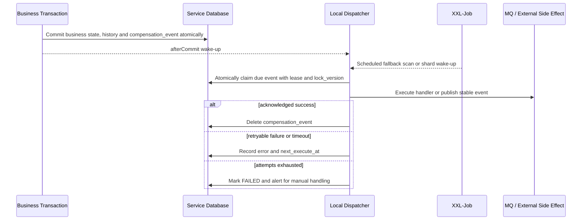

# 本地消息事件补偿规范

最后更新：2026-08-29

## 1. 使用范围与当前决策

当任务涉及 MQ 事件发布、异步本地任务、失败重试、XXL-Job、消息幂等或 `compensation-event` 时，Agent 必须完整读取本文。

Code-MoR MVP 采用以下基线：

- 不单独建设通用 Inbox、Outbox 表或中央事件服务；
- 每个业务服务在自己的数据库中维护 `compensation_event`；
- 业务状态与待执行事件在同一个本地事务中提交；
- 事务提交后由本服务执行器处理，XXL-Job 负责兜底唤醒、分片和服务级隔离；
- RabbitMQ 是 MVP 唯一业务 MQ，Java 侧使用 Spring AMQP；MQ 保持至少一次投递，消费端通过本地业务事实实现幂等；
- Topic 使用 `topic_{source_system}_{business_subject}`，映射为 Durable Topic Exchange；Consumer Group 使用 `cg_{consumer_system}_{consumer_subject}`，映射为 Durable Queue；
- 消息使用 UTF-8 JSON 统一信封、Persistent Delivery、Publisher Confirm、Manual Ack、Quorum Queue 和 DLQ；
- `compensation-event` 是嵌入各服务的基础 JAR，不是第七个业务系统，也不拥有中央数据库。

`/Users/kenny/Desktop/Workspace/Code-PMX/compensation-event` 可作为代码参考，但不能未经加固直接成为生产基线。采用它时必须补齐本文定义的事务、并发、超时、状态和可观测性约束。

## 2. 统一执行流程

强制规则：

1. 禁止在业务事务提交前向 MQ 或外部系统执行不可撤销副作用。
2. 正常请求使用事务 `afterCommit` 唤醒执行器；即使进程在提交后、唤醒前崩溃，XXL-Job 扫描也必须能找回记录。
3. XXL-Job 可以按服务、事件类型或业务分片串行调度，但调度串行不能替代数据库 Claim；故障转移、重复调度和人工重试仍可能产生多执行者。
4. Claim 必须使用条件更新、行锁或 `SKIP LOCKED`，同时写入 `lock_owner`、`lock_until` 和乐观锁版本；只有持有当前 Lease 的执行者可以完成或回写该次尝试。
5. Claim 会先增加 `execute_count`。最后一次允许的尝试若在副作用后崩溃并留下过期 `PROCESSING`，接管者 Claim 后必须在调用 Handler 前发现次数已经超限并直接转为 `FAILED`，禁止再产生一次副作用。
6. Handler 必须配置执行超时。线程池不得使用静默丢弃策略；拒绝执行、超时和进程恢复都必须重新变成可见的待处理状态。
7. MQ 发布只有收到 Broker Confirm 才算成功。确认后、本地删除前崩溃会导致再次发布，这是允许的至少一次语义。
8. `LOCAL_HANDLER` 也必须可重入：调用外部 HTTP 时把 `event_key` 作为幂等键；不支持幂等的外部动作一旦出现未知结果，必须进入该领域的查询/人工恢复状态，不能盲目重放。

业务锁和 XXL-Job 串行可以降低并发，但不能把外部副作用变成“精确一次”。进程可能在外部成功后、本地完成前崩溃，因此所有 Handler 都必须按至少一次执行设计。

统一初始运行参数如下：

| 参数 | 默认值 | 规则 |
|---|---:|---|
| Core Pool Size | 10 | Dispatcher 协调线程池基础线程数 |
| Maximum Pool Size | 20 | Dispatcher 协调线程上限，也是隔离 Handler 的并发上限 |
| Queue Capacity | 500 | Dispatcher 协调线程池必须使用有界队列 |
| Keep Alive | 60 秒 | 仅作用于可回收的 Dispatcher 协调线程 |
| 单次扫描批次 | 100 | 每次、每分片最多 Claim 数 |
| Rejection Policy | `AbortPolicy` | 上层捕获，保留/恢复为可扫描状态并产生指标 |

实现必须使用两个有界的 Platform Thread 执行器：Dispatcher 协调线程池使用上述 Core/Maximum/Queue 参数；Handler 隔离线程池固定为 Maximum Size、使用 `SynchronousQueue`，不缓存等待中的 Handler。禁止切换到 Virtual Thread 或无界执行器来绕过并发上限。

`mor.compensation.*` 进程参数可以由 Nacos 提供，但只在实例启动时构造执行器、身份、Lease 和扫描器；运行中修改 Nacos 不会重建这些对象，必须滚动重启后生效。每类事件的超时、退避、最大次数，以及 RabbitMQ Exchange、Routing Key、Confirm Timeout，均由 `LocalCompensationEventHandler` / `RabbitMqEventRoute` Java Bean 声明并在启动时校验、复制为不可变快照；运行中修改原 Bean 不生效。告警阈值、人工恢复 SLA 和通知路由由宿主配置，不属于 JAR 的动态 Policy。

为了避免宿主 Bean 静默降低安全边界，内置 Handler/Route Registry、Canonical Envelope Factory、Micrometer Observer、生产 Dispatcher、Dispatcher 协调执行器和 Handler 隔离执行器均为固定名称的核心 Bean，不是替换扩展点；同名覆盖必须使应用启动失败。生产 Dispatcher 以固定名称注入 Scanner；宿主额外声明任何 `CompensationEventWakeup` 都必须因候选不唯一而启动失败，不能替换或绕过该 Dispatcher。

## 3. `compensation_event` 最小模型

每个拥有异步发布或本地恢复任务的服务建立自己的表。允许增加本领域字段，但不得删减下列语义：

| 字段 | 语义 |
|---|---|
| `id` | 本库 Snowflake 主键，不作为跨系统事件标识 |
| `event_key` | 稳定且唯一的外部事件标识 |
| `event_type` | 业务事件或本地任务类型 |
| `execution_type` | `MQ_PUBLISH` 或 `LOCAL_HANDLER` |
| `source_type` | 来源聚合或不可变业务事实类型 |
| `source_id` | 来源聚合或事实 ID |
| `source_version` | 来源聚合或事实版本；取值为正 INTEGER |
| `schema_version` | Payload 契约版本；取值为正 INTEGER |
| `payload_json` | 有界、不可变且不含敏感明文的事件信封 |
| `payload_hash` | 去掉 `payloadHash` 字段后的完整 Canonical Envelope 的 SHA-256 原始 64 位小写十六进制值 |
| `execute_status` | `INIT`、`PROCESSING`、`ERROR` 或 `FAILED` |
| `execute_count` | 已开始的执行次数 |
| `next_execute_at` | 下次允许执行时间 |
| `lock_owner` / `lock_until` | 多实例 Claim Lease |
| `last_error_code` / `last_error_summary` | 最后一次失败摘要，禁止保存敏感明文 |
| `lock_version` | Claim/Lease 乐观锁版本；这是新增物理模型的推荐列名 |
| `create_time` / `update_time` | UTC 微秒时间 |

物理约束：

- `event_key` 唯一。身份分量顺序固定为 `source_system`、`source_type`、`source_id`、`source_version`、`event_type`：仅当所有分量不含冒号、拼接值不超过 128 个 Java 字符且 UTF-8 不超过 255 字节时，使用 `source_system:source_type:source_id:source_version:event_type` 可读形式；否则使用 `sha256:` 加上 `v1|<UTF-8字节数>:<值>|...` 全部五个分量的 SHA-256。不得按 Java 字符长度计算前缀，也不得使用无长度边界的简单拼接 Hash。
- `(source_type, source_id, source_version, event_type)` 唯一。
- 同一 `event_type` 在整个应用中必须全局唯一，只能注册为 `LOCAL_HANDLER` 或 `MQ_PUBLISH` 之一；两种执行机制出现同名类型时必须启动失败，不能根据持久化行的 `execution_type` 静默切换副作用路径。
- `source_version` 和 `schema_version` 必须位于正 INTEGER 范围，即 `1..2147483647`。
- `lock_version` 只表示 Claim/Lease 的技术乐观锁，登记初始值固定为 `1`；不得把业务事实版本 `source_version` 重命名为 `lock_version`，也不得让两者共用语义。历史模型若仍使用通用名 `version`，其语义必须等同于 `lock_version`，新建或重生成物理模型应采用 `lock_version`。
- `schema_version`、`payload_json` 和 `payload_hash` 非空；创建后不得修改信封或 Payload。Canonical `payload_json` 最大 65,536 UTF-8 字节，超过时拆分事件或只携带稳定业务/File 引用，不把本表当作大 Payload 存储。
- `payload_json` 只携带业务 ID、版本、金额等允许进入事件总线的字段。敏感明文、密文、PAN、CVV、密钥和大文件都不得进入该表。
- Payload 中的 JSON Number 只允许 signed 64-bit 整数。金额、小数、科学计数值以及超出 signed 64-bit 的整数必须按对应契约编码为规范字符串；这避免 MySQL `JSON` 规范化数值文本后破坏 Canonical Hash。布尔、字符串、null、对象和数组仍按 Schema 使用。
- 大文件只携带 Platform `file_id + content_hash`。跨业务系统默认只传事实拥有方 ID 和接收方已批准的非敏感派生事实；Masked Value 只有展示消费者存在时才传，Vault Metadata Hash 只有跨系统校验或内容承诺消费者存在时才传。只有已通过 Vault `CopyForBinding` 为准确接收系统/资源生成的接收方专属 Token，才可携带该场景实际需要的 `vault_token` 及可选 Record Version/Metadata Hash。来源系统自己的 Token 不得跨系统复用；本系统 `LOCAL_HANDLER` 处理自身 Binding 时可保存最小必要 Token 引用。
- `PROCESSING` 必须同时具有未过期的 `lock_owner`、`lock_until`；其他状态不得保留活动 Lease。
- 到达最大重试次数后进入 `FAILED`，保留记录并告警。人工重开必须记录操作人、原因和工单引用，并回到 `ERROR` 等待重新 Claim。

成功获得 Broker Confirm 或 Handler 的确定完成结果后，可以删除 `compensation_event`。唯一约束只能在该行仍保留时把重复登记识别为幂等；成功删除后，来源业务模型必须通过不可变事实/状态历史和单调 `source_version` 保证同一 `(source_type, source_id, source_version, event_type)` 不会再次登记。若业务不能证明这一点，就不得删除成功行，必须先设计领域化的投递历史，不能误称 JAR 提供永久去重。

不可变业务状态历史、来源版本、消费端幂等事实和 Platform Audit 承担长期审计；本表默认不承担成功投递历史仓库职责。

## 4. 发布事件约束

- 业务事务必须原子写入：权威业务状态、状态历史以及对应 `compensation_event`。
- 一个业务事实只定义一个拥有者和一个 `event_key`。不得由聚合根与子聚合各发布一份语义相同、ID 不同的事件。
- 事件信封至少包含 `eventKey`、`eventType`、`sourceSystem`、`sourceType`、`sourceId`、`sourceVersion`、`occurredAt`、`schemaVersion` 和 `payloadHash`。
- 重试只重复同一事件信封，不生成新的事件 ID，不改变业务发生时间或 Payload。
- 本地补偿任务也使用相同 Claim/Lease 机制，但不得伪装成已经发生的跨系统业务事实。

### 4.1 Canonical Envelope、Event Key 与 Hash

- Canonical Envelope 的字段固定为 `eventKey`、`eventType`、`sourceSystem`、`sourceType`、`sourceId`、`sourceVersion`、`occurredAt`、`schemaVersion`、`payload` 和 `payloadHash`；对象字段递归按名称排序，数组顺序保持不变，使用 UTF-8 JSON。
- Hash 输入是移除 `payloadHash` 后的完整 Canonical Envelope，而不是只对业务 `payload` 计算。数据库 `payload_hash` 保存 `SHA-256(UTF-8 canonical envelope without payloadHash)` 的原始 64 位小写十六进制值；信封 `payloadHash` 保存 `sha256:<同一64位值>`。
- Dispatcher 在每次副作用前校验行元数据、固定信封字段、Payload Policy、内嵌 Hash、数据库 Hash 与重新计算结果，并重新 Canonicalize 后才交给 Handler/Publisher。
- SHA-256 是未加密、无密钥的完整性校验，只能发现行元数据、JSON 和 Hash 不一致或意外损坏；它不能防御能够同时修改 JSON 与 Hash 的数据库攻击者。生产数据库最小权限、变更审计、备份保护和入侵检测由宿主负责。
- Event Key 必须使用第 3 节冻结的可读形式或 `v1` UTF-8 长度前缀 Hash 算法；算法版本、分量顺序或字符编码变化属于破坏性契约变更。

### 4.2 RabbitMQ 拓扑与序列化

- Topic 名使用小写 `topic_{source_system}_{business_subject}`，在 RabbitMQ 中创建为 Durable Topic Exchange。
- Consumer Group 名使用小写 `cg_{consumer_system}_{consumer_subject}`，在 RabbitMQ 中创建为 Durable Queue；同组实例竞争消费同一 Queue。
- Routing Key 使用稳定的小写点分格式，例如 `payment.succeeded.v1`。
- 环境通过 VHost 隔离，本地使用 `/mor-local`，不在 Topic/Group 前拼接环境名。
- 持久业务 Queue 默认声明为 Quorum Queue；每个 Consumer Queue 都有独立 DLX/DLQ 和显式 Delivery Limit。
- Publisher 使用 Mandatory Persistent Message 并等待 Confirm；Unroutable、Nack 和 Confirm Timeout 都是发布失败，保留事件重试。
- JAR 使用自己的 `RabbitTemplate` 和隔离的 Publisher Connection 发布尝试，不修改或复用宿主 `RabbitTemplate` 的回调配置；每次发送使用独立 Confirm/Return 监听器。Confirm Timeout、中断或未知发布失败必须在受控上界内 abort 该专用发布 Connection，使该次 Channel 及其所有未决 Confirm 一并失效，不能让未知 Channel 回到缓存继续使用，也不能影响宿主的一般业务 Connection。
- Listener 使用 Manual Ack；完成本地事务后 Ack，失败时按错误分类 Requeue 或 Dead-Letter，禁止无界立即重投。
- Java 侧使用 Spring AMQP，不增加 Spring Cloud Stream 抽象；Exchange、Queue、Binding、Confirm、Ack 和错误语义必须在代码/受控拓扑中明确。
- 消息使用 UTF-8 JSON。信封至少包含 `eventKey`、`eventType`、`sourceSystem`、`sourceType`、字符串 `sourceId`、`sourceVersion`、UTC `occurredAt`、`schemaVersion`、`payloadHash` 和 `payload`。
- Payload 的 JSON Number 只允许 signed 64-bit 整数；金额、小数、科学计数值和超范围整数必须使用契约定义的规范字符串。可能超过 JavaScript 安全整数范围的 ID 使用十进制字符串；禁止 Java 原生序列化和无版本任意对象反序列化。
- `spring-rabbit` 在基础 JAR 中是可选依赖。只使用 `LOCAL_HANDLER` 的宿主不需要引入 AMQP；定义 `MQ_PUBLISH` Route 的宿主必须显式引入 `spring-boot-starter-amqp`，启用 Publisher Confirm 和 Publisher Return，并显式配置正数 `spring.rabbitmq.channel-rpc-timeout`。不得直接沿用 Boot/Rabbit 客户端的 10 分钟默认值。
- 每个 MQ Route 必须满足 `0 < confirmTimeout + channel-rpc-timeout < policy.timeout < leaseDuration`。其中 `channel-rpc-timeout` 同时作为专用发布 Connection 的最大 abort 等待预算；任何一段为零、负数、溢出或总预算不满足严格小于关系时，应用必须启动失败。
- JAR 启动校验 Bean、名称、Policy、Route 和 ConnectionFactory 能力，但不连接 Broker 探测 Exchange/Queue/Binding。宿主必须通过版本化基础设施或显式 Bean 提前声明拓扑，并用部署 Readiness/烟雾测试证明 Durable Topic Exchange、Queue、Binding、DLX/DLQ 等已经就绪。

完整版本与产品选择见 [TECHNOLOGY_STACK.md](./TECHNOLOGY_STACK.md)。

## 5. 消费幂等，不建立通用 Inbox

MQ Listener 在本系统事务中完成事件校验和业务更新，事务提交后才能 Ack。每类事件必须在其落地业务表或投影表实现以下约束：

- 保存 `source_system`、`source_event_key`、`source_version` 和 `source_payload_hash`；
- 使用业务唯一键或 `(source_system, source_event_key)` 唯一约束阻止重复创建；
- 对投影执行“仅接受更高来源版本”的条件更新，禁止乱序回退；
- 同一事件键且 Hash 相同视为安全重复，返回已处理结果并 Ack；
- 对本地仍保存的同一事件键，Hash 不同视为契约冲突，拒绝覆盖并告警；
- 只保留当前来源版本的投影，对低版本重复消息可以 Ack 但不得回写；同版本必须比较 Hash。仅保存当前版本时，不能宣称可识别任意历史旧 Key 的不同 Hash。法规、资金审计或契约安全要求长期识别每个来源事实时，应在有业务语义的不可变 History/Fact 表逐事件保存 Key 与 Hash，而不是新增一个无业务语义的 Inbox；
- 本地事务失败时不 Ack，由 Broker 重投；
- 若消费后还需要跨系统调用或发布新事实，在同一事务中新增本服务的 `compensation_event`，Listener 不直接制造不可恢复的远程副作用。

不同领域可以保留专用恢复表，例如 Payment `UNKNOWN` 查询、Settlement 付款尝试或通知投递尝试。这些表表达领域状态，不应被强行合并到通用 `compensation_event`。

## 6. XXL-Job 与多实例规则

- 依赖方向固定为 `paytech-compensation-event -> paytech-xxl-job-starter -> xxl-job-core`。通用 Starter 只配置 Executor，不得引用补偿 API、Handler 或自动配置；补偿模块自己提供并注册扫描 Handler。
- 每个服务注册自己的扫描 Handler，只访问本服务数据库。
- 可通过任务参数限定 `event_type`、时间窗口和分片号；不得让一个 Job 跨库扫描六个系统。
- 分片和串行策略用于减小竞争，数据库 Lease 是最终互斥边界。
- 扫描只选择 `INIT/ERROR` 且已到 `next_execute_at` 的记录，以及 Lease 已过期、可安全接管的 `PROCESSING` 记录。
- 重试采用有上限的指数退避与抖动；具体间隔、最大次数和人工恢复 SLA 按事件类别配置。
- 最后一次允许尝试崩溃后，接管 Claim 会使 `execute_count` 超过 Policy 上限；Dispatcher 必须在调用 Handler/Publisher 前将其置为 `FAILED`，不能因 Lease 接管绕过最大次数。
- JAR 必须产生积压量、最老待处理时间、失败率、Lease 接管、人工重开和 Handler 耗时等 Micrometer 指标；Prometheus 抓取、Alertmanager 规则/阈值、通知路由和值班处置由宿主负责。

### 6.1 Code-PMX 参考 JAR 加固清单

未来复用 `/Users/kenny/Desktop/Workspace/Code-PMX/compensation-event` 的代码思路时，必须先证明以下差异已经完成，不能只增加一个 XXL-Job 就视为生产可用：

- `saveEvent` 明确加入调用方本地事务，回滚时记录一起回滚；禁止隐式新事务造成业务失败但事件仍存在。
- 异步提交只发生在 Spring Transaction `afterCommit`，不能在事务尚未提交时把 Event 交给线程池。
- 原来的“查询后直接执行”升级为原子 Claim/Lease/`lock_version`；两个实例或人工重试不能同时执行同一行。
- 线程池禁止 `DiscardPolicy` 等静默丢弃，任务拒绝必须回到可扫描状态并产生指标。
- Handler 有明确超时、可重试/不可重试错误分类和最大次数；`IGNORE`、空返回或永久无界重试都不是合法终态。
- MQ Publish 必须等待 Broker Confirm；本地/HTTP Handler 必须携带稳定幂等键，并对未知结果使用领域查询恢复。
- 成功后才删除；失败、Lease 过期、人工重开及最后错误必须保持可见且不包含敏感明文。
- `event_type` 到 Handler/Route 的映射在启动时校验唯一，Policy/Route 复制为不可变快照；没有 Handler/Route 的新登记直接拒绝，历史异常行转为可见失败并告警，不能无限扫描。
- 两个核心 Executor、数据库扫描批次和进程参数在启动时外部配置并有安全默认值；事件 Policy/Route 由 Java Bean 声明并经重启生效；告警阈值由宿主监控配置管理。

### 6.2 错误摘要、人工恢复与告警责任

- 未预期异常只保存 JAR 生成的固定通用摘要，不持久化异常原文、堆栈或 Payload。
- `CompensationHandlerResult.safeSummary` 是 Handler 与宿主的安全契约：Handler 必须只返回经过业务审查、无 PII/凭据/业务密文的摘要。JAR 会再执行长度限制、控制字符清理以及常见 Secret/Bearer/Token/长数字的尽力脱敏，但该规则不能识别任意领域 PII，不能替代每个 Handler 的契约测试。
- JAR 只在宿主提供 `CompensationRecoveryAuditRecorder` 时暴露人工重开服务，并校验 `eventId`、`lock_version`、`actor`、`reason` 和 `ticket` 的基本格式；它信任宿主传入的已认证 `actor`。
- 宿主负责人工恢复的身份认证、授权、双人复核或工单规则、FAILED 查询/API/运营界面、审计表 Migration 与保留策略、告警确认和处置记录。JAR 的状态迁移与审计回调不能代替这些运营控制。

## 7. Vault 与敏感数据边界

`compensation_event` 不存敏感明文或业务密文。跨系统需要敏感字段时默认通过事实拥有方受控接口取得已批准的非敏感派生事实；只有存在普通展示消费者时才取得 Masked Value。确需长期交付 Token 时，必须先由 Vault `CopyForBinding` 创建接收方专属 Record/Token，不能传播或复用来源系统 Token；Record Version 与 Metadata Hash 仍需分别证明元数据并发/同步、跨系统校验或内容承诺消费者。Vault 自身的异步审计发送、重加密或销毁任务也使用自己的 `compensation_event`，不建立中央消息表。

Vault 详细边界见 [VAULT_SERVICE_ARCHITECTURE.md](./VAULT_SERVICE_ARCHITECTURE.md)。

## 8. 自动化测试最低覆盖

测试必须使用真实测试数据库与测试 Broker，不使用 `when(...).thenReturn(...)` 改写生产链路，至少覆盖：

- 业务事务回滚时不留下业务事实，也不留下 `compensation_event`；
- 业务提交成功、`afterCommit` 唤醒丢失时可由 XXL 扫描恢复；
- 两个执行者并发时只有一个获得 Claim；
- Lease 到期后可接管，旧执行者不能覆盖新执行者结果；
- 最后一次允许尝试崩溃后，Lease 接管在 Handler 副作用前进入 `FAILED`；
- Broker 已确认、本地删除前崩溃时重发相同 `event_key`；
- Mandatory Return、Nack、Confirm Timeout、连续 Channel 协议关闭及其后的恢复发布；
- 消费端对当前/仍留存的相同 Key/Hash 幂等，对相同 Key/不同 Hash 拒绝；要求覆盖任意历史 Key 的领域还必须验证其不可变 History/Fact 逐事件保留 Key/Hash；
- 来源低版本消息不会回退本地投影；
- Handler 超时、线程池拒绝、可重试失败、最大次数失败和人工重开；
- 成功后记录删除，失败记录及告警上下文仍可查询；
- Canonical Envelope 在 MySQL `JSON` 中往返后仍通过 Hash 校验；signed 64-bit 边界、Decimal/科学计数/超范围数的字符串编码、Unicode 和超过 AMQP 字节上限的 Event Key 均有覆盖；
- Payload 禁止字段、未预期异常固定摘要、显式安全摘要的尽力脱敏，以及日志/指标不写入 `eventKey`、`sourceId`、Payload 或任意异常原文；
- Handler/Route 启动快照、缺失/重复配置、核心 Bean 同名覆盖启动失败，以及仅 `LOCAL_HANDLER` 场景不加载 AMQP 类。

## 9. 未来重新评估条件

出现以下任一情况时，可以重新评估是否引入保留式 Outbox/Inbox 或事件平台，但不得在当前 MVP 中预先建设：

- 法规要求长期保留每次投递与消费尝试；
- 一个事实需要大量独立 Sink，且每个 Sink 必须独立追踪游标；
- 事件吞吐、回放、跨团队 Schema 治理或审计查询超过本地补偿表能力；
- 业务幂等无法自然落到领域表，且重复消费治理成本已可量化。

升级时仍须保持六个核心系统的数据所有权，不得建立可以跨库修改业务状态的中央工作流。
