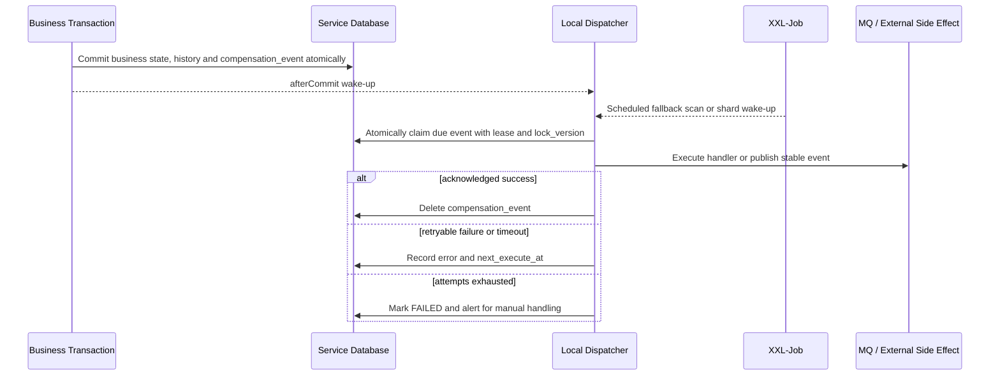

# 本地补偿任务规范

最后更新：2026-08-29

## 1. 使用范围与当前决策

当任务涉及 MQ 事件发布、异步本地任务、失败重试、XXL-Job、消息幂等或 `compensation-event` 时，Agent 必须完整读取本文。

Code-MoR MVP 采用以下基线：

- 不单独建设通用 Inbox、Outbox 表或中央事件服务；
- 每个业务服务在自己的数据库中维护 `compensation_event`；
- 业务状态与待执行事件在同一个本地事务中提交；
- 事务提交后由本服务执行器处理，XXL-Job 负责兜底唤醒、分片和服务级隔离；
- RabbitMQ 是 MVP 唯一业务 MQ，Java 侧使用 Spring AMQP；MQ 保持至少一次投递，消费端通过本地业务事实实现幂等；
- Topic 使用 `topic_{source_system}_{business_subject}`，映射为 Durable Topic Exchange；Consumer Group 使用 `cg_{consumer_system}_{consumer_subject}`，映射为 Durable Queue；
- 消息使用 UTF-8 JSON 统一信封、Persistent Delivery、Publisher Confirm、Manual Ack、Quorum Queue 和 DLQ；
- `compensation-event` 是嵌入各服务的基础 JAR，不是第七个业务系统，也不拥有中央数据库。

`/Users/kenny/Desktop/Workspace/Code-PMX/compensation-event` 可作为代码参考，但不能未经加固直接成为生产基线。采用它时必须补齐本文定义的事务、并发、超时、状态和可观测性约束。

## 2. 统一执行流程

强制规则：

1. 禁止在业务事务提交前向 MQ 或外部系统执行不可撤销副作用。
2. 正常请求使用事务 `afterCommit` 唤醒执行器；即使进程在提交后、唤醒前崩溃，XXL-Job 扫描也必须能找回记录。
3. XXL-Job 可以按服务、事件类型或业务分片串行调度，但调度串行不能替代数据库 Claim；故障转移、重复调度和人工重试仍可能产生多执行者。
4. Claim 必须使用条件更新、行锁或 `SKIP LOCKED`，同时写入 `lock_owner`、`lock_until` 和乐观锁版本；只有持有当前 Lease 的执行者可以完成或回写该次尝试。
5. Claim 会先增加 `execute_count`。最后一次允许的尝试若在副作用后崩溃并留下过期 `PROCESSING`，接管者 Claim 后必须在调用 Handler 前发现次数已经超限并直接转为 `FAILED`，禁止再产生一次副作用。
6. Handler 必须配置执行超时。线程池不得使用静默丢弃策略；拒绝执行、超时和进程恢复都必须重新变成可见的待处理状态。
7. MQ 发布只有收到 Broker Confirm 才算成功。确认后、本地删除前崩溃会导致再次发布，这是允许的至少一次语义。
8. Handler 必须可重入：调用外部 HTTP 时把 `event_key` 作为幂等键；不支持幂等的外部动作一旦出现未知结果，必须进入该领域的查询/人工恢复状态，不能盲目重放。

业务锁和 XXL-Job 串行可以降低并发，但不能把外部副作用变成“精确一次”。进程可能在外部成功后、本地完成前崩溃，因此所有 Handler 都必须按至少一次执行设计。

统一初始运行参数如下：

| 参数 | 默认值 | 规则 |
|---|---:|---|
| Coordinator Core Size | 10 | Dispatcher 协调线程池基础线程数 |
| Coordinator Maximum Size | 20 | Dispatcher 协调线程上限 |
| Coordinator Queue Capacity | 80 | 接收默认 100 条扫描批次，并允许协调线程扩展到 20 |
| Coordinator Keep Alive | 60 秒 | 仅作用于可回收的 Dispatcher 协调线程 |
| Handler Maximum Concurrency | 20 | Handler 隔离线程池的固定线程数和并发上限 |
| 单次扫描批次 | 100 | 每次、每分片最多 Claim 数 |
| Rejection Policy | `AbortPolicy` | 上层捕获，保留/恢复为可扫描状态并产生指标 |

实现必须使用两个有界的 Platform Thread 执行器：Dispatcher 协调线程池使用 Coordinator 参数；Handler 隔离线程池使用独立的 Maximum Concurrency、固定大小和 `SynchronousQueue`，不缓存等待中的 Handler。所有参数均提供表中的安全默认值，`instance-id` 默认取 `spring.application.name`，宿主通常无需增加补偿配置；显式 `compensation.instance-id` 仅用于覆盖默认来源。只有容量评估证明需要时才覆盖线程池参数。禁止切换到 Virtual Thread 或无界执行器来绕过并发上限。

`compensation.*` 进程参数可以由 Nacos 提供，但只在实例启动时构造执行器、身份、Lease 和扫描器；运行中修改 Nacos 不会重建这些对象，必须滚动重启后生效。每类事件的超时、退避和最大次数由 Handler Java Bean 声明并在启动时校验、复制为不可变快照；运行中修改原 Bean 不生效。告警阈值、人工恢复 SLA 和通知路由由宿主配置，不属于 JAR 的动态 Policy。

为了避免宿主 Bean 静默降低安全边界，内置 Handler Registry、Micrometer Observer、生产 Dispatcher、具名 `compensationCoordinatorExecutor` 和 `compensationHandlerExecutor` 均为核心 Bean，不是替换扩展点；同名覆盖必须使应用启动失败。生产 Dispatcher 以固定名称注入 Scanner；宿主额外声明任何 `CompensationEventWakeup` 都必须因候选不唯一而启动失败，不能替换或绕过该 Dispatcher。

旧版 Snapshot 的 `compensation.pool.*` 已拆分为 `compensation.coordinator.*` 和 `compensation.handler.maximum-concurrency`。旧键必须启动失败，不能静默回落到新默认值；升级宿主必须先完成配置迁移。

## 3. `compensation_event` 最小模型

每个使用补偿能力的服务只在自己的数据库中创建 `t_compensation_event`。Foundation JAR 不自动建表，宿主必须通过自己的 PDManer 模型和人工执行的当前 Schema DDL 管理它。最小字段为：

| 字段 | 语义 |
|---|---|
| `id` | 本库 Snowflake 主键，不作为跨系统事件标识 |
| `event_key` | Handler 查询本服务权威数据使用的稳定业务键 |
| `event_type` | 全应用唯一的 Handler 类型 |
| `sub_event_type` | 同一 Handler 下的业务子类型 |
| `payload_json` | 可选的最小 JSON Object；通常为空 |
| `execute_status` | `INIT`、`PROCESSING`、`ERROR` 或 `FAILED` |
| `execute_count` | 已开始的 Handler 尝试次数 |
| `next_execute_at` | 下次允许执行时间 |
| `lock_owner` / `lock_until` | 多实例 Claim Lease |
| `last_error_code` / `last_error_summary` | 最后一次失败摘要，禁止保存敏感明文 |
| `lock_version` | Claim/Lease 乐观锁版本，登记初始值固定为 `1` |
| `create_time` / `update_time` | UTC 微秒时间 |

物理约束：

- 唯一索引固定为 `(event_key, event_type, sub_event_type)`；三个身份字段按此顺序传入、查询和排序。
- `event_key` 最长 128 个 Java 字符，`event_type` 与 `sub_event_type` 最长 64 个 Java 字符；均去除首尾空白、拒绝控制字符并使用大小写敏感 collation。
- 同一 `event_type` 在整个应用中只能注册一个 Handler；缺失或重复 Handler 必须在启动或登记时失败。
- 默认不使用 `payload_json` 保存 Handler 上下文。Handler 应使用 `event_key + sub_event_type` 查询本服务权威表，只做一件事；只有数据确实从未落库时才允许保存最小参数。
- `payload_json` 必须为空或有效 JSON Object，最大 4 KiB UTF-8；禁止敏感明文、凭据、卡数据、Token、大文件和可从本服务数据库恢复的上下文。
- `PROCESSING` 必须同时具有未过期的 `lock_owner`、`lock_until`；其他状态不得保留活动 Lease。
- 到达最大重试次数后进入 `FAILED`，保留记录并告警。人工重开必须记录操作人、原因和工单引用，并回到 `ERROR` 等待重新 Claim。
- 表中不定义 `CHECK CONSTRAINT`；状态、非负次数、正锁版本和 Lease 组合由 Foundation 代码、Schema DDL 默认值及开发者共识共同保证。

Handler 返回确定成功后删除该记录。唯一索引只在记录存在期间防止重复登记，不提供永久去重；业务需要长期幂等时，必须依赖本领域权威状态或不可变历史。由于 Handler 可从权威表重建数据，人工补偿通常只需插入 `id + event_key + event_type + sub_event_type`，其余运行字段使用安全默认值。

`t_compensation_recovery_audit` 不是每个宿主都必须创建的 Foundation 表。只有宿主启用人工重开并提供 `CompensationRecoveryAuditRecorder` 时，才按本领域审计模型创建相应审计表。

## 4. Handler 与 MQ 边界

`paytech-compensation-event` 只负责本地记录、事务提交后唤醒、Claim/Lease、Handler 调度、重试和人工恢复状态迁移。它不定义 `execution_type`，也不内置 RabbitMQ Route、`RabbitTemplate`、Canonical Envelope 或 Publisher Connection。每个 `event_type` 只对应一个宿主 Handler：

- Handler 接收 `event_key`、`event_type`、`sub_event_type` 和可选最小 Payload；正常路径使用这些身份字段查询本服务权威数据库后执行一项明确动作。
- Handler 确定成功时返回 `SUCCESS`；不可重试的业务失败抛出 `FailException` 或返回终态失败；未知或暂时性错误抛出 `ErrorException` 或返回可重试失败。
- `CompensationExecutionPolicy` 按 Handler 定义 timeout、最大执行次数、初始/最大退避、倍数和抖动，并在启动时复制为不可变快照。
- timeout 只会请求中断 Handler，不能保证外部副作用已经停止。所有 Handler 仍必须幂等；外部结果未知时必须先查询或转人工恢复，不能直接假定失败后重放。

需要发布 RabbitMQ 事件时，由宿主实现一个职责单一的 MQ Handler。该 Handler 从权威表构建业务事件，使用稳定 `event_key` 作为幂等标识，等待 Publisher Confirm 后才返回成功。`paytech-compensation-event` 不把完整业务事件上下文复制进 `payload_json`，也不替宿主定义业务事件 Schema。

RabbitMQ 的系统级约束仍然适用：Topic 使用 `topic_{source_system}_{business_subject}` Durable Topic Exchange，Consumer Group 使用 `cg_{consumer_system}_{consumer_subject}` Durable Queue；消息使用 UTF-8 JSON、Persistent Delivery、Publisher Confirm、Manual Ack、Quorum Queue、显式 DLX/DLQ 和有界重试。具体拓扑、序列化和 Confirm 超时由宿主 MQ 组件及其自动测试负责。

完整版本与产品选择见 [TECHNOLOGY_STACK.md](./TECHNOLOGY_STACK.md)。

## 5. 消费幂等，不建立通用 Inbox

MQ Listener 在本系统事务中完成事件校验和业务更新，事务提交后才能 Ack。每类事件必须在其落地业务表或投影表实现以下约束：

- 使用业务唯一键或稳定事件键阻止重复创建，并把幂等事实保存到本领域权威表或投影表；
- 需要顺序控制的事件必须携带其业务契约定义的领域版本，并只接受更高版本；该版本不来自 `t_compensation_event`；
- 已完成的重复消息返回既有业务结果并 Ack，不重复执行副作用；
- 本地事务失败时不 Ack，由 Broker 重投；
- 若消费后还需要跨系统调用或发布新事实，在同一事务中新增本服务的 `compensation_event`，Listener 不直接制造不可恢复的远程副作用。

不同领域可以保留专用恢复表，例如 Payment `UNKNOWN` 查询、Settlement 付款尝试或通知投递尝试。这些表表达领域状态，不应被强行合并到通用 `compensation_event`。

## 6. XXL-Job 与多实例规则

- 依赖方向固定为 `paytech-compensation-event -> paytech-xxl-job-starter -> xxl-job-core`。通用 Starter 只配置 Executor，不得引用补偿 API、Handler 或自动配置；补偿模块自己提供并注册扫描 Handler。
- 每个服务注册自己的扫描 Handler，只访问本服务数据库。
- 可通过任务参数限定 `event_type`、时间窗口和分片号；不得让一个 Job 跨库扫描六个系统。
- 分片和串行策略用于减小竞争，数据库 Lease 是最终互斥边界。
- 扫描只选择 `INIT/ERROR` 且已到 `next_execute_at` 的记录，以及 Lease 已过期、可安全接管的 `PROCESSING` 记录。
- 重试采用有上限的指数退避与抖动；具体间隔、最大次数和人工恢复 SLA 按事件类别配置。
- 最后一次允许尝试崩溃后，接管 Claim 会使 `execute_count` 超过 Policy 上限；Dispatcher 必须在调用 Handler 前将其置为 `FAILED`，不能因 Lease 接管绕过最大次数。
- JAR 必须产生积压量、最老待处理时间、失败率、Lease 接管、人工重开和 Handler 耗时等 Micrometer 指标；Prometheus 抓取、Alertmanager 规则/阈值、通知路由和值班处置由宿主负责。

### 6.1 Code-PMX 参考 JAR 加固清单

未来复用 `/Users/kenny/Desktop/Workspace/Code-PMX/compensation-event` 的代码思路时，必须先证明以下差异已经完成，不能只增加一个 XXL-Job 就视为生产可用：

- `saveEvent` 明确加入调用方本地事务，回滚时记录一起回滚；禁止隐式新事务造成业务失败但事件仍存在。
- 异步提交只发生在 Spring Transaction `afterCommit`，不能在事务尚未提交时把 Event 交给线程池。
- 原来的“查询后直接执行”升级为原子 Claim/Lease/`lock_version`；两个实例或人工重试不能同时执行同一行。
- 线程池禁止 `DiscardPolicy` 等静默丢弃，任务拒绝必须回到可扫描状态并产生指标。
- Handler 有明确超时、可重试/不可重试错误分类和最大次数；`IGNORE`、空返回或永久无界重试都不是合法终态。
- MQ Publish 必须等待 Broker Confirm；本地/HTTP Handler 必须携带稳定幂等键，并对未知结果使用领域查询恢复。
- 成功后才删除；失败、Lease 过期、人工重开及最后错误必须保持可见且不包含敏感明文。
- `event_type` 到 Handler 的映射在启动时校验唯一，Policy 复制为不可变快照；没有 Handler 的新登记直接拒绝，历史异常行转为可见失败并告警，不能无限扫描。
- 两个核心 Executor、数据库扫描批次和进程参数在启动时外部配置并有安全默认值；事件 Policy 由 Handler Java Bean 声明并经重启生效；告警阈值由宿主监控配置管理。

### 6.2 错误摘要、人工恢复与告警责任

- 未预期异常只保存 JAR 生成的固定通用摘要，不持久化异常原文、堆栈或 Payload。
- `CompensationHandlerResult.safeSummary` 是 Handler 与宿主的安全契约：Handler 必须只返回经过业务审查、无 PII/凭据/业务密文的摘要。JAR 会再执行长度限制、控制字符清理以及常见 Secret/Bearer/Token/长数字的尽力脱敏，但该规则不能识别任意领域 PII，不能替代每个 Handler 的契约测试。
- JAR 只在宿主提供 `CompensationRecoveryAuditRecorder` 时暴露人工重开服务，并校验 `eventId`、`lock_version`、`actor`、`reason` 和 `ticket` 的基本格式；它信任宿主传入的已认证 `actor`。
- 宿主负责人工恢复的身份认证、授权、双人复核或工单规则、FAILED 查询/API/运营界面、审计表 DDL/数据变更 SQL 与保留策略、告警确认和处置记录。JAR 的状态迁移与审计回调不能代替这些运营控制。

## 7. Vault 与敏感数据边界

`compensation_event` 不存敏感明文或业务密文。跨系统需要敏感字段时默认通过事实拥有方受控接口取得已批准的非敏感派生事实；只有存在普通展示消费者时才取得 Masked Value。确需长期交付 Token 时，必须先由 Vault `CopyForBinding` 创建接收方专属 Record/Token，不能传播或复用来源系统 Token；Record Version 与 Metadata Hash 仍需分别证明元数据并发/同步、跨系统校验或内容承诺消费者。Vault 自身的异步审计发送、重加密或销毁任务也使用自己的 `compensation_event`，不建立中央消息表。

Vault 详细边界见 [VAULT_SERVICE_ARCHITECTURE.md](./VAULT_SERVICE_ARCHITECTURE.md)。

## 8. 自动化测试最低覆盖

Foundation 自动测试使用真实测试数据库，不使用 `when(...).thenReturn(...)` 改写生产链路，至少覆盖：

- 业务事务回滚时不留下业务事实，也不留下 `compensation_event`；
- 业务提交成功、`afterCommit` 唤醒丢失时可由 XXL 扫描恢复；
- 两个执行者并发时只有一个获得 Claim；
- Lease 到期后可接管，旧执行者不能覆盖新执行者结果；
- 最后一次允许尝试崩溃后，Lease 接管在 Handler 副作用前进入 `FAILED`；
- Handler 超时、线程池拒绝、可重试失败、最大次数失败和人工重开；
- 成功后记录删除，失败记录及告警上下文仍可查询；
- 无 Payload 的人工插入记录可以由 Handler 仅凭身份字段查询权威数据并执行；
- Payload 非对象、超过 4 KiB 或包含禁止字段时登记失败；未预期异常只保存固定安全摘要；
- Coordinator/Handler 默认参数、自定义参数独立绑定、旧 `compensation.pool.*` 启动失败；
- Handler 启动快照、缺失/重复配置和核心 Bean 同名覆盖启动失败。

宿主实现 MQ Handler 后，还必须在宿主项目中使用真实测试 Broker 覆盖 Confirm、Return/Nack、超时、重复发布和消费幂等；这些测试不属于未集成 RabbitMQ 的 Foundation JAR。

## 9. 未来重新评估条件

出现以下任一情况时，可以重新评估是否引入保留式 Outbox/Inbox 或事件平台，但不得在当前 MVP 中预先建设：

- 法规要求长期保留每次投递与消费尝试；
- 一个事实需要大量独立 Sink，且每个 Sink 必须独立追踪游标；
- 事件吞吐、回放、跨团队 Schema 治理或审计查询超过本地补偿表能力；
- 业务幂等无法自然落到领域表，且重复消费治理成本已可量化。

升级时仍须保持六个核心系统的数据所有权，不得建立可以跨库修改业务状态的中央工作流。
