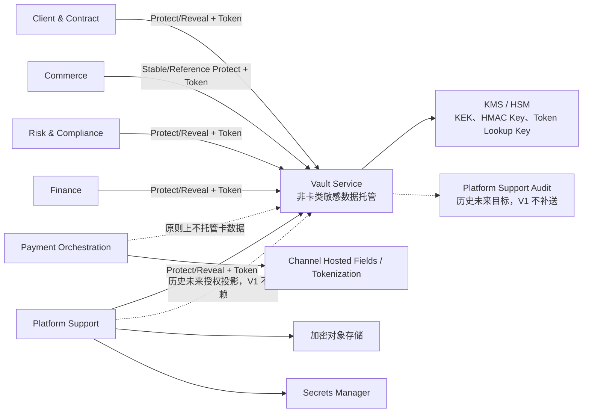
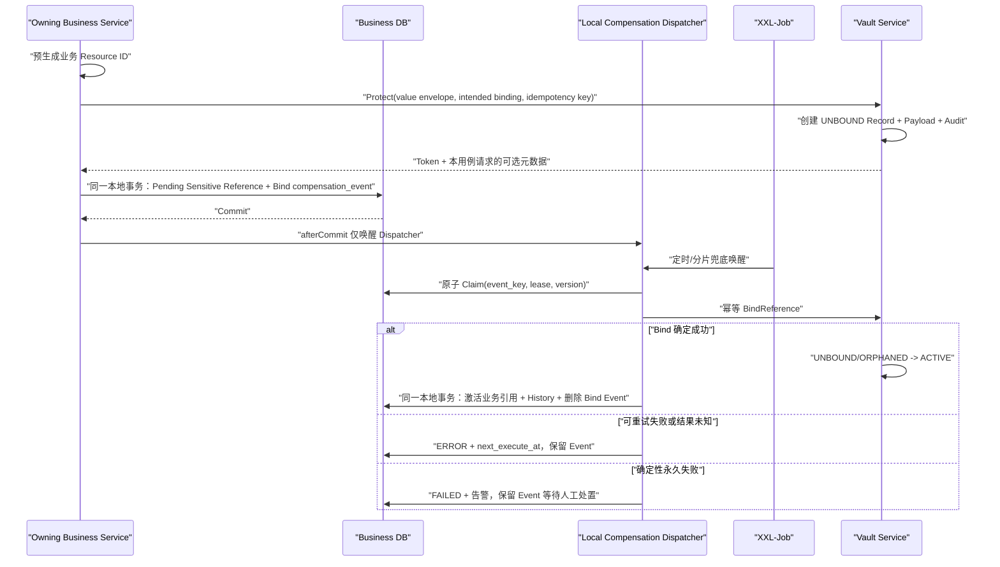
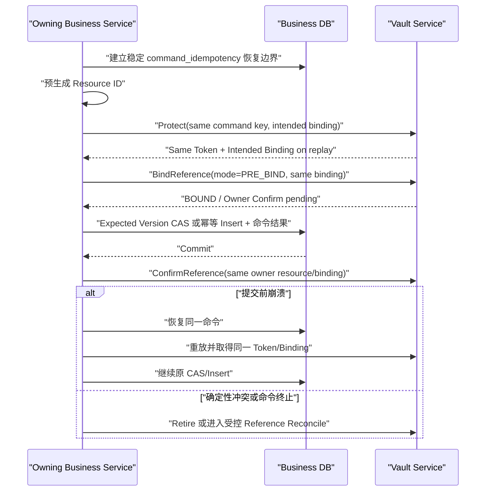
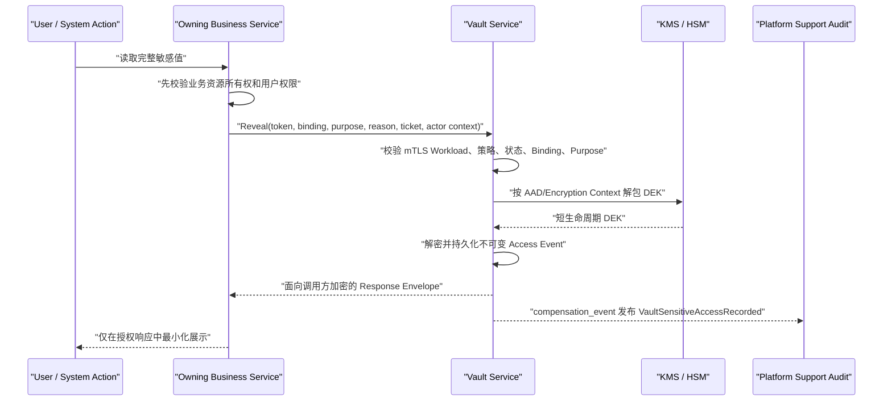
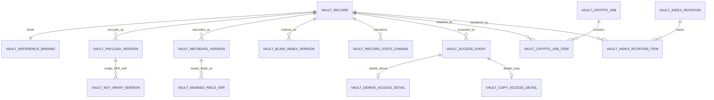
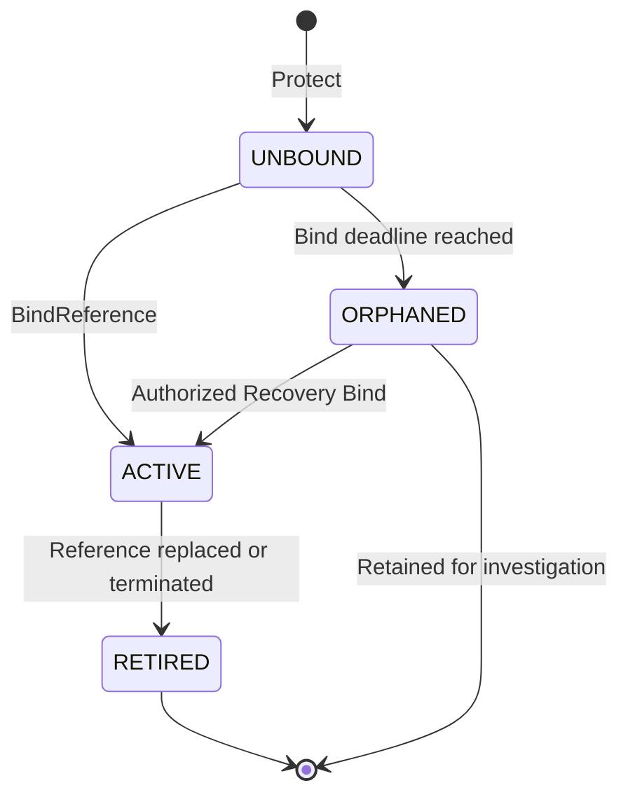

# Vault Service 架构与数据保护规范

最后更新：2026-09-05
状态：未被当前 V1 取代的安全边界仍有效；其余内容是历史架构记录

> **2026-09-04 URL 精简：** 当前业务路径仅为 `POST /vault/v1/records/protect` 和
> `POST /vault/v1/records/reveal`，以 [OpenAPI](../vault-service/api/openapi/v1.yaml) 为准；
> 不保留旧路径或冒号路径的别名/重定向。下方历史接口清单不是当前可调用路由，
> 移除路径前缀不改变内部专用、私网访问和静态 Allowlist 边界。

> **当前 V1 权威与取代范围：** [Vault Minimal Database Design](../docs/superpowers/specs/2026-09-02-vault-database-design.md)、[VAULT_PHYSICAL_DECISIONS.md](../vault-service/docs/database/VAULT_PHYSICAL_DECISIONS.md)和生成的 [vault.pdma.json](../vault-service/docs/database/vault.pdma.json)共同管理当前 API、调用者识别假设、Token、密码学持久化、Protect 幂等、三表拓扑和本地访问审计。本文此前要求的 Binding/Bind/Confirm/Copy、强制 mTLS/Workload Identity、广泛 API 与复杂 Record 生命周期、18 表拓扑、Replay Capsule/轮换任务等复杂幂等以及 Platform Audit/WORM 审计均在被新设计取代处仅为历史，不能作为当前 V1 实现要求。当前模型精确为 3 表 / 30 字段 / 3 个非主键唯一索引 / 4 个访问索引 / 2 条本库 `n:1` 关系 / 0 条一对一关系 / 1 个 `vault_core` Diagram Group。
>
> 当前 V1 使用部署网络限制的私有 HTTP，不持有 X.509 应用证书，并接受必需的 `X-Caller-Service` Header 与静态 `caller_service + action + data_type + purpose` Allowlist 作为 MVP 信任假设。该 Header 可被内部调用方伪造，只能 best-effort 防止误用，不是 mTLS、Workload Identity 或其他强服务认证；当前三表模型也没有 Binding。公网 TLS、可信 Client IP 与 Java 服务私有 HTTP 的统一边界以 [MVC/internal-HTTP design](../docs/superpowers/specs/2026-09-02-mvc-web-logging-and-internal-http-simplification-design.md) 为准。独立 `vault-service` 中的 Go Server 与 Java Client 是正式 V1 实现，结论见 [2026-09-05 决策](./decisions/2026-09-05-document-governance-and-conflict-resolution.md)，协议以 [OpenAPI](../vault-service/api/openapi/v1.yaml) 为准。当前 local/test 成熟度不证明生产 KMS、强服务身份、真实业务接入、部署或合规完成；精确状态只在 [`CURRENT_IMPLEMENTATION.md`](./CURRENT_IMPLEMENTATION.md) 维护。
>
> 本文继续生效的部分是：Vault 只保护获批的可恢复非卡敏感值、永不拥有业务含义、内部专用且不经 Gateway/BFF/浏览器暴露、禁止任何服务直读 Vault 数据库、PAN/CVV/CVC/完整磁道/卡有效期/PIN/PIN Block 排除、KMS/Secrets/对象存储/Channel Tokenization 职责分离，以及其他不与当前三表设计冲突的安全边界。

## 1. 文档目的

本文保存 Code-MoR 集中式 Vault Service 的长期职责边界、安全控制和历史设计背景。涉及当前 API、Trust、Token、数据模型、幂等或审计时必须先读取上方当前 V1 权威，并只把本文未被取代的安全边界作为约束。后续涉及以下任务时必须先读取本文：

- 把非卡类敏感字段从业务库密文迁移为 Vault Token；
- 创建或修改 `vault-service` Go Server、OpenAPI 或 Java Client；
- 设计 Vault 的 PDManer 模型、手工 DDL/DML、DataObject、Mapper 或 Repository；
- 新增或修改 Protect/Reveal，或评估 Bind、Copy、Retire、Rewrap、Blind Index 等 V1 之外的能力；
- 调整敏感数据授权、解密审计、MVP 默认保留或密钥轮换；
- 判断某类数据应进入 Vault、Secrets Manager、对象存储还是 Channel Tokenization。

本文必须与以下文档一起使用：

- [PROJECT_CONTEXT.md](./PROJECT_CONTEXT.md)：六大核心系统和业务事实边界；
- [JAVA_PROJECT_STRUCTURE.md](./JAVA_PROJECT_STRUCTURE.md)：`*-api`、`*-web`、HTTP Client 和 DDD 分层；
- [DATABASE_DESIGN_GUIDE.md](./DATABASE_DESIGN_GUIDE.md)：PDManer、手工 SQL、ID、时间、索引和数据库安全；
- [database/README.md](./database/README.md)：六库隔离和跨系统引用规则；
- [database/PLATFORM_SUPPORT_DATABASE.md](./database/PLATFORM_SUPPORT_DATABASE.md)：Platform IAM/审计事实背景；当前 Vault V1 不依赖其 Workload Policy 投影或集中 Audit Relay。

## 2. 架构定位

Vault Service 是独立部署、独立数据库的安全基础设施，不是第七个核心业务系统。六大核心系统仍然拥有 Client、Order、Payment、Risk Decision、Ledger、Settlement 等业务事实，Vault 只托管这些事实中需要受控保护的非卡类敏感值。

固定边界：

- 业务系统决定为什么收集数据、数据属于哪个业务资源、业务留存依据和谁有业务访问权；
- 业务系统定义并校验原始 Payload 的业务 Schema，拥有字段语义、规范化输入选择和 Geo/ASN/网络/设备等派生维度；Vault 只校验通用 Data Type、Purpose、Classification、大小和安全策略并保护不透明 Payload；
- Vault 按当前 V1 决定如何执行信封加密、`REFERENCE/STABLE` 令牌化、静态 Purpose 策略、Protect 幂等和本地访问审计；Blind Index、脱敏、复杂轮换与其他扩展留待未来独立批准；
- 当前 V1 不依赖 Platform Support Workload/User 授权投影或集中 Audit；旧方案中的对应职责和事件补送是历史目标；中央 Retention Policy 与 Legal Hold 同样未进入 V1；
- KMS/HSM 拥有根密钥和密码学密钥生命周期；Secrets Manager 拥有系统 Secret；
- 加密对象存储拥有文件正文和大体积原始材料；
- Channel Tokenization 拥有支付卡数据和卡 Token 的生成、使用与还原能力。



Vault 不得：

- 拥有或推导业务聚合状态；
- 创建 Consumer、Customer、Client、Order、Checkout 或 Network Evidence 业务表、业务字段和业务状态，也不得解析业务 Payload 后自行生成 Email Domain、地域、ASN、代理/VPN/Tor/Hosting、Browser/OS/Device 等业务维度；
- 查询或写入六个核心系统数据库；
- 替业务系统判断 Client、Operating Entity、Order、Payment、Case 或 Settlement 的资源所有权；
- 充当跨系统业务工作流、通用文件库、通用配置中心或通用 Secret Manager；
- 暴露给浏览器、Client、Partner、Channel 或公共 API Gateway 路由。

## 3. 数据范围

### 3.1 允许集中托管的数据

Vault 只接受注册在受控 Data Type Catalog 中的非卡类敏感数据。首期允许类型如下：

| 类别 | 典型字段 | 建议分类 |
|---|---|---|
| 个人基础信息 | 姓名、生日、国籍相关受限字段 | `CONFIDENTIAL_PII` |
| 联系方式 | Email、电话号码、受限联系地址 | `CONFIDENTIAL_PII` |
| 地址 | 居住地址、账单地址、注册地址中非公开部分 | `CONFIDENTIAL_PII` |
| 法律身份标识 | 身份证件号、护照号、其他政府签发号码 | `RESTRICTED_IDENTITY` |
| 企业标识 | 企业注册号及尚未获准公开的公司标识 | `RESTRICTED_IDENTITY` |
| 税务标识 | VAT/TRN/TIN 等税务注册号或 Buyer Tax ID | `RESTRICTED_FINANCIAL` |
| 银行与收款信息 | IBAN、普通银行账号、受益人姓名和受益人受限信息 | `RESTRICTED_FINANCIAL` |
| KYC/KYB 结构化数据 | 版本化尽调快照、结构化检查输入、受限 Feature Value 和 Screening 明细 | `RESTRICTED_COMPLIANCE` |

KYC/KYB 与其他结构化业务 Payload 必须先由事实拥有系统按已发布的业务 Schema Version、字段白名单和大小上限校验。当前 Vault V1 只识别通用 `data_type` 与静态 Caller/Action/Purpose Policy，不登记 Tenant、Owner Resource 或 Field 事实，也不拥有 Payload 内部的 Consumer、Order、Case 等业务字段；不接受无业务 Schema 证明的任意 JSON、二进制文件或可执行脚本。

Client & Contract 的 Party Identity 首期只注册两个 Vault Data Type：`EMAIL_ADDRESS_V1` 与 `PHONE_E164_V1`。两者都是单一标量 Schema；调用方按批准的 Email/E.164 规则产生 Canonical Bytes，Vault 只对准确字节执行 `REFERENCE/STABLE` 语义，不负责业务规范化或脱敏。禁止把整份 Party/Profile、姓名、生日、法律标识或地址包装成不透明 Payload。其他系统是否使用 Vault 仍按各自数据分类和 Data Type Catalog 独立审批，不能从 CCT 的简化规则反推。

### 3.2 明确禁止进入 Vault 的数据

| 禁止数据 | 正确存放或处理方式 |
|---|---|
| PAN、完整银行卡号 | Channel Hosted Fields / SDK / Tokenization |
| CVV/CVC | 只在 Channel 授权链路瞬时处理，授权后不得保存 |
| 完整磁道数据 | 不进入 Code-MoR |
| PIN、PIN Block | 不进入 Code-MoR |
| 支付卡有效期 | 由 Channel Token 和 Channel 侧支付工具生命周期管理 |
| Channel Card Token 的 Detokenization 能力 | 由 Channel 管理；Payment 只保存 Channel Token 及批准的最小卡片描述元数据，后者仍按内部分类保护 |
| Provider/API/Webhook Secret、私钥、证书私钥、数据库密码 | Secrets Manager/KMS；业务库只保存 `secret_ref` |
| 用户登录密码或可恢复密码 | 不进入 Vault、事件、日志或文件；内部 Operations 账号仅由 Platform Support 自有认证域保存批准的不可逆自适应校验值，Client/Partner/Consumer 的认证提供方仍待设计；任何可恢复密码均禁止保存 |
| KMS 根密钥、KEK、HMAC Key 或明文 DEK | KMS/HSM；当前 Vault 数据库只保存非敏感 `kms_key_ref` 和 Wrapped DEK，不保存 Key Version 表/字段 |
| KYC/KYB 文件、付款证据、合同文件和其他文件正文 | 加密对象存储；业务库保存 Platform `file_id + content_hash` |
| Order、Payment、Refund、Risk Decision、Journal、Balance、Settlement 等业务事实 | 对应核心系统数据库 |
| 任意未注册字符串、无边界 Payload 或大型原始报文 | 先完成分类和 Schema 注册；不能用 Vault 逃避业务建模 |

Vault 当前 V1 必须按 `caller_service + action + data_type + purpose` 静态 Allowlist、32 KiB 上限和禁止数据安全策略校验请求；它不接收或持久化 Owner/Field/Resource/Tenant 授权事实。仅靠调用方声明“这不是卡数据”不构成控制；可按注册 Data Type 执行格式、长度和疑似卡数据拒绝性检测，但不得借此拥有业务聚合 Schema、业务规范化或派生业务维度。无法确定类别时拒绝 Protect，而不是落入通用字符串类型。

### 3.3 托管不改变业务事实所有权

Vault Token 只是敏感值的安全引用。例如：

- Client & Contract 仍拥有 Party Profile 以及姓名、出生日期、法律标识和地址的结构化字段；Vault 只保存 Party 的 Email、Phone 标量原值；
- Commerce 仍拥有 Consumer Context、Checkout Network Evidence、Order 与 Acceptance。Vault 只保护 Consumer Email/Phone 标量及仅含姓名/完整账单地址的 Profile Payload；Network Evidence 原值和派生维度由 Commerce 作为受限数据直接保存，不进入 Vault；
- Finance 仍拥有 Beneficiary Account Version，Vault 只保存受益人姓名和账号；
- Risk 仍拥有 Due Diligence Case 和 Assessment，Vault 只保存受限快照或 Feature Value；
- Platform Support 仍拥有 Notification、Audit 和 File Metadata，Vault 只保存其中允许集中托管的非 Secret 敏感字段。

完整 Token 永远不得进入外部 API、普通日志、MQ 或 BCR。当前 V1 没有 Binding 或 `CopyForBinding`；`REFERENCE/STABLE` Token 只是数据库定位符，不是设计上的授权凭据。唯一已批准的跨系统传递是 Commerce Consumer Email/Phone 稳定 Value Token，可在 Commerce→Payment→Risk 内部同步最小契约中传递，Payment 只透传不持久化。必须明确记录当前限制：任一能进入内部网络且通过静态 `X-Caller-Service + action + data_type + purpose` Allowlist 的调用方，只要取得 Token 就可 Reveal；Header 可伪造，因此这只是已接受的 MVP Trust Assumption，不是资源级 Binding 或强服务认证。

## 4. 当前部署和工程边界

Vault V1 采用 Go Server + Java Client，避免把安全服务实现强行套入 Java 业务服务分层：

```text
vault-service/
├── api/openapi/v1.yaml        # 唯一 HTTP 契约
├── cmd/vault-server/          # Go 部署入口
├── internal/                  # Go 应用、领域、HTTP、策略、持久化和集成实现
├── paytech-vault-client/      # Java Client JAR
├── vault-test/                # Java 跨语言/生命周期验证
├── docs/database/             # PDManer、手工 Schema 与物理决策
├── go.mod
└── pom.xml                    # Java Client/Test 聚合构建
```

固定规则：

- OpenAPI 是 Go Server 和 Java Client 的共同协议权威；两端不能维护不同的手写契约；
- Go Server 拥有 V1 Protect/Reveal、Allowlist、密码学、三表持久化和本地审计；业务 Java 服务只依赖轻量 Java Client，不导入 Vault 持久化模型；
- Java Client 封装私有 HTTP、超时、错误映射和日志安全，不提供 V1 中不存在的 Binding/Copy/Metadata API；
- Vault 通过私有网络/Nacos 供内部服务调用，不经 Dubbo、OpenFeign、API Gateway、BFF 或浏览器；
- Vault 数据库独立于六大业务库，禁止跨库事务、跨库查询、共享表和跨库外键；
- Schema 只由评审后的手工 SQL 管理；应用和测试不得自动建表、迁移或 Seed。

Vault 的入口只允许部署限制的私有网络。V1 使用普通内部 HTTP、不持有应用证书，并以必需但可伪造的 `X-Caller-Service` 与静态 Allowlist 作为已接受的 MVP 信任假设，不构成强身份认证；mTLS 或其他强 Workload Identity 留待未来独立设计。下方历史章节中的 HTTPS/mTLS/证书描述作为历史证据保留，不得解释为当前要求。

## 5. 历史/未来目标：业务数据库保存形态

业务数据库不再保存 Vault 托管字段的 `*_ciphertext` 或加密密钥引用。保存形态由事实拥有系统的真实消费者决定：

```text
<field>_vault_token                  # 业务持有 Vault 值时的必需引用
<field>_blind_index                 # 仅等值查询/唯一性需要时保存
<field>_blind_index_key_version     # Blind Index 存在时必填；超过 32 字符时缩写为同前缀 *_blind_key_ver
<field>_masked_value                # 仅存在普通受控展示消费者时保存
vault_record_version                # 仅存在元数据并发/同步消费者时保存
vault_metadata_hash                 # 仅存在跨系统校验或内容承诺消费者时保存
```

上述字段不是必须整套落库的固定 Tuple。Token 是 Reveal、Retire、Bind 和受控替换的稳定引用；其他字段只有对应查询、展示、元数据并发/同步、跨系统校验或内容承诺消费者时才保存。一个业务行包含多个 Token 且确实保存 Version/Hash 时，必须使用同前缀字段或用途明确的引用子表，不能让一组元数据模糊代表多个 Token。

字段语义：

| 字段 | 语义 |
|---|---|
| `vault_token` | 不可枚举 Opaque Token；普通 Record 首次创建时由 CSPRNG 生成，稳定 Value 模式首次见到规范化值时生成并在后续相同值请求中复用；不是业务 ID、授权凭据或可排序时间 |
| `blind_index` | Vault 使用按 Tenant/Data Type/Field/Purpose 隔离的 Keyed HMAC 生成的等值查询值 |
| `blind_index_key_version` | 生成 Blind Index 的非敏感 Key Version，用于轮换期双版本查询 |
| `masked_value` | Vault 按版本化 Mask Policy 生成的最小展示值；不能作为唯一键或授权依据 |
| `vault_record_version` | Vault 返回的敏感值元数据版本；不等于业务聚合版本或密钥包装版本 |
| `vault_metadata_hash` | 绑定、数据类型、分类、规范化版本、Blind Index/Masked 元数据和值承诺的 Canonical Hash；不包含明文 |

强制规则：

1. 业务系统持有 Vault 保护值时必须保存 Token；不得为了“完整”机械增加 Record Version、Metadata Hash、Blind Index 或 Masked Value。
2. Blind Index 只有明确的等值查询、唯一约束或时间窗口关联消费者时保存，并必须与同前缀 Key Version 成组，按 Tenant/Data Type/Field/Purpose 隔离。它和业务系统生成的地域/网络/设备派生维度仍是可关联假名化或准标识数据，不是匿名数据，必须执行最小权限、访问审计、用途隔离、禁止任意导出和 Retention/删除治理。Masked Value 与 Blind Index 相互独立；没有展示消费者时不保存 Masked Value。
3. Record Version 只有元数据并发、轮换同步或精确版本读取消费者时保存；Metadata Hash 只有跨系统校验、Metadata 同步或业务内容承诺消费者时保存。二者可以按场景分别出现，但一旦保存必须与准确 Token/Metadata 响应一致。
4. 业务内容 Hash 如确需敏感值语义承诺，使用已批准的稳定 Blind Index/Metadata Hash，不使用随机 Token、随机密文、Wrapped DEK 或 KMS Key Version，避免纯密码学轮换改变业务事实 Hash。
5. Token 与所选元数据由业务系统建立适合自身语义的约束；Vault 不替业务系统拥有身份唯一性、业务 Payload Schema 或派生维度。
6. Masked Value 只支持无需解密的列表和详情展示。完整值必须经过 Reveal，不能从日志、缓存或其他投影恢复；不需要检索的字段不创建 Blind Index，防止扩大可关联面。
7. 已有系统若在专项文档中证明了完整 Token/Version/Metadata Hash、Blind Index/Key Version 或 Masked Value 的并发、同步、校验、承诺或展示消费者，继续保持该现行约束；本规则只禁止无消费者的机械套餐化删除或新增。
8. 业务事件不发送完整 Token。历史方案曾要求长期跨系统 Token 使用 `CopyForBinding`，当前 V1 已明确不支持；现行唯一例外是批准的 Consumer Email/Phone 稳定 Token 只允许经 Commerce→Payment→Risk 内部同步最小契约传递，不进入 MQ、外部 API、普通日志或 BCR。

### 5.1 批准的 Commerce Consumer Stable Value Tokenization

这是明确批准的 Value Tokenization 模式，不是 Blind Index，也不扩展为默认 Vault 行为：

- 适用字段仅为规范化版本已注册的 Consumer Email 与 Phone；`consumer_reference` 不进入 Vault，它必须是 Client 命名空间内非 PII、不透明引用；
- Vault 以 `environment + data_type_code + field_code + normalization_version + normalized_value` 的专用 HMAC Identity Digest 查找现有 Value Record。首次出现时生成随机 Opaque Token；此后同字段、同规范化值返回同一 Token；
- Token 同时服务等值/频次关联与授权 Reveal，因此 Commerce 不再保存 Consumer Blind Index/Key Version/Masked Value；
- `consumer_profile_vault_token` 使用普通引用型 Record，只包含姓名和完整账单地址，Payload Schema 必须拒绝 Email/Phone；
- 加密 KEK/DEK Rewrap、算法迁移、Token Lookup Key 或 Value Identity Key 轮换均不得改变既有 Token。Identity Key 轮换使用新旧 Digest 双读、后台覆盖与核对，不能生成第二个 Token；
- 同一 Value Record 可有多个获批 Reference Binding。解除一个引用只 Retire 该 Binding，不得影响其他引用；仅在全部引用解除且适用 Retention、Legal Hold、备份和审计策略允许时，未来的受控销毁流程才可销毁共享 Token/密文；MVP 仍不提供 Destroy；
- Commerce、Payment、Risk 不能从 Token 推导原值。Reveal 仍逐 Workload、Resource、Field、Purpose、Reason 授权并审计；Payment 常规风险透传不获得 Reveal 权限。

## 6. 历史目标：内部 HTTP 契约

本节广泛接口、应用层信封、mTLS、Binding 和授权上下文是历史方案。当前 V1 仅保留批准设计中的同步 Protect/Reveal；确切 Header、请求、响应、失败语义和信任限制以上方当前 V1 设计为准。

### 6.1 公共安全上下文

历史方案要求所有接口使用 mTLS 建立调用服务身份，并携带：

- `request_id`、`trace_id`；
- `idempotency_key`，适用于有状态命令；
- `tenant_scope_type + tenant_scope_id`；
- `resource_system + resource_type + resource_id + field_code`；
- `purpose_code + reason_code`；
- 需要人工或高权限访问时的 `ticket_ref`；
- 经过 Platform Support 签名的 Delegated Actor Context，用于记录最终用户或操作员；
- 请求 Schema Version 和 Canonical Request Hash。

Vault 从连接身份推导 `caller_workload`，并校验它是否与授权策略匹配。请求体中的系统、Tenant、Actor 和资源信息只能缩小权限，不能扩大 mTLS 身份已有权限。

`purpose_code` 使用稳定枚举，例如：

```text
BUSINESS_PROCESSING
CUSTOMER_SUPPORT
COMPLIANCE_REVIEW
FINANCIAL_OPERATION
LEGAL_OBLIGATION
DATA_SUBJECT_REQUEST
SECURITY_INCIDENT
SYSTEM_MAINTENANCE
INDEX_MAINTENANCE
DATA_SHARING
```

`reason_code` 必须是配置化稳定编码，不允许把敏感明文放入自由文本。人工查看、批量操作、Break-glass、Legal/Compliance 和 Security Incident 必须提供可审计 `ticket_ref`。

### 6.2 接口清单

| 能力 | 建议路径 | 主要语义 |
|---|---|---|
| Protect | 已废弃历史接口 | 校验通用 Data Type/Purpose/Classification/大小/安全策略并创建 `UNBOUND` Record；通用标量可按 Catalog 规范化，业务系统已校验的不透明 Payload 不由 Vault 解析业务 Schema 或派生维度 |
| Protect Stable Value | 已废弃历史接口 | 仅限批准的 Consumer Email/Phone；按注册规范化和 Value Identity 查找/创建稳定 Opaque Token，并为准确 Owner Resource 建立或复用 Reference Binding；相同字段规范化值返回同 Token |
| BindReference | 已废弃历史接口 | Token 位于加密请求体；默认在业务本地事务成功后确认唯一资源 Binding；已批准 pre-bind 模式可先同步 Bind，但必须等待 Owner Confirm 后才允许普通 Reveal |
| ConfirmReference | 已废弃历史接口 | 仅用于已批准 pre-bind；业务本地提交成功后幂等确认准确 Owner Resource 已持有该 Binding，不改变 Intended Binding |
| Reveal | 已废弃历史接口 | Token 位于加密请求体；按 Workload、Tenant、资源、字段、Purpose 和 Reason 授权后返回受保护明文信封 |
| Metadata | 已废弃历史接口 | Token 位于加密请求体；返回状态和调用方明确请求且已获批准的可选 Version、Masked Value、Blind Index/Key Version 或 Metadata Hash，不返回密文或明文 |
| Derive Blind Index | 已废弃历史接口 | 对受控查询输入生成当前及轮换窗口内的 Blind Index，不创建 Vault Record |
| Read Record Blind Indexes | 已废弃历史接口 | Vault 根据加密请求体中的 Token 解密现有 Record，在 `INDEX_MAINTENANCE` Purpose 下返回当前/上一轮换窗口的 Index 与 Key Version，不返回明文 |
| CopyForBinding | 已废弃历史接口 | 经来源所有者批准，在 Vault 内复制值并创建新 Record/Token 与接收方 Intended Binding；不复用来源 Token、不返回明文 |
| Rewrap | 已废弃历史接口 | 创建受控异步 Key Rewrap Job；不改变业务值、Token 或 Metadata Hash |
| Retire | 已废弃历史接口 | Token 位于加密请求体；业务引用被替换或终止后逻辑解绑并禁止普通 Reveal，密文与审计继续保留 |

接口细则：

- Protect、Protect Stable Value、Bind、ConfirmReference、CopyForBinding、Retire 和 Rewrap 必须以 `caller_scope + operation_type + idempotency_key` 幂等；同键不同 Request Hash 拒绝。Stable Value 还必须在不同命令键下依据 Value Identity 返回既有 Token。
- Protect 与 CopyForBinding 的重试必须返回同一 Response Envelope，即相同 Token 和原请求选择的可选元数据。Vault 在创建 Token 时，把该 Envelope 写入由独立 KMS Replay Key 保护的 `kms_replay_capsule`，AAD 冻结 Caller Scope、Operation、Idempotency Key、Request Hash、Intended Binding、Response Schema 与 Expiry；数据库不保存 Token 明文，也不把旧调用方公钥加密的响应直接当作可重放内容。重试携带新的临时响应公钥时，Vault 在内存中解开 Capsule、校验 AAD，再向新公钥重新加密同一 Envelope。
- Replay Capsule 至少保留到 Bind/Orphan Recovery Window 结束，或 Record 已 BOUND 后的批准宽限期。默认 Pending-afterCommit 中，成功的 BindReference 证明调用方已先提交 Tuple 与 Bind Event；pre-bind 中必须另有成功的 ConfirmReference 或受控引用核对证明本地业务行已经提交。Retire 必须清除 Capsule，但保留不含 Token 的 Idempotency Tombstone：Caller/Operation/Key、Request Hash、Record ID、结果 Metadata Hash、创建/过期时间和 `RESULT_EXPIRED` 状态。Protect/Copy 的 Tombstone 至少与 Vault Record 同期保留；后续同键同 Hash 只返回 `IDEMPOTENCY_RESULT_EXPIRED`，同键不同 Hash 返回冲突，均不得生成第二个 Record/Token。
- Protect 与 Bind 的稳定幂等键共同锁定同一 Token、Record 与 Intended Binding；同键同 Hash 重放必须返回同一 Token/Binding 结果，不得创建第二个 Record 或改绑到另一个系统、Tenant、资源或字段。
- ConfirmReference 只接受原 Owner Workload 对同一 Resource/Field/Binding 的确认。未 Confirm 的 pre-bound Binding 禁止普通 Reveal；Vault 不跨库验证业务行，只能通过 Owner 的幂等确认或受控引用核对契约取得证明。
- Reveal 对结构化 Field Set 必须声明最小 `requested_field_codes`，并逐字段校验 Data Type Catalog、Workload/Resource/Purpose Policy；未请求或未获准的子字段不得出现在响应。Reveal 不进行透明自动重试。每次实际 Reveal 尝试都拥有独立 Request ID 和访问审计，客户端不得缓存完整明文响应。
- Metadata 只允许拥有该 Binding 的服务和受控安全运维能力访问；它不是 Token 探测接口。
- Derive Blind Index 必须使用与 Protect 完全相同的 Data Type、Normalization Version、Tenant、Field 和 Purpose Scope；它不返回 Masked Value 或任何可还原信息。该接口是低熵值枚举 Oracle，必须按 Workload/Tenant/Field/Purpose 执行独立限流、禁止无界批量、检测异常命中/枚举模式，并为成功和拒绝都写入不含输入值/完整 Index 的访问审计。
- Read Record Blind Indexes 只允许原 Binding Owner 的 `INDEX_MAINTENANCE` 任务调用。Vault 在内部解密并派生批准窗口内的 Index；调用方不需要也不能提供原始值，每次读取都产生高权限审计。
- CopyForBinding 必须校验来源 Owner 的数据共享权限、接收方白名单与 Purpose；普通引用模式结果是独立 Record/Token。Stable Value 模式不使用 CopyForBinding，而是在同一 Value Record 下增加获批 Reference Binding；两种模式的访问审计都冻结来源/目标引用、授权 Policy Version 与 Purpose，不含原值或完整 Token。
- Rewrap 是异步管理命令，普通业务 Workload 无权调用。
- Retire 是 MVP 唯一的退出能力：普通 Record 逻辑解绑后禁止普通 Reveal；Stable Value Record 只 Retire 指定 Reference Binding，仍有其他有效引用时 Token/Record 保持 ACTIVE。Retire 不表示密码学或物理销毁。
- MVP 不提供 Destroy API，不接受任何普通业务、后台任务或运维命令物理删除 Vault Record。
- 所有 Record 动作使用无 Token 的固定路径；Token 只能位于应用层加密请求体，禁止进入 URL Path、Query、Header、HTTP Client 日志、异常、Metric Tag、Trace Attribute 或 APM Body Capture。Blind Index、Protect 请求值和 Reveal 响应同样禁止被这些组件记录。

为降低代理、日志和诊断组件误采集风险，`vault-client-starter` 实现双向应用层信封：所有含明文、Token 或 Blind Index 的请求使用 Vault 当前短期传输公钥加密；Protect、CopyForBinding、Reveal、Metadata 与 Blind Index 等会返回 Token、可选元数据或受控值的请求，同时携带调用方本次请求生成的临时响应公钥，Vault 使用该公钥加密响应。也可以使用经批准、与 mTLS 会话和请求绑定的双向会话密钥协议。两种方式都必须把 Workload Identity、Request ID、Purpose、Resource、Schema Version、请求 Hash 和响应公钥指纹绑定到签名/AAD；mTLS 仍然必须存在，应用层信封不能替代传输层认证。

## 7. 历史目标：核心数据流程

### 7.1 默认：Protect 后绑定（Pending-afterCommit）

业务数据库和 Vault 数据库之间不建立分布式事务。未获专项批准的业务引用固定使用以下默认流程：



约束：

1. 业务服务在 Protect 前生成稳定 Resource ID，并把准确的 System、Tenant、Resource、Field 和预期业务版本纳入 Intended Binding。
2. Vault 在 Protect 时即把 Intended Binding 纳入 AAD；Bind 只确认，不允许改绑。
3. 业务本地事务必须同时保存 Pending Token、该用例明确选择的元数据和 `VAULT_BIND_REFERENCE` 类型的 `compensation_event`；在 Bind 确定成功前不能把该引用宣称为当前可 Reveal 引用。
4. 本地事务回滚时没有 Bind 事件，Vault Record 保持 `UNBOUND`，由孤儿治理流程处理。
5. `afterCommit` 与 XXL-Job 都只负责唤醒同一个本地 Dispatcher。任何在线快速路径也必须先 Claim 同一 Event，再调用 Vault；禁止绕过 Claim 直接 Bind 后留下无法删除或重复执行的任务。
6. Dispatcher 以 Event Key 调用幂等 Bind；只有 Vault 返回确定成功后，才在调用方本地事务中激活引用、追加 History 并删除 Event。超时和未知结果保留任务并使用同键查询/重试。
7. 如果命令必须立即使用新值，可以在有限超时内等待同一 Dispatcher 完成，或返回可重试的“敏感数据激活中”结果；不能把未绑定 Token 当成已激活数据。

### 7.2 批准例外：同步预绑定（Synchronous Pre-Bind）

同步 pre-bind 不是默认优化，只允许专项模型逐项证明恢复和孤儿治理闭环后使用。Commerce Consumer Profile 是当前批准场景；Email/Phone 走 Stable Value Tokenization。Checkout Network Evidence 不进入 Vault，因此不存在 Vault pre-bind。



强制条件：

1. 调用 Vault 前预生成稳定 Resource ID，并把准确 System、Tenant、Resource、Field、预期业务版本纳入不可改的 Intended Binding。
2. 先以 `caller_scope + operation_type + idempotency_key + request_hash` 建立可恢复命令边界；同键不同 Hash 必须冲突，同键同 Hash 的 Protect/Bind 必须得到同一 Token、Record 和 Binding。
3. Protect 与 Bind 在有限超时内同步完成后，才允许执行本地 CAS/Insert；本地写必须由 Expected Version、命令幂等引用和业务唯一约束防止重复或覆盖。
4. 本地 Commit 前，Token/Binding 只能停留在命令内部，不得作为 Current、不得发布事件、不得响应给外部调用方，也不得用于普通 Reveal。
5. Bind 后、Commit 前崩溃时，命令恢复必须重放同一 Vault 结果并继续原 CAS/Insert；不能生成新 Resource ID、新 Token 或另一 Binding 来“补一次”。
6. Commit 后调用方必须幂等 ConfirmReference；确认调用失败由同一命令恢复或专项本地任务补送。Vault 对长期未 Confirm/无法证明被 Owner 引用的 Binding 标记为 `REFERENCE_RECONCILE` 候选，并向准确 Owner 发起受控核对，不能跨库读取业务表。
7. Owner 证明引用存在时补齐 Confirm；Owner 以稳定命令终态证明未引用时才进入受控 Retire。Owner 不可用、结果 UNKNOWN 或存在争议时保持不可普通 Reveal并告警，不能猜测退役，更不能自动 Destroy。
8. Retire 仍只是逻辑解绑；Ciphertext、审计、Legal Hold 与 MVP 默认保留规则不变。禁止没有稳定命令恢复、提交前不可见、Owner Confirm、Reconcile/Retire 和自动测试证据的裸 pre-bind。

### 7.3 修改敏感值

业务值变化不覆盖原 Token。默认模式按以下流程处理：

1. 对新值执行 Protect，得到新 Token 和本用例请求的可选元数据；
2. 业务系统在本地事务中保存 Pending New Reference 并写入新 Token 的 Bind Event；当前指针仍指向旧 ACTIVE Reference，不提前写 Retire Event；
3. Dispatcher 确认新 Token 已 Bind 后，在一个本地事务中锁定业务聚合并校验 Expected Current Reference/Version，以 CAS 方式把当前指针切到新 Reference、追加 History、登记旧 Token 的 Retire Event，并删除新 Token 的 Bind Event；
4. 如果当前指针 CAS 冲突，不切换业务值；为已经 Bind 但未被采用的新 Token 登记受控 Retire Event，防止产生长期无业务引用的 ACTIVE Record；
5. 如果新 Token Bind 失败或结果未知，旧 Reference 始终保持当前且可按原授权 Reveal；
6. 旧 Token Retire 失败由补偿任务重试，但不回滚已经完成的新引用切换；
7. 旧 Record 进入 `RETIRED` 后默认保留，普通 Reveal 被禁止，不能因当前指针变化物理删除。

已批准 pre-bind 的修改流程仍必须先 Bind 新 Record，再执行 Expected Version CAS；CAS 成功并提交后 Confirm 新 Binding、登记旧 Token Retire，CAS 冲突或命令终止则 Retire/Reconcile 未采用的新 Binding。命令恢复必须取得同一 Token/Binding，不能通过创建第二个 Record 绕过冲突。

这样可以保留 Profile、Beneficiary、KYC Snapshot 等历史版本，避免在 Vault 中把旧业务事实静默改写。

### 7.4 Reveal



Reveal 的固定顺序是：业务系统资源授权 → Vault Workload/Binding/Purpose 授权 → KMS 解包 → 完整性校验 → 本地访问审计成功 → 返回。任何一步失败都不得返回明文。

Platform Audit 暂时不可用时，Vault 依靠本地不可变 Access Event 和 Compensation Task 持续补送；本地审计无法持久化、审计积压超过安全阈值或补送存储不可用时，Reveal 失败关闭。

### 7.5 UNBOUND 与未确认 pre-bound 引用治理

`UNBOUND` 不能在短期限到达时物理删除，防止业务已经提交但 Bind 长时间失败造成不可恢复的数据丢失。MVP 治理阶段固定为：

```text
UNBOUND
  -> 到达 bind_deadline 后 ORPHANED
  -> 在受控恢复窗口内允许原 Binding 的幂等 Recovery Bind
  -> 恢复窗口结束后继续保持 ORPHANED，禁止普通 Reveal，等待人工调查或未来专项处置能力
```

初始策略使用至少 24 小时 Bind Deadline 和至少 7 天 Orphan Recovery Window；具体数值由版本化 Operational Policy 发布，不能通过代码常量随意改变。Recovery Bind 必须由原 Owner Workload 证明本地 Resource 与 Metadata Hash 仍存在，不能把 ORPHANED Token 改绑给其他资源。恢复窗口结束不触发销毁。

已批准 pre-bind 的 Record 已处于 `ACTIVE`，但在 Owner Confirm 前仍禁止普通 Reveal。超过版本化 Confirmation Deadline 后，Vault 只把它登记为 `REFERENCE_RECONCILE` 候选并请求原 Owner 证明准确 Resource/Field 是否持有该 Binding；证明存在则补 Confirm，证明命令已确定终止且不存在引用才受控 Retire，UNKNOWN/超时则保留、限制 Reveal并告警。该流程不自动 Destroy，也不绕过 Legal Hold、访问审计或默认保留。

## 8. 历史目标：18 表 Vault 逻辑数据模型

以下是已被当前三表设计取代的书面逻辑基线，不是当前可执行 DDL 或实现要求。

历史方案共 18 张逻辑表；`vault_crypto_job / vault_crypto_job_item` 按两张表计数。当前 V1 只保留 `t_vault_record`、`t_vault_protect_request` 和 `t_vault_access_event`。

### 8.1 核心记录和密码学材料

| 逻辑表 | 关键字段 | 关键约束 |
|---|---|---|
| `vault_record` | `record_id`、`token_mode`、`token_lookup_key_version`、`token_digest`、`value_identity_key_version`、`value_identity_digest`、`data_type_code`、`data_classification`、`record_version`、`status`、`bind_deadline`、`current_payload_ver_id`、`current_metadata_ver_id`、`state_version`、`create_time/update_time` | `(token_lookup_key_version,token_digest)` 唯一；`token_mode IN (REFERENCE,STABLE_VALUE)`；STABLE_VALUE 必须有 Value Identity Key/Digest，并在 environment/data_type/field/normalization scope 唯一，REFERENCE 二者为空；Token 不明文落库 |
| `vault_reference_binding` | `binding_id`、`record_id`、`owner_system`、`tenant_scope_type/id`、`resource_type/id`、`field_code`、`resource_version`、`binding_hash`、`binding_mode`、`binding_status`、`owner_confirm_status/time`、`reconcile_after`、`intended_workload_id`、`bound_workload_id`、`intended_time`、`bound_time`、`version` | `(record_id,binding_hash)` 唯一；REFERENCE Record 只能有一个非终态 Binding，STABLE_VALUE 可有多个获批 Binding。每个 Binding 独立授权、Confirm、Retire 与审计；未 Confirm 禁止以该资源 Reveal；全部外部资源 ID 无跨库外键 |
| `vault_payload_version` | `payload_ver_id`、`record_id`、`crypto_version`、`ciphertext`、`nonce`、`auth_tag`、`algorithm`、`aad_schema_version`、`aad_binding_hash`、`aad_value_version`、`aad_hash`、`commitment_key_version`、`value_commitment`、`status` | `(record_id,crypto_version)` 唯一；每行冻结加密时准确 AAD Context 与 Commitment Key Version；Payload 只因密码学迁移新增版本，业务值变化创建新 Record；密文和完整性元数据成组保存 |
| `vault_metadata_version` | `metadata_ver_id`、`record_id`、`record_version`、`metadata_schema_version`、`metadata_hash`、`effective_from/to`、`status` | `(record_id,record_version)` 唯一；每版不可变；Hash 覆盖按 Field Code 排序的 Masked Field 与 Blind Index 元数据；调用方可见语义变化时新增，并由 Record Current Pointer 指向当前版本 |
| `vault_masked_field_ver` | `masked_field_ver_id`、`metadata_ver_id`、`field_code`、`mask_policy_version`、`masked_value`、`canonical_hash` | `(metadata_ver_id,field_code)` 唯一；只允许 Catalog 中可展示字段；每行不可变；不允许用 Masked Value 反向授权或去重 |
| `vault_blind_index_version` | `blind_index_id`、`record_id`、`field_code`、`purpose_code`、`normalization_version`、`index_key_ref/version`、`blind_index`、`status`、`active_slot`、`effective_from/to` | `(record_id,field_code,purpose_code,index_key_version)`、`(record_id,field_code,purpose_code,active_slot)` 分别唯一；每个字段/用途最多一个 Active，可同时保留 Previous Queryable；HMAC Key 本体不落库 |
| `vault_key_wrap_version` | `wrap_ver_id`、`payload_ver_id`、`wrap_version`、`wrapped_dek`、`kms_key_ref/version`、`encryption_context_hash`、`status`、`active_slot`、`validated_time`、`sanitized_time` | `(payload_ver_id,wrap_version)` 唯一；同 Payload 最多一个 Active Wrap；新 Wrap 验证后旧 Wrapped DEK 必须受控清除 |
| `vault_record_state_change` | `change_id`、`record_id`、`from_status`、`to_status`、`reason_code`、`trigger_type/id`、`actor_id`、`aggregate_version`、`occurred_time` | `(record_id,aggregate_version)` 唯一；只追加；每次状态变化必须有不可变触发来源 |

`token_digest` 使用独立 Token Lookup HMAC Key 计算。Vault 数据库泄漏时不能从顺序 ID 或数据库值直接恢复可调用 Token。

### 8.2 安全、授权和运维

| 逻辑表 | 关键字段 | 关键约束 |
|---|---|---|
| `command_idempotency` | `caller_scope`、`operation_type`、`idempotency_key`、`request_hash`、`record_id/job_id`、`result_metadata_hash`、`response_schema_version`、`kms_replay_capsule`、`replay_key_ref/version`、`replay_aad_hash`、`capsule_expires_time`、`tombstone_retain_until`、`status` | `(caller_scope,operation_type,idempotency_key)` 唯一；同键不同 Hash 冲突；Capsule 使用独立 Replay Key/AAD，重试时重新加密给本次调用方临时公钥；清除 Capsule 后保留 `RESULT_EXPIRED` 非敏感 Tombstone，Protect/Copy Key 不得重用 |
| `vault_access_policy_projection` | `workload_id`、`action_code`、`owner_system`、`tenant_scope_pattern`、`resource_type`、`field_code`、`purpose_code`、`source_policy_version`、`source_event_key/hash`、`effective_from/to`、`signature_hash`、`status` | 来源为 Platform Support 签名策略；同 Event Key 不同 Hash 冲突；缺失、过期、签名失败或版本回退时失败关闭 |
| `vault_access_event` | `access_event_id`、nullable `record_id`、`owner_system`、`workload_id`、`delegated_actor_id`、`action_code`、`purpose_code`、`reason_code`、`ticket_ref_hash`、`policy_version`、`resource_type/id`、`result`、`request_id`、`trace_id`、`audit_partition`、`event_seq`、`prev_event_hash`、`event_hash`、`signature`、`sign_key_version`、`occurred_time` | 只追加；Derive 无 Record 时 ID 为空，其他 Record 动作按 Action Matrix 必填；`(audit_partition,event_seq)` 唯一且前序 Hash 连续；Canonical Event Hash 必须签名；禁止 Token、明文、完整 Blind Index 或密文进入审计 |
| `vault_derive_access_detail` | `access_event_id`、Tenant Scope、`data_type_code`、`field_code`、`normalization_version`、`purpose_code`、Rate Limit Policy/Version/Bucket Hash/Result、Anomaly Code、`detail_hash` | `access_event_id` 唯一且只允许 `DERIVE_BLIND_INDEX` Action；不记录输入值、完整 Index 或可关联的普通 Hash；字段和限流结果创建后不可改 |
| `vault_copy_access_detail` | `access_event_id`、Source Record/Binding Hash、Target Record/Binding Hash、Target Owner/Resource/Field、Share Grant Hash、Share Policy Version、`detail_hash` | `access_event_id` 唯一且只允许 `COPY_FOR_BINDING` Action；来源/目标与授权版本创建后不可改；不记录 Token 或原值 |
| `vault_crypto_job` / `vault_crypto_job_item` | Job Scope、旧/新 Key Version、Expected Hash、Approval、Item 状态、Attempt、结果 Hash | 批量 Rewrap/Re-encrypt 可恢复、可审计；Item 幂等；不在任务 Payload 中保存明文 |
| `vault_index_rotation` | `rotation_id`、Owner/Scope、From/Target Key Version、Catalog Snapshot Hash、Manifest High Watermark/Hash、Expected Item Count、状态、Cutover/Grace 时间、Approval、Version | 状态只允许 `PREPARED/OWNER_READY/BACKFILLING/COVERAGE_VERIFIED/CUTOVER/OLD_RETIRED/FAILED`；Scope 与 Key Version 冻结；每个 Owner/Field/Purpose 同时最多一个非终态 Rotation |
| `vault_index_rotation_item` | `rotation_item_id`、`rotation_id`、`record_id`、`field_code`、`purpose_code`、`binding_hash`、Expected/Target Metadata Version、`item_status`、Owner Resource Version/Tuple Hash、Superseding Binding Hash、Terminal Source Type/ID/Version/Hash、Vault/Owner Verified Time、`terminal_evidence_hash`、Version | `(rotation_id,record_id,field_code,purpose_code)` 唯一；状态只允许 `PENDING/VAULT_READY/OWNER_ACKED/SUPERSEDED/RETIRED/REFERENCE_REMOVED/CONFLICT`；三个排除终态必须有 Vault 与 Owner 双方验证及不可变 Evidence，不保存业务明文或完整 Index |
| `compensation_event` | `id`、`event_key/type`、`execution_type`、`source_type/id/version`、`schema_version`、`payload_json/hash`、`execute_status/count`、`next_execute_at`、`lock_owner/until`、`last_error_code/summary`、`version`、`create_time/update_time` | 完整语义遵守 [COMPENSATION_EVENT_GUIDE.md](./COMPENSATION_EVENT_GUIDE.md)；只保存最小脱敏事件信封；Event Key 和来源事实唯一约束保证 Handler 幂等 |

### 8.3 关系图



Vault 内部关系可以使用本库外键；`resource_id`、`tenant_scope_id`、`actor_id` 等跨系统引用绝不能建立物理外键。

## 9. 历史目标：状态机

### 9.1 Vault Record



状态语义：

- `UNBOUND`：密文已保存但业务事务尚未确认；禁止 Reveal；
- `ACTIVE`：REFERENCE 的唯一 Binding 或 STABLE_VALUE 的至少一个 Binding 已确认；Reveal 必须匹配请求资源对应的已确认 ACTIVE Binding；
- `ORPHANED`：超过 Bind Deadline，默认禁止 Reveal，只允许原 Owner 的恢复绑定；恢复窗口结束后仍默认保留；
- `RETIRED`：业务当前引用已逻辑解绑、替换或终止，普通 Reveal 永久禁止；密文、密码学材料、元数据和审计在 MVP 继续保留。

`RETIRED` 不允许直接恢复为 `ACTIVE`。REFERENCE 业务值变化创建新 Token；STABLE_VALUE 的同一规范化 Email/Phone 值继续解析为其稳定 Token，并按新业务资源创建新的 Binding，而不是生成重复 Token。MVP 没有 `DESTROY_PENDING/DESTROYED` 状态或紧急销毁旁路。

### 9.2 Key Wrap

```text
CREATED -> VALIDATED -> ACTIVE -> SUPERSEDED -> SANITIZED
                      \-> FAILED
```

- 新 Wrap 必须先使用相同 AAD/Encryption Context 完成验证，再切换 Active Slot；
- 切换失败继续使用旧 Active Wrap，不得留下两个 Active；
- `SUPERSEDED` 的 Wrapped DEK 在回滚保护窗口结束后清除，元数据和审计保留；
- 所有 Record 完成 Rewrap 前，不得禁用仍被引用的 KMS Key Version。

## 10. 历史密码学设计（冲突处以当前 V1 为准）

### 10.1 Token

- REFERENCE Token 与 STABLE_VALUE 首次创建的 Token 都使用 CSPRNG 生成至少 256 bit 随机值并采用 URL-safe 编码；STABLE_VALUE 后续相同字段规范化值返回已存在 Token，不重新生成；
- Token 不嵌入 Record ID、时间、Tenant、数据类型或校验可枚举信息；
- `vault_record` 只保存 `HMAC-SHA-256(token_lookup_key_version, token)` 的 Token Digest，并冻结 `token_lookup_key_version`；唯一例外是 `command_idempotency.kms_replay_capsule` 在受控期限内保存 KMS/AAD 加密的可恢复 Response Envelope，Capsule 清除后只留非敏感 Idempotency Tombstone；
- 查找时 Vault 对输入 Token 使用当前 Active 与仍处于 Lookup-Only 的 Key Version 分别计算 Digest，再以 `(key_version,digest)` 定位。除未过期 Replay Capsule 外 Vault 不保存可恢复原 Token，因此不要求也不能离线重算旧 Record 的 Digest；MVP 默认保留 Record，旧 Lookup Key 只要仍有对应 Record 就不得禁用；
- 生成新 Token 时必须跨 Active/Lookup-Only 版本执行碰撞检查；Stable Value 在生成前必须以 Value Identity Digest 原子查找/插入，唯一冲突时读取赢家并返回相同 Token。Token Lookup Key 与 Value Identity Key 分离；
- API、日志和 Audit 最多记录独立的不可关联短摘要，不记录 Token 全值；
- Token 不能充当授权凭据。拥有 Token 但 Binding、Workload、Purpose 或资源不匹配时仍必须拒绝。

### 10.2 信封加密

- 每个 Vault Record/Payload 使用独立随机 DEK；
- 数据加密基线为支持认证加密的 `AES-256-GCM`，每个 Crypto Version 使用唯一随机 Nonce；
- DEK 只在请求内存中短暂存在，并通过 KMS/HSM 的 KEK 包装；
- 数据库保存 Ciphertext、Nonce、Authentication Tag、Wrapped DEK、KMS Key Ref/Version 和算法版本，不保存任何明文密钥；
- 解密必须验证 Authentication Tag、AAD Hash 和 KMS Encryption Context；任何不一致作为安全事件失败关闭；
- Rewrap 只替换 Wrapped DEK，不改变业务值、Token、Binding 或业务 Metadata Hash；算法迁移创建新的不可变 Payload Crypto Version。

### 10.3 AAD 与防字段搬移

AAD 至少覆盖：

```text
environment
record_id
owner_system
tenant_scope_type + tenant_scope_id
resource_type + resource_id + resource_version
field_code
data_type_code
data_classification
binding_hash
aad_value_version
aad_schema_version
```

`aad_value_version` 表示该 Record 中创建后不可变的业务值版本，首版固定为 1；业务值变化必须创建新 Record，不能靠修改该值模拟换版。每个 `vault_payload_version` 必须保存加密时准确的 `aad_schema_version + aad_binding_hash + aad_value_version + aad_hash`，解密和算法迁移只能从该不可变 Payload 行重建 AAD，禁止从当前可变的 `record_version` 或 Metadata 推断。Metadata/Mask/Blind Index 轮换不会改变旧 Payload 的 AAD。

因此即使攻击者替换数据库行或把密文复制到另一个 Client、资源或字段，KMS Encryption Context/AES-GCM 验证也会失败。AAD Schema 必须版本化，历史版本长期可解释。

低熵敏感值的 `value_commitment` 固定使用独立、域隔离的 Commitment Key：

```text
HMAC-SHA-256(
  commitment_key(environment, data_classification, key_version),
  canonicalize(record_id, binding_hash, data_type_code, normalization_version, value)
)
```

严禁使用裸 SHA-256 充当值承诺。`record_id + binding_hash` 把承诺限制在单一 Record/Binding 验证域，禁止利用 Commitment 横向关联不同 Tenant、资源或字段的相同低熵值。`commitment_key_version` 必须随 Payload 冻结；旧 Key 在相关 Payload 留存期间保持 Verify-Only，且不得与 Token Lookup、Blind Index、Metadata/Audit 签名 Key 复用。

### 10.4 Blind Index

Blind Index 固定使用：

```text
HMAC-SHA-256(
  index_key(environment, tenant_scope, data_type, field_code, purpose, key_version),
  canonicalize(normalization_version, value)
)
```

规则：

- 禁止对 Email、电话、姓名、地址、证件、银行账号或税号使用裸 SHA-256；
- Normalization、HMAC Key 和 Purpose 必须版本化并分域，禁止一个全局 Hash 关联所有 Tenant 和字段；
- Blind Index 只支持批准的等值匹配/唯一约束，不提供模糊查询、排序或明文恢复；
- Blind Index Key 只存在于 KMS/HSM，业务系统只能通过 Protect 或 Derive API 获得结果；
- 轮换期 `Read Record Blind Indexes` 由 Vault 内部解密现有 Record，向原 Binding Owner 的 `INDEX_MAINTENANCE` 任务返回 Active 和 Previous Version；调用方不提供原始值。业务系统通过本地 `compensation_event` 更新对应 Tuple，并在批准窗口内执行双版本查询；
- 如确需把 Blind Index 返回业务库，必须执行下述 Owner 协同覆盖协议；覆盖率与冲突对账完成前不得停用旧版本；
- Channel Token、高熵随机 ID 和 Content Hash 不应因为“统一”而改成 Blind Index。

#### Blind Index 轮换覆盖协议

Blind Index Key 不能只靠“发布新版本后让各服务自行同步”轮换。以下协议适用于会把 Blind Index 返回 Owner 数据库的场景。

1. Vault 在双人批准后创建 `vault_index_rotation`，冻结 From/Target Key Version、Data Type Catalog/Normalization Snapshot、Owner Scope 和初始 Record High Watermark；状态为 `PREPARED`。
2. Vault 以本地 `compensation_event` 发布签名的 `VaultBlindIndexRotationPrepared`，最小 Payload 只含 Rotation ID、Owner/Field/Purpose Scope、From/Target Version、Catalog Snapshot Hash、Deadline 和 Source Version/Hash。Owner 在本库版本化 Control Projection 幂等消费；缺事件也可通过受控 Rotation Query 恢复。
3. Owner 先上线并确认 Active + Candidate 双版本查询能力，再以幂等 Ack 把 Rotation 推进 `OWNER_READY`。在此之前 Vault 不把 Target Version 用作新 Protect 的返回版本。
4. Vault 在同一状态切换中启用该 Owner Scope 的 Target New-Write Version，封存 Manifest High Watermark/Hash，并为切换前仍使用 From Version 的每个 Record 建立 `vault_index_rotation_item`；切换后的新 Record 直接使用 Target Version 并纳入覆盖计数。
5. Owner 按本地稳定业务主键/版本分页枚举 Tuple，使用 Token + Rotation ID 调 `Read Record Blind Indexes`。Vault 返回不透明 Rotation Item Ref、Target Index/Key Version 与 Expected Metadata；Owner 以 Expected Token/Record/Resource Version 在本地事务更新确有需要的 Tuple，并登记 `VAULT_INDEX_ROTATION_ACK` 本地任务，禁止把 Index 放入日志或任务错误摘要。
6. Ack Handler 通过 mTLS 和幂等键向 Vault 提交 Rotation Item Ref、Owner Resource Version、Target Tuple Hash 与结果。Vault 校验原 Binding、Target Metadata 和 Workload 后记录 Owner Ack；冲突留在 Item 上并告警，不能以成功计数掩盖。
7. 轮换期间 Record 被替换、Retire 或 Owner 已受控移除引用时，Item 不得删除或假装迁移成功。Owner 必须提交精确业务状态/History/Retire Event 来源，Vault 独立校验 Record/Binding/替代 Record 后，才能把 Item 置为 `SUPERSEDED/RETIRED/REFERENCE_REMOVED`；`SUPERSEDED` 还必须冻结已采用且使用 Target Version 的 Superseding Binding Hash。三类排除终态都要求 Vault/Owner 双方验证时间与不可变 `terminal_evidence_hash`。
8. 只有 Vault 证明 Manifest 数量守恒 `expected_item_count = OWNER_ACKED + verified_excluded_terminal`、没有 `PENDING/VAULT_READY/CONFLICT`，新写入全部使用 Target Version、重复身份/唯一约束冲突为零，并收到 Owner 对最终 Count/Manifest Hash/终态分布的签名确认后，才进入 `COVERAGE_VERIFIED -> CUTOVER`。
9. Cutover 后经过批准的双读宽限期，Owner 证明不再存在仍参与查询的 From Version Tuple，Vault 才把旧 Key 置为非查询状态并最终 `OLD_RETIRED`。任何 Count/Hash/Ack/Terminal Evidence 缺口、乱序或超时都保持双读并失败关闭；MVP 不物理销毁旧 Key。

Rotation、Item、Owner Ack 和 Cutover 都必须产生不含原值/完整 Index 的 Access/Security Event。业务库中的扫描进度、逐资源迁移事实和 Ack 任务属于各 Owner 本地状态，不由 Vault 跨库读取或集中代写。

### 10.5 Masked Value 和 Metadata Hash

- Mask Policy 按 Data Type/Country/Use Case 版本化；例如 Email、IBAN、证件号使用不同策略；
- Masked Value 只显示完成业务所需的最少字符，不可作为认证、授权、去重或对账依据；
- Metadata Hash 使用确定性 Canonical Encoding，覆盖稳定 Binding、Data Type、Classification、Record Version、Normalization/Mask Policy、Blind Index 元数据和值承诺；
- Metadata Hash 不覆盖随机 Token、Ciphertext、Nonce、Wrapped DEK、KMS Key Version、当前状态或更新时间，因此 Rewrap 不影响业务内容 Hash；
- Metadata 发生语义变化时递增 `vault_record_version`，业务系统必须以补偿任务同步新 Tuple 后再停用旧版本查询。

## 11. 历史目标：密钥生命周期

KMS/HSM 是密钥事实源，Vault 数据库只保存引用和非敏感状态投影。密钥用途必须分离：

- 数据 KEK：包装 DEK；
- Blind Index HMAC Key：生成等值索引；
- Token Lookup HMAC Key：生成 Token Digest；
- Value Commitment HMAC Key：生成低熵敏感值的域隔离承诺；
- Metadata Signing Key：签署 Metadata/Policy 相关完整性证明；
- Audit Chain Signing Key：签署 Access Event Hash Chain 与 Checkpoint；
- Vault Request Transport Key：由 Vault 发布短期公钥，保护发往 Vault 的明文/Token/Blind Index 请求；
- Caller Ephemeral Response Key：由调用方逐请求生成，保护 Vault 返回的 Token、可选元数据、Blind Index 或 Reveal 值；
- Idempotency Replay Key：由 KMS 管理，仅用于短期 `kms_replay_capsule`，不得充当请求或响应传输 Key。

禁止同一个 Key 跨用途复用。环境、区域和数据分类至少独立，生产 Key 不得被非生产环境调用。

Data KEK 轮换流程：

1. 在 KMS 激活新 Key Version，新 Protect 只使用新版本；
2. 创建批准的 Rewrap Job，按分类和旧 Key Version 选择 Record；
3. 每个 Item 以 Expected Wrap Version/Hash 幂等执行，验证新 Wrap 后原子切换 Active Slot；
4. 回滚保护窗口结束后清除旧 Wrapped DEK；
5. 所有 Item 完成并对账后，将旧 Key 置为 Decrypt-Only；
6. 确认不存在活动引用且完成审计对账后，可在 KMS 将旧 Key 置为禁用/Retired；MVP 不执行最终物理销毁。

Blind Index Key 轮换与 KEK Rewrap 分开执行，因为它会改变业务数据库查询值。轮换必须先由 Vault 为现有 Record 派生新版本索引、协调拥有方双版本查询并验证覆盖率，最后才停用旧索引版本。

Token Lookup Key 采用 `ACTIVE -> LOOKUP_ONLY -> RETIRED` 生命周期：新 Token 只使用 Active Key；已有 Record 继续使用创建时冻结的 Key Version 定位；只要仍有对应 Record 就不得进入 RETIRED。Value Commitment Key 采用 `ACTIVE -> VERIFY_ONLY -> RETIRED`，只要仍有旧 Payload 就保留验证能力。两类轮换都不得通过改写 Record 当前版本掩盖历史密码学来源，MVP 不物理销毁 Key。

Stable Value Identity Key 独立采用 `ACTIVE -> DUAL_READ -> RETIRED` 生命周期：轮换期以新旧 Digest 双读并为既有 Value Record 回填目标版本，覆盖率与冲突核对完成后才能停用旧 Key；任何阶段都返回既有 Token，禁止因 Identity Key、KEK、DEK、Token Lookup Key 或算法轮换创建第二个 Stable Token。

Idempotency Replay Key 采用 `ACTIVE -> DECRYPT_ONLY -> RETIRED`：新 Capsule 只用 Active Version，旧 Version 在其最后一个 Capsule 到期或清除前保持解密能力。Vault Request Transport Key 可短期轮换并发布 Key ID；Caller Ephemeral Response Private Key 只存在于调用方本次请求内存，Vault 永不保存。任何传输 Key 轮换都不能改变命令 Idempotency Key 或生成第二个 Token。

Key 管理、Rewrap、禁用/Retire 和失败回滚都必须产生 Vault Access/Security Event，并补送到 Platform Support Audit。

## 12. 历史目标：授权和审计

### 12.1 双层授权

完整值读取必须同时通过两层授权：

1. 业务系统校验最终用户/操作员是否拥有该 Client、Party、Order、Case、Beneficiary 等资源权限；
2. Vault 校验 mTLS Workload 是否有权针对准确 Owner System、Tenant、Resource、Field、Action 和 Purpose 操作该 Binding。

Vault 不能只信任业务系统传入的 `client_id`，也不能因为调用方是内部服务就授予全库 Reveal。Platform Support、Operations BFF 和安全管理员同样没有默认全量解密权。

授权策略要求：

- 默认拒绝；未命中明确 Allow 即拒绝；
- Policy Version 缺失、过期、签名失败、乱序回退或授权服务不可验证时失败关闭；
- 人工 Reveal 必须携带签名 Delegated Actor、Purpose、Reason 和 Ticket；
- Break-glass 使用独立 Workload/Role、短时授权、双人批准和实时安全告警；
- 批量 Reveal 默认禁止；批准后仍逐 Record 授权和逐 Record 审计；
- Background Job 只允许固定 Data Type/Field/Purpose，不能使用通配全库权限；
- 业务服务不能 Reveal 其他系统拥有的 Binding。普通长期跨系统使用由 `CopyForBinding` 创建独立 Record/Binding；批准的 Consumer Stable Value Token 可共享 Token，但 Reveal 仍必须匹配调用系统、准确业务资源与已确认 Binding，Payment 风控透传默认无 Reveal 权限。

### 12.2 本地访问审计和 Platform 集中审计

每次 Protect、Bind、ConfirmReference、Reference Reconcile、Reveal、Metadata、Derive Blind Index、Read Record Blind Indexes、CopyForBinding、Retire、Rewrap、Policy 拒绝和完整性失败都创建不可变 `vault_access_event`。任何 Token/敏感值/Blind Index 返回和高权限 Copy/Index 操作都必须在返回前成功持久化本地审计。

“不可抵赖”必须能被独立验证，不能只依赖应用约定“不更新”：每个 Audit Partition 在持锁事务中分配连续 `event_seq`，以 Canonical Encoding 计算 `event_hash = HASH(partition, sequence, previous_hash, canonical_event)`，再由专用 Audit Signing Key 签名并冻结 `sign_key_version`。数据库唯一约束保证 `(audit_partition,event_seq)` 不重复；链首、分区规则和跨分区关联必须版本化。

审计至少包含：

- Vault Access Event ID；
- Workload Identity 和 Delegated Actor；
- Owner System、Tenant Scope 和 Resource Identity；
- Action、Purpose、Reason、Ticket Hash；
- Policy Version、Record Version、Data Classification；
- Request/Trace ID、结果、失败原因码和发生时间；
- KMS Key Version、算法版本和 Metadata Hash 的安全摘要。

审计禁止包含敏感明文、Token 全值、完整 Blind Index、Ciphertext、Wrapped DEK 或自由文本 PII。

`DERIVE_BLIND_INDEX` 必须恰好关联一条 `vault_derive_access_detail`，即使因限流或异常枚举被拒绝也要记录 Scope/Policy/Result；`COPY_FOR_BINDING` 必须恰好关联一条 `vault_copy_access_detail`，冻结来源、目标与共享授权版本。两类 Detail 的 Canonical Hash 都进入父 Access Event Hash/Signature，不能在签名后补写。

Vault 定期把各 Partition 已验签的 Checkpoint/Merkle Root 写入 Platform Audit 和启用 Object Lock/WORM 的独立存储。独立验证 Job 持续检查 Sequence、Previous Hash、Event Hash、Signature 和 Checkpoint；缺口、分叉、签名失败或回退必须产生高优先级 Security Event 并使受影响范围的 Reveal 失败关闭。Platform 收到的副本用于集中证明，不能反向改写 Vault 本地链。

Vault 在保存 Access Event 的同一事务写入唯一 `compensation_event`，事件类型固定为 `VaultSensitiveAccessRecorded`，Source ID 为 Access Event ID、Source Version 固定为 1，Event Key 按全局确定性算法生成。事务提交后本地执行器发布 MQ，XXL-Job 负责兜底唤醒；只有获得 Broker Confirm 后才删除成功的补偿记录。Platform Support 订阅该事件，并在自己的 `audit_event` 业务事实中以 `(source_system=VAULT, source_event_key)` 唯一约束去重，同时保存 `access_event_id + source_version + source_payload_hash`；同 Key 不同 Payload Hash 必须拒绝并告警。Platform Audit 是集中合规轨迹，不能替代 Vault 本地访问事实或业务系统领域状态历史。

`VaultSensitiveAccessRecorded` 的最小 Payload 只包含 `access_event_id`、Action、Owner System、Tenant/Resource 类型与稳定 ID、Data Classification、Purpose/Reason、Ticket Hash、Policy/Record Version、Result、Request/Trace ID、Metadata Hash 摘要和 Occurred Time。事件不得包含敏感值、完整 Token、Blind Index、Masked Value、Ciphertext 或 KMS Material。

## 13. 历史生命周期细化：默认保留与处置延期

- Vault Record 在 MVP 默认保留，不自动归档、匿名化或销毁；不接收中央 Retention Policy 或 Legal Hold 投影，也不创建 Destruction Job/Item。
- Retire 对 REFERENCE Record 解绑唯一业务 Binding；对 STABLE_VALUE 只解绑指定业务引用，其他 ACTIVE Binding 不受影响。只有最后一个引用解除时 Record 才可进入 `RETIRED`；Ciphertext、Metadata、Token Digest、Access Event 和状态历史继续保留。
- `ORPHANED` Record 在恢复窗口结束后继续保持 `ORPHANED`，禁止普通 Reveal，不自动进入其他终态。
- 普通业务有效期、Replay Capsule 到期和授权失效仍可清除各自的短期技术材料或停止使用，但不得据此删除 Vault Record 的可恢复材料。
- 备份继续加密、限制访问并执行受控恢复演练；恢复后必须保持 `RETIRED/ORPHANED` 状态和 Reveal 禁止语义，不能把非活动 Record 恢复为 ACTIVE。
- 在承载真实受监管生产数据前，必须依据适用司法辖区完成 Retention、Legal Hold、备份副本、密码学擦除、物理删除、证明与异常恢复的端到端专项设计，并通过法律与合规评审。该未来设计不得由当前 `expires_time`、自由 Job 参数或运维脚本提前代替。

## 14. 历史目标：可靠任务与 XXL-Job

Vault MVP 不建设通用 Inbox/Outbox。自身可靠后台任务统一使用 `compensation_event + XXL-Job`，命令重试使用 `command_idempotency`：

| Task Type | 用途 | 幂等落点 |
|---|---|---|
| `VaultSensitiveAccessRecorded` | 向 Platform 发布 Access/Security Event | Platform `(VAULT, access_event_id)` 唯一且校验 Payload Hash |
| `VaultBlindIndexRotationPrepared` | 向准确 Owner 发布签名 Rotation Control Fact | Owner `(VAULT,rotation_id,source_version)` 投影唯一且校验 Payload Hash |
| `BLIND_INDEX_ROTATE_ITEM` | 为单 Record/Field/Purpose 生成 Target Index | `(rotation_id,record_id,field_code,purpose_code)` 唯一 |
| `BLIND_INDEX_COVERAGE_CHECK` | 对账 Manifest、Owner Ack 和新写版本 | Rotation 期望状态/版本与 Manifest Hash |
| `UNBOUND_ORPHAN_SCAN` | 把超期 UNBOUND 标记为 ORPHANED | Record 期望状态和 `state_version` |
| `KEY_REWRAP_ITEM` | 执行单 Record Rewrap | `(payload_ver_id, target_key_version)` 唯一 |
| `OLD_WRAP_SANITIZE` | 清除已替代的 Wrapped DEK | Wrap 期望状态和版本 |
| `REFERENCE_RECONCILE` | 核对长期未绑定、pre-bound 未获 Owner Confirm/引用证明或元数据版本异常 | Record/Binding/Metadata Hash；只形成受控 Confirm/Retire 候选，不自动 Destroy |

固定规则：

- XXL-Job 只负责定时唤醒、分片或串行隔离；任务正确性以 Vault 数据库状态、业务唯一键和条件更新为准；
- 同一任务可以串行执行，但 Handler 仍必须按稳定 Event Key 幂等，防止执行成功后状态回写前进程退出造成再次执行；
- `compensation_event` 只保存最小任务引用，不保存敏感值、Ciphertext、Token、Blind Index 或完整 Payload；
- 获得 Broker Confirm 或本地 Handler 的确定成功结果后删除补偿记录，因为 Access Event、Crypto/Index Rotation 和 State Change 已保留权威历史；
- Retryable Error 保留记录并安排 `next_execute_at`；重试耗尽进入 `FAILED`、保留失败记录、告警并支持记录操作人/原因/工单的人工重开，不能静默丢弃；
- Vault 不使用通用任务表承载 Client Onboarding、Payment、Refund、Risk Review、Settlement 等业务工作流。

默认 Pending-afterCommit 的调用方 Bind/Retire 由调用方数据库中的 `compensation_event` 保证，而不是写入 Vault 的任务表或依赖分布式事务。已批准 pre-bind 改由稳定 `command_idempotency` 重放同一 Token/Binding，并在 Commit 后可靠补送 Owner Confirm；终止和长期未确认引用仍必须进入调用方 Retire 或 Vault `REFERENCE_RECONCILE` 闭环。

## 15. 历史目标：高可用、超时与降级

以下部署拓扑和运行规则是历史目标；当前 V1 未授权或实现部署、物理数据库、KMS 集成或运行时认证。

固定运行规则：

- 服务间直连使用 mTLS、Nacos 和 Spring Cloud LoadBalancer，不经过 Gateway；
- 所有 HTTP、数据库和 KMS 调用必须配置有限 Connect/Request Timeout，禁止无限等待；具体毫秒数由环境 SLO 配置发布，不写死在 API 契约或业务代码；
- Protect、Bind、ConfirmReference、CopyForBinding、Metadata、Retire 和管理命令只在明确可重试错误上使用同一 Idempotency Key 重试；pre-bind 的 Protect/Bind 重放必须返回同一 Token/Binding；
- Reveal 禁止 Client 自动重试，防止重复解密和模糊审计；
- Rewrap、Blind Index Rotation 和 Orphan 标记任务采用异步 Job，不占用在线请求直至批量完成；
- KMS、授权策略、Vault 主库、本地访问审计或完整性校验不可用时失败关闭；
- Platform 集中 Audit 短暂不可用时依靠本地持久化补送，不降级为丢审计；积压超过批准安全阈值后 Reveal 失败关闭；
- 不缓存敏感明文、Reveal 响应或长期 DEK；只允许缓存公钥、已验签策略元数据和非敏感 Data Type/Mask 配置，并设置短 TTL 和版本校验；
- 普通页面优先使用业务库中的 Masked Value，因此 Vault 短暂不可用不应阻塞纯列表展示；需要新 Protect 或完整 Reveal 的操作明确失败，不回退到本地明文存储；
- Circuit Breaker 只能快速失败，不能绕过授权、返回旧明文或调用非批准的备用数据源。

## 16. 历史接入映射（未冲突的数据分类继续有效）

| 系统 | 进入 Vault 的数据 | 业务库保留内容 | 特殊规则 |
|---|---|---|---|
| Client & Contract | Party Email、Phone 标量 | Party/Profile/Role/Agreement 事实；姓名、生日、法律标识与地址结构化字段；Contact Token 及专项文档已证明需要的元数据；公开 Seller Disclosure | `contact_type=EMAIL` 使用 `EMAIL_ADDRESS_V1`，`PHONE` 使用 `PHONE_E164_V1`；密码不进入 CCT 或 Vault，现有完整 Tuple 消费者不因 Commerce 精简而删除 |
| Commerce | Consumer Email、Phone 标量，以及只含姓名/完整账单地址的 Consumer Profile Payload | Order/Context/Checkout/Acceptance/Refund；非 PII `consumer_reference`；Email/Phone Stable Value Token；Profile Token；Network Evidence 原值和批准派生维度 | Email/Phone 同字段规范化值返回同 Token；Profile 禁止重复 Email/Phone。Network Evidence 不进入 Vault，不生成 Blind Index/Key Version/device identifier。Token 仅可经 Commerce→Payment→Risk 同步最小契约传递 |
| Payment Orchestration | 原则上不托管卡或 Channel Token；确有非卡类 PII 时必须单独审批 Data Type/Field | Channel Token、Scheme、最多八位 BIN、Last4、Issuer Country、Channel Fingerprint 和支付事实 | PAN/CVV/磁道/PIN/卡有效期禁止进入 Vault；Channel Secret 进入 Secrets Manager |
| Risk & Compliance | Due Diligence/KYC/KYB 等另有批准的敏感快照、Feature/Screening 明细 | Case/Assessment/Decision；同步接收的 Consumer Stable Token、Network Evidence 原值与批准维度；文件引用 | Consumer Profile Token 不进入 Risk；Consumer/Network Blind Index/Key Version/device identifier 均删除；同步受限输入不得进入 MQ、外部 API、普通日志或 BCR |
| Finance | Tax Registration、Buyer Tax ID、Cash/Beneficiary Bank Account、IBAN、Beneficiary Name | Tax/Ledger/Balance/Settlement/Reconciliation 事实、必需 Token 与专项文档已证明需要的元数据、Last4/Fingerprint | Journal 不保存敏感明文；银行账号 Reveal 仅限受控财务 Purpose 和审批/工单场景 |
| Platform Support | Email、Notification Address、Webhook URL、受限 Audit Attribute 等允许的非 Secret PII | IAM/Permission、Notification/Webhook/File/Audit 事实、必需 Token 与专项文档已证明需要的元数据 | API Key/OTP 只保存 Hash/HMAC；Webhook/API/Provider Secret 和私钥进入 Secrets Manager；文件正文进入对象存储 |

迁移六个数据库书面模型时，只有 Vault 实际托管的字段才从 `*_ciphertext + key_ref` 改为 Token；Blind Index/Key Version、Masked Value、Record Version 和 Metadata Hash 必须分别有真实消费者，不能机械补成完整 Tuple。以下内容不能机械迁移：

- 已批准公开的 Seller Disclosure；
- 不可逆且无需还原的风险/设备 HMAC；
- 高熵 Content Hash、Request Hash 和 Channel Fingerprint；
- API Key/OTP Hash；
- Secrets Manager/KMS Reference；
- 文件 `file_id + content_hash`；
- Channel Token 和批准的最小卡片描述元数据（仍需分类、脱敏、授权和留存控制）。

## 17. PCI 与支付卡边界

本 Vault 的正式定位是“非卡类敏感数据 Vault”，不是 PCI Card Vault，也不提供自有 Card Tokenization 或 Detokenization。

```text
Consumer Card Data
  -> Channel Hosted Fields / SDK
  -> Channel Tokenization
  -> Code-MoR Payment 只接收 Channel Token + Scheme + BIN + Last4 + Issuer Country + Fingerprint
```

强制要求：

- PAN、CVV/CVC、完整磁道、PIN/PIN Block 和卡有效期不得出现在 Protect 请求、Vault 数据库、Compensation Event、日志、Trace、Audit、备份或测试 Fixture；
- 服务端 Data Type Catalog 不提供 `PAN`、`CARD_NUMBER`、`CVV`、`TRACK_DATA`、`PIN` 或通用 Payment Card Payload 类型；
- Payment Workload 默认没有银行账号/证件等通配 Protect 或 Reveal 权限；
- 发现疑似卡数据时拒绝请求、产生 Security Event，并按事件响应流程处理，不能为了“先保存再清理”临时入库；
- Scheme、BIN、Last4、Issuer Country 和 Channel Fingerprint 虽是批准保留的最小卡片描述数据，也必须按内部数据分类执行最小权限、脱敏展示、日志控制和期限留存；不能称为公开数据或完全非敏感数据；
- 排除 PAN 和 Sensitive Authentication Data 只能缩小 CDE 与评估范围，不等于 Code-MoR 或 Vault 自动符合 PCI；
- 实际适用的 SAQ 或 ROC、Code-MoR 与 Channel/云服务商之间的责任矩阵、网络分段和控制有效性，必须结合真实数据流由 QSA/收单方独立确认。不能仅凭文档名称、Token 化描述或“不保存 PAN”宣称合规。

## 18. 历史实现参考：Code-PMX

`/Users/kenny/Desktop/Workspace/Code-PMX/vault-service` 只作为实现经验参考，不允许原样复制到 Code-MoR。

可借鉴：

- 独立 Vault Client、契约和部署模块的隔离思路；
- 客户端应用层加密后再传输的思路；
- DEK 与 KMS/本地 Provider 抽象的分层方向；
- 使用 Token 隔离业务数据库与敏感密文的基本模型。

必须重做：

- Dubbo Facade 改为轻量 `vault-api` 的 Spring `@HttpExchange`；
- 顺序/可枚举 Token 改为 CSPRNG Opaque Token；`vault_record` 只存 Token Digest，只有有期限、KMS/AAD 保护的 Idempotency Replay Capsule 可暂存可恢复 Tuple，清除后保留非敏感 Tombstone；
- 裸 Hash/全局去重改为按 Tenant、Data Type、Field、Purpose 和版本隔离的 Keyed HMAC Blind Index；
- 增加 mTLS Workload Identity、Binding、Purpose/Reason/Ticket、默认拒绝授权和 Fail-Closed；
- 增加不可变 Access Audit、Platform Audit 补送、MVP 默认保留、Retire、Rewrap 和密钥生命周期；Retention、Legal Hold 与 Destroy 留待专项设计；
- KMS 二进制结果使用明确的 Binary/Base64 编码，禁止通过默认字符集直接转 String；
- 删除本地明文 Key、测试凭据、环境 Secret 和对旧内部基础包的隐式依赖；
- 测试必须覆盖真实 HTTP、数据库、KMS Simulator、并发状态转换、重复请求、授权失败、篡改、轮换、Retire 和 Orphan 保留，不使用方法级 Stub 绕过生产链路。

## 19. 历史全局不变量与保留边界

本节只有不与顶部当前 V1 权威冲突的非卡/PCI、业务所有权、内部专用、禁止直读数据库和密钥职责分离等安全边界继续有效。Binding、mTLS/Workload Identity、Token Digest/Replay Capsule、广泛生命周期/接口、复杂幂等、Platform Audit 与可靠任务条目均为历史要求。

1. Vault 是安全基础设施，不是第七个核心业务系统。
2. Vault 只托管非卡类敏感值，不拥有业务聚合或业务决定。
3. PAN、CVV/CVC、完整磁道、PIN/PIN Block 和卡有效期永远禁止进入 Vault。
4. Secret、私钥和根密钥进入 Secrets Manager/KMS，文件正文进入加密对象存储。
5. Token 必须不可枚举且不能作为授权凭据；REFERENCE 与 STABLE_VALUE 首次创建均随机，后者按同字段规范化值复用既有 Token。`vault_record` 只保存 Token Digest，受控 Replay Capsule 是唯一可恢复例外。
6. REFERENCE Record 只能绑定一个明确资源；批准的 STABLE_VALUE Record 可绑定多个明确资源，每个 Binding 独立授权、确认、退役和审计。
7. Vault Binding 默认使用业务事务保存 Pending Reference + Bind Compensation Event、提交后 Dispatcher Bind；只有专项批准且具备预分配 Resource ID、稳定命令重放同一 Token/Binding、Expected Version/唯一约束写入、提交前不可见、Owner Confirm 和孤儿 Reconcile/Retire 的场景才可同步 pre-bind 并省略本地 `bind_status`。
8. `UNBOUND/ORPHANED` 禁止普通 Reveal；pre-bound 但未 Owner Confirm 的 `ACTIVE` 同样禁止普通 Reveal；其他 `ACTIVE` 也必须经过完整授权。
9. REFERENCE 业务值变化创建新 Token；Stable Email/Phone 同一规范化值始终解析为同 Token，值改变时解析到另一 Value Token。
10. 业务库持有 Vault 值时必须保存 Token；Blind Index/Key Version、Masked Value、Record Version 和 Metadata Hash 仅在存在对应等值查询、展示、元数据并发/同步、跨系统校验或内容承诺消费者时保存，不机械套餐化；任何场景都不保存 Vault Ciphertext 或 Key Ref。
11. Blind Index 使用按作用域隔离的 Keyed HMAC，禁止低熵 PII 裸 Hash；Blind Index 与可关联派生维度仍按假名化/准标识数据治理，不得当成匿名数据任意导出或跨 Purpose 使用。
12. 每次加密使用独立 DEK 和认证加密；密钥用途、环境和分类必须隔离。
13. Rewrap 不改变业务值、Token、Binding 或业务 Metadata Hash。
14. Reveal 必须同时通过业务资源授权和 Vault Workload/Binding/Purpose 授权。
15. KMS、授权策略、本地审计或完整性验证失败时不返回明文。
16. 每次 Reveal 和高权限操作在返回前形成 Vault 本地不可变审计，并可靠补送 Platform。
17. Retire 只逻辑解绑；共享 Stable Token 在仍有有效引用时继续可供其他已授权资源使用。密文与审计默认保留，不表示密码学或物理销毁。
18. Vault MVP 不提供 Destroy API、Destruction Job、Retention/Legal Hold 投影或任何自动清理路径；真实受监管生产数据前必须专项设计并完成法律/合规评审。
19. Vault MVP 自身不建设通用 Inbox/Outbox，可靠任务使用 `compensation_event + XXL-Job`，命令使用 `command_idempotency`，Handler 和消费方仍按业务唯一键与 Payload Hash 幂等。
20. Vault 不跨库查询，不经 Gateway 对外暴露，不信任请求体自报身份，也不缓存敏感明文。

## 20. 历史实施前检查清单

本清单对应旧架构，不能用于宣称当前 V1 已实现。当前实现前门禁以批准的三表设计为准；现阶段只有已自动验证的 PDManer 设计资产，人工应用内评审仍待完成。

- [ ] 已确认字段属于允许的非卡类 Data Type，而不是 PAN、Secret、文件正文或业务事实。
- [ ] 已确认业务事实所有者、Tenant、Resource、Field、Purpose 和 MVP 默认保留口径。
- [ ] `vault-api` 只包含轻量 `@HttpExchange` 契约，未引入 Dubbo/OpenFeign。
- [ ] mTLS Workload Identity、默认拒绝策略和 Delegated Actor Context 已启用。
- [ ] Protect/Bind/ConfirmReference/CopyForBinding/Retire/Rewrap 的 Idempotency Key 与 Request Hash 已设计；Protect/Copy 的 KMS Replay Capsule 可在调用方更换临时响应密钥后重放同一 Token 与原请求选择的可选元数据。
- [ ] 业务数据库保存必需 Token，并只保存本用例有真实消费者的 Blind Index/Key Version、Masked Value、Record Version 或 Metadata Hash；现有专项设计已证明需要的完整 Tuple 未被破坏；默认模式在同一本地事务写 Bind Compensation Event，已批准 pre-bind 则验证稳定命令恢复、同 Token/Binding 重放、提交前不可见、Owner Confirm 和未引用 Binding 的 Reconcile/Retire。
- [ ] Blind Index 的 Normalization、Purpose、Key Version、本地唯一约束、Derive 防枚举控制和版本轮换覆盖协议已确认；业务库未复制 Vault Key Material。
- [ ] AES-GCM、AAD、KMS Encryption Context、DEK Wrap 和 Key 用途隔离已验证。
- [ ] Reveal 失败路径不会把明文写入日志、异常、Trace、Metric、缓存或响应重试记录。
- [ ] Protect/Bind/Confirm/Reconcile/Reveal/Metadata/Derive/ReadIndexes/Copy/Retire/Rewrap 的本地 Access Audit 与 Platform Audit 补送均可幂等重放。
- [ ] Orphan Recovery、Retire 和 Rewrap 状态均有并发条件更新，且不存在隐式 Destroy 路径。
- [ ] Vault PDManer 模型、手工 DDL/DML、DataObject/Mapper/Repository 和本地 MySQL 测试将在同一批准变更中保持一致，DataObject 类型名不追加 `DO` 后缀。
- [ ] 参考 Code-PMX 代码仅作思想参考，没有复制旧 Token、Hash、Dubbo、授权或密钥实现。
