# Client & Contract 数据库设计规范

最后更新：2026-08-23
状态：36 表逻辑与物理目标已确认；权威 Catalog 现为 36 表、404 字段、54 个唯一索引、43 个访问索引和 61 条本库关系。Client Pricing、Partner Share 与 Platform Service Charge 在保留三类业务语义的前提下共用 4 张 Commercial Term 表；BCR 改为18类审计对象白名单，不再覆盖所有结构化业务行；持久化 Eligibility Evaluation 与通用 Retention 投影已从 MVP 删除，交易资格改为使用点实时校验。PDManer 4.9.3 应用内检查仍是待执行人工兼容性门禁；当前不包含 Migration、Java 实现或数据库环境。

设计与物理导航：[现实场景与逐表字段映射](./scenarios/CLIENT_CONTRACT_REAL_WORLD_SCENARIOS.md) · [实时交易资格与 Retention 延期设计](../plans/2026-08-23-cct-realtime-eligibility-retention-deferral-design.md) · [Commercial Term 合并与 Hash 精简设计](../plans/2026-08-23-cct-commercial-term-consolidation-design.md) · [经营主体自动分配精简设计](../plans/2026-08-22-cct-assignment-simplification-design.md) · [通用行级变更历史设计](../plans/2026-08-20-cct-row-history-design.md) · [当前物理建模决策](../../client-contract-service/docs/database/CLIENT_CONTRACT_PHYSICAL_DECISIONS.md) · [PDManer 模型](../../client-contract-service/docs/database/client-contract.pdma.json)

## 1. 目标与边界

Client & Contract（CCT）唯一拥有 Party 与资料、Client/Local Partner/Operating Entity 角色、入驻申请、主体来源与分配、Agreement、Consumer Legal、Client Pricing、Partner Share 与 Platform Service Charge，并在交易使用点编排实时资格校验。Risk 拥有 KYC/KYB/Underwriting Case 与 Decision，Platform Support 拥有文件正文和集成就绪事实，Commerce 拥有 Order/Checkout/Consumer Acceptance，Payment 拥有 Provider/MID/路由覆盖/支付，Finance 拥有结算资料、计算结果和账本。CCT 不保存跨系统资格事实副本或 Evaluation，不建跨库外键。

当前目标精确为 36 张表，分组为 `9+8+4+5+2+4+2+2`。表数不是独立设计目标；该目录保留已确认的业务事实、并发、审计与可靠执行能力，并删除持久化 Eligibility、通用 Retention、重复生命周期、Current Pointer、无当前产品用例的 Agreement/Legal Root/Version/Binding/Hash、Assignment Policy/Version/Binding、Pricing/Share 重复物理结构、多层权属路径及无独立消费者的中间 Hash。

## 2. 统一物理与事务规则

### 2.1 ID、时间与审计

- 主键与 Code-MoR 稳定 ID 使用服务侧 Snowflake `BIGINT`，Java/MyBatis 为 `Long`，禁止 `AUTO_INCREMENT`。
- 瞬时时间使用 UTC `DATETIME(6)`，Java/MyBatis 为 `Instant`；`birth_date`、`incorporation_date` 是 date-only 事实，使用 `DATE`，并通过派生 `localDate` 映射为 Java/MyBatis `LocalDate`。派生 CCT 模型已加入该映射，共享模板保持字节级不变。
- 普通表完整字段清单均显式列出非空 `create_time/update_time`；不可变 `business_change_version` 只含 `create_time`。
- 有效期采用半开区间 `[effective_from,effective_to)`，并满足 `effective_to IS NULL OR effective_from < effective_to`。

### 2.2 版本、Active Slot 与并发

- CCT 只有 BCR Root Type 白名单内的普通聚合不保存机械 `version`。唯一聚合 CAS 令牌是根行对应 `business_change_record.current_version`；外部写命令必须携带 `expected_change_version`。白名单内受审计 Child 的 `current_version` 只表示最近快照采用的 Root 版本，不是独立 CAS Token；白名单外业务表不创建 BCR。
- `version_no` 是不可变业务版本坐标，`source_version` 是外部或事件来源版本，`vault_record_version` 是 Vault 记录版本，`hash_schema_version/schema_version` 是 Hash/协议版本；它们都不是普通锁。
- `commercial_term_version` 保持 Client Pricing/Partner Share 的业务 Version 与 Plan/`active_slot` 唯一键；只有 `ACTIVE` 行保存 `active_slot=1`，其他状态为 `NULL`。Agreement、Consumer Legal 与 Seller Disclosure 一行就是独立法律事实，使用状态、签署/发布时间和有效区间解析，不使用 Root/Version、Current Pointer 或 Active Slot。Assignment 领域不再拆 Root/Version，一行 Assignment 即一份有效期化业务事实。
- `compensation_event.lock_version` 是唯一独立技术锁。
- Agreement、Consumer Legal、Seller Disclosure 与 Assignment/Affiliation/Source 都不向跨系统 Wire 复制 BCR 修订号；BCR 只作为本地并发与审计坐标。

### 2.3 Hash 规范与封存边界

- Client Application Submission 与 Operating Entity Application Submission 两个 Domain 使用 UTF-8 RFC 8785/JCS 后的 SHA-256 小写 64 字符十六进制文本。`BIGINT` 编码为无前导零十进制字符串；Decimal 使用去无意义尾零、禁止指数的十进制字符串，零固定为 `"0"`；固定属性为空时使用 JSON `null` 而不省略。属性、算法或 Domain 变化必须增加 `hash_schema_version`，不得覆盖重算旧版本。
- 当前仓库阶段由 Node 固定 Fixture 验证上述两个 Domain。未来 Java 实现必须复用同一批 Fixture；本阶段不创建 Java 工程。
- Party Profile 与 Business Profile 在封存点锁定父子集合并重算父 Hash。Business Profile 的 Canonical 输入形状为 Hash Schema V2：按 `industry_code,mcc_code` 的 UTF-8 字节序稳定排序完整 `client_business_classification` 集合，每项分别包含 `industry_code`、`mcc_code`、`primary_slot`，并与 Profile 头字段一同 Hash；既有 Profile 保持其原 `hash_schema_version` 与 `content_hash`，不得因输入形状升级而重算。Commercial Term 的 Version、Scope 与 Component 以结构化不可变行保存，不再维护中间 Hash；合同文件仍保留文件字节级 `content_hash`，但不恢复合同业务聚合 Hash。
- Assignment 领域的 `client_entity_affiliation`、`entity_assignment_rule`、`client_entity_assignment` 均结构化保存准确 `industry_code,mcc_code`，不保存 `scope_hash/content_hash/hash_schema_version`，也不允许 `*`。`commercial_term_scope` 继续支持批准的 `*`；其 `operating_entity_id IS NULL` 表示该 Agreement 覆盖的全部经营主体，Partner Share 的 `payment_method` 固定为 `*`。禁止先拼接为自由字符串；Business Classification、CCT-I13 输入、Proof 以及 Commerce Order/Order Context 始终使用准确代码。
- CCT-I13 逐组件输出完整结构化字段并计算整包 `commercial_context_hash`；Commerce 只冻结实际命中的 Scope ID，Finance 在经济计算时按精确 Scope ID 读取，并在 Transaction Economics Component 逐值冻结命中 Version/Scope/Component ID、参数与结果。Finance 的 Transaction Economics Header 不复制整包 Hash 或规则 Scope。只保留具有独立消费者的文件 Hash、Profile Hash、Relation Hash 与 CCT/Commerce 审计使用的整包 `commercial_context_hash`；Commercial Term 内部 Version/Scope/Component Hash 不再保存。

## 3. 精确 36 表 Catalog

以下表名是用于领域讨论和关系图的逻辑 Key；生成的 PDManer `defKey` 统一映射为 `t_<逻辑表名>`，例如 `party -> t_party`。中文表名不添加技术前缀。每一行均为完整且有序的物理字段清单，不省略或引用其他行的字段与约束，也没有隐含审计字段。所有业务唯一键均显式命名；“无额外 `uk_*`”表示除主键外没有业务唯一键，普通物理索引统一使用 `idx_*`。

### 3.1 Party 与身份：9 张

| 表 | 用途 | 完整有序字段 | 命名唯一键与关键约束 |
|---|---|---|---|
| `party` | 法律身份根 | `party_id`, `party_no`, `party_type`, `create_time`, `update_time` | `uk_party_no(party_no)`；`party_type IN (INDIVIDUAL,ORGANIZATION)`，创建后不可改 |
| `party_profile` | Party 资料不可变版本头 | `profile_id`, `party_id`, `version_no`, `profile_status`, `active_slot`, `effective_from`, `effective_to`, `hash_schema_version`, `content_hash`, `create_time`, `update_time` | `uk_party_prof_ver(party_id,version_no)`、`uk_party_prof_active(party_id,active_slot)`；状态 `DRAFT/FROZEN/ACTIVE/SUPERSEDED`，仅 ACTIVE slot=1；有效区间合法，封存后内容不可改 |
| `individual_profile` | 个人资料版本明细 | `profile_id`, `given_name`, `middle_name`, `family_name`, `birth_date`, `nationality_country`, `residence_country`, `create_time`, `update_time` | 无额外 `uk_*`；`profile_id` 同时为主键及到 `party_profile` 的 1:1 FK；`birth_date` 为 `DATE -> LocalDate` |
| `organization_profile` | 机构资料版本明细 | `profile_id`, `legal_name`, `trade_name`, `incorporation_country`, `organization_type`, `incorporation_date`, `create_time`, `update_time` | 无额外 `uk_*`；`profile_id` 同时为主键及到 `party_profile` 的 1:1 FK；`incorporation_date` 为 `DATE -> LocalDate` |
| `party_identity_key` | Party 法律标识注册主档 | `identity_key_id`, `party_id`, `identifier_type`, `issuing_country`, `issuer_scope_key`, `identifier_value`, `normalized_identifier_value`, `create_time`, `update_time` | `uk_party_identity_norm(identifier_type,issuer_scope_key,normalized_identifier_value)`；标识永久归属一个 Party，规范化规则升级必须受控迁移并检查冲突 |
| `party_profile_identifier` | Profile 与稳定法律标识关联 | `profile_identifier_id`, `profile_id`, `identity_key_id`, `valid_from`, `valid_to`, `create_time`, `update_time` | `uk_profile_identity(profile_id,identity_key_id)`；Identity Key 必须属于同一 Party，区间合法 |
| `party_address` | Profile 地址版本 | `address_id`, `profile_id`, `address_type`, `address_line1`, `address_line2`, `city`, `state_or_province`, `postal_code`, `country_code`, `create_time`, `update_time` | `uk_profile_address_type(profile_id,address_type)`；同一 Profile 每用途至多一个地址 |
| `party_contact` | Profile 联系方式 Vault 引用 | `contact_id`, `profile_id`, `contact_type`, `contact_vault_token`, `contact_masked_value`, `vault_record_version`, `vault_metadata_hash`, `create_time`, `update_time` | `uk_profile_contact_type(profile_id,contact_type)`；`contact_type IN (EMAIL,PHONE)`；四元组来自同一 Vault Metadata Version，Email/Phone 分别使用 `EMAIL_ADDRESS_V1/PHONE_E164_V1` |
| `party_relation` | Party 关系不可变版本 | `relation_version_id`, `organization_party_id`, `related_party_id`, `relation_type`, `version_no`, `ownership_percentage`, `effective_from`, `effective_to`, `status`, `active_slot`, `hash_schema_version`, `content_hash`, `create_time`, `update_time` | `uk_party_rel_ver(organization_party_id,related_party_id,relation_type,version_no)`、`uk_party_rel_active(organization_party_id,related_party_id,relation_type,active_slot)`；`DRAFT/ACTIVE/ENDED`，仅 ACTIVE slot=1；无环且直接持股合计不超过 100% |

### 3.2 角色与入驻：8 张

| 表 | 用途 | 完整有序字段 | 命名唯一键与关键约束 |
|---|---|---|---|
| `client` | Client 角色根 | `client_id`, `client_no`, `party_id`, `status`, `activation_time`, `suspension_time`, `termination_time`, `create_time`, `update_time` | `uk_client_no(client_no)`、`uk_client_party(party_id)`；状态 `PENDING/ACTIVE/SUSPENDED/TERMINATED` |
| `local_partner` | Local Partner 角色根 | `local_partner_id`, `partner_no`, `party_id`, `status`, `activation_time`, `termination_time`, `create_time`, `update_time` | `uk_partner_no(partner_no)`、`uk_partner_party(party_id)`；Party 必须为 Organization |
| `operating_entity` | 法律卖方与 MID 持有人角色根 | `operating_entity_id`, `entity_no`, `party_id`, `operating_country`, `status`, `create_time`, `update_time` | `uk_entity_no(entity_no)`、`uk_entity_party(party_id)`；状态精确为 `PENDING/ACTIVE/SUSPENDED/CLOSED`，CLOSED 不重开；来源只由 `entity_source_relation` 表达 |
| `client_business_profile` | Client 业务资料版本 | `business_profile_id`, `client_id`, `version_no`, `status`, `active_slot`, `business_model_code`, `website_url`, `expected_volume`, `expected_ticket`, `currency`, `effective_from`, `effective_to`, `hash_schema_version`, `content_hash`, `create_time`, `update_time` | `uk_client_biz_prof_ver(client_id,version_no)`、`uk_client_biz_prof_active(client_id,active_slot)`；状态 `DRAFT/FROZEN/ACTIVE/SUPERSEDED`，仅 ACTIVE slot=1，内容封存后不可改 |
| `client_business_classification` | 客户经营分类：Business Profile 已批准的行业与 MCC 组合 | `classification_id`, `business_profile_id`, `industry_code`, `mcc_code`, `primary_slot`, `create_time`, `update_time` | `uk_biz_class_pair(business_profile_id,industry_code,mcc_code)`、`uk_biz_class_primary(business_profile_id,primary_slot)`；一个 Business Profile 1:N 拥有分类行，同一组合不得重复，Primary 为 1、其他为 NULL；`industry_code` 为平台开放行业目录代码，`mcc_code` 必须为保留前导零的四位数字字符串并存在于批准 MCC 目录；不允许 `*`，无子行 Canonical Hash |
| `client_application` | Client 入驻或资料变更申请 | `application_id`, `application_no`, `application_type`, `client_id`, `base_party_profile_id`, `target_party_profile_id`, `base_business_profile_id`, `target_business_profile_id`, `status`, `active_slot`, `due_diligence_case_id`, `qualification_decision_id`, `qualification_decision_version`, `qualification_type`, `submitted_time`, `submission_hash_schema_version`, `submission_content_hash`, `create_time`, `update_time` | `uk_client_app_no(application_no)`、`uk_client_app_active(client_id,active_slot)`；类型 `ONBOARDING/PROFILE_CHANGE`；状态精确为 `DRAFT/SUBMITTED/UNDER_REVIEW/APPROVED/REJECTED/WITHDRAWN`，前三态 slot=1；Decision ID/Version 成组为空或非空 |
| `operating_entity_application` | Operating Entity 入驻申请 | `application_id`, `application_no`, `operating_entity_id`, `party_profile_id`, `source_type`, `source_client_id`, `source_partner_id`, `client_source_basis`, `status`, `active_slot`, `due_diligence_case_id`, `qualification_decision_id`, `qualification_decision_version`, `qualification_type`, `submitted_time`, `submission_hash_schema_version`, `submission_content_hash`, `approved_source_relation_id`, `create_time`, `update_time` | `uk_oe_app_no(application_no)`、`uk_oe_app_active(operating_entity_id,active_slot)`；申请状态/Slot 与 Client Application 相同；`operating_entity_id` 非空稳定，`qualification_type=ENTITY_UNDERWRITING`；仅 APPROVED 的 `approved_source_relation_id` 非空 |
| `application_document` | 两类申请共享的材料引用 | `document_id`, `client_application_id`, `operating_entity_application_id`, `subject_party_id`, `requirement_code`, `document_type`, `file_id`, `content_hash`, `create_time`, `update_time` | `uk_app_doc_client(client_application_id,subject_party_id,requirement_code,document_type,file_id)`、`uk_app_doc_entity(operating_entity_application_id,subject_party_id,requirement_code,document_type,file_id)`；两父 FK 满足 `(client_application_id IS NOT NULL) <> (operating_entity_application_id IS NOT NULL)`，均 RESTRICT；`subject_party_id -> party` 为真实 FK |

### 3.3 来源与主体分配：4 张

| 表 | 用途 | 完整有序字段 | 命名唯一键与关键约束 |
|---|---|---|---|
| `client_entity_affiliation` | Client 使用 Operating Entity 的业务资格关系 | `affiliation_id`, `client_id`, `operating_entity_id`, `scope_country`, `scope_currency`, `industry_code`, `mcc_code`, `status`, `active_slot`, `effective_from`, `effective_to`, `create_time`, `update_time` | `uk_aff_scope_time(client_id,operating_entity_id,scope_country,scope_currency,industry_code,mcc_code,effective_from)`、`uk_aff_scope_active(client_id,operating_entity_id,scope_country,scope_currency,industry_code,mcc_code,active_slot)`；Scope 均为准确值且不允许 `*`；状态仅 `ACTIVE/ENDED`，仅 ACTIVE slot=1；身份与 Scope 创建后不可覆盖 |
| `entity_assignment_rule` | Client 准确交易范围到候选 OE 的自动分配规则 | `rule_id`, `client_id`, `country_code`, `currency`, `industry_code`, `mcc_code`, `operating_entity_id`, `priority_no`, `status`, `active_slot`, `effective_from`, `effective_to`, `create_time`, `update_time` | `uk_assign_rule_time(client_id,country_code,currency,industry_code,mcc_code,priority_no,effective_from)`、`uk_assign_rule_active(client_id,country_code,currency,industry_code,mcc_code,priority_no,active_slot)`；全部 Scope 为准确值；同 Client/Scope 按唯一最小 Priority 选择；状态仅 `ACTIVE/ENDED`，仅 ACTIVE slot=1 |
| `client_entity_assignment` | 已验证并生效的 Operating Entity 自动分配事实 | `assignment_id`, `client_id`, `scope_country`, `scope_currency`, `industry_code`, `mcc_code`, `operating_entity_id`, `affiliation_id`, `entity_source_relation_id`, `rule_id`, `status`, `active_slot`, `effective_from`, `effective_to`, `create_time`, `update_time` | `uk_assignment_time(client_id,scope_country,scope_currency,industry_code,mcc_code,effective_from)`、`uk_assignment_active(client_id,scope_country,scope_currency,industry_code,mcc_code,active_slot)`；四个证明 FK 必须指向同一 Client/Scope/OE；Scope 不允许 `*`；状态仅 `ACTIVE/ENDED`，仅 ACTIVE slot=1；变化时结束旧行并新增 Assignment |
| `entity_source_relation` | OE 的唯一来源认定关系 | `source_relation_id`, `operating_entity_id`, `source_type`, `source_client_id`, `source_partner_id`, `client_source_basis`, `status`, `active_source_slot`, `effective_from`, `effective_to`, `create_time`, `update_time` | `uk_source_effective(operating_entity_id,effective_from)`、`uk_source_active(operating_entity_id,active_source_slot)`；`source_type IN (PLATFORM,CLIENT,PARTNER)`，Owner XOR；状态仅 `ACTIVE/ENDED`，仅 ACTIVE 的 `active_source_slot=1`；Client 来源依据仅为 `SAME_PARTY/VERIFIED_ASSOCIATION` |

### 3.4 Agreement：5 张

| 表 | 用途 | 完整有序字段 | 命名唯一键与关键约束 |
|---|---|---|---|
| `agreement` | 合同 | `agreement_id`, `agreement_no`, `agreement_name`, `agreement_type`, `client_id`, `local_partner_id`, `status`, `effective_from`, `effective_to`, `signed_time`, `activated_time`, `create_by`, `create_time`, `update_time` | `uk_agreement_no(agreement_no)`；`agreement_type IN (CLIENT,PARTNER)`，CLIENT 要求 `client_id` 非空且 `local_partner_id` 为空，PARTNER 反之；一行是一份独立法律合同，不使用 Root/Version、Active Slot 或业务聚合 Hash；有效区间合法，历史解析必须按签署、激活和有效区间而非当前状态 |
| `agreement_signatory` | 合同签约方 | `agreement_signatory_id`, `agreement_id`, `party_id`, `party_profile_id`, `signatory_role`, `create_time`, `update_time` | `uk_agreement_signatory(agreement_id,party_id,signatory_role)`；`signatory_role IN (CLIENT,LOCAL_PARTNER,PLATFORM_SIGNATORY,OPERATING_ENTITY)`；资料属于同一主体且提交签署时已封存，进入 `PENDING_SIGNATURE` 后不可修改 |
| `agreement_document_ref` | 合同文件引用 | `agreement_document_id`, `agreement_id`, `document_type`, `file_id`, `content_hash`, `create_time`, `update_time` | `uk_agreement_doc_file(agreement_id,document_type,file_id)`；`document_type IN (SIGNING_DOCUMENT,ANNEX,EXECUTED_DOCUMENT,TERMINATION_NOTICE)`；文件 Hash 为 SHA-256 小写 64 字符十六进制文本，签署文件唯一、附件可多份、最终执行文件至多一份 |
| `agreement_acceptance` | 合同签署记录 | `acceptance_id`, `agreement_signatory_id`, `acceptance_method`, `accepted_by_actor_id`, `accepted_time`, `evidence_document_id`, `acceptance_reference`, `create_by`, `create_time`, `update_time` | `uk_agreement_accept_signatory(agreement_signatory_id)`、`uk_agreement_accept_ref(acceptance_reference)`；`acceptance_method IN (E_SIGNATURE,CLICK_ACCEPTANCE,MANUAL_SIGNATURE)`；接受证据只追加，不得修改或删除 |
| `agreement_operating_entity` | 合同覆盖经营主体及 CLIENT 结算到期条款 | `agreement_operating_entity_id`, `agreement_id`, `operating_entity_id`, `settlement_business_days`, `business_calendar_code`, `settlement_timezone`, `cutoff_second_of_day`, `create_time`, `update_time` | `uk_agreement_entity(agreement_id,operating_entity_id)`；四个结算字段物理可空，但 CLIENT Agreement 必须全部非空，PARTNER Agreement 必须全部为空；`settlement_business_days >= 0`，`cutoff_second_of_day` 为 `0..86399`；提交签署前至少一行，进入 `PENDING_SIGNATURE` 后覆盖及四字段不可修改；不新增日历/规则表、Version、Hash、索引或关系，且不承载交易 Scope、优先级或业务 Hash |

### 3.5 Consumer Legal：2 张

| 表 | 用途 | 完整有序字段 | 命名唯一键与关键约束 |
|---|---|---|---|
| `consumer_legal_document` | 消费者法律文档 | `legal_document_id`, `document_code`, `document_type`, `operating_entity_id`, `country_code`, `locale`, `content_file_id`, `content_hash`, `status`, `effective_from`, `effective_to`, `approved_time`, `published_time`, `create_by`, `create_time`, `update_time` | `uk_legal_doc_code(document_code)`、`uk_legal_doc_scope_time(document_type,operating_entity_id,country_code,locale,effective_from)`；类型 `CONSUMER_TERMS/REFUND_POLICY/PRIVACY_NOTICE`，状态 `DRAFT/APPROVED/ACTIVE/EXPIRED/WITHDRAWN`；一行是一份独立可发布文档，不使用 Client Override、Root/Version、Active Slot 或业务 Hash |
| `seller_disclosure` | 法律卖方披露 | `disclosure_id`, `operating_entity_id`, `country_code`, `locale`, `public_legal_name`, `public_registration_number`, `public_tax_registration_number`, `public_address_text`, `public_support_email`, `public_support_phone`, `status`, `effective_from`, `effective_to`, `approved_time`, `published_time`, `create_by`, `create_time`, `update_time` | `uk_seller_disclosure_time(operating_entity_id,country_code,locale,effective_from)`；状态 `DRAFT/APPROVED/ACTIVE/EXPIRED/WITHDRAWN`；`public_tax_registration_number` 与 `public_support_phone` 可空，其余公开展示字段必填；一行是一套获准公开的卖方信息，不使用文件、Client Override、Root/Version、Active Slot 或业务 Hash |

### 3.6 Commercial Term：4 张

| 表 | 用途 | 完整有序字段 | 命名唯一键与关键约束 |
|---|---|---|---|
| `commercial_term_plan` | Client Pricing、Partner Share 或 Platform Service Charge 的稳定方案根 | `term_plan_id`, `plan_code`, `term_type`, `client_id`, `local_partner_id`, `status`, `create_time`, `update_time` | `uk_comm_term_code(term_type,plan_code)`、`uk_comm_term_client(client_id)`、`uk_comm_term_partner(local_partner_id,term_type)`；`term_type=CLIENT_PRICING` 时仅 Client 非空，`PARTNER_SHARE/PLATFORM_SERVICE_CHARGE` 时仅 Local Partner 非空；每个 Client 一个 Pricing Plan，每个 Local Partner 可分别有一个 Share Plan 和一个 Service Charge Plan |
| `commercial_term_version` | 商业条款版本 | `term_version_id`, `term_plan_id`, `agreement_id`, `version_no`, `status`, `active_slot`, `effective_from`, `effective_to`, `rounding_mode`, `create_time`, `update_time` | `uk_comm_term_ver(term_plan_id,version_no)`、`uk_comm_term_active(term_plan_id,active_slot)`；仅 ACTIVE slot=1；Client Pricing 引用同 Client 的 CLIENT Agreement，Partner Share 与 Platform Service Charge 引用同 Local Partner 的 PARTNER Agreement；同一交易命中的两类 Partner Term 必须属于同一 Agreement；Agreement 覆盖全部 Scope，计划有效区间不得超出合同；APPROVED 后 Owner、Agreement、Version No、`effective_from`、舍入方式、Scope 与 Component 冻结，换版只允许通过 Plan Root CAS/BCR 推进旧 Version 的 `status/active_slot/effective_to`，不得改写计算内容或物理删除历史行 |
| `commercial_term_scope` | 商业条款适用范围与优先级 | `term_scope_id`, `term_version_id`, `operating_entity_id`, `country_code`, `currency`, `industry_code`, `mcc_code`, `payment_method`, `priority_no`, `create_time`, `update_time` | `uk_comm_scope_priority(term_version_id,priority_no)`；唯一最小 Priority 解析；经营主体为空表示 Agreement 覆盖的全部主体，其他维度可使用批准的 `*`；Partner Share 固定 `payment_method='*'`；Platform Service Charge 使用受控 Calculation Base Catalog，禁止残差倒算；封存/激活事务在锁定 Version 后校验完整 Scope Tuple 不重复，不保存派生 Scope Hash |
| `commercial_term_component` | Client Fee、Partner Share 或 Platform Service Charge 计算组件 | `term_component_id`, `term_scope_id`, `component_code`, `component_type`, `trigger_code`, `calculation_base`, `rate`, `fixed_amount`, `currency`, `min_amount`, `max_amount`, `create_time`, `update_time` | `uk_comm_term_component(term_scope_id,component_code)`；`PERCENTAGE/FIXED` 金额、费率和币种矩阵；Client Pricing 使用受控计算基数目录，Partner Share 固定 `calculation_base=ACTUAL_CLIENT_FEE`，Platform Service Charge 使用受控 Calculation Base Catalog；不保存派生 Component Hash |

### 3.7 通用历史：2 张

| 表 | 用途 | 完整有序字段 | 命名唯一键与关键约束 |
|---|---|---|---|
| `business_change_record` | 白名单业务对象的稳定审计身份与当前修订 | `history_id`, `record_type`, `record_id`, `aggregate_root_type`, `aggregate_root_id`, `parent_history_id`, `current_version`, `create_time`, `update_time` | `uk_bcr_record(record_type,record_id)`；`record_type` 与 `aggregate_root_type` 使用第 7 节闭合白名单；Root 的 Record Tuple 等于 Aggregate Root Tuple 且 Parent 为空，归属不可修改；仅 Root `current_version` 是 CCT 聚合 CAS 令牌 |
| `business_change_version` | 不可变行级审计快照 | `change_version_id`, `history_id`, `version_no`, `operation_type`, `snapshot_json`, `create_by`, `create_time` | `uk_bcv_history_ver(history_id,version_no)`；`CREATE/UPDATE/DELETE`，只 INSERT，Snapshot 白名单与 Canonical Integrity Hash，最大 64 KiB，无 `update_time` |

### 3.8 可靠执行与幂等：2 张

| 表 | 用途 | 完整有序字段 | 命名唯一键与关键约束 |
|---|---|---|---|
| `compensation_event` | MQ 发布或 after-commit 本地任务 | `id`, `event_key`, `event_type`, `execution_type`, `source_type`, `source_id`, `source_version`, `schema_version`, `payload_json`, `payload_hash`, `execute_status`, `execute_count`, `next_execute_at`, `lock_owner`, `lock_until`, `last_error_code`, `last_error_summary`, `lock_version`, `create_time`, `update_time` | `uk_comp_event_key(event_key)`、`uk_comp_source_fact(source_type,source_id,source_version,event_type)`；`MQ_PUBLISH/LOCAL_HANDLER`，状态 `INIT/PROCESSING/ERROR/FAILED`；Payload 不可变且最大 64 KiB；Claim/Lease 使用 `lock_version` |
| `command_idempotency` | HTTP/内部命令幂等 | `idempotency_id`, `caller_scope`, `operation_type`, `idempotency_key`, `request_hash`, `response_ref`, `status`, `expire_time`, `create_time`, `update_time` | `uk_command_idem(caller_scope,operation_type,idempotency_key)`；同键不同 Request Hash 冲突 |

## 4. Application、Profile 与 Risk 事务

### 4.1 Client Application

`client_application.application_type` 仅为 `ONBOARDING/PROFILE_CHANGE`。ONBOARDING 的两个 Base Profile ID 必须为空，两个 Target 非空，且绑定 PENDING Client；PROFILE_CHANGE 的 Base/Target 四个 ID 均非空，Base 必须是提交时的 ACTIVE Party/Business Profile，绑定 ACTIVE Client，并要求至少一个 Target 与 Base 不同。未变化的一组允许 Target=Base；变化的 Target 在提交事务中进入 `FROZEN`。Party Profile 与 Client Business Profile 状态均为 `DRAFT -> FROZEN -> ACTIVE -> SUPERSEDED`，FROZEN 以后内容不可覆盖。

Client Application 的 Risk Tuple 固定为 `role_type=CLIENT, role_id=client_id`；Individual/Organization Client 分别冻结 `INDIVIDUAL_KYC/ORGANIZATION_KYB`。`due_diligence_case_id + qualification_decision_id + qualification_decision_version + qualification_type` 必须与同一 Role、Case、不可变 Submission Hash 的 Risk 决策完整匹配；WITHDRAWN 不要求 Decision。

### 4.2 Operating Entity Application 与申请材料

首次创建 OE Application 时，同一事务为目标 Party 创建唯一 `PENDING` Operating Entity，并把稳定非空 `operating_entity_id` 写入申请。拒绝/撤回后的重提复用该 PENDING Role；明确放弃才由 Operations 关闭。申请不重复保存 Organization Party、经营国家或批准后的第二个 OE ID；这些事实分别从 `operating_entity.party_id/operating_country/operating_entity_id` 获得。Risk Tuple 固定为 `role_type=OPERATING_ENTITY, role_id=operating_entity_id, qualification_type=ENTITY_UNDERWRITING`。

`application_document` 的两个可空父列都是真实 RESTRICT FK，满足 exactly-one-parent XOR；`subject_party_id` 也是真实 Party FK，必须是主 Party 或审查涉及的 UBO/Director/Control 图节点。DRAFT 替换材料必须删除旧行、新增新行，并在 Application 聚合同一修订中写 DELETE/CREATE History；父申请提交后材料不可变。

### 4.3 Submission Hash 与 after-commit Risk

Client Submission Schema V1 的精确输入对象为：

```json
{
  "domain": "CODE-MOR:CCT:CLIENT_APPLICATION_SUBMISSION:1",
  "hashSchemaVersion": 1,
  "application": {
    "applicationId": "<BIGINT>",
    "applicationType": "<ONBOARDING|PROFILE_CHANGE>",
    "clientId": "<BIGINT>",
    "clientPartyId": "<BIGINT>",
    "clientPartyType": "<INDIVIDUAL|ORGANIZATION>",
    "qualificationType": "<INDIVIDUAL_KYC|ORGANIZATION_KYB>",
    "basePartyProfile": null,
    "targetPartyProfile": {"profileId": "<BIGINT>", "contentHash": "<64-hex>"},
    "baseBusinessProfile": null,
    "targetBusinessProfile": {"businessProfileId": "<BIGINT>", "contentHash": "<64-hex>"}
  },
  "documents": [
    {
      "subjectPartyId": "<BIGINT>",
      "requirementCode": "<STRING>",
      "documentType": "<STRING>",
      "fileId": "<BIGINT>",
      "contentHash": "<64-hex>"
    }
  ]
}
```

PROFILE_CHANGE 的四个 Profile 对象均非空；ONBOARDING 的两个 Base 固定为 JSON `null`。Document 数组按 `subjectPartyId/requirementCode/documentType/fileId` 的 UTF-8 字节序稳定排序。

OE Submission Schema V1 的精确输入对象为：

```json
{
  "domain": "CODE-MOR:CCT:OPERATING_ENTITY_APPLICATION_SUBMISSION:2",
  "hashSchemaVersion": 2,
  "application": {
    "applicationId": "<BIGINT>",
    "operatingEntityId": "<BIGINT>",
    "operatingEntityPartyId": "<BIGINT>",
    "operatingCountry": "<ISO-3166-1-alpha-2>",
    "partyProfile": {"profileId": "<BIGINT>", "contentHash": "<64-hex>"},
    "qualificationType": "ENTITY_UNDERWRITING",
    "source": {
      "sourceType": "<PLATFORM|CLIENT|PARTNER>",
      "sourceClientId": null,
      "sourcePartnerId": null,
      "clientSourceBasis": null
    }
  },
  "documents": [
    {
      "subjectPartyId": "<BIGINT>",
      "requirementCode": "<STRING>",
      "documentType": "<STRING>",
      "fileId": "<BIGINT>",
      "contentHash": "<64-hex>"
    }
  ]
}
```

Source 对象始终保留全部固定属性并按 XOR 填字符串或 JSON `null`。CLIENT 来源的 `clientSourceBasis` 仅为 `SAME_PARTY/VERIFIED_ASSOCIATION`；PLATFORM、PARTNER 来源固定为 JSON `null`。Schema V2 删除权属路径属性，Document 排序与 Client Application 相同。Risk Case/Decision 是提交后的执行结果，不进入 Submission Hash。

Client Fee、Partner Share 与 Platform Service Charge Component 只作为 CCT-I13 V5 Bundle 的结构化 `component` 字段对象进入 `commercial_context_hash`。对象属性顺序固定为 `termComponentId/componentCode/componentType/triggerCode/calculationBase/rate/fixedAmount/currency/minAmount/maxAmount`；所有可空属性显式为 JSON `null`，Decimal 使用无指数规范字符串，组件按 `componentCode/termComponentId` 稳定排序。`termScopeId` 已由父 Scope 对象表达，不在 Component 中重复；不得生成 Component Canonical Hash、父 Content Hash 或独立 Domain Tag。

提交事务只冻结 Profile/Document/Source/Risk 输入 Tuple、写 Submission Hash、推进各 Root BCR、将申请置为 SUBMITTED，并登记唯一 `LOCAL_HANDLER`；禁止同步调用 Risk。提交后 Client/OE Handler 的 `source_namespace` 分别固定为 `CCT_CLIENT_APPLICATION` 与 `CCT_OPERATING_ENTITY_APPLICATION`，并携带 `application_id + role_type + role_id + qualification_type + submission_content_hash`。Risk 以 Typed Source Namespace、Application ID 和完整 Role/Qualification Tuple 唯一定位本申请的主 Case，再用 Hash 区分同内容幂等与异内容冲突。第二个 CCT 本地事务校验 Hash 未变，只回填主 Role Case 并推进 UNDER_REVIEW；Organization Application 派生的关联人 KYC Case 由 Risk 内部管理。超时或响应丢失继续以相同完整身份重试；同身份返回不同 Case ID 必须拒绝并告警。

## 5. Agreement、Consumer Legal、实时交易资格与 Wire 契约

### 5.1 Agreement 生命周期、签署证据与解析

一行 `agreement` 是一份独立法律合同，归属严格为 `client_id XOR local_partner_id`：CLIENT 只关联 Client，PARTNER 只关联 Local Partner。一个 Agreement 可以通过多条 `agreement_operating_entity` 明确覆盖多个 Operating Entity；覆盖事实不等于签约事实。`agreement_signatory` 只保存实际签约法律主体和封存的 Profile，`agreement_document_ref` 保存文件引用，`agreement_acceptance` 是追加式法律证据。

Agreement 状态固定为 `DRAFT -> PENDING_SIGNATURE -> SIGNED -> ACTIVE -> EXPIRED/TERMINATED`，DRAFT/PENDING_SIGNATURE 也可取消。给定 `context_as_of_time=t`，候选精确为：`signed_time <= t AND activated_time <= t AND effective_from <= t AND (effective_to IS NULL OR t < effective_to)`。不得按当前 `status=ACTIVE` 排除已经 `EXPIRED/TERMINATED`、但在历史有效区间内的合同；零条或多条候选均 Fail Closed。

时间矩阵固定为：DRAFT/PENDING_SIGNATURE/CANCELLED 的 `signed_time/activated_time` 均为空；SIGNED 的 `signed_time` 非空且 `activated_time` 为空；ACTIVE/EXPIRED 两者均非空；TERMINATED 的 `signed_time` 非空，若从未生效则 `activated_time` 可空。存在 `activated_time` 时必须满足 `signed_time <= activated_time` 且 `effective_from <= activated_time`；EXPIRED/TERMINATED 必须填写 `effective_to`。`effective_from` 可在 DRAFT 为空，但进入 PENDING_SIGNATURE 前必须确定，且 `effective_to` 为合法结束时间或开放结束。

进入 `PENDING_SIGNATURE` 时，按 Owner、Agreement Type、Operating Entity 的稳定顺序锁定全部相关 Root，冻结签约包并检查与其他 `PENDING_SIGNATURE/SIGNED/ACTIVE` 合同的区间冲突；进入 `SIGNED/ACTIVE` 时防御性复查。显式替换命令也按该顺序锁定全部 Root，在同一本地事务收窄旧合同 `effective_to`、写 BCR/事件和终止依据并冻结新合同；不得按当前状态过滤旧 `EXPIRED/TERMINATED` 行，且不得把 `effective_to` 回溯收窄到 `operation_context_time` 之前。旧合同的内容、覆盖关系和 `effective_from` 不得被覆盖。

每份 Agreement 必须且只能有一份 `SIGNING_DOCUMENT`，可有多份 `ANNEX`，`EXECUTED_DOCUMENT` 至多一份。CLICK 签署的 `evidence_document_id` 指向唯一 Signing Document；E-Sign 和 Manual 签署指向 Executed Document。`accepted_by_actor_id` 是实际在线接受的 Actor，`create_by` 是登记证据的 Actor，两者不混同；Email OTP 只是 CLICK/E-Sign 的验证因子，不是新的接受方式。每个 Signatory 必须恰有一条 Acceptance；任何 E-Sign/Manual 场景进入 SIGNED 前还必须存在唯一 Executed Document。最后一位签约方接受且文件规则满足后写不可覆盖的 `signed_time`，首次可用时写不可覆盖的 `activated_time`。

### 5.2 Consumer Legal 解析

三种 `document_type` 是同表中的三个独立法律语义，不允许相互替代、Client Override 或 Locale 隐式回退。给定 `context_as_of_time=t`，消费者法律文档候选精确为：`published_time <= t AND effective_from <= t AND (effective_to IS NULL OR t < effective_to)`；法律卖方披露候选使用相同条件。候选查询不得以当前 `status=ACTIVE` 排除后来已变为 `EXPIRED/WITHDRAWN` 的历史有效行；每个 Scope 缺失或并列都 Fail Closed。

进入 `APPROVED` 时按 Operating Entity 稳定顺序锁定，并检查同一 OE/Country/Locale/Document Type（披露不含 Document Type）的全部历史行的有效区间冲突；进入 `ACTIVE` 时防御性复查。替换命令按稳定顺序锁定全部受影响 Root，在同一本地事务中收窄旧行 `effective_to`、写 BCR/事件并冻结新行；不得按当前状态过滤历史 `EXPIRED/WITHDRAWN` 行，且不得把旧区间回溯收窄到 `operation_context_time` 之前。进入 `APPROVED` 后文件、展示字段、Scope 与 `effective_from` 不得修改，内容变化创建新的业务 ID。

Consumer Legal 与 Seller Disclosure 状态固定为 `DRAFT -> APPROVED -> ACTIVE -> EXPIRED/WITHDRAWN`。DRAFT 的 `approved_time/published_time` 均为空；APPROVED 仅 `approved_time` 非空；ACTIVE/EXPIRED 两者均非空；WITHDRAWN 的 `approved_time` 非空，未发布即撤回时 `published_time` 可空。存在 `published_time` 时必须满足 `approved_time <= published_time` 与 `effective_from <= published_time`，已经发布的 EXPIRED/WITHDRAWN 必须填写 `effective_to`。

CCT-I12/I13 对同一 OE/Country/Locale/As-Of 分别唯一解析 Consumer Terms、Refund Policy、Privacy Notice；每个结果固定返回 `legal_document_id + content_file_id + content_hash`。Seller Disclosure 固定返回 `disclosure_id`、OE、Country、Locale 及全部公开展示字段 `public_legal_name/public_registration_number/public_tax_registration_number/public_address_text/public_support_email/public_support_phone`；其中 `public_tax_registration_number` 可空，缺值也必须作为该属性显式返回。CCT-I04 及 CCT-I13 的 Agreement Proof 固定返回 `client_agreement_id + client_agreement_operating_entity_id`；仅当 Source Type 为 `PARTNER` 时，再返回 `partner_agreement_id + partner_agreement_operating_entity_id`。

Commercial Term 的合同引用只保存在不可变 `commercial_term_version`：所属 Plan 为 `CLIENT_PRICING` 时，`agreement_id` 必须匹配同一 Client 的 CLIENT Agreement；为 `PARTNER_SHARE` 或 `PLATFORM_SERVICE_CHARGE` 时，必须匹配同一 Local Partner 的 PARTNER Agreement，同一交易命中的两类 Partner Term 还必须引用同一份 Agreement。每个 Scope 的 Operating Entity 都必须被该 Agreement 覆盖；两类 Partner Term 还必须在交易 As-Of 命中同一 Local Partner 的 `entity_source_relation`。包含 Platform Service Charge 的 Partner Agreement 必须恰有一个 `PLATFORM_SIGNATORY`，CCT-I13 和该 Term 的 CCT-I14 响应都返回其 `party_id` 作为 `platformServicePartyId/platform_service_party_id`；零个或多个均 Fail Closed。Version 有效区间不得早于 Agreement `effective_from`，有结束时间时不得晚于 Agreement `effective_to`。合同提前终止不覆盖历史 Version，但新交易必须随收窄后的合同区间 Fail Closed。

### 5.3 使用点实时交易资格

CCT 不保存 Eligibility Root、Evaluation、固定维度明细、外部 Source Fact 副本或相关集合 Hash。交易资格是使用点的同步判断，不是可以跨交易复用的持久化状态。

CCT-I10 是诊断查询。请求必须带 `client_id/country_code/currency/industry_code/mcc_code` 的准确交易范围；CCT 在一次本地一致性读取中校验 Client、Profile/Classification、Assignment/OE、Agreement、Legal 与 Commercial Term，并同步查询 Risk 当前角色资格、Payment 当前准确路由覆盖和 Platform 当前集成就绪状态。响应只包含 `status=READY|NOT_READY|RESTRICTED`、`checked_at`，以及非 READY 时的稳定 `reason_code`。它无持久化副作用，不返回 Eligibility/Evaluation ID、版本、有效期、固定维度或 Hash，也不是 CCT-I13 可复用的准入证明。

CCT-I13 每次调用重新执行同一实时校验。任一必要条件不满足返回业务拒绝；任一依赖超时、协议错误或当前状态无法确定返回技术失败，两类情况都 Fail Closed 且不得返回部分 Bundle。跨系统读取不宣称全局事务一致性：结果只代表本次调用各事实拥有系统的当前状态，调用方不得用 `context_as_of_time` 重放旧外部 READY 结果。Commerce 必须先在 Command 幂等记录冻结 `operation_context_time`，并满足 `command_idempotency.operation_context_time = CCT-I13.context_as_of_time = order_context.commercial_context_time`；同一命令恢复必须复用该值，不能重新取当前时间。CCT-I13 成功响应本身只证明本次调用通过门禁，不创建或保存资格结果；无合格 OE、路由覆盖不足、依赖失败或其他 Fail-Closed 结果都不允许 Commerce 创建正式 Order。

### 5.4 CCT-I13 原子 Bundle

CCT-I13 请求精确携带 `client_id`、`country_code`、`currency`、`locale`、`industry_code`、`mcc_code` 和唯一 `context_as_of_time`。`industry_code + mcc_code` 是一组准确交易分类：二者必填，`mcc_code` 必须为保留前导零的四位数字字符串，二者均不得为 `*`，也不得以 `classification_id`、商品名称或其他自由文本替代。

同一只读一致性事务和同一 `context_as_of_time` 内，CCT 先验证该 Client 当前有效 Business Profile 恰有命中的准确组合，再返回不可替代的 Proof：Profile Proof 为 `business_profile_id/version_no/content_hash`，Classification Proof 为 `classification_id/industry_code/mcc_code`。随后只使用这同一组准确代码原子解析 ACTIVE Assignment、对应 Rule/Affiliation/Source Relation、Client/Partner Agreement、Client Pricing、Partner Share、Partner 来源时的 Platform Service Charge 与 Consumer Legal；Assignment 领域不做通配回退，也不得针对任一商业关注点重新推导、替换或拆分该组合。Assignment Proof 固定返回 `assignment_id/rule_id/affiliation_id/entity_source_relation_id/source_type/operating_entity_id` 与准确 Scope，不返回 Assignment Version、Assignment Scope Hash、Affiliation Revision、Source Relation Revision、Policy Version 或 Policy Binding。Client Agreement Association 的四项结算字段必须完整非空，Partner Agreement Association 的四项结算字段必须全部为空；CCT-I13 只验证该矩阵并返回 Agreement/Association ID，不重复返回四字段。Finance 后续凭精确 Association ID 通过 CCT-I14 读取四项不可变输入，因此 Commerce 不复制这些 CCT 自有事实。这是 Agreement 覆盖关系的直接结算到期事实，不创建 Commercial Term、日历或通用规则对象，也不引入 Version 或 Hash。三类 Term 分别返回语义化 Version/Scope ID，并逐项返回 Component ID、Code、Type、Trigger、Calculation Base、Rate、Fixed Amount、Currency、Min 与 Max；PARTNER 来源还返回 Partner Agreement 唯一 `PLATFORM_SIGNATORY` 的 `platformServicePartyId`。不返回 Version Content Hash、Scope Hash 或 Component Canonical Hash。三个 Consumer Legal 输出字段继续分别返回 `legal_document_id/content_file_id/content_hash`，Seller Disclosure 返回稳定 ID 与全部公开展示字段，包括可空的 `public_tax_registration_number`。

`commercial_context_hash` 使用 V5 Canonical Domain `CODE-MOR:CCT:COMMERCIAL_CONTEXT:5`。其输入按契约固定顺序覆盖 Client、可空 Local Partner、Operating Entity 与 As-Of，Client/Partner 两组 Agreement/Association ID，三个 Legal 的 ID/File/Hash，以及 Seller Disclosure ID 和全部展示字段；可空的 `public_tax_registration_number` 属性固定保留，缺值显式编码为 JSON `null`，不得省略。同时覆盖 Profile、Classification、Assignment、Client Pricing、条件存在的 Partner Share，以及 Partner 来源必须存在的 Platform Service Charge：每套条款都覆盖 Plan/Version/Scope 稳定 ID、Version No/有效区间/舍入方式、全部 Scope 维度与 Priority、按 `component_code,term_component_id` 稳定排序的完整 Component 字段。V5 还在固定位置包含 `platformServicePartyId` 与 `platformServiceCharge`；非 PARTNER 来源这两个属性必须存在并分别编码为 JSON `null`，PARTNER 来源则都必须非空。V5 不包含任何 Eligibility ID、Version、Status、Reason/Dimension/Source Hash。其他所有可空值也显式编码为 JSON `null`，使用 UTF-8 RFC 8785/JCS、无前导零 BIGINT 字符串、无指数金额字符串及六位微秒 UTC 时间字符串。V4/V5 不得混算；Commerce 必须冻结同一次 V5 Bundle，Finance 必须从同一 Order Context 逐值校验并冻结实际使用的 Component 输入，但不把 V5 Hash 复制到 Transaction Economics Header。

组合不存在、Profile 非有效、MCC 格式非法、输入含 `*`、分类或 Proof 的代码/ID/Version/Hash 不一致、Client Agreement 的四个结算字段不完整、Partner Agreement 的四个结算字段非空、任一商业关注点缺失或过期、Scope/优先级并列、Partner 来源缺少或出现多个 `PLATFORM_SIGNATORY`、实时资格非 READY、外部检查失败或一致性读取失败时，整个 Bundle 都 Fail Closed，不得返回部分结果。Commerce 只能在 CCT-I13 成功后，把准确分类与金额保存到 Order 主表，并在唯一不可变 Order Context 中冻结同一次返回的 `assignment_id`、Client/可选 Partner Agreement Association ID、Client Pricing/可选 Partner Share Scope ID、Partner 来源的 Platform Service Charge Scope ID 与 Platform Service Party ID、Legal/Seller 交易展示值、V5 `commercial_context_hash` 与 `commercial_context_time`；非 PARTNER 来源的两个平台服务属性成组为空。Commerce 不复制 Association 的四个结算字段，也不把它们加入或派生新的 Bundle Hash；Finance 使用已冻结 Association ID 和 `commercial_context_time` 调用 CCT-I14，读取并冻结实际使用的历史输入。不保存 Eligibility、Profile/Classification Proof 或 Assignment 内部路径副本，也不建立 Commerce 聚合 Schema/Hash。Payment、Risk 与 Finance 不得回读可变的当前 Profile 或目录改写历史事实。

### 5.5 CCT-I14 精确不可变 Commercial Term Scope 查询

`GetImmutableCommercialTermScope(term_scope_id, agreement_operating_entity_id, context_as_of_time)` 仅供内部 Finance 按 Order 冻结引用读取历史计算输入。CCT 按精确 `term_scope_id` 直接读取结构化历史行，闭包固定为 `Scope -> Version -> Plan -> Agreement -> Components`，并按精确 `agreement_operating_entity_id` 读取 Association；不得从 BCR Snapshot 恢复 Plan、Version、Agreement 或其他 Header。`context_as_of_time` 只校验这些精确引用的业务有效期，不按 `create_time/update_time`、BCR 版本、当前 `status=ACTIVE` 或 `active_slot` 还原历史状态，也不重新解析当前 Version/Scope 或重选最小 `priority_no`。

CCT 必须验证 Scope、Version、Plan 与 Agreement 的父链完整，Association 的 `agreement_id` 等于 Version 的 `agreement_id`，并以 Association 的 `operating_entity_id` 作为本次返回的实际经营主体。Scope 的 `operating_entity_id IS NULL` 表示该 Agreement 覆盖的全部 OE，此时精确 Association 证明实际 OE 在合同覆盖内；Scope 指定 OE 时则必须与 Association 的 OE 相等。`CLIENT_PRICING` Plan 必须以 `owner_type=CLIENT/owner_id=client_id` 对齐同一 Client 的 CLIENT Agreement，且 Association 的 `settlement_business_days/business_calendar_code/settlement_timezone/cutoff_second_of_day` 必须全部非空、`settlement_business_days >= 0`、`cutoff_second_of_day` 在 `0..86399`。`PARTNER_SHARE/PLATFORM_SERVICE_CHARGE` Plan 必须以 `owner_type=LOCAL_PARTNER/owner_id=local_partner_id` 对齐同一 Local Partner 的 PARTNER Agreement，且该 Association 的四个结算字段必须全部为空。读取 Platform Service Charge 时还必须校验该 Agreement 恰有一个 `PLATFORM_SIGNATORY` 并返回 `platform_service_party_id`。给定 `t=context_as_of_time`，Version 必须满足 `effective_from <= t AND (effective_to IS NULL OR t < effective_to)`，Agreement 还必须满足 `signed_time <= t`、`activated_time <= t` 及同一半开有效区间；任一父链、Association、Owner、OE、结算字段矩阵或范围、有效期、唯一平台签约方或 Component 结构缺失、不一致、不可读或损坏均永久 Fail Closed，不得回退到另一 Scope、当前 Version、默认费率或零费率。

响应必须返回 `owner_type/owner_id/agreement_id/operating_entity_id`、所属 `term_plan_id/term_type`，以及精确 Association 的 `settlement_business_days/business_calendar_code/settlement_timezone/cutoff_second_of_day`；对 CLIENT 这是 Finance 冻结结算到期日计算输入，对 PARTNER 四者均为 `null`。随后返回完整 Version、Scope 与 Component 业务字段：Version 包含 `term_version_id/term_plan_id/agreement_id/version_no/effective_from/effective_to/rounding_mode`；Scope 包含 `term_scope_id/term_version_id/operating_entity_id/country_code/currency/industry_code/mcc_code/payment_method/priority_no`；全部 Component 按 `component_code,term_component_id` 稳定排序并返回 `term_component_id/term_scope_id/component_code/component_type/trigger_code/calculation_base/rate/fixed_amount/currency/min_amount/max_amount`。当 Term Type 为 `PLATFORM_SERVICE_CHARGE` 时还返回 `platform_service_party_id`，其他 Term Type 该属性为空。顶层 `operating_entity_id` 来自 Association，因而在全 OE Scope 中也必须是实际 OE，而 Scope 对象内的 `operating_entity_id` 保持 `NULL`。

该接口不能验证或重算完整 V5 `commercial_context_hash`，不能证明该 Scope 是交易时唯一最优命中，也不能验证 Assignment、Consumer Legal、Seller Disclosure 或另一类 Commercial Term Scope 是否属于同一次 CCT-I13 Bundle。V5 Hash 只是 CCT-I13 原成功响应的审计关联摘要，不是 CCT-I14 参数或信任锚；`expected_commercial_context_hash` 不再属于本接口。Finance 必须使用 Commerce 冻结的精确 Scope/Association，并把 COM-I04 返回的 `commercial_context_time` 映射为本接口的 `context_as_of_time`；读取 Platform Service Charge 时还必须把返回的 `platform_service_party_id` 与 Commerce 冻结 Party 逐值比对，随后把返回 Owner/OE、Scope 维度和实际支付方式与不可变 Order/Payment 显式事实逐值比对。已被交易引用的 Scope、全部 Component、Version/Plan、Agreement 与 Association 必须长期保留并可按精确 ID 直接读取。Scope、Component 及 Version 的计算内容禁止覆盖或物理删除；Version 只有受 Plan Root CAS/BCR 约束的 `status/active_slot/effective_to` 生命周期收口可以变化。本接口不增加 Term Content/Scope/Component 中间 Hash。

## 6. Source、审核关联与分配

Source Type 只允许 `PLATFORM/CLIENT/PARTNER`。来源所有者直接由 `source_type + source_client_id/source_partner_id` 表达，不保存派生 `source_owner_key`。Owner XOR 由数据库可表达的 CHECK 与 Repository 双重校验：PLATFORM 两个 Owner ID 都为空，CLIENT 只允许 Client ID，PARTNER 只允许 Partner ID。Source 身份 Tuple 创建后不可修改，来源变化结束旧 Relation 并创建新 Relation。

CLIENT Source 的 `client_source_basis` 仅为 `SAME_PARTY/VERIFIED_ASSOCIATION`：前者要求 Client Party 等于 OE Party；后者要求两个 Party 不同，并且必须由已批准的 Operating Entity Application、冻结申请材料和匹配的 Risk Qualification Decision 支撑。非 CLIENT 来源的 `client_source_basis` 必须为空。当前不结构化保存多公司多层持股路径，也不在运行时计算间接持股比例；未来出现明确用例时再作为独立能力扩展。

自动分配只保留 Source Relation、Affiliation、Assignment Rule 和 Assignment 四层。Rule 对一个 Client 的准确国家、币种、Industry、MCC 指定候选 OE 和 Priority；系统按最小 Priority 选择第一条同时具备 ACTIVE OE、ACTIVE Affiliation 和唯一 ACTIVE Source Relation 的规则，并写入 ACTIVE Assignment。触发者固定为 CCT 内部处理 Rule、Affiliation、Source、OE 或 Business Classification 变化的 Processor：状态变更命令在同一本地事务内同步重算受影响的准确 Client/Scope，Assignment 已生成、保持或结束后才提交，提交后的状态才可用于新交易。外部调用方、CCT-I10/I13 查询、定时任务和人工操作都不触发或补写 Assignment；当前不增加工作流、调度器、发布版本或额外事件表。无候选或证据冲突时不猜测，同一命令结束旧 Assignment，并使实时资格校验与 CCT-I13 Fail Closed。CCT 只选择并冻结 OE，不选择 MID；Payment 后续 Attempt 只能在同一 OE 下选择或更换 MID。

Operating Entity 状态变化继续复用 `OperatingEntityChanged`，不增加新事件或事件表。最小 Payload 固定包含 `operating_entity_id`、`operating_entity_status`、`reason_code`、`source_version` 与 `occurred_time`。本轮只有 `operating_entity_status=CLOSED` 表示对既有交易永久不可用：Payment 收到后阻止该主体下的新 Attempt，等待不存在活动或 `UNKNOWN` Attempt 再终止 Intent；Commerce 只在收到对应 `PaymentIntentTerminated` 后取消仍开放的 Order/Session。`SUSPENDED` 的在途交易语义本轮不扩展；临时 Provider/MID shortage 不是 Operating Entity 状态变化，也不得用该事件伪装。既有 Order 不允许切换主体或由平台自动创建替代 Order。

## 7. BCR CAS、修订与可靠执行

BCR 只用于需要审计、追责或历史留档的对象，不是所有表的自动历史拦截器。CCT V1 的 `record_type` 闭合白名单为：

```text
PARTY
CLIENT
LOCAL_PARTNER
OPERATING_ENTITY
PARTY_PROFILE
CLIENT_BUSINESS_PROFILE
COMMERCIAL_TERM_VERSION
CLIENT_APPLICATION
OPERATING_ENTITY_APPLICATION
PARTY_RELATION
CLIENT_ENTITY_AFFILIATION
ENTITY_ASSIGNMENT_RULE
CLIENT_ENTITY_ASSIGNMENT
ENTITY_SOURCE_RELATION
AGREEMENT
CONSUMER_LEGAL_DOCUMENT
SELLER_DISCLOSURE
COMMERCIAL_TERM_PLAN
```

白名单按审计职责分组如下：

| 审计对象 | 保留 BCR 的现实用途 |
|---|---|
| `PARTY`、`CLIENT`、`LOCAL_PARTNER`、`OPERATING_ENTITY` | 追踪法律主体与角色主档、启用、暂停、终止或关闭等关键变化 |
| `PARTY_PROFILE`、`CLIENT_BUSINESS_PROFILE` | 追踪资料版本头从 Draft、冻结到激活/替换的生命周期及封存 Hash；具体明细仍由结构化 Profile Version 保留 |
| `CLIENT_APPLICATION`、`OPERATING_ENTITY_APPLICATION` | 追踪申请提交、Risk Case/Decision 引用和审批结果，支持审核责任追溯 |
| `PARTY_RELATION`、`CLIENT_ENTITY_AFFILIATION`、`ENTITY_ASSIGNMENT_RULE`、`CLIENT_ENTITY_ASSIGNMENT`、`ENTITY_SOURCE_RELATION` | 追踪主体关系、使用授权、自动规则、分配结果和来源认定的建立或结束 |
| `AGREEMENT`、`CONSUMER_LEGAL_DOCUMENT`、`SELLER_DISCLOSURE` | 追踪 Draft、审批、签署/发布、激活、终止及有效期收窄；已冻结内容仍由结构化法律事实保存 |
| `COMMERCIAL_TERM_PLAN`、`COMMERCIAL_TERM_VERSION` | 追踪方案主档及条款版本头的 Draft、审批、激活和替换；Scope/Component 由冻结结构化 Version 保存 |

可作为 `aggregate_root_type` 的闭合白名单为：`PARTY`、`CLIENT`、`LOCAL_PARTNER`、`OPERATING_ENTITY`、`CLIENT_APPLICATION`、`OPERATING_ENTITY_APPLICATION`、`PARTY_RELATION`、`CLIENT_ENTITY_AFFILIATION`、`ENTITY_ASSIGNMENT_RULE`、`CLIENT_ENTITY_ASSIGNMENT`、`ENTITY_SOURCE_RELATION`、`AGREEMENT`、`CONSUMER_LEGAL_DOCUMENT`、`SELLER_DISCLOSURE`、`COMMERCIAL_TERM_PLAN`。三个受审计 Child 的固定归属为：`PARTY_PROFILE -> PARTY`、`CLIENT_BUSINESS_PROFILE -> CLIENT`、`COMMERCIAL_TERM_VERSION -> COMMERCIAL_TERM_PLAN`；其余白名单类型都是自身 Root。Root/Parent Tuple 创建后不可改变。

下列14张业务表明确不重复写 BCR：`individual_profile`、`organization_profile`、`party_identity_key`、`party_profile_identifier`、`party_address`、`party_contact`、`client_business_classification`、`application_document`、`agreement_signatory`、`agreement_document_ref`、`agreement_acceptance`、`agreement_operating_entity`、`commercial_term_scope`、`commercial_term_component`。这些表只在 Draft 内编辑并随所属业务版本冻结，或者本身已是追加式领域证据；已冻结结构化行与稳定外键就是其业务历史。`business_change_record`、`business_change_version`、`compensation_event`、`command_idempotency` 四张技术表也不得自审计。

创建受审计聚合时，同一事务插入结构化业务数据、Root `business_change_record(current_version=1)`、Root Version 1 CREATE Snapshot、白名单内且确需审计的 Child Record/Snapshot 和对应 `compensation_event`；白名单外 Child 只写结构化表。更新时外部命令携带 `expected_change_version`，Root BCR 用条件更新 CAS 到 `next_version=expected+1`，影响行数必须为 1。白名单内发生需留档变化的 Child 才追加该 Root Version 的最终 Snapshot，并把自己的 `current_version` 更新为该版本坐标；Root CAS 已串行化同聚合写入，因此 Child 不接收 `child_expected_version`，也不执行第二次独立 CAS。未变化 Child 不写空洞 Snapshot，白名单外 Child 不写 Snapshot。

删除白名单内受审计业务行时，先写 DELETE Snapshot 再删除结构化行，Record 永久保留；删除白名单外 Child 按所属 Root CAS 与结构化业务规则执行，不补造 BCR。定时激活、过期、撤销与系统回调同样作为 System Command 执行 Root CAS/History/Event 协议。新增 `agreement_acceptance` 时必须推进所属 Agreement Root BCR 并记录 Agreement 根状态变化；Acceptance 本身是追加式法律证据，不再复制一份通用 BCR Snapshot。

多 Root 命令按 `(aggregate_root_type,aggregate_root_id)` 确定顺序锁定/CAS。每个 Root 独立计算下一版本、写自己的 Root 及白名单内 Changed Child History，并以自己的下一版本作为相关 Event `source_version`；共同 `_meta.triggerId` 只用于关联。任一 Root CAS、校验、结构化更新、应写 History 或 Event 登记失败，整个本地事务回滚。

`snapshot_json` 固定为按 `record_type` 登记的 `_meta + data` 字段白名单，不序列化 DO，不含敏感原值、完整 Vault Token、Blind Index、密文、Secret、卡数据、文件正文或 Slot/Lease/锁/重试等技术字段。Integrity 输入使用 `CODE-MOR:CCT:BUSINESS_CHANGE_SNAPSHOT:1`、UTF-8 RFC 8785/JCS 与同一无损数字/时间编码规则。BCR 只能还原上述18类对象组成的审计视图，不能单独还原完整业务聚合，更不能替代日常结构化查询。

`compensation_event` 与业务/History 同事务登记，事务提交后只由 afterCommit 唤醒 Dispatcher；XXL-Job 是本服务兜底。`LOCAL_HANDLER` 外部调用必须传稳定 `event_key` 幂等键；未知结果进入领域查询/人工恢复，不盲目重放。Claim/Lease 使用 `lock_version`，但业务 `source_version` 名称与语义不变。成功记录可删除，FAILED 保留告警；消费者在业务 Fact/Projection 中以 Event Key、Payload Hash、Source Version 和状态机幂等，不创建通用 Inbox。

## 8. 核心关系图

```mermaid
erDiagram
    PARTY ||--o{ PARTY_PROFILE : has_versions
    PARTY_PROFILE ||--o| INDIVIDUAL_PROFILE : individual_detail
    PARTY_PROFILE ||--o| ORGANIZATION_PROFILE : organization_detail
    PARTY_PROFILE ||--o{ PARTY_ADDRESS : has
    PARTY_PROFILE ||--o{ PARTY_CONTACT : has
    PARTY ||--o{ PARTY_RELATION : relates
    PARTY ||--o| CLIENT : client_role
    PARTY ||--o| LOCAL_PARTNER : partner_role
    PARTY ||--o| OPERATING_ENTITY : seller_role
    CLIENT ||--o{ CLIENT_BUSINESS_PROFILE : has_versions
    CLIENT_BUSINESS_PROFILE ||--o{ CLIENT_BUSINESS_CLASSIFICATION : has_classifications
    CLIENT ||--o{ CLIENT_APPLICATION : applies
    OPERATING_ENTITY ||--o{ OPERATING_ENTITY_APPLICATION : applies
    CLIENT_APPLICATION o|--o{ APPLICATION_DOCUMENT : documents
    OPERATING_ENTITY_APPLICATION o|--o{ APPLICATION_DOCUMENT : documents
    PARTY ||--o{ APPLICATION_DOCUMENT : subject
    CLIENT ||--o{ CLIENT_ENTITY_AFFILIATION : may_use
    OPERATING_ENTITY ||--o{ CLIENT_ENTITY_AFFILIATION : permitted_entity
    CLIENT ||--o{ ENTITY_ASSIGNMENT_RULE : configures
    OPERATING_ENTITY ||--o{ ENTITY_ASSIGNMENT_RULE : candidate
    CLIENT ||--o{ CLIENT_ENTITY_ASSIGNMENT : assigned
    ENTITY_ASSIGNMENT_RULE ||--o{ CLIENT_ENTITY_ASSIGNMENT : selected_by
    CLIENT_ENTITY_AFFILIATION ||--o{ CLIENT_ENTITY_ASSIGNMENT : proves_use
    ENTITY_SOURCE_RELATION ||--o{ CLIENT_ENTITY_ASSIGNMENT : proves_source
    OPERATING_ENTITY ||--o{ CLIENT_ENTITY_ASSIGNMENT : freezes
    OPERATING_ENTITY ||--o{ ENTITY_SOURCE_RELATION : sourced_by
    CLIENT o|--o{ AGREEMENT : owns_client_contract
    LOCAL_PARTNER o|--o{ AGREEMENT : owns_partner_contract
    AGREEMENT ||--|{ AGREEMENT_SIGNATORY : signed_by
    PARTY ||--o{ AGREEMENT_SIGNATORY : legal_party
    PARTY_PROFILE ||--o{ AGREEMENT_SIGNATORY : frozen_profile
    AGREEMENT ||--|{ AGREEMENT_DOCUMENT_REF : documents
    AGREEMENT_SIGNATORY ||--o| AGREEMENT_ACCEPTANCE : accepts
    AGREEMENT_DOCUMENT_REF ||--o{ AGREEMENT_ACCEPTANCE : evidences
    AGREEMENT ||--|{ AGREEMENT_OPERATING_ENTITY : covers
    OPERATING_ENTITY ||--o{ AGREEMENT_OPERATING_ENTITY : covered_by
    OPERATING_ENTITY ||--o{ CONSUMER_LEGAL_DOCUMENT : publishes
    OPERATING_ENTITY ||--o{ SELLER_DISCLOSURE : discloses
    CLIENT o|--o| COMMERCIAL_TERM_PLAN : client_pricing_owner
    LOCAL_PARTNER o|--o| COMMERCIAL_TERM_PLAN : partner_share_owner
    COMMERCIAL_TERM_PLAN ||--o{ COMMERCIAL_TERM_VERSION : versions
    AGREEMENT ||--o{ COMMERCIAL_TERM_VERSION : governs
    COMMERCIAL_TERM_VERSION ||--o{ COMMERCIAL_TERM_SCOPE : scopes
    OPERATING_ENTITY o|--o{ COMMERCIAL_TERM_SCOPE : narrows
    COMMERCIAL_TERM_SCOPE ||--|{ COMMERCIAL_TERM_COMPONENT : components
    BUSINESS_CHANGE_RECORD ||--o{ BUSINESS_CHANGE_VERSION : versions
    BUSINESS_CHANGE_RECORD o|--o{ BUSINESS_CHANGE_RECORD : parent
```



图仅使用当前 36 表名称。跨系统 ID、BCR 多态 Record Tuple 与 `compensation_event.source_type/source_id` 不建立伪造物理 FK。

## 9. 状态、不变量与数据保留

- Client 与 Local Partner 主线为 `PENDING -> ACTIVE -> SUSPENDED/TERMINATED`；Operating Entity 为 `PENDING -> ACTIVE -> SUSPENDED/CLOSED`。角色状态互不替代。
- Application 为 `DRAFT -> SUBMITTED -> UNDER_REVIEW -> APPROVED/REJECTED/WITHDRAWN`；进行中三态 slot=1，终态 NULL，终态不可复活。
- Agreement 为 `DRAFT/PENDING_SIGNATURE/SIGNED/ACTIVE/EXPIRED/TERMINATED/CANCELLED`；Consumer Legal 与 Seller Disclosure 为 `DRAFT/APPROVED/ACTIVE/EXPIRED/WITHDRAWN`；Assignment 四张表只使用 `ACTIVE/ENDED`，Commercial Term 按 `term_type` 保留两类独立业务 Version/Active Slot 与有效区间规则。Agreement/Legal/Seller 历史解析由签署或发布时间和半开有效区间决定，不由当前状态单独决定。
- MVP 暂不实施通用自动留存、Legal Hold、归档、匿名化或销毁基础设施。业务与技术数据默认保留，不自动删除或销毁；禁止在没有专项设计和授权的情况下临时编写清理任务。投入真实受监管生产数据前，必须按适用国家/地区完成数据分类、期限、Legal Hold、备份处置、受控销毁与审计设计，并通过法律/合规评审。除只追加的 `business_change_version` 外，所有不可变业务行仍保留 `create_time/update_time`，INSERT 时两者相等，此后不得覆盖。
- `compensation_event` 成功可删，FAILED 在人工处置和业务历史落地后清理；命令幂等记录一般至少 7 天，Agreement/Application 类 90 天。

## 10. 历史说明与明确禁止

77、68、66、57、55、48 与 44 仅是先前重构阶段的历史表数，不是当前目标；当前目标始终是本文件的 36 表、404 字段 Catalog。历史名称或旧字段只能在实施/设计历史中作为“已删除或替换”证据出现，不得用于当前关系、状态、接口或生成目标。

- 禁止把来源扩展为 `DIRECT`；平台自有 OE 使用 `PLATFORM`。
- 禁止恢复 Agreement/Consumer Legal/Seller Disclosure 的 Root/Version、Current Pointer、Active Slot、Client Override、Agreement 交易 Scope、业务 Content/Scope Hash、Hash Schema Version、Binding Revision 或 Seller Content Hash；也禁止恢复普通业务 `version`、Assignment Policy/Version/Binding、Assignment Root/Version、Assignment 中间 Hash、`source_owner_key`、任何 `current_version_id`、申请/合同材料的文档版本列、Primary/Fallback 双标记、`entity_source_ownership_path`、`entity_source_path_edge` 或 `ownership_path_id`。GLOBAL/Wildcard/Manual Assignment 与多公司多层持股能力必须在出现明确用例后重新设计并审批。
- 禁止恢复 Commercial Term 的 `hash_schema_version/content_hash/scope_hash/canonical_hash`，也禁止用 `scope_key` 或另一种派生摘要改名恢复同一结构。
- 禁止恢复持久化 Client Eligibility/Evaluation、固定七维结果、外部资格来源事实副本或 Eligibility Hash；KYC、Agreement、实时交易资格和 Settlement Eligibility 继续保持不同责任边界。禁止跨库 FK/View/Repository；禁止在 CCT 保存 MID、路由、银行账户、账本、卡数据、Secret 或文件正文。
