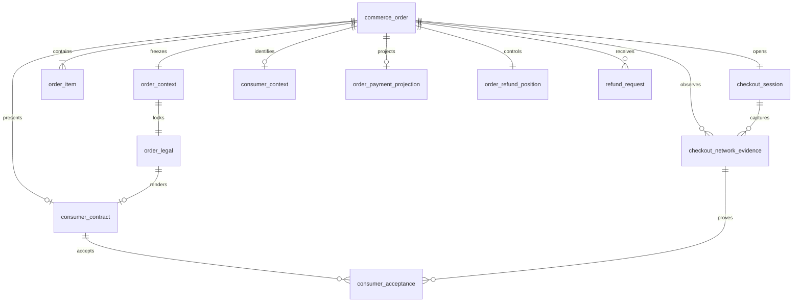

# Commerce 数据库设计规范

最后更新：2026-08-26

状态：V1 权威逻辑与物理字段基线已确认，固定为 14 张表。用户已授权本轮 Commerce PDManer 设计资产；该授权不包含 Migration、Java 实现、物理数据库或运行环境。

## 1. 文档目的与实施边界

本文定义 Commerce System 的事实所有权、14 表结构、字段语义、状态机、关系、并发与跨系统契约，是 Commerce PDManer 设计资产的权威输入。现实示例见 [Commerce 现实场景](./scenarios/COMMERCE_REAL_WORLD_SCENARIOS.md)，订单边界见 [Commerce 订单上下文精简设计](../plans/2026-08-24-commerce-order-context-simplification-design.md)，消费者、网络证据与非履约边界见 [Commerce 隐私与履约精简设计](../plans/2026-08-24-commerce-privacy-fulfillment-simplification-design.md)，文档/审计精简及取消撤销语义见 [Commerce 文档投影、审计与取消撤销精简设计](../plans/2026-08-24-commerce-document-audit-cancel-reversal-design.md)。

本轮只授权 PDManer 设计资产。后续 Migration、DO/Mapper/Repository、Java 服务、物理数据库、Nacos 配置和运行环境均须另行授权。

## 2. 系统边界

Commerce 拥有 Order 身份/生命周期、每 Order 一个不可变 Order Context、Hosted Checkout Session、当前 Consumer Context、不可变 Consumer Contract/Acceptance/Checkout Network Evidence、订单级退款意图和位置、命令幂等与本地可靠执行记录。

Commerce 不拥有 Client/Operating Entity/Agreement/Commercial Term 主档，Payment Intent/Attempt/Provider/MID，Risk 决策与 Dispute Case，Finance 税务/账本/结算，Consumer Document 状态/版本/文件/更正关系，Webhook 配置与投递，文件正文，或 Vault 原始值。跨系统引用按具体消费者保留必要的稳定业务 ID、版本/Hash 或交易时点，不建立跨库外键；Refund Request 只保留 Payment `channel_refund_id` 这一稳定下游业务 ID，不投影 Payment Refund 的状态与来源元数据，也不建立 Finance 退款资金预留引用。Receipt 与 Credit Note 由 Platform Support 持久化，Finance 保留 Fiscal Fact；Commerce 只可靠发布生成所需的最小来源事实。

Commerce 不建设主动履约域。支付成功后的 Order 保持 `PAID`；退款、争议与财务追偿各自保持权威状态。Chargeback 后 RFI/举证由 Risk 的 Dispute Case、Evidence Package/Reference 和 Submission Request 承接。

## 3. 全局物理规则

- PDManer、DDL、Migration 和 Mapper 使用 `t_<logical_table_name>` 小写物理名；唯一索引 `uk_`，访问索引 `idx_`。
- 主键为服务侧 Snowflake `BIGINT`；瞬时时间 UTC `DATETIME(6)`；金额 `DECIMAL(24,8)`、费率 `DECIMAL(18,10)`，金额绑定 ISO 4217 `CHAR(3)`。
- 可变 Current 行有 `version BIGINT NOT NULL`，使用 Expected Version/CAS；`compensation_event` 仅有技术 `lock_version`；不可变事实没有乐观锁。
- 可变行有 `create_time + update_time`，创建后不可变行仅有 `create_time`；业务发生时间使用专用字段。
- 业务变更和所需 `compensation_event` 在同一本地事务提交；MQ Ack 只能发生在提交后。Commerce V1 不保存通用 JSON 变更历史，法律接受、网络证据和冻结上下文由专项结构化表保留。

## 4. 精确 14 表目录

| 分组 | 逻辑表 | 物理表 | 基数与职责 |
|---|---|---|---|
| Order | `commerce_order` | `t_commerce_order` | 每 Order 一行；身份、冻结主体/分类/金额、状态、到期与 CAS |
| Order Context | `order_context` | `t_order_context` | 每 Order 一行；最小 CCT/Risk/Finance 不可变引用 |
| Order Context | `order_legal` | `t_order_legal` | 每 Context 一行；Agreement、三份 Consumer Legal 与 Seller Disclosure |
| Order | `order_item` | `t_order_item` | 每 Order 多行；商品/服务和逐行金额 |
| Payment View | `order_payment_projection` | `t_order_payment_projection` | Intent 和当前/最近 Attempt Current View |
| Refund Position | `order_refund_position` | `t_order_refund_position` | 每 Order 一行；可退金额并发位置 |
| Checkout | `checkout_session` | `t_checkout_session` | 每 Order 一行；访问 Token Hash 与会话状态 |
| Consumer | `consumer_context` | `t_consumer_context` | 每 Order 至多一行；Consumer 引用、稳定 Token、联系/账单派生维度 |
| Consumer Legal | `consumer_contract` | `t_consumer_contract` | 每 Order 至多一行；不可变合同呈现证据 |
| Network Evidence | `checkout_network_evidence` | `t_checkout_network_evidence` | 每可信 Checkout 请求一行；直接网络证据与解析维度 |
| Consumer Legal | `consumer_acceptance` | `t_consumer_acceptance` | 每 Contract 三行；不可变逐内容接受证据 |
| Refund | `refund_request` | `t_refund_request` | 每退款一行；唯一对外退款状态 |
| Reliability | `command_idempotency` | `t_command_idempotency` | 每命令键一行；幂等与恢复 |
| Reliability | `compensation_event` | `t_compensation_event` | 每待执行任务一行；可靠 MQ/本地 Handler |

## 5. 核心事实与约束

### 5.1 Order、Context、Checkout 与退款

`commerce_order` 冻结 `client_id + client_order_id`、Operating Entity/来源、Industry/MCC、金额币种和 `expires_at`。`uk_order_client_order(client_id,client_order_id)` 永久阻止同一 Client 重用业务标识；它不是传输幂等键。`order_status IN (CREATED,OPEN,PAID,CANCELLED,EXPIRED)`，仅支付成功写 `paid_at`，不含 `fulfilled_at` 或履约状态。可空 `status_reason_code` 来自 Commerce Order Status Reason Catalog，结构化说明当前取消、过期或其他需要解释的终态；它不保存历史，非终态通常为空。

`order_context` 每 Order 一行且不可变，保存 `commercial_context_time`、Assignment、CCT V5 `cct_commercial_context_hash`、Client Pricing Scope、可选 Partner Share Scope、可选 Platform Service Charge Scope、可选 Platform Service Party、Risk Assessment、Finance Tax Snapshot/Hash、Consumer Country 和 Locale。`platform_service_charge_scope_id` 是 CCT-I13 V5 返回的 `PLATFORM_SERVICE_CHARGE` Scope 稳定标识，`platform_service_party_id` 是同一 Partner Agreement 唯一 `PLATFORM_SIGNATORY` 的法律 Party 稳定标识；二者只用于跨系统事实导航，不建立跨库或本库关系。它不保存 Commerce 自建 Snapshot Schema/Hash，不复制 Order 分类/金额、Tax Line 或 Term Component。`order_legal` 与 `order_item` 在创建事务一并插入并冻结。

CreateOrder 必须原样冻结 CCT-I13 V5 的条件元组：PARTNER 来源时，`commerce_order.local_partner_id`、`order_context.partner_share_scope_id`、`order_context.platform_service_charge_scope_id`、`order_context.platform_service_party_id` 四项成组非空；非 PARTNER 来源四项成组为空。任一缺项、额外值或多义 `PLATFORM_SIGNATORY` 都失败关闭，不允许 Commerce 猜测平台主体或费率。

`checkout_session` 是每 Order 唯一 Hosted Checkout Session，公开 Token 只存 Hash。Payment Intent/Attempt Current View 只用于 Commerce 读取；Attempt `UNKNOWN` 保持 Active，迟到事件不能回退新 Attempt 或唯一成功事实。临时 Provider/MID 短缺可在同一 Operating Entity 下重试；OE CLOSED 后阻止新 Attempt，待活动/UNKNOWN Attempt 收敛，Client 若需再次付款必须以新的 `client_order_id` 创建新订单，不自动替换、不跨 OE 重试。

`t_order_refund_position` 与 Order 一对一，在创建 Order 的同一本地事务中初始化：`refundable_base_amount=0`、`reserved_amount=0`、`refunded_amount=0`，`currency=commerce_order.currency`。唯一成功的 `PaymentSucceeded` 只允许把 `refundable_base_amount` 从零建立为实际捕获金额一次；重复事件必须幂等，冲突金额必须失败关闭。创建 Refund Request 时以 Expected Version/CAS 在同一本地事务增加 `reserved_amount`，并始终满足 `reserved_amount + refunded_amount <= refundable_base_amount`。

`t_refund_request` 精确包含以下字段，不保存 Finance Funding 引用、Payment 来源版本、Event Key、Payload Hash、事件时间或 Current Projection：

| 字段 | 语义与约束 |
|---|---|
| `refund_request_id` | 服务侧 Snowflake 主键 |
| `refund_request_no` | 平台退款编号；`uk_refund_request_no(refund_request_no)` |
| `order_id` / `client_id` | 本地 Order 归属与 Client 冗余校验 |
| `request_origin` | `CLIENT` 或 `OPERATIONS` |
| `client_refund_id` | Client 退款业务标识；CLIENT 发起时 client_refund_id 必填；OPERATIONS 发起时为空；`uk_refund_client_ref(client_id,client_refund_id)` |
| `refund_amount` / `currency` | 本次申请的退款金额与 Order 币种 |
| `reason_code` / `reason_summary` | 结构化原因与受控补充说明 |
| `refund_status` | `PENDING`、`PROCESSING`、`SUCCEEDED`、`FAILED` 或 `CANCELLED` |
| `status_reason_code` | 失败、取消或其他终态原因；成功时为空 |
| `channel_refund_id` | 可空且唯一的 Payment Channel Refund 稳定 ID；`uk_refund_channel(channel_refund_id)` |
| `completed_at` | `SUCCEEDED`、`FAILED` 或 `CANCELLED` 的权威终态时间；非终态为空 |
| `version` | Request 条件更新的业务 CAS |
| `create_time` / `update_time` | 本地创建与最后更新时间 |

`client_refund_id` 是 Client 退款业务幂等标识，不是传输命令幂等键；CLIENT 在同一 Client 下重用该值只定位同一退款，相同标识携带不同 Order、金额或币种时按结构化字段比较并冲突失败，不依赖 Request Hash 猜测等价。OPERATIONS 不伪造 Client 标识，`client_refund_id` 固定为空，使用 `t_command_idempotency` 的命令键完成重试幂等。`channel_refund_id` 是可空且唯一的稳定 Payment 引用：Payment 尚未创建渠道退款时为空，填入后不承载下游状态。

Refund Request 创建后为 `PENDING`，本地退款额度已预占；Commerce 本地预占成功后直接调用 PAY-I04，Payment 以自身 Refund Position CAS 创建 Channel Refund，Commerce 获得 `channel_refund_id` 后进入 `PROCESSING`。Payment Refund=UNKNOWN 只保留在 Payment 本地，Commerce Request 保持 PROCESSING、本地退款额度继续预占。Payment Refund=SUCCEEDED 同时通知 Commerce 与 Finance：Commerce 同事务消费本地退款额度并将 Request 置为 SUCCEEDED，即 `reserved_amount` 减少、`refunded_amount` 等额增加并写入 `completed_at`；Finance 独立按成功事实记账。Payment Refund=FAILED/CANCELLED 只通知 Commerce，Commerce 同事务释放本地退款额度并进入对应终态，即 `reserved_amount` 等额减少并写入 `status_reason_code + completed_at`。

退款成功后 Commerce 可靠发布最小生成来源事实。Platform Support 创建新的 Credit Note 并引用原 Receipt，绝不覆盖原文档；Commerce 不保存 Consumer Document Current Projection。

### 5.2 Consumer 单轨模型

`consumer_context` 的精确事实为 `consumer_reference`、`email_vault_token`、可选 `phone_vault_token`、`consumer_profile_vault_token`、`email_domain`、`phone_country_code`、`billing_country_code`、`billing_region_code`、`billing_city`、`billing_postal_prefix` 和版本/审计时间。

- `consumer_reference` 是 Client 命名空间内的非 PII、不透明业务引用；禁止复用 Email、Phone、证件号或其他个人原值。
- 同一规范化 Email/Phone 在平台内部同字段作用域返回稳定 Token，分别兼具受控关联与授权 Reveal，Vault 内部密钥轮换不得改变业务 Token。
- `consumer_profile_vault_token` 只保护姓名和完整账单地址，不能重复包含 Email/Phone。
- 不保存 Consumer Blind Index、Key Version、Masked Value、旧 Composite Token、Vault Record Version 或 Metadata Hash；Token 不得进入外部响应、普通日志、MQ 或通用审计 JSON。
- 修改使用命令派生稳定 Token/Binding 身份和 Expected Version CAS；终止命令只 Retire 未被业务行引用的 Binding。

### 5.3 Network Evidence 与 Acceptance

`checkout_network_evidence` 保存 `order_id + checkout_session_id + evidence_scene + request_id`、`client_ip_address`、`user_agent`、可选 `trusted_proxy_chain`，以及 Geo/ASN/Network/Proxy/VPN/Tor/Hosting/Browser/OS/device_type。`occurred_at` 只取可信 Gateway/Commerce 服务端 UTC 时钟。`uk_network_evidence_request(checkout_session_id,request_id,evidence_scene)` 防止重复写入；`idx_network_order_time` 和 `idx_network_client_ip(client_ip_address,occurred_at)` 是受控取证/频次路径。

网络证据直接保存完整客户端 IP、完整 User-Agent 和可信代理链。它不保存 Network Vault Token、Blind Index、Key Version 或 `device_identifier`，插入后不可更新；原值和派生维度是受限数据，禁止复制到通用审计 JSON、MQ、普通日志或普通业务页面。

Consumer Contract 1:N Acceptance。`uk_consumer_acceptance(consumer_contract_id,acceptance_type)` 使每个 Contract 的 `CONSUMER_TERMS`、`REFUND_POLICY`、`PRIVACY_NOTICE` 三类记录各至多一条；每条必须关联同 Order、同 Session 的 `LEGAL_ACCEPTANCE` Evidence，二者同一本地事务插入且创建后不可变。COM-I10 每次实时校验归属、可支付状态、到期和三类精确齐全，返回 Contract ID、三个显式 Acceptance ID、`acceptance_completed_at=max(accepted_at)`、Order Version 和 Expires At；不维护 Acceptance Summary、集合 Hash 或完成指针。

### 5.4 事件、审计与跨系统边界

Commerce V1 不保存 `business_change_record/business_change_version`。结构化 `version` 只服务当前业务行 CAS，不代表历史版本；Order Context/Legal/Item、Consumer Contract、Network Evidence 和 Acceptance 本身就是冻结或追加式事实。若未来出现明确的监管审计或历史还原需求，应针对具体聚合重新评估，不得默认恢复通用 JSON BCR。

订单取消同事务登记 `OrderCancelled`；支付成功、退款成功等文档来源事实通过 `compensation_event` 在业务提交后可靠发布。Platform Support 对文档生成、版本和更正幂等负责，Finance 对 Fiscal Fact 负责；Commerce 不消费双方事件建立三方 Current Projection。

Commerce 通过内部 HTTP 契约与 CCT、Risk、Finance、Payment 交互，不读其他数据库。Commerce 仅保存实际采用的 Risk `ALLOW` Assessment ID；Risk 独占 Case、Decision、RFI、Evidence Package/Reference 和 Submission Request。Chargeback 后 Risk 进入 `EVIDENCE_REQUIRED` 并发布 `DisputeEvidenceRequested`；Commerce 不增加履约表、接口、事件或场景行来伪造举证。

COM-I04 返回订单已经冻结的 `platform_service_charge_scope_id`、`platform_service_party_id` 以及 CCT-I13 `V5 commercial_context_hash`，供 Finance 精确读取原 Scope 并把法律 Party 映射为本地 Finance Entity。Commerce 不解析或返回 `finance_entity_id`，不复制 Commercial Term Component、服务费金额或任何会计状态。Risk 的最小 Order Preparation Context 如需审计关联可以携带同一 V5 Hash，但不得消费 Finance Entity ID、平台服务费金额或会计映射。

### 5.5 Cancel、Void 与 Reversal

- `CANCEL` 是未支付关单：没有成功 Authorization/Capture/Sale，且没有已提交或 `UNKNOWN` 渠道结果。Commerce 调用 Payment 终止 Intent，只有得到确定终止结果后才将 Order/Session 更新为 `CANCELLED`。Cancel 不会静默升级为 Reversal。
- `VOID` 是 Payment 对成功 Authorization 的内部 Action。精确条件为 `AUTHORIZE Action=SUCCEEDED` 且 `captured_amount=0`；单独授权成功不是 `PaymentSucceeded`。Void 成功后业务撤销场景下 Intent/Order/Session=`CANCELLED`，订单原因通常为 `AUTHORIZATION_VOIDED`，不创建 Refund Request 或 Finance 事实。
- `REVERSAL` 是 Commerce 接收的统一业务命令，不是 Payment Action 或新表。Payment 在锁/CAS 内原子判断：授权未捕获时执行 Void，SALE/全额 Capture 后返回 `REFUND_REQUIRED` 并由 Commerce 创建标准全额 Refund Request。Capture 提交中或 UNKNOWN 时返回 `PENDING`；部分 Capture 的自动 Reversal 在 V1 返回 `PARTIAL_CAPTURE_REVERSAL_NOT_SUPPORTED`。
- Captured Reversal 完成退款后 Order 仍为 `PAID`，退款经济结果由 Refund Request 与 Refund Position 表达，不增加 `REVERSED` 状态。

## 6. 关系图



## 7. 状态机与实施门禁

```text
Order: CREATED -> OPEN -> PAID
       CREATED -> CANCELLED
       OPEN -> CANCELLED | EXPIRED

Checkout Session: PREPARING -> OPEN -> PAYMENT_PROCESSING -> COMPLETED
                  PREPARING -> CANCELLED
                  OPEN -> CANCELLED | EXPIRED

Refund: PENDING -> PROCESSING -> SUCCEEDED | FAILED | CANCELLED
        PENDING -> FAILED | CANCELLED
```

`PROCESSING` 同时覆盖 Payment 内部的 CREATED、PROCESSING 与 UNKNOWN；Commerce 不复制 Payment 的 `UNKNOWN` 状态。Refund `FAILED` 表示 Payment/Provider 权威确认无法完成，Refund `CANCELLED` 只表示 Provider Action 提交前的受控主动取消；二者都不可复活。Order Cancel 仅在 Payment 已确认没有成功 Authorization/Capture/Sale 且没有未知渠道结果时完成；授权成功必须使用 Reversal，未 Capture 走 Void，已全额 Capture 走 Refund。PAN、CVV/CVC、完整磁道、PIN/PIN Block、Vault 密文和 Secrets Manager 凭据不得进入模型。MVP 默认保留业务/技术数据，不实现自动 Retention、Legal Hold、归档、匿名化或销毁。模型必须精确保持 14 表、223 字段、20 UK、11 IDX、14 本库关系、4 Diagram Groups、7 Version 表、6 不可变表和 0 个 Commerce BCR 类型；PDManer 4.9.3 人工检查仍是兼容门禁。

本文件不授权 Migration、Java 模块、DO/Mapper/Repository、物理数据库或运行环境。
