# Finance 数据库设计规范

> **2026-09-11 模型更新：** 本页的数字 OE、Assignment、Client 多 OE 合同及旧 Scope 冻结描述，仅适用于迁移前记录与接口；现行目标由 [四系统模型决定](../decisions/2026-09-11-cct-commerce-oe-pricing-model.md) 精确取代。Risk 本期不改，Java 与数据库尚未据此迁移，历史订单与 Hash 不重写。

最后更新：2026-08-28

状态：本期模型采用 2026-09-11 四系统调整；生成统计、验证、Java 与数据库迁移状态统一见 [当前实现台账](../CURRENT_IMPLEMENTATION.md)。

> **2026-09-05 跨主题对齐：** 本文拥有 Finance 业务事实，不单独拥有 Vault、`compensation_event`、物理 CHECK/FK 或测试基础设施规范。旧 Vault Binding/Copy/Blind Index/Metadata 与旧补偿字段是 [当前实现台账](../CURRENT_IMPLEMENTATION.md) 记录的迁移债务，不得用于新增实现。手工缴税以“事前承诺门禁 + 事后真实 Debit 保留/异常处理”的已确认决定为准，现有模型无法无损闭环的部分按 [专项计划](../../docs/superpowers/plans/2026-09-05-finance-manual-tax-reconciliation.md) 迁移。

## 1. 文档定位

本文是 `finance-service` 数据库的业务与物理建模基线。后续 PDManer 模型、手工 Schema DDL/初始化 DML、DataObject、Mapper、Repository 和本地 MySQL 自动化测试必须与本文保持一致。

配套产物：

- [Finance 现实业务场景与逐表数据映射](./scenarios/FINANCE_REAL_WORLD_SCENARIOS.md)
- [Finance 统一账户模型设计](../plans/2026-08-26-finance-unified-account-model-design.md)
- [Finance Account Balance 合并实施计划](../plans/2026-08-26-finance-account-balance-merge-implementation-plan.md)
- [Finance 统一账户实施计划](../plans/2026-08-26-finance-unified-account-model-implementation-plan.md)
- [Finance Entity 与 Partner 双账簿设计](../plans/2026-08-26-finance-entity-dual-ledger-design.md)
- [Finance Entity 与 Partner 双账簿实施计划](../plans/2026-08-26-finance-entity-dual-ledger-implementation-plan.md)
- [Finance Trial Balance 与关账门禁收紧实施记录](../plans/2026-08-27-finance-trial-balance-close-hardening-implementation-plan.md)
- [Finance Tax/Fiscal 23 表精简实施记录](../plans/2026-08-27-finance-tax-fiscal-23-table-simplification-implementation-plan.md)
- [Finance 通用 Funding 模块移除设计](../plans/2026-08-27-finance-funding-module-removal-design.md)
- [Finance 通用 Funding 模块移除实施记录](../plans/2026-08-27-finance-funding-module-removal-implementation-plan.md)
- [Finance 保证金 Account 与 Journal 追偿简化实施记录](../plans/2026-08-27-finance-security-deposit-account-simplification-implementation-plan.md)
- [Finance Channel 两层对账简化实施记录](../plans/2026-08-28-finance-provider-reconciliation-simplification-implementation-plan.md)
- [Finance Channel 三阶段账户实施计划](../plans/2026-08-28-finance-provider-three-stage-accounting-implementation-plan.md)
- [Finance 手工出款与共同余额成熟精简设计（当前）](../plans/2026-08-28-finance-manual-payout-simplification-design.md)
- [Finance 手工出款精简实施计划](../plans/2026-08-28-finance-manual-payout-simplification-implementation-plan.md)
- [Finance 物理建模决策](../../paytech/ledger/docs/database/FINANCE_PHYSICAL_DECISIONS.md)
- [Finance PDManer 模型](../../paytech/ledger/docs/database/ledger.pdma.json)

本文固化以下决策：

- 主键使用服务侧 Snowflake `BIGINT`，Java 类型为 `Long`，禁止数据库自增；
- Finance 使用不可变复式记账，Ledger 是唯一会计事实源；
- 科目采用资产、负债、权益、收入、费用五类多级科目；
- `finance_entity` 由 Finance 受控人工维护，以唯一 `legal_party_id` 映射 CCT 的平台签约法律 Party，不复制法律资料；
- Ledger Book 以 `entity_type + entity_id + currency` 表达单一 OE 或 Finance Entity 的独立账簿；
- Partner 来源交易的 Partner OE 与平台 Finance Entity 分别生成平衡 Journal，平台利润只在平台账簿确认与结转；
- 所有借贷明细只进入统一 `account`，通过账簿、科目、核算对象与余额桶确定唯一账户；
- Client 账户按 `Operating Entity + Client + Currency + Balance Bucket` 隔离；
- Payment 成功先形成 `CHANNEL_UNSETTLED_RECEIVABLE` 并把 Client 应付记入 PENDING；Channel 批次交易对账完整后才重分类为 `CHANNEL_SETTLEMENT_RECEIVABLE`，Bank Statement 确认后才形成 `BANK_CASH`；Client 按精确 Agreement-OE 的 T+N 工作日到期，Channel 实际结算不阻断，时间差由平台承担流动性缺口；
- 一个外部银行账户只能服务同一账簿主体、同一币种和已声明用途，可以被该范围内多个 Client 共享；
- MVP 禁止跨 Operating Entity 混池，不建设 Intercompany Cash Pool；
- 保证金是 Client 预存的负债，只使用 `CLIENT_SECURITY_DEPOSIT/NONE` Account 与 Journal 表达，不是平台收入；
- Payout 和 Tax Payment 直接引用各自的责任/现金 Account，并以共同的 `BANK_CASH` Account 行锁及活动付款金额派生并发安全的银行现金容量；退款可退金额由 Commerce 与 Payment 各自控制，Finance 仅在成功后入账；
- PAYMENT Economics 冻结成功时刻和 Client Agreement-OE 的共同余额成熟时刻，到期以一个 Economics 级幂等事务把 Client Principal 与 Local Partner Share 从各自 `PENDING` 转为 `AVAILABLE`；
- V1 不运行自动出款周期；Client 或 Local Partner 只能主动申请支付自己在单一 OE、单一币种下已经成熟的 `AVAILABLE` 应付余额；
- Payout 创建即把 Owner 应付从 `AVAILABLE` 转入 `LOCKED`；每次人工银行提交先创建顺序 Execution 并占用 `BANK_CASH` 容量，`UNKNOWN` 禁止重试或取消，只有完整 `CONFIRMED` 银行借记匹配才可 `PAID`；
- Payout 最终审批和批准后取消使用不可变 `t_payout_approval` Maker-Checker 事实；合法终止以幂等反向 Journal 原子执行 `LOCKED -> AVAILABLE`；
- Payout、人工调整、重大对账处置和期间关账使用固定 Maker-Checker 双人控制；
- Channel 对账严格分为“清算原始行对本地 Open/Debit Item”的交易对账和“已完成交易对账且已重分类的清算批次对银行流水”的银行对账；正常交易对账只使用 Finance 冻结的 Channel 引用，不要求 Payment 在线；两层对账分别推进 Channel 待清算账户到结算账户、结算账户到 `BANK_CASH`，不得越级；
- Local Partner Share 作为 Partner OE 的费用确认；平台服务费必须来自明确合同条款，不得按交易残差倒算；
- Money 使用 `DECIMAL(24,8)`，最终按 ISO 4217 币种精度执行 `HALF_UP`；
- 确定性尾差由平台 `ROUNDING_ADJUSTMENT` 科目承担，未知差异进入对账异常。

## 2. 系统边界

### 2.1 Finance 拥有的事实

Finance 是以下事实的唯一拥有者：

- 受控人工维护的内部 Finance Entity 身份、状态及其到 CCT 法律 Party 的稳定映射；
- 不可变交易经济结果、Client Fee、Partner Share、税务、法定号码序列与财政事实；
- 预计 Channel Cost、实际 Channel Cost 及差异；
- 自动 Accounting Rule Bundle、Accounting Instruction、Journal Entry、Journal Line；
- 统一记账账户及其内置余额投影、合同到期时刻与成熟指令、Client 保证金负债和追偿应收资产；
- Channel 待清算应收/应付、Channel 结算应收/应付、银行流水匹配与对账异常；
- Client/Local Partner 受益人账户、主动 Payout、审批、人工 Execution、付款证据、连续事件和最终银行借记对账；
- 试算平衡、会计期间、关账结果和关账调整。

### 2.2 Finance 不拥有的事实

Finance 不得拥有或修改：

- Client、Local Partner、Operating Entity 主档和协议正文；
- 商业费率规则、Partner 分润规则的权威配置；
- Order、Checkout、Consumer Contract、Refund Request；
- Payment、MID、Channel Callback、渠道支付状态，以及 Cancel/Void/Reversal 的路径选择；
- KYC/KYB、Risk Decision、Dispute Case 和结算限制决定；
- 文件二进制、用户身份、权限、通知和 Webhook 投递状态。

Finance 只保存上述系统提供的稳定业务 ID、交易时点版本和完成计算所需的不可变输入快照，不建立跨数据库外键。`finance_entity.legal_party_id` 是到 CCT Party 的稳定业务引用而非外键；Finance Entity 由 Finance 人工维护，但法律名称、注册资料和签约角色仍以 CCT 为权威。

支付 Cancel、Void 与 Reversal 不得按名称直接推导账务。Cancel 是未形成成功授权或扣款时的关单，未 Capture 授权的 Void 只是释放 Channel Authorization；两者都没有 `PaymentSucceeded`，Finance 不创建 Transaction Economics、Channel Unsettled Receivable、Accounting Instruction、Journal、Fiscal Record 或“零金额冲销”。Reversal 是 Commerce 的业务命令：未 Capture 分支调用 Payment Void，仍无账务；已 Capture 分支必须创建标准 Refund Request 和 Channel Refund，Finance 只在 `RefundSucceeded` 后执行冲回链。Finance 不拥有 Reversal 表、Action 或状态。

Finance 从 Commerce 不可变 Order 与 Order Context 继承唯一 `industry_code + mcc_code`。`industry_code` 是平台业务行业维度，`mcc_code` 是收单分类维度，二者不得合并、互相推导，也不得与 `tax_category`/`tax_category_code` 税务处理分类混用。Client 无权通过这两个字段选择 Operating Entity、Channel 或 MID；Finance 只接受 CCT/Commerce 已冻结的主体和 Payment 已选定的渠道引用，不参与路由。

## 3. 通用物理规则

### 3.1 主键与时间

- 所有业务表主键为 `id BIGINT NOT NULL`，由服务侧 Snowflake 生成；
- Java DO 使用 `Long`；
- 禁止 `AUTO_INCREMENT`；
- 本库内外键字段使用 `BIGINT`；Channel、银行等外部编号使用有明确长度的 `VARCHAR`；
- 时间统一存储 UTC `DATETIME(6)`，Java/MyBatis 映射为 `Instant`；无时区业务日期使用 `DATE`，映射为 `LocalDate`；
- 可变聚合根包含 `version BIGINT NOT NULL DEFAULT 0`，更新使用 `WHERE id=? AND version=?`；
- 不可变事实不提供业务 UPDATE/DELETE Mapper，只保留 `create_time`；只有存在真实状态或并发更新的表才保留 `update_time`。

### 3.2 Money、费率与舍入

- Money 字段使用 `DECIMAL(24,8)`，禁止 `FLOAT`、`DOUBLE`；
- 百分比、费率和汇率使用 `DECIMAL(18,10)`；
- 每个金额必须能从本行或不可变父记录确定 `currency CHAR(3)`；
- 原始计算保留八位小数，最终记账金额按 `currency_spec.minor_unit` 使用 `HALF_UP`；
- Journal Line 金额必须大于零，借贷方向使用 `entry_side`；
- 业务层必须校验 `posted_amount = ROUND(posted_amount, minor_unit)`；
- `ROUNDING_ADJUSTMENT` 只处理确定性舍入差额，不承接缺失数据、渠道差异或人工无法解释的金额。

### 3.3 状态、索引和外键

- 状态保存稳定字符串编码，禁止 Java ordinal；
- 本库聚合内部关系使用外键和 `RESTRICT` 删除策略；
- 不对 Ledger、Fiscal Record、Transaction Economics、Channel 原始清算项和 Audit Reference 级联删除；
- 物理表统一以 `t_` 开头，普通索引以 `idx_` 开头，唯一索引以 `uk_` 开头；逻辑表名和中文显示名不添加技术前缀；
- 外部事件直接在对应 Finance 业务事实或投影上保存 `source_system + source_event_key + source_version + source_payload_hash`；业务唯一约束负责重复消费幂等，同一 Event Key/Version 出现不同类型或内容时必须进入冲突状态。
- 所有状态历史和执行事件的 `trigger/source type + id` 均必须非空；系统转换使用 Job Run/Recovery Task ID，操作人只作为 Actor，不能替代不可变 Trigger。
- `tax_rule` 与 `tax_return` 不再使用 Root + Version + Approval 三表：每行就是精确业务版本，分别以 `rule_code + rule_ver`、`return_no + return_ver` 唯一；审批结果直接落在该版本行。`channel_cost_plan`、`accounting_rule_bundle`、`cash_account_binding` 等 Version Root 在 `DRAFT` 之外仍必须具有非空 `current_ver_id`，切换时必须锁 Root 并校验版本归属、审批状态与生效区间。`beneficiary_account` 一行就是可被历史 Payout 精确引用的账户版本，不再维护 Current Pointer。
- 自引用字段的 Sidecar 表达式至少定义直接自环禁令：`chart_account.parent_account_id`、`tax_jurisdiction.parent_id`、`tax_category.parent_id`、`fiscal_record.original_record_id`、`tax_return.amends_return_id`、`transaction_economics.parent_economics_id`、`journal_entry.reversal_of_entry_id`、`period_close.reopens_close_id` 均不得等于本行 `id`。Owner 写入口在同一本地事务中锁定相关 Root，并校验同业务编号、无长环和合法前驱；不创建物理 `CHECK`。
- 金额、比率、期间与状态证据必须有明确 Sidecar 表达式和应用校验：业务金额按各表语义限制为正数或非负数，费率限制在 `[0,1]`，`year_start_month` 限制为 `1..12`，期间开始不得晚于结束，状态对应的时间、文件、Journal、Current Pointer、Active Slot 和执行证据必须成组出现。所有校验由写入事务、实际资源锁、唯一索引/CAS 与仓库自有 `local-environment` 真实 MySQL 反例测试保证；跨表金额守恒、维度一致和审批完整性必须在同一事务重算。

## 4. 聚合与精确表清单

本章当前共 84 张逻辑表，其中 Channel 清算、现金与对账主图精确为 15 表，Tax/Fiscal 主图精确为 23 表，Manual Payout 主图精确为 7 表。MVP 不预建通用 Retention Policy Projection、Resource Control、Legal Hold Projection 或 Retention Action Log；本节科目代码基线不是额外物理表。

### 4.1 会计基础与多级科目

| 表 | 用途 | 关键字段 | 唯一、检查与并发约束 |
|---|---|---|---|
| `currency_spec` | Finance 使用的 ISO 4217 币种规则 | `currency`、`minor_unit`、`rounding_mode`、`status` | `uk_currency(currency)`；`minor_unit BETWEEN 0 AND 8`；`rounding_mode='HALF_UP'` |
| `finance_entity` | Finance 内部人工维护的平台会计主体 | `entity_code`、`legal_party_id`、`display_name`、`status` | `uk_fin_entity_code(entity_code)`、`uk_fin_entity_party(legal_party_id)`；一个 CCT 法律 Party 最多映射一个 Finance Entity；只允许 `ACTIVE/CLOSED`，关闭后不得恢复；不保存 Version、Hash、审批、Operating Entity 或法律资料副本 |
| `chart_of_accounts` | 可供账簿采用的稳定多级科目目录 | `chart_code`、`chart_name`、`status` | `uk_chart_code(chart_code)`；V1 不对整套科目表做业务版本化，已被账簿使用后不得改码或删除 |
| `chart_account` | 五类科目定义 | `chart_id`、`parent_account_id`、`account_code`、`account_name`、`account_class`、`normal_side`、`posting_allowed` | `uk_chart_acct(chart_id,account_code)`；`account_class IN (ASSET,LIABILITY,EQUITY,REVENUE,EXPENSE)`；资产/费用默认借方，负债/权益/收入默认贷方；禁止形成环；Chart 被任一 Ledger Book 采用后，既有科目的代码、父级、类别、正常方向和 `posting_allowed` 不可修改 |
| `ledger_book` | OE 或 Finance Entity 的单币种独立账簿 | `entity_type`、`entity_id`、`currency`、`chart_id`、`book_status` | `uk_ledger_book_entity(entity_type,entity_id,currency)`；`entity_type IN (OPERATING_ENTITY,FINANCE_ENTITY)`；二者创建后不可修改；多态主体不建外键，Finance Entity 类型必须在应用事务校验本地 Entity 存在且 ACTIVE；带 `version` |
| `account` | 账簿内可过账的统一核算账户及当前余额投影 | `ledger_book_id`、`chart_account_id`、`owner_type`、`owner_id`、`balance_bucket`、`normal_side`、`account_status`、`debit_total`、`credit_total`、`net_balance`、`last_journal_sequence`、`balance_version` | `uk_account_identity(ledger_book_id,chart_account_id,owner_type,owner_id,balance_bucket)`；只引用 `posting_allowed=true` 科目；创建时必须把 `chart_account.normal_side` 复制到本行且二者相等，之后不可修改；所有账户都允许借贷双向过账，`normal_side` 只允许 `DEBIT/CREDIT`，不允许 `BOTH`。行内 `ck_account_owner_bucket` 只做 Owner/Bucket 结构放行：Client 与 Local Partner 可出现 `PENDING/AVAILABLE/LOCKED/NONE`，Operating Entity、Finance Entity、Channel Account、Cash Account、Tax Authority 只允许 `NONE`；它不表示任意 Local Partner/NONE 账户都合法。同一创建事务还必须锁定并校验 Chart Account：`PARTNER_PAYABLE` 只能配 `PENDING/AVAILABLE/LOCKED`，`PARTNER_RECOVERY_RECEIVABLE` 资产科目只能配 `NONE`，其他 Partner 科目/Bucket 组合拒绝。外部 Owner 不建跨库外键；身份字段创建后不可修改，状态变更携带期望旧状态；`debit_total/credit_total/net_balance/last_journal_sequence` 可由 Journal 重算，`balance_version` 只做 CAS 并发控制，不从 Journal 推导 |
| `fiscal_calendar` | OE 或 Finance Entity 的唯一法定财年规则 | `entity_type`、`entity_id`、`calendar_code`、`timezone`、`year_start_month` | `uk_fiscal_cal(entity_type,entity_id)`；V1 每个主体只有一套法定财务日历；时区固定为 IANA 编码；带 `version` |
| `accounting_period` | 可过账会计期间 | `calendar_id`、`fiscal_year`、`period_no`、`start_date`、`end_date`、`status`、`reopen_count` | `uk_account_period(calendar_id,fiscal_year,period_no)`；日期不得重叠；带 `version` |
| `book_sequence` | 每账簿严格递增 Journal 序号 | `ledger_book_id`、`next_value` | `uk_book_seq(ledger_book_id)`；创建 Book 时在同一事务初始化唯一行；`next_value>0`；Journal Posting 在同一本地事务中以 `SELECT ... FOR UPDATE` 锁定本行、取得并递增 `next_value`；不再叠加 `version`，不使用全库序列、数据库自增、时间或 Snowflake ID 推导记账顺序 |

科目树只使用 `chart_account.parent_account_id` 表达直接父子关系；查询多级汇总时使用递归 CTE 或在应用层遍历，不维护第二套闭包表。Chart 尚未被任何 Ledger Book 采用时，新增或移动科目必须在同一事务校验父子属于同一 Chart、父科目存在且不会形成长环；Chart 一旦被采用，既有科目的代码、父级、类别、正常方向和 `posting_allowed` 全部冻结，只允许追加新科目，避免重跑历史报表时改变既有 Journal 的汇总归类。`posting_allowed=false` 是永久的汇总节点结构属性，不承担启停；具体核算账户停用通过 `account.account_status` 完成，历史账户不得删除。

`account.normal_side` 是为了让高频过账、余额重建和账户查询不必再关联科目表而保存的不可变冗余，不改变 `chart_account.normal_side` 作为科目定义来源的地位。借方与贷方累计都必须非负；借方正常账户使用 `net_balance=debit_total-credit_total`，贷方正常账户使用 `net_balance=credit_total-debit_total`。`net_balance` 是有符号金额：正数表示正常方向余额，负数表示反向余额，零表示无余额；当前实际方向由符号派生，不保存 `balance_direction`。正常业务同时形成相反法律性质时必须使用成对科目，例如 `CHANNEL_UNSETTLED_RECEIVABLE/CHANNEL_UNSETTLED_PAYABLE`、`CHANNEL_SETTLEMENT_RECEIVABLE/CHANNEL_SETTLEMENT_PAYABLE`、`CLIENT_RECOVERY_RECEIVABLE/CLIENT_PAYABLE`，不能把负数能力误用为长期跨性质承载资产和负债。

复式记账的正式会计恒等式为：

```text
Assets + Expenses = Liabilities + Equity + Revenue
```

每个 Journal Entry、每个 Ledger Book 的累计余额以及每次 Trial Balance 都必须满足该恒等式；系统实现使用借方合计等于贷方合计进行校验。

#### 4.1.1 核心科目基线

每个账簿采用的 Chart of Accounts 至少包含下列可过账叶子科目；可以增加父级汇总科目，但不得改变代码语义和账户类别。

| 科目代码 | 类别 / 正常方向 | 固定用途 |
|---|---|---|
| `CHANNEL_UNSETTLED_RECEIVABLE` | ASSET / DEBIT | PaymentSucceeded 或真实重复扣款形成、尚未完成 Channel 交易对账的待清算应收 |
| `CHANNEL_SETTLEMENT_RECEIVABLE` | ASSET / DEBIT | Channel 批次交易对账完整并已按净额重分类、尚未由 Bank Statement 确认的结算应收 |
| `BANK_CASH` | ASSET / DEBIT | 指定 OE、币种、用途银行账户的已匹配现金 |
| `CLIENT_RECOVERY_RECEIVABLE` | ASSET / DEBIT | 结算后退款、拒付形成的 Client 追偿应收 |
| `PARTNER_RECOVERY_RECEIVABLE` | ASSET / DEBIT | Local Partner Share 冲回无法由 `PENDING/AVAILABLE/LOCKED` 应付余额吸收时形成的追偿应收；后续 Share 先合法净额抵扣 |
| `TAX_RECOVERABLE` | ASSET / DEBIT | 税务机关允许抵扣但尚未申报抵扣的进项税额 |
| `RECON_SUSPENSE_ASSET` | ASSET / DEBIT | 已知来源但尚未完成处置的临时对账悬挂资产 |
| `CLIENT_PAYABLE` | LIABILITY / CREDIT | Client 应付款控制科目；待成熟、可结算和已锁定状态由统一账户的 `balance_bucket` 区分 |
| `PARTNER_PAYABLE` | LIABILITY / CREDIT | Local Partner Share 应付款控制科目；待成熟、可出款和已锁定状态由统一账户的 `balance_bucket` 区分 |
| `CLIENT_SECURITY_DEPOSIT` | LIABILITY / CREDIT | Client 预存且仍归属于 Client 的保证金；不计入平台收入 |
| `TAX_PAYABLE` | LIABILITY / CREDIT | OE 对税务机关的销项税和净应纳税额 |
| `CHANNEL_FEE_ACCRUAL` | LIABILITY / CREDIT | 预计或已确认但尚未结清的 Channel Fee |
| `CHANNEL_UNSETTLED_PAYABLE` | LIABILITY / CREDIT | RefundSucceeded、明确允许入账的 DisputeLost 或补偿退款形成、尚未完成 Channel 交易对账的待清算应付 |
| `CHANNEL_SETTLEMENT_PAYABLE` | LIABILITY / CREDIT | Channel 批次交易对账完整并已按净额重分类、尚未由 Bank Statement Debit 确认的结算应付 |
| `UNIDENTIFIED_CASH` | LIABILITY / CREDIT | 银行已入账但权属尚未识别的资金 |
| `CONSUMER_COMPENSATION_PAYABLE` | LIABILITY / CREDIT | 重复扣款等已确认应退给 Consumer、但补偿尚未完成的义务 |
| `CAPITAL` | EQUITY / CREDIT | 法律主体投入资本 |
| `CURRENT_PERIOD_RESULT` | EQUITY / CREDIT | 本期 Revenue 与 Expense 的关账结转结果 |
| `RETAINED_EARNINGS` | EQUITY / CREDIT | 历史累计留存收益 |
| `OWNER_DISTRIBUTION` | EQUITY / DEBIT | 所有者分配的 Contra-Equity |
| `CLIENT_FEE_REVENUE` | REVENUE / CREDIT | Client 百分比费和 Fixed Fee 收入 |
| `PLATFORM_SERVICE_RECEIVABLE` | ASSET / DEBIT | 平台 Finance Entity 对 Partner OE 的合同服务费应收 |
| `PLATFORM_SERVICE_REVENUE` | REVENUE / CREDIT | 平台 Finance Entity 按明确合同服务费确认的平台收入 |
| `PLATFORM_SERVICE_FEE_EXPENSE` | EXPENSE / DEBIT | Partner OE 因使用平台服务产生的合同费用 |
| `PLATFORM_SERVICE_PAYABLE` | LIABILITY / CREDIT | Partner OE 对平台 Finance Entity 的合同服务费应付 |
| `PARTNER_SHARE_EXPENSE` | EXPENSE / DEBIT | 基于 Client Fee 产生的 Local Partner Share，固定按费用处理 |
| `CHANNEL_FEE_EXPENSE` | EXPENSE / DEBIT | Channel/Acquirer 预计与实际渠道成本 |
| `ROUNDING_ADJUSTMENT` | EXPENSE / DEBIT | 确定性 `HALF_UP` 尾差；负向尾差通过 Credit 记入同一科目 |
| `RECON_ADJUSTMENT_EXPENSE` | EXPENSE / DEBIT | 经双人审批确认、无法归入其他成本科目的对账损失 |

`CURRENT_PERIOD_RESULT` 只在期间关账时接收 Revenue/Expense 结转，不用于逐笔交易记利润。`ROUNDING_ADJUSTMENT` 不得替代 `RECON_SUSPENSE_ASSET` 或 `recon_exception`。

### 4.2 税务、交易经济与 Channel Cost

| 表 | 用途 | 关键字段 | 唯一、检查与并发约束 |
|---|---|---|---|
| `tax_jurisdiction` | 国家、州/省、地区和特殊税区等税务辖区树 | `jurisdiction_code`、`jurisdiction_type`、`country_code`、`parent_id`、`timezone`、`status` | `uk_tax_jurisdiction(jurisdiction_code)`；禁止形成环；国家使用 ISO 3166 编码；类型支持 `COUNTRY/SUBNATIONAL/LOCAL/SPECIAL_ZONE` |
| `tax_authority` | 辖区税务机关 | `jurisdiction_id`、`authority_code`、`authority_name`、`status` | `uk_tax_authority(jurisdiction_id,authority_code)`；本地外键 |
| `tax_registration` | OE 或 Finance Entity 在税务机关的注册或“依法无需注册”声明 | `entity_type`、`entity_id`、`authority_id`、`tax_type`、`reporting_currency`、`registration_kind`、`registration_no_vault_token`、`registration_no_blind_index`、`registration_no_blind_key_ver`、`registration_no_masked`、`vault_record_version`、`vault_metadata_hash`、`effective_from/to`、`status`、`version` | `uk_tax_registration(entity_type,entity_id,authority_id,tax_type,registration_kind,effective_from)`；实际号码另由 `uk_tax_reg_number(authority_id,tax_type,registration_no_blind_key_ver,registration_no_blind_index)` 防重；`reporting_currency` 固定该 Registration 下 Snapshot 报告金额、Liability Summary、Return 与 Tax Payment 的法定申报币种；`REGISTERED` 必须完整保存 Vault Tuple，`NO_REGISTRATION_REQUIRED` 必须全部为空；有效期不得重叠；多态主体由应用逐值校验，注册号由中央 Vault 保存 |
| `tax_category` | 商品/服务税务分类，不等同于平台行业或 MCC | `category_code`、`parent_id`、`category_name`、`status` | `uk_tax_category(category_code)`；禁止形成环；只描述税务处理分类，不得替代、推导或改写 `industry_code/mcc_code` |
| `tax_category_mapping` | Commerce 商品/服务分类到 Finance Tax Category 的版本化映射 | `source_system`、`source_category_code`、`seller_jurisdiction_id`、`tax_category_id`、`effective_from/to`、`priority`、`status`、`version` | `uk_tax_cat_map(source_system,source_category_code,seller_jurisdiction_id,effective_from)`；同 Scope/优先级有效期不得重叠；不承载行业准入 |
| `tax_treatment` | 稳定税务处理编码 | `treatment_code`、`tax_type`、`liability_mode`、`invoice_requirement`、`status` | `uk_tax_treatment(tax_type,treatment_code)`；同一处理代码可在不同税种下拥有各自责任与凭证语义；固定支持 `STANDARD/ZERO_RATED/EXEMPT/OUT_OF_SCOPE/REVERSE_CHARGE` |
| `tax_rule` | 一行一个可审批、可生效的精确税务规则版本 | `rule_code`、`tax_type`、`rule_ver`、`seller_jurisdiction_id`、`buyer_jurisdiction_id`、`buyer_type`、`category_id`、`treatment_id`、`effective_from/to`、`priority`、`content_hash`、`status`、`maker_id`、`checker_id`、`checker_decision`、`decision_time`、`version` | `uk_tax_rule(rule_code,rule_ver)`；`rule_ver>0`，同业务代码严格递增；DRAFT 时 Hash/Checker Tuple 为空，提交审批后冻结适用范围等业务内容和全部子行，审批与发布状态仍按合法生命周期推进；ACTIVE/INACTIVE 必须由不同 Checker APPROVED，REJECTED 必须由不同 Checker REJECTED；新内容只能新建 `rule_ver`，不维护 Current Pointer 或独立 Approval 表 |
| `place_of_supply_rule` | 根据卖方、消费者和数字服务证据判定供应地 | `tax_rule_id`、`rule_no`、`seller_country`、`buyer_country`、`supply_type`、`evidence_match_mode`、`result_jurisdiction_id`、`priority` | `uk_supply_rule(tax_rule_id,rule_no)`；`tax_rule_id` 精确指向一条规则版本行；同版本优先级唯一；结果辖区必须有效 |
| `tax_rate` | 精确规则版本下的税率 | `tax_rule_id`、`jurisdiction_id`、`category_id`、`treatment_id`、`rate_value`、`effective_from/to` | `uk_tax_rate(tax_rule_id,jurisdiction_id,category_id,treatment_id,effective_from)`；`tax_rule_id` 精确指向一条规则版本行；`rate_value BETWEEN 0 AND 1`；有效期不得重叠 |
| `tax_evidence_rule` | 供应地和税务处理要求的证据组合 | `tax_rule_id`、`evidence_type`、`minimum_count`、`must_agree`、`max_age_days`、`priority` | `uk_tax_evidence_rule(tax_rule_id,evidence_type)`；`tax_rule_id` 精确指向一条规则版本行；计数和天数非负 |
| `tax_exchange_rate` | 非账簿币种税务换算的不可变汇率 | `rate_source`、`rate_date`、`base_currency`、`quote_currency`、`rate_value`、`source_ref`、`source_hash` | `uk_tax_fx(rate_source,rate_date,base_currency,quote_currency)`；Rate 大于零；不可变；不允许隐式反向取倒数 |
| `tax_snapshot` | Checkout 阶段 Finance 生成的不可变税快照头 | `tax_snapshot_no`、`source_system`、`source_request_id`、`request_hash`、`order_id`、`client_order_id`、`client_id`、`operating_entity_id`、`buyer_type`、`buyer_tax_country`、`buyer_tax_id_vault_token`、`buyer_tax_id_blind_index`、`buyer_tax_id_blind_key_ver`、`buyer_tax_id_masked`、`buyer_tax_vault_record_version`、`buyer_tax_vault_metadata_hash`、`buyer_tax_validation`、`currency`、`reporting_currency`、`exchange_rate_id`、`total_collected_tax`、`total_reverse_charge_tax`、`reporting_collected_tax`、`reporting_reverse_charge_tax`、`calculation_hash` | `uk_tax_snapshot_no(tax_snapshot_no)`、`uk_tax_snapshot_req(source_system,source_request_id)`；相同 Request ID 且 `request_hash` 相同时返回原 Snapshot，Hash 不同必须冲突；`client_order_id` 是 Client 在自身范围内提供的订单引用，只用于业务对账，不充当 Finance 幂等键；Buyer Tax ID 六字段必须全空或成组非空，`buyer_tax_id_blind_key_ver` 是 Buyer Tax ID Blind Index Key Version 的物理缩写，Token 指向交易时点冻结的 Vault Record Version；`request_hash` 是输入 Hash，`calculation_hash` 是按 `CODE-MOR:FINANCE:TAX_CALCULATION:1` 计算的输出 Hash；生成后不可变 |
| `tax_evidence` | 本次计算实际采用的消费者位置和供应地证据快照 | `tax_snapshot_id`、`evidence_no`、`evidence_type`、`country_code`、`evidence_value_hash`、`source_system/ref_id`、`observed_time` | `uk_tax_evidence(tax_snapshot_id,evidence_no)`；只保存最小值或 Hash；无跨库外键；不可变 |
| `tax_line` | 多税种、多责任主体的不可变行级税务事实 | `tax_snapshot_id`、`line_no`、`line_key`、`source_order_item_id`、`source_line_ref`、`tax_type`、`jurisdiction_id`、`registration_id`、`fiscal_scope_hash`、`tax_rule_id`、`tax_rate_id`、`treatment_id`、`liability_mode`、`liable_party_type`、`liable_oe_id`、`tax_basis`、`tax_rate`、`collected_tax_amount`、`reverse_charge_tax_amount`、`currency`、`reporting_tax_basis`、`reporting_collected_tax`、`reporting_reverse_charge_tax`、`reporting_currency` | `uk_tax_line_no(tax_snapshot_id,line_no)`、`uk_tax_line_key(tax_snapshot_id,line_key)`；来源 Item 可空但 `source_line_ref` 非空，Commerce 可稳定映射到同一 Order Item；行级冻结 Registration、Fiscal Scope Hash、精确 Rule、Rate 和 Treatment；交易币种与报告币种金额均非负，零税率行也必须保存 `reporting_tax_basis`；`currency` 等于 Snapshot 交易币种，`reporting_currency` 等于 Snapshot 及 Registration 的法定申报币种 |
| `fiscal_number_sequence` | 每个税务注册、法定记录类型和号码系列的连续取号器 | `tax_registration_id`、`record_type`、`series_code`、`fiscal_year`、`next_value`、`version` | `uk_fiscal_seq(tax_registration_id,record_type,series_code,fiscal_year)`；通过带 `version` 的条件更新原子取号；禁止回退、复用或数据库自增 |
| `fiscal_record` | 支付、退款后的权威财政事实 | `client_id`、`operating_entity_id`、`order_id`、`refund_request_id`、`business_ref_type`、`business_ref_id`、`document_type`、`tax_registration_id`、`tax_period_id`、`fiscal_sequence_id`、`sequence_value`、`series_code`、`source_system`、`record_type`、`fiscal_number`、`tax_snapshot_id`、`source_event_key`、`source_version`、`source_payload_hash`、`generation_key_version`、`document_generation_key`、`generation_scope_hash`、`original_record_id`、`fiscal_date`、`currency`、`total_amount`、`content_hash` | `uk_fiscal_no(tax_registration_id,record_type,fiscal_number)`；`uk_fiscal_sequence(fiscal_sequence_id,sequence_value)`；`uk_fiscal_source(source_system,source_event_key,record_type,document_type,tax_registration_id,source_version)`、`uk_fiscal_generation(generation_key_version,document_generation_key)`；`source_version=1`、`source_payload_hash` 非空且 `generation_key_version > 0`；Order ID 始终非空；`business_ref_type=ORDER` 时 `business_ref_id=order_id` 且 Refund ID 为空，`REFUND` 时 `business_ref_id=refund_request_id` 且 Order/Refund ID 都非空，Sidecar 固化矩阵并由写入事务校验；同一来源事件可按不同 Registration/Document Type 生成多条记录并使用独立 Generation Key；Registration、Period、Sequence/Generation Scope 必须一致；不可变 |
| `fiscal_record_line` | 财政记录明细 | `fiscal_record_id`、`line_no`、`tax_line_id`、`net_amount`、`collected_tax_amount`、`reverse_charge_tax_amount`、`gross_amount` | `uk_fiscal_line(fiscal_record_id,line_no)`、`uk_fiscal_tax_line(fiscal_record_id,tax_line_id)`；Tax Line 的 Registration 必须等于 Record Registration；行合计等于 Header；`net+collected_tax=gross`，Reverse Charge 金额仅用于法定披露，均符合币种精度 |
| `tax_period` | 一个 Tax Registration 的法定申报期间 | `tax_registration_id`、`tax_type`、`period_start/end`、`filing_due_date`、`payment_due_date`、`status`、`version` | `uk_tax_period(tax_registration_id,tax_type,period_start,period_end)`；期间连续且不重叠；关闭后不可纳入新 Fiscal Record |
| `tax_liability_summary` | 按 Period、Treatment、Rate、责任方和币种汇总的税负快照 | `tax_period_id`、`summary_no`、`jurisdiction_id`、`treatment_id`、`tax_rate_id`、`liability_mode`、`currency`、`taxable_amount`、`output_tax`、`recoverable_tax`、`reverse_charge_taxable_amount`、`reverse_charge_tax_amount`、`net_tax_payable`、`source_hash` | `uk_tax_summary(tax_period_id,summary_no)` 提供稳定行号，语义唯一键 `uk_tax_summary_dim(tax_period_id,jurisdiction_id,treatment_id,tax_rate_id,liability_mode,currency)` 防止同一申报维度被拆成重复行；`output-recoverable=net`；Buyer Reverse Charge 只进入单独披露金额，不进入 OE `net_tax_payable`；由不可变 Fiscal Record 重建并在申报时冻结 |
| `tax_return` | 一行一个可审批、可提交和可更正的精确税务申报版本 | `return_no`、`return_ver`、`amends_return_id`、`tax_period_id`、`tax_registration_id`、`authority_id`、`currency`、四个申报金额、`content_hash`、`file_id`、`file_content_hash`、`maker_id`、`checker_id`、`checker_decision`、`decision_time`、`authority_ref`、`status`、`filed_time`、`version` | `uk_tax_return_no(return_no,return_ver)`、`uk_tax_return_period(tax_period_id,return_ver)`；DRAFT/PENDING_APPROVAL/APPROVED/REJECTED/FILED/ACCEPTED/AMENDMENT_REQUIRED/CLOSED 的 Hash、Checker、文件、提交时间和回执矩阵由 Sidecar 固化并由写入事务校验；首版 `amends_return_id` 为空，后续版本必须引用同 `return_no` 的已提交前驱且无环；离开 DRAFT 后申报金额等被审批业务内容和明细冻结，文件、回执与状态证据仍按合法生命周期补齐；不维护 Current Pointer 或独立 Approval 表 |
| `tax_return_line` | 精确 Tax Return 版本引用 Liability Summary 的申报行 | `tax_return_id`、`line_no`、`liability_summary_id`、`declared_taxable_amount`、`declared_tax`、`declared_reverse_charge_taxable`、`declared_reverse_charge_tax` | `uk_tax_return_line(tax_return_id,line_no)`、`uk_tax_return_summary(tax_return_id,liability_summary_id)`；同 Summary 在同精确版本只出现一次 |
| `tax_payment` | 账簿主体向税务机关支付某个精确申报版本的净应纳税额 | `tax_return_id`、`payment_no`、`tax_payable_account_id`、`active_slot`、`cash_account_binding_ver_id`、`cash_account_id`、`execution_key`、`request_hash`、`bank_payment_ref`、`amount`、`reconciled_amount`、`currency`、`journal_entry_id`、`reconciled_time`、`status`、`version` | `uk_tax_payment(tax_return_id,payment_no)`、`uk_tax_payment_active(tax_return_id,active_slot)`、`uk_tax_execution(cash_account_id,execution_key)`、`uk_tax_bank_ref(cash_account_id,bank_payment_ref)`；`tax_payable_account_id` 必须是同主体、税务机关和币种的 `TAX_PAYABLE/NONE` Account；活动状态 `CREATED/SUBMITTED/PROCESSING/BANK_ACCEPTED/UNKNOWN` 固定 `active_slot=1`，`FAILED/RECONCILED` 固定为空；V1 不自动向银行或税务门户发起支付，正常路径必须先由 Finance 以同一 Execution Key + Request Hash 幂等创建 `CREATED` Payment 并通过应付税/现金容量/活动槽门禁，Operations 才可执行外部操作；同 Key 同 Hash 返回原 Payment、不同 Hash 冲突；Hash 覆盖精确申报版本、Authority/Registration、Tax Payable Account、Binding/Cash Account、金额和币种；绑定版本必须同主体、币种、`TAX` 用途；付款金额大于零 |
| `tax_payment_event` | Tax Payment 提交、银行状态和对账历史 | `tax_payment_id`、`event_no`、`event_type`、`bank_status`、`source_ref`、`evidence_hash`、`occurred_time` | `uk_tax_payment_event(tax_payment_id,event_no)`；追加式；Source Ref 与 Evidence Hash 成对为空或非空；FAILED 必须有银行未扣款权威证据并在同一事务释放活动槽；超时、丢响应形成的 UNKNOWN 可没有来源证据，且不释放活动槽或银行现金承诺 |
| `transaction_economics` | PAYMENT、REFUND、DUPLICATE_CAPTURE、DUPLICATE_COMPENSATION、DISPUTE、COST_ADJUSTMENT 六类不可变交易经济结果 | `economics_type`、`source_system`、`source_event_key`、`source_version`、`source_payload_hash`、`parent_economics_id`、`order_id`、`order_context_id`、`commercial_context_time`、`tax_snapshot_id`、`payment_intent_id`、`payment_attempt_id`、`payment_succeeded_time`、`balance_available_time`、`refund_request_id`、`channel_refund_id`、`duplicate_capture_item_id`、`channel_dispute_notice_id`、`dispute_case_id`、`client_id`、`operating_entity_id`、`assignment_id`、`local_partner_id`、`consumer_country_code`、`payment_method`、`industry_code`、`mcc_code`、`client_agreement_oe_id`、`partner_agreement_oe_id`、`finance_entity_id`、`currency`、`gross_amount` | `uk_econ_source(source_system,source_event_key)`、`uk_econ_duplicate(duplicate_capture_item_id,economics_type)`；一个来源事件只能生成一条 Transaction Economics，同一 Event Key 的 Type、Version 或 Payload 任一不一致均进入冲突，不能生成第二条结果；Source Key/Version/Payload Hash 非空且创建后不可改；六类结果的 Parent/Payment/Refund/Duplicate/Dispute 引用矩阵由 Sidecar 固化并由写入事务校验。PAYMENT 无 Parent、必须引用成功 Attempt，且两个时间字段均非空；REFUND 必须引用 Parent、Attempt、Refund Request 与 Channel Refund；DUPLICATE_CAPTURE 必须引用原 PAYMENT Parent、Attempt 与 `duplicate_capture_item_id`；DUPLICATE_COMPENSATION 必须引用同一 Duplicate Item 的 DUPLICATE_CAPTURE Parent 并再回溯原 PAYMENT；DISPUTE 必须引用 Notice 与 Case；COST_ADJUSTMENT 必须继承 Parent。PAYMENT 还必须把 `payment_succeeded_time` 与 PaymentSucceeded 逐值一致，并按精确 CLIENT Agreement-OE 的 T+N、Cutoff、时区、节假日日历及 FOLLOWING 计算和冻结 `balance_available_time`；该时点同时控制 Client Principal 与 Local Partner Share 的成熟。随后把 PaymentSucceeded 与 COM-I04 的 Order/Context、Client/OE/Assignment、分类、金额和币种逐值交叉校验，再冻结商业时点、参与方、国家/支付方式、Tax Snapshot 和 Agreement-OE Association。有 Local Partner 时 `local_partner_id + partner_agreement_oe_id + finance_entity_id` 成组三项全非空，否则三项全为空。Header 明确不保存 CCT V5 Hash、Agreement Root ID、Pricing/Share/Platform Service Charge Version/Scope、Channel Cost Version 或经济计算 Hash；精确规则来源和计算参数由 Component 逐项冻结；不可变 |
| `transaction_economic_component` | Client Fee、Tax、Entitlement、Partner Share、Platform Service Charge、Channel Cost、Rounding 等已计算经济组成 | `transaction_economics_id`、`component_no`、`component_type`、`party_type`、`party_id`、`tax_line_id`、`basis_amount`、`rate_value`、`raw_amount`、`posted_amount`、`effect_direction`、`source_rule_type`、`source_rule_version_id`、`source_rule_scope_id`、`source_rule_component_id`、`source_component_code`、`source_trigger_code`、`source_calculation_base`、`source_rate`、`source_fixed_amount`、`source_currency`、`source_min_amount`、`source_max_amount`、`source_rule_content_hash`、`calculation_method`、`rounding_mode` | `uk_econ_component(transaction_economics_id,component_no)`；`idx_econ_comp_rule(source_rule_type,source_rule_version_id,source_rule_scope_id)` 提供来源追溯；金额非负；`party_type` 与 `party_id` 成组空或成组非空；`effect_direction IN (CHARGE,REVERSAL,ADJUSTMENT)`。`source_rule_type` 固定为 `CLIENT_PRICING/PARTNER_SHARE/PLATFORM_SERVICE_CHARGE/TAX_RULE/CHANNEL_COST`：前三类必须有 Scope 且不得自造规则 Hash；Platform Service Charge 还必须引用明确 Component，且 `party_type=FINANCE_ENTITY`、`party_id` 等于 Header 的 `finance_entity_id`，Tax 必须引用 `tax_line_id`、不得填写 Scope 且必须携带权威规则 Hash，Channel Cost 必须同时携带 Scope 与权威规则 Hash。Channel 实际成本差额的 `effect_direction=ADJUSTMENT`，但非负金额本身不表达借贷方向：增提必须使用 `component_type=CHANNEL_COST_INCREASE`，冲减必须使用 `CHANNEL_COST_DECREASE`；不可变 |
| `transaction_economic_comp_link` | 原交易经济组件与冲回/调整组件的关联 | `source_component_id`、`target_component_id`、`link_type`、`linked_amount` | 物理名因 32 字符上限使用 `comp` 缩写；`uk_component_link(source_component_id,target_component_id,link_type)`；禁止自引用；`linked_amount>0`。Target Component 与完整 Link 集必须同事务创建，且同一 Target 的 `SUM(linked_amount)=target.posted_amount`；Target Economics 必须沿 Parent 链回溯到所有 Source Economics，币种与组件族必须兼容，`REVERSAL/ADJUSTMENT` 分别对应 Target 的同名 `effect_direction`。事务按 `source_component_id` 升序锁定全部 Source；REVERSAL 的每个 Source 历史累计不得超过其 `posted_amount`。ADJUSTMENT 表示实际成本相对预计成本的差额，可能大于原预计额，因此只要求 Target 分配守恒而不错误套用冲回封顶；这些跨行约束由应用事务与本地 MySQL 并发测试保证 |
| `channel_cost_plan` | Channel 预计渠道成本规则稳定身份 | `channel_id`、`plan_code`、`current_ver_id`、`status`、`version` | `uk_channel_cost_plan(channel_id)`、`uk_channel_cost_code(plan_code)`；MVP 每个 Channel 一个 Plan，按 Version/Scope 区分 MID 与交易类型 |
| `channel_cost_plan_ver` | Channel 成本规则版本 | `plan_id`、`cost_ver`、`effective_from/to`、`content_hash`、`status`、`maker_id`、`checker_id` | `uk_channel_cost_ver(plan_id,cost_ver)`；Plan Root 的唯一 `current_ver_id` 是当前版本权威，切换时必须锁 Root、校验 Version 属于同一 Plan 且已批准，再原子更新指针；Channel 协议不放在 Version Header，因为不同 MID/OE Scope 可以采用不同协议；Maker 与 Checker 不同；APPROVED/ACTIVE 内容不可改 |
| `channel_cost_scope` | Cost Version 对 MID、OE、方式、币种和 Action 的确定性适用范围 | `cost_ver_id`、`scope_no`、`mid_id`、`operating_entity_id`、`channel_agreement_ref`、`country_code`、`currency`、`payment_method_code`、`action_type` | `uk_channel_cost_scope_no(cost_ver_id,scope_no)`、语义唯一键 `uk_channel_cost_scope(cost_ver_id,mid_id,operating_entity_id,country_code,currency,payment_method_code,action_type)`；全部匹配维度均非空，不保存 `scope_hash`、Priority 或通配逻辑，直接以完整结构化维度精确防重和唯一命中；每个 Scope 的 `channel_agreement_ref` 也必须非空并冻结其准确 Channel Agreement 引用；无规则时拒绝估算，不默认零成本 |
| `channel_cost_component` | 百分比、固定费、跨境费或退款/争议费组成 | `scope_id`、`component_code`、`component_type`、`calculation_base`、`rate_value`、`fixed_amount`、`currency`、`min_amount`、`max_amount`、`rounding_mode` | `uk_channel_cost_component(scope_id,component_code)`；Rate 与 Fixed 至少一项非空，允许同一组件表达行业常见的“百分比 + 固定费”；Rate 在 `[0,1]`，Fixed 非负且仅在其非空时 Currency 必须非空，Rate-only 时 Fixed/Currency 都为空；Min/Max 非负且同时存在时 Min 不得大于 Max；不覆盖实际 Cost。V1 目录：`component_type` = `PROCESSING_FEE/CROSS_BORDER_FEE/REFUND_FEE/DISPUTE_FEE`，`calculation_base` = `TRANSACTION_AMOUNT`，`rounding_mode` = `HALF_UP`；固定费币种必须等于适用范围币种 |
| `channel_cost_confirm` | 渠道实际成本确认头 | `channel_settle_item_id`、`actual_cost`、`source_hash` | `uk_channel_cost_item(channel_settle_item_id)`；一对一锚定本库 Channel Settlement Item，并由 Item → Batch → Channel Account 唯一追溯 Channel、MID、OE、币种和原始批次/项目引用，避免不同 MID 复用外部编号时误冲突；不可变 |
| `channel_cost_alloc` | 批次实际成本分配至成功 Payment Attempt、Channel Refund 或 Dispute | `cost_confirm_id`、`allocation_no`、`payment_attempt_id`、`channel_refund_id`、`channel_dispute_notice_id`、`dispute_case_id`、`transaction_economics_id`、`allocated_amount`、`rounding_amount` | `uk_cost_alloc(cost_confirm_id,allocation_no)`；Payment Attempt、Channel Refund、Dispute 三类目标恰好一类成立；Dispute 类要求 Notice ID 与 Case ID 同时非空，其他两类要求两者都为空；对应 Transaction Economics 类型和冻结 ID 必须匹配；分配合计等于实际成本；尾差明确进入 Rounding |

Client Fee 固定公式：

```text
percentageFeeRaw = gross × percentage
percentageFee    = currencyRound(percentageFeeRaw, HALF_UP)
clientFee        = percentageFee + fixedFee
```

退款仅按退款金额比例冲回 percentage fee，fixed fee 不退。多次部分退款使用累计目标法并封顶原 percentage fee。Partner Share 只在交易时点 Operating Entity 存在有效 Partner 关系时产生，以 Client Fee 为计算基础，并作为 `PARTNER_SHARE_EXPENSE`；其冲回基于实际 Client Fee reversal，使用原交易 Partner 和规则版本。

PAYMENT Transaction Economics 必须以同一 Commerce `order_id + order_context_id` 为共同来源锚。Finance 先把 PaymentSucceeded 冻结的 `source_id/source_order_context_id` 与 COM-I04 返回的 `order_id/order_context_id` 逐值交叉校验，再逐值比较 Client、Operating Entity、Assignment、`industry_code + mcc_code`、金额和币种；任一不一致都属于永久完整性错误。同一 COM-I04 响应还提供 `commercial_context_time`、参与方、国家、Agreement-OE Association、Client Pricing Scope，以及 Partner 来源时成组非空的 Partner Share Scope、Platform Service Charge Scope 和 `platform_service_party_id`。Finance 校验这些输入后，Header 只保存商业事实锚、Agreement-OE Association、本库 `tax_snapshot_id` 及解析后的 `finance_entity_id`；各商业条款的 Version/Scope/Component 与参数逐行保存在 `transaction_economic_component`。Finance 不保存 CCT V5 Hash、Agreement Root ID、Tax Snapshot Hash 或经济计算 Hash。存在 `local_partner_id` 时，`partner_agreement_oe_id + finance_entity_id` 必须同时存在，Partner Share 与 Platform Service Charge Scope 都必须有效并分别生成 Component；非 Partner 来源时三项 Header 引用、两个 Scope 和服务费 Component 全部为空。

Finance 分别调用 CCT `GetImmutableCommercialTermScope(term_scope_id, agreement_operating_entity_id, context_as_of_time)`，其中 `context_as_of_time` 逐值映射自 Commerce 冻结的 `commercial_context_time`，另外两个参数取自 Scope 与 Agreement Association。CCT 校验单 Scope 闭包；Finance 再把返回的 `owner_type/owner_id/agreement_id/operating_entity_id` 与订单 Client/Partner/OE 逐值比对，并按 `consumer_country_code/currency/industry_code/mcc_code` 和 PaymentSucceeded 的实际 `payment_method` 校验 Scope 维度。Platform Service Charge 还必须属于同一 Local Partner、同一 Partner Agreement，且 CCT 返回的唯一 `PLATFORM_SIGNATORY` Party 必须等于 Commerce 冻结的 `platform_service_party_id`；Finance 再以该 Party 唯一命中一条 `status=ACTIVE` 的 `finance_entity`，不存在、重复或 CLOSED 都 Fail-Closed。校验通过后，Finance 在 Component 上冻结 Source Rule Version/Scope/Component ID、Code、Trigger、Calculation Base、Rate、Fixed Amount、Currency、Min、Max 与舍入方式；Plan ID、Version No/有效期、Scope Tuple/Priority 只用于本次查询校验，不参与金额计算，也不复制进 Transaction Economics Header。CCT V5 Hash 只是来源 Bundle 的审计关联摘要，不是 I14 参数、单 Scope 内容 Hash 或 Finance 本地信任锚，因此本模型不予保存。

`PLATFORM_SERVICE_CHARGE` 必须按合同明确声明的 Calculation Base、Rate、Fixed Amount、上下限和币种计算，不允许以 Client Fee、Partner Share、Channel Cost 或交易剩余金额倒推。它只作为一条已经计算完成的 Transaction Economic Component 进入 Accounting Rule：Partner OE Book 生成 `PLATFORM_SERVICE_CHARGE_PARTNER` 指令并 `Dr PLATFORM_SERVICE_FEE_EXPENSE / Cr PLATFORM_SERVICE_PAYABLE`；Platform Finance Entity Book 生成 `PLATFORM_SERVICE_CHARGE_PLATFORM` 指令并 `Dr PLATFORM_SERVICE_RECEIVABLE / Cr PLATFORM_SERVICE_REVENUE`。两条 Instruction 分别冻结各自 `ledger_book_id`，两条 Journal 各自借贷平衡，并与 Transaction Economics/Component 在同一 Finance 本地事务创建。事务固定按 `ledger_book.id ASC`、再按各 Book 的 `account.id ASC` 锁定，最后 `commit once`；任一失败全部回滚。同一 Event Key、Version 和 Payload 的重试返回已有双账结果，不同金额、主体或 Payload 必须进入冲突，不能留下单边利润或单边往来。

Refund、Dispute 或其他后续经济事实沿 `parent_economics_id` 继承 `finance_entity_id`，并通过 `transaction_economic_comp_link` 对原 Platform Service Charge 进行封顶冲回；不得查询当前合同或修改原 Component/Journal。Partner OE 与 Platform Finance Entity 的 Trial、Close、Current Period Result 和 Retained Earnings 全部独立，平台利润只在 Platform Book 结转。是否采用 gross 或 net 收入列报仍由合同及 principal/agent 会计政策决定，模型不会机械把 `Client Fee - Partner Share - Channel Cost` 定义成平台法定利润。

上述外部读取发生在创建 Transaction Economics 之前，不存在 PENDING `transaction_economics`。网络超时、连接失败或明确可重试 5xx 时不 ACK 原 `PaymentSucceeded`，由 Broker 以相同 Event Key/Version/Payload Hash 重投；精确对象 Not Found、Order/Context ID、显式业务 Tuple、Tax Snapshot/Hash、Association/Owner/OE/Scope 关系或维度不一致属于永久完整性错误，告警并进入 DLQ，禁止创建 Transaction Economics、Journal 或无业务事实归属的 `compensation_event`。只有全部校验成功后，Finance 才在一个本地事务内创建不可变 Transaction Economics/Component、记账指令及其出站 `compensation_event`，提交成功后 ACK。任何路径都严禁重新解析当前 ACTIVE 或使用当前/默认/零费率。

Partner Share `basis_amount` 必须等于本次实际 Client Fee。Finance 还要按 Payment 已锁定的 Channel/MID 唯一选择 Channel Cost Version/Scope，并在预计 Cost Component 上冻结实际命中的 Version/Scope/Component ID、计算参数和可选规则内容 Hash；没有唯一规则时进入配置异常，禁止假设成本为零。PaymentSucceeded 的 Channel Open Item 与 `CHANNEL_UNSETTLED_RECEIVABLE` 始终保存相同 Gross 应收；预计 Channel Cost 另记 `Dr CHANNEL_FEE_EXPENSE / Cr CHANNEL_FEE_ACCRUAL`，不得直接冲减待清算应收。Channel 清算确认的实际成本只通过新的 COST_ADJUSTMENT Transaction Economics/Instruction 调整差额，不覆盖预计成本；实际大于预计时只创建 `CHANNEL_COST_INCREASE` 差额组件并借记 `CHANNEL_FEE_EXPENSE`、贷记 `CHANNEL_FEE_ACCRUAL`，实际小于预计时只创建 `CHANNEL_COST_DECREASE` 并反向冲减，二者必须恰好一类；实际等于预计时不创建 COST_ADJUSTMENT。批次第二阶段 Journal 只借记实际 `CHANNEL_FEE_ACCRUAL` 结清计提，不再次确认全额费用。正向差额可以大于原预计额，所以 ADJUSTMENT Link 不使用退款式 Source 封顶，但完整 Target Link 合计必须等于该差额组件金额。REFUND、DUPLICATE_CAPTURE、DUPLICATE_COMPENSATION、DISPUTE 和 COST_ADJUSTMENT 通过 `parent_economics_id` 继承原 `order_id + order_context_id`、OE/Assignment、参与方、Agreement-OE Association、同一 `industry_code + mcc_code` 和金额币种，冲回/调整组件通过精确组件关联沿用原规则证据；不重新查询当前 CCT、Client Profile、分类目录或当前有效费率。税务 Category 仍由原 Tax Snapshot/Line 独立继承，不从 Industry 或 MCC 推导。

重复扣款使用一条连续、不可冒充普通销售或普通 Client Refund 的财务链：`DuplicateCaptureDetected` 先创建 `duplicate_capture_item + DUPLICATE_CAPTURE transaction_economics + channel_open_item`，确认额外 `CHANNEL_UNSETTLED_RECEIVABLE` 与 `CONSUMER_COMPENSATION_PAYABLE`；实际向 Consumer 原路补偿成功后，再创建同一 `duplicate_capture_item_id` 下的 `DUPLICATE_COMPENSATION transaction_economics + channel_debit_item(debit_type=DUPLICATE_COMPENSATION)`。两条结果分别由 `(duplicate_capture_item_id,economics_type)` 唯一；DUPLICATE_CAPTURE 的 Parent 是原 PAYMENT，DUPLICATE_COMPENSATION 的直接 Parent 是该 DUPLICATE_CAPTURE，再通过两跳回溯原 PAYMENT，任何直接或间接环都必须拒绝。补偿不会冲回合法 Client Fee、收入或合法 Client 应付余额，渠道交易对账和银行对账分别推进额外待清算应收/应付、结算应收/应付与银行现金。

Finance 的收入、Client Fee、Channel Cost、Partner Share 和逐笔利润分析以 `transaction_economics.industry_code/mcc_code` 作为订单时点维度：收入、成本和分润来自交易经济组件与对应 Journal 事实，利润仍是收入减实际成本的可重建查询结果，不新建“行业利润”权威表或科目。全部六类结果均按原 PAYMENT 的继承分类分组，不用当前 Profile 改写历史口径；未来数仓按稳定 Order/Intent/Event ID 汇聚，不建跨库 OLTP 统计。

税务匹配固定按“有效 Registration → Place of Supply → Category Mapping → Treatment → Rule Version → Rate → Evidence → Exchange Rate”执行。多个规则同时命中时使用版本内唯一 `priority`；没有完整证据或唯一规则时拒绝生成 Tax Snapshot，禁止默认为零税率。`source_order_item_id` 使用 Commerce 在请求前生成的稳定 Snowflake Item ID，Order 级税项为空；`source_line_ref` 始终非空。`line_key` 由来源行、税种、辖区、Registration、Rule/Rate/Treatment 与责任模式规范化计算，防止同一语义税行通过不同 `line_no` 重复生成。FIN-I17 向 Commerce 只返回 `tax_snapshot_id + calculation_hash`、实收/反向税汇总、币种和按 `source_order_item_id` 汇总的实收 `line_tax_amount`；完整 Tax Line 留在 Finance，后续 Payment、Refund 和 Fiscal Record 必须引用同一事实链。

### 3.5 FIN-I17 与 FIN-I22 不可变 Tax Snapshot 查询

FIN-I17 按预分配 `order_id/order_item_id` 与冻结交易输入幂等生成 Tax Snapshot。响应固定为 `tax_snapshot_id`、`calculation_hash`、`total_collected_tax`、`total_reverse_charge_tax`、`currency` 及每个 `source_order_item_id` 的实收 `line_tax_amount`；同一请求 Hash 必须返回同一 Snapshot，Hash 不同冲突。Commerce 只持久化该最小结果，普通 Checkout 不读取 Finance 明细。

Buyer Tax ID 的旧同步预绑定方案依赖 `CopyForBinding/Prepare/ConfirmReference`、资源级 Binding 和 Retire，这些能力不属于当前 Vault V1。该段旧流程不再是可实施契约：Commerce 来源 Token 不得复制到 Finance 表、MQ 或普通日志；在 [Vault 消费者模型对齐](../../docs/superpowers/plans/2026-09-05-vault-consumer-model-alignment.md) 完成并同步批准 API、数据模型、迁移与安全测试前，FIN-I17 的 Buyer Tax ID 分支必须 Fail Closed。普通 Tax Snapshot 计算和下方 `calculation_hash` 契约不因此改变。

#### 3.5.1 `calculation_hash` V1 精确契约

`tax_snapshot.calculation_hash` 的 Canonical Domain 固定为 `CODE-MOR:FINANCE:TAX_CALCULATION:1`。Hash 输入是一个且只能是下列根对象；Domain 作为对象属性参与 Hash，不使用字符串前缀拼接：

```json
{
  "domain": "CODE-MOR:FINANCE:TAX_CALCULATION:1",
  "header": {},
  "taxEvidence": [],
  "taxLines": []
}
```

V1 属性名、层级和集合边界固定如下；下列属性必须全部存在，可空值也不得省略：

| 节点 | 固定属性 |
|---|---|
| Tax Snapshot 输出 Header `header` | `taxSnapshotId`、`taxSnapshotNo`、`sourceSystem`、`sourceRequestId`、`requestHash`、`orderId`、`clientOrderId`、`clientId`、`operatingEntityId`、`buyerType`、`buyerTaxCountry`、`buyerTaxIdVaultToken`、`buyerTaxIdBlindIndex`、`buyerTaxIdBlindIndexKeyVersion`、`buyerTaxIdMasked`、`buyerTaxVaultRecordVersion`、`buyerTaxVaultMetadataHash`、`buyerTaxValidation`、`currency`、`reportingCurrency`、`exchangeRateId`、`totalCollectedTax`、`totalReverseChargeTax`、`reportingCollectedTax`、`reportingReverseChargeTax` |
| 每个 `taxEvidence` 元素 | `taxEvidenceId`、`taxSnapshotId`、`evidenceNo`、`evidenceType`、`countryCode`、`evidenceValueHash`、`sourceSystem`、`sourceRefId`、`observedTime` |
| 每个 `taxLines` 元素 | `taxLineId`、`taxSnapshotId`、`lineNo`、`lineKey`、`sourceOrderItemId`、`sourceLineRef`、`taxType`、`jurisdictionId`、`registrationId`、`fiscalScopeHash`、`taxRuleVersionId`、`taxRateId`、`treatmentId`、`liabilityMode`、`liablePartyType`、`liableOperatingEntityId`、`taxBasis`、`taxRate`、`collectedTaxAmount`、`reverseChargeTaxAmount`、`currency`、`reportingTaxBasis`、`reportingCollectedTax`、`reportingReverseChargeTax`、`reportingCurrency` |

`header` 不包含 `calculationHash` 自身，也不包含 `createTime/updateTime` 等技术审计字段；Evidence/Line 的技术主键作为长期引用进入契约，但其 `createTime/updateTime` 不进入。物理字段 `client_order_id` 固定映射为 V1 Canonical 属性 `clientOrderId`；本模型尚未部署，不保留旧字段别名。物理缩写 `buyer_tax_id_blind_key_ver` 映射为 Canonical 属性 `buyerTaxIdBlindIndexKeyVersion`。新增、删除、重命名属性，改变集合边界或编码规则都必须启用新的 Domain 版本，禁止用新版本重算或覆盖历史 `calculation_hash`。

Canonical 化与 Hash 规则固定为：

- 先按 `evidence_no` 数值升序放置全部 `taxEvidence`；先按 `line_no` 数值升序、再按 `line_key` UTF-8 字节序升序放置全部 `taxLines`。不得依赖数据库默认顺序、Locale 或 Collation；空集合编码为 `[]`。
- 使用 UTF-8 RFC 8785/JCS；JCS 负责对象属性排序，数组保持上一条规定的业务排序。
- 数据库 `BIGINT` 一律编码为无前导零的十进制 JSON String，零为 `"0"`，禁止编码为可能丢失精度的 JSON Number；`evidenceNo/lineNo` 是有界整数，编码为 JSON Integer。
- `DECIMAL` 一律编码为去除无意义尾零和末尾小数点、禁止指数的十进制 JSON String，正零和负零统一为 `"0"`。
- 固定属性缺值编码为 JSON `null`，不得省略、改为空串或使用字符串 `"null"`；瞬时时间编码为 `YYYY-MM-DDTHH:mm:ss.SSSSSSZ` 六位微秒 UTC 字符串。
- `calculation_hash = lowercaseHex(SHA-256(UTF-8(JCS(root))))`，结果必须是小写 64 位 Hex。

每个 Tax Line 对外契约沿用 `registrationId`、`jurisdictionId`、`taxRuleVersionId`、`taxRateId`、`treatmentId`，分别绑定计算时采用的 `tax_registration.id`、`tax_jurisdiction.id`、`tax_rule.id`、`tax_rate.id`、`tax_treatment.id` 对应不可变来源，并以精确 ID 定位。`taxRuleVersionId` 的接口名为兼容性保留，但物理上直接对应 `tax_rule.id`；该行本身就是业务版本，不是可变 Root，且只有已经离开 DRAFT 并冻结的规则行才能被 Tax Line 引用。`taxRateId` 所属精确 Rule、Jurisdiction 与 Treatment 必须逐值等于同一 Line 的三个 ID，Line 的 `taxRate` 必须等于该 Rate 来源；`registrationId` 必须属于同一 Operating Entity、Tax Type 和 Fiscal Scope。禁止只保留展示 Code、重新解析当前 ACTIVE 或把同 Code 的其他版本视为同一来源。

`GetImmutableTaxSnapshot(tax_snapshot_id, expected_calculation_hash)` 即 FIN-I22：在同一只读一致性视图读取原 Header、全部 Evidence/Line 和上述五类精确来源，按 V1 契约重建 Canonical 输入并重算 `calculation_hash`，再按精确 ID 和 Hash 返回原 Tax Snapshot、Tax Line、Registration、Jurisdiction、Rule/Rate/Treatment 与责任模式。只有 `expected_calculation_hash = tax_snapshot.calculation_hash = recomputed_calculation_hash`、五类来源绑定、Buyer Tax ID Vault Binding 为 ACTIVE 以及 Item/金额汇总全部一致时才返回；任一 Hash 非小写 64 位 Hex、ID/Hash 不一致、来源关系不一致、Vault Binding 未确认/不可用、记录缺失、读取失败或汇总不一致都必须 Fail Closed。它不执行税务重算、不读取当前税率，也不以当前同 Code 记录替换历史来源；该不可变历史查询长期可读，完整税务审计、财政凭证和需要逐税种披露的流程使用它。

`liability_mode=SELLER` 时，`liable_party_type=OPERATING_ENTITY`、`liable_oe_id=tax_snapshot.operating_entity_id`且 Reverse Charge 金额为零。`liability_mode=BUYER_REVERSE_CHARGE` 时，`liable_party_type=BUYER`、`liable_oe_id IS NULL`、Seller 实收税额为零，应披露金额单独进入 `reverse_charge_tax_amount`；是否需要已验证 Buyer Tax ID 由当次精确 Rule 行决定，不按国家在代码中硬编码。Snapshot 的 Collected/Reverse Charge 本币和报告币种合计必须分别等于所有 Tax Line 汇总；Liability Summary 的应税金额使用 `reporting_tax_basis` 汇总，因此零税率与外币行也不能丢失税基。Buyer Reverse Charge 不得进入 OE `TAX_PAYABLE` Journal。

`tax_snapshot.reporting_currency` 和每条 `tax_line.reporting_currency` 必须等于所采用 `tax_registration.reporting_currency`；本币等于申报币种时 `exchange_rate_id` 为空，不同时必须精确引用不可变汇率。单个 Snapshot 命中的多个 Registration 若申报币种不一致，V1 无法用一个 Header 表达，FIN-I17 必须 Fail Closed，不得任意选一个币种或把不同申报币种净额合并。

多国税务闭环固定为：同一 Payment/Refund 事件可能涉及多个 Tax Registration，因此必须按每个 Registration 分别创建 `source_version=1` 的 Fiscal Record，并按法定日期归入该 Registration 唯一 OPEN Tax Period；同一 Registration/Record Type/Series/Fiscal Year 通过 `fiscal_number_sequence` 在记录落库事务中原子取号，不允许应用缓存、跳回或复用号码。`generation_scope_hash` 覆盖 OE、Registration（合法无注册范围使用受控 `NONE`）、Record/Document Type 和来源业务 Scope；`document_generation_key` 使用与 Commerce 相同的版本化算法覆盖 Client、Order/Refund、Document Type 与该 Scope Hash，使两个事件不依赖到达顺序即可汇聚。Fiscal Record 的 `content_hash` 覆盖来源事件、Registration、Period、号码序列、Tax Line 和金额；Correction 不增加同一记录的 Source Version，而是以新来源事件创建引用 `original_record_id` 的调整记录。Period 汇总生成 `tax_liability_summary`；Maker 直接创建 `t_tax_return` 的精确版本行和申报明细，提交审批时冻结 `content_hash`，Checker 的决定直接写回该版本行；正式提交后保存 Authority Reference、受控 `file_id` 和文件 Hash。净应纳税额的 Tax Payment 直接冻结 `tax_payable_account_id`、活动槽及同主体、币种、`TAX` 用途 Cash Account；银行借记完整对账后追加 `Dr TAX_PAYABLE / Cr BANK_CASH` Journal。被税务机关要求更正时追加同一 `return_no` 的新 `return_ver`，以 `amends_return_id` 引用此前已提交版本并追加调整 Fiscal Record，不覆盖原版本。

`generation_key_version` 必须显式选择上述 Canonical 算法版本并进入 Key 的 Domain Tag；Commerce Request、Finance Fiscal Record 和 Platform Generation 三方必须逐值一致，算法升级只能使用新版本号，不能以新算法重算或覆盖历史 Key。

### 4.3 Accounting Instruction 与 Journal

| 表 | 用途 | 关键字段 | 唯一、检查与并发约束 |
|---|---|---|---|
| `accounting_rule_bundle` | 自动记账规则集稳定身份 | `bundle_code`、`current_ver_id`、`status`、`version` | `uk_acct_rule_bundle(bundle_code)`；Root 只维护当前版本引用；不保存可执行表达式 |
| `accounting_rule_bundle_ver` | 自动记账规则版本 | `bundle_id`、`bundle_ver`、`effective_from`、`effective_to`、`status`、`maker_id`、`checker_id`、`approved_time` | `uk_acct_rule_ver(bundle_id,bundle_ver)`；`bundle_ver>0`；`effective_to` 为空或严格晚于 `effective_from`。Rule Line 追加、Version 提交/审批和 Current Pointer 切换统一先锁定 Bundle Root、再锁定 Version，禁止反向取锁；切换指针时还必须校验 Version 归属、审批状态和生效区间，再原子更新。DRAFT/PENDING_APPROVAL 时 `checker_id/approved_time` 为空，APPROVED/ACTIVE/RETIRED 时两者非空且 Checker 不同于 Maker，REJECTED 时 Checker 非空但 `approved_time` 为空；不再保存 Engine Contract Version 或 Content Hash，也不建独立审批表 |
| `accounting_rule_line` | 把已计算金额来源确定性映射为借贷规则行 | `bundle_ver_id`、`instruction_type`、`line_no`、`line_code`、`amount_source_code`、`owner_role`、`account_code`、`balance_bucket`、`entry_side`、`required_flag` | `uk_acct_rule_line(bundle_ver_id,instruction_type,line_no)`、`uk_acct_rule_line_code(bundle_ver_id,instruction_type,line_code)`；`line_no>0`；`idx_acct_rule_amount(bundle_ver_id,instruction_type,amount_source_code)` 用于按金额来源读取规则行。`amount_source_code` 指向 Transaction Economic Component 或受控业务金额；同一金额来源允许生成多条借贷行，例如同一 `PARTNER_SHARE` 金额借记 `PARTNER_SHARE_EXPENSE`、贷记 Partner `PAYABLE`。Channel Cost 增提使用 `CHANNEL_COST_INCREASE`（借 Expense、贷 Receivable），冲减使用 `CHANNEL_COST_DECREASE`（借 Receivable、贷 Expense）。规则行只决定 Owner Role、Account Code、Balance Bucket 和 Entry Side，不计算金额，不保存条件 DSL、Priority、Hash、SQL、Script 或 JSON；`required_flag=1` 时金额来源缺失必须拒绝生成指令。来源存在但金额为零不算缺失，解释器对该来源的全部规则行整体跳过，不创建零金额 Instruction Line；不可变 |
| `accounting_instruction` | 一个业务事实在单一账簿产生的平衡记账指令组 | `ledger_book_id`、`instruction_type`、`origin_type`、`source_system`、`source_event_key`、`source_version`、`source_payload_hash`、`transaction_economics_id`、`manual_adjustment_id`、`accounting_rule_bundle_ver_id`、`input_hash`、`status`、`maker_id`、`checker_id`、`version` | `uk_instr_source(source_system,source_event_key,instruction_type)`、`uk_instr_manual(manual_adjustment_id)`、`idx_instr_book_status(ledger_book_id,status,create_time)`；同一来源事实可按不同 `instruction_type` 为不同 Book 形成指令，但一条 Instruction 的全部 Line、Journal Entry 和 Account 必须属于其唯一 `ledger_book_id`。AUTO 必须冻结 Source Tuple、已批准 Bundle Version 与 Input Hash，且 Maker/Checker/Manual Adjustment 为空；交易类 AUTO 指令通过 `transaction_economics_id` 引用已计算经济结果。MANUAL 的自动规则引用与 Source Tuple 必须全空，`transaction_economics_id` 为空，并引用同 Book 已批准 Adjustment 且 `maker_id<>checker_id`；只有 `VALIDATED` 可过账 |
| `instruction_line` | 已解析到唯一账户的指令行 | `instruction_id`、`line_no`、`accounting_rule_line_id`、`manual_adjustment_line_id`、`account_id`、`entry_side`、`amount` | `uk_instr_line(instruction_id,line_no)`、`uk_instr_adj_line(manual_adjustment_line_id)`；金额大于零；每账簿、币种借贷平衡；账户所属 Book 必须等于最终 Journal Header Book；AUTO 行必须引用本 Instruction Bundle Version 下的 Rule Line 且 Manual 引用为空，MANUAL 行必须一一引用已批准 Adjustment Line 且 Rule Line 为空 |
| `journal_entry` | 指令在一个账簿中的不可变入账头 | `ledger_book_id`、`accounting_period_id`、`instruction_id`、`journal_sequence`、`posting_date`、`entry_type`、`reversal_of_entry_id` | `uk_journal_seq(ledger_book_id,journal_sequence)`；`uk_journal_instr(instruction_id,ledger_book_id)`；CLOSED 期间禁止写入；不可变 |
| `journal_line` | 不可变借贷分录 | `journal_entry_id`、`line_no`、`instruction_line_id`、`account_id`、`entry_side`、`amount` | `uk_journal_line(journal_entry_id,line_no)`；金额大于零；统一账户必须属于 Header 账簿，币种由账簿唯一确定；不可变 |
| `manual_adjustment` | 人工会计调整申请头 | `adjustment_no`、`ledger_book_id`、`accounting_period_id`、`currency`、`reason_code`、`file_id`、`file_content_hash`、`total_debit`、`total_credit`、`content_hash`、`submitted_time`、`status`、`maker_id`、`version` | `uk_manual_adj(adjustment_no)`；同一账簿、期间和币种；Platform 附件必须保存成对的 `file_id + file_content_hash`，不得用调整内容 `content_hash` 代替文件 Hash；提交时 `total_debit=total_credit>0`；SUBMITTED 后 Header/Line 不可修改；必须 Checker 审批 |
| `manual_adjustment_line` | 审批前冻结的人工调整借贷明细 | `adjustment_id`、`line_no`、`account_id`、`entry_side`、`amount`、`line_description` | `uk_manual_adj_line(adjustment_id,line_no)`；金额大于零；至少两行；只能使用 Header 账簿下状态可用的统一账户；SUBMITTED 后不可变 |
| `adjustment_approval` | 人工调整 Maker-Checker 记录 | `adjustment_id`、`approval_role`、`actor_id`、`decision`、`approved_content_hash`、`decision_time` | `uk_adj_approval(adjustment_id,approval_role)`；角色为 `MAKER/CHECKER`；两人必须不同；批准 Hash 必须等于 Adjustment `content_hash` |

**系统关账/重开指令例外（2026-10-16 决定，见 [期间关账需求](../../requirements/20261016/finance-期间关账/requirement.md) D2）：** 期间关账损益结转与重开冲回由 Finance 自身生成，不来自规则 Bundle。此类指令 `origin_type=AUTO`、`source_system=FINANCE`、`source_event_key=PERIOD_CLOSE:{period_close_id}:{ledger_book_id}`（重开时为 `PERIOD_REOPEN:{period_close_id}:{ledger_book_id}`）、`instruction_type=PERIOD_PROFIT_CLOSE`（重开冲回为 `PERIOD_PROFIT_REOPEN`），`accounting_rule_bundle_ver_id` 为空，`input_hash` 覆盖按顺序的结转行；其他 AUTO 指令仍必须冻结已批准 Bundle Version。

**交易自动记账 V1 目录（2026-10-16 决定，见[交易自动记账需求](../../requirements/20261016/finance-交易自动记账/technique.md) §4）：** 以下目录为固定解释器的 Java 枚举，不作为可配置数据入库。指令类型决定目标账簿，不在规则行配置：`PAYMENT_SUCCEEDED` 与 `PLATFORM_SERVICE_CHARGE_PARTNER` 记入交易 OE 账簿（`OPERATING_ENTITY + entity_no + 币种`），`PLATFORM_SERVICE_CHARGE_PLATFORM` 记入 Platform Finance Entity 账簿（`FINANCE_ENTITY + finance_entity_id + 币种`）；两个平台服务费指令仅在 `PLATFORM_SERVICE_CHARGE` 组件金额大于零时生成。金额来源 `GROSS_AMOUNT` 取交易经济 Header `gross_amount`，`CLIENT_PRINCIPAL`、`CLIENT_FEE`、`SELLER_TAX`、`CHANNEL_COST`、`PARTNER_SHARE`、`PLATFORM_SERVICE_CHARGE` 按同名组件类型汇总 `posted_amount`。Owner Role 解析为账户 Owner：`BOOK_ENTITY` 为目标账簿自身主体，`CLIENT`/`LOCAL_PARTNER` 取 Header `client_id`/`local_partner_id`，`CHANNEL_ACCOUNT` 为按命令 `midId` + 币种唯一命中的 ACTIVE 渠道清算账户（不自动创建），`PLATFORM_FINANCE_ENTITY` 取 Header `finance_entity_id`，`TRANSACTION_OE` 取 Header `entity_no`，`TAX_AUTHORITY` 取 `SELLER_TAX` 组件唯一的 `party_id`（多个不同税务机关 Fail-Closed）。规则版本创建时即校验代码属于上述目录、科目在 `STANDARD` 科目表存在且可过账、解析出的 Owner 类型与科目和余额桶符合账户身份矩阵；行集随版本一次写入，版本离开 `DRAFT` 后冻结。

Accounting Rule Line 不再保存 Content Hash，因此发布流程必须直接冻结行集：只有所属 Bundle Version 仍为 `DRAFT` 时，服务才可在锁定 Bundle 与 Version 的受控事务中追加 Rule Line；提交 `PENDING_APPROVAL` 的同一事务必须校验并冻结按 `instruction_type + line_no` 排序的完整行集。Version 一旦离开 `DRAFT`，禁止继续 `INSERT`，既有 Rule Line 从创建起始终禁止 `UPDATE/DELETE`；Checker 只能审批这一冻结集合，任何修正都必须在同一 Bundle 下新建 Version 和全新的规则行集合。

Journal Posting 必须在一个本地事务内完成：按固定锁顺序锁定 Instruction、Book/Period 和该 Book 唯一 `book_sequence` 行，锁后重新校验 Book/Period 仍允许普通过账；以 `SELECT ... FOR UPDATE` 分配 Journal Sequence，再写 Entry/Line、按 `balance_version + last_journal_sequence` 更新 `account` 余额投影并登记对应 `compensation_event`。任何一步失败时 Journal、Sequence 和余额更新整体回滚；已经提交的 Journal 序号不可复用，回滚事务中未提交的候选序号随 Sequence 更新一起回滚。Account 按 ID 升序锁定，并在锁后重新校验 `account_status=ACTIVE`；每条 Line 可按借方或贷方进入账户，但余额投影必须使用账户已冻结的 `normal_side` 计算。交易金额由 Transaction Economic Component 先行按已冻结费率和舍入参数计算；AUTO Instruction 的固定解释器只按 Bundle Version 和 `amount_source_code` 取得已计算金额，再用 Rule Line 的 Owner Role、Account Code、Balance Bucket 和 Entry Side 生成指令行。同一金额来源可生成多行，但必须按账簿和币种平衡；相同 Bundle Version 与 Input Hash 必须重放出完全相同的 Line。V1 不加载数据库 SQL、脚本、外部规则文件或通用条件 DSL。MANUAL Instruction 的每一行必须与已批准 `manual_adjustment_line` 的账户、方向和金额完全一致，并通过账户所属账簿确认 Header Book 与币种；Instruction 重建的 Content Hash 必须与申请和审批 Hash 相同；驳回后如需改动必须新建 Adjustment。余额重建从 Journal 重算 `debit_total/credit_total/net_balance/last_journal_sequence`，再以旧 `balance_version` 做 CAS 并单调加一；不能从 Journal 推导或重置并发版本，也不改变账户身份、`normal_side` 和状态字段。

### 4.4 合同余额、保证金与追偿

| 表 | 用途 | 关键字段 | 唯一、检查与并发约束 |
|---|---|---|---|
| `ledger_period_balance` | 按账簿与会计科目冻结的期间汇总余额 | `period_id`、`ledger_book_id`、`chart_account_id`、`opening_balance`、`period_debit/credit`、`closing_balance`、`as_of_sequence`、`trial_balance_run_id` | `uk_ledger_period_bal(period_id,ledger_book_id,chart_account_id)`；汇总该 Book/Chart 下全部 Owner/Bucket 账户，只由 Trial Balance/Close 流程写入；只允许更大水位覆盖，相同 Run/水位幂等，旧水位拒绝 |

保证金与追偿不再各建一套案件和变动表，而是复用 4.1 的统一 `account`、4.3 的 Accounting Instruction 与不可变 Journal：

- 保证金 Account 固定为 `owner_type=CLIENT + owner_id=client_id + account_code=CLIENT_SECURITY_DEPOSIT + balance_bucket=NONE`，它是 Finance 对 Client 的负债；
- 追偿 Account 固定为 `owner_type=CLIENT + owner_id=client_id + account_code=CLIENT_RECOVERY_RECEIVABLE + balance_bucket=NONE`，它是 Finance 对 Client 的资产应收；
- 预存收款记为 `Dr BANK_CASH / Cr CLIENT_SECURITY_DEPOSIT`；当权威要求降为零且经授权返还时，记为 `Dr CLIENT_SECURITY_DEPOSIT / Cr BANK_CASH`；
- 只有业务明确允许的 `DisputeLost` 才可先借记 `CLIENT_SECURITY_DEPOSIT`，不足部分借记 `CLIENT_RECOVERY_RECEIVABLE`，并以同一来源对应的贷方承接实际渠道扣款义务；
- 未来交易净额抵扣记为 `Dr CLIENT_PAYABLE / Cr CLIENT_RECOVERY_RECEIVABLE`，人工回款记为 `Dr BANK_CASH / Cr CLIENT_RECOVERY_RECEIVABLE`；任何豁免仍需专门受控的人工调整与 Maker-Checker，不自动减少应收。

每次变动的来源、金额、方向与幂等由 Instruction/Journal Source Tuple 保存，当前余额由 Account 投影读取；不再存第二套 Original/Remaining/Outstanding 余额真相。

PAYMENT 成功时，Client Principal 与 Local Partner Share 都先进入各自 `PENDING` Account；以下只是完整平衡支付 Journal 中与这两项应付有关的行：

```text
Cr CLIENT_PAYABLE / PENDING              client_principal
Dr PARTNER_SHARE_EXPENSE                 partner_share
Cr PARTNER_PAYABLE / PENDING             partner_share
```

PAYMENT Economics 必须冻结 `payment_succeeded_time` 与 `balance_available_time`，且 `balance_available_time >= payment_succeeded_time`。Finance 从该交易精确 CLIENT Agreement-OE 取得 T+N 工作日、Cutoff、IANA 时区、节假日日历和 FOLLOWING：成功当地日为工作日且成功时刻不晚于 Cutoff 时该日为 T；晚于 Cutoff 或成功日非工作日，则先按 FOLLOWING 滚到下一工作日作为 T；再增加 N 个工作日，以结果日当地 Cutoff 转成 UTC。这个冻结时点同时控制 Client Principal 与 Local Partner Share，Channel 实际结算不阻断成熟，时间差由平台承担流动性缺口。

到期任务使用唯一键 `PAYABLE_BALANCE_MATURED:<economics_id>`，在一个本地幂等事务中重算两类应付的已成功冲回、此前已成熟金额及 Partner Recovery 合法净额抵扣，然后追加一笔平衡 Journal。`partner_gross_matured` 是本次从 Partner PENDING 消灭的成熟总额；`recovery_netted` 是其中依法抵扣 `PARTNER_RECOVERY_RECEIVABLE/NONE` 的金额，满足 `0 <= recovery_netted <= partner_gross_matured`；`partner_net_available = partner_gross_matured - recovery_netted` 是实际进入 Partner AVAILABLE 的净额：

```text
Dr CLIENT_PAYABLE / PENDING              client_matured_amount
Cr CLIENT_PAYABLE / AVAILABLE            client_matured_amount
Dr PARTNER_PAYABLE / PENDING             partner_gross_matured
Cr PARTNER_RECOVERY_RECEIVABLE / NONE    recovery_netted
Cr PARTNER_PAYABLE / AVAILABLE           partner_net_available
```

没有 Local Partner、Partner Share 为零、`recovery_netted=0` 或 `partner_net_available=0` 时，分别省略对应零金额行，不能创建零金额 Journal Line；非零 Partner 行仍满足借方 `partner_gross_matured` 等于两条贷方之和。到期与 RefundSucceeded 入账事务按相同顺序锁定原 PAYMENT Economics、Source/Target Component Link 和 Client/Partner PENDING/AVAILABLE 及 Partner Recovery Account；先完成的事务决定冲减哪个 Account，后完成的事务在锁内重算，因此同一金额不会重复成熟、抵扣或冲减。

Finance 不审批退款，也不在 Channel 执行前预留资金。Commerce 与 Payment 分别用各自的 Refund Position 控制业务可退金额；Finance 只消费 Payment 的权威 `RefundSucceeded`。收到成功事实后，Finance 幂等创建 REFUND Economics、反向 Component、完整 Component Link、Channel Debit Item 和平衡 Journal。属于 Client Principal 的冲减按 PENDING、AVAILABLE 的顺序使用当前账户余额；LOCKED 已属于独立 Payout 承诺，不由退款自动拆锁，已锁定、已出款或余额不足的剩余部分借记 `CLIENT_RECOVERY_RECEIVABLE`。退款的完整贷方按实际经济构成先进入 `CHANNEL_UNSETTLED_PAYABLE` 等科目；后续 Channel Batch 交易对账完整时重分类为 `CHANNEL_SETTLEMENT_PAYABLE`，Bank Statement Debit 确认后才减少 `BANK_CASH`。Payment 的本地 `UNKNOWN` 以及只通知 Commerce 的 `RefundFailed/RefundCancelled` 都不产生 Finance 状态或余额动作。

`RefundSucceeded` 不得自动消耗 `CLIENT_SECURITY_DEPOSIT`。这是一条明确区分：退款是已发生的客户资金冲回，只使用 PENDING、AVAILABLE 和追偿应收；保证金只在经业务规则明确允许的争议损失路径中被消耗。

Payout 创建直接冻结同 Owner、经营主体和币种的 `available_account_id + locked_account_id`，按 `owner_debit_amount` 在同一事务执行 `AVAILABLE -> LOCKED` 并创建 Payout/Event；Final Finance Approval 与 Execution 不复制余额快照。Client 在 Payout 创建、最终 Finance 审批、Execution 创建和每次外部提交前，都必须重验 `CLIENT_RECOVERY_RECEIVABLE=0` 且 `CLIENT_SECURITY_DEPOSIT >=` 当次 RCO-I09 最终 `required_amount`；Local Partner 必须重验 `PARTNER_RECOVERY_RECEIVABLE=0`。任一门禁失败即 Fail-Closed，不新增 Gate、Requirement Snapshot、Recovery Workflow 或 Funding 记录。

Payout 的四类会计动作均由不可变 Journal 表达：创建锁款使用 `PAYOUT_LOCK:<payout_id>`，拒绝、合法撤回或批准取消释放使用 `PAYOUT_RELEASE:<payout_id>`，完整银行借记确认后的正常清偿使用 `PAYOUT_PAID:<payout_id>`，已批准的银行费差异处置使用 `PAYOUT_FEE_DIFF:<recon_exception_id>`。`t_payout_event`、Bank Recon Match、Recon Exception/Resolution、Accounting Instruction 和 Journal 共同构成审计链；不创建 Payout Adjustment 或重复余额 Move。

Tax Payment 直接引用 `tax_payable_account_id`，该 Account 必须是同主体、税务机关和币种的 `TAX_PAYABLE/NONE`。创建时按 Account ID 顺序锁定精确 Tax Return、Tax Payable Account 与 Bank Cash Account；同一 Return 的全部非 FAILED Payment 加新金额不得超过已批准申报应付额，同时以 `tax_payable_account.net_balance - 同一 tax_payable_account_id 下全部既有活动 Tax Payment.amount` 计算剩余可承诺应付税，要求新金额不超过该结果。这个聚合跨 Tax Return，不能让两个 Return 共用同一 TAX_PAYABLE Account 时分别通过、合计超额。UNKNOWN 保持 `active_slot=1` 并阻断替代执行；FAILED 必须有权威未扣款证据、与事件同事务锁定 Tax Payable/Bank Cash Account 并释放活动槽；只有完整银行 Debit Recon 才在锁定两类 Account 的同一事务写 `Dr TAX_PAYABLE / Cr BANK_CASH` Journal 并进入 RECONCILED。

已经出现在银行账单中的真实 DEBIT 是不可丢失的外部事实。`bank_statement_item` 的导入和证据保留不以事前现金容量为准入条件。若流水能唯一、合法匹配一个既有 Tax Payment，使用现有 `TAX_PAYMENT_DEBIT` Bank Recon Match 和完整 Debit Recon；确认真实扣款时不得再次用 `available_cash` 决定是否接受，入账后的余额用于阻断后续新承诺。

若不存在可合法匹配的既有 Tax Payment，或归属、账户、币种、金额等条件不满足，则保留 Bank Statement Item，并以 `source_type=BANK_STATEMENT_ITEM`、`source_id=bank_statement_item.id` 打开 Recon Exception；按现有含义选择 `WRONG_ACCOUNT`、`WRONG_CURRENCY`、`SHORT_AMOUNT`、`EXCESS_AMOUNT` 或 `LATE_DEBIT`，无合法目标时使用 `UNMATCHED`。不得补造正常 Tax Payment、不得创建缺少合法 `tax_payment_id` 的 `TAX_PAYMENT_DEBIT` Match，也不得在完成匹配及受控解决前把 Tax Payable 标记为已结清。当前模型尚不能无损表达“无前置 Tax Payment 的真实扣款”从暂记、调查到具体 Tax Return/Tax Payable 最终结清的完整链路；该 P0 缺口按[专项计划](../../docs/superpowers/plans/2026-09-05-finance-manual-tax-reconciliation.md)闭合，本文不虚构字段或状态。

Payout Execution 创建/解决、Payout 取消、Tax Payment 创建/失败、两类完整 Recon 和改变该 Bank Cash 的 Journal 都必须在同一事务锁定 `owner_type=CASH_ACCOUNT`、`owner_id=t_cash_account.id`、科目 `BANK_CASH`、`balance_bucket=NONE` 的同一 Account 行。锁内计算：

```text
available_cash = bank_cash_account.net_balance - active_payout_cash - active_tax_cash
```

其中活动 Payout Execution 为 `CREATED/SUBMITTED/UNKNOWN`，按其 `cash_account_id` 和所属 Payout 的 `cash_required_amount` 占用容量；活动 Tax Payment 为 `CREATED/SUBMITTED/PROCESSING/BANK_ACCEPTED/UNKNOWN`。`CREATED` 必须发生在 Operations 外部提交之前；`UNKNOWN` 不释放容量、不允许重试或取消。只有确定未提交的 `CREATED -> ABORTED` 或权威未扣款证据支持的 `SUBMITTED/UNKNOWN -> FAILED` 才释放 Payout 现金容量，Owner Liability 始终保持 `LOCKED` 直到合法释放或最终付款。结果不另存余额表，Journal 是唯一不可变会计事实。

### 4.5 Channel 应收、银行账户与对账

| 表 | 用途 | 关键字段 | 唯一、检查与并发约束 |
|---|---|---|---|
| `channel_account` | OE 下 Channel/MID/币种清算账户 | `channel_id`、`mid_id`、`operating_entity_id`、`currency`、`status` | `uk_channel_acct(channel_id,mid_id,operating_entity_id,currency)` 与 `uk_channel_mid_currency(mid_id,currency)`；同一 Payment MID/币种在 Finance 只能有一个清算账户，应用还必须逐值校验该 MID 的 Channel 与 OE，不能通过改变 Channel/OE 复制同一 MID；V1 统一按单一净现金腿处理，不暴露无法由当前模型表达的 GROSS 双腿模式；未来若 Channel 真正提供独立 Gross Credit 与 Fee Debit，再增加明确的多现金腿模型 |
| `channel_open_item` | 正常支付或真实重复扣款形成的逐笔 Channel 待清算应收 | `channel_account_id`、`item_type`、`payment_intent_id`、`payment_attempt_id`、`duplicate_capture_item_id`、`channel_transaction_ref_id`、`reference_type`、`external_transaction_id`、`transaction_economics_id`、`gross_receivable`、`settled_amount`、`outstanding_amount`、`status`、`version` | `uk_channel_txn_ref(channel_account_id,channel_transaction_ref_id)`、`uk_channel_external(channel_account_id,reference_type,external_transaction_id)`、`uk_open_duplicate(duplicate_capture_item_id)`；`idx_channel_attempt(channel_account_id,payment_attempt_id)` 与 `idx_channel_open_econ(transaction_economics_id)` 都只是访问路径，不限制业务基数。同一 Attempt 未来多次 Capture 可按每个准确 Channel Transaction Ref 创建多条 PAYMENT Open Item，同一 PAYMENT Transaction Economics 也可被这些行共同引用，行级 `gross_receivable` 合计必须等于该经济结果的 `gross_amount`；DUPLICATE_CAPTURE 仍由 `duplicate_capture_item_id` 一对一约束。`item_type IN (PAYMENT,DUPLICATE_CAPTURE)` 并按类型严格 XOR；来源 Journal 记入同 Channel Account Owner 的 `CHANNEL_UNSETTLED_RECEIVABLE`；始终 `settled+outstanding=gross>0`，OPEN/PARTIALLY_SETTLED/SETTLED 分别对应 0、部分、全部交易对账，EXCEPTION 仍保持金额守恒 |
| `channel_debit_item` | Channel 因退款、重复扣款补偿或争议形成的逐笔待清算应付事实 | `channel_account_id`、`debit_type`、`channel_refund_id`、`duplicate_capture_item_id`、`channel_dispute_notice_id`、`dispute_case_id`、`channel_transaction_ref_id`、`channel_debit_id`、`reference_type`、`external_transaction_id`、`transaction_economics_id`、`expected_amount`、`settled_amount`、`outstanding_amount`、`status`、`version` | `debit_type IN (REFUND,DUPLICATE_COMPENSATION,DISPUTE)`，三类来源严格 XOR；`uk_channel_debit_ref`、`uk_channel_debit_id`、`uk_debit_channel_refund`、`uk_debit_duplicate`、`uk_debit_dispute_notice` 防止重复渠道事实；`uk_channel_debit_econ(transaction_economics_id)` 将一笔扣款唯一绑定到同类型交易经济结果；来源 Journal 记入同 Channel Account Owner 的 `CHANNEL_UNSETTLED_PAYABLE`；始终 `settled+outstanding=expected>0`，OPEN/PARTIALLY_SETTLED/SETTLED 分别对应 0、部分、全部交易对账；Finance 不恢复已删除的 Refund Attempt ID |
| `duplicate_capture_item` | 第二笔真实成功但非业务成功的资金异常 | `duplicate_capture_case_id`、`payment_intent_id`、`conflicting_attempt_id`、`channel_account_id`、`channel_transaction_ref_id`、`external_transaction_id`、`amount`、`currency`、`source_system`、`source_event_key`、`source_version`、`source_payload_hash`、`remediation_status`、`journal_entry_id`、`version` | `uk_dup_capture_case(duplicate_capture_case_id)`、`uk_dup_capture_attempt(conflicting_attempt_id)`、`uk_dup_capture_event(source_system,source_event_key)`；Source Key/Version/Payload Hash 非空；消费 `DuplicateCaptureDetected` 后即创建异常 Open Item，并平衡记入 `CHANNEL_UNSETTLED_RECEIVABLE` 与 Consumer Compensation/Suspense Liability，绝不当作第二笔 PaymentSucceeded；只由准确补偿事件推进 |
| `channel_settle_batch` | Channel 权威最终 Settlement/Remittance 批次、交易对账聚合 Journal 的稳定来源，也是 Channel 银行匹配的净现金目标 | `channel_account_id`、`channel_batch_ref`、`settlement_date`、`currency`、`gross_amount`、`fee_amount`、`debit_amount`、`net_amount`、`cash_direction`、`file_id`、`file_content_hash`、`status` | `uk_channel_batch(channel_account_id,channel_batch_ref)`、`idx_channel_batch_recon(channel_account_id,status,cash_direction,settlement_date)`；Preliminary Transaction Report 不能冒充该批次，`settlement_date` 必须是最终明细声明的实际业务清算日；金额均使用正绝对值；CREDIT 时 `net=gross-fee-debit`，DEBIT 时 `net=fee+debit-gross`，相等时 `NONE/net=0`；`VALIDATED` 只表示文件结构、币种和金额恒等式校验通过，单独不能触发账户重分类；只有业务行、费用/调整、实际成本和阻塞异常门禁全部通过，才以 `CHANNEL_BATCH_SETTLEMENT:<batch_id>` 幂等生成一次聚合 Journal；文件引用与批次事实不可变 |
| `channel_settle_item` | 清算批次逐行事实 | `batch_id`、`item_no`、`channel_item_ref`、`item_type`、`settlement_direction`、`reference_type`、`external_transaction_id`、`gross/fee/net_amount` | `uk_settle_item(batch_id,item_no)`、`uk_channel_item_ref(batch_id,channel_item_ref)`；PAYMENT/DUPLICATE_CAPTURE 为 CREDIT，REFUND/DISPUTE/FEE 为 DEBIT，ADJUSTMENT 必须显式声明方向；各行按方向重放 Batch 汇总；Channel 交易引用按原文件冻结；不可变 |
| `channel_transaction_match` | 第一层交易对账：业务交易原始行与 Channel 待清算应收或应付明细的不可变多对多匹配 | `settle_item_id`、`target_type`、`target_key`、`open_item_id`、`debit_item_id`、`allocation_no`、`gross/fee/net_amount` | `uk_channel_transaction_match(settle_item_id,target_type,target_key,allocation_no)`；`target_type IN (OPEN_ITEM,DEBIT_ITEM)`，两个目标严格 XOR；`target_key` 必须分别等于 `OPEN_ITEM:<ID>` 或 `DEBIT_ITEM:<ID>`，不能依赖 NULL 唯一语义；PAYMENT/DUPLICATE_CAPTURE 按 Finance 已冻结的 Channel Transaction Ref 匹配 Open Item，REFUND/DISPUTE 按冻结的准确退款或争议引用匹配 Debit Item。FEE/ADJUSTMENT 不得伪造 Open/Debit Item Match：代表实际渠道成本时由 Channel Cost Confirm/Alloc 完整处置，否则进入 Recon Exception。正常流程完全使用本库引用，不在线查询 Payment；未知、缺失或歧义引用必须打开 Recon Exception，不能猜测目标；每条 Match 只证明逐笔交易对账，不代表银行到账，多条 Match 可共同支持一个批次级聚合 Journal；不可变 |
| `cash_account` | OE 或 Finance Entity 外部银行账户受控元数据 | `entity_type`、`entity_id`、`bank_code`、`currency`、`account_vault_token`、`account_blind_index`、`account_blind_index_key_version`、`account_last4`、`vault_record_version`、`vault_metadata_hash`、`status` | `uk_cash_blind_index(entity_type,entity_id,account_blind_index_key_version,account_blind_index)`；记录存在即要求 Vault Tuple 完整；Finance 只保留 Token、按主体/字段/Purpose 隔离的 Blind Index/Key Version、Last4 和 Vault Version/Metadata Hash；一个账户只属于一个主体和币种 |
| `cash_account_binding` | 主体、币种、用途到银行账户的稳定绑定槽 | `entity_type`、`entity_id`、`currency`、`account_purpose`、`current_ver_id`、`status`、`version` | `uk_cash_binding(entity_type,entity_id,currency,account_purpose)`；用途只允许 `CHANNEL_SETTLEMENT/PAYOUT/TAX`，退款通过 Channel Debit Item 进入渠道净清算，不是独立银行账户用途；每个 Scope 只有一个当前版本；Binding Version 指向的 Cash Account 必须同主体、同币种 |
| `cash_account_binding_ver` | 银行账户绑定的不可变历史版本 | `binding_id`、`binding_ver`、`cash_account_id`、`effective_from/to`、`status` | `uk_cash_binding_ver(binding_id,binding_ver)`；ACTIVE 区间不得重叠；账户必须同主体、同币种；历史清算、流水和付款引用原版本 |
| `bank_statement` | 指定银行账户的不可变账单/流水批次 | `cash_account_id`、`statement_ref`、`statement_date`、`currency`、`opening_balance`、`closing_balance`、`file_id`、`file_content_hash` | `uk_bank_statement(cash_account_id,statement_ref)`；原始文件以 Platform `file_id + file_content_hash` 成对冻结，内容不可变 |
| `bank_statement_item` | 银行逐笔流水 | `statement_id`、`cash_account_id`、`line_no`、`bank_txn_ref`、`value_date`、`direction`、`amount`、`description_hash` | `uk_bank_line(statement_id,line_no)`；`uk_bank_txn(cash_account_id,bank_txn_ref)`；金额大于零；冗余 Cash Account 必须与 Statement 一致 |
| `bank_recon_match` | 第二层银行对账：Channel 批次结算应收/应付、Payout 借记和 Tax Payment 借记到银行流水的统一匹配分配 | `match_fingerprint`、`match_type`、`channel_batch_id`、`payout_execution_id`、`payout_component_type`、`tax_payment_id`、`bank_item_id`、`cash_account_binding_ver_id`、`matched_amount`、`status`、`decision_by`、`decision_time`、`version` | `uk_bank_recon_match(match_fingerprint)`、`uk_bank_recon_channel(channel_batch_id,bank_item_id,match_type)`、`uk_bank_recon_payout(payout_execution_id,bank_item_id,match_type)`、`uk_bank_recon_tax(tax_payment_id,bank_item_id,match_type)`；访问路径为 `idx_bank_recon_channel(channel_batch_id,status)`、`idx_bank_recon_payout(payout_execution_id,status)`、`idx_bank_recon_bank_item(bank_item_id,status)`、`idx_bank_recon_binding_ver(cash_account_binding_ver_id)`；`match_type IN (CHANNEL_CREDIT,CHANNEL_DEBIT,PAYOUT_DEBIT,TAX_PAYMENT_DEBIT)` 并决定恰好一组业务目标非空；Payout 借记还必须使用 `BENEFICIARY_TRANSFER/BANK_FEE/COMBINED` 组成，非 Payout 行该字段为空；关系连接 Channel Batch、Payout Execution、Tax Payment、Bank Item 与 Cash Binding Version。金额大于零；PROPOSED 时决定人/时间都为空，CONFIRMED/REJECTED 成组保存决定人/时间；确认前锁 Bank Item，累计已确认分配不得超过流水金额，且同一流水全部已确认分配必须使用兼容用途和 Cash Binding。Channel Match 继续以 `CHANNEL_BANK_MATCH:<bank_recon_match_id>` 过账；Payout 是否完成由完整组成与总额门禁决定 |
| `recon_exception` | 未匹配、少款、多款、费用和日期差异 | `exception_type`、`source_type/id`、`entity_type/entity_id`、`currency`、`difference_amount`、`applied_resolution_id`、`status`、`owner_id`、`version` | `uk_recon_exception(source_type,source_id,exception_type)`、`uk_recon_exception_applied(applied_resolution_id)`、`idx_recon_exception_entity(entity_type,entity_id,currency,status)`；主体必须从 Source、Bank 或 Cash 父链确定，不得人工改挂；OPEN/UNDER_REVIEW 时 Applied Resolution 为空，RESOLVED/CLOSED 时必须 1:1 指向唯一最终处置；不得自动转 Rounding |
| `recon_resolution` | 重大差异处置及可导航执行证据 | `exception_id`、`resolution_no`、`resolution_type`、`maker_id`、`checker_id`、`instruction_id`、`channel_transaction_match_id`、`bank_recon_match_id`、`content_hash`、`checker_decision`、`approved_content_hash`、`decision_time`、`status` | `uk_recon_resolution(exception_id,resolution_no)`、`uk_recon_resolution_channel_txn(channel_transaction_match_id)`、`uk_recon_resolution_bank(bank_recon_match_id)`、`uk_recon_instruction(instruction_id)`；`resolution_type IN (RE_MATCH,ACCOUNTING_ADJUSTMENT,ACCEPT_TIMING_DIFFERENCE,WRITE_OFF)`，不建模原路退回执行；提交复核后冻结 Content Hash；允许保留多条草稿或被拒历史，但每个 Exception 只能通过 `recon_exception.applied_resolution_id` 1:1 指向一条属于自身且 `status=APPLIED` 的最终处置，该行必须完整处置 `difference_amount`，不支持部分累计处置；APPROVED/APPLIED 与 REJECTED 均必须有独立 Checker、明确决定、相同批准 Hash 和决定时间；非 APPLIED 时三个执行引用全空；APPLIED 后 RE_MATCH 要求 `channel_transaction_match_id` 与 `bank_recon_match_id` 严格 XOR，前者只能指向新追加的不可变交易匹配，后者只能指向已 CONFIRMED 银行匹配；金额调整/核销只绑定唯一 Instruction，接受时间差无执行引用；禁止先执行后审批或用 Hash 冒充执行证据 |

两层对账、三阶段账户的关系固定如下。第一层回答“Channel 文件里的每笔交易究竟对应本库哪笔待清算应收或应付”，完整后由批次聚合 Journal 重分类为结算应收或应付；第二层回答“整个 Channel 批次的净额是否真的进入或离开银行账户”，确认后才推进 `BANK_CASH`。两层不能混成一张匹配表，也不能从待清算账户越过结算账户直达银行现金。

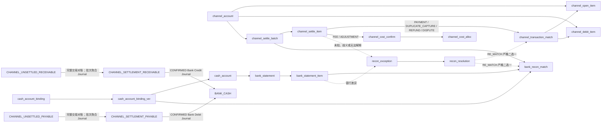

MVP 不创建 `cash_pool`。`cash_account` 和 `cash_account_binding` 明确限制到单一 `entity_type + entity_id` 账簿主体。Client 只能共享其交易所属 OE、币种和用途对应的外部银行账户，禁止使用同一物理账户跨主体收款或付款。

Channel/MID 与银行绑定的跨表一致性必须在同一应用事务中校验：`channel_account.mid_id` 在同一币种只能定位一个 Finance 清算账户，且 Channel/OE 必须等于 Payment 权威 MID Tuple；`cash_account_binding.current_ver_id` 必须属于同一 Binding，所指 Version 的 `cash_account_id` 必须与 Binding 的主体/币种一致且处于有效期；Payout Execution 与 Tax Payment 保存的 `cash_account_id`、Bank Recon Match 引用的 Bank Item 所属 `cash_account_id` 都必须等于其 Binding Version 指向的账户，Account Purpose 分别为 `PAYOUT/TAX/CHANNEL_SETTLEMENT`。任何 ID 单独能连上但 Channel、MID、主体、币种、用途、方向或生效版本不一致的组合都必须回滚。

渠道交易对账先把 Channel 的 PAYMENT/DUPLICATE_CAPTURE/REFUND/DISPUTE 原始 Settlement Item 分配给本库 Open/Debit Item。正常行依据 Finance 在 `PaymentSucceeded`、`RefundSucceeded`、`DuplicateCaptureDetected/Compensated` 或 `DisputeLost` 时已经冻结的 Channel Transaction Reference 与 External Transaction ID 完成，不调用 Payment 查询；未知、缺失或一对多歧义的外部行只创建 Recon Exception，Operations 可人工调查来源，但不得用当前 Payment 状态猜测历史事实。每条业务交易原始行的 Transaction Match 金额必须完整覆盖且不超额。FEE/ADJUSTMENT 原始行不创建虚假的 Open/Debit Item Match：代表实际渠道成本时必须由 `channel_cost_confirm + channel_cost_alloc` 完整确认和分摊，否则必须创建 Recon Exception；未解决的阻断异常不能视为完成。整批所有行按方向回放后必须与 Batch Gross/Fee/Debit/Net 一致。

Channel 批次必须来自 Channel 权威最终 Settlement/Remittance 明细；Preliminary Transaction Report 即使逐笔匹配完整也不能触发重分类。最终批次只有同时满足 `status=VALIDATED`、全部业务交易行匹配完整、FEE/ADJUSTMENT 行已由 Channel Cost Confirm/Alloc 或已审批异常处置完整覆盖、实际 Channel Cost Confirmation 完整且不存在阻断性开放异常时，才派生为“交易对账完整”；`VALIDATED` 单独绝不能触发重分类。该门禁不另存第二套状态字段。满足门禁的事务必须锁定相关 Batch/Item/Match/Open Item/Debit Item/Cost Confirm/Alloc/Exception 和 Channel 阶段/费用计提 Account，按 `CHANNEL_BATCH_SETTLEMENT:<batch_id>` 幂等创建一个批次聚合 Journal，并原子更新 Open/Debit Item 的 `settled_amount/outstanding_amount/status`。预计 Channel Cost 已在交易阶段通过 `CHANNEL_FEE_ACCRUAL` 计提；本 Journal 只借记实际计提余额并重分类净额，不能再次确认全额费用，实际差异只允许由已有 COST_ADJUSTMENT 在 `CHANNEL_FEE_EXPENSE ↔ CHANNEL_FEE_ACCRUAL` 间入账一次。净额只能在同一 Channel Account/MID/OE/Currency/Batch 内抵销，不能跨边界净额化；阶段二完成后禁止追加会改变 Gross/Fee/Debit 的 Match、Cost 或 Resolution，纠错只能追加新的 Adjustment/Reversal Journal。

确认 Bank Recon Match 的事务必须再次锁定冻结事实和 `t_bank_statement_item`，避免较早的检查结果漂移。`CHANNEL_CREDIT/CHANNEL_DEBIT` 必须引用 `channel_batch_id + bank_item_id`，并分别匹配 CREDIT/DEBIT 银行流水及 `CHANNEL_SETTLEMENT` Binding Version；`PAYOUT_DEBIT` 必须引用 `payout_execution_id + bank_item_id`、使用 `PAYOUT` Binding Version，并以 `payout_component_type` 标明受益人转账、银行费或合并借记；`TAX_PAYMENT_DEBIT` 必须引用 `tax_payment_id + bank_item_id` 及 `TAX` Binding Version，其他业务目标字段必须为空。Payout 拆分行分别核对 `beneficiary_amount` 与 `fee_amount`；COMBINED 行必须以相同 Bank Payment Ref 或权威银行证据绑定同一 Execution，不能用无关 Debit 的偶然等额合计。`cash_direction=NONE` 的 Channel 批次禁止 Bank Match。同一 Bank Item 可拆分匹配多个目标，但全部 CONFIRMED 分配合计不得超过银行行金额，且必须使用兼容用途和 Cash Binding；同一 Channel Batch 的合计不得超过 `net_amount`，Payout 的完整确认还必须满足已确认 Debit 与已批准差异处置共同闭合 `cash_required_amount`。PROPOSED/REJECTED 不过账；CONFIRMED Channel Match 继续以 `CHANNEL_BANK_MATCH:<bank_recon_match_id>` 幂等创建 Journal。外部 Debit 是已发生事实，即使会使可承诺现金为负也不得拒绝入账；交易层未知/歧义，以及银行层超额、错方向、错币种、错账户、错用途或 Payout 组成不守恒，都必须进入 `recon_exception`。

旧 FAILED Payout Execution 或 FAILED Tax Payment 出现迟到 Debit 时，不得把旧执行改回普通成功，也不得释放或迁移任何新 Execution/替代付款的现金承诺。导入确认该银行事实的事务必须锁定原 BANK_CASH Account，以 `LATE_DEBIT:<bank_item_id>` 为稳定来源键幂等创建 `Dr RECON_SUSPENSE_ASSET / Cr BANK_CASH` 暂记 Journal，并创建 `exception_type=LATE_DEBIT` 的 Recon Exception。这样现金减少立即进入 `net_balance`；后续固定双人 Recon Resolution 只能把暂记资产重分类到最终科目，不能再冲一次 BANK_CASH。

Channel 负向清算不得把已清零的 `CHANNEL_UNSETTLED_RECEIVABLE` 记成负资产。退款、补偿或明确允许入账的争议权威事实先按业务构成借记 Client 应付冲减、收入冲回或损失科目，贷记 `CHANNEL_UNSETTLED_PAYABLE`；Channel Batch 交易对账完整后，才把同批正向待清算应收和该待清算应付净额化。净 CREDIT 时分录为借记 `CHANNEL_SETTLEMENT_RECEIVABLE`、本批实际 `CHANNEL_FEE_ACCRUAL` 与本批抵扣的 `CHANNEL_UNSETTLED_PAYABLE`，贷记本批 `CHANNEL_UNSETTLED_RECEIVABLE`；净 DEBIT 时借记本批 `CHANNEL_UNSETTLED_PAYABLE` 与实际 `CHANNEL_FEE_ACCRUAL`，贷记本批抵扣的 `CHANNEL_UNSETTLED_RECEIVABLE` 与 `CHANNEL_SETTLEMENT_PAYABLE`。`cash_direction=CREDIT/DEBIT/NONE` 必须分别只建立结算应收、只建立结算应付或两者都不建立。银行 CREDIT 的 CONFIRMED Match 按 `matched_amount` 借记 `BANK_CASH`、贷记 `CHANNEL_SETTLEMENT_RECEIVABLE`；银行 DEBIT 的 CONFIRMED Match 按 `matched_amount` 借记 `CHANNEL_SETTLEMENT_PAYABLE`、贷记 `BANK_CASH`，累计不得超过 Batch `net_amount`，累计等于净额才派生为银行层完整。每个 Entry 仍必须借贷相等，且批次、现金方向、用途 Binding Version 与银行方向逐值一致。

### 4.6 Manual Payout 七表

七表是当前完整出款模型；不存在自动 Profile/Run/Candidate/Obligation 层，也没有独立取消根、付款聚合或付款 Attempt 根。每行的字段、索引和关系均按当前 Manifest 原样列出。

| 表 | 可变性与实际字段 | 唯一/访问索引 | 本库逻辑关系、Sidecar 与跨行门禁 |
|---|---|---|---|
| `beneficiary_account` | 可变根；`id,owner_type,owner_id,account_code,beneficiary_vault_token,beneficiary_name_masked,bank_country,currency,bank_account_blind_index,bank_account_blind_key_ver,account_last4,vault_record_version,vault_metadata_hash,bank_code,content_hash,maker_id,checker_id,checker_decision,decision_time,status,version,create_time,update_time` | UK：`uk_beneficiary_acct(owner_type,owner_id,account_code)`；访问：`idx_beneficiary_owner(owner_type,owner_id,status)`、`idx_beneficiary_blind(bank_account_blind_key_ver,bank_account_blind_index)` | 无本库 FK。`ck_beneficiary_lifecycle` 固化 DRAFT、待审、VERIFIED、REJECTED、SUSPENDED/CLOSED 的 Hash 与 Checker 证据矩阵；Maker/Checker 必须不同。DRAFT 可改，提交后银行/Vault 身份字段冻结；变更创建新 ID。新 Payout 仅可引用同 Owner、同币种的 VERIFIED 行并冻结 `content_hash`；Execution 创建和外部提交前再次逐值校验 |
| `finance_restriction_proj` | 可变来源投影；`id,source_system,source_restriction_id,source_version,source_event_key,source_payload_hash,restriction_type,owner_type,owner_id,client_id,operating_entity_id,currency_scope_key,decision,reason_set_hash,effective_from,effective_to,version,create_time,update_time` | UK：`uk_fin_restrict_source(source_system,source_restriction_id)`、`uk_fin_restrict_event(source_system,source_event_key)`；访问：`idx_fin_restrict_scope(owner_type,owner_id,operating_entity_id,currency_scope_key,decision)`、`idx_fin_restrict_client(client_id,decision)` | 无本库 FK、无表级 CHECK；应用按 Source Version CAS，只接受严格新版本，同键不同 Payload Hash 冲突。它只表达当前限制，不冻结金额，也不能替代任一 RCO-I09 实时检查 |
| `payout` | 可变聚合根；`id,payout_no,request_key,owner_type,owner_id,operating_entity_id,currency,beneficiary_account_id,beneficiary_content_hash,available_account_id,locked_account_id,requested_amount,fee_mode,fee_amount,owner_debit_amount,beneficiary_amount,cash_required_amount,assessment_id,evaluation_id,eligibility_decision,eligibility_reason_codes,eligibility_matched_controls,risk_required_amount,risk_required_currency,control_set_hash,eligibility_hash,request_hash,approval_hash,approved_time,journal_entry_id,reconciled_time,status,version,create_time,update_time` | UK：`uk_payout_no(payout_no)`、`uk_payout_request(owner_type,owner_id,request_key)`、`uk_payout_journal(journal_entry_id)`；访问：`idx_payout_owner(owner_type,owner_id,currency,status)`、`idx_payout_oe(operating_entity_id,currency,status)`、`idx_payout_beneficiary(beneficiary_account_id,status)`、`idx_payout_available(available_account_id,status)`、`idx_payout_locked(locked_account_id,status)` | N:1 → `beneficiary_account`、AVAILABLE `account`、LOCKED `account`；仅 `journal_entry_id -> journal_entry` 为 1:1。`ck_payout_amounts` 固化两种费用公式；`ck_payout_risk_snapshot` 固化全空/完整 ALLOW 快照及 Client/Partner 要求金额矩阵；`ck_payout_approval_snapshot` 要求 Approval Hash/Time 成组且绑定完整快照；`ck_payout_reconciled` 要求仅 PAID 存在最终 Journal/时间。跨行校验 Owner/OE/币种、受益人 Hash、Account 科目/Bucket、余额锁定、完整 Risk Scope 与最终 Bank Match 闭合 |
| `payout_approval` | 不可变追加事实；`id,payout_id,action_type,action_no,approval_role,actor_id,decision,requested_from_status,reason_code,evidence_ref_id,approved_content_hash,decision_time,create_time` | UK：`uk_payout_approval(payout_id,action_type,action_no,approval_role)`；访问：`idx_payout_approval_evidence(evidence_ref_id)`、`idx_payout_approval_actor(actor_id,decision_time)` | N:1 → `payout`、可选 `payout_evidence_ref`。`ck_payout_approval_action` 固化普通审批为 `action_no=1/PENDING_APPROVAL/无 Evidence`，取消为正 Action No 且来自 `APPROVED/ON_HOLD/RETRY_REQUIRED`，Cancel 或 REJECTED 必须有原因。每个动作的 Maker/Checker 必须不同并重复完全相同的动作输入与 Hash；取消 Hash 覆盖 Payout、Action、原状态、原因、Evidence、LOCKED Account 与 Owner Debit |
| `payout_execution` | 可变执行根；`id,payout_id,attempt_no,cash_account_binding_ver_id,cash_account_id,execution_key,request_hash,assessment_id,evaluation_id,eligibility_decision,eligibility_reason_codes,eligibility_matched_controls,risk_required_amount,risk_required_currency,control_set_hash,eligibility_hash,bank_payment_ref,status,failure_code,active_slot,submitted_time,resolved_time,version,create_time,update_time` | UK：`uk_payout_execution(payout_id,attempt_no)`、`uk_payout_execution_key(execution_key)`、`uk_payout_bank_ref(cash_account_id,bank_payment_ref)`、`uk_payout_active_execution(payout_id,active_slot)`；访问：`idx_payout_execution_binding(cash_account_binding_ver_id)`、`idx_payout_execution_cash(cash_account_id,status)`、`idx_payout_execution_status(status,create_time)` | N:1 → `payout`、`cash_account_binding_ver`、`cash_account`。`ck_payout_execution_active` 固化 CREATED/SUBMITTED/UNKNOWN 的 `active_slot=1`；`ck_payout_execution_state` 固化提交/解决/失败证据矩阵；`ck_payout_execution_risk_snapshot` 要求每行完整 ALLOW 快照。跨行保证 Attempt 连续、同一 Payout 最多一个活动执行、Binding/OE/币种/PAYOUT 用途一致、CREATED 先占用 BANK_CASH 容量，且重试只能在前一执行权威 FAILED 后创建 |
| `payout_evidence_ref` | 不可变追加事实；`id,payout_execution_id,file_id,file_content_hash,evidence_type,create_time` | UK：`uk_payout_evidence(payout_execution_id,file_id,evidence_type)`；访问：`idx_payout_evidence_file(file_id,file_content_hash)` | N:1 → `payout_execution`；无额外表级 CHECK。`evidence_type` 仅 `PAYMENT_PROOF/NO_DEBIT_PROOF/BANK_CONFIRMATION/RECONCILIATION_SUPPORT`；文件 ID/Hash 必须成对且与 Platform 内容逐值一致，不保存正文或 URL |
| `payout_event` | 不可变连续审计事实；`id,payout_id,execution_id,event_scope,event_no,from_status,to_status,reason_code,actor_id,source_type,source_id,source_event_key,approval_id,evidence_ref_id,bank_recon_match_id,journal_entry_id,payout_version_after,execution_version_after,occurred_time,create_time` | UK：`uk_payout_event_no(payout_id,event_no)`、`uk_payout_event_source(source_type,source_event_key)`；访问：`idx_payout_event_execution(execution_id,event_no)`、`idx_payout_event_approval(approval_id)`、`idx_payout_event_evidence(evidence_ref_id)`、`idx_payout_event_bank_match(bank_recon_match_id)`、`idx_payout_event_journal(journal_entry_id)`、`idx_payout_event_actor(actor_id,occurred_time)` | N:1 → `payout`、可选 `payout_execution/payout_approval/payout_evidence_ref/bank_recon_match/journal_entry`。`ck_payout_event_scope` 固化 PAYOUT Scope 时 Execution/Execution Version 全空，EXECUTION Scope 时两者全非空。锁 Payout Root 后严格连续分配 `event_no`；两类 Version 必须等于同一事务更新结果；来源唯一键保证重放不跳号、不重复追加 |

`beneficiary_account` 是 Client/Local Partner 的外部收款目的地，不是平台资产账户。一个已验证受益人可被同一 Owner 的多个 OE 出款引用，但每个 Payout 只允许一个 Owner、一个 OE 和一种币种；账户余额、审批、执行、Bank Match 与 Journal 始终按该 Tuple 隔离，不得跨 OE 或跨币种抵销。

Payout 创建时先锁定并校验唯一 AVAILABLE/LOCKED Owner Payable Account，以 `PAYOUT_LOCK:<payout_id>` 原子记账：`Dr Owner Payable/AVAILABLE`、`Cr Owner Payable/LOCKED`。`PENDING_APPROVAL` 且没有 Execution 时允许申请人直接撤回；`APPROVED/ON_HOLD/RETRY_REQUIRED` 的取消是 Payout 上的 `PAYOUT_CANCEL` 双人审批动作，不创建取消根。只有无可能扣款的 Execution、无 `UNKNOWN`、无未决 Bank Match 且所有已提交 Execution 均有权威未扣款结论时，才以 `PAYOUT_RELEASE:<payout_id>` 原子记账：`Dr Owner Payable/LOCKED`、`Cr Owner Payable/AVAILABLE`。正常完成以 `PAYOUT_PAID:<payout_id>` 记账：`Dr Owner Payable/LOCKED`、`Cr BANK_CASH`。上述每条 Journal 都必须借贷相等。

两种费用模式都由 Owner 承担且不形成平台收入/费用：`ADDED_ON_TOP` 要求 `owner_debit_amount=cash_required_amount=requested_amount+fee_amount`、`beneficiary_amount=requested_amount`；`DEDUCTED_FROM_PAYOUT` 要求 `owner_debit_amount=cash_required_amount=requested_amount`、`beneficiary_amount=requested_amount-fee_amount`。完整 Bank Match 的实际 Debit 与已批准差异处置共同闭合 `cash_required_amount`。不足扣款释放差额时借记 LOCKED、贷记 AVAILABLE；超额或迟到扣款通过 Recon Exception/Resolution 与 `PAYOUT_FEE_DIFF:<recon_exception_id>` 或 `LATE_DEBIT:<bank_item_id>` 的平衡 Journal 处理，不得改写已完成 Payout。`payout.journal_entry_id` 只指向正常/最终清算 Journal；差异、追偿和迟到 Debit 必须从 `payout_event`、Bank Match、Recon Exception/Resolution 的会计坐标导航。

差异分录也必须平衡。若实际 Debit 少于冻结 Owner Debit，最终清算 Journal 只按真实 Debit 记 `Dr Owner Payable/LOCKED / Cr BANK_CASH`，差额 Journal 记 `Dr Owner Payable/LOCKED / Cr Owner Payable/AVAILABLE`；若实际 Debit 超出冻结金额，正常 Payout 只分配冻结金额并按该金额清算，超额经批准记 `Dr CLIENT_RECOVERY_RECEIVABLE 或 PARTNER_RECOVERY_RECEIVABLE / Cr BANK_CASH`，或者在有追加授权且余额充足时记 `Dr Owner Payable/AVAILABLE / Cr BANK_CASH`。受益人转账金额不符不能伪装成手续费差异。所有差异 Journal 使用 `PAYOUT_FEE_DIFF:<recon_exception_id>` 幂等，已失败 Execution 的迟到 Debit 则使用 `LATE_DEBIT:<bank_item_id>` 记 `Dr RECON_SUSPENSE_ASSET / Cr BANK_CASH`。

RCO-I09 必须在 Payout 创建、最终 Finance 审批、Execution 创建和外部提交四个 Checkpoint 发起新的实时评估，任何较早结果都不能跳过下一次调用。最终审批采用的完整结果冻结在 Payout，每个 Execution 采用的最新完整结果冻结在该 Execution，字段均为 `assessment_id + evaluation_id + eligibility_decision/reason_codes/matched_controls + risk_required_amount/currency + control_set_hash + eligibility_hash`；Risk 自己的不可变 Assessment/Evaluation 保留四次评估的权威历史。Finance 查询 Risk 时还必须验证 Assessment/Evaluation 为不可变一对一、Owner/OE/Currency/Amount Scope 完整一致，并能按 `control_set_hash` 重建控制集合。任一缺失、陈旧、不可重建、非 ALLOW 或来源版本断档都 Fail-Closed。Finance 本地 Hash 不能替代 Risk 的权威 Hash，也不得新增 Risk Result Root。

每个 `payout_execution` 在 CREATED 事务中就锁定其 `BANK_CASH` Account 并占用 `cash_required_amount`；提交前再执行第四次 RCO-I09 和受益人/限制/现金门禁。超时或无法确认只能进入 `UNKNOWN`，继续占用 Owner LOCKED 余额与 BANK_CASH 容量并禁止重试和取消；只有权威未扣款证据允许 FAILED，随后才可创建连续 `attempt_no` 的新 Execution。已失败 Execution 的迟到 Debit 进入 `LATE_DEBIT` 异常路径，不得反改为普通成功或释放新 Execution 的承诺。

### 4.7 试算平衡与期间关账

| 表 | 用途 | 关键字段 | 唯一、检查与并发约束 |
|---|---|---|---|
| `trial_balance_run` | 指定账簿和期间的试算任务 | `ledger_book_id`、`period_id`、`run_no`、`as_of_sequence`、`status`、`total_debit/credit`、`content_hash` | `uk_trial_run(ledger_book_id,period_id,run_no)`；`total_debit/credit` 是可过账叶子科目期末余额按实际借贷方向拆分的合计，不是本期发生额；成功时必须相等；CREATED/RUNNING 的 Hash 为空，SUCCEEDED/FAILED 时冻结；失败 Run 不转成功且不可覆盖 |
| `trial_balance_line` | 科目期初、本期和期末试算行 | `run_id`、`chart_account_id`、`opening_balance`、`period_debit/credit`、`closing_balance` | `uk_trial_line(run_id,chart_account_id)`；汇总该 Run 所属 Book 下同一会计科目的全部统一账户，并按科目正常方向保留有符号 Opening/Closing Balance，不取绝对值；同 Chart 下账户的冻结 `normal_side` 必须与科目一致 |
| `trial_balance_exception` | 账户、往来、在途、对账和科目汇总不一致 | `run_id`、`exception_type`、`reference_type`、`reference_id`、`difference_amount`、`status`、`resolution_type`、`resolution_ref_id`、`resolution_content_hash`、`resolution_maker_id`、`resolution_checker_id`、`resolution_time` | `uk_trial_exception(run_id,exception_type,reference_type,reference_id)`；Reference Type 只允许 `ACCOUNT/CHART_ACCOUNT/CASH_ACCOUNT/RECON_EXCEPTION`；OPEN/UNDER_REVIEW 时解决 Tuple 全空；RESOLVED/WAIVED 时必须冻结类型化证据、内容 Hash 和不同人员双签；`PROJECTION_REBUILD` 只允许总账投影漂移并引用重建命令结果，`GENERAL_LEDGER_MISMATCH` 禁止 Waiver；自由文本引用不能解除关账门禁 |
| `period_close` | 会计期间关账或重开聚合根 | `period_id`、`close_no`、`close_type`、`reopens_close_id`、`reopen_reason_code`、`reopen_request_ref`、`status`、`active_slot`、`maker_id`、`checker_id`、`close_hash`、`version` | `uk_period_close(period_id,close_no)`、`uk_period_close_active(period_id,active_slot)`、`idx_period_reopen_target(reopens_close_id)`（驳回的重开不阻止再次发起，活动并发由 `uk_period_close_active` 保证）；活动流程 slot=1、终态为 NULL；普通 CLOSE 的重开 Tuple 全空，REOPEN 必须完整引用同期间原 Close；Maker 与 Checker 不同；`close_hash` 冻结 Header、全部 Book Scope、Step、Trial Balance、Exception Resolution 和结转 Instruction |
| `period_close_book` | 一个关账/重开流程内的逐账簿证据 | `period_close_id`、`ledger_book_id`、`as_of_sequence`、`final_trial_run_id`、`posting_instruction_id`、`status` | `uk_period_close_book(period_close_id,ledger_book_id)`、`uk_close_book_trial(final_trial_run_id)`、`uk_close_book_instr(posting_instruction_id)`；LOCK_SEQUENCE 先禁止普通业务过账并把字段初始化为当时水位，关账流程专用的调整/结转 Journal 可原子推进水位；FINALIZED 时该字段冻结为最终水位，并与成功 Final Trial 完全一致，同时必须存在 CLOSING/REOPENING Instruction；Root 完成前所有适用账簿都必须 FINALIZED |
| `close_step` | 数据完整性、对账、试算、损益结转等步骤 | `period_close_id`、`step_no`、`step_type`、`status`、`result_hash`、`completed_time` | `uk_close_step(period_close_id,step_no)`；PENDING/RUNNING 时 Result Hash 与 Completed Time 均为空，SUCCEEDED/FAILED/SKIPPED 时二者都必须存在；按固定序列执行，失败阻断后续步骤 |
| `close_approval` | 关账/重开双人审批 | `period_close_id`、`approval_role`、`actor_id`、`decision`、`approved_close_hash`、`decision_time` | `uk_close_approval(period_close_id,approval_role)`；Maker 与 Checker 不同；批准 Hash 必须等于 `period_close.close_hash` |
| `close_account_rule` | Revenue/Expense 到期间损益和留存收益的结转映射 | `chart_id`、`source_account_id`、`current_result_account_id`、`retained_earnings_account_id`、`effective_from/to` | `uk_close_rule(chart_id,source_account_id,effective_from)`；目标必须为 Equity 类科目 |

固定关账步骤：

1. 枚举该期间适用的全部 Ledger Book，并按与普通 Posting 一致的 Book/Period→Sequence 锁顺序把期间从 OPEN 推进到 CLOSING，禁止新的普通业务过账，再在每条 `period_close_book` 初始化各自 `as_of_sequence`；后续只有本次关账流程自己的调整/结转 Journal 可以推进该水位；
2. 检查待处理/人工处置的 `compensation_event`、外部事件业务幂等冲突、Instruction 和 Journal 完整性；
3. 执行 `RECONCILE_ACCOUNT_BALANCES`，完成 Channel、银行、Client/Partner 统一账户、余额桶、保证金与追偿应收 Account 核对；对 Partner 来源交易还必须按同一 Transaction Economics、Platform Service Charge Component 和币种核对 Partner OE 的 `PLATFORM_SERVICE_PAYABLE` 与 Platform Finance Entity 的 `PLATFORM_SERVICE_RECEIVABLE`，任何单边缺失或金额不等产生 `COUNTERPARTY_MISMATCH`；
4. 生成试算平衡；
5. 解决全部 Trial Balance Exception；
6. 追加损益结转 Instruction；
7. 每个账簿重新试算、冻结 Final Trial Run 与 CLOSING/REOPENING Instruction，全部进入 FINALIZED 后生成不可变 `close_hash`，写入前再次校验活动槽；
8. Checker 仅可批准相同 `close_hash`，审批、全部 Book Scope 完整性复验、期间 CLOSED/OPEN、流程终态和活动槽释放在同一事务完成。

**关账补充约定（2026-10-16 决定 D3、D4）：** 期间内没有任何收入/费用净额的账簿不生成结转指令，其 `period_close_book.posting_instruction_id` 为空；FINALIZED 仍要求成功的 Final Trial 且水位一致。`period_close.close_hash` 在 CREATED/RUNNING/FAILED 时为空，进入 PENDING_CHECK 时冻结并在之后不可变。关账必须按期间顺序进行：同一日历中更早的期间全部 CLOSED 后才能发起（D1）。

**重开与年末结转（2026-10-17 决定，见[期间重开与年末结转需求](../../requirements/20261017/finance-期间重开与年末结转/requirement.md)）：** D1 只能重开同一日历中最近关闭的期间：开始日期晚于它的期间不得处于 CLOSED、CLOSING 或 REOPENING；原关账为该期间序号最大且 COMPLETED 的 CLOSE 流程。D2 发起重开只规划并冻结冲回行（`close_hash` 使用独立 schema `CODE-MOR:FINANCE:PERIOD_REOPEN:1`，覆盖原因、申请编号、原关账 ID 与摘要、账簿水位与冲回行），期间 CLOSED → REOPENING；冲回分录在审批通过的同一事务内过账，期间回到 OPEN 并 `reopen_count + 1`；驳回不留分录，期间回到 CLOSED。D3 冲回按原关账各账簿结转指令的行逐行借贷互换、金额不变，以 REOPENING 分录、过账日为期间结束日；重开 Book 的 FINALIZED 表示冲回指令已过账（原关账无结转指令的账簿直接 FINALIZED），不要求 Final Trial；再次关账时按当时余额重新结转。D4 财年最后期间 = 期间结束日次日为日历 `year_start_month` 的 1 日；该期间关账时在同一结转指令中追加 `CURRENT_PERIOD_RESULT → RETAINED_EARNINGS` 行，重开时随原指令一并冲回。D5 重开流程只有 `LOCK_SEQUENCE`、`PLAN_REOPEN_REVERSAL`、`POST_REOPEN_REVERSAL` 三个步骤（第三步在审批时 SUCCEEDED、驳回时 SKIPPED），不执行关账的 7 个步骤。

Trial Line 只持久化可过账叶子科目；父科目仅由查询向上汇总，期初为零且水位内无发生额的叶子科目可以不持久化。每行 `opening_balance/closing_balance` 继续按科目 `normal_side` 保存有符号余额：DEBIT 正余额计入 Run `total_debit`、DEBIT 负余额按绝对值计入 `total_credit`，CREDIT 正余额计入 `total_credit`、CREDIT 负余额按绝对值计入 `total_debit`。`period_debit/period_credit` 只是本期发生额，不参与替代期末借贷余额合计。

`trial_balance_run.content_hash` 在 CREATED/RUNNING 时必须为 NULL；进入 SUCCEEDED/FAILED 时一次冻结 Run Scope、Book/Period/Sequence、全部 Trial Line 和异常发现事实，但明确不包含之后可变的异常解决 Tuple。失败 Run 即使异常后来被解决也保持 FAILED；Accounting Instruction、Recon Resolution、Projection Rebuild 或 Waiver 完成后都必须创建新的 Run，Final Trial 只能引用新的成功 Run。`resolution_content_hash` 单独冻结每次异常解决，Close Hash 再绑定本次关账采用的最终解决集合。

`PROJECTION_REBUILD` 仅用于 Journal 正确而 `account` 或 `ledger_period_balance` 等可重建投影漂移的 `GENERAL_LEDGER_MISMATCH`。重建命令按 Book 和 `as_of_sequence` 从 Journal 重算，通过原并发令牌/CAS 更新投影，不创建 Accounting Instruction 或 Journal，也不改变 Journal Sequence；`resolution_ref_id` 指向受控命令结果，解决 Hash 覆盖重建 Scope、水位及重建前后摘要。若 Journal 本身错误，必须追加经过正常控制的更正 Instruction/Journal 后重新试算，禁止把 Projection Rebuild 伪装成会计更正。

`CONTROLLED_WAIVER` 只允许经会计政策明确列入 Allowlist 的软控制差异，并继续要求 Maker-Checker；Journal 不平衡、Journal/Line 缺失、跨 Book/Period/Sequence、总账硬错误以及 Platform Service Charge 单边 Journal 或双边金额不等永远不得 Waive。没有现实可豁免类型时，应用 Allowlist 为空并 Fail-Closed，不能因为 enum 存在就默认放行。

同一期间任何时间最多一条 `active_slot=1` 的 CLOSE/REOPEN 流程。重开不得修改旧 Close：必须新建 `close_type=REOPEN` 的 `period_close`，重新冻结重开原因、原 Close Hash、影响范围和新 `close_hash` 并双人审批；成功后将期间改回 OPEN 并释放活动槽。后续再次关账创建新的 `close_no`，历史 Close、Step、Approval 和 Hash 均不可覆盖。

逐笔交易利润始终是收入减实际成本的查询结果，不建立交易利润科目；期间关账允许将 Revenue 与 Expense 结转到 `CURRENT_PERIOD_RESULT`，再进入 `RETAINED_EARNINGS`。

### 4.8 本地补偿事件与命令幂等

| 表 | 用途 | 关键字段 | 唯一、检查与并发约束 |
|---|---|---|---|
| `compensation_event` | Finance 业务事实发布与本地补偿重试 | `id`、`event_key`、`event_type`、`sub_event_type`、可空 `payload_json`、`execute_status`、`execute_count`、`next_execute_at`、`lock_owner`、`lock_until`、`last_error_code`、`last_error_summary`、`lock_version`、`create_time`、`update_time` | 唯一身份固定为 `(event_key,event_type,sub_event_type)`；业务状态、Journal 和本表同一本地事务提交；状态为 `INIT/PROCESSING/ERROR/FAILED`；`lock_version` 只用于 Claim/Lease CAS。当前 84 表生成模型仍是旧形态，实施前按 COMP-01 一次性迁移 |
| `command_idempotency` | Finance HTTP/内部命令幂等与调用方隔离 | `caller_type`、`caller_id`、`caller_scope`、`operation_type`、`idempotency_key`、`request_hash`、`result_ref_type/id`、`response_hash`、`correlation_id`、`status`、`expires_time` | `uk_finance_command_idem(caller_scope,operation_type,idempotency_key)`；`caller_scope` 必须把 Caller Type/ID、租户与 OE 等授权边界编码为最长 128 字符的非空 Canonical Key（如 `CLIENT:{id}:OE:{id}`），不是展示文本或自由 JSON；相同 Key 同一 Hash 返回原结果，相同 Key 不同 Request Hash 记录冲突审计并拒绝；本表不需要机械 Version；不保存明文请求、响应或敏感参数 |

MVP 不建立通用 Inbox、Outbox、Outbox Attempt 或聚合事件游标。`payload_json` 默认为空；只有参数从未进入本库权威事实时才允许保存最大 4 KiB UTF-8 的最小 JSON Object，禁止敏感明文、业务密文、凭据、Vault Token、大文件和可从本库恢复的上下文。`event_key` 是 Handler 查询 Finance 权威事实的稳定业务键，不要求在补偿表复制 Source/Schema/Payload Hash；`id` 只是本库可删除任务的 Snowflake 主键。跨系统业务事件自己的 Version/Hash 属于 MQ 契约和接收方业务幂等事实，不属于本地补偿表身份。

业务事务提交后由 afterCommit 唤醒本地 Dispatcher，XXL-Job 只负责丢失唤醒后的兜底扫描、服务级串行隔离或分片；Worker 必须使用 `lock_owner + lock_until + lock_version` 原子 Claim。MQ 采用 At-Least-Once，收到 Broker Confirm 才算成功；相同任务重试复用原 `(event_key,event_type,sub_event_type)`。成功后允许删除任务；可重试失败进入 `ERROR` 并计算 `next_execute_at`，达到上限或不可重试时进入 `FAILED`、保留安全错误摘要并告警；人工重开必须有 Operator Command/工单审计并回到 `ERROR`。Finance 消费外部事件时不写通用 Inbox，而是在 `transaction_economics`、`accounting_instruction`、`duplicate_capture_item`、`finance_restriction_proj` 等对应权威事实上保存业务事件的 `source_system + source_event_key + source_version + source_payload_hash`，以唯一约束和版本条件更新幂等；同 Key/Version 不同 Hash 必须进入业务冲突且不产生 Journal，本地事务失败时不 Ack。若创建权威事实前的同步依赖暂时失败，同样不 Ack 并依靠 Broker 重投；确定性的引用/完整性错误进入 DLQ 与人工处置，不得只创建一条无权威业务状态关联的本地任务后 Ack 原消息。

### 4.9 退款成功入账契约

| 入站事件 | Finance 接收条件 | 最小 Payload 与本库语义 |
|---|---|---|
| `RefundSucceeded` | Payment 的 Channel Refund 已取得权威成功，且 Payload 能唯一定位原成功 Payment、Refund Request、Channel Refund Transaction Ref；Finance 不参与此前的退款审批或 Channel 提交 | Payload 至少包含 Event Key/Version/Hash、`refund_request_id`、`channel_refund_id`、Order/Intent/原成功 Attempt、退款金额币种、Channel/MID、原支付与退款 Transaction Ref、发生时间。Finance 与原 PAYMENT Economics、Component、Channel Open Item 逐值核对，在一个本地事务中幂等创建 REFUND Economics、Component Link、Channel Debit Item、Instruction/Journal；同 Key/Version 不同 Hash 或累计 REVERSAL 超过原组件金额必须拒绝并进入业务异常 |

Payment `refund_status=UNKNOWN` 表示 Channel 结果尚不确定，只留在 Payment 内继续占用其本地 Refund Position，不形成外部事件；`RefundFailed/RefundCancelled` 只驱动 Commerce 与 Payment 释放各自的退款额度。这些状态或事实都不发送给 Finance，也不产生 Finance Journal 或成熟补偿。Finance 处理 `RefundSucceeded` 失败时不 Ack，由 MQ 重投；这不会回退 Payment 与 Commerce 已确认的权威退款终态。Finance 的账务幂等由 REFUND Economics 的 Source Event Tuple、`channel_refund_id` 唯一绑定和 Component Link 累计守恒共同保证。

#### 4.9.1 Cancel、Void 与 Reversal 会计边界

| 支付操作 | Payment 权威事实 | Finance 行为 |
|---|---|---|
| Cancel 未支付 Intent | 可空 `PaymentAttemptFailed(reason=CANCELLED_BEFORE_CHANNEL_SUBMIT)` + `PaymentIntentTerminated(CANCELLED)` | 不入账；即使此前 Risk 已预占限额，也由 Risk 释放，Finance 不创建资金或会计对象 |
| Void 未 Capture 授权 | `PaymentAuthorized` 后，VOID Action/Ref 权威成功，并发布 `PaymentAttemptFailed(reason=AUTHORIZATION_VOIDED)` + `PaymentIntentTerminated(CANCELLED)` | 不入账；授权不是 Channel Unsettled Receivable，VOID 也不是 Refund、Accounting Reversal 或负向 Payment |
| Reversal 选择未 Capture 分支 | 与上一行相同，最终资源为 Payment VOID Action | 不入账，不创建 Transaction Economics 或 Journal |
| Reversal 选择已 Capture 分支 | Commerce 创建标准 Refund Request；Payment 以本地 Refund Position 控制 Channel Refund，成功后发布 `RefundSucceeded` | 完整复用标准 Channel Refund 和 4.9 成功入账契约；只有 `RefundSucceeded` 才生成 `REFUND` Transaction Economics、按实际经济构成形成的 `STANDARD`/`ADJUSTMENT` Journal 与财政更正 |

Finance 不以 `PaymentAuthorized`、`PaymentAttemptFailed` 或 `PaymentIntentTerminated` 单独生成账务；只有已经通过 `PaymentSucceeded` 建立原 PAYMENT Economics/Journal 后，标准 `RefundSucceeded` 才能形成负向经济影响。Channel Adapter 即使把一个外部接口命名为 reversal，也必须由 Payment 先归一为 `VOID` 或 `REFUND`，Finance 不消费含义不确定的 `ReversalSucceeded`。

这里的业务命令 `Reversal` 与会计数据中的 `REVERSAL` 必须严格区分：`transaction_economic_component.effect_direction=REVERSAL` 与 `journal_entry.reversal_of_entry_id` 表示对既有经济组件或完整会计分录追加反向事实，不表示 Finance 接收过名为 Reversal 的支付命令，也不得作为绕过 Refund Request、Payment Refund Position 或 Fiscal Correction 的入口。

### 4.10 Finance 出站事实目录

下列最小 Payload 之外，每个事件都必须携带不受本地任务删除影响的 Event Key、Event Type、`source_system=FINANCE`、Source Type/ID/Version、Schema Version、Payload Hash 和 Occurred Time。`compensation_event.id` 仅是本地任务主键，禁止作为跨系统事件标识。状态事实只能在权威聚合状态与 `compensation_event` 同一事务提交后发布。

| 事件 | 权威聚合与触发 | 最小业务 Payload |
|---|---|---|
| `EconomicsCalculated` | `TRANSACTION_ECONOMICS` 与全部 Component 完整冻结 | Transaction Economics/Parent ID、`economics_type`、Source Tuple、Order/Order Context/Intent/Attempt/Refund/Dispute 引用、可选 `duplicate_capture_item_id`、`commercial_context_time`、Client/OE/Assignment/Partner、Agreement-OE Association、国家/实际支付方式、`industry_code/mcc_code`、Tax Snapshot ID、金额币种，以及每个 Component 的类型、金额、影响方向、来源 Rule Version/Scope/Component ID、完整计算参数、方法和舍入方式；只有规则族存在独立 Hash 契约时才发送 `source_rule_content_hash`。非 PAYMENT 类型必须沿合法 Parent 链继承原交易 Context 锚和分类，DUPLICATE_COMPENSATION 的直接 Parent 必须为同 Duplicate Item 的 DUPLICATE_CAPTURE；不发送未在 Finance 落库的 CCT V5 Hash、Agreement Root ID、Plan 或经济 Calculation Hash |
| `TaxCalculated` | TAX_SNAPSHOT 及 Tax Line 同事务冻结 | Tax Snapshot ID、Request/Order ID、OE、逐行 Registration/Fiscal Scope Hash、Registration 集合 Hash、Collected/Reverse Charge 合计、币种、`calculation_hash` |
| `FiscalRecordCreated` | FISCAL_RECORD 取得法定号码并归入 Period | `generation_key_version`、`document_generation_key/generation_scope_hash`、`client_id`、`order_id`、`business_ref_type/business_ref_id`、`document_type`、`fiscal_record_id`、`fiscal_source_version=1`、`fiscal_record_content_hash`、`fiscal_source_payload_hash`、Original Record/Registration/Period ID、Record Type/Number、OE、金额币种与 `occurred_time`；`fiscal_record_content_hash` 等于不可变 Record `content_hash`，`fiscal_source_payload_hash` 是事件信封 Canonical Payload Hash，两者不得互相替代；Generation Key 使用与 Commerce 完全相同且显式编号的 Canonical 算法，每个 Registration/Document Type 独立 |
| `LedgerPosted` | ACCOUNTING_INSTRUCTION 成功生成不可变 Journal | Instruction ID、Journal Entry/Sequence 集合、Ledger Book/OE、币种、平衡 Hash、Source Event Key |
| `BalanceChanged` | Account Bucket Journal 与余额投影同事务提交 | Owner/OE、From/To Account ID、金额币种、变更后余额、Journal Sequence |
| `PayableBalanceMatured` | 同一 PAYMENT Economics 的 Client Principal 与可选 Partner Share 共同成熟 Journal 原子提交 | Economics ID、Client/OE、可选 Partner、共享 `balance_available_time`、币种、Client PENDING/AVAILABLE Account ID 与 `client_matured_amount`；Partner 场景冻结 PENDING Account ID、Recovery Receivable/NONE Account ID、AVAILABLE Account ID，以及 `partner_gross_matured`、`recovery_netted`、`partner_net_available` 三个金额，满足 `partner_net_available=partner_gross_matured-recovery_netted`；Journal ID/Sequence。没有 Partner 或某组成金额为零时 Payload 仍以显式零冻结金额，只有零金额 Journal Line 省略 |
| `ClientRecoveryReceivableCreated` | 负向事件借记 `CLIENT_RECOVERY_RECEIVABLE/NONE` Account | Recovery Account ID、Client/OE、Source Type/ID/Version、本次新增与币种、变更后 Account 余额、Journal Entry/Sequence |
| `ActualChannelCostConfirmed` | Channel Cost Confirmation/Allocation 冻结 | Confirmation ID、本库 Channel Settlement Item ID、由 Item 链唯一解析的 Batch/Channel/MID/OE/币种、目标 Payment/Refund/Dispute、金额与 Allocation Set Hash |
| `ReconciliationMismatchDetected` | RECON_EXCEPTION 首次打开 | Exception ID/Type、Source Type/ID、OE、币种、差额、Evidence Hash |
| `PayoutCreated` | Payout、初始 Event、Owner Payable 锁定 Journal 原子提交 | Payout ID/No/Version、Owner/OE/币种、Beneficiary ID/Content Hash、AVAILABLE/LOCKED Account、费用模式与 Requested/Fee/Owner Debit/Beneficiary/Cash Required 金额、Request Hash、Lock Journal ID/Sequence；创建 Checkpoint 的权威 Assessment/Evaluation 保留在 Risk，不把尚未最终审批的结果伪装成 Payout Approval Snapshot |
| `PayoutPaid` | Execution 的 Bank Debit 完整确认、最终 Payout Journal 与终态 Event 原子提交 | Payout/Execution ID 与 Version、已确认 Bank Match ID 集、证据 File ID/Content Hash Tuple、Owner Debit/Beneficiary/Fee/Cash Required 金额币种、最终 Journal ID/Sequence |
| `PayoutRetryRequired` | Execution 权威 FAILED 且确认未扣款 | Payout/Execution ID 与 Version、Failure Code、No-Debit Evidence File ID/Content Hash、LOCKED Account、Cash Account 与原 Execution Key |

保证金预存、返还或允许的争议消耗，以及追偿的净额抵扣和人工回款，均由 `LedgerPosted` 与 `BalanceChanged` 提供 Account/Journal 变动事实，不发布第二套 Hold/Release/Application 事件。只在新增追偿应收时额外发布 `ClientRecoveryReceivableCreated`，且 Payload 不含本地 Case ID。

上述任何事件都不得只传内部 ID 而要求下游跨库补读关键金额、主体、币种或来源版本；确需详情时下游可用公开接口按稳定引用查询。退款不再产生 Finance 自有的资金释放/消费出站事件。

所有出站事实继续使用本服务本地 `compensation_event`：业务 Root、不可变 Event/Audit、Journal 及 `compensation_event` 在同一事务提交，提交后由 Local Handler 可靠发布，XXL-Job 只负责失败唤醒与分片。消费方按稳定 Event Key 幂等；不得新增通用 Inbox/Outbox、Payout Event 总线表或中央补偿数据库。`PayoutRetryRequired` 是业务事实，不等于本地 `compensation_event` 的执行状态。

## 5. 核心关系图

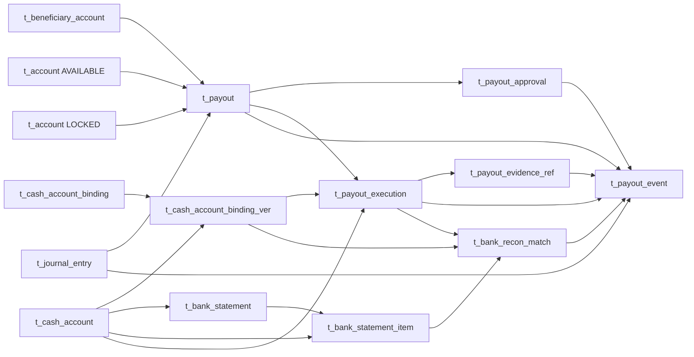

Manual Payout 的关系方向以 Manifest 为准：Beneficiary 与 AVAILABLE/LOCKED Account 是 Payout 的父事实；Approval、Execution 和连续 Event 都挂在 Payout 下；Execution 再冻结 Cash Binding Version、BANK_CASH Account，并拥有 Evidence。Bank Statement Item 与 Execution 通过 `bank_recon_match` 相连，Match 可被 Payout Event 引用；最终 Journal 由 Payout 直接 1:1 引用，其他锁定、释放、差异和迟到 Debit Journal 由 Event/Recon 链导航。

用非会计语言理解：Account 回答“钱目前在待成熟、可出款还是已锁定”；Payout 回答“为什么、给谁、要付多少”；Execution 回答“Operations 实际发起了哪一次银行指令”；Bank Match 回答“银行流水是否真的扣了这笔钱”；Journal 才是唯一改变账簿余额的记录。前四者提供业务与证据链，不能代替 Journal 记账。

## 6. 状态机

### 6.1 Accounting Instruction

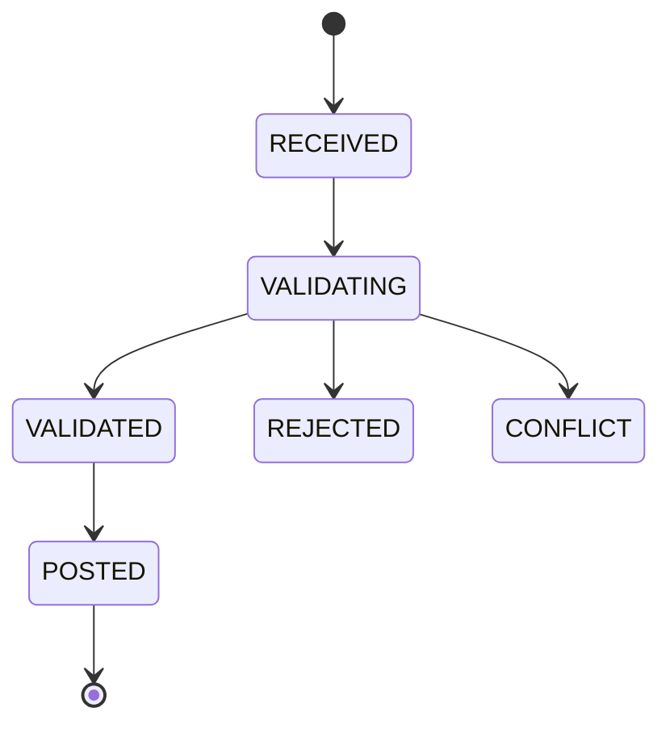

`POSTED` 后禁止回退。更正创建新 Instruction 和 Reversal/Adjustment Journal。

### 6.2 Channel 应收与银行匹配

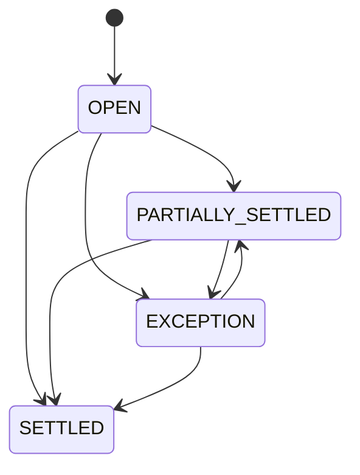

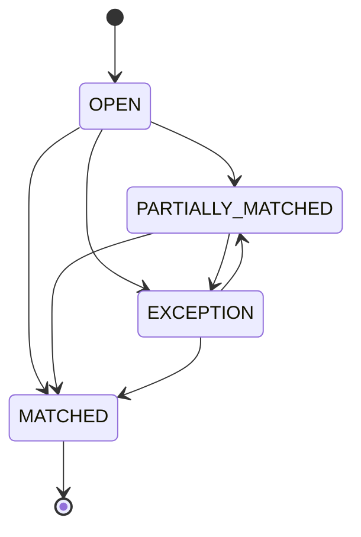

到达冻结的共同 `balance_available_time` 后，以唯一键 `PAYABLE_BALANCE_MATURED:<economics_id>` 在一个本地事务同时成熟 Client Principal 与可选 Partner Share：Client 记 `Dr CLIENT_PAYABLE/PENDING / Cr CLIENT_PAYABLE/AVAILABLE`；Partner 记 `Dr PARTNER_PAYABLE/PENDING partner_gross_matured / Cr PARTNER_RECOVERY_RECEIVABLE/NONE recovery_netted / Cr PARTNER_PAYABLE/AVAILABLE partner_net_available`，其中 `partner_net_available=partner_gross_matured-recovery_netted`，零金额行省略。双方在同一个平衡 Journal 原子提交；Channel 实际结算与未决退款都不构成门禁。每个金额按原 Component、锁内已关联的成功负向事实、此前已成熟金额和当前 Partner Recovery 重算。到期、RefundSucceeded 及 Partner Recovery Netting 串行锁定同一 Economics、Component Link 和相应 PENDING/AVAILABLE/Recovery Account。

### 6.3 Payout 与 Tax Payment 的账户并发门禁

Payout 与 Tax Payment 各自承载业务付款状态；状态变化、不可变 Event、Bank Recon Match、Accounting Instruction 和 Journal 构成完整审计链。每次 Payout Execution 创建或重试、Payout 取消、Tax Payment 创建或失败、两类完整银行 Debit Recon，以及改变对应银行现金的 Journal，都必须在同一本地事务锁定相同的 `BANK_CASH` Account 行。

锁内以 `Bank Cash Account.net_balance` 减去同账户活动付款金额计算可承诺现金：活动 Payout Execution 为 `CREATED/SUBMITTED/UNKNOWN`，活动 Tax Payment 为 `CREATED/SUBMITTED/PROCESSING/BANK_ACCEPTED/UNKNOWN`。Payout Execution 在 CREATED 时即占用 `cash_required_amount`；`UNKNOWN 不释放`。FAILED 只有在权威未扣款证据齐全时才释放该 Execution 的 `active_slot` 与现金承诺，但 Owner Payable 仍保持 LOCKED，等待受控重试或取消；Tax Payment FAILED 同样必须在权威未扣款证据和 Tax Payment Event 同一事务锁定 Tax Payable/BANK_CASH Account 并释放 `active_slot`，之后才能创建替代执行。两类付款只有完整 Debit Recon 后才写最终付款 Journal。Channel Credit/Debit Match、Recon Adjustment 及所有其他 BANK_CASH Journal 也锁定同一 Account；外部已发生 Debit 即使使可承诺现金为负也先如实入账，再阻断后续新承诺。

### 6.4 Payout

```mermaid
stateDiagram-v2
    [*] --> PENDING_APPROVAL
    PENDING_APPROVAL --> APPROVED: maker/checker + fresh RCO-I09
    PENDING_APPROVAL --> REJECTED
    PENDING_APPROVAL --> CANCELLED: requester withdrawal; no execution
    APPROVED --> PAYING: execution externally submitted
    APPROVED --> ON_HOLD: fresh gate fails before submit
    APPROVED --> CANCELLED: approved cancel + PAYOUT_RELEASE
    PAYING --> PAYMENT_UNKNOWN: outcome unavailable
    PAYING --> RETRY_REQUIRED: no debit confirmed
    PAYING --> PAID: complete confirmed debit match
    PAYMENT_UNKNOWN --> PAID: late complete match
    PAYMENT_UNKNOWN --> RETRY_REQUIRED: no debit confirmed
    RETRY_REQUIRED --> PAYING: next execution externally submitted
    RETRY_REQUIRED --> CANCELLED: approved cancel + PAYOUT_RELEASE
    ON_HOLD --> APPROVED: gate restored before first execution
```

Payout 创建即以 `PAYOUT_LOCK` 锁定 Owner Payable。Execution 失败不会消灭付款义务，LOCKED Account 保持锁定；PENDING_APPROVAL 无 Execution 时可由申请人直接撤回，其余取消是 `payout_approval.action_type=PAYOUT_CANCEL` 的双人审批动作，不创建取消 Root。满足无可能扣款的 Execution、无 `UNKNOWN`、无未决 Bank Match且已确认无扣款后，才以 `PAYOUT_RELEASE` 原子解锁。只有完整已确认 Bank Debit Match 与最终 Journal 同事务提交后才进入 PAID。

### 6.5 Payout Execution

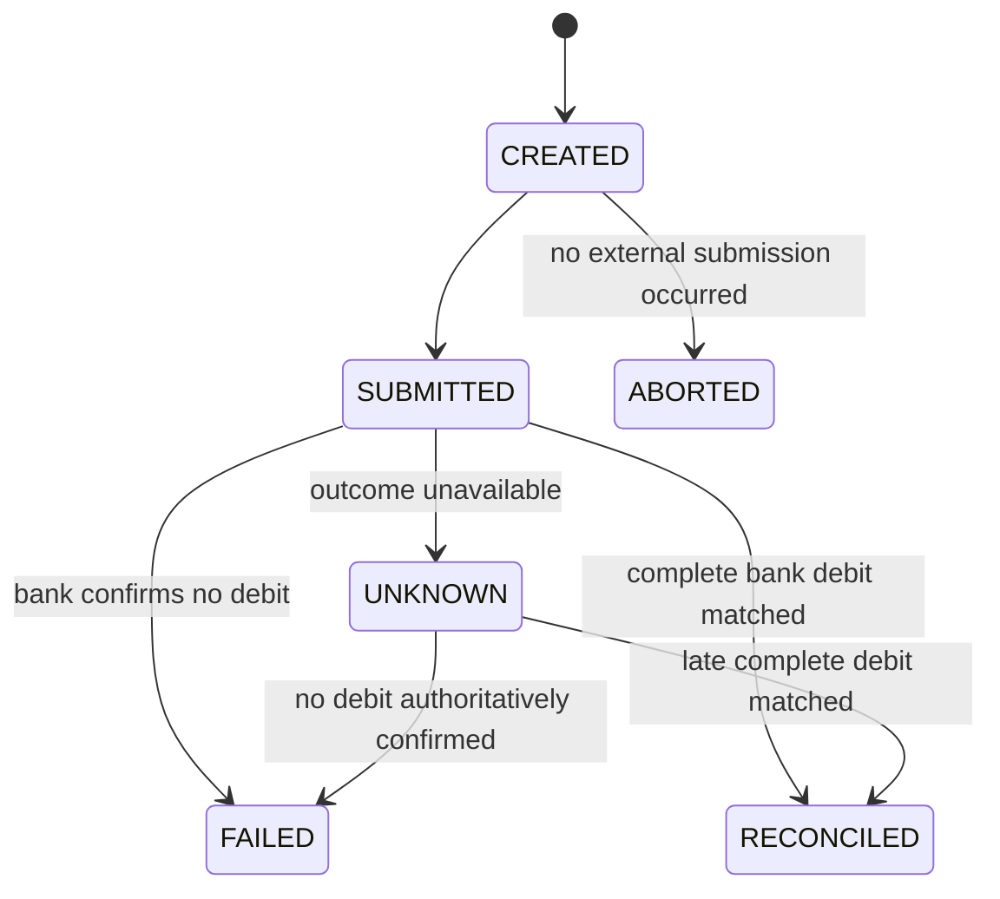

`CREATED/SUBMITTED/UNKNOWN` 都是活动态，`active_slot=1`，不得新建下一 Execution。CREATED 已占用 BANK_CASH 容量；只有 FAILED 释放活动槽且允许下一连续 Attempt。RECONCILED 只在完整已确认 Debit Match 与最终 Payout Journal 同事务存在时成立。

### 6.6 会计期间

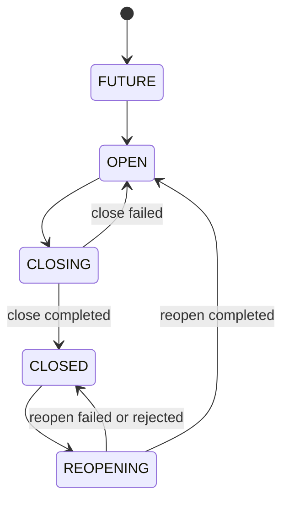

每次 CLOSE/REOPEN 都创建独立 `period_close`，其流程状态固定为：

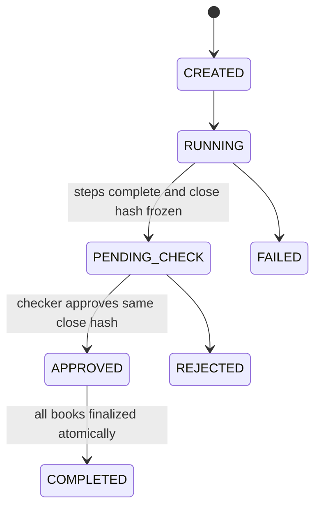

CREATED、RUNNING、PENDING_CHECK、APPROVED 时 `active_slot=1`；FAILED、COMPLETED、REJECTED 时必须在同一状态事务把 Slot 置空。每个 `period_close_book` 必须冻结一个账簿的 Sequence 水位、成功 Final Trial Run 和 CLOSING/REOPENING Instruction；只有全部适用账簿均为 FINALIZED，Root 才能进入 COMPLETED。Accounting Period 只有在 `close_type=CLOSE` 的流程 COMPLETED 后进入 CLOSED，只有在 `close_type=REOPEN` 的流程 COMPLETED 后回到 OPEN。

### 6.7 税务期间与申报

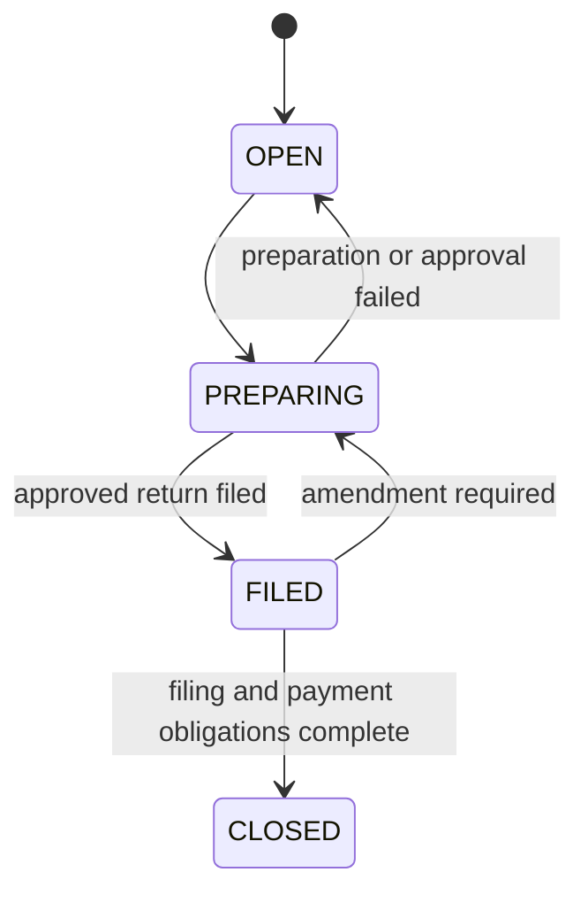

`tax_period` 只有在覆盖范围内 Fiscal Record 完整、Liability Summary Hash 固定且对应精确 Tax Return 版本通过双人审批后才可 FILED。申报的 DRAFT/PENDING_APPROVAL/APPROVED/FILED/ACCEPTED/REJECTED/AMENDMENT_REQUIRED/CLOSED 生命周期由 `tax_return` 承担，付款的执行状态由 `tax_payment` 承担，不塞进 Tax Period。DRAFT 的 `content_hash` 和 Checker Tuple 为空；离开 DRAFT 后申报金额等被审批业务内容及其 Line 冻结，文件、提交时间、回执和状态只可按 Sidecar 矩阵和应用状态机继续补齐。首版 `return_ver=1` 且 `amends_return_id` 为空；更正追加同 `return_no` 的更高版本并引用此前已提交版本，应用事务校验同业务编号、合法前驱和无长环。不存在 Return Root、Current Pointer 或独立 Approval 行。

### 6.8 Tax Payment

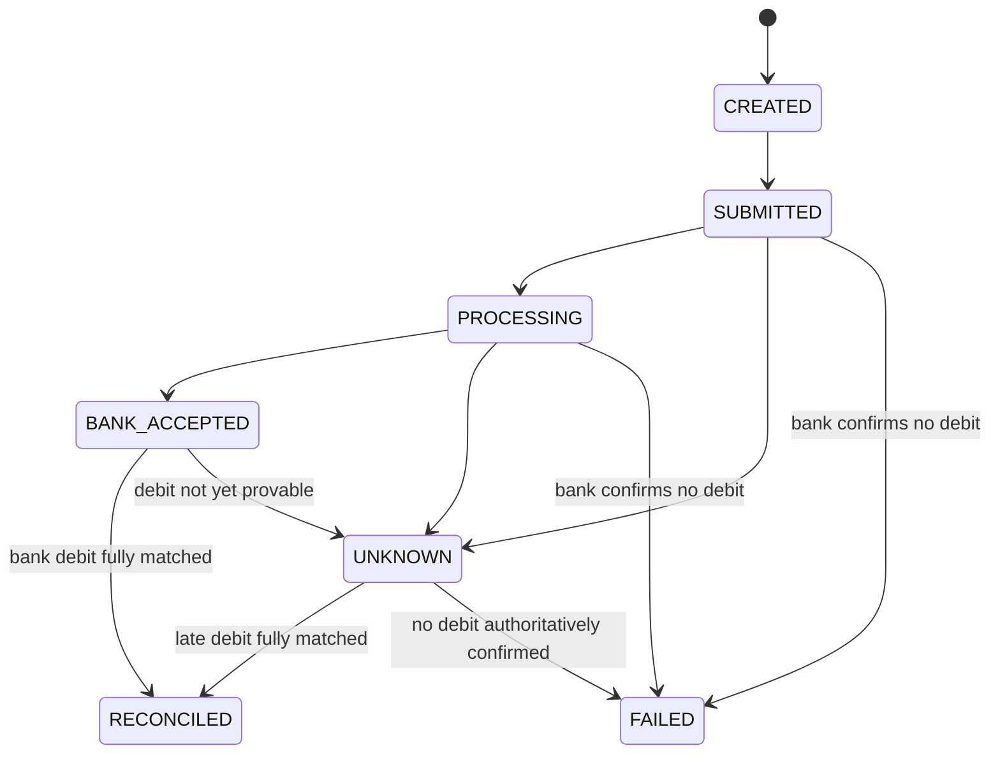

V1 保持人工外部缴税，但正常计划内路径不是事后补录：Finance 必须先创建 `CREATED` Tax Payment，锁定 Tax Payable 与 BANK_CASH，完成金额、现金容量和活动槽门禁后，Operations 才可在银行或税务门户形成新的外部支付承诺。Finance 不自动选择税务机关收款账户、不生成出款指令，也不把 Authority ID 当作可支付目的地。每次执行使用 `cash_account_id + execution_key + request_hash` 做幂等；未来自动缴税必须先新增经审批、版本化且可验证的税务机关付款目的地模型。

每个 `tax_payment` 是一次不可替换的支付执行，直接冻结 `tax_payable_account_id` 并通过 `active_slot` 保证同一 Tax Return 最多一个活动 Payment；部分缴税可在前一 Payment FAILED 或 RECONCILED 后使用新的 `payment_no`。创建时还必须锁定 Tax Payable Account，按其 `net_balance` 减去同一账户全部既有活动 Tax Payment 金额后校验本次金额，覆盖不同 Return 共用账户的并发。FAILED 必须有银行“未扣款”权威证据并在同一事务释放活动槽；超时或丢响应形成的 UNKNOWN 可无权威证据，并保持活动槽和 Bank Cash 承诺。Tax Return 可以在全部应付金额完成银行借记对账后进入 CLOSED；`tax_period` 在申报与付款义务全部完成后进入 CLOSED，本身不使用 PAID 状态。

已经出现在 Bank Statement 的真实 Debit 不受上述事前容量门禁约束，必须先作为不可变 `bank_statement_item` 保存。它能合法匹配既有 Tax Payment 时才创建带非空 `tax_payment_id` 的 `TAX_PAYMENT_DEBIT`；没有合法目标时从 Bank Item 打开 Recon Exception，不补造正常 Tax Payment，也不提前结清 Tax Payable。当前模型可以保留 Bank Item 和异常，但不能无损完成无前置 Payment 的暂记、Tax Return/Tax Payable 归属及最终重分类，须按[专项计划](../../docs/superpowers/plans/2026-09-05-finance-manual-tax-reconciliation.md)完成模型、SQL、代码与测试迁移。

### 6.9 合同余额成熟与 Payout 锁定

Client 与 Local Partner 应付余额状态完全由统一 Account 和 Journal 表达：

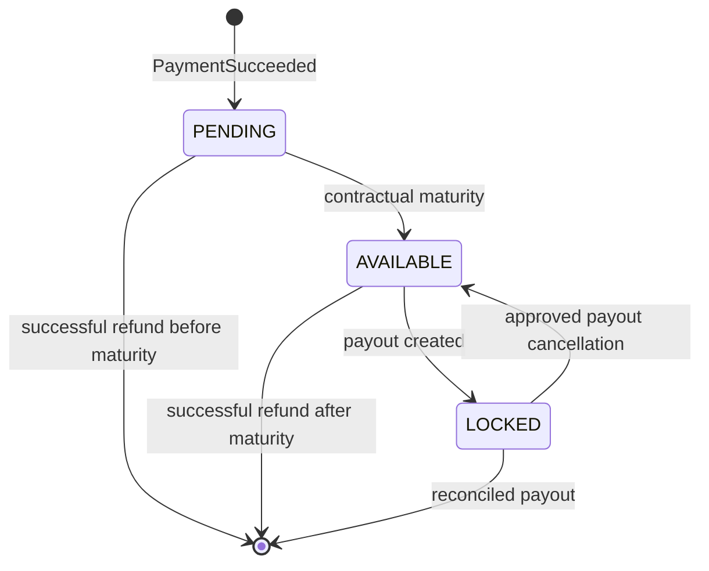

PAYMENT Economics 创建时冻结 `payment_succeeded_time/balance_available_time`。Client Principal 与可选 Partner Share 先分别进入 PENDING，到达共同成熟时刻后用 `PAYABLE_BALANCE_MATURED:<economics_id>` 在一个 Journal 中同时成熟；到期锁内扣除已成功且已形成 Component Link 的负向事实和此前成熟金额。RefundSucceeded 根据处理时点冲减 Client PENDING、AVAILABLE；已进入 LOCKED、已支付或余额不足的部分形成 `CLIENT_RECOVERY_RECEIVABLE/NONE`，不自动消耗 Security Deposit。Partner 的负向事实先形成 `PARTNER_RECOVERY_RECEIVABLE/NONE`；成熟事务从 Partner PENDING 借记 `partner_gross_matured`，贷记 Recovery `recovery_netted` 和 Partner AVAILABLE `partner_net_available`，两条贷方之和等于借方。追偿非零时阻断新的 Partner Payout。Payout 创建写 `PAYOUT_LOCK`，取消写 `PAYOUT_RELEASE`，完整付款对账写 `PAYOUT_PAID`。保证金独立存在 `CLIENT_SECURITY_DEPOSIT/NONE`，不占用应付款状态边。

## 7. 全局不变量

1. 会计恒等式固定为 `Assets + Expenses = Liabilities + Equity + Revenue`；每个 Journal Entry 只属于一个 Ledger Book、其唯一 OE/Finance Entity 主体和币种，且借贷绝对相等。
2. 每条 Journal 只在所属主体账簿内独立平衡；一个跨主体商业事实必须以双方各自的平衡 Journal 表达，不允许一条 Journal 跨 Book，也不允许跨主体共享现金账户、抵销义务、转移资金或建立资金池。
3. Journal、Transaction Economics/Component、Fiscal Record、Channel 原始清算和银行原始流水不可修改、不可物理删除。
4. Ledger 是唯一会计事实源；`account.debit_total/credit_total/net_balance/last_journal_sequence`、Ledger Period Balance 和业务余额均可由 Journal 重建，`balance_version` 仅作为 CAS 并发令牌单调推进。每个 Account 的 `normal_side` 必须等于其 Chart Account 的冻结值；账户允许借贷双向过账，反向余额使用负 `net_balance` 表达，不保存 `BOTH` 或动态余额方向。
5. 同一 Book/Chart 下全部统一账户余额汇总必须按 Chart 正常方向等于 Journal 的科目汇总；未完成批次重分类的 Channel Open Item `outstanding_amount` 汇总必须等于对应 Channel Account Owner 的 `CHANNEL_UNSETTLED_RECEIVABLE` 账户余额，Channel Debit Item 同理核对 `CHANNEL_UNSETTLED_PAYABLE`。Channel Fee 单独核对 `CHANNEL_FEE_ACCRUAL`，不能混入 Gross Open Item 余额。正常业务形成相反法律性质时使用应收/应付成对科目，不能靠负资产或负负债长期承载。
6. PaymentSucceeded 形成 Gross `CHANNEL_UNSETTLED_RECEIVABLE`，预计 Channel Cost 形成独立 `CHANNEL_FEE_ACCRUAL`，均不形成 Bank Cash。
7. 权威最终 Channel Batch 的交易对账完整后形成 `CHANNEL_SETTLEMENT_RECEIVABLE` 或 `CHANNEL_SETTLEMENT_PAYABLE`；只有关联 Bank Statement Item 的 Bank Recon Match 进入 CONFIRMED 后，才按 `matched_amount` 形成或减少 `BANK_CASH`。
8. Owner AVAILABLE 是可出款负债状态，不等于银行现金；Payout 创建直接锁定 AVAILABLE/LOCKED Account，每次 Execution 创建和外部提交都以共同的 BANK_CASH Account 行锁检查派生现金容量。
9. Client 的所有应结、保证金、锁定和追偿 Account 按 Operating Entity、币种隔离，禁止跨 OE 抵销。
10. `CLIENT_SECURITY_DEPOSIT` 是 Client 预存负债，不得计入收入，也不得用于其他 Client 或 OE；除明确允许的 `DisputeLost` 外不得自动消耗。
11. Partner Share 固定记入 Partner OE 的费用；后续冲回使用原交易 Partner 关系和实际 Client Fee reversal。Platform Service Charge 必须来自明确合同 Component：Partner OE 记费用/应付，Platform Finance Entity 记应收/收入；两本账同事务各自平衡，平台利润只在平台账簿结转，禁止以交易残差倒算。
12. 实际 Channel Cost 不覆盖预计成本，差异使用新的 Accounting Instruction。
13. 确定性尾差进入 `ROUNDING_ADJUSTMENT`；未知差异进入 `recon_exception`。
14. Payout 普通审批、Payout 取消动作、Beneficiary 验证、Manual Adjustment、重大 Reconciliation Resolution 和 Period Close/Reopen 必须由不同 Maker 与 Checker 完成；审批必须冻结并校验被审对象及其明细的 Content Hash。
15. CLOSED 期间禁止普通 Journal；同一期间最多一个活动 CLOSE/REOPEN 流程。重开必须新建流程和 Close Hash，不能覆盖旧 Close、Step 或 Approval；审批 Hash 不一致时不得改变期间状态。
16. Tax Snapshot 的每一 Tax Line 必须稳定映射来源 Order/Item，并引用唯一有效的 Registration、Place of Supply Result、Rule Version、Rate、Treatment 与 Evidence 组合；缺少唯一匹配时拒绝计算，禁止默认零税率。同 `source_system+source_request_id` 只能生成一个 Snapshot，同 Key 不同 Request Hash 必须冲突；Tax Rule Approval 必须绑定覆盖全部子规则的 Version Content Hash。
17. Seller 负责的 Tax Line 才可将实收税额计入 OE `TAX_PAYABLE`；Buyer Reverse Charge 必须保存行级责任模式和单独披露金额，Seller Collected Tax 必须为零，不得通过净额汇总变成 OE 应纳税。
18. Tax Registration、Rule Version、Rate、Treatment 和 Exchange Rate 的历史版本不可覆盖；Refund 税务冲回引用原 Tax Snapshot、Tax Line 和 Fiscal Record。同一来源事件可按不同 Registration 各生成一个 `source_version=1` 的 Fiscal Record；每条记录必须归属同 Registration 的 Tax Period 和法定号码序列，Content Hash 与法定号码一经分配不可变。
19. Tax Return 在同一稳定 `return_no` 下追加不可变精确版本，不建立 Root 或 Current Pointer；申报和更正都创建新的精确版本行。Tax Period、Liability Summary、Return Version 和 Tax Payment 必须属于同一 Registration、主体、Authority，并统一使用 `tax_registration.reporting_currency`；Snapshot/Line 的 Reporting Currency 也必须一致。Liability Summary 除稳定 `summary_no` 外，必须以 Period、Jurisdiction、Treatment、Rate、Liability Mode、Currency 的语义唯一键防止同一申报维度重复拆行；FILED Version 及其 Line/Approval 不可覆盖。
20. PAYMENT Transaction Economics 必须先交叉校验 PaymentSucceeded 与 Commerce COM-I04 的 Order/Context、OE/Assignment、分类、金额和币种，并冻结 `payment_succeeded_time`；再按精确 CLIENT Agreement-OE 的 T+N、Cutoff、IANA 时区、节假日日历与 FOLLOWING 计算并冻结 Client Principal 与可选 Partner Share 共同使用的 `balance_available_time`。成功当地日为工作日且不晚于 Cutoff 时该日为 T，否则先滚到下一工作日作为 T，再增加 N 个工作日并把结果日当地 Cutoff 转 UTC。商业规则证据继续逐项冻结在 Component，Partner 来源双账规则不变。
21. Commerce 与 Payment 分别拥有订单退款额度和渠道退款额度的并发守恒；Finance 不审批或预留退款资金，也不阻断 Channel 提交。Finance 只消费 `RefundSucceeded`，且原 Component 的成功 REVERSAL Link 累计不得超过原 `posted_amount`；该约束是会计入账完整性，不是第二套退款授权。
22. Payout 直接保存 AVAILABLE/LOCKED Account、费用公式与六个金额。创建按 Account ID 升序锁定两账户并以 `PAYOUT_LOCK:<payout_id>` 写 `Dr AVAILABLE / Cr LOCKED`。`ADDED_ON_TOP` 为 Owner Debit/Cash Required=`requested+fee`、Beneficiary=`requested`；`DEDUCTED_FROM_PAYOUT` 为 Owner Debit/Cash Required=`requested`、Beneficiary=`requested-fee`。正常费用由 Owner 承担，不形成平台费用或收入。
23. Payout Execution 与 Tax Payment 共享同主体/币种的 BANK_CASH Account 行。所有新增承诺在同一事务锁定该行并按 `available_cash = bank_cash_account.net_balance - active_payout_cash - active_tax_cash` 计算容量；活动 Payout Execution 是 `CREATED/SUBMITTED/UNKNOWN`，活动 Tax Payment 是 `CREATED/SUBMITTED/PROCESSING/BANK_ACCEPTED/UNKNOWN`。`UNKNOWN 不释放`。真实 Bank Statement Debit 不以该容量为导入准入条件：合法目标完整匹配后如实入账，无合法 Tax Payment 时保留银行事实并打开 Recon Exception，不能补造正常 Payment 或提前结清税负。退款不承诺 Finance Bank Cash，平台明确承担 Channel 退款与 Client 可回收余额之间的流动性和信用缺口。
24. RCO-I09 在 Payout 创建、最终 Finance 审批、Execution 创建和外部提交四个 Checkpoint 都必须新评估。Payout 冻结最终审批采用的 Assessment ID、Evaluation ID 与完整结果，每个 Execution 冻结本次执行采用的最新坐标和完整结果；Risk 保留四次评估的不可变权威历史。查询必须验证 Assessment/Evaluation 不可变一对一、Scope 为同 Owner/OE/Currency/Amount 且控制集可重建。任何陈旧、缺失、不一致或非 ALLOW 都 Fail-Closed；本地 Eligibility Hash 不替代 Risk 权威 Hash，也不能跳过任一 Checkpoint；不新增 Risk Result Root。
25. 每个 Payout 可有多个连续 `attempt_no` 的 Execution，但 `uk_payout_active_execution(payout_id,active_slot)` 保证最多一个 CREATED/SUBMITTED/UNKNOWN。CREATED 在 BANK_CASH 锁内立即占用容量；只有前一 Execution 经权威未扣款证据进入 FAILED 后才能创建下一 Execution。重试不得改变 Owner、OE、Beneficiary Content Hash、币种、费用模式或冻结金额。
26. 相同 Execution Key 只能对应相同 Request Hash；任一 Execution 完成借记对账后 Payout 终态成功并禁止新 Execution。旧 FAILED Payout Execution 或 FAILED Tax Payment 的迟到扣款必须在原 BANK_CASH 锁内，以 `LATE_DEBIT:<bank_item_id>` 幂等暂记 `Dr RECON_SUSPENSE_ASSET / Cr BANK_CASH` 并打开重大对账异常；不得静默改成普通成功，也不得释放新 Execution/替代付款的现金承诺。
27. Accounting Rule Line 不计算金额；交易金额先由 Transaction Economic Component 计算，固定解释器再按 `amount_source_code` 取值，把同一金额来源通过一条或多条 Rule Line 映射到 Owner Role、Account Code、Balance Bucket 和 Entry Side。`required_flag` 只判断来源是否存在：来源存在但金额为零时，对该来源的全部 Rule Line 整体跳过且不生成零金额 Instruction Line。只有 DRAFT Bundle Version 可在受控事务中追加 Rule Line；追加、提交 PENDING_APPROVAL、审批和 Current Pointer 切换全部统一先锁定 Bundle、再锁定 Version，提交时校验行号/行代码唯一及预期借贷平衡，并冻结完整有序行集。Version 离开 DRAFT 后 Rule Line 永不允许新增、更新或删除，Checker 只能审批同一冻结集合，修正必须新建 Bundle Version。Channel Cost Adjustment 必须恰好提供 `CHANNEL_COST_INCREASE/DECREASE` 之一，并由对应规则行确定相反借贷方向。`origin_type=AUTO` 的 Accounting Instruction 只能由已批准 Bundle Version、Input Hash 和已计算金额来源确定性生成，并冻结 Bundle Version ID 与 Input Hash，Maker/Checker 必须为空；V1 不建 Artifact/Condition/Approval 表，不加载任意 SQL、脚本、外部规则文件或 JSON DSL。`origin_type=MANUAL` 的规则引用必须全空，必须引用已批准且 Content Hash 一致的 `manual_adjustment`，Instruction Line 与 Adjustment Line 必须一一同值对应，Maker 与 Checker 不同。
28. 同一已验证 Beneficiary 可供同一 Owner 的多个 OE 使用，但每个 Payout 只能绑定一个 Owner/OE/Currency Tuple；受益人 Content Hash、审批、余额、Execution、Bank Match 与 Journal 都不得跨 Tuple 合并。
29. 上传付款凭证或银行接受回执都不足以把 Payout 置为 `PAID` 或把 Tax Payment 置为 `RECONCILED`；只有同 OE、币种、Cash Account 的银行借记流水完整匹配，并在同一事务生成付款 Journal 后，才能消灭对应 Liability 并进入各自终态。
30. `cash_account` 是平台/OE 的外部资产账户，映射 `BANK_CASH`；`beneficiary_account` 是 Client/Partner 收款目的地，绝不能映射为平台资产或参与现金余额。
31. PAYMENT Economics 必须冻结 `payment_succeeded_time/balance_available_time`；到期任务和 Accounting Instruction 共用 `PAYABLE_BALANCE_MATURED:<economics_id>`。Client Principal 与可选 Partner Share 都先进入 PENDING，并在同一平衡 Journal 同时成熟。Partner 行固定满足：`Dr PARTNER_PAYABLE/PENDING partner_gross_matured`，`Cr PARTNER_RECOVERY_RECEIVABLE/NONE recovery_netted`，`Cr PARTNER_PAYABLE/AVAILABLE partner_net_available`，且 `partner_net_available=partner_gross_matured-recovery_netted`、零金额行省略；未清 Partner Recovery 阻断新 Partner Payout。
32. PENDING、AVAILABLE、LOCKED 是 Client/Local Partner 的 Account 余额状态；出款只通过 Payout 直接冻结的 LOCKED Account 表示锁定结果，不为退款、成熟或出款建立另一套余额 Position。
33. 到期与 RefundSucceeded 必须按同一稳定顺序锁定原 Economics、Component Link 和 PENDING/AVAILABLE Account。RefundSucceeded 先从 PENDING、再从 AVAILABLE 冲减并创建 Component Link；LOCKED 不自动拆锁，剩余短缺形成 `CLIENT_RECOVERY_RECEIVABLE`，不自动消耗 `CLIENT_SECURITY_DEPOSIT`。Payment 本地 `UNKNOWN` 与只通知 Commerce 的失败/取消事实不进入 Finance，因此不存在退款占用释放或补成熟分支。
34. `channel_open_item` 必须冻结 Payment 提供的 `channel_transaction_ref_id/reference_type/external_transaction_id`；Channel 清算匹配不得依赖 Payment 的未来可用性。同一 Payment Attempt 允许因多次 Capture 产生多条 PAYMENT Open Item，同一 PAYMENT Transaction Economics 也允许被多条 Open Item 引用；唯一性只落在准确 Channel Transaction Reference/External Transaction 上，Attempt 与 Transaction Economics 组合均只建普通访问索引，相关 Open Item 的 Gross 合计必须等于 Transaction Economics Gross。DUPLICATE_CAPTURE 仍按 Duplicate Item 一对一。`channel_cost_alloc` 的 Payment Attempt、Channel Refund、Dispute 三类目标严格 XOR，Dispute 类同时冻结 Payment Notice ID 与 Risk Case ID。
35. `PENDING_APPROVAL` 且没有 Execution 的 Payout 可由申请人直接撤回；`APPROVED/ON_HOLD/RETRY_REQUIRED` 的取消是 `payout_approval.action_type=PAYOUT_CANCEL` 的不可变双人审批动作，不创建取消 Root。只有无可能扣款的 Execution、无 UNKNOWN、所有已提交 Execution 权威确认无扣款且不存在未决 Bank Match 时，才能以 `PAYOUT_RELEASE:<payout_id>` 原子执行 LOCKED 到 AVAILABLE Journal。
36. `compensation_event` 的唯一身份是 `(event_key,event_type,sub_event_type)`，具有完整 Claim Lease；业务事实与任务同事务写入，事务提交后才可执行。发布重试只更新执行元数据，成功后允许删除，失败达到上限必须进入 `FAILED` 并告警。业务事件 Version/Hash 留在领域事实，不复制为补偿表通用字段。
37. Command Idempotency 必须以已包含 Caller Type/ID 与授权边界的 Canonical Caller Scope、Operation Type 和 Key 共同隔离；同 Key 不同 Request Hash 记录冲突审计并拒绝业务调用。业务幂等字段、`compensation_event`、MQ 和 `command_idempotency` 不得保存敏感明文、本地密文或 Vault Token；跨系统敏感结果只能通过当前获批的同步 Owner 能力取得。
38. Finance 中所有 Platform 文件引用必须显式保存 `file_id + file_content_hash`；语义化证据字段使用 `evidence_file_id + evidence_file_hash`。业务 Content Hash 或 Source Hash 不能替代文件内容 Hash；不得保存文件二进制或临时下载地址。
39. `DuplicateCaptureDetected` 表示真实发生但不属于业务唯一成功的额外渠道资金：Finance 必须创建异常 Channel Open Item、DUPLICATE_CAPTURE Transaction Economics 和平衡 `CHANNEL_UNSETTLED_RECEIVABLE`/Consumer Compensation Liability，不得再次确认收入。Consumer 补偿成功后必须在同一 Duplicate Item 下创建 DUPLICATE_COMPENSATION Transaction Economics 与 `debit_type=DUPLICATE_COMPENSATION` 的 Channel Debit Item；不得等待普通对账才发现，也不得在额外应收与补偿扣款均结清前销毁异常链。
40. Payout 创建、最终 Finance 审批、Execution 创建和每次外部提交前都要使用 `finance_restriction_proj` 最新来源版本及新的 RCO-I09 结果 Fail-Closed 重验；已批准不代表可绕过后来到达的 Client/Compliance/Payout Restriction。
41. 未支付 Cancel 与未 Capture Authorization Void 不产生 Finance 事实；禁止为它们创建零金额 Transaction Economics、Journal、Channel Open Item 或 Fiscal Record。已 Capture Reversal 必须表现为标准 Refund Request/Channel Refund，并且只有 `RefundSucceeded` 才按原 PAYMENT Transaction Economics 追加退款经济事实与反向业务分录，业务命令名不得直接驱动记账。Journal 的 `entry_type=REVERSAL` 仅用于对一整条原 Journal Entry 做金额、借贷方向和统一账户逐行严格相反的技术全额冲销；部分退款或任何非完整镜像调整必须形成新的 `STANDARD`/`ADJUSTMENT` 分录，且 `reversal_of_entry_id` 为空。
42. Tax Rule 与 Tax Return 不建独立 Approval 表；精确版本行直接保存 `maker_id + checker_id + checker_decision + decision_time + status`，提交审批时冻结 `content_hash`，并以“离开 DRAFT 后禁止修改头和子行”保证 Checker 审批的就是同一内容。Beneficiary 使用本行 Maker/Checker 生命周期；Payout 普通审批和取消动作使用不可变 `payout_approval`，同一事务校验 MAKER/CHECKER 角色完整、Actor 不同、最终决定与 Root 状态一致且批准 Hash 等于被审内容 Hash。Manual Adjustment 和 Period Close/Reopen 的既有审批边界不变。Accounting Rule Bundle Version 同样不建独立 Approval 表；它以 `maker_id + checker_id + approved_time + status` 保存固定双人结果，并冻结有序 Rule Line 集。
43. `period_close` 完成前必须枚举该期间全部适用 Ledger Book，且每个 Book 恰有一条 `period_close_book=FINALIZED`；FINALIZED 状态更新必须在同一事务重新锁定并逐值校验：Final Trial Run 属于同 Book/Period、`as_of_sequence` 完全一致且 `SUCCEEDED`，不存在 OPEN/UNDER_REVIEW 或被禁止 Waive 的硬异常；Posting Instruction 属于同 Book、类型为 `CLOSING/REOPENING` 并已生成同 Book/Period 的对应 Journal；该 Book 全部 `ledger_period_balance` 已到同一 Final Trial/Sequence；七种固定 `close_step.step_type` 各一条且全部 `SUCCEEDED`，不能用 `SKIPPED` 冒充完成。Close Approval 的两名 Actor 不同且批准 Hash 等于 `period_close.close_hash`；任一复验失败整体回滚。
44. Ledger Book、Accounting Period、Chart、统一 Account 与 Currency 的组合必须逐层一致：Instruction、Journal、Trial Balance、Ledger Period Balance 与 Close Book 不得跨 Book、跨 Period、跨 Chart 或跨 Currency 组合；`account.owner_type/owner_id/balance_bucket` 还必须符合账户身份矩阵，`account.normal_side` 必须等于引用科目的正常方向。行内 Owner/Bucket Sidecar 只定义结构形状，账户创建事务还必须锁定 Chart Account 并验证科目—Bucket 矩阵，尤其 `PARTNER_PAYABLE` 只能为 PENDING/AVAILABLE/LOCKED，`PARTNER_RECOVERY_RECEIVABLE` 只能为 NONE；禁止把任意 Local Partner/NONE 视为合法。`ledger_period_balance.as_of_sequence` 必须单调，旧 Trial Run 永远不得覆盖较新水位。关系 ID 能连上并不代表业务维度一致，这些条件必须在应用事务中校验并由仓库自有 `local-environment` 真实 MySQL 场景证明。
45. `channel_settle_batch.status=VALIDATED` 只代表导入结构、币种与金额恒等式通过，不代表交易已对平。PAYMENT/DUPLICATE_CAPTURE/REFUND/DISPUTE 行的 Transaction Match 按方向汇总必须与原始行一致；FEE/ADJUSTMENT 行必须由 Channel Cost Confirm/Alloc 或已审批 Recon Exception 完整处置，禁止伪造 Open/Debit Item Match；全部原始行回放必须与 Batch 四个金额一致。只有业务交易行匹配完整、费用/调整行处置完整、实际成本确认完整且无阻断性开放异常的 VALIDATED 批次，才允许 Bank Recon Match 从 PROPOSED 转 CONFIRMED；确认事务必须锁定并重算这些条件，不能信任旧水位或另存的布尔状态。
46. Payout 只有在 CONFIRMED `PAYOUT_DEBIT` Bank Match 与已批准差异处置共同闭合 `cash_required_amount`、实际使用的 Cash Binding Version 与 OE/币种/PAYOUT 用途/DEBIT 方向一致，并在同一事务生成最终付款 Journal 后才可进入 `PAID`；Tax Payment 的既有完整匹配门禁不变。Payout 非 PAID 时 `reconciled_time` 与 `journal_entry_id` 必须同时为空。
47. Channel 三阶段使用 `CHANNEL_UNSETTLED_RECEIVABLE/CHANNEL_UNSETTLED_PAYABLE`、`CHANNEL_SETTLEMENT_RECEIVABLE/CHANNEL_SETTLEMENT_PAYABLE` 与 `BANK_CASH` 区分交易形成、批次完整和银行确认。净 Credit 批次把 Gross 待清算应收、待清算应付抵扣与实际 `CHANNEL_FEE_ACCRUAL` 重分类为单一结算应收；银行 Credit 的 CONFIRMED Match 再转入 Bank Cash。净 Debit 批次形成单一结算应付，银行 Debit 的 CONFIRMED Match 再冲减 Bank Cash。禁止从待清算账户直达 Bank Cash、用负金额复用资产应收科目或恢复通用 `CASH_IN_TRANSIT/CASH_OUT_TRANSIT`。
48. 除已精简为“每行即精确版本”的 Tax Rule/Tax Return 外，其余 Version Root 在非 DRAFT 状态必须具有非空 Current Version Pointer，且只能原子指向同 Root 的合法已批准版本。自环、跨行长环、同业务编号/合法前驱、金额、比率、时间区间和状态组合由应用事务、锁/CAS 与反例测试保证；Schema 不新增物理 CHECK 或 FOREIGN KEY，仍保留批准的主键、唯一索引和 `NOT NULL`。
49. `channel_account` 必须同时满足完整 Channel/MID/OE/Currency 语义唯一和 MID/Currency 唯一；创建时逐值核对 Payment 权威 MID Tuple。Channel 清算、Payout Execution 与 Tax Payment 使用的 Cash Account Binding Current Pointer、Version、Cash Account、OE、币种、用途、方向和生效期必须在同一业务事务校验，任一跨表维度不一致都整体回滚。
50. 一个 Recon Exception 可以保留多条草稿或被拒 Resolution，但只能通过 `applied_resolution_id` 指向一条属于自身且 `status=APPLIED` 的最终处置；该 Resolution 必须一次完整处置差额，不能以多条 APPLIED 累计、已删除的退回执行字段或“原路退回”状态表达执行。
51. V1 Tax Payment 仅登记 Operations 在银行或税务门户完成的手工外部支付，并以 `cash_account_id + execution_key + request_hash` 幂等；Finance 不自动选择 Tax Authority 收款账户或生成付款指令。未来自动缴税必须先增加经审批的税务机关付款目的地及版本模型。
52. FIN-I17 Buyer Tax ID 所需的跨系统敏感值能力超出 Vault V1；在消费者对齐或获批窄 V2 设计完成前该分支必须 Fail Closed，不得调用不存在的 Copy/Binding/Confirm/Retire API，也不得复用 Commerce Token。
53. 合同成熟使用 `event_type + sub_event_type` 明确的本地 `compensation_event` 和 `next_execute_at=balance_available_time` 到期唤醒；`event_key` 定位 Economics，Payload 默认为空。Client Principal 与可选 Partner Share 金额在锁内依据已成功 Component Link、Partner Recovery 和此前成熟 Journal 重算，不能把队列载荷当作余额事实。
54. Bank Recon Match 的 PROPOSED 状态不得提前保存决定人或决定时间；CONFIRMED 与 REJECTED 都必须成组保存 `decision_by + decision_time`，以证明匹配被接受或拒绝，而不是只为成功匹配留审计证据。决定终态不可回退或覆盖。APPLIED 的 RE_MATCH Resolution 必须在 `channel_transaction_match_id` 与 `bank_recon_match_id` 中严格选择一个；非 APPLIED 或非 RE_MATCH 类型不得同时携带这两个引用。

## 8. 跨系统引用

| 来源系统 | Finance 保存的引用 | 用途 |
|---|---|---|
| Client & Contract | Header 保存 `client_id`、`local_partner_id`、`operating_entity_id`、`commercial_context_time`、`client_agreement_oe_id`，Partner 时还保存 `partner_agreement_oe_id` 并通过 Platform Service Party 解析本库 `finance_entity_id`；Component 保存实际命中的 `source_rule_version_id/source_rule_scope_id/source_rule_component_id` | CCT-I13 在 Partner 来源时返回唯一 `platform_service_party_id` 和 Platform Service Charge Scope；CCT-I14 按 Scope ID + Agreement Association 返回精确闭包。Finance 校验 Owner/OE/Partner Agreement/PLATFORM_SIGNATORY 后，Party 唯一映射本地 ACTIVE Finance Entity，只把实际采用的 Version/Scope/Component ID、舍入和完整计算参数保存在 Component；不保存 CCT V5 Hash、Agreement Root ID、Plan/有效期/Scope Tuple/Priority |
| Commerce | `order_id`、`order_context_id`、`commercial_context_time`、参与方、国家/币种、冻结的 OE/Assignment、`industry_code/mcc_code`、金额、Agreement-OE Association、Pricing/Share/Platform Service Charge Scope、`platform_service_party_id`、`refund_request_id`、`finance_tax_snapshot_id` | COM-I04 一次返回同一 Order/Context 聚合；Partner 来源时四元组 `local_partner_id + partner_agreement_oe_id + platform_service_charge_scope_id + platform_service_party_id` 全部非空，非 Partner 来源全部为空。Finance 与 Payment 事件逐值交叉校验后使用 Scope 调 CCT-I14；不保存 Commerce V5 摘要或 Tax Snapshot Hash |
| Payment Orchestration | `payment_intent_id`、`payment_attempt_id`、Intent 继承的 `source_id/source_order_context_id`、Client/OE/Assignment、`industry_code/mcc_code`、金额币种、实际 `payment_method`、`channel_refund_id`、`duplicate_capture_case_id`、`channel_dispute_notice_id`、`channel_id`、`mid_id`、支付 `channel_transaction_ref_id`、退款 `refund_transaction_ref_id/channel_refund_id`、`reference_type`、`external_transaction_id` | PaymentSucceeded 提供与 Intent 一致的 Order/Context ID、显式业务 Tuple 和实际支付方式，Finance 与 COM-I04 逐值交叉校验后才读取 CCT Scope；退款只消费 `RefundSucceeded`，Payment 本地 UNKNOWN、失败与取消不进入 Finance；Channel 应收、退款应扣、重复扣款异常、争议渠道来源和清算匹配均冻结准确 Transaction Reference；Payment 已删除独立 Refund Attempt，Finance 不恢复其 ID；Client 不得借分类选择 Channel/MID |
| Risk & Compliance | 争议仅冻结 `DisputeLost/DisputeOutcomeCorrected` 的 `dispute_case_id`、`outcome_id/outcome_version`、`outcome`、`principal_bearer`、`security_deposit_use_allowed` 与来源版本；Payout 冻结 RCO-I09 的 `assessment_id/evaluation_id`、Decision/Reason Codes/Matched Controls、Required Amount/Currency、Control Set Hash 与 Eligibility Hash | `DisputeOpened` 不进入 Finance Transaction Economics 或 Journal；Finance 只按权威 LOST Outcome 或其更正追加金额与会计影响，不覆盖旧 Outcome。Payout 创建、最终 Finance 审批、Execution 创建和外部提交四次调用 RCO-I09 新评估；每次查询验证 Assessment/Evaluation 不可变一对一、同 Owner/OE/Currency/Amount Scope 及完整控制集可重建，任何缺失、陈旧、不一致或非 ALLOW 都 Fail-Closed。Finance 不新增 Risk Result Root；Risk 拥有控制评估与争议决定，Finance 拥有准确金额、Account 余额、Payout 与 Journal 影响 |
| Platform Support | `file_id`、`audit_event_id` | 银行文件、付款证据、财政凭证和审计引用 |
| Vault / Data Protection | 当前 V1 只提供 Protect/Reveal 的不透明 Token；Finance 模型中的 Blind Index/Masked/Version/Metadata/Binding 字段待消费者对齐 | 集中保存已批准的非卡敏感值；Finance 不保存本地密文或解密密钥。每个字段必须先证明 Reveal/关联/展示等真实消费者，再选择 V1 适配或窄 V2，不能把旧字段当作已实现 API |

跨系统引用不得建立物理外键。关键业务锚、金额和参与方必须冻结在 `transaction_economics`，实际采用的规则版本/范围/组件和计算参数必须逐项冻结在 `transaction_economic_component`，不能只依赖未来远程查询。

## 9. 敏感数据与留存

### 9.1 敏感数据

- `cash_account`、`beneficiary_account`、`tax_registration` 与 `tax_snapshot` 的非卡敏感值应由中央 Vault 保护；当前 V1 只提供 Protect/Reveal 和不透明 Token。每个 Finance 字段必须先证明写入来源、授权 Reveal 和生命周期消费者，不能机械要求 Blind Index、Masked/Last4、Record Version 或 Metadata Hash；
- 当前模型中的 Pending Bind、`VAULT_BIND_REFERENCE`、Bind/Confirm、Copy、Derive/Metadata、Retire 及资源级 Binding 是待迁移的旧目标，不得据此调用 Vault V1。需要这些能力时必须走 [Vault 消费者模型对齐](../../docs/superpowers/plans/2026-09-05-vault-consumer-model-alignment.md) 并批准窄 V2；
- Vault Token 不得进入跨系统 MQ、外部 API、普通日志或 BCR。当前唯一批准跨系统传递的稳定 Token 是 Commerce→Payment→Risk 的 Consumer Email/Phone 同步最小契约，不扩展到 Finance；
- FIN-I17 Buyer Tax ID、已有敏感字段替换和跨 Owner 共享在完成对齐前 Fail Closed。不得复用 Commerce Token、不得用本地密文规避 Vault，也不得假装旧 Tuple 已由 V1 返回；
- Finance 数据库与 PDManer 不保存敏感值 Ciphertext、DEK、KMS Key Ref 或可离线还原材料；Channel/API/Webhook Secret、银行通道 Credential 和私钥继续由 Secrets Manager/KMS 保存，Finance 只保存 `secret_ref`；
- PAN、CVV/CVC、完整磁道、PIN/PIN Block 不得进入 Finance 或中央 Vault；Payment 仅向 Finance 提供 Channel Token 以外的必要交易引用以及 Scheme/BIN/Last4/Issuer/Fingerprint 等最小卡片描述元数据，这些元数据仍需分类、脱敏、授权和留存控制；
- Channel、银行原始文件存储在 Platform 文件服务，Finance 只保存成对的 `file_id + file_content_hash`；
- Channel/银行原文只有在通过版本化 Schema 校验与 PAN/SAD/Secret 扫描后，才能作为受控加密对象信封进入 Platform 文件服务；发现意外 PAN/SAD/Secret 时不持久化原文、不写日志，并发布 Security Event；
- 财务查询按 Client、Partner、OE、岗位和数据敏感级别执行资源授权；
- Journal 描述、银行摘要和对账备注禁止保存完整账号、Token、证件号或消费者支付数据。

### 9.2 MVP 留存口径（自动化延期）

- Ledger、Journal、Accounting Instruction、Fiscal Number Sequence、Fiscal Record、Transaction Economics/Component、Trial Balance 和 Period Close 等永久会计事实继续永久保留，且不得被普通清理任务修改或删除。
- MVP 对其余 Finance 业务事实默认保留，不自动归档、匿名化或销毁，也不以临时 Job、SQL 或人工脚本代替尚未设计的受控留存流程。税务、Channel 清算、银行流水、Payout 等十年候选期限只作为后续专项设计输入。
- `compensation_event` 成功发布后仍允许按可靠执行规范删除；`FAILED` 任务保留到人工处置完成并形成 Audit/Command 事实。消费幂等的 Source Event Key/Version/Payload Hash 随对应财务事实保留。
- Command Dedup 不保存完整响应；MVP 的幂等 Key、Caller Scope、Request/Response Hash、Result Reference 和 History 默认保留。
- Vault 中税号、银行账户和受益人记录在 MVP 只允许 Retire 业务引用并禁止普通 Reveal，不执行自动 Destroy；Finance 不因 Journal 永久留存而扩大明文 Reveal 权限。
- 在承载真实受监管生产数据前，必须依据适用司法辖区完成 Retention、Legal Hold、归档、匿名化和销毁专项设计，并通过法律与合规评审；任何未来归档都不得破坏 Journal 到业务来源、Payout、Channel 清算和银行流水的可追溯链。

## 10. 明确排除项

- 不创建跨 OE Cash Pool、Treasury Pool、自动扫款或内部资金拆借模型；
- V1 不创建通用 `intercompany_transfer`、跨主体净额或资金转移模型；已批准的 Partner OE ↔ Platform Finance Entity 服务费只使用四个业务明确的应收/应付/收入/费用科目和两条独立平衡 Journal，不允许扩展成任意主体调拨；
- 不允许一张银行账户绑定多个账簿主体；
- 不创建全局 Client Wallet，也不跨 OE 汇总成一个可操作余额；
- 不把 Paid 设计为长期负债余额桶；
- 不用负数 Client Payable 表示追偿，追偿使用资产类应收；
- 不创建独立逐交易余额批次、通用到期规则或重复的结算锁定明细；余额状态只由 Account 和 Journal 表达；
- 不直接修改已入账 Journal；
- 不在 Transaction Economics Header 保存 CCT V5 Hash、Agreement Root ID、Pricing/Share/Platform Service Charge Version/Scope、Channel Cost Version 或经济 Calculation Hash；规则来源和计算参数只在 Component 逐项冻结；
- 不创建 `t_platform_service_charge`；平台服务费直接作为 Transaction Economic Component，并由两类 Accounting Instruction 映射到两本账；
- 不为 Accounting Rule 建立 Artifact、Condition 或独立 Approval 表，不让 Rule Line 计算金额，也不把任意 SQL、脚本、JSON DSL 或外部规则文件作为 V1 自动记账运行时；
- 不使用单边账或把 Channel Cost 直接冲减 Gross `CHANNEL_UNSETTLED_RECEIVABLE`；Channel Cost 必须单独计提，只有合同存在当前可执行抵销权且最终 Settlement/Remittance Batch 证明实际净额结算意图时，才允许在该批次内形成单一结算应收或应付，否则 Fail-Closed 为当前 V1 不支持的 Gross Multi-Leg；
- 不允许 Finance 恢复退款审批、退款预留或 Channel 提交前资金门禁；退款额度只由 Commerce 与 Payment 的本地 Refund Position 控制；
- 不创建独立 Payment Reversal 表/Action/状态，不把 Cancel 或未 Capture Void 伪造成 Refund、负向 Payment 或会计 `REVERSAL`；
- 不创建 `t_funding_position`、`t_funding_commitment`、`t_funding_allocation` 或 `t_funding_move`，也不以替代 Availability、Balance Lot 或 Treasury 表承诺 Bank Cash；Payout Execution/Tax Payment 只可通过直接 Account 引用、同一 BANK_CASH Account 行锁和活动付款金额承诺现金；退款不在 Finance 预占 Bank Cash，成功后按权威事实入账；
- 不恢复自动 Payout Profile/Run/Candidate/Obligation、独立 Payout Request、独立 Cancel Root、Settlement Payment 或 Attempt 聚合；Manual Payout 七表就是当前完整出款模型；
- 不因 Payout Execution 失败自动解锁 Client/Partner 余额，也不在未确认银行无扣款时取消 Payout；
- 不因 Tax Payment 执行失败冲销或释放 Ledger Tax Payable 义务；FAILED 只在权威未扣款证据下释放活动槽；
- 不让 BFF、Gateway、Payment 或 Platform Support 直接读取 Finance 数据库；
- 不在 Finance 保存文件二进制、通知/Webhook 状态、密码、Token 或 API Secret；
- 不由数据库定时任务直接执行业务关账或付款，所有动作必须经过应用层状态机、Maker-Checker 和审计。
