# Platform Support 数据库设计规范

最后更新：2026-08-27

状态：V1 逻辑模型已按 92 表平衡方案收敛；PDManer 已确定性生成并通过自动验证，PDManer 4.9.3 应用内人工评审待完成；当前不包含 Migration、Java 实现或数据库环境。

## 1. 文档定位

本文是 `platform-support-service` 数据库的业务与物理建模基线。当前物理权威是 [物理决策](../../platform-support-service/docs/database/PLATFORM_SUPPORT_PHYSICAL_DECISIONS.md)、[现实场景](./scenarios/PLATFORM_SUPPORT_REAL_WORLD_SCENARIOS.md)和 [PDManer 模型](../../platform-support-service/docs/database/platform-support.pdma.json)，精确快照为 92 表、1,076 字段、167 个唯一索引、116 个访问索引、145 条本库关系、19 条 1:1 关系和 8 个 Diagram Groups；另有 28 条已写入模型实体属性的复合外键契约与 67 条物理 CHECK 契约。后续 Migration、DO、Mapper、Repository 和 Testcontainers 自动化测试必须与这些权威保持一致，并再次获得明确授权。

Platform Support 是通用支撑事实拥有者，不是其他五个系统的共享业务数据库。本文固化以下决策：

- 登录认证使用外部 Identity Provider；
- Platform 不保存密码、登录 MFA Secret、Refresh Token 或登录 Session；
- Email OTP 用于 Email Ownership、低风险 Consumer 验证和低风险业务动作确认，按 `Subject + Purpose + Context` 绑定；绝不用于登录 MFA、结算/出款或管理员高风险动作；
- Platform 拥有 API Credential、文件元数据与扫描策略、消费者文档的状态/版本/文件/更正、通知、Client Webhook、审计、安全事件、Gateway 技术配置、Platform 技术配置和可靠技术执行；Commerce 不保存消费者文档或其 Current Projection；通用留存与 Legal Hold 自动化在 MVP 延期；
- Gateway 限流匹配优先级固定为 `EMERGENCY > CREDENTIAL > CLIENT > ROUTE > GLOBAL`；
- Gateway 运行时限流计数不进入 MySQL，使用支持原子操作的 Redis；
- Gateway 无法获取新配置或新配置校验失败时继续使用 Last-Known-Good；
- Platform 不拥有业务工作流、领域配置和其他系统业务事实；
- 非卡类敏感字段由独立中央 Vault/Data Protection 基础设施统一保存；Platform 数据库只保存不透明 Vault Token 以及被当前 Reveal、等值查询、展示或元数据并发消费者证明必要的 Blind Index/Key Version、Masked Value、Record Version 或 Metadata Hash，禁止默认复制完整字段包；
- 内部主键使用服务侧 Snowflake `BIGINT`，Java 类型为 `Long`，禁止数据库自增。

## 2. 系统边界

### 2.1 Platform Support 拥有的事实

- 外部 IdP Subject 到平台用户的身份映射；
- Client、Partner、Internal Operator 的访问租户、成员、角色和权限；
- Client API Credential 的生命周期；
- Email Ownership、低风险 Consumer/业务验证使用的 Email OTP Challenge；
- 文件对象元数据、对象存储引用、扫描策略与结果；
- 消费者文档的专用模板、多语言内容、Generation、状态、版本、文件引用、更正和投递轨迹；
- Email 等通知请求、渲染快照、投递任务和尝试；
- Client Webhook Endpoint、订阅、签名 Secret 版本、投递和 Replay；
- 操作审计、安全事件、敏感访问审计和完整性检查点；
- Gateway Route、Rate Limit Policy、经过审批的配置发布及实例应用回执；
- Platform/Gateway 技术配置；
- Platform 专用投递、渲染、发布任务和本地可靠执行。

### 2.2 只保存引用、不拥有的事实

Platform 可以为投递、鉴权和审计保存稳定业务 ID、事件信封、Schema Version、Hash 和最小化冻结 Payload，但不拥有：

- Client、Partner、Operating Entity、Agreement、Pricing；
- Order、Checkout、Refund；
- Payment、MID、Provider、Routing；
- KYC/KYB、Risk Decision、Dispute、Settlement Restriction；
- Tax、Fiscal Record、Ledger、Balance、Settlement、Provider Cost。

业务系统拥有“为什么产生文件、通知、Webhook 或审计”；Platform 只拥有“如何保存、生成、投递和留痕”。消费者文档是明确例外：Commerce/Finance 仍各自拥有触发所需的 Order/Refund 和 Fiscal Record 事实，但 Platform 是文档状态、版本、文件与更正的唯一拥有者，Commerce 不建立文档 Current Projection。

## 3. 通用物理规则

### 3.1 主键、时间与并发

- 内部表主键为 Snowflake `BIGINT`，禁止 `AUTO_INCREMENT`；
- Java DO 使用 `Long`；
- 外部 IdP Subject、Provider Message ID 等使用有明确上限的 `VARCHAR`；
- 业务时刻统一为 UTC `DATETIME(6)`，无时区审计分区日使用 `DATE`，业务有效期明确保存 `effective_from/to`；
- 有真实并发写入者的可变聚合根带正数 `version INT NOT NULL`，Root 状态变更使用期望旧状态与版本条件更新；附属 Version/Translation 的审批或渲染状态在持有所属 Root 锁后按期望旧状态更新，不机械复制业务 Version；
- Attempt、Event、Audit、File Scan Result 和状态历史等追加式事实不提供业务 UPDATE/DELETE；Template/Translation/Document Version 的内容在批准或生成后冻结，但其审批、渲染生命周期字段使用条件更新并保留 `update_time`；
- 跨系统 ID 不建立物理外键，本库聚合内部关系使用本地外键和 `RESTRICT` 删除策略。
- JSON/模板/Payload 只保存有边界的不可变内容，必须同时保存 `schema_version` 和 Canonical `content_hash/payload_hash`；敏感内容保存于中央 Vault，本库只按真实 Reveal、等值查询、展示或元数据并发消费者保留必要 Token、Blind Index/Key Version、Masked Value 或元数据字段，禁止默认复制完整字段包；
- 可变聚合的状态、当前版本指针、状态历史和对应 `compensation_event` 必须在同一本地事务中提交。

### 3.2 敏感字段与中央 Vault

- 姓名、Email、Notification Address、Webhook URL、非卡类身份/银行/税务字段和受限 Payload 统一保存于中央 Vault；本库只保存不可枚举 `*_vault_token` 以及被当前消费者证明必要的 keyed Blind Index/Key Version、Masked Value、Record Version 或 Metadata Hash，不保存本地 Ciphertext、DEK 或 KMS Key Ref；
- Token 用于授权 Reveal，Blind Index/Key Version 仅用于等值查询或抑制匹配，Masked Value 仅用于批准的展示，Record Version/Metadata Hash 仅用于明确的元数据并发或完整性比较；没有这些消费者时字段必须省略。可检索字段的 Blind Index 与 Key Version 必须来自同一次 Protect/Derive 响应并成组保存；轮换期对新旧 Key Version 双版本查询，验证覆盖后才停用旧版本；
- Token 新增/替换必须遵循 Pending Bind：Protect 后先以不可对外使用的 Pending 引用和 `VAULT_BIND_REFERENCE` 与业务资源同事务提交；afterCommit 只唤醒本地 Dispatcher，由其原子 Claim 后调用 BindReference。Bind 确定成功后再以本地事务 CAS 切换有效 Tuple/指针、登记旧 Token Retire 并删除 Bind Event；禁止绕过 Claim 或并发抢跑 Bind/Retire，Bind 失败时不得暴露新 Token 或覆盖旧指针，CAS 冲突时退役未采用的新 Token；
- API Key 保存 Argon2id 等抗暴力 Hash；短码 OTP 保存带 KMS Pepper 的 keyed HMAC，禁止只使用普通 Hash。Provider/API/Webhook Secret、Callback Verification Key 和私钥仍由 Secrets Manager/KMS 保存，本库只保存 `secret_ref`、fingerprint 和 version；
- Vault Token 必须绑定 Owner System、Tenant、Resource Type/ID、Field Code 和 Purpose；调用方完成资源授权后 Vault 仍需依据 Workload Identity 与 Token Binding 二次授权，每次 Reveal 形成敏感访问审计；
- 跨系统事件默认不传递来源系统已持有的 Vault Token；接收方确有授权 Binding 需求时，必须由 Vault `CopyForBinding` 创建接收方专属 Token。事件只携带该 Token，以及被接收方明确的元数据并发/完整性消费者证明必要的 Record Version/Metadata Hash；禁止共享或转发来源 Token；
- PAN、CVV/CVC、完整磁道、PIN/PIN Block 不得进入 Platform 或中央 Vault；卡数据由 Provider Hosted Fields/Tokenization 承担；
- 文件正文和大型原始 Payload 存入加密对象存储；Platform 数据库只保存 File ID、Hash、分类、业务有效期、受控 Container Ref 和由 Platform 生成的高熵 `storage_object_ref`。该 Ref 不得包含文件名、Client、业务 ID 或 PII，不作为访问凭据，也不进入 Vault；对象读取仍必须使用云 IAM/短期签名 URL，Container/Object Ref 不直接返回外部调用方；
- Provider/外部系统原文只有通过版本化 Schema 校验和 PAN/SAD/Secret 扫描后，才能作为受控加密对象信封保存；发现意外 PAN/SAD/Secret 时不持久化原文、不写日志，只保存安全摘要并发布 Security Event；
- Payload 必须按 Schema 分类、限制大小并定义业务有效期；该时间只约束继续使用或 Reveal，不在 MVP 触发物理删除。含非卡类敏感字段时只保存 Vault Token，禁止使用无边界 JSON 复制业务数据库。

## 4. 聚合与精确表清单

本章共 92 张逻辑表，按 `16 + 19 + 14 + 11 + 9 + 13 + 8 + 2` 分入八个物理图组。相较 108 表草案删除重复授权/审计、无当前消费者的通用字典和通用 Job 平台；中央 Retention Policy、Legal Hold、归档/匿名化/销毁能力在 MVP 全部延期，不预建对应表或发布契约。

### 4.1 外部 IdP 身份、租户与权限

| 表 | 用途 | 关键字段 | 唯一、检查与并发约束 |
|---|---|---|---|
| `idp_connection` | 外部 IdP 可信发行方技术配置 | `connection_code`、`issuer`、`audience`、`jwks_uri`、`status`、`config_version` | `uk_idp_code(connection_code)`、`uk_idp_issuer(issuer,audience)`；只保存公开验证配置，不保存 IdP Secret；带 `version` |
| `access_tenant` | Client、Partner 或 Internal Operator 的访问租户 | `tenant_type`、`owner_ref_id`、`tenant_name`、`status` | `uk_access_tenant(tenant_type,owner_ref_id)`；`tenant_type IN (CLIENT,PARTNER,INTERNAL)`；不是业务主档 |
| `user_identity` | 外部 IdP Subject 到平台 User 的映射 | `idp_connection_id`、`idp_subject`、`email_vault_token`、`email_blind_index`、`email_blind_key_ver`、`email_masked`、`display_name_vault_token`、`display_name_masked`、`status`、`version` | `uk_idp_subject(idp_connection_id,idp_subject)`；Email Token/Blind Index/Key Version/Masked 全空或成组非空，用于授权 Reveal、同 IdP 域等值查询和展示；Display Name Token/Masked 全空或成组非空，仅用于 Reveal/展示，不机械保存 Blind Index 或 Vault 元数据；不保存密码、MFA Secret、Session 或本地密文 |
| `tenant_member` | User 在访问租户中的成员关系 | `tenant_id`、`user_id`、`member_type`、`status`、`invited_by` | `uk_tenant_member(tenant_id,user_id)`、`uk_tenant_member_owner(member_id,tenant_id)`；状态条件更新；一个 User 可属于多个 Tenant |
| `role` | Tenant 或平台级角色 | `tenant_scope`、`tenant_id`、`scope_key`、`role_code`、`role_name`、`status` | `scope_key` 非空，平台级固定为 `PLATFORM`、租户级为 Tenant ID 的 Canonical 字符串；`uk_role_scope(scope_key,role_code)`、`uk_role_owner(role_id,scope_key)`；系统角色不可删除，只能停用 |
| `permission` | 稳定操作权限定义 | `permission_code`、`resource_type`、`action_code`、`risk_level`、`status` | `uk_permission(permission_code)`、`uk_resource_action(resource_type,action_code)` |
| `member_role` | 成员角色授权 | `tenant_member_id`、`tenant_id`、`role_id`、`role_scope_key`、`effective_from/to`、`granted_by`、`status` | `uk_member_role(tenant_member_id,role_id,effective_from)`；`(tenant_member_id,tenant_id)` 与 `(role_id,role_scope_key)` 复合 FK 同时约束成员 Tenant 和角色 Scope；租户角色 Scope 必须等于 Tenant ID，平台角色固定为 `PLATFORM`；授权和撤销写 Audit |
| `role_permission` | 角色与权限映射当前状态 | `role_id`、`permission_id`、`status`、`version` | `uk_role_permission(role_id,permission_id)`；状态仅 `ACTIVE/REVOKED`，单项撤权条件更新本行并写统一 Audit，不硬删除映射或停用整个 Role |

外部 IdP 完成登录、MFA 和 Token 签发。Platform 只验证可信 Token、映射 Subject 并提供平台授权上下文，不创建密码表、MFA Secret 表、Refresh Token 表或 Session 表。

### 4.2 Client API Credential 与业务 Email OTP

| 表 | 用途 | 关键字段 | 唯一、检查与并发约束 |
|---|---|---|---|
| `api_credential` | Client API Key 生命周期 | `tenant_id`、`client_id`、`key_prefix`、`key_hash`、`scope_hash`、`expires_time`、`status`、`rotated_from_id`、`version` | `uk_key_prefix(key_prefix)`、`uk_key_hash(key_hash)`；明文只在创建时返回；撤销不可恢复 |
| `api_credential_scope` | API Credential 的可查询、可审计 Scope 明细 | `credential_id`、`scope_code`、`resource_pattern`、`action_code`、`effective_from/to`、`status` | `uk_credential_scope(credential_id,scope_code,resource_pattern,action_code)`；`api_credential.scope_hash` 必须等于排序后全部活动 Scope 的 Canonical Hash |
| `credential_event` | 创建、轮换、使用、撤销和过期历史 | `credential_id`、`event_no`、`event_type`、`actor_id`、`request_id`、`occurred_time` | `uk_credential_event(credential_id,event_no)`；追加式；不保存 Secret |
| `client_integration_readiness` | Client 当前技术接入准备事实根 | `client_id`、`current_evaluation_id`、`readiness_status`、`reason_set_hash`、`evaluated_time`、`version` | `uk_client_readiness(client_id)`；`readiness_status IN (READY,NOT_READY,UNKNOWN)`；Current Evaluation 必须属于本 Client；状态、指针和对应 `compensation_event` 同事务更新 |
| `integration_readiness_eval` | 一次不可变接入准备评估 | `readiness_id`、`evaluation_no`、`requirement_config_ver_id`、`requirement_config_hash`、`input_hash`、`readiness_status`、`reason_set_hash`、`trigger_type`、`trigger_id`、`evaluated_time` | `uk_readiness_eval(readiness_id,evaluation_no)`、`uk_readiness_input(readiness_id,requirement_config_ver_id,input_hash)`；冻结已发布 Platform Config Version 及 Hash；Trigger 非空；追加式 |
| `integration_readiness_check` | 评估实际执行的逐项技术能力检查 | `evaluation_id`、`check_no`、`capability_code`、`required_flag`、`resource_type`、`resource_id`、`resource_version`、`check_result`、`reason_code`、`evidence_hash` | `uk_readiness_check(evaluation_id,check_no)`、`uk_readiness_cap(evaluation_id,capability_code)`；检查至少覆盖配置要求的 API Credential Scope，并按配置决定是否要求 Webhook；资源必须属于同 Client；Reason Set Hash 可由排序后检查重建 |
| `email_otp_challenge` | Email Ownership、低风险 Consumer 或业务验证 | `challenge_no`、`tenant_scope_key`、`subject_type`、`subject_ref_hash`、`purpose`、`context_type`、`context_ref_hash`、`active_scope_hash`、`email_vault_token`、`email_blind_index`、`email_blind_key_ver`、`email_masked`、`code_hmac`、`pepper_key_ver`、`expires_time`、`max_attempts`、`used_attempts`、`status`、`active_slot`、`supersedes_challenge_id`、`notification_request_id`、`version` | `tenant_scope_key` 非空，公共验证固定为 `PUBLIC`；`active_scope_hash` 是 Tenant/Public Scope + Subject + Purpose + Context 的 Canonical Hash；Email Token/Blind Index/Key Version/Masked 成组非空且来自同一次 Vault 响应，分别用于 Reveal、防滥用匹配和展示；`uk_otp_challenge_no(challenge_no)`；CREATED/SENT 时 slot=1、终态为 NULL，并以 `uk_otp_active(active_scope_hash,active_slot)` 防止并发 Resend 双活；TTL 固定 10 分钟；最多 5 次验证；单次消费 |
| `email_otp_attempt` | OTP 验证尝试 | `challenge_id`、`attempt_no`、`result`、`request_id`、`ip_hash`、`device_hash`、`attempt_time` | `uk_otp_attempt(challenge_id,attempt_no)`；追加式；不保存输入 Code |

Email OTP 固定规则：

- `purpose` 只允许 `EMAIL_OWNERSHIP/CONSUMER_CONTACT_VERIFY/LOW_RISK_BUSINESS_VERIFY`；
- 必须绑定稳定 Subject、Purpose 和不可歧义 Context，不能换 Subject、用途或上下文复用；
- `EMAIL_OWNERSHIP` 与低风险 Consumer 验证可在没有 Platform User 的情况下创建，但必须绑定防枚举的 Consumer/业务 Context Hash；
- 每次 Resend 创建新 Challenge，并原子取消同动作旧 Challenge；
- 验证成功后状态变为 `VERIFIED`，禁止再次消费；
- Email、Subject、Tenant、IP、Device、Purpose 和 Context 维度均实施独立防滥用限制；
- OTP 不能用于登录、代替外部 IdP MFA、结算/出款确认、财务 Maker-Checker、管理员权限提升、Credential Root 管理或 Gateway Emergency 发布；
- 短码空间有限，`code_hmac=HMAC-SHA-256(KMS pepper, challenge_id || purpose || context_hash || code)`；Pepper 只在 KMS 中保存并按 `pepper_key_ver` 轮换，禁止仅用 SHA/Argon2 等普通无密钥 Hash；
- OTP 明文不得进入 Notification Message 持久化日志、Audit Payload、Exception 或 Trace；通知模块只短期保存受限渲染参数的 Vault Token，终态 24 小时后可以 Retire 引用、禁止普通 Reveal 并清除本地 Token 指针，仅保留 Hash 与投递结果。MVP 不触发 Vault Destroy。

`ClientIntegrationReadinessChanged` 只表达 Platform 拥有的技术接入事实。API Credential、Credential Scope、按配置要求的 Webhook Version/Subscription 或 Requirement Config 变化时必须重评；事件携带 Client ID、Evaluation ID/No、Requirement Config Version/Hash、状态、Reason Set Hash 和 Platform 聚合版本。CCT 不消费该事件建立资格投影，而是在 CCT-I10/I13 使用点通过同步接口读取当前 Readiness；UNKNOWN 或技术失败按失败关闭。

### 4.3 文件元数据与对象存储引用

| 表 | 用途 | 关键字段 | 唯一、检查与并发约束 |
|---|---|---|---|
| `file_upload` | 受控上传会话 | `tenant_id`、`uploader_id`、`expected_size`、`expected_mime`、`upload_token_hash`、`expires_time`、`status`、`version` | `uk_upload_token(upload_token_hash)`；大小和 MIME 白名单；过期后不可完成 |
| `file_scan_policy` | 文件扫描策略稳定身份 | `policy_code`、`current_ver_id`、`status`、`version` | `uk_file_scan_policy(policy_code)`；`(current_ver_id,policy_id)` 复合 FK 保证当前指针只指向本 Policy 的 ACTIVE Version |
| `file_scan_policy_ver` | 扫描策略版本与审批生命周期 | `policy_id`、`policy_ver`、`rule_schema_version`、`allowed_mime_rules`、`allowed_mime_hash`、`max_size_bytes`、`content_hash`、`effective_from/to`、`status`、`active_slot` | `uk_file_scan_policy_ver(policy_id,policy_ver)`、`uk_file_scan_policy_active(policy_id,active_slot)`、`uk_file_scan_ver_owner(policy_ver_id,policy_id)`；Allowed MIME 只允许有界的版本化 JSON，Schema/Hash 必须同时冻结；ACTIVE 时 slot=1、其他为 NULL；激活后内容不可改 |
| `file_scan_requirement` | 某策略版本必须通过的 Scanner | `policy_ver_id`、`requirement_no`、`scanner_code`、`scan_type`、`minimum_scanner_version`、`accepted_result_codes`、`accepted_result_hash`、`requirement_hash` | `uk_file_scan_req_no(policy_ver_id,requirement_no)`、`uk_file_scan_req(policy_ver_id,scanner_code,scan_type)`、`uk_file_scan_req_owner(requirement_id,policy_ver_id)`；Accepted Codes 是有边界白名单且必须与 Hash 一致；不存在“默认已通过”，每项 Requirement 都必须有明确 PASS 结果 |
| `file_object` | 一个不可变对象存储对象 | `creation_source`、`upload_id`、`storage_provider`、`storage_container_ref`、`storage_object_ref`、`object_version`、`content_hash`、`size_bytes`、`mime_type`、`storage_encryption_key_ref`、`classification`、`scan_policy_ver_id`、`scan_policy_hash`、`scan_status`、`object_status`、`available_time`、`version` | `uk_storage_object(storage_provider,storage_container_ref,storage_object_ref,object_version)`、`uk_file_upload(upload_id)`；Object Ref 由 Platform CSPRNG 生成且不得嵌入文件名、Tenant、Client、业务 ID 或 PII，不是访问凭据、不得外发；文件正文只在加密对象存储，`storage_encryption_key_ref` 仅表示对象存储服务端加密使用的非秘密 KMS Key 引用；`creation_source IN (UPLOAD,DOCUMENT_RENDER,INTERNAL)`，UPLOAD 时 `upload_id` 必填、其他来源为空；Size 大于零；创建时只冻结 Scan Policy Version/Hash；AVAILABLE 后内容不可改 |
| `file_owner_ref` | 文件与来源系统业务对象的安全引用 | `file_id`、`owner_system`、`owner_type`、`owner_ref_id`、`purpose_code` | `uk_file_owner(file_id,owner_system,owner_type,owner_ref_id,purpose_code)`；无跨库外键；业务系统仍保存 `file_id` |
| `file_scan_result` | Anti-malware、DLP 和格式校验结果 | `file_id`、`scan_requirement_id`、`scan_policy_ver_id`、`attempt_no`、`scanner_runtime_version`、`result_code`、`result_hash`、`scanned_time` | `uk_file_scan_attempt(file_id,scan_requirement_id,attempt_no)`；`(file_id,scan_policy_ver_id)` 与 `(scan_requirement_id,scan_policy_ver_id)` 复合 FK 保证 Requirement 属于 File 冻结的同一 Policy Version；追加式；全部 Requirement 的有效结果均为 PASS 后才可 AVAILABLE |
| `file_state_change` | File 扫描、隔离与可用状态历史 | `file_id`、`from_status`、`to_status`、`reason_code`、`source_system`、`source_event_key`、`source_version`、`source_payload_hash`、`source_type`、`source_ref_id`、`aggregate_version`、`occurred_time` | `uk_file_state(file_id,aggregate_version)`；追加式；来源为外部事件时 Source System/Event Key/Version/Payload Hash 成组非空；`source_type/ref` 必须指向 Scan Result 或 Operator Command；状态、历史和对应 `compensation_event` 同事务 |

文件二进制不进入 MySQL。业务替换文件必须创建新 `file_id`，不得覆盖 Evidence。通用文件读取不维护第二套 ACL：Platform 使用调用方授权上下文和 `file_owner_ref`，并由来源系统复核资源归属；消费者文档访问继续使用专用 `document_access_grant`。所有签发 URL、下载和预览统一写 `audit_event`。`file_scan_policy_ver.content_hash` 由 MIME/大小规则与按 Requirement No 排序的全部 Requirement Hash 计算，进入 ACTIVE 后不得增删 Requirement。Scan Policy 后续升级不会静默改变旧 File 的判定依据；如需重扫，必须显式创建新扫描任务并保留原结果，`AVAILABLE` 可因新结果进入 `QUARANTINED`。

### 4.4 Consumer Document

| 表 | 用途 | 关键字段 | 唯一、检查与并发约束 |
|---|---|---|---|
| `document_template` | Consumer Document 专用模板聚合根 | `template_code`、`document_type`、`current_ver_id`、`status`、`version` | `uk_document_template(template_code,document_type)`；当前指针只能指向本 Template 的 ACTIVE 版本；不得复用 Notification Template |
| `document_template_ver` | Locale-neutral 不可变文档模板版本 | `template_id`、`template_ver`、`renderer_contract_ver`、`variable_schema`、`schema_version`、`variable_schema_hash`、`content_hash`、`status` | `uk_document_template_ver(template_id,template_ver)`；ACTIVE 后不可改；Root `current_ver_id` 指向该 Locale-neutral Version |
| `document_template_translation` | 文档模板的多语言渲染内容 | `template_ver_id`、`locale`、`title_template`、`layout_template`、`translation_hash`、`status` | `uk_document_translation(template_ver_id,locale)`；语言标签使用规范 BCP 47；发布后不可改 |
| `document_generation` | 把 Commerce 请求与 Finance Fiscal Fact 汇聚为一次生成的并发控制根，并在 ConsumerDocumentRequested 先到时持久化 Commerce 渲染证明 | `generation_key_version`、`document_generation_key`、`generation_scope_hash`、`client_id`、`order_id`、`business_ref_type/id`、`document_type`、`commerce_request_event_key`、`commerce_source_version`、`commerce_source_payload_hash`、`commerce_order_context_id`、`consumer_terms_file_id`、`consumer_terms_content_hash`、`refund_policy_file_id`、`refund_policy_content_hash`、`privacy_notice_file_id`、`privacy_notice_content_hash`、`fiscal_event_key`、`fiscal_record_id`、`fiscal_source_version`、`fiscal_source_payload_hash`、`status`、`version` | `uk_document_generation(generation_key_version,document_generation_key)`、`uk_document_request(commerce_request_event_key,document_type)`、`uk_document_fiscal_event(fiscal_event_key,document_type)`、`uk_document_fiscal(fiscal_record_id,document_type)`；两个 Source Event Key/Version/Payload Hash 分别成组非空。Commerce 事件槽不存在时这七个 Commerce 渲染证明字段必须全空；`commerce_request_event_key/commerce_source_version/commerce_source_payload_hash` 成组非空时 `commerce_order_context_id` 与三份 Legal 的 File/Content Hash 七字段必须全非空。算法版本为正且两个事件必须携带完全相同的版本、Canonical Generation Key/Scope Hash 与业务身份，任一方先到都只条件填充自己的空槽；首次 Commerce 到达必须连同事件槽和七个字段原子冻结，不匹配的 Commerce 重放进入 `CONFLICT` 而非覆盖；状态只允许 `WAITING_FISCAL/WAITING_REQUEST/MATERIALIZED/CONFLICT` |
| `document_generation_state_change` | 双输入汇聚、冲突与 Document 原子创建历史 | `generation_id`、`from_status`、`to_status`、`reason_code`、`source_system`、`source_event_key`、`source_version`、`source_payload_hash`、`source_type`、`source_ref_id`、`aggregate_version`、`occurred_time` | `uk_document_generation_state(generation_id,aggregate_version)`；追加式；来源为外部事件时 Source System/Event Key/Version/Payload Hash 成组非空；Source Event 或 Operator Command 必须精确可定位；Generation 状态/历史和唯一 Consumer Document 的创建事务原子一致 |
| `consumer_document` | Receipt、Invoice、Credit Note 的唯一消费者文档聚合根 | `generation_id`、`client_id`、`order_id`、`document_type`、`consumer_ref_hash`、`corrects_document_id`、`current_ver_id`、`status`、`version` | `uk_consumer_doc_generation(generation_id)`、`uk_consumer_doc_owner(id,client_id,order_id)`；只有 Generation 双输入匹配后才可创建；Credit Note 必须通过同 Client/Order Composite FK 指向被更正的 Receipt/Invoice 且不能自引用，其他类型该字段为空；Current Version 必须属于本 Document 且已 GENERATED；Platform 拥有状态、Version、File 与更正，Commerce 不保存投影；Platform 不生成法定号码 |
| `document_version` | 不可变渲染版本 | `document_id`、`document_ver`、`supersedes_version_id`、`document_template_ver_id`、`document_template_translation_id`、`renderer_version`、`locale`、`file_id`、`source_set_hash`、`content_hash`、`status` | `uk_doc_ver(document_id,document_ver)`、`uk_doc_version_owner(id,document_id)`；Supersedes 为空或通过同 Document Composite FK 指向更早版本且不能自引用；Translation 必须属于冻结的 Template Version 且 Locale 一致；GENERATED 后不可改；File Hash 必须与 Content Hash 一致 |
| `document_render_job` | 文档生成执行 | `document_ver_id`、`job_no`、`status`、`active_slot`、`attempt_count`、`lease_owner`、`lease_until`、`fencing_token`、`error_code`、`version` | `uk_doc_render(document_ver_id,job_no)`；活动状态 slot=1、终态为 NULL，并以 `uk_doc_render_active(document_ver_id,active_slot)` 保证同版本一个活动 Job；Worker 使用 Lease/Fencing |
| `document_delivery` | 文档安全投递轨迹 | `document_ver_id`、`delivery_no`、`recipient_hash`、`channel`、`notification_delivery_id`、`status`、`version` | `uk_doc_delivery(document_ver_id,recipient_hash,channel,delivery_no)`；不保存公开永久 URL |
| `document_access_grant` | Consumer 访问授权 | `grant_no`、`document_ver_id`、`consumer_ref_hash`、`order_id`、`access_action`、`effective_from/to`、`status`、`active_slot`、`version` | `uk_document_grant_no(grant_no)`、`uk_document_grant_active(document_ver_id,consumer_ref_hash,order_id,access_action,active_slot)`；ACTIVE 时 slot=1、过期/撤销后为 NULL；授权查询仍必须同步向 Commerce 校验 Order 访问资格；无跨库外键 |
| `document_state_change` | Document 生成、更正和终止状态历史 | `document_id`、`document_ver_id`、`from_status`、`to_status`、`reason_code`、`source_system`、`source_event_key`、`source_version`、`source_payload_hash`、`source_type`、`source_ref_id`、`aggregate_version`、`occurred_time` | `uk_document_state(document_id,aggregate_version)`；追加式；来源为外部事件时 Source System/Event Key/Version/Payload Hash 成组非空；`source_type/ref` 必须指向 Source Event、Render Job 或 Operator Command；状态、当前版本指针、历史和对应 `compensation_event` 同事务 |

Finance 拥有 Fiscal Record、税额、法定编号和冲销关系；Platform 按指定 Source Version/Hash 生成并拥有不可篡改的消费者文档状态、版本、文件与更正。Commerce 在 `ConsumerDocumentRequested` 创建稳定 `generation_key_version + document_generation_key`，Finance 的 `FiscalRecordCreated` 必须沿用同一算法版本和 Key；Key 固定由带版本 Domain Tag、Document Type、Client、Order/Refund 等稳定业务引用与 `generation_scope_hash` 的 Canonical 值计算，不能直接使用 Source Event Key、到达顺序或数据库自增 ID。一个请求事件只对应一个 Fiscal Scope/Generation；多 Registration 必须拆成多个 Key。两个事件可并发或乱序到达，均以 Generation 行锁和期望版本条件合并；第二个匹配输入到达时必须在同一事务把 Generation 置为 MATERIALIZED、写 State Change 并创建唯一 Document，任何算法版本、身份、Document Type、Scope、Fiscal Event Key/Version/Hash 不一致都进入 CONFLICT。`ConsumerDocumentGenerated` 只通知授权消费者，不要求 Commerce 维护文档投影。

双输入最小契约固定如下：`ConsumerDocumentRequested` 必须携带 `generation_key_version`、`document_generation_key/generation_scope_hash`、`client_id`、`order_id`、`business_ref_type/id`、`document_type`、`commerce_source_version`、`commerce_source_payload_hash`、Commerce `order_context_id`，以及 Consumer Terms、Refund Policy、Privacy Notice 各自的 `file_id + content_hash` 与 `occurred_time`；不得携带 Agreement、Seller 或 Commerce 聚合 Hash。`FiscalRecordCreated` 必须携带同一组算法版本、Generation/业务身份字段，以及 `fiscal_record_id`、`fiscal_source_version=1`、`fiscal_source_payload_hash` 与 `occurred_time`。两个稳定来源 Event Key 分别冻结为 `commerce_request_event_key/fiscal_event_key`，并由这两个业务唯一键、Source Version 和 Payload Hash 一致性检查直接承担重复消费幂等；缺字段、算法版本/Key 不能按同一 Canonical Algorithm 重建或双侧身份不一致时必须 Fail Closed。

Commerce 先到时，`document_generation` 必须在 `WAITING_FISCAL` 原子保存 `commerce_source_payload_hash`、`commerce_order_context_id` 和三份 Legal 的 File/Content Hash；Finance 先到后再接收 Commerce 时，同一组字段必须在 `WAITING_REQUEST` 原子保存。二者在进入 `MATERIALIZED` 前始终保留，渲染输入和 `document_version.source_set_hash` 必须消费这组冻结的渲染证明。`document_generation` 是两个来源身份与渲染证明的唯一持久化位置，不再建立重复的 `document_source_ref`；任一重放的事件身份、Payload Hash、Context ID 或任一 Legal File/Content Hash 不同都进入 `CONFLICT`。

`document_template_ver.content_hash` 由 Variable Schema、Renderer Contract 和按 Locale 排序的全部 Translation Hash 计算；进入 ACTIVE 后不得增删 Translation。同一 Document 的新渲染版本通过 `supersedes_version_id` 指向旧版本；Credit Note 通过 `corrects_document_id` 指向原 Receipt/Invoice。两种关系都必须同 Owner 且禁止自引用，原文件永不覆盖；Notification Template 与 Document Template 不共享版本、变量 Schema 或生命周期。

### 4.5 Notification 与 Email

| 表 | 用途 | 关键字段 | 唯一、检查与并发约束 |
|---|---|---|---|
| `notification_provider` | Email/SMS 等投递 Provider 稳定身份 | `provider_code`、`channel`、`adapter_code`、`current_ver_id`、`status`、`version` | `uk_notify_provider(provider_code,channel)`；Adapter 必须来自代码白名单；不保存 Secret 明文 |
| `notification_provider_ver` | Provider 连接、回调验签与能力不可变版本 | `provider_id`、`provider_ver`、`endpoint_ref`、`secret_ref`、`callback_verification_key_ref`、`callback_algorithm`、`capability_config`、`capability_schema_version`、`capability_hash`、`content_hash`、`effective_from/to`、`status` | `uk_notify_provider_ver(provider_id,provider_ver)`、`uk_notify_provider_ver_owner(id,provider_id)`；Capability Config 是有界版本化 JSON，Schema/Hash 必须同时冻结；ACTIVE 区间不得重叠；发送 Secret 与 Callback Verification Key 仅保存外部引用；激活后不可改 |
| `notification_request` | 一个逻辑通知请求 | `source_system`、`source_event_key`、`source_version`、`source_payload_hash`、`notification_type`、`tenant_scope_key`、`notification_template_ver_id`、`recipient_set_hash`、`priority`、`status`、`version` | `tenant_scope_key` 非空，公共通知固定为 `GLOBAL`；`uk_notify_source(source_system,source_event_key,notification_type,recipient_set_hash)`；Source Event Key/Version/Payload Hash 成组非空，重复事件不重复创建；模板版本与来源事件在创建时冻结 |
| `notification_recipient` | 收件人和 Channel | `request_id`、`recipient_no`、`channel`、`address_vault_token`、`address_blind_index`、`address_blind_key_ver`、`address_masked`、`locale` | `uk_notify_recipient(request_id,recipient_no)`；Address Token/Blind Index/Key Version/Masked 全部必填且来自同一次 Vault 响应，分别用于投递 Reveal、Suppression 匹配和展示；Token 绑定 Request/Recipient/Channel Purpose；Channel 白名单 |
| `notification_message` | 实际渲染内容快照 | `request_id`、`recipient_id`、`notify_template_translation_id`、`message_vault_token`、`subject_masked`、`body_preview_masked`、`content_hash`、`sensitivity`、`expires_time` | `uk_notify_message(request_id,recipient_id)`；Translation 必须属于 Request 冻结的 Template Version 且 Locale 与 Recipient 一致；Subject/Body 作为一个不可变渲染记录保存于 Vault，操作界面只返回 Masked 内容；到期 Retire 引用并清除本地 Token 指针，保留 Hash，不得由业务逻辑直接 Destroy Vault Record |
| `notification_delivery` | 每个收件人/Channel 的逻辑投递 | `request_id`、`recipient_id`、`notification_route_id`、`route_hash`、`status`、`next_retry_time`、`attempt_count`、`lease_owner`、`lease_until`、`fencing_token`、`version` | `uk_notify_delivery(request_id,recipient_id)`；创建时冻结唯一有效 Route 与 Hash；Route 的 Tenant/Type/Channel/Template Version 必须与 Request 和 Recipient 一致；Lease 获取递增 Fencing Token，只有当前 Token 的执行者可推进 |
| `notification_attempt` | 每次 Provider 调用及回调定位锚点 | `delivery_id`、`attempt_no`、`provider_id`、`provider_ver_id`、`fencing_token`、`provider_request_key`、`provider_message_id`、`request_hash`、`response_code`、`response_hash`、`result`、`started/finished_time` | `uk_notify_attempt(delivery_id,attempt_no)`、`uk_notify_send(provider_ver_id,provider_request_key)`、`uk_notify_provider_message(provider_id,provider_message_id)`、`uk_notify_attempt_callback(id,provider_id,provider_message_id,delivery_id)`；Provider Message ID 在收到 Provider 接受结果后必填且在 Provider 内唯一；`provider_id` 必须通过 Composite FK 与 Version 一致；追加式；Token 必须等于 Delivery 当前 Fencing Token；Provider Version 必须是冻结 Route 的 Primary/Fallback 之一；不持久化完整 Provider Response |
| `notification_route` | Notification Type、Tenant、Channel 到 Template/Provider/Fallback 的不可变路由版本 | `route_code`、`route_ver`、`tenant_id`、`tenant_scope_key`、`notification_type`、`channel`、`notification_template_ver_id`、`primary_provider_ver_id`、`fallback_provider_ver_id`、`priority`、`effective_from/to`、`content_hash`、`status`、`active_slot`、`version` | `tenant_scope_key` 非空，公共默认使用 `GLOBAL`、租户级使用 Canonical Tenant ID；`uk_notify_route_ver(route_code,route_ver)`、`uk_notify_route_scope(tenant_scope_key,notification_type,channel,effective_from)`、`uk_notify_route_active(tenant_scope_key,notification_type,channel,active_slot)`；ACTIVE 时 slot=1、其他为 NULL；有效期不得重叠；ACTIVE 后不可改；不包含业务判断 |
| `notification_provider_callback` | Email/SMS Provider 的异步送达、Bounce、Complaint 回调与验签证据 | `provider_id`、`provider_message_id`、`provider_event_id`、`callback_dedup_key`、`callback_type`、`occurred_time`、`payload_hash`、`signature_header_hash`、`signature_status`、`verification_provider_ver_id`、`verification_time`、`verification_failure_code`、`notification_attempt_id`、`notification_delivery_id` | `uk_notify_callback(provider_id,callback_dedup_key)`；Dedup Key 非空，优先使用 `EVENT:` + Canonical Provider Event ID，无事件号时使用 Canonical Signed Envelope Hash；所有结果都冻结实际 Verification Version/Time。VERIFIED 时 Failure Code 为空并通过 `(notification_attempt_id,provider_id,provider_message_id,notification_delivery_id)` 复合 FK 精确定位 Attempt/Delivery；FAILED/UNSUPPORTED 时 Failure Code 必填且两个可信业务锚点必须为空，只追加 Security/Audit，不推进 Delivery |
| `notification_suppression` | Bounce、Complaint、Invalid Address 和人工屏蔽清单 | `channel`、`address_blind_index`、`address_blind_index_key_version`、`reason_code`、`source_callback_id`、`effective_from`、`expires_time`、`status`、`active_slot`、`version` | ACTIVE 时 slot=1、终态为 NULL；`uk_notify_suppress_active(channel,address_blind_index,address_blind_index_key_version,reason_code,active_slot)` 防止同原因双活；Blind Index 与 Key Version 必须成组非空，并与 Recipient 使用相同的 Channel/Field/Purpose 派生域；Key 轮换期必须对新旧 Version 双写/双查后才停用旧值；`reason_code IN (HARD_BOUNCE,COMPLAINT,INVALID_ADDRESS,MANUAL)`；Complaint 默认无过期时间 |
| `notification_template` | 通知模板聚合根 | `template_code`、`channel`、`purpose`、`current_ver_id`、`status`、`version` | `uk_notify_template(template_code,channel)`；不得保存业务规则 |
| `notification_template_ver` | Locale-neutral 不可变通知模板版本 | `template_id`、`template_ver`、`variable_schema`、`schema_version`、`variable_schema_hash`、`content_hash`、`status` | `uk_notify_template_ver(template_id,template_ver)`；Root `current_ver_id` 只能指向本 Template 的 ACTIVE Version；ACTIVE 后不可改 |
| `notify_template_translation` | 通知模板的多语言内容 | `template_ver_id`、`locale`、`subject_template`、`body_template`、`translation_hash`、`status` | `uk_notify_translation(template_ver_id,locale)`；规范 BCP 47 Locale；发布后不可改；必须符合所属 Version 的 Variable Schema |
| `notify_delivery_state_change` | Notification Delivery 的可追溯状态历史 | `delivery_id`、`from_status`、`to_status`、`reason_code`、`source_system`、`source_event_key`、`source_version`、`source_payload_hash`、`source_type`、`source_ref_id`、`aggregate_version`、`occurred_time` | `uk_notify_state(delivery_id,aggregate_version)`；追加式；来源为外部事件时 Source System/Event Key/Version/Payload Hash 成组非空；Provider Callback 状态变更必须回指 Callback ID/Provider Event ID |

`notification_template_ver.content_hash` 由 Variable Schema 与按 Locale 排序的全部 Translation Hash 计算，进入 ACTIVE 后不得增删 Translation。`SENT` 表示 Provider 接受，`DELIVERED` 仅在已验签 Provider Callback 明确确认送达时使用，两者不得混同；晚到 `SOFT_BOUNCE` 可进入 RETRY_WAIT 并追加新 Attempt。Callback 必须先冻结实际使用的 Verification Version 和签名结果，再通过 Provider/Message ID 唯一锚定 Attempt；无法定位、签名失败或算法不受支持时只写 Security/Audit。Provider 晚到的 `HARD_BOUNCE` 或 `COMPLAINT` 即使在 `DELIVERED/DEAD` 之后到达也必须幂等接受，保留 Callback 与 State Change，并把 Delivery 推进到更高优先级的负向结果（`COMPLAINED > BOUNCED > DELIVERED > SENT`）。创建 Delivery 前必须检查活动 Suppression；`HARD_BOUNCE/COMPLAINT/INVALID_ADDRESS` 阻止普通通知，法定或安全通知也不能绕过 Complaint，而应切换已批准的替代 Channel 并产生 Audit。

### 4.6 Client Webhook

| 表 | 用途 | 关键字段 | 唯一、检查与并发约束 |
|---|---|---|---|
| `webhook_endpoint` | Client Webhook Endpoint 聚合根 | `tenant_id`、`client_id`、`endpoint_code`、`current_ver_id`、`status`、`version` | `uk_webhook_endpoint(client_id,endpoint_code)`、`uk_webhook_endpoint_owner(id,client_id)`；一个 Client 可有多个用途明确的 Endpoint |
| `webhook_endpoint_ver` | URL、超时和安全策略版本 | `endpoint_id`、`endpoint_ver`、`url_vault_token`、`url_masked`、`host_name`、`timeout_ms`、`content_hash`、`status` | `uk_endpoint_ver(endpoint_id,endpoint_ver)`、`uk_endpoint_ver_owner(id,endpoint_id)`；URL Token/Masked 全部必填，分别用于投递 Reveal 和展示；当前没有 URL 等值查询或元数据并发消费者，不保存 Blind Index/Key Version/Record Version/Metadata Hash；URL 变化必须创建新的 Vault Record 与 Endpoint Version 并重新验证；只允许 HTTPS 和公网目标；验证后不可改 |
| `webhook_endpoint_verification` | 每个 URL Version 的 DNS/SSRF/Challenge 验证尝试 | `endpoint_ver_id`、`verification_no`、`challenge_hash`、`resolved_ip_hash`、`http_status`、`result`、`failure_code`、`verified_time` | `uk_endpoint_verify(endpoint_ver_id,verification_no)`；追加式；只有最新成功 Verification 可把 Version 置为 VERIFIED |
| `webhook_secret_ver` | 签名 Secret 版本 | `endpoint_id`、`secret_ver`、`secret_ref`、`fingerprint`、`effective_from/to`、`status` | `uk_webhook_secret(endpoint_id,secret_ver)`、`uk_webhook_secret_owner(id,endpoint_id)`；不保存明文；轮换重叠窗口最长 24 小时 |
| `webhook_subscription` | Endpoint/Event 的不可变 Schema 订阅版本 | `subscription_no`、`endpoint_id`、`event_type`、`subscription_ver`、`payload_schema_version`、`effective_from/to`、`content_hash`、`status`、`active_slot`、`version` | `uk_webhook_sub_no(subscription_no)`、`uk_webhook_sub_ver(endpoint_id,event_type,subscription_ver)`、`uk_webhook_sub_active(endpoint_id,event_type,active_slot)`、`uk_webhook_sub_owner(id,endpoint_id,payload_schema_version)`；Content Hash 覆盖 Endpoint/Event/Schema/Effective Window；ACTIVE 时 slot=1、其他为 NULL；同 Endpoint/Event 任何时间只允许一个 ACTIVE Schema Version；激活后内容不可改，升级创建新订阅版本并原子释放旧 Slot |
| `webhook_sub_state_change` | Subscription Version 激活、暂停和退役历史 | `subscription_id`、`from_status`、`to_status`、`reason_code`、`source_type`、`source_ref_id`、`aggregate_version`、`occurred_time` | `uk_webhook_sub_state(subscription_id,aggregate_version)`；追加式；状态、Active Slot、Readiness 重评触发与 Audit 同事务 |
| `webhook_event` | 面向 Client 与指定外部 Schema 的可恢复冻结事件信封 | `client_id`、`source_system`、`source_event_key`、`source_version`、`source_payload_hash`、`event_type`、`payload_schema_version`、`payload_storage_mode`、`payload_inline`、`payload_vault_token`、`payload_hash` | `uk_webhook_event(client_id,source_system,source_event_key,event_type,payload_schema_version)`、`uk_webhook_event_owner(id,client_id,payload_schema_version)`；Source Event Key/Version/Payload Hash 成组非空；非敏感 Canonical JSON 使用 `INLINE + payload_inline`，敏感 Payload 使用 `VAULT_TOKEN +` Platform/Webhook Event 专属短期 Token，二者严格 XOR；来源 Token 禁止复用，Token 永不发送给外部订阅方；`payload_hash` 始终验证同一冻结字节，Retry/Replay 不回源重建；不是业务事实源；追加式 |
| `webhook_delivery` | Event 到 Endpoint 的同租户逻辑投递 | `webhook_event_id`、`client_id`、`endpoint_id`、`endpoint_ver_id`、`subscription_id`、`payload_schema_version`、`generation_no`、`replay_request_id`、`status`、`next_retry_time`、`attempt_count`、`lease_owner`、`lease_until`、`fencing_token`、`version` | `uk_webhook_delivery(webhook_event_id,endpoint_ver_id,subscription_id,generation_no)`、`uk_webhook_delivery_endpoint(id,endpoint_id)`；必须用 Composite FK 同时约束 Event 的 Client/Schema、Endpoint 的 Client、Endpoint Version 的 Endpoint、Subscription 的 Endpoint/Schema，禁止靠应用 Join 猜测归属；原始投递 `generation_no=0` 且 Replay 引用为 NULL，Replay 投递 Generation 必须等于其 `replay_no>=1`；Lease/Fencing 阻止并发重投和旧 Worker 覆盖；成功后不自动重投 |
| `webhook_attempt` | 每次 HTTP 调用 | `delivery_id`、`endpoint_id`、`attempt_no`、`secret_ver_id`、`fencing_token`、`request_key`、`request_hash`、`response_code`、`response_hash`、`result`、`started/finished_time` | `uk_webhook_attempt(delivery_id,attempt_no)`、`uk_webhook_request(delivery_id,request_key)`；`(delivery_id,endpoint_id)` 与 `(secret_ver_id,endpoint_id)` 必须分别通过 Composite FK 保证签名 Secret 属于该 Delivery Endpoint；追加式；Token 必须为 Delivery 当前值；响应正文不完整持久化 |
| `webhook_replay` | 人工 Replay 请求 | `original_delivery_id`、`replay_no`、`requested_by`、`reason_code`、`new_delivery_id`、`status`、`version` | `uk_webhook_replay(original_delivery_id,replay_no)`、`uk_webhook_replay_delivery(new_delivery_id)`；Original 必须是 Generation 0，`new_delivery_id` 必须指向同 Event/Endpoint/Subscription 且 Generation=`replay_no` 的新 Delivery；不改原结果 |
| `webhook_delivery_state_change` | Webhook Delivery 的可追溯状态历史 | `delivery_id`、`from_status`、`to_status`、`reason_code`、`source_system`、`source_event_key`、`source_version`、`source_payload_hash`、`source_type`、`source_ref_id`、`aggregate_version`、`occurred_time` | `uk_webhook_state(delivery_id,aggregate_version)`；追加式；来源为外部事件时 Source System/Event Key/Version/Payload Hash 成组非空；Attempt/Replay/Operator 触发都必须保存精确来源 |

Endpoint Verification 和每次投递都必须实施 SSRF 防护：DNS 解析后禁止私网、Loopback、Link-local 和 Metadata 地址；限制跳转、请求大小、响应大小和超时。Endpoint URL 任何变化都会创建新的 `webhook_endpoint_ver`，旧 Version 的成功结果不能复用；新 Version 完成 `webhook_endpoint_verification=SUCCEEDED` 后才可 ACTIVE。一个 Source Event 到达时按该 Client 的每个活动 Subscription Schema 独立渲染并冻结 `webhook_event`；Delivery 的 Schema 必须同时等于 Event 与 Subscription，Client 必须同时等于 Event 与 Endpoint，Endpoint Version、Subscription 和 Secret 必须全部属于同 Endpoint，任一不一致均 Fail Closed。Retry 只在原 Delivery 内追加 Attempt，人工 Replay 则以新 Generation Delivery 形成独立、可审计的投递结果。

`DisputeEvidenceRequested` 是 Risk 发布的按需 RFI 事实。Platform 按当前 ACTIVE Subscription/VERIFIED Endpoint Version 冻结通知目标，并向 Client 传递 Case 外部引用、所需材料类型和 Client 截止时间；Client 截止时间必须早于 Provider 截止时间。Platform 可保存证据文件并返回 `file_id + content_hash`，但不拥有 Dispute 状态、Evidence Package/Ref/Submission Request，也不新增通用 RFI 表。Client 未响应时，Risk 必须让案件保持 `EVIDENCE_REQUIRED`，不得自动认损；Platform 不决定争议结果。只有经显式授权的责任接受或放弃举证，或已验证的 Provider `LOST` 结果，Risk 才可形成权威 `DisputeLost`。

`OrderCancelled` 是 Commerce 发布的订单终态事实。Platform 按同一 Source Event Key/Version/Payload Hash 幂等创建已批准的取消通知和 Client Webhook Event；它不调用 Payment 或 Finance、不决定 Cancel/Void/Reversal 的业务结果，也不创建或改变消费者文档。通知/Webhook 的最小外部载荷只包含 Order ID、Client ID、订单终态、原因码和发生时间。

### 4.7 Audit 与 Security Event

| 表 | 用途 | 关键字段 | 唯一、检查与并发约束 |
|---|---|---|---|
| `audit_chain` | 日期与 Shard 级 Hash Chain 尾指针 | `chain_key`、`partition_date`、`shard_no`、`previous_partition_hash`、`last_sequence_no`、`last_event_hash`、`status`、`version` | `uk_audit_chain_key(chain_key)`、`uk_audit_chain(partition_date,shard_no)`；通过行锁和乐观锁原子追加；跨分区首事件引用前一分区同 Shard 终 Hash |
| `audit_event` | 操作和敏感访问的不可变审计事实 | `chain_id`、`sequence_no`、`previous_event_hash`、`canonical_version`、`attribute_root_hash`、`event_hash`、`source_system`、`source_event_key`、`source_version`、`source_payload_hash`、`schema_version`、`actor_type/id`、`tenant_id`、`action_code`、`resource_system/type/id`、`result`、`request_id`、`trace_id`、`occurred/received_time`、`payload_hash` | `uk_audit_source(source_system,source_event_key)`、`uk_audit_sequence(chain_id,sequence_no)`；来源为外部事件时 Source Event Key/Version/Payload Hash 成组非空；`payload_hash` 是本 Audit 事实的 Canonical Hash；只追加；Actor/Resource 可为外部 ID |
| `audit_event_attr` | 结构化、脱敏的扩展审计属性 | `audit_event_id`、`attr_no`、`attr_key`、`value_text`、`value_vault_token`、`value_masked`、`value_hash`、`classification` | `uk_audit_attr(audit_event_id,attr_no)`；PUBLIC/INTERNAL 必须使用 `value_text`，CONFIDENTIAL/RESTRICTED 必须使用 Vault Token+Masked，两种载荷严格 XOR；当前无按敏感原值查询消费者，不保存 Blind Index 或 Vault 元数据；按 Canonical 顺序计算 `attribute_root_hash`；禁止复制完整证件、账号、Provider Token 或卡数据 |
| `audit_integrity_point` | 审计 Hash Chain 检查点 | `chain_id`、`sequence_from/to`、`start_event_hash`、`end_event_hash`、`root_hash`、`signature_ref`、`file_id`、`content_hash` | `uk_audit_integrity(chain_id,sequence_to)`；`file_id/content_hash` 成组引用 `file_object`；签名后不可变 |
| `audit_archive_batch` | 审计链的 WORM 副本与完整性验证 | `archive_no`、`chain_id`、`range_from/to`、`start_event_hash`、`end_event_hash`、`file_id`、`content_hash`、`verification_status` | `uk_audit_archive(archive_no)`；只记录可验证副本，不在 MVP 触发热数据清理 |
| `security_event` | 登录、权限、Credential、OTP、Webhook、File 等安全事件 | `event_type`、`severity`、`actor_ref`、`tenant_id`、`source_system`、`source_event_key`、`source_version`、`source_payload_hash`、`schema_version`、`event_hash`、`occurred_time` | `uk_security_event(event_hash)`、`uk_security_source(source_system,source_event_key,event_type)`；Source Event Key/Version/Payload Hash 成组非空；只追加；来源身份、Schema 和 Hash 不可后补或改写；不包含交易风控事实 |
| `security_alert` | 需要人工处置的安全告警聚合根 | `alert_no`、`alert_type`、`severity`、`status`、`owner_id`、`version` | `uk_security_alert(alert_no)`；状态条件更新；不承担 KYC/交易风险 Case |
| `security_alert_event` | Alert 与 Security Event 关联 | `alert_id`、`security_event_id` | `uk_alert_event(alert_id,security_event_id)` |
| `security_alert_action` | ACK、调查、关闭和误报处置 | `alert_id`、`action_no`、`action_type`、`actor_id`、`reason_code`、`occurred_time` | `uk_alert_action(alert_id,action_no)`；追加式 |

Platform Audit 是集中合规轨迹，不替代 Finance、Payment、Risk 等系统自身的领域状态历史和审批事实。审计查询本身继续写入同一 `audit_event` 链，使用 `action_code=AUDIT_QUERY`、Purpose、查询条件 Hash 和结果摘要，不建立第二张 `audit_access_event`。

`event_hash` 固定由 Canonical Version、Chain Key、Sequence、Previous Event Hash、事件内容 Hash 与排序后的 Attribute Root Hash 计算。Audit Event、Attributes 和 `audit_chain` 尾指针必须在同一事务写入；Sequence 表示 Platform 接收顺序，不冒充来源系统业务发生顺序。

### 4.8 Gateway Route Catalog、保护策略与 Last-Known-Good

| 表 | 用途 | 关键字段 | 唯一、检查与并发约束 |
|---|---|---|---|
| `gateway_route` | 外部 Route Catalog 聚合根 | `route_code`、`owner_system_code`、`runtime_route_ref`、`current_ver_id`、`status`、`version` | `uk_gateway_route(route_code)`；只保存外部 Path/Method 的 Catalog 和 Nacos/部署引用，不保存实例、地址或部署拓扑 |
| `gateway_route_ver` | 外部 Path、Method 和保护元数据版本 | `route_id`、`route_ver`、`path_pattern`、`http_method`、`request_token_cost`、`content_hash`、`status` | `uk_route_ver(route_id,route_ver)`；同发布内 Path+Method 不冲突；`request_token_cost>=1`；进入 APPROVED/ACTIVE 或被冻结 Release 引用后不可改 |
| `gateway_policy` | Gateway 保护策略聚合根 | `policy_code`、`current_ver_id`、`status`、`version` | `uk_gateway_policy(policy_code)`；不包含目标实例和部署拓扑 |
| `gateway_policy_ver` | 不可变保护策略版本 | `policy_id`、`policy_ver`、`status`、`content_hash` | `uk_gateway_policy_ver(policy_id,policy_ver)`；ACTIVE 后不可改 |
| `gateway_guard_rule` | Rate、并发、大小、超时和 IP 规则 | `policy_ver_id`、`rule_no`、`rule_type`、`mode`、`refill_per_sec`、`burst_capacity`、`concurrency_limit`、`max_request_bytes`、`timeout_ms`、`request_token_cost`、`reject_status` | `uk_gateway_guard(policy_ver_id,rule_no)`、`uk_gateway_guard_type(policy_ver_id,rule_type)`；`rule_type IN (RATE_LIMIT,CONCURRENCY,REQUEST_SIZE,TIMEOUT,IP_ALLOW,IP_DENY)`；每个 Policy Version 对每种 Rule Type 最多一条；适用数值必须大于零，其他 Rule Type 专属数值必须为 NULL，`reject_status` 为空或在 400～599 |
| `gateway_policy_binding` | 策略绑定的稳定聚合根 | `binding_code`、`current_ver_id`、`status`、`version` | `uk_gateway_binding_code(binding_code)`；Current Pointer 只能指向本 Binding 的 ACTIVE 不可变版本；Scope、Tier、Route 或 Policy 变化都创建新 Version |
| `gateway_policy_binding_ver` | 策略到固定 Tier/Route/Scope 的不可变绑定版本 | `binding_id`、`binding_ver`、`policy_ver_id`、`priority_tier`、`scope_key`、`route_id`、`route_scope_key`、`effective_from/to`、`selector_set_hash`、`content_hash`、`status`、`active_slot` | `uk_gateway_binding_ver(binding_id,binding_ver)`、`uk_gateway_binding_active(binding_id,active_slot)`、`uk_gateway_binding_scope(priority_tier,scope_key,route_scope_key,effective_from)`、`idx_gateway_binding_lookup(status,route_scope_key,priority_tier,effective_from,effective_to)`；ACTIVE 时 slot=1、其他为 NULL；`scope_key` 为非空 Canonical 调用方 Key，GLOBAL 使用 `*`；`route_scope_key` 非空且为精确 Route ID 的 Canonical Key，适用于全部 Route 时固定为 `*`，禁止依赖 nullable `route_id` 的唯一性；`priority_tier IN (EMERGENCY,CREDENTIAL,CLIENT,ROUTE,GLOBAL)`；Emergency 必须有不超过 24 小时的过期时间；进入 APPROVED/ACTIVE 后不可改 |
| `gateway_selector` | Binding Version 的不可变请求匹配条件 | `binding_ver_id`、`selector_no`、`selector_type`、`selector_value_hash`、`cidr_value`、`match_mode`、`selector_hash` | `uk_gateway_selector(binding_ver_id,selector_no)`；`selector_type IN (IP,CIDR,USER,ENV,CLUSTER)`；CIDR 必须规范化且 IP Family 明确；按 Selector No 排序的全部 `selector_hash` 必须重建 Version `selector_set_hash`，Version 进入 APPROVED 后不得增删或修改 |
| `gateway_release` | 一次经过校验和审批的 Gateway 配置发布 | `release_no`、`environment_code`、`cluster_scope`、`release_type`、`rollback_of_release_id`、`restore_from_release_id`、`content_hash`、`items_frozen_time`、`activation_slot`、`active_slot`、`status`、`maker_id`、`checker_id`、`activated_time`、`version` | `uk_gateway_release(release_no)`、`idx_gateway_hash(environment_code,cluster_scope,content_hash)`、`idx_gateway_release_status(status,environment_code,cluster_scope)`、`uk_gateway_activating(environment_code,cluster_scope,activation_slot)`、`uk_gateway_active(environment_code,cluster_scope,active_slot)`；DRAFT/VALIDATING/CANCELLED 未冻结，PENDING_APPROVAL/APPROVED/REJECTED/ACTIVATING/ACTIVE/SUPERSEDED/ACTIVATION_FAILED 必须已冻结；ACTIVATING 时 `activation_slot=1/active_slot=NULL`，ACTIVE 时二者分别为 NULL/1，其他状态二者均为 NULL；同一 Scope 最多一个激活中的 Release，同时保留一个当前 ACTIVE Last-Known-Good；ROLLBACK 必须同时引用被替代 Release 和待恢复内容来源 Release；Maker 与 Checker 不同 |
| `gateway_release_item` | Release 草稿到冻结项集的精确 Version 引用 | `release_id`、`item_no`、`item_type`、`route_ver_id`、`policy_ver_id`、`binding_ver_id`、`item_version`、`item_hash` | `uk_gateway_item_no(release_id,item_no)`、`uk_gateway_item_route(release_id,route_ver_id)`、`uk_gateway_item_policy(release_id,policy_ver_id)`、`uk_gateway_item_binding(release_id,binding_ver_id)`；DRAFT/VALIDATING 内在父 Release Version 锁下可编辑；按 `item_type` 三个 Version FK 恰好一个非空；校验成功进入 PENDING_APPROVAL 时原子设置父 `items_frozen_time + content_hash`，后续不得 INSERT/UPDATE/DELETE |
| `gateway_release_approval` | Release Maker-Checker 记录 | `release_id`、`approval_role`、`actor_id`、`decision`、`approved_content_hash`、`decision_time` | `uk_gateway_approval(release_id,approval_role)`；Maker 与 Checker 不同；`approved_content_hash` 必须等于由冻结 Item 集计算的 Release Hash，Hash 改变后原审批失效 |
| `gateway_release_state_change` | Gateway Release 状态历史 | `release_id`、`from_status`、`to_status`、`reason_code`、`source_type`、`source_ref_id`、`aggregate_version`、`occurred_time` | `uk_gateway_release_state(release_id,aggregate_version)`；追加式；状态、Activation/Active Slot、历史和对应 `compensation_event` 同事务 |
| `gateway_instance_ack` | Gateway 实例应用发布的回执 | `instance_id`、`release_id`、`apply_status`、`applied_hash`、`applied_time`、`error_code` | `uk_gateway_ack(instance_id,release_id)`、`idx_gateway_ack_release(release_id,apply_status)`；不保存运行限流计数 |

固定匹配顺序：

```text
EMERGENCY > CREDENTIAL > CLIENT > ROUTE > GLOBAL
```

对一次请求，先找出所有匹配 Binding，再对每个 `rule_type` 分别按 Tier 从高到低选择第一条规则；高 Tier 只覆盖它明确定义的 Rule Type，未定义的类型继续从低 Tier（直到 GLOBAL）取值，因此 Credential/Client/Emergency 策略不能绕过 Route/Global 的基线保护。同 Tier 内同一 Rule Type 如有多个 Binding 同时匹配则视为配置冲突，Release 校验必须拒绝，运行时也要 Fail Closed 并保留 Last-Known-Good；每条 Route 的 GLOBAL 基线必须完整提供 `REQUEST_SIZE/TIMEOUT/CONCURRENCY/RATE_LIMIT`。组合后固定执行顺序为 `IP_DENY → IP_ALLOW → REQUEST_SIZE → TIMEOUT → CONCURRENCY → RATE_LIMIT`。Route 的 `request_token_cost` 为基线，最终选中的 RATE_LIMIT Rule 可覆盖；Emergency 只能在它显式提供的 Rule Type 上临时限速或拒绝，24 小时内自动失效。

Platform 只保存 Route Catalog、Route Reference 和保护策略。服务发现、实例地址、权重、目标路由和部署拓扑由 Nacos 与部署系统拥有，Gateway 运行时解析 `runtime_route_ref`，Platform 不复制这些事实。

Gateway 在本地持久化最后成功校验并应用的 Release；Platform 不可用、新 Release Hash 不匹配或校验失败时，Gateway 继续使用 Last-Known-Good 并产生 Security Event。

Policy Version `content_hash` 必须覆盖按 Rule Type 排序的全部 Guard Rule；Binding Version `content_hash` 必须覆盖 Policy Version ID/Hash、Tier、Scope、精确 Route Root ID、Effective Window 和 `selector_set_hash`，Release 校验再要求所含 Route Version 必须属于该 Root。Release `content_hash` 由按 `item_type + 精确Version ID + item_version` 排序的全部 Item Hash 计算。VALIDATING 失败可返回 DRAFT 修改 Item；校验成功进入 PENDING_APPROVAL 时才原子写入 `items_frozen_time` 并冻结项集。之后每次审批、激活都只读取 Item 指向的不可变 Version 并重算 Hash，不一致立即失败，不得经 Root `current_ver_id` 漂移解析。进入 ACTIVATING 前先抢占 Scope 唯一 `activation_slot`；失败时释放该 Slot 且保持旧 ACTIVE Release 不变，成功时在一个事务把旧 ACTIVE 置为 SUPERSEDED、释放其 `active_slot`，再把新 Release 置为 ACTIVE、迁移 Slot 并写 History 与对应 `compensation_event`。Rollback 不是修改或回退原 Release 状态，而是创建 `release_type=ROLLBACK` 的新 Release：它通过 `rollback_of_release_id` 指向当前待替代 Release，通过 `restore_from_release_id` 指向要恢复的历史内容来源；新 Release 的 Item 集合与 `content_hash` 必须等于该来源的已验证内容，并重新完成校验、Maker-Checker、激活和实例回执。

运行时 Token Bucket Counter、Lease 和原子扣减全部在 Redis，禁止写入 MySQL。MySQL 只保存策略、发布和实例回执。

### 4.9 Platform 技术配置

| 表 | 用途 | 关键字段 | 唯一、检查与并发约束 |
|---|---|---|---|
| `config_namespace` | Platform/Gateway 技术配置命名空间 | `namespace_code`、`owner_component`、`status` | `uk_config_ns(namespace_code)`；Owner 只能是 Platform/Gateway 技术组件 |
| `config_item` | 稳定配置 Key | `namespace_id`、`config_key`、`value_type`、`sensitivity`、`current_ver_id`、`status`、`version` | `uk_config_item(namespace_id,config_key)`；`current_ver_id` 只能指向本 Item 的 ACTIVE 不可变 Version |
| `config_version` | 不可变配置内容版本 | `config_item_id`、`config_ver`、`storage_mode`、`inline_value`、`value_vault_token`、`secret_ref`、`value_masked`、`value_hash`、`schema_version`、`status` | `uk_config_ver(config_item_id,config_ver)`；`storage_mode IN (INLINE,VAULT_TOKEN,SECRET_REF)`，三个载荷字段严格三选一：非敏感短小技术值使用 INLINE，需恢复的非卡敏感值使用 Vault Token，API/Provider/Webhook Secret、私钥和验证 Key 使用 Secret Manager/KMS Ref；所有模式保存 Canonical Hash，需展示时保存 Masked；ACTIVE 后不可改 |
| `config_change_set` | 多配置原子发布集合 | `change_set_no`、`status`、`maker_id`、`checker_id`、`content_hash`、`items_frozen_time`、`version` | `uk_change_set(change_set_no)`；Maker 与 Checker 不同；DRAFT/CANCELLED 时冻结时间为空，进入 PENDING_APPROVAL 后非空 |
| `config_change_item` | Change Set 草稿到冻结的逐项配置变更 | `change_set_id`、`item_no`、`config_item_id`、`operation_type`、`expected_current_ver_id`、`target_ver_id`、`item_hash` | `uk_change_item_no(change_set_id,item_no)`、`uk_change_item(change_set_id,config_item_id)`；DRAFT 内在父 Change Set Version 锁下可编辑；Expected/Target Version 分别通过复合 FK 属于同一 Config Item；进入 PENDING_APPROVAL 后不可改 |
| `config_approval` | 配置双人审批 | `change_set_id`、`approval_role`、`actor_id`、`decision`、`approved_content_hash`、`decision_time` | `uk_config_approval(change_set_id,approval_role)`；角色不同、人员不同；批准 Hash 必须等于 Change Set 当前 Hash |
| `config_release` | 激活、定时激活和回滚发布 | `change_set_id`、`release_no`、`effective_time`、`status`、`rollback_of_release_id`、`content_hash`、`version` | `uk_config_release(release_no)`、`idx_config_release_due(status,effective_time)`；Rollback 创建新 Release，不改旧版本；状态条件更新 |
| `config_release_state_change` | Config Release 状态历史 | `release_id`、`from_status`、`to_status`、`reason_code`、`source_type`、`source_ref_id`、`aggregate_version`、`occurred_time` | `uk_config_release_state(release_id,aggregate_version)`；追加式；状态、Config Item 当前指针、历史和对应 `compensation_event` 同事务 |

Platform 技术配置不得保存 Fee、Partner Share、Tax、Risk Rule、Industry Allowlist、MID Capability、Routing Rule、Settlement Rule、Order/Refund Policy 等领域配置。当前没有通用数据库字典的批准消费者；稳定业务码由所属系统模型与接口契约拥有，纯 UI 多语言展示由前端本地化资产管理，因此不预建 Dictionary 聚合。

Change Set 的 `content_hash` 固定由按 Config Item 排序的全部 `config_change_item.item_hash` 计算。进入 PENDING_APPROVAL 的同一事务设置 `items_frozen_time` 并冻结该 Hash；发布时对每一项执行 `expected_current_ver_id` Compare-And-Set，任一项版本漂移则整个 Release 失败，不允许部分激活。Rollback 同样先创建包含目标 Config Version 的新 Change Set 和 Release，历史 Change Set、Version 与 Release 均不修改。

### 4.10 可靠技术执行（无通用 Job 表）

Webhook/Notification 重试、文件扫描、文档渲染和配置激活都有专用状态、Attempt 或 Lease/Fencing 字段；跨事务动作统一通过 4.11 的本地 `compensation_event` 执行。XXL-Job 只按代码配置做遗失唤醒、分片和服务隔离，不提供数据库可编辑的 Definition/Schedule/Run/Attempt/Lease 聚合。MVP 不注册通用归档、匿名化、Retention、Legal Hold 或 Destruction Handler，也不通过自由参数、SQL 或脚本预留隐式工作流。

中央 Retention Policy、Legal Hold、跨系统发布事件及自动销毁能力保留为未来专项设计议题。真实受监管生产数据接入前必须完成适用司法辖区、数据分类、保全、备份、对象存储和 Vault 的端到端法律/合规评审。

### 4.11 本地补偿事件与命令幂等

| 表 | 用途 | 关键字段 | 唯一、检查与并发约束 |
|---|---|---|---|
| `compensation_event` | Platform 业务事实发布与本地补偿重试 | `id`、`event_key`、`event_type`、`execution_type`、`source_type`、`source_id`、`source_version`、`schema_version`、`payload_json`、`payload_hash`、`execute_status`、`execute_count`、`next_execute_at`、`lock_owner`、`lock_until`、`last_error_code`、`last_error_summary`、`lock_version`、`create_time`、`update_time` | `uk_platform_comp_event(event_key)`、`uk_platform_comp_source(source_type,source_id,source_version,event_type)`；`execution_type IN (MQ_PUBLISH,LOCAL_HANDLER)`；`execute_status IN (INIT,PROCESSING,ERROR,FAILED)`；`lock_version` 只用于 Claim/Lease CAS；业务状态/State Change 和本表同一本地事务提交，Event Key、Source、Schema、Payload/Hash 创建后不可改 |
| `command_idempotency` | Platform HTTP/内部命令幂等 | `caller_scope`、`operation_type`、`idempotency_key`、`request_hash`、`response_ref`、`response_hash`、`status`、`expire_time` | `uk_command_idempotency(caller_scope,operation_type,idempotency_key)`；`caller_scope` 是认证租户/主体/凭证边界的 Canonical Hash，不是可变 Display ID；同键不同 Request Hash 拒绝，完成后返回原 Response Ref/Hash；不机械增加 Version |

MVP 不建立通用 Inbox、Outbox 或 Outbox Attempt。`payload_json` 必须是创建后不可变、最大 64 KiB 的 Canonical JSON，并与 `schema_version/payload_hash` 成组非空。业务提交后由本地 Dispatcher 执行，XXL-Job 仅负责兜底唤醒、服务级隔离和分片；Worker 必须通过 `lock_owner + lock_until + lock_version` 原子 Claim，调度串行不能替代数据库 Lease。MQ 采用 At-Least-Once，只有 Broker Confirm 或 Handler 确定完成后才算成功；成功允许删除任务，失败写 `ERROR + next_execute_at`，达到上限进入 `FAILED`、保留错误摘要并告警，人工重开必须有 Operator Command/工单审计。

Platform 不提供中央业务幂等。消费其他系统事件时，`document_generation`、`webhook_event`、Notification Request 和其他实际落地业务表必须保存 `source_system + source_event_key + source_version + source_payload_hash`，使用业务唯一约束和来源版本条件更新：同 Key/Hash 幂等，同 Key 不同 Hash 冲突且不推进状态，本地事务失败则不 Ack。Platform 状态历史还必须以 Source Event Key、Attempt/Callback ID 或 Operator Command ID 指出真实触发来源，不得使用无语义备注代替。

### 4.12 Platform 对外事件契约

所有事件使用共同不可变信封：`event_key`（稳定且唯一的跨系统事件标识，不使用可删除的 `compensation_event.id`）、`event_type`、`source_system=PLATFORM`、`source_type/source_id/source_version`、`occurred_time`、`schema_version`、`payload_hash`。`source_version` 必须等于触发事务提交后的聚合版本；以下字段是 Payload 最小集合，允许向后兼容地增加可选字段，但不得删除、改义或用展示文本替代稳定 ID/Hash。

| 事件 | 唯一发布条件与 Compensation Source | 最小 Payload 与下游语义 |
|---|---|---|
| `WebhookDelivered` | `WEBHOOK_DELIVERY` 首次进入 `SUCCEEDED`，与 Attempt、State Change 同事务 | `client_id`、`webhook_event_id`、来源 `source_system/source_event_key/source_version/source_payload_hash/event_type`、`payload_schema_version/payload_hash`、`endpoint_id/endpoint_ver_id`、`subscription_id`、`generation_no`、成功 `attempt_id/attempt_no`、发生时间；只表示该 Generation 投递成功 |
| `WebhookFailed` | `WEBHOOK_DELIVERY` 首次进入 `DEAD`，与最后 Attempt、State Change 同事务 | 与 Delivered 相同的定位字段，加 `terminal_reason_code`、最后 `attempt_id/attempt_no`、`attempt_count`；Replay 只能产生新 Generation 的新结果，不改原事件 |
| `NotificationSent` | `NOTIFICATION_DELIVERY` 首次收到 Provider 同步接受结果并进入 `SENT` | `tenant_id`、`notification_request_id`、`request_source_system/request_source_event_key/request_source_version/request_source_payload_hash`、`notification_delivery_id`、`notification_type`、`channel`、`recipient_hash`、`route_id/route_hash`、`provider_id/provider_ver_id/provider_message_id`、`attempt_id/attempt_no`、发生时间；不表示 DELIVERED，Payload 不含地址或消息正文 |
| `ConsumerDocumentGenerated` | `CONSUMER_DOCUMENT` 的新 `document_version` 首次进入 `GENERATED`，对应 File 已 AVAILABLE | `generation_key_version`、`document_generation_key/generation_scope_hash`、`commerce_request_event_key/commerce_source_version/commerce_source_payload_hash`、`fiscal_event_key/fiscal_record_id/fiscal_source_version=1/fiscal_source_payload_hash`、`client_id`、`order_id`、`document_type`、`document_id/document_ver_id/document_ver`、`locale`、`file_id/content_hash`、`source_set_hash`、发生时间；Platform 是唯一文档状态/版本/文件/更正 Owner，Commerce 不更新或保存文档投影 |
| `FileStored` | `FILE_OBJECT` 首次完成该冻结 Scan Policy 的全部 Required Scanner 并进入 `AVAILABLE` | `file_id`、`creation_source`、`upload_id`、`content_hash`、`size_bytes`、`mime_type`、`classification`、`scan_policy_ver_id/scan_policy_hash`、`source_version`、`available_time`；不携带 Bucket、Object Key 或下载 URL |
| `ConfigurationActivated` | Gateway Release 或 Config Release 首次完成原子激活 | `configuration_type`、`release_id/release_no`、`content_hash`、`effective_time`、`source_version`；`GATEWAY` 还带 `environment_code/cluster_scope` 与精确 Release Item Set Hash，`PLATFORM_CONFIG` 带 `change_set_id`，两个上下文分组恰好一个成立 |
| `ClientIntegrationReadinessChanged` | `CLIENT_INTEGRATION_READINESS` Current Evaluation 或状态发生语义变化 | `client_id`、`evaluation_id/evaluation_no`、`requirement_config_ver_id/requirement_config_hash`、`readiness_status`、`reason_set_hash`、`source_version`、发生时间；供确有需要的异步消费者使用，CCT 交易资格不依赖该事件而同步读取当前状态 |

同一聚合版本的事件只写一条语义事实；Broker 重试复用原 Event Key、Schema Version 与 Payload Hash。`compensation_event.payload_json` 只保存 Webhook/Notification/File 等本地业务 ID、版本和 Hash，不保存外部 Payload、Object Key、Email、银行/税号或 Vault Token。跨系统入站确需受限字段时，来源 Owner 必须通过 Vault `CopyForBinding` 创建 Platform/Webhook Event 专属 Token；Delivery Worker 加载本地 Event 后以 `WEBHOOK_DELIVERY` Purpose Reveal、按冻结 Schema 生成最小外部 Payload，并仅通过 TLS + Webhook Signature 发送。内部 Token 永不写入外部 Payload；每次 Reveal 和投递均审计，Client/订阅方不访问内部 Vault。

## 5. 核心关系图

```mermaid
erDiagram
    IDP_CONNECTION ||--o{ USER_IDENTITY : maps
    ACCESS_TENANT ||--o{ TENANT_MEMBER : contains
    USER_IDENTITY ||--o{ TENANT_MEMBER : joins
    TENANT_MEMBER ||--o{ MEMBER_ROLE : receives
    ROLE ||--o{ MEMBER_ROLE : assigns
    ROLE ||--o{ ROLE_PERMISSION : grants
    PERMISSION ||--o{ ROLE_PERMISSION : includes
    API_CREDENTIAL ||--o{ API_CREDENTIAL_SCOPE : scopes
    CLIENT_INTEGRATION_READINESS ||--o{ INTEGRATION_READINESS_EVAL : evaluated_as
    INTEGRATION_READINESS_EVAL ||--o{ INTEGRATION_READINESS_CHECK : checks
    EMAIL_OTP_CHALLENGE ||--o{ EMAIL_OTP_ATTEMPT : attempts
    EMAIL_OTP_CHALLENGE o|--o| NOTIFICATION_REQUEST : delivers

    FILE_UPLOAD o|--o| FILE_OBJECT : completes
    FILE_SCAN_POLICY ||--o{ FILE_SCAN_POLICY_VER : versions
    FILE_SCAN_POLICY_VER ||--o{ FILE_SCAN_REQUIREMENT : requires
    FILE_SCAN_POLICY_VER ||--o{ FILE_OBJECT : freezes
    FILE_OBJECT ||--o{ FILE_OWNER_REF : references
    FILE_OBJECT ||--o{ FILE_SCAN_RESULT : scans
    FILE_SCAN_REQUIREMENT ||--o{ FILE_SCAN_RESULT : satisfies
    FILE_OBJECT ||--o{ FILE_STATE_CHANGE : transitions
    DOCUMENT_TEMPLATE ||--o{ DOCUMENT_TEMPLATE_VER : versions
    DOCUMENT_TEMPLATE_VER ||--o{ DOCUMENT_TEMPLATE_TRANSLATION : translates
    DOCUMENT_GENERATION ||--o{ DOCUMENT_GENERATION_STATE_CHANGE : transitions
    DOCUMENT_GENERATION ||--o| CONSUMER_DOCUMENT : creates_once
    CONSUMER_DOCUMENT ||--o{ DOCUMENT_VERSION : versions
    CONSUMER_DOCUMENT o|--o{ CONSUMER_DOCUMENT : corrects
    DOCUMENT_TEMPLATE_VER ||--o{ DOCUMENT_VERSION : renders_with
    DOCUMENT_TEMPLATE_TRANSLATION ||--o{ DOCUMENT_VERSION : localizes
    DOCUMENT_VERSION o|--|| FILE_OBJECT : renders
    DOCUMENT_VERSION o|--o{ DOCUMENT_VERSION : supersedes
    DOCUMENT_VERSION ||--o{ DOCUMENT_DELIVERY : delivers
    DOCUMENT_VERSION ||--o{ DOCUMENT_ACCESS_GRANT : authorizes
    CONSUMER_DOCUMENT ||--o{ DOCUMENT_STATE_CHANGE : transitions

    NOTIFICATION_REQUEST ||--o{ NOTIFICATION_RECIPIENT : targets
    NOTIFICATION_REQUEST ||--o{ NOTIFICATION_MESSAGE : renders
    NOTIFICATION_REQUEST ||--o{ NOTIFICATION_DELIVERY : delivers
    NOTIFICATION_DELIVERY ||--o{ NOTIFICATION_ATTEMPT : attempts
    NOTIFICATION_PROVIDER ||--o{ NOTIFICATION_PROVIDER_VER : versions
    NOTIFICATION_PROVIDER_VER ||--o{ NOTIFICATION_ROUTE : primary_for
    NOTIFICATION_PROVIDER_VER o|--o{ NOTIFICATION_ROUTE : fallback_for
    NOTIFICATION_PROVIDER_VER ||--o{ NOTIFICATION_ATTEMPT : sends
    NOTIFICATION_ROUTE ||--o{ NOTIFICATION_DELIVERY : routes
    NOTIFICATION_DELIVERY ||--o{ NOTIFY_DELIVERY_STATE_CHANGE : transitions
    NOTIFICATION_ATTEMPT ||--o{ NOTIFICATION_PROVIDER_CALLBACK : receives
    NOTIFICATION_PROVIDER_VER ||--o{ NOTIFICATION_PROVIDER_CALLBACK : verifies
    NOTIFICATION_PROVIDER_CALLBACK o|--o{ NOTIFICATION_SUPPRESSION : suppresses
    NOTIFICATION_TEMPLATE ||--o{ NOTIFICATION_TEMPLATE_VER : versions
    NOTIFICATION_TEMPLATE_VER ||--o{ NOTIFY_TEMPLATE_TRANSLATION : translates
    NOTIFICATION_TEMPLATE_VER ||--o{ NOTIFICATION_ROUTE : renders
    NOTIFY_TEMPLATE_TRANSLATION ||--o{ NOTIFICATION_MESSAGE : localizes

    WEBHOOK_ENDPOINT ||--o{ WEBHOOK_ENDPOINT_VER : versions
    WEBHOOK_ENDPOINT_VER ||--o{ WEBHOOK_ENDPOINT_VERIFICATION : verifies
    WEBHOOK_ENDPOINT ||--o{ WEBHOOK_SECRET_VER : signs
    WEBHOOK_ENDPOINT ||--o{ WEBHOOK_SUBSCRIPTION : subscribes
    WEBHOOK_SUBSCRIPTION ||--o{ WEBHOOK_SUB_STATE_CHANGE : transitions
    WEBHOOK_EVENT ||--o{ WEBHOOK_DELIVERY : delivers
    WEBHOOK_ENDPOINT ||--o{ WEBHOOK_DELIVERY : owns
    WEBHOOK_ENDPOINT_VER ||--o{ WEBHOOK_DELIVERY : targets
    WEBHOOK_SUBSCRIPTION ||--o{ WEBHOOK_DELIVERY : authorizes
    WEBHOOK_DELIVERY ||--o{ WEBHOOK_ATTEMPT : attempts
    WEBHOOK_SECRET_VER ||--o{ WEBHOOK_ATTEMPT : signs
    WEBHOOK_DELIVERY ||--o{ WEBHOOK_REPLAY : replays
    WEBHOOK_REPLAY o|--|| WEBHOOK_DELIVERY : creates
    WEBHOOK_DELIVERY ||--o{ WEBHOOK_DELIVERY_STATE_CHANGE : transitions

    AUDIT_CHAIN ||--o{ AUDIT_EVENT : sequences
    AUDIT_EVENT ||--o{ AUDIT_EVENT_ATTR : describes
    AUDIT_CHAIN ||--o{ AUDIT_INTEGRITY_POINT : checkpoints
    AUDIT_CHAIN ||--o{ AUDIT_ARCHIVE_BATCH : archives
    SECURITY_ALERT ||--o{ SECURITY_ALERT_EVENT : groups
    SECURITY_EVENT ||--o{ SECURITY_ALERT_EVENT : triggers
    SECURITY_ALERT ||--o{ SECURITY_ALERT_ACTION : handles

    GATEWAY_ROUTE ||--o{ GATEWAY_ROUTE_VER : versions
    GATEWAY_POLICY ||--o{ GATEWAY_POLICY_VER : versions
    GATEWAY_POLICY_VER ||--o{ GATEWAY_GUARD_RULE : protects
    GATEWAY_POLICY_BINDING ||--o{ GATEWAY_POLICY_BINDING_VER : versions
    GATEWAY_POLICY_VER ||--o{ GATEWAY_POLICY_BINDING_VER : binds
    GATEWAY_POLICY_BINDING_VER ||--o{ GATEWAY_SELECTOR : selects
    GATEWAY_RELEASE ||--o{ GATEWAY_RELEASE_ITEM : contains
    GATEWAY_ROUTE_VER o|--o{ GATEWAY_RELEASE_ITEM : freezes_route
    GATEWAY_POLICY_VER o|--o{ GATEWAY_RELEASE_ITEM : freezes_policy
    GATEWAY_POLICY_BINDING_VER o|--o{ GATEWAY_RELEASE_ITEM : freezes_binding
    GATEWAY_RELEASE ||--o{ GATEWAY_RELEASE_APPROVAL : approves
    GATEWAY_RELEASE ||--o{ GATEWAY_RELEASE_STATE_CHANGE : transitions
    GATEWAY_RELEASE ||--o{ GATEWAY_INSTANCE_ACK : applies
    GATEWAY_RELEASE o|--o{ GATEWAY_RELEASE : rolls_back

    CONFIG_NAMESPACE ||--o{ CONFIG_ITEM : contains
    CONFIG_ITEM ||--o{ CONFIG_VERSION : versions
    CONFIG_CHANGE_SET ||--o{ CONFIG_CHANGE_ITEM : contains
    CONFIG_ITEM ||--o{ CONFIG_CHANGE_ITEM : changes
    CONFIG_VERSION o|--o{ CONFIG_CHANGE_ITEM : targets
    CONFIG_CHANGE_SET ||--o{ CONFIG_APPROVAL : approves
    CONFIG_CHANGE_SET ||--o{ CONFIG_RELEASE : releases
    CONFIG_RELEASE ||--o{ CONFIG_RELEASE_STATE_CHANGE : transitions
    COMPENSATION_EVENT {
        bigint id PK
        varchar event_key UK
        varchar execute_status
    }
    COMMAND_IDEMPOTENCY {
        bigint id PK
        varchar caller_scope
        varchar operation_type
        varchar idempotency_key
    }
```

## 6. 状态机

### 6.1 API Credential 与 Email OTP

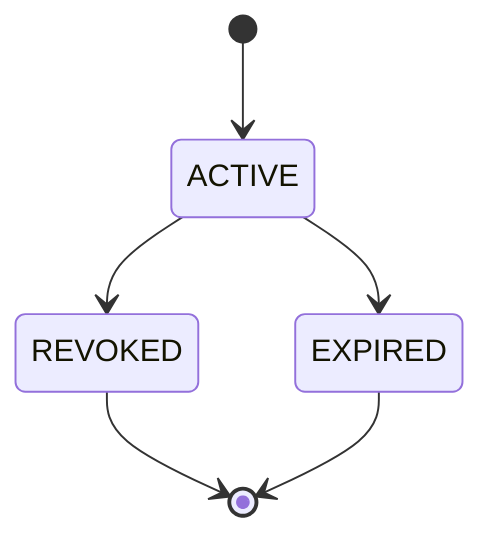

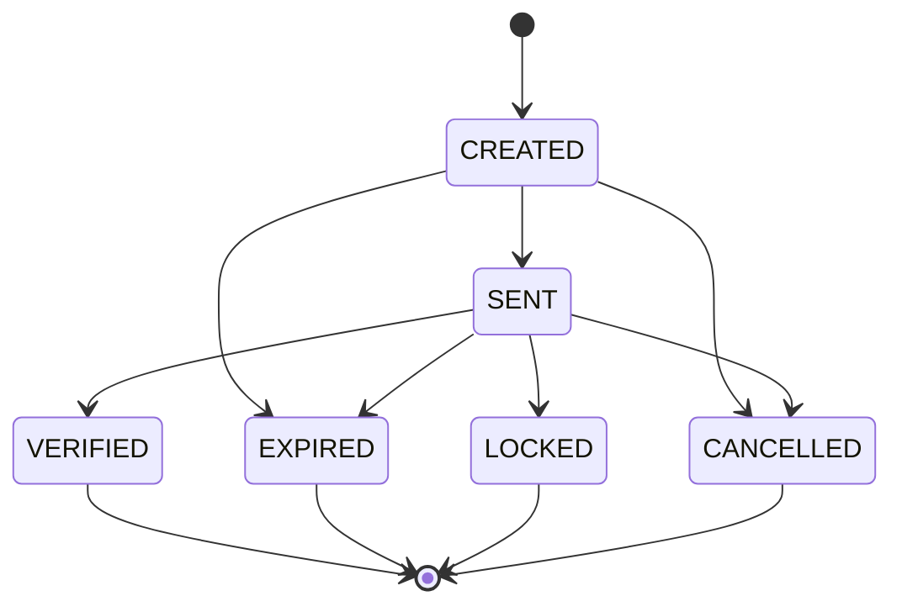

### 6.2 File 与 Document

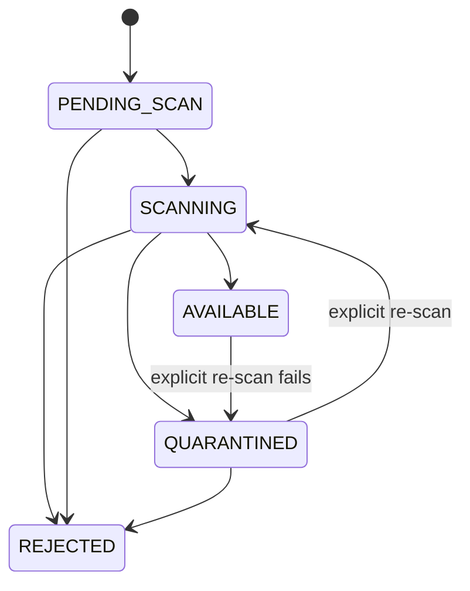

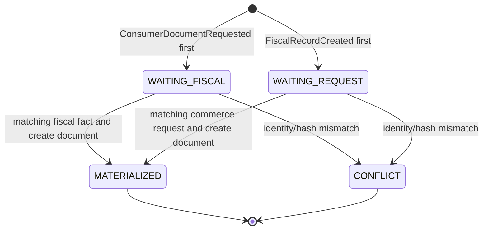

Generation 只按 `generation_key_version + document_generation_key` 条件合并两个输入；`WAITING_*` 不创建 Document，进入 MATERIALIZED 的同一事务必须创建唯一 Consumer Document。冲突必须人工调查并保留两侧 Source Event Key/Version/Hash 和冲突状态，禁止选择“最后到达者”覆盖。

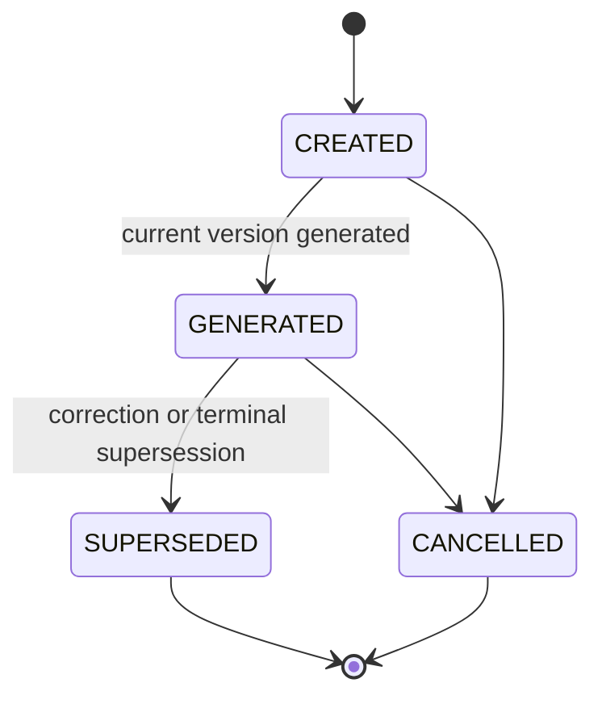

Document Version 使用独立渲染状态，并通过新行而不是覆盖文件表达替代：

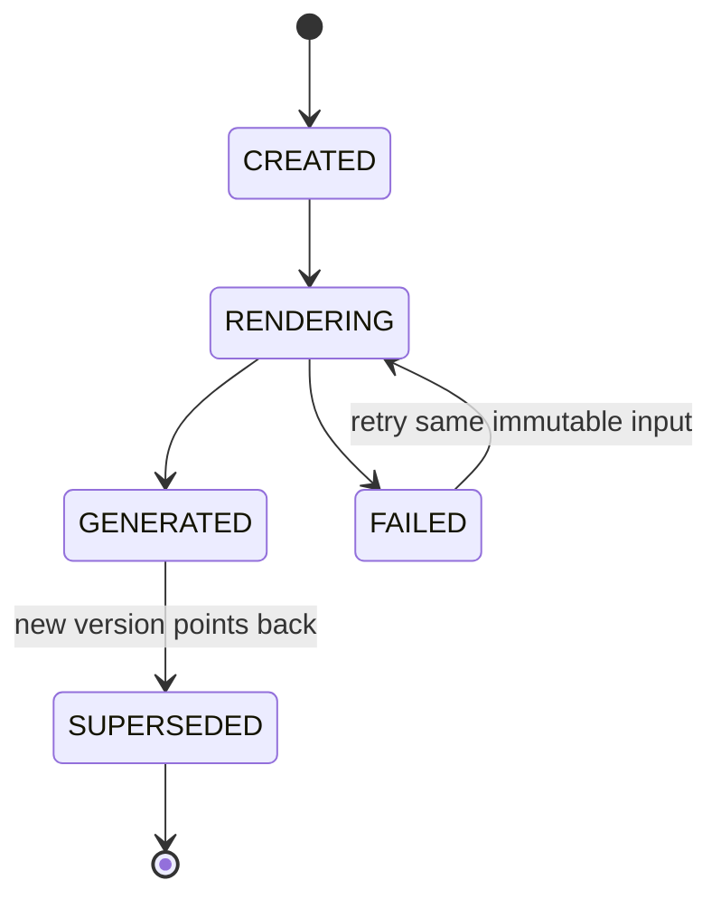

### 6.3 Notification Delivery

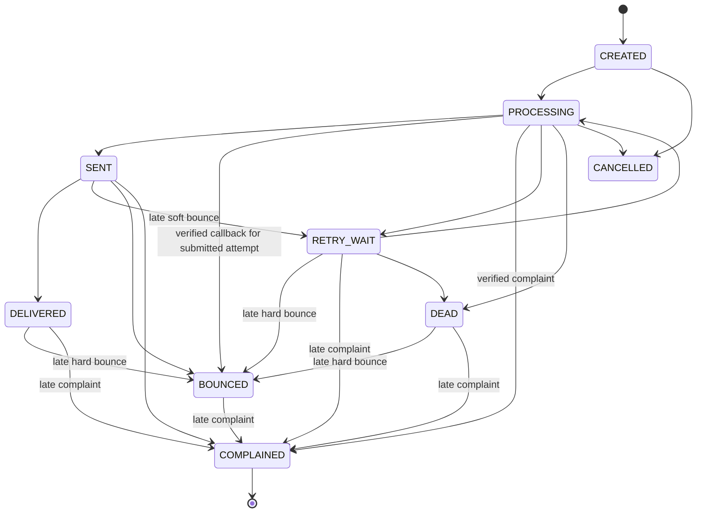

`DEAD` 只终止自动发送重试，不拒绝此前已提交 Attempt 的晚到回调；`PROCESSING/RETRY_WAIT/SENT/DELIVERED/DEAD` 收到已验签 Hard Bounce/Complaint 都按固定优先级幂等推进，不允许退回为更弱的成功状态。FAILED/UNSUPPORTED 签名只记录 Callback、Security Event 和 Audit，不进入此状态机。

### 6.4 Webhook Delivery

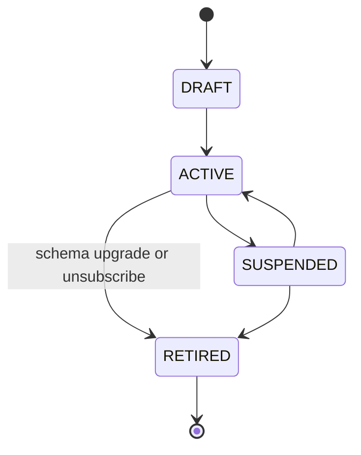

只有 `ACTIVE` Subscription Version 占用 `(endpoint_id,event_type)` 唯一活动 Slot；Schema 升级必须先创建并验证新 Version，再在一个事务释放旧 Slot、激活新 Slot，历史 Delivery 继续引用旧 Version。

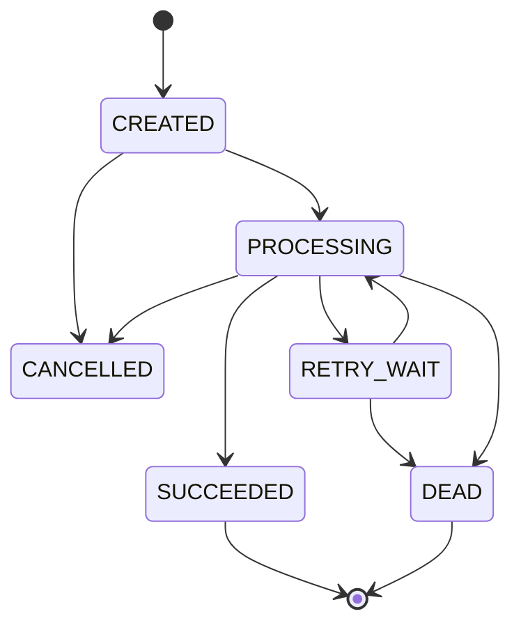

Replay 不将 `SUCCEEDED/DEAD` 原 Delivery 改回 CREATED，而是创建 `generation_no>=1` 的新 Delivery，新 Delivery 独立使用上述状态机。

### 6.5 Gateway 与技术配置发布

```mermaid
stateDiagram-v2
    [*] --> DRAFT
    DRAFT --> CANCELLED: cancel before submission
    DRAFT --> VALIDATING
    VALIDATING --> PENDING_APPROVAL
    VALIDATING --> DRAFT: validation failed; correct unfrozen items
    PENDING_APPROVAL --> APPROVED
    PENDING_APPROVAL --> REJECTED
    APPROVED --> ACTIVATING
    ACTIVATING --> ACTIVE
    ACTIVATING --> ACTIVATION_FAILED
    ACTIVATION_FAILED --> ACTIVATING: audited retry and reacquire slot
    ACTIVE --> SUPERSEDED
```

Rollback Release 与普通 Release 使用同一状态机。回滚激活旧内容时创建新 Release；原 ACTIVE Release 只进入 `SUPERSEDED`，不存在对原记录执行 `ROLLED_BACK` 的状态迁移。

`CANCELLED` 只用于提交前、尚未冻结的草稿；审批拒绝进入已冻结的 `REJECTED`。`APPROVED → ACTIVATING` 必须先抢占 `(environment_code,cluster_scope,activation_slot=1)`；应用进入 `ACTIVATION_FAILED` 时释放该 Slot，旧 ACTIVE Last-Known-Good 始终保留。只有所有要求的应用回执满足并重算 Content Hash 一致后，才在同一事务完成旧 ACTIVE→SUPERSEDED 与新 ACTIVATING→ACTIVE 的 Slot 切换。

### 6.6 Compensation Event

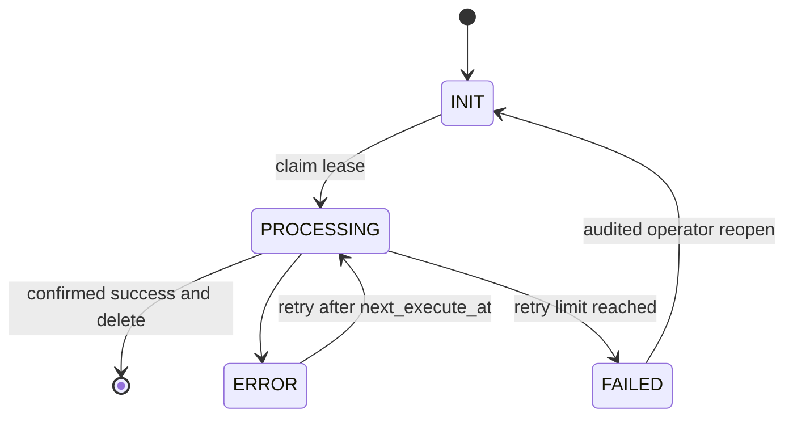

## 7. 全局不变量

1. Platform 不保存密码、登录 MFA Secret、Refresh Token 或登录 Session，外部 IdP 是登录身份事实源。
2. Email OTP 必须绑定 Subject、Purpose 和 Context；同一 Canonical Scope 最多一个 CREATED/SENT Challenge，Resend 必须在同一事务取消旧 Challenge 并抢占 Active Slot；OTP 只支持 Email Ownership、低风险 Consumer/业务验证，不能登录、用作 MFA、确认结算/出款或管理员高风险动作，不能换上下文复用或重复消费。
3. User 可以属于多个 Access Tenant；Tenant 只表达访问边界，不复制 Client/Partner 主档。
4. API Key、OTP、Webhook Secret 只保存抗暴力 Hash、Keyed HMAC 或外部 Secret Reference，禁止明文落库；其他非卡类敏感值只按真实 Reveal、等值查询、展示或元数据并发消费者保存必要 Vault Token、Blind Index/Key Version、Masked Value 或元数据字段，不得默认复制完整字段包，也不得保存本地密文或解密密钥。
5. 业务系统负责资源归属，Platform 权限结果不能替代业务系统的 Client/OE/Order/Settlement 所有权校验。
6. File 创建时冻结 Scan Policy Version/Hash；未完成加密、Content Hash 和该版本的全部 `file_scan_requirement` PASS 前不得 AVAILABLE；显式重扫失败必须允许 AVAILABLE→QUARANTINED 并立即阻断读取。
7. Evidence、Template/Translation Version、Document Version、Delivery Attempt、State Change、Audit Event 和 Security Event 全部追加式，不得被普通业务更新覆盖。
8. Finance 拥有税额、Fiscal Record 和法定编号，Platform 只渲染和投递消费者文档；`ConsumerDocumentRequested` 与 `FiscalRecordCreated` 必须以同一 `generation_key_version + document_generation_key` 并发汇聚，算法版本、身份或 Hash 不一致进入 CONFLICT，只有双输入齐备才创建唯一 Document；Fiscal Record 固定使用 `source_version=1` 与必填 `source_payload_hash`。Credit Note 用同 Client/Order 的 `corrects_document_id`，同一 Document 的新渲染用 `supersedes_version_id`，两者均禁止自引用；Consumer Document 绝不复用 Notification Template。
9. Notification/Webhook 的逻辑 Delivery 与执行 Attempt 分表；Retry 不覆盖历史 Attempt；Worker 只能凭未过期 Lease 和当前 Fencing Token 创建 Attempt 或推进状态，旧 Worker 结果必须拒绝。
10. Notification Delivery 创建时必须冻结唯一有效 Route、Locale-neutral Template Version、Content Hash 和 Provider Version，Message 冻结实际 Translation，并在发送前检查 Suppression；Provider Callback 必须先以冻结 Verification Version 验签，再用 Provider Message ID 唯一定位 Attempt。晚到 Hard Bounce/Complaint 即使 Delivery 已 DELIVERED 或 DEAD 也必须接受、推进并生成 Suppression；验签失败不得改变业务状态。
11. Webhook URL 变化必须创建新 Version 并重新验证；同 Endpoint/Event 最多一个 ACTIVE Subscription Schema。Event、Subscription 与 Delivery Schema 必须相等，Event Client 与 Endpoint Client 必须相等，Endpoint Version/Subscription/Secret 必须属于同 Endpoint，并由本地 Composite FK 强制；Retry 在同 Delivery 追加 Attempt，Replay 创建新 `generation_no` 的 Delivery且 Generation 必须与 Replay No 一致。
12. API Credential 的授权以 `api_credential_scope` 明细为准，Scope Canonical Hash 必须与 Credential Header 一致，禁止只有不可解释的 Hash。
12.1 Client 技术接入准备必须由冻结的 Requirement Config Version 和逐项 Check 计算；Credential/Webhook 资源变化只追加 Evaluation，`ClientIntegrationReadinessChanged` 与 Current Pointer 同事务发布，不能由 CCT 猜测。
13. Audit 不替代业务系统领域状态历史；每个 Shard 的 Sequence 连续、Previous Hash 与 Chain Tail 一致，事件与 Tail 在同一事务追加；不可抵赖通过跨分区 Hash、Signature、Integrity Point 和可验证 WORM 副本实现，MVP 不因生成副本自动删除热数据。
14. Gateway 保护策略优先级固定为 `EMERGENCY > CREDENTIAL > CLIENT > ROUTE > GLOBAL`，但必须按 `rule_type` 逐项选择最高匹配 Tier；高 Tier 未定义的类型继续继承低 Tier 基线，不得整体绕过。运行 Rate/Concurrency 计数只在 Redis；MySQL 不保存请求计数器。
15. Gateway 永远保留一个已验证 Last-Known-Good；同 Environment/Cluster 最多一个 ACTIVATING Release，激活失败只释放 `activation_slot` 而不改旧 `active_slot`，成功时才原子切换，新配置失败不清空当前配置。
16. Config Rollback 和 Gateway Rollback 都创建新发布事实；Gateway 原 ACTIVE Release 只进入 SUPERSEDED，Rollback Release 必须重新校验和审批。`config_version` 的 INLINE Value、Vault Token 与 Secret Ref 必须严格三选一，Secret 不得以 INLINE 或普通 Vault 值模式伪装落库。
17. Platform 不建设通用 Job 表；专用 Delivery/Render/Release 与 `compensation_event` 只执行 Platform 技术动作，禁止承载其他系统业务工作流。
18. Platform 不保存领域规则、Nacos 服务发现数据或部署拓扑；其他系统的业务 Payload 只保留投递所需最小冻结副本并带 Source/Schema/Hash。
19. MVP 默认保留 Platform 自有业务事实，不运行通用归档、匿名化或销毁任务；普通业务 `expires_time/effective_to` 只停止资源继续使用，不代表删除历史数据。
20. Platform 不发布中央 Retention/Legal Hold 事件，也不直接删除或更新其他系统数据。真实受监管生产数据接入前必须完成专项设计和法律/合规评审。
21. Config Change Set 必须以逐项明细计算 Canonical Hash；审批绑定该 Hash，发布对全部 `expected_current_ver_id` 原子 Compare-And-Set，任一项冲突则整批失败，不得部分发布。
22. Gateway Policy/Binding/Selector 都以不可变 Version/Hash 发布；Gateway Release Item 必须用类型化 FK 精确指向 Route/Policy/Binding Version，禁止经 Root Current Pointer 或通用 ID 二次解析。进入 PENDING_APPROVAL 时原子冻结全部 Item，Release Hash 只由该冻结项集计算；Maker/Checker 都必须审批同一 `approved_content_hash`，后续不得修改 Item 或复用审批。
23. Notification Template 和 Document Template 的 `current_ver_id` 只指向 Locale-neutral Version；各 Locale 内容必须存在独立 Translation 表，不得把多个 Locale 版本挂在同一 Current Pointer 下。当前不预建通用 Dictionary 聚合。
24. `compensation_event` 必须冻结 Schema Version/Canonical Hash 且只携带本地业务引用，并以 `lock_version` 承担 Claim/Lease CAS；Webhook Event 等专用敏感 Payload 只保存 Platform 自有短期 Vault Token 与 Hash。`compensation_event` 与聚合事实同事务写入，成功执行后允许删除，长期幂等证据保留在来源业务表或投影。
25. HTTP/内部命令幂等边界固定为 `caller_scope + operation_type + idempotency_key`；同键不同 Request Hash 必须冲突，不得只用人工用户 ID 或可变显示名作为 Caller Scope。
26. File、Document Generation/Document、Notification Delivery、Webhook Delivery、Gateway Release 和 Config Release 的状态变化必须写追加式 State Change，并以 Source System/Event、Attempt/Callback、Replay、Approval 或 Operator Command 精确说明触发来源。
27. 同一 Consumer/Order/Document Version/Action 最多一条 ACTIVE `document_access_grant`；过期或撤销必须释放 Active Slot，但不删除历史授权。
28. Platform 对外事件必须满足 4.12 的唯一发布条件、Compensation Source 和最小 Payload；聚合状态/Current Pointer/Slot、State Change 与 `compensation_event` 必须同事务，MQ 重投只能复用原 Event Key/Schema Version/Payload Hash。

## 8. 跨系统引用

| 来源系统 | Platform 保存的引用 | 用途 |
|---|---|---|
| Client & Contract | `client_id`、`local_partner_id`、`operating_entity_id`、`file_id` 与 Profile/Case Owner Reference | Access Tenant、文件归属引用和通知路由 |
| Commerce | `order_id`、`order_context_id`、`consumer_contract_id`、`refund_request_id`、`generation_key_version`、`document_generation_key`、`generation_scope_hash`、三份 Legal 各自的 `file_id/content_hash`、Document Authorization Reference | Consumer Document 和售后通知；算法版本、Generation Key/Scope、Order Context ID、三份 Legal 文件证明与 Request Event/Version/Payload Hash 一并冻结；不接收 Agreement、Seller 或 Commerce 聚合 Hash |
| Payment Orchestration | `payment_intent_id`、`payment_attempt_id`、`channel_refund_id`、Payment/Refund Event Key/Source Version/Payload Hash | Client Webhook 和通知，不复制支付状态机 |
| Risk & Compliance | `due_diligence_case_id`、`dispute_case_id`、`DisputeEvidenceRequested` Source Event/Version、Client/Provider 截止时间、`file_id` 与 Evidence Owner Reference | 只负责 RFI 通知、文件与审计引用，不复制争议决定或建立通用 RFI 状态 |
| Finance | `generation_key_version`、`document_generation_key`、`generation_scope_hash`、`fiscal_event_key`、`fiscal_record_id`、`source_version=1`、`source_payload_hash`、`settlement_id`、`file_id` 与 Payment Evidence Owner Reference | 按与 Commerce 一致的算法版本、Generation Key/Scope 和不可变 Fiscal Event Key/Record ID/Hash 生成文档，并用于文件和通知 |
| API Gateway | `gateway_route_id`、`gateway_route_ver_id`、`runtime_route_ref`、`gateway_release_id`、`api_credential_id`、`gateway_instance_id`、`environment_code`、`cluster_scope` | Route Catalog、保护策略和应用回执；运行目标由 Nacos/部署系统解析 |
| Vault / Data Protection | Email、Display Name、Notification Address/Message、Webhook URL/Payload、敏感 Audit Attribute 与非 Secret 配置的 `*_vault_token`，以及被当前消费者证明必要的 Blind Index/Key Version、Masked Value 或元数据字段 | 集中保存与受控 Reveal 非卡类敏感值；当前 Platform 92 表不机械保存 Vault Record Version/Metadata Hash，Vault 是独立安全基础设施，不成为第七个核心业务系统或业务事实源 |

跨系统引用不得建立物理外键。入口应用、BFF 和 Gateway 不得直接查询 Platform 数据库，必须调用 Platform 接口。

## 9. 敏感数据与 MVP 留存口径

### 9.1 敏感数据控制

- Email、Display Name、Webhook URL、Notification Address/Message、敏感 Audit Attribute 和受限 Payload 统一保存于中央 Vault；Platform 只按当前 Reveal、等值查询、展示或元数据并发消费者保存必要 Token、Blind Index/Key Version、Masked Value 或元数据字段；存在 Blind Index 时必须按 3.2 的成组非空与双版本轮换规则执行；高熵 `storage_object_ref` 是非凭据内部定位符，遵循文件访问/IAM/留存控制但不进入 Vault；
- Vault Reveal 必须同时校验 Workload Identity、Tenant、Resource、Field 和 Purpose/Reason，所有成功与失败访问写入不可变 Audit/Security Event；仅凭 Token 不得解密；
- API Key 保存 Argon2id 等抗暴力 Hash；OTP Code 使用 KMS Pepper 的 HMAC-SHA-256，数据库只保存 HMAC 和 Pepper Key Version；
- Webhook Secret 保存在 Secret Manager，数据库只保存 `secret_ref` 和 fingerprint；
- Notification Provider 的发送 Secret 与 Callback Verification Key 保存在 Secret Manager/KMS，数据库只保存精确 Version 引用；签名原文不落库，只保存 Header Hash、Payload Hash 和验证结果；
- PAN、CVV/CVC、完整磁道、PIN/PIN Block 明确禁止进入 Platform 和 Vault；Provider/API/Webhook Secret、Callback Verification Key 与私钥只能进入 Secrets Manager/KMS，不能混入普通 Vault 敏感记录；
- Config 使用 `storage_mode` 强制 `inline_value`、`value_vault_token` 与 `secret_ref` 三选一；Secret Manager 引用不得伪装为 INLINE 或 Vault 普通值；
- `compensation_event` 不得保存敏感明文或密文；Webhook 与 Notification 敏感 Payload/渲染内容只保存有期限的 Vault Token、Schema Version 和 Canonical Hash，超期可以 Retire 引用、禁止普通 Reveal 并清除本地 Token 指针，但保留 Hash 和投递结果；MVP 不执行 Vault Destroy；
- File 下载使用分钟级签名 URL，并在签发前执行 Tenant、Resource 和 Action 授权；
- 所有密钥轮换、敏感文件访问、审计查询、权限提升和 Emergency 限流发布写入 Security Event 与 Audit Event。

### 9.2 自动化延期与默认保留

- MVP 对 Platform 自有业务事实默认保留，不自动归档、匿名化或销毁，也不以临时 Job、SQL 或人工脚本代替尚未设计的受控流程。
- Email OTP、Credential、Notification/Webhook、Consumer Document、Evidence、附件、Audit 和 Gateway Config 等原期限仅作为未来专项设计的候选输入；现阶段普通 `expires_time/effective_to` 只终止资源使用、授权或 Reveal，不物理删除历史。
- 到期的 Vault 引用可以执行 Retire、清除本地 Token 指针并禁止普通 Reveal；Retire 不是 Destroy，MVP 不承诺密码学或物理删除。
- `compensation_event` 成功执行后仍允许按可靠执行规范删除；`FAILED` 任务保留至人工处置完成，长期幂等证据继续保存在对应业务事实中。
- Integrity Point 与 `audit_archive_batch` 可以形成可验证 WORM 副本，但该动作不触发热数据清理。
- 在承载真实受监管生产数据前，必须依据适用司法辖区完成 Retention、Legal Hold、备份、对象存储、Vault、匿名化和销毁的端到端专项设计，并通过法律与合规评审；届时再决定所需表、事件和执行任务。

## 10. 明确排除项

- 不保存本地密码、登录 OTP、登录 MFA Secret、Refresh Token 或登录 Session；
- 不实现自有 IdP，不与外部 IdP 竞争身份事实；
- 不把 Email OTP 作为登录/MFA、结算/出款、财务审批或管理员高风险动作的确认手段；
- 不保存 Gateway 运行时限流 Counter、Token Bucket 或每次请求日志；
- 不保存 Nacos 服务实例、实际目标路由、容器节点或部署拓扑；
- 不因 Platform 或 Redis 故障清空 Gateway 当前策略；
- 不拥有 Order、Payment、Refund、Dispute、Ledger、Balance、Settlement 等业务状态；
- 不保存 Fee、Tax、Risk、Routing、MID、Settlement 等领域配置；
- 不创建跨系统共享业务表、跨库视图或跨库外键；
- 不在 MySQL 保存文件二进制、完整 Provider Response、完整 Trace/Metric/Access Log；
- 不使用通用 Job 或 Task 表承载 KYC、退款、拒付、结算审批等业务工作流；
- 不向 BFF 提供绕过业务系统的“全量业务查询”接口；
- 不提供其他五个系统的中央业务幂等事务。
