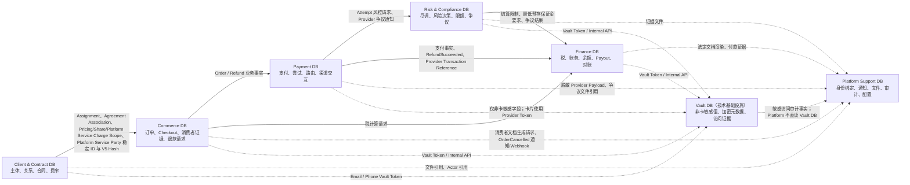
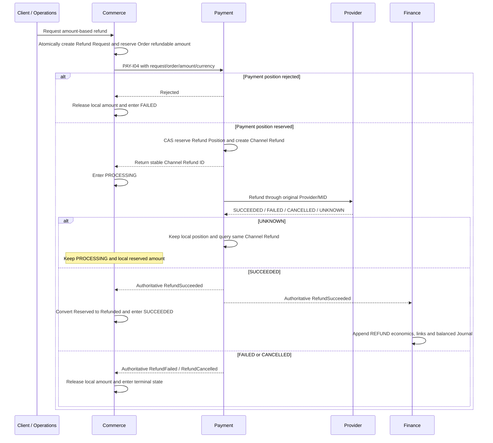

# 六大核心系统数据库设计总览

最后更新：2026-08-27
状态：六系统书面逻辑模型 V1 已确认并按 MVP 决策统一延期通用自动 Retention/Legal Hold；六套 PDManer 设计资产均已授权、生成并通过自动验证；PDManer 4.9.3 应用内检查均保留人工门禁

## 1. 文档用途

本目录固化 Code-MoR 六个核心系统的数据事实所有权、逻辑表结构、关系、状态机和数据库级不变量。后续 Agent 进行业务状态设计、接口设计、PDManer 建模、Migration、DO/Mapper/Repository 或数据库测试时，必须读取本总览以及任务所涉及系统的专项文档。

这些文档是已确认的 V1 业务与逻辑模型基线，不是可执行 DDL。物理模型必须从 [PDManer 项目模板](../templates/pdmaner/template.pdma.json) 派生，并遵守 [DATABASE_DESIGN_GUIDE.md](../DATABASE_DESIGN_GUIDE.md)。Client & Contract、Commerce、Payment Orchestration、Finance、Risk & Compliance 与 Platform Support 六套 PDManer 映射均已完成生成：CCT 为 36 表、404 字段、54 个唯一索引、43 个访问索引、61 条本库关系和 6 个 Diagram Groups；Commerce 当前精确为 14 表、223 字段、20 个唯一索引、11 个访问索引、14 条本库关系和 4 个 Diagram Groups，并有 7 张 Version 表、6 张 immutable evidence 表且没有 Commerce BCR Root；Payment 当前精确为 29 表、373 字段、41 个唯一索引、44 个访问索引、63 条本库关系和 7 个 Diagram Groups；Finance 当前精确为 84 表、1,100 字段、145 个唯一索引、155 个访问索引、160 条本库关系、22 条 1:1 关系和 6 个 Diagram Groups，其中 Tax/Fiscal 主图为 23 表；Risk 当前精确为 71 表、865 字段、106 个唯一索引、74 个访问索引、111 条本库关系、9 条 1:1 关系、8 个 Diagram Groups 和 83 个 CHECK 约束，其中 Due Diligence 为 19 表、Limit 为 7 表；Platform Support 当前精确为 92 表、1,076 字段、167 个唯一索引、116 个访问索引、145 条本库关系、19 条 1:1 关系和 8 个 Diagram Groups，另有 28 条复合外键与 67 条 CHECK 契约。六套模型均已通过与当前基线同步的自动门禁；六套模型的 PDManer 4.9.3 应用内检查仍需人工确认。

## 2. 按系统读取

| 核心系统 | 数据库职责 | 专项文档 | V1 状态与物理入口 |
|---|---|---|---|
| Client & Contract | Party、Client、Local Partner、Operating Entity、关系、合同、费率和实时交易资格校验 | [CLIENT_CONTRACT_DATABASE.md](./CLIENT_CONTRACT_DATABASE.md) · [现实场景与逐表字段映射](./scenarios/CLIENT_CONTRACT_REAL_WORLD_SCENARIOS.md) | V1 当前为 36 表、404 字段、54 个唯一索引、43 个访问索引和 61 条本库关系，物理模型已生成并通过自动验证；[实时交易资格与 Retention 延期设计（当前）](../plans/2026-08-23-cct-realtime-eligibility-retention-deferral-design.md)；[实施计划](../plans/2026-08-23-cct-realtime-eligibility-retention-deferral-implementation-plan.md)；[物理建模决策](../../client-contract-service/docs/database/CLIENT_CONTRACT_PHYSICAL_DECISIONS.md)；[PDManer 模型](../../client-contract-service/docs/database/client-contract.pdma.json)；PDManer 4.9.3 应用内检查待人工确认 |
| Commerce | Order、Order Context、Hosted Checkout、Consumer Context、Checkout Network Evidence、三条消费者接受和退款业务请求 | [14 张表权威模型](./COMMERCE_DATABASE.md) · [现实场景与逐表字段映射](./scenarios/COMMERCE_REAL_WORLD_SCENARIOS.md) | 14 表、223 字段、20 个唯一索引、11 个访问索引、14 条本库关系和 4 个 Diagram Groups；7 Version / 6 immutable / 0 BCR；Refund 仅保留 Order Refund Position 与 Refund Request；消费者文档状态/版本/文件/更正由 Platform Support 拥有，Commerce 不保存 Document Projection；[文档、审计与 Cancel/Void/Reversal 设计（当前）](../plans/2026-08-24-commerce-document-audit-cancel-reversal-design.md)；[隐私与 Fulfillment 移除设计（前序）](../plans/2026-08-24-commerce-privacy-fulfillment-simplification-design.md)；[消费者分析与网络证据设计（前序）](../plans/2026-08-24-commerce-consumer-analytics-evidence-design.md)；[Order Context 精简设计](../plans/2026-08-24-commerce-order-context-simplification-design.md)；[物理建模决策](../../commerce-service/docs/database/COMMERCE_PHYSICAL_DECISIONS.md)；[PDManer 模型](../../commerce-service/docs/database/commerce.pdma.json)；未授权 Migration、Java 或环境 |
| Payment Orchestration | Provider、Provider Account、MID、Capability、Health、路由、Payment Intent、Attempt、渠道退款和 Provider 交互 | [29 表逻辑模型](./PAYMENT_ORCHESTRATION_DATABASE.md) · [现实场景与逐表字段映射](./scenarios/PAYMENT_REAL_WORLD_SCENARIOS.md) | 29 表、373 字段、41 个唯一索引、44 个访问索引、63 条本库关系和 7 个 Diagram Groups；[Payment Execution 精简设计（当前）](../plans/2026-08-25-payment-execution-simplification-design.md)；首次 Provider 提交前实时检查不建立 Gate 表；[Provider Account 与 MID 五表精简设计（专项参考）](../plans/2026-08-25-payment-provider-account-mid-simplification-design.md)；[平衡型物理模型设计（历史）](../plans/2026-08-25-payment-balanced-physical-model-design.md)；[物理建模决策](../../payment-orchestration-service/docs/database/PAYMENT_ORCHESTRATION_PHYSICAL_DECISIONS.md)；[PDManer 模型](../../payment-orchestration-service/docs/database/payment-orchestration.pdma.json)；PDManer 4.9.3 应用内检查待人工完成；未授权 Migration、Java 或环境 |
| Risk & Compliance | KYC/KYB/PDD、策略、风险特征与决策、限额、结算限制和争议案件 | [RISK_COMPLIANCE_DATABASE.md](./RISK_COMPLIANCE_DATABASE.md) · [现实场景与逐表字段映射](./scenarios/RISK_COMPLIANCE_REAL_WORLD_SCENARIOS.md) | 第五套已授权、生成并通过自动验证的物理模型；当前为 71 表、865 字段、106 个唯一索引、74 个访问索引、111 条本库关系、9 条 1:1 关系、8 个 Diagram Groups 和 83 个 CHECK 约束，Due Diligence 为 19 表、Limit 为 7 表；[Limit 7 表平衡精简设计](../plans/2026-08-28-risk-limit-balanced-simplification-design.md)；[Limit 平衡精简实施计划](../plans/2026-08-28-risk-limit-balanced-simplification-implementation-plan.md)；[Decision Engine 19/8 平衡精简计划](../plans/2026-08-27-risk-decision-engine-balanced-simplification-implementation-plan.md)；[Dispute 平衡优化设计](../plans/2026-08-28-risk-dispute-balanced-optimization-design.md)；[Dispute 平衡优化实施计划](../plans/2026-08-28-risk-dispute-balanced-optimization-implementation-plan.md)；[DD 19 表精简计划](../plans/2026-08-27-risk-dd-simplification-implementation-plan.md)；[首版 PDManer 历史记录](../plans/2026-08-26-risk-compliance-pdmaner-implementation-plan.md)；[物理建模决策](../../risk-compliance-service/docs/database/RISK_COMPLIANCE_PHYSICAL_DECISIONS.md)；[PDManer 模型](../../risk-compliance-service/docs/database/risk-compliance.pdma.json)；PDManer 4.9.3 应用内检查待人工完成；未授权 Migration、Java、物理数据库或运行环境 |
| Finance | 税、交易经济、双录账务、统一账户、预存保证金与 Journal 追偿、Provider 三阶段清算、银行现金容量、银行对账、Manual Payout 和关账 | [FINANCE_DATABASE.md](./FINANCE_DATABASE.md) · [现实场景与逐表字段映射](./scenarios/FINANCE_REAL_WORLD_SCENARIOS.md) | 第四套已授权、生成并通过自动验证的物理模型；当前为 84 表、1,100 字段、145 个唯一索引、155 个访问索引、160 条本库关系、22 条 1:1 关系和 6 个 Diagram Groups，Tax/Fiscal 主图为 23 表；[交易经济与会计规则精简计划](../plans/2026-08-26-finance-transaction-economics-accounting-rule-simplification-implementation-plan.md)；[Account Balance 合同成熟精简实施计划](../plans/2026-08-27-finance-account-balance-contract-maturity-simplification-implementation-plan.md)；[退款 Funding 移除实施记录](../plans/2026-08-27-finance-refund-funding-removal-implementation-plan.md)；[通用 Funding 模块删除设计](../plans/2026-08-27-finance-funding-module-removal-design.md)；[通用 Funding 模块删除实施记录](../plans/2026-08-27-finance-funding-module-removal-implementation-plan.md)；[保证金 Account 精简实施记录](../plans/2026-08-27-finance-security-deposit-account-simplification-implementation-plan.md)；[Provider 对账精简实施计划](../plans/2026-08-28-finance-provider-reconciliation-simplification-implementation-plan.md)；[Provider 三阶段账户实施计划](../plans/2026-08-28-finance-provider-three-stage-accounting-implementation-plan.md)；[手工出款精简设计](../plans/2026-08-28-finance-manual-payout-simplification-design.md)；[手工出款精简实施计划](../plans/2026-08-28-finance-manual-payout-simplification-implementation-plan.md)；[统一账户模型设计（Funding 部分已替代）](../plans/2026-08-26-finance-unified-account-model-design.md)；[Account Balance 合并计划（Funding 部分已替代）](../plans/2026-08-26-finance-account-balance-merge-implementation-plan.md)；[统一账户实施记录](../plans/2026-08-26-finance-unified-account-model-implementation-plan.md)；[Finance Entity 双账簿设计](../plans/2026-08-26-finance-entity-dual-ledger-design.md)；[Finance Entity 双账簿实施记录（Funding 部分已替代）](../plans/2026-08-26-finance-entity-dual-ledger-implementation-plan.md)；[Trial Balance 与关账门禁收紧实施记录](../plans/2026-08-27-finance-trial-balance-close-hardening-implementation-plan.md)；[Tax/Fiscal 23 表精简实施记录](../plans/2026-08-27-finance-tax-fiscal-23-table-simplification-implementation-plan.md)；[物理建模决策](../../finance-service/docs/database/FINANCE_PHYSICAL_DECISIONS.md)；[PDManer 模型](../../finance-service/docs/database/finance.pdma.json)；PDManer 4.9.3 应用内检查待人工完成；未授权 Migration、Java、物理数据库或运行环境 |
| Platform Support | IAM 绑定、API Credential、通知/OTP、Webhook、文件、文档、审计和技术配置 | [PLATFORM_SUPPORT_DATABASE.md](./PLATFORM_SUPPORT_DATABASE.md) · [现实场景与逐表字段映射](./scenarios/PLATFORM_SUPPORT_REAL_WORLD_SCENARIOS.md) | 第六套已授权、生成并通过自动验证的物理模型；92 表、1,076 字段、167 个唯一索引、116 个访问索引、145 条本库关系、19 条 1:1 关系和 8 个 Diagram Groups，另有 28 条复合外键与 67 条 CHECK 契约；[平衡型物理模型设计](../plans/2026-08-27-platform-support-balanced-physical-model-design.md)；[PDManer 实施记录](../plans/2026-08-27-platform-support-pdmaner-implementation-plan.md)；[物理建模决策](../../platform-support-service/docs/database/PLATFORM_SUPPORT_PHYSICAL_DECISIONS.md)；[PDManer 模型](../../platform-support-service/docs/database/platform-support.pdma.json)；PDManer 4.9.3 应用内检查待人工完成；未授权 Migration、Java、物理数据库或运行环境 |

一次任务涉及多个系统时必须同时读取对应文档。不能从某个系统的本地投影推导并覆盖另一个系统拥有的事实。

Risk's current Manual Payout authority additionally includes the [2026-08-29 eligibility checkpoint alignment](../plans/2026-08-29-risk-manual-payout-eligibility-checkpoint-alignment-implementation-plan.md). The four checkpoints each have a distinct immutable Risk pair; replay of the same command reuses that pair, and Client/Local Partner apply their separate Finance Account gates over the common Owner/OE/currency/Beneficiary Account-country/`owner_debit_amount` scope.

## 3. 六库边界



图中的箭头表示 HTTP 契约或业务事件，不表示数据库关系。固定规则如下：

- 每个核心系统拥有独立数据库、独立 Migration 和独立 PDManer 模型。
- 禁止跨库查询、跨库事务、共享表、跨库视图和跨库物理外键。
- 同步命令/查询使用轻量 `*-api` 契约与 Spring `@HttpExchange`；业务事实和内部回调使用 MQ。
- 接收方只保存必要的外部业务 ID、来源系统、来源事实版本、事件 ID 和交易时点显式事实或来源证据。
- Gateway、BFF 和入口应用不拥有六大系统的业务事实，也不能建立影子业务库。
- Vault 是独立安全基础设施而不是第七个核心系统。任何服务都不得读取 Vault 数据库；只能通过内部 mTLS/Workload Identity HTTP 契约按 Purpose 保护、读取或处置值。Token 不能替代本系统业务事实或跨库外键。

## 4. 全局物理约定

逻辑文档中的表名用于表达领域语义，可省略技术前缀；落到 PDManer、DDL、Migration 和 Mapper 后，所有物理表名统一使用 `t_<logical_table_name>`，唯一索引统一使用 `uk_`，普通索引统一使用 `idx_`。中文表名保持纯业务名称，不添加 `t_`。

### 4.0 第一性原理与精简审查

六库落物理模型前必须先通过 [数据库设计规范第 7 节](../DATABASE_DESIGN_GUIDE.md#7-第一性原理与精简门禁) 的精简门禁。每张表和关键字段都必须能对应具体业务事实、写入流程、查询/约束/审计用途以及删除后会破坏的已确认场景；不能只以 DDD 名称、未来扩展、密钥轮换或“审计需要”作为存在理由。

固定要求：

- 结构化业务表始终保存当前权威事实；Vault Token、文件引用和 JSON 都不能替代尚未定义的业务字段或 Schema。跨系统不可变事实可按精确稳定 ID 经内部 HTTP 查询，并按来源契约冻结足以校验一致性的显式业务 Tuple 或来源 Hash/Version；没有真实消费者的聚合 Hash 不得机械添加，且始终禁止用 ID 重新解析来源系统当前 `ACTIVE`。
- 独立子表、Current Pointer、Active Slot、乐观锁、业务 Version、Content Hash 和专项 History 必须分别证明其基数、并发、快照或领域证据价值，禁止机械套用。
- 普通字段和状态变化优先使用经批准的统一行级变更历史；独立 Agreement、Acceptance、Decision、Ledger、来源事实等领域证据继续使用专项不可变表，两类职责不能混淆。CCT 一份 Agreement 本身就是一份独立法律事实，没有 Agreement Version 表；交易上下文使用 Agreement/Association 稳定 ID，商业计算规则另用 Pricing/Share/Platform Service Charge Version/Scope。
- 复杂关系图必须用实际 Showcase 讲通写入、当前查询、版本切换和历史追溯；不能只交付一张 ER 图。
- Client & Contract 的表、字段、Current/Version/BCR、As-Of、CCT-I13 或跨系统交易上下文任务还必须读取 [CCT 现实场景](./scenarios/CLIENT_CONTRACT_REAL_WORLD_SCENARIOS.md)；Commerce 的 Order/Order Context、Consumer Contract/Acceptance、Consumer/Network Evidence、退款或 BCR 任务还必须读取 [Commerce 现实场景](./scenarios/COMMERCE_REAL_WORLD_SCENARIOS.md)；Risk & Compliance 的尽调、规则 AST、Action、Shadow 发布、Velocity、限额、结算限制、争议 RFI 或状态机任务还必须读取 [Risk 现实场景](./scenarios/RISK_COMPLIANCE_REAL_WORLD_SCENARIOS.md)、[Limit 7 表平衡精简设计](../plans/2026-08-28-risk-limit-balanced-simplification-design.md)、[Limit 平衡精简实施计划](../plans/2026-08-28-risk-limit-balanced-simplification-implementation-plan.md)、[Decision Engine 19/8 平衡精简计划](../plans/2026-08-27-risk-decision-engine-balanced-simplification-implementation-plan.md)；[Dispute 平衡优化设计](../plans/2026-08-28-risk-dispute-balanced-optimization-design.md)；[Dispute 平衡优化实施计划](../plans/2026-08-28-risk-dispute-balanced-optimization-implementation-plan.md)、[DD 19 表精简计划](../plans/2026-08-27-risk-dd-simplification-implementation-plan.md)和[物理建模决策](../../risk-compliance-service/docs/database/RISK_COMPLIANCE_PHYSICAL_DECISIONS.md)；Finance 的税务、交易经济、Journal、合同成熟、Account、预存保证金、追偿应收、银行现金容量、Provider 清算与对账、Client/Local Partner Manual Payout 或关账任务还必须读取 [Finance 现实场景](./scenarios/FINANCE_REAL_WORLD_SCENARIOS.md)、[交易经济与会计规则精简计划](../plans/2026-08-26-finance-transaction-economics-accounting-rule-simplification-implementation-plan.md)、[Account Balance 合同成熟精简实施计划](../plans/2026-08-27-finance-account-balance-contract-maturity-simplification-implementation-plan.md)、[退款 Funding 移除实施记录](../plans/2026-08-27-finance-refund-funding-removal-implementation-plan.md)、[通用 Funding 模块删除设计](../plans/2026-08-27-finance-funding-module-removal-design.md)、[通用 Funding 模块删除实施记录](../plans/2026-08-27-finance-funding-module-removal-implementation-plan.md)、[保证金 Account 精简实施记录](../plans/2026-08-27-finance-security-deposit-account-simplification-implementation-plan.md)；[Provider 对账精简实施计划](../plans/2026-08-28-finance-provider-reconciliation-simplification-implementation-plan.md)；[Provider 三阶段账户实施计划](../plans/2026-08-28-finance-provider-three-stage-accounting-implementation-plan.md)；[手工出款精简设计](../plans/2026-08-28-finance-manual-payout-simplification-design.md)；[手工出款精简实施计划](../plans/2026-08-28-finance-manual-payout-simplification-implementation-plan.md)、[平衡型物理模型设计（历史）](../plans/2026-08-25-finance-balanced-physical-model-design.md)、[PDManer 实施计划（历史）](../plans/2026-08-25-finance-pdmaner-implementation-plan.md)和[物理建模决策](../../finance-service/docs/database/FINANCE_PHYSICAL_DECISIONS.md)。消费者文档状态/版本/文件/更正任务还必须读取 Platform Support 专项文档；Commerce 不保存 Document Projection。新结构必须映射到至少一个真实写入、查询、变更和历史/失败流程。
- 表总数不是质量指标。设计目标是在不损失业务边界、并发约束和审计能力的前提下删除重复结构与无真实用例的复杂度。

### 4.1 主键与业务编号

- 所有领域实体主键使用服务侧生成的 Snowflake `BIGINT`，Java 类型为 `Long`。
- 主键不使用 `AUTO_INCREMENT`，不得向 Client 暴露其有序性或依赖连续性。
- Snowflake worker/region 配置由部署环境管理；服务必须检测时钟回拨并拒绝生成冲突 ID。
- 对外稳定编号单独建模，例如 `party_no`、`order_no`、`payment_no`、`settlement_no`，并建立业务唯一约束。
- 外部系统 ID 仍用本库字段保存，但不得建立跨库外键。
- 专项表清单中的 `effective_from/to`、`owner_type/id`、`source_system/ref_id`、`resource_system/type/id`、`gross/net/fee_amount` 等斜杠写法仅为文档压缩；落 PDManer 时必须展开为 `effective_from` 与 `effective_to` 等独立真实列，列名中不得包含斜杠，也不得据此合并不同语义。

### 4.2 时间、有效期与版本

- 时间字段统一使用 `DATETIME(6)` 保存 UTC，API 使用带 offset 的 ISO 8601。
- 有效期统一使用半开区间 `[effective_from, effective_to)`；`effective_to IS NULL` 表示无预定结束时间。
- 独立 Agreement 封存后不得原地覆盖，法律条款变化创建新的 Agreement ID；策略、费率、快照、决定、Journal 和投递尝试则按各自专项规则通过版本、冲销或补偿事实表达。
- 除下述 Client & Contract 专项例外外，可变聚合根使用结构化 Root 的 `version` 乐观锁；状态更新必须包含期望旧状态与版本并检查影响行数。该通用规则继续适用于其他五库，不能由 CCT 的专项方案静默改写。
- 状态及其他业务字段变化必须能定位聚合版本、原因、触发来源和操作者。领域专项 History/Fact 可使用 `from_status/to_status` 等结构化字段；也可在符合下述约束时使用服务本地通用行级变更历史，不强制每个状态历史都重复建立 `from_status/to_status` 物理列。

#### 4.2.1 服务本地通用行级变更历史（可选）

服务可在自己的业务数据库中使用一张变更主表和一张不可变版本明细表，记录明确需要审计、追责或历史留档的业务对象。BCR 按系统专项 Record Type 白名单启用，不是所有业务表自动接入的通用拦截器。它们只是附加的本地业务审计视图：结构化业务表始终是当前权威事实，历史 JSON 不参与日常业务查询、唯一性判断或状态转换校验，也不是跨服务的中央审计库。

参考逻辑结构为：

```text
business_change_record
- history_id
- record_type
- record_id
- aggregate_root_type
- aggregate_root_id
- parent_history_id
- current_version
- create_time
- update_time

business_change_version
- change_version_id
- history_id
- version_no
- operation_type
- snapshot_json
- create_by
- create_time
```

强制语义如下。除另有专项设计外，本节描述普通服务使用结构化 Root `version` 的通用模式；Client & Contract 使用 4.2.2 的批准例外：

- 每个采用 BCR 的系统必须显式发布完整 Record Type 白名单、Root Type 白名单、受审计 Child 到 Root 的固定映射和排除清单。新增业务表默认不接入；一行一份且创建后完全不可变的 Acceptance/Decision/Ledger/Fact、由冻结 Version 保存的附属明细、只在 Draft 内编辑的冻结子表以及 BCR/补偿/幂等等技术表，不为形式统一重复写 BCR。具有 Draft/审批/激活等可变生命周期且确有审计要求的 Version 头可以由专项白名单接入。
- `record_type + record_id` 唯一定位一条业务行；`aggregate_root_type + aggregate_root_id` 定位所属聚合，`parent_history_id` 只表示同一聚合内的直接父子关系。根记录的业务类型/ID 必须等于聚合根类型/ID 且 Parent 为空；归属、父子和业务行身份创建后不得覆盖。
- `version_no` 统一表示所属业务聚合根的版本，不是 Child 自己的连续序号，因此允许跳号。聚合内的写命令必须经过 Root 并使 Root 并发版本以期望旧版本原子递增一次；同一聚合版本内，Root 与白名单内实际发生需留档变化的记录各最多写一条最终快照。`(history_id,version_no)` 必须唯一，不得使用 `create_time` 猜测一次业务变更的边界。
- 白名单内 Child 变化时，Root 写入相同 `version_no` 的明细，Child `current_version` 只推进为该 Root 版本坐标；白名单外 Child 不创建 BCR 或重复快照。业务变化、应写历史、主记录指针和所需 `compensation_event` 在同一本地事务提交；多次 SQL 修改必须在 Repository 聚合入口收敛为一条最终行快照。
- `snapshot_json` 使用按 `record_type` 登记、有大小上限的审计 Schema，格式固定为 `_meta + data`。`_meta` 至少保存非空 `schemaVersion`、`triggerType`、`triggerId`、`reasonCode`、`integrityAlgorithm` 和 `integrityHash`；Integrity Hash 输入包含服务与 Schema 版本化 Domain Tag、记录/聚合/父级 Tuple、明细结构化字段以及排除 Hash 自身后的 `_meta + data`，统一使用 UTF-8 RFC 8785/JCS。每个采用该模式的服务必须冻结精确输入对象属性名与层级；`BIGINT` 编码为十进制字符串，`DECIMAL` 使用去无意义尾零且无指数的十进制字符串，时间使用六位微秒 UTC 字符串，禁止把 Snowflake ID 编码成可能丢精度的 JSON Number。`create_by` 记录业务操作者，系统自动变更使用正式 System Actor，不能用它代替 Trigger。
- `data` 是白名单化的完整行审计视图，不是对 DO/数据库行的无差别序列化。不得复制 Vault Reveal 原值、完整 Vault Token、Blind Index、Ciphertext、Secret、卡数据、文件正文，也不记录 `create_time/update_time`、乐观锁、Active Slot、Lease、重试次数等纯技术字段。敏感业务值只允许保存经分类批准的 Masked Value、Metadata Hash、Record Version 或稳定“已变更”标记。
- 版本明细是追加式业务历史，只包含 `create_time`，是通用 `create_time + update_time` 规则的明确例外；普通业务权限不得更新或删除明细。MVP 默认保留数据，不执行通用自动归档、匿名化或销毁；真实受监管生产数据前必须完成 Retention/Legal Hold 专项设计与法律/合规评审。
- 删除父业务行时，必须在同一聚合版本为全部仍存活且已接入 BCR 的后代追加 `DELETE`；版本还原只恢复白名单覆盖的审计视图，对每行选择目标版本之前的最新快照并忽略无快照或最新操作为 `DELETE` 的行，不得宣称由 BCR 单独还原完整业务聚合。
- 创建后完全不可变的 History、Acceptance、Decision、Ledger/Journal 或其他证据表本身就是权威历史，不得为了形式统一再完整复制到通用明细。结构化 Version 的冻结 Child 不重复写 BCR；版本头若仍有 Draft、审批、激活或替换等可变生命周期，只能由系统专项白名单决定是否审计。现有领域专项状态历史仍然合法；只有在本系统业务规范明确选用通用模式时才替换，同一生命周期不建立两套相互竞争的权威历史。

#### 4.2.2 Client & Contract 的 BCR CAS 专项例外

Client & Contract 的当前 36 表模型已经批准删除白名单内普通业务 Root 上机械重复的 `version`。在 CCT 内，Root 对应 `business_change_record.current_version` 是唯一 `expected_change_version` / CAS Token，同时也是该 Root 的审计版本坐标；这项专项决策不推广到 Commerce、Payment、Risk、Finance 或 Platform Support。

- 创建受审计 Root 时，结构化业务数据、Root Record/Version 1 `CREATE` Snapshot、白名单内且确需审计的 Child Record/Snapshot 和本地 `compensation_event` 在同一事务写入；白名单外 Child 只写结构化表。
- 修改 Root 时，以 `current_version = expected_change_version` 条件 CAS 到固定 `next_version = expected_change_version + 1`；白名单内发生需留档变化的 Child 追加最终快照并把 `current_version` 更新到该 Root 版本，但不执行独立 Child CAS。
- 一个命令涉及多个 Root 时，按 `(aggregate_root_type, aggregate_root_id)` 确定顺序锁定。每个 Root 独立校验 CAS、独立计算自己的 `next_version`、独立写 History 和对应 Event；多个 Root 之间只共享同一命令 `trigger_id`，并映射到 Event `_meta.triggerId` 关联，禁止共享或借用另一个 Root 的业务版本。
- 任一 Root CAS、业务校验、结构化更新、应写 History 或 Event 登记失败，整个本地事务回滚。
- CCT 的 BCR 版本只服务内部 CAS 与通用行级审计，不升级为 Agreement/Legal 交易接口字段。CCT-I13 的完整 V5 Bundle 覆盖 Assignment 四层、Agreement/Association、Legal/Seller，以及 Client Pricing、条件存在的 Partner Share 和 Partner 来源必须存在的 Platform Service Charge 三类 Commercial Term 的 Plan/Version/Scope/Component；Partner 来源还返回同一 Partner Agreement 的唯一 `PLATFORM_SIGNATORY` Party。Commerce 只冻结其中的 `assignment_id`、Agreement Association ID、Term Scope ID、Platform Service Party ID、Legal/Seller 公开展示值和 V5 Hash，不保存 Finance Entity ID；Finance 再按精确 Scope ID 查询不可变 CCT 历史、映射本地 Finance Entity 并冻结完整计算参数。V5 不含 Eligibility 证明；下游不得使用内部修订号或中间 Hash 替代这些业务事实。

### 4.3 金额、币种与舍入

- 金额统一用 `DECIMAL(24,8)`，禁止 `FLOAT/DOUBLE`；费率和汇率使用 `DECIMAL(18,10)`。
- 每个金额事实必须绑定 ISO 4217 alpha currency；当前产品从 USD 开始，但模型不能假设只有 USD。
- 计算中保留数据库精度，最终金额按币种 minor unit 使用 `HALF_UP`。
- 可解释的计算尾差进入平台内部 `ROUNDING_ADJUSTMENT`；来源未知的差异进入对账异常，不能伪装成舍入。
- 同一 Journal Entry 只能属于一个 Ledger Book 及其唯一 Operating Entity 或 Finance Entity 主体和币种。

### 4.4 数据分类与 Vault

- 只有被所属业务模型明确分类并由事实拥有系统校验业务 Payload Schema 的可恢复非卡敏感值才集中保存在 Vault；Vault 只校验通用 Data Type/Purpose/Classification/大小/安全策略，不拥有 Consumer、Customer、Order 等业务表、字段或派生维度。CCT Party V1 仅 Email、Phone 使用标量 Vault Token，姓名、生日、法律标识和地址在 CCT 结构化保存；登录密码不进入 CCT 或 Vault。内部 Operations 账号只由 Platform Support 保存不可逆校验值；Client、Partner、Consumer 的认证提供方仍待设计。其他系统仍按专项文档保护已批准字段。
- 业务系统持有 Vault 值时必须保存 `*_vault_token`；`*_blind_index + *_blind_index_key_version` 只有等值查询消费者存在时保存，`*_masked_value` 只有展示消费者存在时保存，`vault_record_version/vault_metadata_hash` 只有真实消费者存在时保存。不得机械落完整套餐。Commerce Consumer 是明确例外：Email/Phone 各保存一个稳定 Value Token，既用于等值/频次关联也用于授权 Reveal；`consumer_profile_vault_token` 只含姓名和完整账单地址且不得重复 Email/Phone，Consumer Blind Index/Key Version/Masked Value 全部删除。
- Blind Index 使用按 Tenant、字段和 Purpose 隔离并带版本的 HMAC，不能用普通 SHA 对邮箱、电话、证件号或银行账号做可枚举 Hash，也不能跨字段或跨用途关联。跨系统传递时必须由 Vault 按明确获批的发送方→接收方 Analytics/Assessment Purpose 生成，或由同一 Purpose 授权明确覆盖两端；不得复用发送方本库查询 Purpose 的 Index，接收方也不得跨 Purpose 再利用。每个 Index 必须保存同前缀的 `*_blind_index_key_version`；若完整名超过 32 字符，可使用注释明确的 `*_blind_key_ver`。多个 Index 不得共用一个含义不清的通用版本字段。Blind Index 与地域/网络/设备等可关联派生维度仍是假名化或准标识数据，不是匿名数据，必须最小授权、访问审计、禁止任意导出并纳入 Retention/删除治理。
- 业务库可以保存经过分类批准、不能还原原值且确实参与业务规则的派生事实，例如国家代码、证件类型、验证状态、风险结论和脱敏展示；“集中存储”不要求每次查询都 Reveal，也不允许借派生字段重新拼出原始敏感值。
- PAN、CVV/CVC、完整磁道数据和 PIN/PIN Block 禁止进入 Code-MoR 服务、数据库、事件、日志、文件或 Vault。卡片录入与 Tokenization 使用 Provider Hosted Fields/SDK；Payment 只保存 Provider Token Reference、Scheme、BIN、Last4、Issuer Country 和 Provider Fingerprint，卡片有效期由 Provider Token 管理。这些最小卡片元数据仍必须分类、脱敏、授权和按期留存，不能按普通公开字段处理。
- 该边界用于缩小 Cardholder Data Environment 和 PCI DSS 评估范围，不代表 Code-MoR 或 Vault 自动取得 PCI 合规；上线前仍需依据实际数据流、Provider 集成方式、责任矩阵和适用 SAQ/ROC，由收单方或合格评估方确认。
- Provider/API Credential、Webhook Signing Secret、IdP Token 和私钥放云 Secrets Manager/KMS，业务库只保存引用；不得把这类运行凭据当作 Vault 业务记录。
- 文件正文和大体积原始 Payload 放 Platform 管理的加密对象存储；数据库保存稳定 `file_id`、`content_hash`、分类、大小和保留策略。
- JSON 只用于不可变协议快照、经批准的通用行级审计快照、受版本控制的扩展输入或不参与核心查询的原始信封；需同时保存 Schema Version 和 Payload Hash，可使用专用结构列或上述受控 `_meta`，且不得包含敏感明文或 Vault 内部密文。
- Vault Token 是不透明标识。默认 Record Token 首次创建时随机；批准的 Commerce Consumer Email/Phone 使用稳定 Value Tokenization，同字段相同规范化值返回同一 Token，密钥轮换不改变 Token。稳定 Token 可在 Commerce→Payment→Risk 内部同步最小契约中传递，禁止进入外部 API、普通日志、MQ 或 BCR。Reveal 必须由服务端使用 mTLS/Workload Identity 发起并携带 Purpose/Reason/Resource；共享 Token 仅在所有引用解除且 Retention/Legal Hold 允许后销毁。
- Vault Binding 有且只有两种受控模式。默认 `PENDING_AFTER_COMMIT` 把 Protect 返回的新引用与 `VAULT_BIND_REFERENCE` 在本地事务中先作为 Pending 保存；afterCommit 只唤醒统一 Dispatcher，由其 Claim 后幂等 Bind。首次创建在 Bind 成功前不可对外使用；替换时旧 Current Reference 保持有效，只有新 Bind 成功并以 Expected Version 原子切换后才登记旧 Token Retire。
- `SYNCHRONOUS_PRE_BIND` 仅限专项设计明确批准的场景。Commerce Consumer Profile 使用稳定命令恢复边界；Email/Phone 使用稳定 Value Tokenization。Checkout Network Evidence 不再调用 Vault，因此不是 Vault pre-bind 例外。
- 两种引用绑定模式都禁止 Bind/Retire 抢跑；除批准的稳定 Value Token 外禁止 Token 复用。CAS 冲突产生的未采用 Profile Token 必须受控退役。
- 普通 access log、trace、metric 不进入核心 MySQL，也不得包含 Vault Reveal 值或完整 Token。

Vault 的 API、逻辑模型、KMS、AAD、重加密、Legal Hold 与销毁规则见 [VAULT_SERVICE_ARCHITECTURE.md](../VAULT_SERVICE_ARCHITECTURE.md)。

## 5. 每库本地补偿与幂等表

每个系统按实际异步生产行为拥有自己的 `compensation_event`，不由 Platform Support 或 Vault 集中承载。MVP 不建立通用 Inbox/Outbox：

| 逻辑表 | 最小职责 | 强制约束 |
|---|---|---|
| `compensation_event` | 在领域事务内登记 MQ 发布或本地恢复任务，并在提交后可靠执行 | 稳定 `event_key` 唯一；`(source_type,source_id,source_version,event_type)` 唯一；Schema/Payload/Hash 创建后不可变；Canonical Payload 最大 64 KiB；状态、重试时间、Claim Lease 和乐观锁完整 |
| `command_idempotency` | HTTP/内部命令幂等 | `(caller_scope, operation_type, idempotency_key)` 唯一；同键不同 request hash 必须冲突 |

实现时各库必须使用 `t_compensation_event` 与 `t_command_idempotency` 等统一物理表名；不得改为系统自定义表前缀，语义和约束必须一致：

- 权威业务变化、状态历史与 `compensation_event` 在同一本地事务提交；仅在提交后唤醒执行器，禁止事务内直接发布 MQ。
- 正常路径由本地 `afterCommit` 唤醒；XXL-Job 只做本服务的兜底扫描、分片或串行隔离。数据库条件 Claim、Lease 与 Version 是多实例最终互斥边界。
- Broker Confirm 或本地 Handler 确定成功后可以删除补偿记录；可重试失败保留错误和下次时间，超过上限进入 `FAILED` 并告警，人工重开必须有 Actor、Reason 和 Ticket。
- 事件重试复用相同的稳定 `event_key`、来源版本、Schema、Payload 与 Hash，不因重发生成新 ID。Payload 只能包含批准的非敏感字段、`file_id + content_hash`、必要 Masked Value，或 Vault 已通过 `CopyForBinding` 为准确接收方创建的专属 Token Tuple；来源系统自己的 Token 不得跨系统复用。
- `LOCAL_HANDLER` 的外部调用必须把 `event_key` 传为幂等键；外部系统不支持幂等且结果未知时转入领域专项查询/人工恢复，不能靠业务锁或 XXL 串行盲目重放。
- 消费方不建立通用 Inbox。Listener 在本地业务事务中通过 `source_event_key` 唯一约束、`source_payload_hash` 一致性检查、来源版本条件更新和领域状态机实现幂等，提交成功后才 Ack；对当前或仍保留的 Key，同键不同 Hash 必须拒绝并告警。要求识别任意历史旧 Key 冲突的资金/合规领域，必须在有业务语义的不可变 History/Fact 逐事件保留 Key/Hash，不能让单行 Current Projection 冒充完整历史证据。
- Payment UNKNOWN 查询、Payout Execution、通知投递等领域恢复记录继续使用自己的专项表；它们不能被压缩成无业务语义的通用补偿状态。

完整运行、并发和测试规则见 [COMPENSATION_EVENT_GUIDE.md](../COMPENSATION_EVENT_GUIDE.md)。

### 5.1 MVP 数据默认保留

MVP 暂不实施通用自动 Retention、Legal Hold、归档、匿名化或销毁基础设施。六个核心系统不预建 `retention_policy_projection`、`retention_resource_control`、`retention_hold_projection`、`retention_action_log`，Platform Support 也不发布通用留存/Hold 事件或跨库运行销毁任务。

延期不表示允许随意清理：业务和技术数据默认保留，不自动删除或销毁；业务专用过期字段、命令幂等生命周期、成功补偿记录清理及明确业务终态继续按各自规则执行。投入真实受监管生产数据前，必须完成数据分类、适用国家/地区法规、留存期限、Legal Hold、备份处置、Vault 生命周期、受控销毁、审批与审计的专项设计，并通过法律/合规评审和验证。

## 6. 跨系统主链路

### 6.1 下单和支付

```mermaid
sequenceDiagram
    participant ClientSystem as Client System
    participant Consumer
    participant CCT as Client & Contract
    participant Commerce
    participant Finance
    participant Risk
    participant Payment
    participant Provider

    ClientSystem->>Commerce: CreateOrder(idempotencyKey, client_order_id, checkout data)
    Note over Commerce: Lock operation_context_time for this command and every recovery
    Commerce->>CCT: CCT-I13 with context_as_of_time=operation_context_time
    CCT-->>Commerce: Frozen OE, Assignment、Agreement/Scope/Platform Service Party IDs and V5 Hash
    Commerce->>Risk: Assess checkout eligibility with immutable OrderPreparationContext
    Risk-->>Commerce: ALLOW / REVIEW / DENY / FAILED / TIMED_OUT
    Note over Commerce: Only ALLOW continues; technical failure is fail-closed
    Commerce->>Finance: FIN-I17 calculate tax from preallocated immutable order lines
    Finance-->>Commerce: Tax Snapshot ID/Calculation Hash, aggregates and per-Item collected tax
    Commerce->>Commerce: Commit Order + one immutable Order Context; commercial_context_time=context_as_of_time
    Commerce->>Payment: Create one Intent with order_id/order_context_id and explicit frozen facts
    Payment-->>Commerce: paymentIntentId
    Consumer->>Commerce: Accept each frozen legal content hash
    Consumer->>Payment: Start explicit Payment Attempt
    Payment->>Commerce: COM-I10(order_id, order_context_id)
    Commerce-->>Payment: consumer_contract_id + 3 typed Acceptance IDs + acceptance_completed_at + Order Version, or reject
    Payment->>Risk: Assess this Attempt and reserve limits
    Risk-->>Payment: ALLOW / REVIEW / DENY / FAILED / TIMED_OUT
    alt ALLOW
        Payment->>Payment: Select and freeze Provider/MID
        Payment->>Provider: Execute payment action
        Provider-->>Payment: Success / explicit failure / unknown
    else REVIEW or DENY
        Payment->>Payment: End Attempt without Provider call
    else FAILED or TIMED_OUT
        Payment->>Payment: RISK_FAILED without Provider call
    end
    Payment-->>Commerce: Attempt and Payment facts
    Payment-->>Finance: Payment financial fact
```

固定不变量：

- 一个 Order 只有一个 Checkout Session 和一个 Payment Intent。
- `client_order_id` 在 Client 命名空间内永久唯一；同一命令重试必须复用原 `idempotency_key` 和 `operation_context_time`。使用新 Key 重复已有 `client_order_id` 不创建第二个 Order，只返回冲突或已有 `order_no`。
- `command_idempotency.operation_context_time = CCT-I13.context_as_of_time = order_context.commercial_context_time`；命令恢复不得重新取当前时间。Finance 通过 COM-I04 取得 `commercial_context_time` 后，将其映射回 CCT-I14 的 `context_as_of_time`。
- Checkout 资格评估与每个 Payment Attempt 的交易风控是两个独立事实；两者的 `REVIEW/DENY` 都拒绝当前请求，不能在原记录上改为 ALLOW；`FAILED/TIMED_OUT` 是独立技术结果并同样 Fail-Closed，不能伪装成业务 DENY。
- Payment 创建 Attempt 前必须通过 COM-I10 让 Commerce 实时查询同一 Consumer Contract 下 `CONSUMER_TERMS/REFUND_POLICY/PRIVACY_NOTICE` 三条不可变 Acceptance，逐条验证其 Network Evidence 属于同 Order、同 Checkout Session 且 Scene 为 `LEGAL_ACCEPTANCE`，并冻结三条显式 Acceptance ID、`acceptance_completed_at=max(accepted_at)` 与当前 Order Version；前端布尔值、缓存或仅有页面点击记录都不能绕过该服务端门禁，也不新增集合摘要、集合版本或集合 Hash。
- 一个 Payment Intent 可以有多次显式顺序 Attempt，但最多一笔业务成功、最多一个非终态 Attempt。
- `UNKNOWN` 是非终态，会继续占用活动槽；不能为了重试把超时当失败。
- Order 到期只禁止创建新 Attempt；只要存在任一活动 Attempt 就不得单方面终止。尚未提交 Provider 的前置 Attempt 可由 Payment 明确失败，已提交、等待 Consumer 或结果不确定的 Attempt 必须先完成权威查询。
- `REVIEW` 和 `DENY` 都拒绝当前 Attempt；仅内部分析 REVIEW，不把原 Attempt 改成 ALLOW。
- CCT 必须在正式 Order 打开前解析唯一 Operating Entity；没有合格主体、路由覆盖不足或依赖失败时不创建 Order、Order Context 或 Checkout Session。Payment 不得在后续 Attempt 中切换该主体。
- Provider/MID 在 Attempt 内冻结；临时 Provider/MID 不可用时保留同一 Order 与 Intent，重试必须创建新 Attempt，且新 Attempt 只能在同一 Operating Entity 下更换 MID。
- CCT 复用 `OperatingEntityChanged`，最小携带 `operating_entity_id,operating_entity_status,reason_code,source_version,occurred_time`。本轮只有 `CLOSED` 表示永久不可用：Payment 立即阻止新 Attempt，等待不存在活动或 `UNKNOWN` Attempt 后终止唯一 Intent；Commerce 再取消仍开放的 Order 与 Checkout Session。不自动创建替代 Order、不跨主体重试；Client 仍需交易时必须使用新的 `client_order_id`。`SUSPENDED` 的在途处置暂不扩展。

### 6.2 退款



- 当前只支持 amount-based full/partial refund，不设计 Item Refund。
- Client 发起退款不需要审批；退款提交 Provider 之前不再调用 Finance，也不再做 Finance 现金预占。
- Commerce Refund 只使用 `order_refund_position + refund_request`：创建 Refund Request 与增加 `reserved_amount` 必须在同一本地事务完成，不再建立 Refund Reservation、Reserve Change 或 Payment Projection。
- Commerce 只保存 Payment `channel_refund_id`，不保存 Finance 引用、下游状态版本、Event Key、Payload Hash 或 Event Time。PAY-I04 输入稳定的 Commerce Refund Request、Order、金额和币种；Payment 在本库以 Refund Position CAS 约束渠道侧可退款额度。
- Commerce Refund 状态只使用 `PENDING/PROCESSING/SUCCEEDED/FAILED/CANCELLED`。Payment `UNKNOWN` 不形成外部退款事实：Commerce 保持 PROCESSING 和本地 `reserved_amount`，Payment 保留本地渠道额度并继续查询权威结果。
- Payment `RefundSucceeded` 同时通知 Commerce 与 Finance：Commerce 在本地消费 Order Refund Position，Finance 才追加 REFUND Economics、Component Link、Provider Debit Item、Journal 与适用的 Fiscal 更正。`RefundFailed/RefundCancelled` 只通知 Commerce 释放本地额度，Finance 不接收、不建状态，也不发布退款资金事件。
- 原 Refund Request 明确失败或取消后不可复活；Client 再次退款必须使用新的 `client_refund_id`，Operations 必须生成新的 Command ID；二者都创建新的 Refund Request 与 Channel Refund，并重新校验 Commerce 与 Payment 各自的可退款额度。
- 渠道退款必须绑定原成功 Attempt、Provider、MID 和 Provider Transaction。

### 6.3 Provider 到款、对账和 Client 可用余额

```mermaid
flowchart LR
    A["PaymentSucceeded"] --> B["冻结 payment_succeeded_time\nClient pending payable"]
    B --> C["CCT Agreement-OE 冻结规则\nT+N 工作日/日历/时区/Cutoff/FOLLOWING"]
    C --> D["冻结 balance_available_time\nClient 与 Local Partner 共用"]
    D --> E["到期成熟任务：扣除已成功退款后\nPending → Available；未决退款不阻断"]
    E --> F["唯一 AVAILABLE Account\n冻结 account_id + balance_version"]
    F --> I["Manual Payout：Journal Available → Locked\n冻结 owner_debit_amount"]
    I --> I2["Maker-Checker final approval\n创建并人工提交 Payout Execution"]
    I2 --> J["Bank debit reconciled"]
    J --> K["Liability extinguished\nPayout reconciled"]
```



Provider 报表不等于现金到账；银行入账也不自动等于已匹配。`AVAILABLE` 是由冻结 `balance_available_time` 决定的 Client/Local Partner 对 Owner 负债状态，不等于独立银行余额：Provider 实际 T+2、Provider/银行匹配和对账不阻断合同成熟，平台承担流动性缺口。Risk 的长期限制与最低保证金只门禁 Manual Payout 的四个检查点，不能改写共同成熟时点。到期成熟与 `RefundSucceeded` 对同一 Economics、Component 和 Account 串行：到期只扣除已经成功并建立 Component Link 的退款，未决退款不阻断成熟；成功退款先扣 `PENDING`，不足再扣 `AVAILABLE`，已 `LOCKED`、已支付或仍不足的部分形成对应 Owner 的 Recovery Receivable，不自动解锁 Payout 资金，也不消耗 `CLIENT_SECURITY_DEPOSIT`。不同 Operating Entity 的账簿、Account、Payout 和银行账户不得净额混用。

### 6.4 争议

- Payment 接收并标准化 Provider dispute notice，负责向 Provider 提交或查询。
- Risk 创建 Dispute Case 后直接进入 `EVIDENCE_REQUIRED`，复用既有 State Change/Evidence Package/Evidence Ref/Submission Request，发布 `DisputeEvidenceRequested`；Client 截止早于 Provider 截止。Client 未响应仍保持 `EVIDENCE_REQUIRED`，不得自动认损或产生 `DisputeLost`；仅经授权人工明确接受责任或放弃举证，或 Provider 权威结果确认为 `LOST`，才可形成 `DisputeLost`。不新增通用 RFI 表。
- `DisputeOpened` 只让 Risk 建立或更新结算限制/最低预存保证金要求，不触发 Finance 分录。Outcome 只追加版本：`PROVIDER_ACTION` 可形成 Version 1 `WON/LOST`，`CLIENT_DISPOSITION/OPERATIONS_DISPOSITION` 只可形成 Version 1 `LOST`，Version 2+ 只允许 `OPERATIONS_CORRECTION`，结果与更正 State Change 均要求 `trigger_id=decision_source_id`。Liability 的规则授权路径保存 `decision_evaluation_id + action_effect_id` 且 `decided_by` 为空，人工授权路径相反，二者严格 XOR。`DisputeLost/DisputeOutcomeCorrected` 显式携带 Outcome Version、`outcome`、`principal_bearer` 与 `security_deposit_use_allowed`；Finance 只能在 `outcome=LOST + principal_bearer=CLIENT + security_deposit_use_allowed=1` 时先借记 `CLIENT_SECURITY_DEPOSIT/NONE`，不得从原因、来源或规则推导许可，其余短缺借记 `CLIENT_RECOVERY_RECEIVABLE/NONE`。
- Platform Support 只保存证据文件并投递 RFI/结果通知，不拥有争议或通用 RFI 状态。

## 7. 全局强制不变量

1. Client、Local Partner、Operating Entity 是 Party 的平级角色；同一 Party 可拥有多个不同角色，角色状态互不替代。
2. Operating Entity 来源统一为 `PLATFORM/CLIENT/PARTNER`：平台自有主体、Organization Client 自身或经平台审核关联的主体、Local Partner 提供的主体；三类来源都可拥有多个 Operating Entity，且所有主体均由平台管理。CLIENT 来源只保存 `SAME_PARTY/VERIFIED_ASSOCIATION` 审核结论，当前不结构化保存多公司多层持股路径或计算间接持股比例。
3. Client 和 Local Partner 均不能在交易请求中选择 Operating Entity 或 MID；平台根据 CCT Assignment 选择，Commerce 在 Order 上锁定唯一 Operating Entity。CCT-I13 在每次调用时实时校验当前交易资格，成功后返回不含 Eligibility 对象的完整 V5 Bundle；Commerce 用 Order 主表冻结准确 `industry_code + mcc_code` 与金额/币种，用唯一 Order Context 冻结 Assignment ID、Agreement Association ID、三类 Term Scope ID、Platform Service Party ID、Legal/Seller 展示值、Tax Snapshot ID/Calculation Hash 与 `commercial_context_hash`，不创建 Commerce 聚合 Schema/Hash，也不保存 Finance Entity ID。CCT/Finance 的完整条款与税务事实分别按精确 Scope/Tax Snapshot ID 和其来源证据长期读取，绝不重新解析当前 ACTIVE；Payment 只在该主体下为每个 Attempt 选择 MID，并与 Risk、Finance 继承同一组显式事实。
4. 同一 Client 可通过多个 Operating Entity 交易，任何订单、支付、退款和交易税事实只属于一个交易 Operating Entity；但 Partner 来源的显式 Platform Service Charge 会在 Partner OE 与平台 Finance Entity 两本独立账簿分别形成平衡 Journal，不能把平台利润记入 Partner OE。
5. Client Fee、Partner Share 与 Platform Service Charge 是三类独立合同条款；Partner Share 以实际 Client Fee 为基数，Platform Service Charge 使用其明确配置的计算基数，均不能作为 Client 费率的附属字段或按交易残差倒算。
6. Payment、Commerce、Risk、Finance 的并发额度各自独立：Commerce 与 Payment 分别约束订单和渠道可退款金额，Risk 约束风险限额；Finance 不建立通用 Funding 状态，Manual Payout 以 `owner_debit_amount` 锁定 Owner Payable，并在同一 `BANK_CASH` Account 行锁内以 `active_payout_cash` 串行所有活动 Execution 的现金容量。上述状态不能合并或跨库回绑。
7. Finance Journal 是唯一会计事实源，必须永远借贷平衡、不可修改、可由来源事实重建；投影余额不是替代账本。
8. 每个业务系统在自己的数据库中保留领域专项或受控通用行级的业务变更历史，并保留本地 `compensation_event`、Command 幂等和消费侧业务幂等；不建立跨服务的中央历史库、通用 Inbox/Outbox、中央补偿数据库或中央业务工作流。
9. 本地投影必须保存来源版本并拒绝乱序回退；投影不能反向成为来源系统的事实。

## 8. PDManer 落模顺序

六套 V1 书面规范均已确认并冻结。物理模型按逐项显式授权执行，以尽早验证跨系统 ID 和资金链；逻辑 V1 获批不自动授权后续物理模型：

1. Client & Contract：当前 36 表、404 字段、54 个唯一索引、43 个访问索引和 61 条本库关系的模型已生成并通过自动工件门禁，已稳定 Party、角色、直接关系、来源审核结论、四表自动主体分配、Agreement/Legal 七表直接模型、Commercial Term 四表模型、使用点实时交易资格及每笔 Order 的唯一行业/MCC 分类；PDManer 4.9.3 应用内检查待人工确认。见 [实时交易资格与 Retention 延期设计（当前）](../plans/2026-08-23-cct-realtime-eligibility-retention-deferral-design.md)、[实施计划](../plans/2026-08-23-cct-realtime-eligibility-retention-deferral-implementation-plan.md)、[物理建模决策](../../client-contract-service/docs/database/CLIENT_CONTRACT_PHYSICAL_DECISIONS.md) 与 [PDManer 模型](../../client-contract-service/docs/database/client-contract.pdma.json)。
2. Commerce：14 表、223 字段、20 个唯一索引、11 个访问索引、14 条本库关系和 4 个 Diagram Groups；7 Version / 6 immutable / 0 BCR。模型固化 Order、唯一 Order Context、Consumer Context、Network Evidence、三条显式 Acceptance 和两表 Refund，且没有 Fulfillment 能力；消费者文档状态/版本/文件/更正完全由 Platform Support 拥有，Commerce 不再保存 Document Projection；Refund 只保存 Payment `channel_refund_id`，不复制 Finance/Payment 状态或事件元数据。见 [文档、审计与 Cancel/Void/Reversal 设计（当前）](../plans/2026-08-24-commerce-document-audit-cancel-reversal-design.md)、[隐私与 Fulfillment 移除设计（前序）](../plans/2026-08-24-commerce-privacy-fulfillment-simplification-design.md)、[现实场景](./scenarios/COMMERCE_REAL_WORLD_SCENARIOS.md)、[物理建模决策](../../commerce-service/docs/database/COMMERCE_PHYSICAL_DECISIONS.md) 与 [PDManer 模型](../../commerce-service/docs/database/commerce.pdma.json)。17 表/266 字段、20 表/302 字段、23 表/338 字段及更早阶段仅为历史。

3. Payment Orchestration：当前为 29 表、373 字段模型（Provider/MID 5、Payment Routing 5、Payment 9、Refund 2、Callback 3、Dispute 3、Reliability 2），包含 41 个唯一索引、44 个访问索引、63 条本库关系和 7 个 Diagram Groups，固化 Intent/Attempt/Payment Method、可选单表 Instrument、通用 Customer Action、Provider/Provider Account/MID、静态 Capability、动态 Health、资金主链状态流转与回调引用；Channel Refund 只引用本库唯一 Refund Position，不复制 Intent/Attempt、Finance 预留绑定或无消费者 Binding Hash。首次 Provider 提交前同步核验 Client/Operating Entity 和 Compliance；明确拒绝、数据缺失、超时或技术失败均 Fail-Closed，但检查本身不建立 Gate 持久化表。权威入口为[逻辑模型](./PAYMENT_ORCHESTRATION_DATABASE.md)、[现实场景](./scenarios/PAYMENT_REAL_WORLD_SCENARIOS.md)、[Payment Execution 精简设计（当前）](../plans/2026-08-25-payment-execution-simplification-design.md)、[Provider Account 与 MID 五表精简设计（专项参考）](../plans/2026-08-25-payment-provider-account-mid-simplification-design.md)、[平衡型物理模型设计（历史）](../plans/2026-08-25-payment-balanced-physical-model-design.md)、[物理建模决策](../../payment-orchestration-service/docs/database/PAYMENT_ORCHESTRATION_PHYSICAL_DECISIONS.md)和[PDManer 模型](../../payment-orchestration-service/docs/database/payment-orchestration.pdma.json)；PDManer 4.9.3 人工检查仍未完成。
4. Finance：第四套物理模型已授权、生成并通过自动验证；当前为 84 表、1,100 字段、145 个唯一索引、155 个访问索引、160 条本库关系、22 条 1:1 关系和 6 个 Diagram Groups，Tax/Fiscal 主图为 23 表。通用 Funding 四表及 Reserve/Recovery 工作流五表已删除；预存保证金和追偿只由 `t_account` + Journal 表达。Manual Payout 的四个检查点实时检查对应 Client/Local Partner 的 Recovery/Deposit 门禁；Payout Execution 与 Tax Payment 仍通过同一 `BANK_CASH` Account 行锁，以 `active_payout_cash` 与 `active_tax_cash` 控制现金容量。权威入口为[逻辑模型](./FINANCE_DATABASE.md)、[现实场景](./scenarios/FINANCE_REAL_WORLD_SCENARIOS.md)、[交易经济与会计规则精简计划](../plans/2026-08-26-finance-transaction-economics-accounting-rule-simplification-implementation-plan.md)、[Account Balance 合同成熟精简实施计划](../plans/2026-08-27-finance-account-balance-contract-maturity-simplification-implementation-plan.md)、[退款 Funding 移除实施记录](../plans/2026-08-27-finance-refund-funding-removal-implementation-plan.md)、[通用 Funding 模块删除设计](../plans/2026-08-27-finance-funding-module-removal-design.md)、[通用 Funding 模块删除实施记录](../plans/2026-08-27-finance-funding-module-removal-implementation-plan.md)、[保证金 Account 精简实施记录](../plans/2026-08-27-finance-security-deposit-account-simplification-implementation-plan.md)；[Provider 对账精简实施计划](../plans/2026-08-28-finance-provider-reconciliation-simplification-implementation-plan.md)；[Provider 三阶段账户实施计划](../plans/2026-08-28-finance-provider-three-stage-accounting-implementation-plan.md)；[手工出款精简设计](../plans/2026-08-28-finance-manual-payout-simplification-design.md)；[手工出款精简实施计划](../plans/2026-08-28-finance-manual-payout-simplification-implementation-plan.md)、[统一账户模型设计（Funding 部分已替代）](../plans/2026-08-26-finance-unified-account-model-design.md)、[Account Balance 合并计划（Funding 部分已替代）](../plans/2026-08-26-finance-account-balance-merge-implementation-plan.md)、[统一账户实施记录](../plans/2026-08-26-finance-unified-account-model-implementation-plan.md)、[Finance Entity 双账簿设计](../plans/2026-08-26-finance-entity-dual-ledger-design.md)、[Finance Entity 双账簿实施记录（Funding 部分已替代）](../plans/2026-08-26-finance-entity-dual-ledger-implementation-plan.md)、[Trial Balance 与关账门禁收紧实施记录](../plans/2026-08-27-finance-trial-balance-close-hardening-implementation-plan.md)、[Tax/Fiscal 23 表精简实施记录](../plans/2026-08-27-finance-tax-fiscal-23-table-simplification-implementation-plan.md)、[物理建模决策](../../finance-service/docs/database/FINANCE_PHYSICAL_DECISIONS.md)与[PDManer 模型](../../finance-service/docs/database/finance.pdma.json)；PDManer 4.9.3 应用内检查待人工完成。
5. Risk & Compliance：第五套物理模型已授权、生成并通过自动验证；当前为 71 表、865 字段、106 个唯一索引、74 个访问索引、111 条本库关系、9 条 1:1 关系、8 个 Diagram Groups 和 83 个 CHECK 约束，Due Diligence 图组精简为 19 表、Limit 图组精简为 7 表，固化尽调资格、事件点、自由规则 AST、受控 Action、完整 Release、Shadow 测试、评估轨迹、冷却/名单、Velocity、限额占用、结算限制和争议 RFI。权威入口为[逻辑模型](./RISK_COMPLIANCE_DATABASE.md)、[现实场景](./scenarios/RISK_COMPLIANCE_REAL_WORLD_SCENARIOS.md)、[Limit 7 表平衡精简设计](../plans/2026-08-28-risk-limit-balanced-simplification-design.md)、[Limit 平衡精简实施计划](../plans/2026-08-28-risk-limit-balanced-simplification-implementation-plan.md)、[Decision Engine 19/8 平衡精简计划](../plans/2026-08-27-risk-decision-engine-balanced-simplification-implementation-plan.md)；[Dispute 平衡优化设计](../plans/2026-08-28-risk-dispute-balanced-optimization-design.md)；[Dispute 平衡优化实施计划](../plans/2026-08-28-risk-dispute-balanced-optimization-implementation-plan.md)、[DD 19 表精简计划](../plans/2026-08-27-risk-dd-simplification-implementation-plan.md)、[首版 PDManer 历史记录](../plans/2026-08-26-risk-compliance-pdmaner-implementation-plan.md)、[物理建模决策](../../risk-compliance-service/docs/database/RISK_COMPLIANCE_PHYSICAL_DECISIONS.md)与[PDManer 模型](../../risk-compliance-service/docs/database/risk-compliance.pdma.json)；PDManer 4.9.3 应用内检查待人工完成。
6. Platform Support：第六套物理模型已授权、生成并通过自动验证；当前为 92 表、1,076 字段、167 个唯一索引、116 个访问索引、145 条本库关系、19 条 1:1 关系和 8 个 Diagram Groups，另冻结 28 条复合外键与 67 条 CHECK 契约。权威入口为[逻辑/物理基线](./PLATFORM_SUPPORT_DATABASE.md)、[现实场景](./scenarios/PLATFORM_SUPPORT_REAL_WORLD_SCENARIOS.md)、[平衡型物理模型设计](../plans/2026-08-27-platform-support-balanced-physical-model-design.md)、[PDManer 实施记录](../plans/2026-08-27-platform-support-pdmaner-implementation-plan.md)、[物理建模决策](../../platform-support-service/docs/database/PLATFORM_SUPPORT_PHYSICAL_DECISIONS.md)与[PDManer 模型](../../platform-support-service/docs/database/platform-support.pdma.json)；PDManer 4.9.3 应用内检查待人工完成。

固定跨域分流：Commerce `COM-I05 Cancel` 只在没有成功 Authorization/Capture/Sale 且不存在已提交或 UNKNOWN Provider Action 时调用 Payment `PAY-I12` 终止 Intent，再关闭 Order/Session 并发布 `OrderCancelled`；Cancel 不会执行 VOID/Refund，也不会静默升级。Operations 另行调用 Commerce `COM-I08 Reversal`，Payment `PAY-I13` 在权威锁内原子判断：成功 Authorization 未 Capture 时对精确原交易执行 `VOID`，不建立退款、Finance Journal/Fiscal Record 或消费者文档；SALE/全额 Capture 时返回 `REFUND_REQUIRED`，由 Commerce 创建现有 Refund Request 并复用 Commerce Order Refund Position 与 Payment Channel Refund 的 `REFUND` 链路，Finance 只消费成功事实入账。部分 Capture 自动 Reversal 在 V1 不支持。不得创建平行 Reversal 模型或由 Gateway/BFF 编排 Payment/Finance。成功退款后的 Provider reversal/recall 不可回退 Commerce Refund、Finance Journal/Fiscal Record 或 Platform Credit Note，必须作为独立异常与经批准的后续更正处理。

当前六套 Client & Contract、Commerce、Payment Orchestration、Finance、Risk & Compliance 与 Platform Support PDManer 设计资产已经授权、生成并通过自动验证；六个系统的 Migration、Java 实现、物理数据库和运行环境均未创建或授权。

Vault 不进入六库业务建模顺序。开始实现任何敏感字段前，必须先完成独立 Vault PDManer 模型与安全评审；六库模型只能引用 Vault Token，不得建立 Vault 物理外键或复制 Vault 密文。

每套模型必须通过 `DATABASE_DESIGN_GUIDE.md` 的验证清单。PDManer 只建立本库内关系；本文档中的跨系统箭头全部使用普通 ID 字段与注释表达。

## 9. Agent 使用规则

- 修改某个领域前，先检查表和事实是否属于该系统；不因为调用方便复制所有权。
- 接口字段、事件字段、PDManer 字段和 Java 类型必须与本规范的 ID、金额、时间和状态语义一致。
- 发现实现需求与已定不变量冲突时，停止落模并提出业务变更，不得用 JSON、通用扩展字段或跨库查询绕过。
- 本规范未列出的纯实现型索引可在访问路径明确后补充；任何改变业务唯一性、基数或生命周期的索引都必须先更新本规范。
- 未来新增 Direct Pay、订阅、跨 Operating Entity 资金池或工作流引擎时，必须作为新场景扩展，不得改写 Checkout、单次支付和当前固定审批的历史语义。
