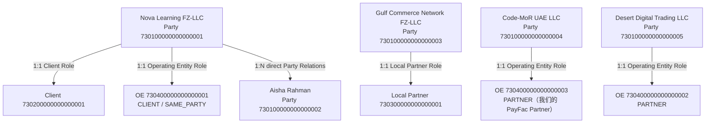

# Client & Contract 现实场景与数据库映射

> `legacy:` 前缀明确标记已经退出新写模型的旧字段；它们只供解释历史示例，当前结构门禁仅校验未带此前缀的引用。

最后更新：2026-09-10
适用基线：Client & Contract 最终 PDManer 生成模型已确认 40 表、443 字段、63 个唯一索引、46 个访问索引、67 条本库关系和 6 个关系图组；Model SHA-256 为 `e36ef6f7a00b67b772895ab834703634dd29854210646920963295a8105d9129`，Structural Projection SHA-256 为 `6013f7f066c277b475a251f85c5ca7768689886b5da0335471d4aa4ec804d678`，模型测试 80/80 通过

> **2026-10-24 OE 来源提示：** `PLATFORM` 来源已从全系统删除且不保留历史，来源只剩 `CLIENT/PARTNER`。本文的平台自有 OE（Code-MoR UAE LLC）按“我们的 PayFac Partner”以 `PARTNER` 来源提供来读；示例中的 PayFac Partner `730300000000000002` 仅为场景编号。

> **2026-09-10 定价迁移提示：** 第 8 节描述当前 Payment Method Profile / Price / Component / Band 目标模型。第 9 节完整保留现行 CCT-I13/I14 V5 Scope 场景，但只作为 legacy/pending migration 兼容证据；其中的 `t_commercial_term_scope`、`term_scope_id`、下单时定价解析和 V5 Hash 不属于当前 40 表新写模型，不得改名冒充 Price 或用新模型重算历史交易。新 Wire 尚未定义。

> **2026-09-05 横切迁移提示：** 除上面的定价迁移边界外，本文的既有逐表记录继续描述相应模型与消费者假设，不单独拥有
> Vault 或 `compensation_event` 契约。其中与当前三表 Protect/Reveal、补偿三字段身份和 4 KiB 可选 Payload
> 不一致的旧字段属于 [`CURRENT_IMPLEMENTATION.md`](../../CURRENT_IMPLEMENTATION.md) 中 VAULT-01 / COMP-01
> 的待迁移现状；完成 [Vault 消费者对齐](../../../docs/superpowers/plans/2026-09-05-vault-consumer-model-alignment.md)
> 和 [补偿六模型对齐](../../../docs/superpowers/plans/2026-09-05-compensation-event-six-model-alignment.md) 前，
> 不得把这些场景字段复制到新增模型、SQL、DataObject 或代码。

## 1. 文档用途与读取规则

本文用一个连续的现实业务故事解释 Client & Contract（CCT）的表、字段、关系、写入流程、当前查询、版本切换、历史审计和跨系统冻结。后续 Agent 在处理以下任务时，必须同时读取本文、[Client & Contract 数据库设计](../CLIENT_CONTRACT_DATABASE.md)、[Payment Method Profile 与组合定价决策](../../decisions/2026-09-10-cct-payment-method-profile-pricing.md) 和 [PDManer 物理模型](../../../paytech/client-master/docs/database/client-master.pdma.json)：

- Party、Client、Local Partner 或 Operating Entity 数据如何落库；
- Application、Source、Affiliation、Assignment 的现实含义；
- Agreement、Consumer Legal、Seller Disclosure、Pricing、Partner Share 或 Platform Service Charge；
- Current、业务 Version、Active Slot、BCR、CAS、As-Of、删除或恢复；
- CCT-I10、legacy CCT-I13/I14、Commerce Order/Order Context 或测试场景数据构造。

本文是已确认目标模型的场景化解释，不是第二份数据库 Catalog。定价主题先服从 2026-09-10 决策与 [Client & Contract 数据库设计](../CLIENT_CONTRACT_DATABASE.md)；最终生成统计与物理命名以完成同步后的 [物理建模决策](../../../paytech/client-master/docs/database/CLIENT_MASTER_PHYSICAL_DECISIONS.md) 和 PDManer 工件为准。当前工件未同步时只能记为迁移缺口，不能用旧 Scope 反向覆盖本文的新模型。本文不授权 Java、手工数据库 SQL、物理数据库或运行环境。

示例约定：

- 故事编号为 `NOVA_GULF_UAE_2026`，所有主体和编号均为虚构数据。
- 示例内部 ID 使用 18 位十进制数模拟 Snowflake `BIGINT`；JSON 中必须编码为字符串，避免 IEEE-754 精度损失。
- 时间均为 UTC，数据库实际使用 `DATETIME(6)`；有效期采用半开区间 `[effective_from,effective_to)`。
- 示例 Hash 均为格式正确的 64 个小写十六进制字符，即 SHA-256 的 256-bit 表示；不宣称由本文展示数据真实计算得出。
- 除不可变 `t_business_change_version` 外，示例业务表统一假定 `create_time=2026-09-01T08:00:00.000000Z`；`update_time` 是最后一次结构化变更时间。下文只在时间本身参与业务语义时重复列出。
- Vault Token、Actor、Risk Decision 和 Platform File ID 都是虚构引用；没有敏感原值、真实 Token 或跨库外键。
- Assignment 的国家、币种、行业和 MCC 都是准确值。当前 Price 必须绑定准确非空 OE，Profile Condition 以缺少维度表达“不限制”，不保存 `*`；第 9 节出现的 Scope 通配仅是 legacy V5 事实。

## 2. 现实参与方

Nova Learning FZ-LLC 是一家在阿联酋销售一次性软件许可证的 Organization Client。创始人 Aisha Rahman 持股 75%，同时是董事，并作为平台 Actor 代表 Nova 完成合同接受。Gulf Commerce Network FZ-LLC 是 Local Partner，它向平台提供 Desert Digital Trading LLC 作为法律卖方。平台自身还拥有 Code-MoR UAE LLC，它由我们的 PayFac Partner 以 PARTNER 来源提供。



主故事交易范围固定为：`country=AE`、`currency=USD`、`industry_code=DIGITAL_SERVICES`、`mcc_code='5734'`、`locale=en-AE`。MCC 是四位数字字符串，必须保留前导零；一笔 Order 只有这一组准确行业与 MCC。

## 3. 场景一：建立 Party、Profile 与直接关系

2026-09-11 当前模型映射：`t_party`、`t_party_profile`、`t_individual_profile`、`t_organization_profile`、`t_party_identity_key`、`t_party_profile_identifier`、`t_party_address`、`t_party_contact`、`t_party_relation`；字段引用：`t_party.party_id`、`t_party.party_type`、`t_party_profile.profile_id`、`t_party_profile.active_slot`、`t_individual_profile.profile_id`、`t_individual_profile.birth_date`、`t_organization_profile.profile_id`、`t_organization_profile.legal_name`、`t_party_identity_key.identity_key_id`、`t_party_identity_key.normalized_identifier_value`、`t_party_profile_identifier.profile_identifier_id`、`t_party_profile_identifier.identity_key_id`、`t_party_address.address_id`、`t_party_address.country_code`、`t_party_contact.contact_id`、`t_party_contact.contact_vault_token`、`t_party_relation.relation_version_id`、`t_party_relation.relation_type`。新流按 [四系统决定](../../decisions/2026-09-11-cct-commerce-oe-pricing-model.md) 执行；下文旧数字/Assignment/分表签署示例保留为历史合同说明。


### 3.1 输入

Operations 收到 Nova、Aisha、Gulf、Code-MoR UAE 和 Desert Digital 的主体资料。Email 与 Phone 原值先交给 Vault；CCT 只保存 Token、脱敏值、Vault Record Version 和 Metadata Hash。

### 3.2 写入事务与示例数据

`t_party` 保存稳定法律主体身份，不保存业务角色：

| 字段 | Nova 示例值 | Aisha 示例值 | 现实含义 |
|---|---:|---:|---|
| `t_party.party_id` | `730100000000000001` | `730100000000000002` | 不因资料变化而复用或修改的 Party ID |
| `t_party.party_no` | `PTY-NOVA-AE-001` | `PTY-AISHA-AE-001` | 可用于业务查询的唯一编号 |
| `t_party.party_type` | `ORGANIZATION` | `INDIVIDUAL` | 决定机构或个人 Profile 明细；创建后不可改 |

五个 Party 在进入角色或签约流程前分别拥有 Profile。Nova 与 Aisha 的完整字段示例如下；其余三个 Organization Party 使用相同的 1:1 结构：

| Party | `t_party_profile.profile_id` | `t_organization_profile.profile_id` | Legal Name | 状态 |
|---|---:|---:|---|---|
| Gulf Commerce Network | `730110000000000003` | `730110000000000003` | `Gulf Commerce Network FZ-LLC` | `ACTIVE / active_slot=1` |
| Code-MoR UAE | `730110000000000004` | `730110000000000004` | `Code-MoR UAE LLC` | `ACTIVE / active_slot=1` |
| Desert Digital | `730110000000000005` | `730110000000000005` | `Desert Digital Trading LLC` | `ACTIVE / active_slot=1` |

Nova 的版本头与机构明细如下：

| 表.字段 | 示例值 | 说明 |
|---|---|---|
| `t_party_profile.profile_id` | `730110000000000001` | Nova Profile V1 稳定标识 |
| `t_party_profile.party_id` | `730100000000000001` | 指向 Nova Party |
| `t_party_profile.version_no` | `1` | Party Profile 的业务版本，不是乐观锁 |
| `t_party_profile.profile_status` | `ACTIVE` | 已审核并可用于业务 |
| `t_party_profile.active_slot` | `1` | 保证 Nova 同时只有一个 ACTIVE Profile |
| `t_party_profile.effective_from` | `2026-09-01T00:00:00.000000Z` | V1 开始有效 |
| `t_party_profile.effective_to` | `NULL` | 尚未结束 |
| `t_party_profile.hash_schema_version` | `1` | Profile Canonical Hash Schema 版本 |
| `t_party_profile.content_hash` | `1111111111111111111111111111111111111111111111111111111111111111` | 封存 Profile 及其明细集合 |
| `t_organization_profile.profile_id` | `730110000000000001` | 与 Profile 头 1:1，共用主键 |
| `t_organization_profile.legal_name` | `Nova Learning FZ-LLC` | 法定名称 |
| `t_organization_profile.trade_name` | `Nova Learning` | 对外经营名称 |
| `t_organization_profile.incorporation_country` | `AE` | 注册国家 |
| `t_organization_profile.organization_type` | `FZ_LLC` | 来自司法辖区机构类型目录 |
| `t_organization_profile.incorporation_date` | `2024-03-15` | 无时区的法定注册日期 |

Aisha 的个人明细用于 UBO 审核和合同签署：

| 表.字段 | 示例值 | 说明 |
|---|---|---|
| `t_party_profile.profile_id` | `730110000000000002` | Aisha Profile V1 |
| `t_party_profile.party_id` | `730100000000000002` | 指向 Aisha Party |
| `t_individual_profile.profile_id` | `730110000000000002` | 与 Profile 头 1:1 |
| `t_individual_profile.given_name` | `Aisha` | 名 |
| `t_individual_profile.middle_name` | `NULL` | 无中间名 |
| `t_individual_profile.family_name` | `Rahman` | 姓 |
| `t_individual_profile.birth_date` | `1990-05-12` | `DATE` 事实 |
| `t_individual_profile.nationality_country` | `AE` | 国籍国家代码 |
| `t_individual_profile.residence_country` | `AE` | 居住国家代码 |

法律标识、地址与联系方式都归属于准确 Profile 或 Party：

| 表 | 关键字段与示例值 | 关系与约束 |
|---|---|---|
| `t_party_identity_key` | `t_party_identity_key.identity_key_id=730120000000000001`、`t_party_identity_key.party_id=730100000000000001`、`t_party_identity_key.identifier_type=TRADE_LICENSE`、`t_party_identity_key.issuing_country=AE`、`t_party_identity_key.issuer_scope_key=AE:DET:DUBAI`、`t_party_identity_key.identifier_value=CN-1234567`、`t_party_identity_key.normalized_identifier_value=CN1234567` | 稳定法律标识永久归属 Nova；规范化值承担全局唯一约束 |
| `t_party_profile_identifier` | `t_party_profile_identifier.profile_identifier_id=730121000000000001`、`t_party_profile_identifier.profile_id=730110000000000001`、`t_party_profile_identifier.identity_key_id=730120000000000001`、`t_party_profile_identifier.valid_from=2026-09-01T00:00:00.000000Z`、`t_party_profile_identifier.valid_to=NULL` | 把 Nova Profile V1 与稳定 Trade License 关联 |
| `t_party_address` | `t_party_address.address_id=730122000000000001`、`t_party_address.profile_id=730110000000000001`、`t_party_address.address_type=REGISTERED`、`t_party_address.address_line1=Building 4, Dubai Internet City`、`t_party_address.address_line2=Office 502`、`t_party_address.city=Dubai`、`t_party_address.state_or_province=Dubai`、`t_party_address.postal_code=00000`、`t_party_address.country_code=AE` | 同一 Profile 每种地址用途最多一条 |
| `t_party_contact` | `t_party_contact.contact_id=730123000000000001`、`t_party_contact.profile_id=730110000000000001`、`t_party_contact.contact_type=EMAIL`、`t_party_contact.contact_vault_token=vlt_demo_nova_email_01`、`t_party_contact.contact_masked_value=n***@novalearning.example`、`t_party_contact.vault_record_version=1`、`t_party_contact.vault_metadata_hash=2222222222222222222222222222222222222222222222222222222222222222` | CCT 不保存 Email 原值；四个 Vault 引用字段必须来自同一 Metadata Version |

Nova 与 Aisha 的直接关系保存为结构化业务版本，不采用多层 Ownership Path：

| 表.字段 | 示例值 |
|---|---|
| `t_party_relation.relation_version_id` | `730124000000000001` |
| `t_party_relation.organization_party_id` | `730100000000000001` |
| `t_party_relation.related_party_id` | `730100000000000002` |
| `t_party_relation.relation_type` | `UBO` |
| `t_party_relation.version_no` | `1` |
| `t_party_relation.ownership_percentage` | `75.0000000000` |
| `t_party_relation.effective_from` | `2026-09-01T00:00:00.000000Z` |
| `t_party_relation.effective_to` | `NULL` |
| `t_party_relation.status` | `ACTIVE` |
| `t_party_relation.active_slot` | `1` |
| `t_party_relation.hash_schema_version` | `1` |
| `t_party_relation.content_hash` | `3333333333333333333333333333333333333333333333333333333333333333` |

董事与授权签署关系是另外两条直接事实，不能覆盖 UBO 行：

| `t_party_relation.relation_version_id` | `t_party_relation.relation_type` | `t_party_relation.ownership_percentage` | 其他关键值 |
|---:|---|---|---|
| `730124000000000002` | `DIRECTOR` | `NULL` | Nova -> Aisha、`version_no=1`、`status=ACTIVE`、`active_slot=1` |
| `730124000000000003` | `SIGNATORY` | `NULL` | Nova -> Aisha、`version_no=1`、`status=ACTIVE`、`active_slot=1` |

### 3.3 当前查询、变更与历史

当前查询先从 `t_party` 找稳定主体，再以 `t_party_profile.active_slot=1` 唯一定位 ACTIVE Profile，并读取其类型明细、法律标识、地址和联系方式。Aisha 的 `UBO`、`DIRECTOR`、`SIGNATORY` 三种身份分别占用一条 `t_party_relation`，任何一种关系都不能覆盖另外两种。

Nova 地址或名称变化时创建 Profile V2：V1 进入 `SUPERSEDED`、`active_slot=NULL`、填写 `effective_to`；V2 使用新 `profile_id/version_no=2` 并占用 `active_slot=1`。历史申请、签署和 Order Proof 继续引用 V1 ID。BCR 只审计 `PARTY_PROFILE` 版本头的生命周期，不重复复制机构明细、地址、联系方式或法律标识。

## 4. 场景二：Client、Local Partner 与 Operating Entity 入驻

2026-09-11 当前模型映射：`t_client`、`t_local_partner`、`t_operating_entity`、`t_client_business_profile`、`t_client_business_classification`、`t_client_application`、`t_partner_application`、`t_operating_entity_application`、`t_application_document`；字段引用：`t_client.client_id`、`t_client.status`、`t_local_partner.local_partner_id`、`t_local_partner.status`、`t_operating_entity.entity_no`、`t_operating_entity.status`、`t_client_business_profile.business_profile_id`、`t_client_business_profile.content_hash`、`t_client_business_classification.classification_id`、`t_client_business_classification.mcc_code`、`t_client_application.application_id`、`t_client_application.requested_by_account_id`、`t_client_application.submission_content_hash`、`t_partner_application.application_id`、`t_partner_application.local_partner_id`、`t_partner_application.requested_by_account_id`、`t_partner_application.qualification_type`、`t_partner_application.submission_content_hash`、`t_operating_entity_application.application_id`、`t_operating_entity_application.approved_source_relation_id`、`t_application_document.document_id`、`t_application_document.partner_application_id`、`t_application_document.file_address`。新流按 [四系统决定](../../decisions/2026-09-11-cct-commerce-oe-pricing-model.md) 执行；下文旧数字/Assignment/分表签署示例保留为历史合同说明。


### 4.1 角色主档

Platform 先完成 CUSTOMER Account 验证，才允许该 Account 提交 CCT Client 或 Local Partner ONBOARDING。`requested_by_account_id` 仅是 Platform Account 稳定外部引用：不是 CCT Party、不是 Agreement Signatory，且不赋予法律身份或签约资格。

| 表 | 关键字段与示例值 | 现实含义 |
|---|---|---|
| `t_client` | `t_client.client_id=730200000000000001`、`t_client.client_no=CLI-NOVA-001`、`t_client.party_id=730100000000000001`、`t_client.status=ACTIVE`、`t_client.activation_time=2026-09-10T10:00:00.000000Z`、`t_client.suspension_time=NULL`、`t_client.termination_time=NULL` | Nova Party 获得 Client 角色 |
| `t_local_partner` | `t_local_partner.local_partner_id=730300000000000001`、`t_local_partner.partner_no=LPT-GULF-001`、`t_local_partner.party_id=730100000000000003`、`t_local_partner.status=ACTIVE`、`t_local_partner.activation_time=2026-09-10T10:00:00.000000Z`、`t_local_partner.termination_time=NULL` | Gulf Party 获得 Local Partner 角色 |
| `t_operating_entity` | `t_operating_entity.operating_entity_id=730400000000000001`、`t_operating_entity.entity_no=OE-NOVA-AE-001`、`t_operating_entity.party_id=730100000000000001`、`t_operating_entity.operating_country=AE`、`t_operating_entity.status=ACTIVE` | Nova Party 同时成为 CLIENT 来源 OE |
| `t_operating_entity` | `t_operating_entity.operating_entity_id=730400000000000002`、`t_operating_entity.entity_no=OE-DESERT-AE-001`、`t_operating_entity.party_id=730100000000000005`、`t_operating_entity.operating_country=AE`、`t_operating_entity.status=ACTIVE` | Partner 提供的 Desert 法律卖方 |
| `t_operating_entity` | `t_operating_entity.operating_entity_id=730400000000000003`、`t_operating_entity.entity_no=OE-PLATFORM-AE-001`、`t_operating_entity.party_id=730100000000000004`、`t_operating_entity.operating_country=AE`、`t_operating_entity.status=ACTIVE` | 平台自有法律卖方 |

角色是 Party 的平级能力，不是父子层级。Nova 同一个 Party 同时拥有 Client 与 Operating Entity 角色是合法的；Client 的暂停不自动改写 OE 状态。

表格展示的是批准后的最终状态。首次创建 OE Application 时，同一事务先创建唯一 `PENDING` OE；申请依次进入 SUBMITTED/UNDER_REVIEW，只有 APPROVED 后 OE 才进入 ACTIVE。拒绝或撤回后重提复用原 PENDING 角色，不能绕过申请直接创建 ACTIVE OE。

### 4.2 Client Business Profile 与一组准确分类

| 表.字段 | 示例值 |
|---|---|
| `t_client_business_profile.business_profile_id` | `730210000000000001` |
| `t_client_business_profile.client_id` | `730200000000000001` |
| `t_client_business_profile.version_no` | `1` |
| `t_client_business_profile.status` | `ACTIVE` |
| `t_client_business_profile.active_slot` | `1` |
| `t_client_business_profile.business_model_code` | `DIGITAL_LICENSE_SALES` |
| `t_client_business_profile.website_url` | `https://novalearning.example` |
| `t_client_business_profile.expected_volume` | `250000.00000000` |
| `t_client_business_profile.expected_ticket` | `120.00000000` |
| `t_client_business_profile.currency` | `USD` |
| `t_client_business_profile.effective_from` | `2026-09-10T10:00:00.000000Z` |
| `t_client_business_profile.effective_to` | `NULL` |
| `t_client_business_profile.hash_schema_version` | `2` |
| `t_client_business_profile.content_hash` | `4444444444444444444444444444444444444444444444444444444444444444` |
| `t_client_business_classification.classification_id` | `730211000000000001` |
| `t_client_business_classification.business_profile_id` | `730210000000000001` |
| `t_client_business_classification.industry_code` | `DIGITAL_SERVICES` |
| `t_client_business_classification.mcc_code` | `'5734'` |
| `t_client_business_classification.primary_slot` | `1` |

本故事的一笔 Order 只提交这组 `DIGITAL_SERVICES + '5734'`。如果 Business Profile 未来批准另一组分类，应新增分类行，但单笔 Order 仍只能选择一组。

### 4.3 Client Application、OE Application 与材料

Nova 首次入驻申请：

| 表.字段 | 示例值 |
|---|---|
| `t_client_application.application_id` | `730220000000000001` |
| `t_client_application.application_no` | `CAP-NOVA-ONBOARD-001` |
| `t_client_application.application_type` | `ONBOARDING` |
| `t_client_application.client_id` | `730200000000000001` |
| `t_client_application.requested_by_account_id` | `220301` |
| `t_client_application.base_party_profile_id` | `NULL` |
| `t_client_application.target_party_profile_id` | `730110000000000001` |
| `t_client_application.base_business_profile_id` | `NULL` |
| `t_client_application.target_business_profile_id` | `730210000000000001` |
| `t_client_application.status` | `APPROVED` |
| `t_client_application.active_slot` | `NULL` |
| `t_client_application.due_diligence_case_id` | `830100000000000001` |
| `t_client_application.qualification_decision_id` | `830200000000000001` |
| `t_client_application.qualification_decision_version` | `3` |
| `t_client_application.qualification_type` | `ORGANIZATION_KYB` |
| `t_client_application.submitted_time` | `2026-09-03T09:00:00.000000Z` |
| `t_client_application.submission_hash_schema_version` | `1` |
| `t_client_application.submission_content_hash` | `5555555555555555555555555555555555555555555555555555555555555555` |

Gulf 的 Local Partner 首次入驻先由 `START_OR_RESUME` 在同一 CCT 本地事务创建稳定的 PENDING Role、DRAFT Application、申请 Root BCR/Version 和 `ProvisionAccessTenant` 的 `LOCAL_HANDLER`；此时 `requested_by_account_id` 只表示已验证的 Platform Account，不替代 Gulf Party 或任何合同 Signatory。Platform Provision 完成后才允许把受控 File ID 写入 DRAFT Application；`SUBMIT` 再冻结材料快照、Submission Hash 并登记 Risk Handler。

| 表.字段 | Gulf Partner Application 示例值 |
|---|---|
| `t_partner_application.application_id` | `730320000000000001` |
| `t_partner_application.application_no` | `PAP-GULF-ONBOARD-001` |
| `t_partner_application.local_partner_id` | `730300000000000001` |
| `t_partner_application.target_party_profile_id` | `730110000000000003` |
| `t_partner_application.requested_by_account_id` | `220301` |
| `t_partner_application.status` | `APPROVED` |
| `t_partner_application.active_slot` | `NULL` |
| `t_partner_application.due_diligence_case_id` | `830100000000000003` |
| `t_partner_application.qualification_decision_id` | `830200000000000003` |
| `t_partner_application.qualification_decision_version` | `1` |
| `t_partner_application.qualification_type` | `PARTNER_DUE_DILIGENCE` |
| `t_partner_application.submitted_time` | `2026-09-03T10:00:00.000000Z` |
| `t_partner_application.submission_hash_schema_version` | `1` |
| `t_partner_application.submission_content_hash` | `9999999999999999999999999999999999999999999999999999999999999999` |

三个 OE 来源申请的关键 Tuple：

| 来源 | `t_operating_entity_application.application_id` | OE | Owner 字段 | `t_operating_entity_application.client_source_basis` | 批准后的来源关系 |
|---|---:|---:|---|---|---:|
| `CLIENT` | `730420000000000001` | `730400000000000001` | `t_operating_entity_application.source_client_id=730200000000000001`、`t_operating_entity_application.source_partner_id=NULL` | `SAME_PARTY` | `730430000000000001` |
| `PARTNER` | `730420000000000002` | `730400000000000002` | `t_operating_entity_application.source_client_id=NULL`、`t_operating_entity_application.source_partner_id=730300000000000001` | `NULL` | `730430000000000002` |
| `PARTNER`（我们的 PayFac Partner） | `730420000000000003` | `730400000000000003` | `t_operating_entity_application.source_client_id=NULL`、`t_operating_entity_application.source_partner_id=730300000000000002` | `NULL` | `730430000000000003` |

以 Desert 的 PARTNER 来源申请为完整示例：

| 表.字段 | 示例值 |
|---|---|
| `t_operating_entity_application.application_no` | `OEA-DESERT-001` |
| `legacy:t_operating_entity_application.operating_entity_id` | `730400000000000002` |
| `t_operating_entity_application.party_profile_id` | `730110000000000005` |
| `t_operating_entity_application.source_type` | `PARTNER` |
| `t_operating_entity_application.status` | `APPROVED` |
| `t_operating_entity_application.active_slot` | `NULL` |
| `t_operating_entity_application.due_diligence_case_id` | `830100000000000002` |
| `t_operating_entity_application.qualification_decision_id` | `830200000000000002` |
| `t_operating_entity_application.qualification_decision_version` | `2` |
| `t_operating_entity_application.qualification_type` | `ENTITY_UNDERWRITING` |
| `t_operating_entity_application.submitted_time` | `2026-09-04T09:00:00.000000Z` |
| `t_operating_entity_application.submission_hash_schema_version` | `2` |
| `t_operating_entity_application.submission_content_hash` | `6666666666666666666666666666666666666666666666666666666666666666` |
| `t_operating_entity_application.approved_source_relation_id` | `730430000000000002` |

申请材料由同一张表承载，但 Client、Partner、OE 三个父级必须恰好一个非空：

| 表.字段 | Nova Client Application 材料 | Gulf Partner Application 材料 | Desert OE Application 材料 |
|---|---|---|---|
| `t_application_document.document_id` | `730221000000000001` | `730221000000000003` | `730221000000000002` |
| `t_application_document.client_application_id` | `730220000000000001` | `NULL` | `NULL` |
| `t_application_document.partner_application_id` | `NULL` | `730320000000000001` | `NULL` |
| `t_application_document.operating_entity_application_id` | `NULL` | `NULL` | `730420000000000002` |
| `t_application_document.subject_party_id` | `730100000000000001` | `730100000000000003` | `730100000000000005` |
| `t_application_document.requirement_code` | `LEGAL_ENTITY_REGISTRATION` | `PARTNER_REGISTRATION` | `ENTITY_REGISTRATION` |
| `t_application_document.document_type` | `INCORPORATION_CERTIFICATE` | `TRADE_LICENSE` | `TRADE_LICENSE` |
| `t_application_document.file_address` | `/files/v1/930100000000000001` | `/files/v1/930100000000000003` | `/files/v1/930100000000000002` |
| `t_application_document.content_hash` | `7777777777777777777777777777777777777777777777777777777777777777` | `aaaaaaaaaaaaaaaaaaaaaaaaaaaaaaaaaaaaaaaaaaaaaaaaaaaaaaaaaaaaaaaa` | `8888888888888888888888888888888888888888888888888888888888888888` |

这里的 `requirement_code` 来自 Risk 冻结材料要求目录，`document_type` 来自申请材料类型目录；表中的代码只是现实示例，不构成 CCT 闭合枚举。

### 4.4 流程闭环

1. 已验证的 Platform CUSTOMER Account 先调用 CCT-I15 `START_OR_RESUME`；同一事务创建或复用 PENDING Local Partner、DRAFT `t_partner_application`、其 Root `PARTNER_APPLICATION` BCR/Version，并登记 `ProvisionAccessTenant` 的 `LOCAL_HANDLER` `t_compensation_event`。该事务不调用 Platform 或 Risk，也不接受尚未归属 Tenant 的 File ID。
2. after-commit 向 Platform 发送 PENDING Tenant/OWNER Member/Onboarding Role 的命令：

   ```json
   {
     "operation_type": "PROVISION_ACCESS_TENANT",
     "tenant_type": "PARTNER",
     "owner_ref_id": "730300000000000001",
     "requested_by_account_id": "220301",
     "source_version": 1,
     "payload_hash": "bbbbbbbbbbbbbbbbbbbbbbbbbbbbbbbbbbbbbbbbbbbbbbbbbbbbbbbbbbbbbbbb"
   }
   ```

   命令身份为 `PARTNER:730300000000000001:220301:1`，完整 Tuple 为 `tenant_type + owner_ref_id + requested_by_account_id + source_version + payload_hash`。同版本同 Hash 返回原 Tenant/Member；同版本异 Hash 为 `CONFLICT`；旧版本拒绝。Status 投影若先于 Provision 到达只能重试，不能创建缺少 `requested_by_account_id` 的 Tenant。
3. Provision 成功后，Platform 创建 PENDING Access Tenant、OWNER Member 和 `TENANT_ONBOARDING_OWNER`，但不签发普通 Tenant Context Token。Partner Console BFF 调用 PLT-I04，以 Account Context 唯一解析该 Account 在 PENDING Tenant 下的 ACTIVE Member 与 `TENANT_ONBOARDING_OWNER`，Platform 用解析出的 `tenant_id` 保存文件；调用方不能指定 Tenant。
4. Partner 确认材料后调用 CCT-I15 `SUBMIT`。CCT 同一本地事务校验全部 File ID、冻结 Application Document/Profile/材料快照与 Submission Hash、推进 BCR，并登记 `RiskDueDiligence` 的 `LOCAL_HANDLER`；after-commit 才向 Risk 提交 `CCT_LOCAL_PARTNER_APPLICATION + application_id + LOCAL_PARTNER + local_partner_id + PARTNER_DUE_DILIGENCE + submission_content_hash`。Risk 用完整 Tuple 定位主 Case，关联人 KYC 子 Case 不回填到 CCT 单值列。
5. Risk 返回 Case 后，第二个本地事务校验 Hash 未变，再进入 `UNDER_REVIEW`。APPROVED 回填 Decision Tuple 并激活 Local Partner Role；同一 `tenant_type` + `owner_ref_id` Owner tuple 的状态投影只接受严格单调递增 `source_version`，把 Platform 转为 active Tenant ownership，撤销 Onboarding Role 并授予 Tenant Owner。
6. Gulf 的 REJECTED 重提继续使用 `t_local_partner.local_partner_id=730300000000000001` 的 PENDING Role，绝不创建第二个 Local Partner；新申请取得新的 Application ID，并重新走上述 Provision/Status 幂等边界。

当前查询直接读结构化 Application 和其材料。历史追责读 Application BCR；已冻结材料不重复写 BCR。PROFILE_CHANGE 创建新 Application，旧 APPROVED 申请不能被覆盖或复活。

## 5. 场景三：来源认定、适用关系、规则与自动分配

2026-09-11 当前模型映射：`t_client_entity_affiliation`、`t_entity_source_relation`、`t_operating_entity_scope`；字段引用：`t_client_entity_affiliation.affiliation_id`、`t_client_entity_affiliation.active_slot`、`t_entity_source_relation.source_relation_id`、`t_entity_source_relation.source_type`、`t_operating_entity_scope.scope_id`、`t_operating_entity_scope.entity_no`、`t_operating_entity_scope.application_id`、`t_operating_entity_scope.mcc_code`。新流按 [四系统决定](../../decisions/2026-09-11-cct-commerce-oe-pricing-model.md) 执行；下文旧数字/Assignment/分表签署示例保留为历史合同说明。


### 5.1 三种来源关系

| OE | `t_entity_source_relation.source_relation_id` | `t_entity_source_relation.source_type` | Owner / Basis | 状态与区间 |
|---|---:|---|---|---|
| Nova OE | `730430000000000001` | `CLIENT` | `t_entity_source_relation.source_client_id=730200000000000001`、`t_entity_source_relation.source_partner_id=NULL`、`t_entity_source_relation.client_source_basis=SAME_PARTY` | `t_entity_source_relation.status=ACTIVE`、`t_entity_source_relation.active_source_slot=1`、`t_entity_source_relation.effective_from=2026-09-10T10:00:00.000000Z`、`t_entity_source_relation.effective_to=NULL` |
| Desert OE | `730430000000000002` | `PARTNER` | Client 为空、`t_entity_source_relation.source_partner_id=730300000000000001`、Basis 为空 | ACTIVE、Slot 1、同日起有效 |
| Platform OE | `730430000000000003` | `PARTNER` | Client 为空、`t_entity_source_relation.source_partner_id=730300000000000002`（我们的 PayFac Partner）、Basis 为空 | ACTIVE、Slot 1、同日起有效 |

同一 OE 同时只能有一个 ACTIVE Source Relation。来源改变时结束旧行并创建新 ID，不能覆盖 Owner Tuple。

### 5.2 Affiliation 与候选规则

Nova 获准在同一准确 Scope 使用 Nova OE 和 Desert OE：

| 表 | Nova OE | Desert OE |
|---|---|---|
| `t_client_entity_affiliation` | `t_client_entity_affiliation.affiliation_id=730500000000000001`、`t_client_entity_affiliation.client_id=730200000000000001`、`t_client_entity_affiliation.operating_entity_id=730400000000000001` | `t_client_entity_affiliation.affiliation_id=730500000000000002`、同一 Client、`t_client_entity_affiliation.operating_entity_id=730400000000000002` |
| Scope | `t_client_entity_affiliation.scope_country=AE`、`t_client_entity_affiliation.scope_currency=USD`、`t_client_entity_affiliation.industry_code=DIGITAL_SERVICES`、`t_client_entity_affiliation.mcc_code='5734'` | 完全相同的准确 Scope |
| 生命周期 | `t_client_entity_affiliation.status=ACTIVE`、`t_client_entity_affiliation.active_slot=1`、`t_client_entity_affiliation.effective_from=2026-09-10T10:00:00.000000Z`、`t_client_entity_affiliation.effective_to=NULL` | 同左 |

规则按唯一最小 Priority 选择第一个仍满足全部证据的候选：

| 字段 | Rule 10 | Rule 20 |
|---|---:|---:|
| `legacy:t_entity_assignment_rule.rule_id` | `730510000000000001` | `730510000000000002` |
| `legacy:t_entity_assignment_rule.client_id` | `730200000000000001` | `730200000000000001` |
| `legacy:t_entity_assignment_rule.country_code` | `AE` | `AE` |
| `legacy:t_entity_assignment_rule.currency` | `USD` | `USD` |
| `legacy:t_entity_assignment_rule.industry_code` | `DIGITAL_SERVICES` | `DIGITAL_SERVICES` |
| `legacy:t_entity_assignment_rule.mcc_code` | `'5734'` | `'5734'` |
| `legacy:t_entity_assignment_rule.operating_entity_id` | `730400000000000001` | `730400000000000002` |
| `legacy:t_entity_assignment_rule.priority_no` | `10` | `20` |
| `legacy:t_entity_assignment_rule.status` | `ACTIVE` | `ACTIVE` |
| `legacy:t_entity_assignment_rule.active_slot` | `1` | `1` |
| `legacy:t_entity_assignment_rule.effective_from` | `2026-09-10T10:00:00.000000Z` | `2026-09-10T10:00:00.000000Z` |
| `legacy:t_entity_assignment_rule.effective_to` | `NULL` | `NULL` |

### 5.3 分配建立与现实故障切换

最初 Nova OE 合格，因此产生 Assignment A：

| 表.字段 | Assignment A |
|---|---|
| `legacy:t_client_entity_assignment.assignment_id` | `730520000000000001` |
| `legacy:t_client_entity_assignment.client_id` | `730200000000000001` |
| `legacy:t_client_entity_assignment.scope_country` / `legacy:t_client_entity_assignment.scope_currency` | `AE` / `USD` |
| `legacy:t_client_entity_assignment.industry_code` / `legacy:t_client_entity_assignment.mcc_code` | `DIGITAL_SERVICES` / `'5734'` |
| `legacy:t_client_entity_assignment.operating_entity_id` | `730400000000000001` |
| `legacy:t_client_entity_assignment.affiliation_id` | `730500000000000001` |
| `legacy:t_client_entity_assignment.entity_source_relation_id` | `730430000000000001` |
| `legacy:t_client_entity_assignment.rule_id` | `730510000000000001` |
| `legacy:t_client_entity_assignment.status` / `legacy:t_client_entity_assignment.active_slot` | `ACTIVE` / `1` |
| `legacy:t_client_entity_assignment.effective_from` / `legacy:t_client_entity_assignment.effective_to` | `2026-09-10T10:00:00.000000Z` / `NULL` |

2026-10-01，Nova OE 被 Operations 暂停。处理该状态变更的 CCT Processor 在同一本地事务内重新计算受影响 Scope：Rule 10 因 OE 非 ACTIVE 被淘汰，Rule 20 成为唯一最小合格候选。系统结束 Assignment A，并创建 Assignment B：

```text
Assignment A: status=ENDED, active_slot=NULL, effective_to=2026-10-01T00:00:00.000000Z
Assignment B: assignment_id=730520000000000002
              operating_entity_id=730400000000000002
              affiliation_id=730500000000000002
              entity_source_relation_id=730430000000000002
              rule_id=730510000000000002
              status=ACTIVE, active_slot=1
              effective_from=2026-10-01T00:00:00.000000Z, effective_to=NULL
```

CCT-I10/I13 只查询已经存在的 Assignment，不触发补写。若没有候选或最小 Priority 并列，旧 Assignment 结束，新交易 Fail Closed。旧 Order 继续冻结 Assignment A；新 Order 使用 Assignment B。Client 从未主动选择 OE，CCT 也从未选择 MID。

Assignment 的 Rule、Affiliation 与 Assignment 必须属于同一 Client；Affiliation、Assignment、Source Relation 和候选 Rule 的 Operating Entity 也必须完全一致，不能因为 Scope 相同就复用其他 Client 或其他 OE 的证明记录。

## 6. 场景四：Client Agreement 与 Partner Agreement

2026-09-11 当前模型映射：`t_agreement`、`t_agreement_party`、`t_agreement_document_ref`、`t_agreement_operating_entity`；字段引用：`t_agreement.agreement_id`、`t_agreement.status`、`t_agreement_party.agreement_party_id`、`t_agreement_party.party_profile_id`、`t_agreement_document_ref.agreement_document_id`、`t_agreement_document_ref.content_hash`、`t_agreement_operating_entity.agreement_operating_entity_id`、`t_agreement_operating_entity.entity_no`、`t_agreement_party.accepted_time`、`t_agreement_party.acceptance_ref_slot`。新流按 [四系统决定](../../decisions/2026-09-11-cct-commerce-oe-pricing-model.md) 执行；下文旧数字/Assignment/分表签署示例保留为历史合同说明。


### 6.1 两份独立合同

| 字段 | Client Agreement | Partner Agreement |
|---|---|---|
| `t_agreement.agreement_id` | `730600000000000001` | `730600000000000002` |
| `t_agreement.agreement_no` | `AGR-NOVA-CLIENT-2026-001` | `AGR-GULF-PARTNER-2026-001` |
| `t_agreement.agreement_name` | `Nova Client Services Agreement` | `Gulf Partner Share Agreement` |
| `t_agreement.agreement_type` | `CLIENT` | `PARTNER` |
| `t_agreement.client_id` | `730200000000000001` | `NULL` |
| `t_agreement.local_partner_id` | `NULL` | `730300000000000001` |
| `t_agreement.status` | `ACTIVE` | `ACTIVE` |
| `t_agreement.effective_from` | `2026-09-15T00:00:00.000000Z` | 同左 |
| `t_agreement.effective_to` | `NULL` | `NULL` |
| `t_agreement.signed_time` | `2026-09-12T14:00:00.000000Z` | `2026-09-12T15:00:00.000000Z` |
| `t_agreement.activated_time` | `2026-09-15T00:00:00.000000Z` | 同左 |
| `t_agreement.create_by` | `940100000000000001` | `940100000000000001` |

Client Agreement 覆盖 Nova 和 Desert 两个 OE；Partner Agreement 只覆盖 Desert：

| `t_agreement_operating_entity.agreement_operating_entity_id` | `t_agreement_operating_entity.agreement_id` | `legacy:t_agreement_operating_entity.operating_entity_id` | `legacy:t_agreement_operating_entity.settlement_business_days` | `legacy:t_agreement_operating_entity.business_calendar_code` | `legacy:t_agreement_operating_entity.settlement_timezone` | `legacy:t_agreement_operating_entity.cutoff_second_of_day` |
|---:|---:|---:|---:|---|---|---:|
| `730640000000000001` | `730600000000000001` | `730400000000000001` | `2` | `AE_WORKING_DAYS` | `Asia/Dubai` | `61200` |
| `730640000000000002` | `730600000000000001` | `730400000000000002` | `2` | `AE_WORKING_DAYS` | `Asia/Dubai` | `61200` |
| `730640000000000003` | `730600000000000002` | `730400000000000002` | `NULL` | `NULL` | `NULL` | `NULL` |

Association ID 证明合同覆盖了哪一个 OE；它不是交易 Scope，也不能只用 Agreement ID 替代。CLIENT Agreement 的四个结算字段在提交 `PENDING_SIGNATURE` 前必须完整写入，此例为按 `AE_WORKING_DAYS`、`Asia/Dubai` 与当地 17:00 (`61200`) 计算的 T+2；PARTNER Agreement 的四字段必须全为 `NULL`。它们与覆盖关系一同冻结，不新增日历/规则表、Version、Hash、索引或关系。

### 6.2 签约方、文件与接受证据

Client Agreement 的两个 Signatory：

| 字段 | Nova 签约方 | 平台签约方 |
|---|---:|---:|
| `legacy:t_agreement_signatory.agreement_signatory_id` | `730610000000000001` | `730610000000000002` |
| `legacy:t_agreement_signatory.agreement_id` | `730600000000000001` | `730600000000000001` |
| `legacy:t_agreement_signatory.party_id` | `730100000000000001` | `730100000000000004` |
| `legacy:t_agreement_signatory.party_profile_id` | `730110000000000001` | `730110000000000004` |
| `legacy:t_agreement_signatory.signatory_role` | `CLIENT` | `PLATFORM_SIGNATORY` |

Partner Agreement 同样冻结 Local Partner 与平台服务法律主体；其中平台 Party 是本次 Platform Service Charge 唯一允许返回的法律收款主体：

| 字段 | Gulf 签约方 | 平台服务签约方 |
|---|---:|---:|
| `legacy:t_agreement_signatory.agreement_signatory_id` | `730610000000000003` | `730610000000000004` |
| `legacy:t_agreement_signatory.agreement_id` | `730600000000000002` | `730600000000000002` |
| `legacy:t_agreement_signatory.party_id` | `730100000000000003` | `730100000000000004` |
| `legacy:t_agreement_signatory.party_profile_id` | `730110000000000003` | `730110000000000004` |
| `legacy:t_agreement_signatory.signatory_role` | `LOCAL_PARTNER` | `PLATFORM_SIGNATORY` |

包含 `PLATFORM_SERVICE_CHARGE` 的 Partner Agreement 必须恰好一个 `PLATFORM_SIGNATORY`。这里唯一平台法律 Party 为 `730100000000000004`；零个或多个都会使商业上下文 Fail Closed。现行 legacy CCT-I13 及该 Scope 的 CCT-I14 仍按第 9 节返回并验证该 Party；新 Price Wire 的返回位置尚未定义。

签署文件与最终文件：

| 字段 | Signing Document | Executed Document |
|---|---:|---:|
| `t_agreement_document_ref.agreement_document_id` | `730620000000000001` | `730620000000000002` |
| `t_agreement_document_ref.agreement_id` | `730600000000000001` | `730600000000000001` |
| `t_agreement_document_ref.document_type` | `SIGNING_DOCUMENT` | `EXECUTED_DOCUMENT` |
| `t_agreement_document_ref.file_id` | `930200000000000001` | `930200000000000002` |
| `t_agreement_document_ref.content_hash` | `9999999999999999999999999999999999999999999999999999999999999999` | `aaaaaaaaaaaaaaaaaaaaaaaaaaaaaaaaaaaaaaaaaaaaaaaaaaaaaaaaaaaaaaaa` |

Nova 的 E-Sign 接受证据：

| 表.字段 | 示例值 |
|---|---|
| `legacy:t_agreement_acceptance.acceptance_id` | `730630000000000001` |
| `legacy:t_agreement_acceptance.agreement_signatory_id` | `730610000000000001` |
| `legacy:t_agreement_acceptance.acceptance_method` | `E_SIGNATURE` |
| `legacy:t_agreement_acceptance.accepted_by_actor_id` | `940100000000000002` |
| `legacy:t_agreement_acceptance.accepted_time` | `2026-09-12T13:55:00.000000Z` |
| `legacy:t_agreement_acceptance.evidence_document_id` | `730620000000000002` |
| `legacy:t_agreement_acceptance.acceptance_reference` | `ESIGN-NOVA-20260912-0001` |
| `legacy:t_agreement_acceptance.create_by` | `940100000000000001` |

每个 Signatory 都必须有一条 Acceptance。E-Sign 或 Manual Signature 的 Evidence ID 指向 `EXECUTED_DOCUMENT` 的业务引用 ID，不是 Platform File ID；CLICK_ACCEPTANCE 则指向唯一 Signing Document。Email OTP 只是验证因子，不是新的 `acceptance_method`。

本表只展开 Nova 法律主体的一条 Acceptance；平台 Signatory 必须另有一条 Acceptance 才能进入 SIGNED。`t_agreement_signatory.party_id=730100000000000001` 表示合同法律签约方是 Nova 公司，Aisha 的 Platform Actor 写入 `accepted_by_actor_id`，代表其完成在线接受；个人 Party ID 不替代公司法律签约方。

### 6.3 当前查询与历史

As-Of 查询按签署、激活和有效区间解析，不能只查当前 `status=ACTIVE`。合同条款变化时创建新的 `agreement_id`；旧合同可进入 EXPIRED/TERMINATED 并收窄 `effective_to`，但历史 Order 仍引用旧 Agreement 与 Association ID。Agreement Root 写 BCR；Signatory、Document、Acceptance、Association 依靠冻结结构化事实，不重复写 BCR。

## 7. 场景五：Consumer Legal 与 Seller Disclosure

2026-09-11 当前模型映射：`t_consumer_legal_document`、`t_seller_disclosure`；字段引用：`t_consumer_legal_document.legal_document_id`、`t_consumer_legal_document.published_time`、`t_seller_disclosure.disclosure_id`、`t_seller_disclosure.public_legal_name`。新流按 [四系统决定](../../decisions/2026-09-11-cct-commerce-oe-pricing-model.md) 执行；下文旧数字/Assignment/分表签署示例保留为历史合同说明。


Desert OE 在 `AE/en-AE` 发布三份独立法律文档：

| 类型 | `t_consumer_legal_document.legal_document_id` | `t_consumer_legal_document.document_code` | `t_consumer_legal_document.content_file_id` | `t_consumer_legal_document.content_hash` |
|---|---:|---|---:|---|
| `CONSUMER_TERMS` | `730700000000000001` | `TERMS-DESERT-AE-EN-2026-01` | `930300000000000001` | `bbbbbbbbbbbbbbbbbbbbbbbbbbbbbbbbbbbbbbbbbbbbbbbbbbbbbbbbbbbbbbbb` |
| `REFUND_POLICY` | `730700000000000002` | `REFUND-DESERT-AE-EN-2026-01` | `930300000000000002` | `cccccccccccccccccccccccccccccccccccccccccccccccccccccccccccccccc` |
| `PRIVACY_NOTICE` | `730700000000000003` | `PRIVACY-DESERT-AE-EN-2026-01` | `930300000000000003` | `dddddddddddddddddddddddddddddddddddddddddddddddddddddddddddddddd` |

三行共同字段：`t_consumer_legal_document.operating_entity_id=730400000000000002`、`t_consumer_legal_document.country_code=AE`、`t_consumer_legal_document.locale=en-AE`、`t_consumer_legal_document.status=ACTIVE`、`t_consumer_legal_document.effective_from=2026-09-15T00:00:00.000000Z`、`t_consumer_legal_document.effective_to=NULL`、`t_consumer_legal_document.approved_time=2026-09-12T10:00:00.000000Z`、`t_consumer_legal_document.published_time=2026-09-14T10:00:00.000000Z`、`t_consumer_legal_document.create_by=940100000000000001`。

Seller Disclosure 是结构化公开展示值，不是文件：

| 表.字段 | 示例值 |
|---|---|
| `t_seller_disclosure.disclosure_id` | `730710000000000001` |
| `legacy:t_seller_disclosure.operating_entity_id` | `730400000000000002` |
| `t_seller_disclosure.country_code` / `t_seller_disclosure.locale` | `AE` / `en-AE` |
| `t_seller_disclosure.public_legal_name` | `Desert Digital Trading LLC` |
| `t_seller_disclosure.public_registration_number` | `CN-7654321` |
| `t_seller_disclosure.public_tax_registration_number` | `NULL` |
| `t_seller_disclosure.public_address_text` | `Office 18, Business Bay, Dubai, UAE` |
| `t_seller_disclosure.public_support_email` | `support@desert-digital.example` |
| `t_seller_disclosure.public_support_phone` | `+971 4 555 0101` |
| `t_seller_disclosure.status` | `ACTIVE` |
| `t_seller_disclosure.effective_from` / `t_seller_disclosure.effective_to` | `2026-09-15T00:00:00.000000Z` / `NULL` |
| `t_seller_disclosure.approved_time` / `t_seller_disclosure.published_time` | `2026-09-12T10:00:00.000000Z` / `2026-09-14T10:00:00.000000Z` |
| `t_seller_disclosure.create_by` | `940100000000000001` |

As-Of 查询用 `published_time <= t` 和有效区间，不能排除后来已 EXPIRED/WITHDRAWN、但在历史时点有效的行。内容变化创建新 Legal/Disclosure ID，旧行收窄结束时间；没有 Client Override 或隐式 Locale 回退。

## 8. 场景六：Payment Method Profile 与组合定价

2026-09-11 当前模型映射：`t_payment_method_profile`、`t_payment_method_profile_cond`、`t_commercial_term_plan`、`t_commercial_term_version`、`t_commercial_term_price`、`t_commercial_term_component`、`t_commercial_term_component_band`；字段引用：`t_payment_method_profile.payment_method_profile_id`、`t_payment_method_profile.payment_method_profile_code`、`t_payment_method_profile.payment_method_code`、`t_payment_method_profile_cond.profile_condition_id`、`t_payment_method_profile_cond.dimension_code`、`t_payment_method_profile_cond.condition_value`、`t_commercial_term_plan.term_plan_id`、`t_commercial_term_plan.term_type`、`t_commercial_term_version.term_version_id`、`t_commercial_term_version.active_slot`、`t_commercial_term_price.term_price_id`、`t_commercial_term_price.entity_no`、`t_commercial_term_price.payment_method_profile_code`、`t_commercial_term_price.priority_no`、`t_commercial_term_component.term_component_id`、`t_commercial_term_component.term_price_id`、`t_commercial_term_component.component_no`、`t_commercial_term_component.component_type`、`t_commercial_term_component.band_mode`、`t_commercial_term_component_band.term_band_id`、`t_commercial_term_component_band.lower_bound`、`t_commercial_term_component_band.upper_bound`。新流按 [四系统决定](../../decisions/2026-09-11-cct-commerce-oe-pricing-model.md) 执行；下文旧数字/Assignment/分表签署示例保留为历史合同说明。


### 8.1 三个语义独立的 Plan 与 Version

`PLATFORM_SERVICE_CHARGE` 是第三类 Commercial Term，不是 Client Fee、Partner Share 或 Channel Cost 的残差：

| 字段 | Client Pricing | Partner Share | Platform Service Charge |
|---|---|---|---|
| `t_commercial_term_plan.term_plan_id` | `730800000000000001` | `730800000000000002` | `730800000000000003` |
| `t_commercial_term_plan.plan_code` | `PRICE-NOVA-001` | `SHARE-GULF-001` | `SERVICE-GULF-001` |
| `t_commercial_term_plan.term_type` | `CLIENT_PRICING` | `PARTNER_SHARE` | `PLATFORM_SERVICE_CHARGE` |
| `t_commercial_term_plan.client_id` | `730200000000000001` | `NULL` | `NULL` |
| `t_commercial_term_plan.local_partner_id` | `NULL` | `730300000000000001` | `730300000000000001` |
| `t_commercial_term_plan.status` | `ACTIVE` | `ACTIVE` | `ACTIVE` |

同一个 Local Partner 可以分别拥有 Share 与 Service Charge Plan，因此唯一约束是 `local_partner_id + term_type`，而不是单列 `local_partner_id`。Plan Status 是开放生命周期目录；这里的 `ACTIVE` 是当前示例，不把它提升为本文新增的闭合枚举。

| 字段 | Client Pricing V1 | Partner Share V1 | Platform Service Charge V1 |
|---|---|---|---|
| `t_commercial_term_version.term_version_id` | `730810000000000001` | `730810000000000002` | `730810000000000003` |
| `t_commercial_term_version.term_plan_id` | `730800000000000001` | `730800000000000002` | `730800000000000003` |
| `t_commercial_term_version.agreement_id` | `730600000000000001` | `730600000000000002` | `730600000000000002` |
| `t_commercial_term_version.version_no` | `1` | `1` | `1` |
| `t_commercial_term_version.status` | `ACTIVE` | `ACTIVE` | `ACTIVE` |
| `t_commercial_term_version.active_slot` | `1` | `1` | `1` |
| `t_commercial_term_version.effective_from` | `2026-09-15T00:00:00.000000Z` | 同左 | 同左 |
| `t_commercial_term_version.effective_to` | `NULL` | `NULL` | `NULL` |
| `t_commercial_term_version.rounding_mode` | `HALF_UP` | `HALF_UP` | `HALF_UP` |

### 8.2 全局 Payment Method Profile 与 Condition

本场景建立两个可跨 Client、Partner、Version 与 OE 复用的 CARD Profile。Payment Method `CARD` 是 Payment 拥有的稳定代码/应用常量；CCT 不建立 Payment Method 表。

| 字段 | 通用 CARD Profile | Visa/Mastercard Credit 3DS Profile |
|---|---|---|
| `t_payment_method_profile.payment_method_profile_id` | `730780000000000001` | `730780000000000002` |
| `t_payment_method_profile.payment_method_profile_code` | `CARD_ANY_V1` | `CARD_VISA_MC_CREDIT_3DS_V1` |
| `t_payment_method_profile.profile_name` | `Any card` | `Visa or Mastercard credit with authenticated 3DS` |
| `t_payment_method_profile.payment_method_code` | `CARD` | `CARD` |
| `t_payment_method_profile.status` | `ACTIVE` | `ACTIVE` |

通用 Profile 没有 Condition，表示只限制 Payment Method。具体 Profile 的条件一值一行：

| `t_payment_method_profile_cond.profile_condition_id` | `t_payment_method_profile_cond.payment_method_profile_id` | `t_payment_method_profile_cond.dimension_code` | `t_payment_method_profile_cond.condition_value` |
|---:|---:|---|---|
| `730781000000000001` | `730780000000000002` | `CARD_NETWORK` | `VISA` |
| `730781000000000002` | `730780000000000002` | `CARD_NETWORK` | `MASTERCARD` |
| `730781000000000003` | `730780000000000002` | `FUNDING_TYPE` | `CREDIT` |
| `730781000000000004` | `730780000000000002` | `AUTHENTICATION_CLASS` | `THREE_DS_AUTHENTICATED` |

两条 `CARD_NETWORK` 是 OR；它们与 `FUNDING_TYPE`、`AUTHENTICATION_CLASS` 之间是 AND。缺少某维度才表示不限制，不能写 `*`、CSV、Operator 或 Range。以上 Dimension/Value 是场景化目录值，不构成 Payment→CCT Wire；允许值、规范化和事实 Owner 必须由后续版本化应用/API 合同批准。

Profile 的外部身份始终是全局唯一且不可复用的 `payment_method_profile_code`；内部 Condition 才使用 `payment_method_profile_id`。DRAFT 可在 Profile Root BCR/CAS 下编辑；ACTIVE 后 Code、Payment Method 和全部 Condition 冻结。RETIRED 只阻止新 Version 引用，历史 Price 仍可读取；条件变化创建新 Profile/Code，不创建 Profile Version。

### 8.3 准确 OE Price 与匹配顺序

每条 `t_commercial_term_price` 都绑定准确非空 OE，不再使用 `operating_entity_id=NULL` 或 `*`。下表只展示 Desert OE；若 Client Agreement 覆盖其他 OE，必须为那些 OE 分别建立 Price。

| Price | `t_commercial_term_price.term_price_id` | `t_commercial_term_price.term_version_id` | `legacy:t_commercial_term_price.operating_entity_id` | `t_commercial_term_price.payment_method_profile_code` | `t_commercial_term_price.priority_no` |
|---|---:|---:|---:|---|---:|
| Client 通用 CARD | `730840000000000001` | `730810000000000001` | `730400000000000002` | `CARD_ANY_V1` | `20` |
| Client 具体 CARD | `730840000000000002` | `730810000000000001` | `730400000000000002` | `CARD_VISA_MC_CREDIT_3DS_V1` | `10` |
| Partner Share | `730840000000000003` | `730810000000000002` | `730400000000000002` | `CARD_VISA_MC_CREDIT_3DS_V1` | `10` |
| Platform Service Charge | `730840000000000004` | `730810000000000003` | `730400000000000002` | `CARD_VISA_MC_CREDIT_3DS_V1` | `10` |

假设 Payment 最终产生受控事实 `payment_method_code=CARD`、`CARD_NETWORK=VISA`、`FUNDING_TYPE=CREDIT`、`AUTHENTICATION_CLASS=THREE_DS_AUTHENTICATED`。Client 的两条 Price 都匹配，但具体 Profile 有 3 个不同 Dimension，优先于 0 个 Dimension 的通用 Profile；只有具体度相同才比较更小的 `priority_no`。这里展示的是确定性模型规则，不是已批准的新 Wire 字段。

无匹配、所需事实缺失、事实值非法，或经过“最大不同 Dimension 数 + 最小 Priority”仍不能唯一解释时都 Fail Closed。Profile 可全局复用，但 Price、优先级、Component 永远属于准确 Version/OE；价格和 Owner 信息不得放入 Profile。

### 8.4 Component 相加与 Band

| Component | `t_commercial_term_component.term_component_id` | `t_commercial_term_component.term_price_id` | `t_commercial_term_component.component_no` | `t_commercial_term_component.component_type` | `t_commercial_term_component.calculation_base` | 参数 | `t_commercial_term_component.band_mode` |
|---|---:|---:|---:|---|---|---|---|
| 通用 Client 百分比 | `730850000000000001` | `730840000000000001` | `1` | `PERCENTAGE` | `GROSS_PAYMENT_AMOUNT` | `rate=0.0350000000` | `NULL` |
| 通用 Client 固定额 | `730850000000000002` | `730840000000000001` | `2` | `FIXED` | `GROSS_PAYMENT_AMOUNT` | `fixed_amount=0.30000000,currency=USD` | `NULL` |
| 具体 Client 阶梯 | `730850000000000003` | `730840000000000002` | `1` | `TIERED` | `GROSS_PAYMENT_AMOUNT` | `rate=NULL,fixed_amount=NULL` | `WHOLE_BASE` |
| 具体 Client 固定额 | `730850000000000004` | `730840000000000002` | `2` | `FIXED` | `GROSS_PAYMENT_AMOUNT` | `fixed_amount=0.30000000,currency=USD` | `NULL` |
| Partner Share | `730850000000000005` | `730840000000000003` | `1` | `PERCENTAGE` | `ACTUAL_CLIENT_FEE` | `rate=0.2000000000` | `NULL` |
| Platform Service Charge | `730850000000000006` | `730840000000000004` | `1` | `PERCENTAGE` | `GROSS_PAYMENT_AMOUNT` | `rate=0.0040000000` | `NULL` |

所有 Component 的 `trigger_code=PAYMENT_SUCCEEDED`，未展示的 `min_amount/max_amount` 为 `NULL`。`PAYMENT_SUCCEEDED`、`GROSS_PAYMENT_AMOUNT` 与 `ACTUAL_CLIENT_FEE` 都是受控目录示例；实际写入必须通过已批准的 Trigger 与 Calculation Base Catalog。多 Component 按 `component_no` 稳定计算并相加。

具体 Client Price 的 TIERED Component 在 `t_commercial_term_component_band` 中拥有两条连续半开 Band：

| `t_commercial_term_component_band.term_band_id` | `t_commercial_term_component_band.term_component_id` | `t_commercial_term_component_band.band_no` | `t_commercial_term_component_band.lower_bound` | `t_commercial_term_component_band.upper_bound` | `t_commercial_term_component_band.rate` | `t_commercial_term_component_band.fixed_amount` |
|---:|---:|---:|---:|---:|---:|---:|
| `730860000000000001` | `730850000000000003` | `1` | `0.00000000` | `100.00000000` | `0.0350000000` | `NULL` |
| `730860000000000002` | `730850000000000003` | `2` | `100.00000000` | `NULL` | `0.0300000000` | `NULL` |

第一档必须从 0 开始，各档连续、无重叠，最后一档上界必须为 `NULL`。`WHOLE_BASE` 对完整基数使用命中档，因此 USD 100.00 位于第二档，阶梯部分为 USD 3.00，再与固定 Component USD 0.30 相加。`PROGRESSIVE` 则逐段累计，首期只允许比例 Band；固定金额必须是独立 FIXED Component。PERCENTAGE/FIXED 不得拥有 Band，TIERED 至少一档且头部 `rate/fixed_amount` 为空。Finance 负责实际计算、舍入和记账，CCT 只拥有冻结的结构化条款。

Version APPROVED 后，Price、Component 与 Band 冻结。费率或档位变化创建新的 `term_version_id` 及其新 Price/Component/Band 行，不覆盖旧 Version；若只是 Profile 条件语义变化，还必须创建新的 Profile Code。历史 legacy Order 继续按第 9 节的 V5 Scope 合同读取，不能把其 Scope ID 回填为这里的 Price ID。

## 9. 场景七（legacy / pending migration）：CCT-I13 V5 为一笔 Order 解析 Scope Bundle

> 本节保留迁移前的 CCT-I13/I14 V5 场景和稳定示例 ID，便于既有 Commerce/Finance 数据与历史 Reader 对账。这里出现的 `t_commercial_term_scope`、Scope Component 父引用、下单时解析费率和 V5 Canonical Hash 都不是第 8 节的新写模型；不得把 `term_scope_id` 重命名为 Price ID，也不得把本节请求/响应扩写成未经批准的新 Wire。

### 9.1 请求

2026-10-15，Nova 创建一笔 USD 100.00 的一次性软件许可证订单。Commerce 同步请求 CCT-I13：

```json
{
  "clientId": "730200000000000001",
  "countryCode": "AE",
  "currency": "USD",
  "locale": "en-AE",
  "industryCode": "DIGITAL_SERVICES",
  "mccCode": "5734",
  "contextAsOfTime": "2026-10-15T12:00:00.000000Z"
}
```

### 9.2 当前查询链

1. 从 `t_client`、ACTIVE `t_party_profile`、ACTIVE `t_client_business_profile` 和 `t_client_business_classification` 验证 Client 及准确分类。
2. 从 `t_client_entity_assignment` 唯一命中 Assignment B，再沿 FK 验证 `t_entity_assignment_rule`、`t_client_entity_affiliation`、`t_entity_source_relation` 与 Desert `t_operating_entity`。
3. 按 As-Of 唯一解析 Client `t_agreement` 及 `t_agreement_operating_entity`；因为 Source 为 PARTNER，再解析 Partner Agreement 与 Association。
4. 按 legacy V5 读取路径分别解析 Client Pricing、Partner Share 和 Platform Service Charge 的 `t_commercial_term_plan`、`t_commercial_term_version`、`t_commercial_term_scope` 与 Scope-owned `t_commercial_term_component`；后两类必须引用同一 Partner Agreement，并解析该合同唯一 `PLATFORM_SIGNATORY`。
5. 唯一解析三类 `t_consumer_legal_document` 和一条 `t_seller_disclosure`。
6. 同步读取 Risk 当前角色资格、Payment 当前路由覆盖、Platform 当前集成就绪。任一依赖失败都 Fail Closed，不持久化 Eligibility。

### 9.3 成功 Bundle 中被冻结的关键值

| Proof | 示例值 |
|---|---|
| Profile / Classification | `business_profile_id=730210000000000001`、`version_no=1`、`classification_id=730211000000000001`、`DIGITAL_SERVICES/5734`、Profile Hash |
| Assignment | `assignment_id=730520000000000002`、`rule_id=730510000000000002`、`affiliation_id=730500000000000002`、`entity_source_relation_id=730430000000000002`、`source_type=PARTNER`、`operating_entity_id=730400000000000002` |
| Client Agreement | `agreement_id=730600000000000001`、`agreement_operating_entity_id=730640000000000002`；CCT-I13 已校验四项结算字段完整，但不重复返回字段值 |
| Partner Agreement | `agreement_id=730600000000000002`、`agreement_operating_entity_id=730640000000000003`；CCT-I13 已校验四项结算字段均为空 |
| Client Pricing | `term_plan_id=730800000000000001`、`term_version_id=730810000000000001`、`term_scope_id=730820000000000001` 及两个 Component |
| Partner Share | `term_plan_id=730800000000000002`、`term_version_id=730810000000000002`、`term_scope_id=730820000000000002` 及一个 Component |
| Platform Service | `platformServicePartyId=730100000000000004`、`platformServiceCharge.termPlanId=730800000000000003`、`termVersionId=730810000000000003`、`termScopeId=730820000000000003` 及一个 Component |
| Legal | 三组 `legal_document_id + content_file_id + content_hash` 与 Seller Disclosure 全部展示字段 |
| Integrity | `commercial_context_hash=eeeeeeeeeeeeeeeeeeeeeeeeeeeeeeeeeeeeeeeeeeeeeeeeeeeeeeeeeeeeeeee`，Domain 为 `CODE-MOR:CCT:COMMERCIAL_CONTEXT:5` |

Commerce 在命令幂等记录先冻结 `operation_context_time=2026-10-15T12:00:00.000000Z`，并把同一值作为本次 CCT-I13 的 `context_as_of_time`。成功后，Order 主表冻结金额、币种和 `DIGITAL_SERVICES/5734`，唯一不可变 Order Context 保存 `commercial_context_time=2026-10-15T12:00:00.000000Z`、Assignment/Association/Scope、`platformServicePartyId`、Legal/Seller、Tax 引用与 V5 Hash。三者必须满足 `command_idempotency.operation_context_time = CCT-I13.context_as_of_time = order_context.commercial_context_time`；同一命令恢复继续使用这个时点。Payment、Risk、Finance 使用该 Order Context 的稳定 ID 与显式事实，不能在以后回查 CCT 当前值改写旧订单。CCT-I13 不返回或保存 Eligibility ID/Version，也不使用 BCR 修订号替代任何业务 Proof。Commerce 不复制四项结算字段；Finance 以已冻结 Association ID 与 `commercial_context_time` 调用 CCT-I14，读取并冻结实际使用的四项历史输入。V5 `commercial_context_hash` 仅关联这次 CCT-I13 原响应以供审计，不是后续 CCT-I14 的请求参数或信任锚；Commerce 不再生成整包 Snapshot Schema/Hash。

V5 固定包含 `platformServicePartyId` 和 `platformServiceCharge` 两个属性。PARTNER 来源二者必须非空；非 PARTNER 来源必须显式编码 `platformServicePartyId=null`、`platformServiceCharge=null`，不得省略属性或沿用默认平台主体。

### 9.4 失败场景

- Assignment 缺失、证据指向不同 Client/Scope/OE、最小 Priority 并列：业务拒绝。
- Agreement、Legal、Seller Disclosure 或 Commercial Term 在 As-Of 零条或多条：业务拒绝。
- Partner Agreement 有零个或多个 `PLATFORM_SIGNATORY`、两类 Partner Term 指向不同 Agreement、或非 PARTNER 交易错误携带 Platform Service Charge：业务拒绝。
- `mcc_code` 不是四位数字、传入 `*` 或与 Classification Proof 不一致：业务拒绝。
- Risk、Payment、Platform 超时或协议错误：技术失败并 Fail Closed，不返回部分 Bundle；Commerce 不创建正式 Order、Order Context 或 Checkout Session。

### 9.5 Legacy CCT-I14 以全 OE Scope 与精确 Association 成功读取

Payment 成功后，Finance 通过 COM-I04 从同一不可变 Order Context 取得 `order_id/order_context_id`、Client Pricing Scope `730820000000000001`、Client Agreement Association `730640000000000002` 和 `commercial_context_time=2026-10-15T12:00:00.000000Z`。Finance 先将 PaymentSucceeded 与 COM-I04 的参与方、Assignment、金额/币种、行业/MCC 逐字段交叉校验，再把 `commercial_context_time` 映射为下列 `context_as_of_time`：

```text
GetImmutableCommercialTermScope(
  term_scope_id=730820000000000001,
  agreement_operating_entity_id=730640000000000002,
  context_as_of_time=2026-10-15T12:00:00.000000Z
)
```

本次精确闭包与校验结果为：

1. Scope `730820000000000001` 直接指向 Version `730810000000000001`，再指向 Plan `730800000000000001` 和 Client Agreement `730600000000000001`；两个 Component `730830000000000001/730830000000000002` 均由该 Scope 直接拥有。
2. Association `730640000000000002` 同样指向 Agreement `730600000000000001`，实际 OE 为 Desert `730400000000000002`，并返回冻结的 `settlement_business_days=2/business_calendar_code=AE_WORKING_DAYS/settlement_timezone=Asia/Dubai/cutoff_second_of_day=61200`。Scope 内 `operating_entity_id=NULL` 表示覆盖该 Agreement 的全部 OE，不表示返回 OE 为空；顶层返回实际 `operating_entity_id=730400000000000002`。
3. Plan 的 `term_type=CLIENT_PRICING/client_id=730200000000000001` 与 Agreement 的 `agreement_type=CLIENT/client_id=730200000000000001` 对齐，因此返回 `owner_type=CLIENT/owner_id=730200000000000001`。
4. `2026-10-15T12:00:00.000000Z` 同时落在 Version 与 Agreement 从 `2026-09-15T00:00:00.000000Z` 开始的半开有效区间内，且 Agreement 已签署并激活，所以 As-Of 校验通过。即使以后 Version 变为 SUPERSEDED、Agreement 变为 EXPIRED，只要该时点仍落在其历史业务有效区间内，本次精确读取仍成功。

响应返回上述 Owner、Agreement、实际 OE、Association 的四个结算字段、Plan/Version 的完整业务字段、Scope 的全部字段，以及按 `component_code,term_component_id` 稳定排序的两个完整 Component。查询直接读取长期保留的结构化 Scope、Version、Plan、Agreement、Association 与 Component 行，不读取 BCR Snapshot 恢复 Header；As-Of 只校验 Version/Agreement 的业务有效期。Finance 把实际命中的 Version/Scope/Component ID 和完整计算参数写入 Transaction Economics Component，并把 Agreement-OE Association 与四个结算到期输入写入 Transaction Economics Header；不会在 Header 重复保存 Plan/Version/Scope 或 V5 Hash。

### 9.6 Legacy CCT-I14 永久 Fail Closed 边界

- 若把 Client Pricing Scope `730820000000000001` 与 Partner Agreement Association `730640000000000003` 组合，Association 的 Agreement 与 Version 的 Agreement 不同，永久 Fail Closed；不得改用当前 Client Agreement Association。
- 若 Plan Owner 与 Agreement Owner/Type 不一致，例如 `CLIENT_PRICING` Plan 被损坏为指向 Partner Agreement，永久 Fail Closed；BCR Snapshot 不能用来拼接或修复 Header。

- 若精确 `term_scope_id` 不存在、父链断裂、Component 结构损坏，或 OE 专属 Scope 与 Association 的 OE 不同，永久 Fail Closed；不得搜索另一 Scope、重选最小 Priority、改用当前 Version、默认费率或零费率。
- 若传入的是另一条内部闭包仍合法、但并非 Order 冻结的 Scope，CCT-I14 本身无法证明它是否来自同一次 CCT-I13 Bundle。Finance 必须把请求 Scope ID、返回 Owner/OE、Scope 国家/币种/Industry/MCC 和实际支付方式与 Order/Payment 的不可变事实逐值比对，任何差异都作为永久上下文错误 Fail Closed。
- CCT-I14 不接收 `expected_commercial_context_hash`，也不验证或重算 V5；它不能证明唯一最优命中、Assignment、Legal、Seller 或另一 Scope。V5 Hash 只保留为 CCT-I13 原响应的审计关联摘要。读取 Platform Service Charge Scope 时，响应必须额外返回唯一 `platform_service_party_id=730100000000000004`；零个或多个平台签约方均永久 Fail Closed。关系错误属于永久失败并告警进入 DLQ；暂时网络错误时 Finance 不 ACK 原 `PaymentSucceeded`，由 Broker 使用同一事件重投相同三参数，不创建无业务事实归属的本地补偿任务。

### 9.7 Operating Entity 永久不可用与支付重试

如果某一时刻只有 Desert 的一个 MID 暂时不可用，CCT 不修改 Operating Entity 状态，也不发布主体永久失效事实。Payment 结束本次 Attempt，保留同一 Order 与唯一 Intent，后续新 Attempt 仍只能在 Desert `730400000000000002` 下选择另一个 MID；不得切换到 Code-MoR UAE。

如果平台完成法律关闭并把 Desert 更新为 `CLOSED`，CCT 在同一业务事务登记现有 `OperatingEntityChanged`：

```json
{
  "operating_entity_id": "730400000000000002",
  "operating_entity_status": "CLOSED",
  "reason_code": "LEGAL_ENTITY_CLOSED",
  "source_version": "8",
  "occurred_time": "2026-11-20T09:30:00.000000Z"
}
```

本轮只有 `CLOSED` 触发永久不可用处置。Payment 立即阻止该主体下的新 Attempt；已有活动或 `UNKNOWN` Attempt 必须先取得权威终态，之后才能终止唯一 Intent。Commerce 收到对应 `PaymentIntentTerminated` 后取消仍开放的 Order 与 Checkout Session。系统不自动建立替代 Order，也不把旧 Order 改绑到其他 Operating Entity；Nova 若仍需交易，必须提交新的 `client_order_id` 创建新 Order。`SUSPENDED` 的在途语义本轮不扩展。

## 10. 场景八：费率换版、选择性 BCR、可靠事件与命令幂等

### 10.1 费率换版

2026-11-01，Operations 为 Nova 准备新的 Client Pricing Version，将通用 CARD Fee 从 3.5% + USD 0.30 调整为 3.8% + USD 0.30：

1. 以 Pricing Plan Root 的 `expected_change_version=1` 执行 CAS。
2. 旧 `term_version_id=730810000000000001` 进入 `SUPERSEDED`，`active_slot=NULL`，`effective_to=2026-11-01T00:00:00.000000Z`。
3. 新建 `t_commercial_term_version.term_version_id=730810000000000004`、`version_no=2`、`status=ACTIVE`、`active_slot=1`。
4. 为 V2 与每个 Agreement 覆盖的准确 OE 新建 Price，再新建按 `component_no` 排序的 Component 和所需 Band；不复制 NULL OE Scope，也不覆盖 V1 的 Price/Component/Band。
5. 同事务写 BCR 最终快照和 `t_compensation_event`；提交后才唤醒 Dispatcher。

2026-10-15 的既有 Order 继续按第 9 节的 legacy V1 Scope Reader 读取，不回填 Price。V2 可作为新模型配置激活，但何时由交易解析和冻结仍取决于尚未批准的新 Wire；本文不以数据库换版步骤虚构调用方已经迁移。

### 10.2 Root 与受审计 Child 的 BCR 对应

2026-09-11 当前模型映射：`t_business_change_record`、`t_business_change_version`；字段引用：`t_business_change_record.history_id`、`t_business_change_record.current_version`、`t_business_change_version.change_version_id`、`t_business_change_version.snapshot_json`。新流按 [四系统决定](../../decisions/2026-09-11-cct-commerce-oe-pricing-model.md) 执行；下文旧数字/Assignment/分表签署示例保留为历史合同说明。


| `t_business_change_record.history_id` | Record Tuple | Aggregate Tuple | Parent | `t_business_change_record.current_version` |
|---:|---|---|---:|---:|
| `730900000000000001` | `record_type=COMMERCIAL_TERM_PLAN`、`record_id=730800000000000001` | `aggregate_root_type=COMMERCIAL_TERM_PLAN`、`aggregate_root_id=730800000000000001` | `NULL` | `2` |
| `730900000000000002` | `record_type=COMMERCIAL_TERM_VERSION`、`record_id=730810000000000001` | 同一 Plan Root | `730900000000000001` | `2` |
| `730900000000000003` | `record_type=COMMERCIAL_TERM_VERSION`、`record_id=730810000000000004` | 同一 Plan Root | `730900000000000001` | `2` |

对应的不可变快照：

| `t_business_change_version.change_version_id` | History | `t_business_change_version.version_no` | `t_business_change_version.operation_type` | 业务含义 |
|---:|---:|---:|---|---|
| `730910000000000001` | `730900000000000001` | `2` | `UPDATE` | Plan Root 在本次换版命令中的最终审计视图 |
| `730910000000000002` | `730900000000000002` | `2` | `UPDATE` | 旧 V1 进入 SUPERSEDED |
| `730910000000000003` | `730900000000000003` | `2` | `CREATE` | 新 V2 创建并激活 |

每条快照还保存 `t_business_change_version.snapshot_json`、`t_business_change_version.create_by=940100000000000001` 和唯一 `create_time`。Snapshot 固定为受控 `_meta + data`，例如：

```json
{
  "_meta": {
    "schemaVersion": 1,
    "triggerType": "COMMAND",
    "triggerId": "730930000000000001",
    "reasonCode": "CLIENT_PRICING_RATE_CHANGED",
    "integrityAlgorithm": "SHA-256",
    "integrityHash": "ffffffffffffffffffffffffffffffffffffffffffffffffffffffffffffffff"
  },
  "data": {
    "termPlanId": "730800000000000001",
    "termType": "CLIENT_PRICING",
    "status": "ACTIVE"
  }
}
```

Root 的 `current_version` 才是 CAS Token。`COMMERCIAL_TERM_VERSION` Child 只是把指针推进到 Root Version 2，不接收独立 Expected Version。Price、Component 与 Band 已由冻结结构化 Version 保存，不重复写 BCR。

Payment Method Profile 是另一个独立 BCR Root。例如 `payment_method_profile_id=730780000000000002` 的 Record Tuple 与 Aggregate Tuple 都是 `PAYMENT_METHOD_PROFILE + 730780000000000002`，Parent 为空；DRAFT 修改或激活只推进这个 Root 的 CAS，不参与任何 Plan Root 的 CAS。`t_payment_method_profile_cond` 不单独建 Record/Snapshot，ACTIVE 后依靠 Profile 冻结规则和结构化行保留历史。

### 10.3 选择性审计边界

BCR 白名单是 20 类 Record Type、17 类 Root Type。`PARTY_PROFILE -> PARTY`、`CLIENT_BUSINESS_PROFILE -> CLIENT`、`COMMERCIAL_TERM_VERSION -> COMMERCIAL_TERM_PLAN` 是三个固定 Child 映射；`PAYMENT_METHOD_PROFILE` 是自身 Root。

以下业务表不重复写 BCR：个人/机构明细、法律标识及其 Profile 关联、地址、联系方式、经营分类、申请材料、Agreement 的 Signatory/Document/Acceptance/OE Association、Payment Method Profile Condition、Commercial Term Price/Component/Band。四张技术表也不自审计。它们仍由结构化约束、所属 Profile/Version 冻结或追加式证据保留历史。

删除白名单对象时，先写 `DELETE` Snapshot 再删除 Current 行，Record 永久保留；删除白名单外 Child 不补造快照。恢复不是修改旧 History，而是新命令、新 Root Version 和新 Snapshot。Acceptance、已冻结合同证据和其他不可变领域事实不得物理删除。

### 10.4 命令幂等与 Compensation Event

2026-09-11 当前模型映射：`t_compensation_event`、`t_command_idempotency`；字段引用：`t_compensation_event.id`、`t_compensation_event.event_key`、`t_compensation_event.source_version`、`t_command_idempotency.idempotency_id`、`t_command_idempotency.request_hash`。新流按 [四系统决定](../../decisions/2026-09-11-cct-commerce-oe-pricing-model.md) 执行；下文旧数字/Assignment/分表签署示例保留为历史合同说明。


费率换版命令先占用 `t_command_idempotency`：

| 表.字段 | 示例值 |
|---|---|
| `t_command_idempotency.idempotency_id` | `730930000000000001` |
| `t_command_idempotency.caller_scope` | `OPERATIONS_CONSOLE` |
| `t_command_idempotency.operation_type` | `ACTIVATE_CLIENT_PRICING_VERSION` |
| `t_command_idempotency.idempotency_key` | `nova-pricing-v2-20261101` |
| `t_command_idempotency.request_hash` | `1212121212121212121212121212121212121212121212121212121212121212` |
| `t_command_idempotency.response_ref` | `TERM_VERSION:730810000000000004` |
| `t_command_idempotency.status` | `COMPLETED`（示例开放目录值） |
| `t_command_idempotency.expire_time` | `2027-01-30T00:00:00.000000Z` |

同一 `(caller_scope,operation_type,idempotency_key)` 且 Hash 相同返回原结果；Hash 不同必须冲突。

同一本地业务事务登记事件：

| 表.字段 | 示例值 |
|---|---|
| `t_compensation_event.id` | `730920000000000001` |
| `t_compensation_event.event_key` | `cct:commercial-term-plan:730800000000000001:v2:activated` |
| `t_compensation_event.event_type` | `CommercialTermVersionActivated` |
| `t_compensation_event.execution_type` | `MQ_PUBLISH` |
| `t_compensation_event.source_type` | `COMMERCIAL_TERM_PLAN` |
| `t_compensation_event.source_id` | `730800000000000001` |
| `t_compensation_event.source_version` | `2` |
| `t_compensation_event.schema_version` | `1` |
| `t_compensation_event.payload_json` | 非敏感 Canonical JSON，最大 64 KiB |
| `t_compensation_event.payload_hash` | `1313131313131313131313131313131313131313131313131313131313131313` |
| `t_compensation_event.execute_status` | `INIT` |
| `t_compensation_event.execute_count` | `0` |
| `t_compensation_event.next_execute_at` | `2026-11-01T00:00:00.000000Z` |
| `t_compensation_event.lock_owner` / `t_compensation_event.lock_until` | `NULL` / `NULL` |
| `t_compensation_event.last_error_code` / `t_compensation_event.last_error_summary` | `NULL` / `NULL` |
| `t_compensation_event.lock_version` | `0` |

`CommercialTermVersionActivated` 是事件注册表中的场景示例代码；实际名称、Schema 和 Payload 必须以已登记的 CCT Domain Event Catalog 为准。

事务提交后 afterCommit 只唤醒 Dispatcher；Claim/Lease/`lock_version` 负责多实例互斥，XXL-Job 兜底扫描。重试复用同一个 Event Key、Payload 和 Hash。成功记录可以删除，所以 Compensation Event 不是永久业务历史；FAILED 保留告警并走受控人工恢复。

## 11. 40 表场景覆盖矩阵

| 分组 | 表 | 场景中的职责 | 历史方式 |
|---|---|---|---|
| Party | `t_party` | 法律主体稳定身份 | 结构化 Current + 选择性 BCR |
| Party | `t_party_profile` | Profile 版本头 | 结构化业务 Version + BCR Child |
| Party | `t_individual_profile` | Aisha 个人 Profile 明细 | 随 Profile 冻结，不重复 BCR |
| Party | `t_organization_profile` | Nova 等机构 Profile 明细 | 随 Profile 冻结，不重复 BCR |
| Party | `t_party_identity_key` | Nova Trade License 稳定标识 | 结构化事实，不重复 BCR |
| Party | `t_party_profile_identifier` | Profile 到法律标识关联 | 随 Profile 冻结 |
| Party | `t_party_address` | Profile 地址 | 随 Profile 冻结 |
| Party | `t_party_contact` | Email/Phone Vault 引用 | 随 Profile 冻结 |
| Party | `t_party_relation` | Nova 到 Aisha 的 UBO 关系 | 不可变业务 Version + BCR Root |
| Role | `t_client` | Nova Client 角色 | Current + BCR Root |
| Role | `t_local_partner` | Gulf Partner 角色 | Current + BCR Root |
| Role | `t_operating_entity` | 三个法律卖方角色 | Current + BCR Root |
| Onboarding | `t_client_business_profile` | Nova 经营资料版本头 | 业务 Version + BCR Child |
| Onboarding | `t_client_business_classification` | `DIGITAL_SERVICES/5734` | 随 Business Profile 冻结 |
| Onboarding | `t_client_application` | Nova 入驻申请 | Current 生命周期 + BCR Root |
| Onboarding | `t_partner_application` | Gulf 前 Tenant 入驻申请 | Current 生命周期 + BCR Root |
| Onboarding | `t_operating_entity_application` | 三类来源 OE 审核 | Current 生命周期 + BCR Root |
| Onboarding | `t_application_document` | Client/Partner/OE 申请材料 | 冻结文件证据，不重复 BCR |
| Assignment | `t_client_entity_affiliation` | Client 使用 OE 的批准关系 | 有效期事实 + BCR Root |
| Assignment | `t_entity_assignment_rule` | 准确 Scope 候选和 Priority | 有效期事实 + BCR Root |
| Assignment | `t_client_entity_assignment` | 已验证分配结果 | 稳定交易事实 + BCR Root |
| Assignment | `t_entity_source_relation` | CLIENT/PARTNER 来源 | 来源事实 + BCR Root |
| Agreement | `t_agreement` | Client/Partner 独立合同 | 独立法律事实 + BCR Root |
| Agreement | `t_agreement_signatory` | 实际签约主体与冻结 Profile | 合同证据，不重复 BCR |
| Agreement | `t_agreement_document_ref` | Signing/Executed 文件 | 文件证据，不重复 BCR |
| Agreement | `t_agreement_acceptance` | 不可变接受事实 | 追加式法律证据 |
| Agreement | `t_agreement_operating_entity` | 合同覆盖 OE 的稳定关联 | 冻结结构化关联 |
| Legal | `t_consumer_legal_document` | 三类消费者法律文档 | 独立 As-Of 事实 + BCR Root |
| Legal | `t_seller_disclosure` | 卖方公开展示值 | 独立 As-Of 事实 + BCR Root |
| Terms | `t_payment_method_profile` | 全局复用的支付特征集合 | Current + 独立 BCR Root；ACTIVE 后冻结 |
| Terms | `t_payment_method_profile_cond` | 一值一行的离散等值条件 | 随 Profile 冻结，不重复 BCR |
| Terms | `t_commercial_term_plan` | Pricing/Share/Service Charge 稳定 Plan | Current + BCR Root |
| Terms | `t_commercial_term_version` | 不可变商业条款版本头 | 业务 Version + BCR Child |
| Terms | `t_commercial_term_price` | Version、准确 OE 与 Profile Code 的价格绑定 | 随 Version 冻结，不重复 BCR |
| Terms | `t_commercial_term_component` | 百分比、固定额或阶梯组件 | 随 Version 冻结，不重复 BCR |
| Terms | `t_commercial_term_component_band` | TIERED 的连续半开档位 | 随 Version 冻结，不重复 BCR |
| Audit | `t_business_change_record` | 白名单审计身份和 Root CAS | Current 指针，不自审计 |
| Audit | `t_business_change_version` | 不可变最终行快照 | 只追加，不自审计 |
| Reliability | `t_compensation_event` | 提交后 MQ/本地任务恢复 | 成功可删，不是历史库 |
| Reliability | `t_command_idempotency` | 命令去重与 Hash 冲突 | 有限生命周期技术记录 |

## 12. 容易混淆的边界

- Party、Client、Local Partner、Operating Entity 不是同一个层级的父子实体；后面三者是 Party 的平级角色。
- Local Partner 提供 OE，不代表 Partner 自己是法律卖方；交易法律卖方是 Operating Entity。
- Affiliation 表示 Client 获准使用 OE；Rule 表示候选与优先级；Assignment 表示系统已经解析并生效的结果；Source Relation 表示 OE 来自谁。
- Agreement-OE Association 表示合同覆盖关系，不表示价格匹配；Assignment 冻结交易 OE，Commercial Term Price 必须逐条引用准确 OE。
- Party/Business Profile Version、Commercial Term Version、Agreement/Legal 稳定 ID 是业务历史；Payment Method Profile 没有 Version，条件变化创建新 Code。BCR 是选择性审计与 CCT Root CAS，不能替代结构化历史。
- Payment Method Profile 描述可复用支付特征，不拥有价格、Client、OE、Agreement、有效期或优先级；Price 才拥有这些合同上下文和 Component。
- `t_business_change_version.snapshot_json` 不参与在线查询、唯一约束或跨系统交易计算，也不能保存 Vault Token、敏感原值或技术锁字段。
- `t_compensation_event` 解决提交后的可靠执行，`t_command_idempotency` 解决命令重放；二者都不是业务历史或通用 Inbox。
- 现行 CCT-I13 V5 每次实时判断资格，成功后由 Commerce 冻结 legacy Scope Bundle；CCT 不持久化 Eligibility。其新 Price 时序与 Wire 仍待 Owner 设计。

## 13. 后续 Agent 使用清单

处理 CCT 数据、接口或测试前，Agent 应确认：

1. 当前需求对应本文哪个现实场景；
2. 写入的是 Current、业务 Version、领域证据、BCR Snapshot 还是技术恢复记录；
3. 稳定 ID 是否会被 Commerce、Payment、Risk 或 Finance 冻结；
4. 当前查询与历史 As-Of 查询是否被错误混用；
5. 新字段能否说明写入者、读取者、删除影响和失败语义；
6. 示例表名、字段和闭合枚举是否通过场景契约测试；
7. 当前内容属于 40 表新写模型，还是第 9 节明确隔离的 legacy V5 Reader；两者不得混接。

## 14. 机器校验 Manifest

下面的 Manifest 用于验证本文第 3—8、10—13 节引用未偏离已写回的 40 表模型，不是运行时配置或第二份业务模型。第 9 节 legacy Scope 引用故意不进入当前表清单；统计已与最终 PDManer 工件复核，两个 Digest 的单一物理台账仍是 `CLIENT_CONTRACT_PHYSICAL_DECISIONS.md`。

<!-- CCT_SCENARIO_MANIFEST_START -->
```json
{
  "schema": "CODE-MOR:CCT:REAL_WORLD_SCENARIOS:1",
  "storyId": "NOVA_GULF_UAE_2026",
  "modelTotals": {
    "tables": 38,
    "fields": 428,
    "uniqueIndexes": 61,
    "accessIndexes": 43,
    "relations": 64,
    "diagramGroups": 6
  },
  "scenarios": [
    {
      "id": "party-profile-and-relation",
      "sectionHeading": "## 3. 场景一：建立 Party、Profile 与直接关系",
      "tables": [
        "t_party",
        "t_party_profile",
        "t_individual_profile",
        "t_organization_profile",
        "t_party_identity_key",
        "t_party_profile_identifier",
        "t_party_address",
        "t_party_contact",
        "t_party_relation"
      ],
      "fieldRefs": [
        "t_party.party_id",
        "t_party.party_type",
        "t_party_profile.profile_id",
        "t_party_profile.active_slot",
        "t_individual_profile.profile_id",
        "t_individual_profile.birth_date",
        "t_organization_profile.profile_id",
        "t_organization_profile.legal_name",
        "t_party_identity_key.identity_key_id",
        "t_party_identity_key.normalized_identifier_value",
        "t_party_profile_identifier.profile_identifier_id",
        "t_party_profile_identifier.identity_key_id",
        "t_party_address.address_id",
        "t_party_address.country_code",
        "t_party_contact.contact_id",
        "t_party_contact.contact_vault_token",
        "t_party_relation.relation_version_id",
        "t_party_relation.relation_type"
      ],
      "flowSteps": [
        "input",
        "write_transaction",
        "current_query",
        "change_or_failure",
        "history_or_wire"
      ]
    },
    {
      "id": "roles-and-onboarding",
      "sectionHeading": "## 4. 场景二：Client、Local Partner 与 Operating Entity 入驻",
      "tables": [
        "t_client",
        "t_local_partner",
        "t_operating_entity",
        "t_client_business_profile",
        "t_client_business_classification",
        "t_client_application",
        "t_partner_application",
        "t_operating_entity_application",
        "t_application_document"
      ],
      "fieldRefs": [
        "t_client.client_id",
        "t_client.status",
        "t_local_partner.local_partner_id",
        "t_local_partner.status",
        "t_operating_entity.entity_no",
        "t_operating_entity.status",
        "t_client_business_profile.business_profile_id",
        "t_client_business_profile.content_hash",
        "t_client_business_classification.classification_id",
        "t_client_business_classification.mcc_code",
        "t_client_application.application_id",
        "t_client_application.requested_by_account_id",
        "t_client_application.submission_content_hash",
        "t_partner_application.application_id",
        "t_partner_application.local_partner_id",
        "t_partner_application.requested_by_account_id",
        "t_partner_application.qualification_type",
        "t_partner_application.submission_content_hash",
        "t_operating_entity_application.application_id",
        "t_operating_entity_application.approved_source_relation_id",
        "t_application_document.document_id",
        "t_application_document.partner_application_id",
        "t_application_document.file_address"
      ],
      "flowSteps": [
        "input",
        "write_transaction",
        "current_query",
        "change_or_failure",
        "history_or_wire"
      ]
    },
    {
      "id": "automatic-entity-assignment",
      "sectionHeading": "## 5. 场景三：来源认定、适用关系、规则与自动分配",
      "tables": [
        "t_client_entity_affiliation",
        "t_entity_source_relation",
        "t_operating_entity_scope"
      ],
      "fieldRefs": [
        "t_client_entity_affiliation.affiliation_id",
        "t_client_entity_affiliation.active_slot",
        "t_entity_source_relation.source_relation_id",
        "t_entity_source_relation.source_type",
        "t_operating_entity_scope.scope_id",
        "t_operating_entity_scope.entity_no",
        "t_operating_entity_scope.application_id",
        "t_operating_entity_scope.mcc_code"
      ],
      "flowSteps": [
        "input",
        "write_transaction",
        "current_query",
        "change_or_failure",
        "history_or_wire"
      ]
    },
    {
      "id": "agreement-signing",
      "sectionHeading": "## 6. 场景四：Client Agreement 与 Partner Agreement",
      "tables": [
        "t_agreement",
        "t_agreement_party",
        "t_agreement_document_ref",
        "t_agreement_operating_entity"
      ],
      "fieldRefs": [
        "t_agreement.agreement_id",
        "t_agreement.status",
        "t_agreement_party.agreement_party_id",
        "t_agreement_party.party_profile_id",
        "t_agreement_document_ref.agreement_document_id",
        "t_agreement_document_ref.content_hash",
        "t_agreement_operating_entity.agreement_operating_entity_id",
        "t_agreement_operating_entity.entity_no",
        "t_agreement_party.accepted_time",
        "t_agreement_party.acceptance_ref_slot"
      ],
      "flowSteps": [
        "input",
        "write_transaction",
        "current_query",
        "change_or_failure",
        "history_or_wire"
      ]
    },
    {
      "id": "consumer-legal-and-seller-disclosure",
      "sectionHeading": "## 7. 场景五：Consumer Legal 与 Seller Disclosure",
      "tables": [
        "t_consumer_legal_document",
        "t_seller_disclosure"
      ],
      "fieldRefs": [
        "t_consumer_legal_document.legal_document_id",
        "t_consumer_legal_document.published_time",
        "t_seller_disclosure.disclosure_id",
        "t_seller_disclosure.public_legal_name"
      ],
      "flowSteps": [
        "input",
        "write_transaction",
        "current_query",
        "change_or_failure",
        "history_or_wire"
      ]
    },
    {
      "id": "payment-method-profile-and-commercial-terms",
      "sectionHeading": "## 8. 场景六：Payment Method Profile 与组合定价",
      "tables": [
        "t_payment_method_profile",
        "t_payment_method_profile_cond",
        "t_commercial_term_plan",
        "t_commercial_term_version",
        "t_commercial_term_price",
        "t_commercial_term_component",
        "t_commercial_term_component_band"
      ],
      "fieldRefs": [
        "t_payment_method_profile.payment_method_profile_id",
        "t_payment_method_profile.payment_method_profile_code",
        "t_payment_method_profile.payment_method_code",
        "t_payment_method_profile_cond.profile_condition_id",
        "t_payment_method_profile_cond.dimension_code",
        "t_payment_method_profile_cond.condition_value",
        "t_commercial_term_plan.term_plan_id",
        "t_commercial_term_plan.term_type",
        "t_commercial_term_version.term_version_id",
        "t_commercial_term_version.active_slot",
        "t_commercial_term_price.term_price_id",
        "t_commercial_term_price.entity_no",
        "t_commercial_term_price.payment_method_profile_code",
        "t_commercial_term_price.priority_no",
        "t_commercial_term_component.term_component_id",
        "t_commercial_term_component.term_price_id",
        "t_commercial_term_component.component_no",
        "t_commercial_term_component.component_type",
        "t_commercial_term_component.band_mode",
        "t_commercial_term_component_band.term_band_id",
        "t_commercial_term_component_band.lower_bound",
        "t_commercial_term_component_band.upper_bound"
      ],
      "flowSteps": [
        "input",
        "write_transaction",
        "current_query",
        "change_or_failure",
        "history_or_wire"
      ]
    },
    {
      "id": "selective-business-change-history",
      "sectionHeading": "### 10.2 Root 与受审计 Child 的 BCR 对应",
      "tables": [
        "t_business_change_record",
        "t_business_change_version"
      ],
      "fieldRefs": [
        "t_business_change_record.history_id",
        "t_business_change_record.current_version",
        "t_business_change_version.change_version_id",
        "t_business_change_version.snapshot_json"
      ],
      "flowSteps": [
        "input",
        "write_transaction",
        "current_query",
        "change_or_failure",
        "history_or_wire"
      ]
    },
    {
      "id": "reliable-execution-and-idempotency",
      "sectionHeading": "### 10.4 命令幂等与 Compensation Event",
      "tables": [
        "t_compensation_event",
        "t_command_idempotency"
      ],
      "fieldRefs": [
        "t_compensation_event.id",
        "t_compensation_event.event_key",
        "t_compensation_event.source_version",
        "t_command_idempotency.idempotency_id",
        "t_command_idempotency.request_hash"
      ],
      "flowSteps": [
        "input",
        "write_transaction",
        "current_query",
        "change_or_failure",
        "history_or_wire"
      ]
    }
  ],
  "partnerApplicationLifecycle": {
    "scenarioId": "roles-and-onboarding",
    "table": "t_partner_application",
    "qualificationType": "PARTNER_DUE_DILIGENCE",
    "statuses": [
      "DRAFT",
      "SUBMITTED",
      "UNDER_REVIEW",
      "APPROVED",
      "REJECTED",
      "WITHDRAWN"
    ],
    "requestedByAccountReference": "PLATFORM_ACCOUNT_EXTERNAL_NO_FK",
    "riskCoordinatesReference": "RISK_EXTERNAL_NO_FK",
    "applicationDocumentParent": "partner_application_id",
    "startOrResumeTransaction": {
      "atomicWrites": [
        "PENDING_LOCAL_PARTNER",
        "DRAFT_PARTNER_APPLICATION",
        "BCR_ROOT_AND_VERSION",
        "COMPENSATION_EVENT:ProvisionAccessTenant"
      ],
      "compensationEventExecutionType": "LOCAL_HANDLER",
      "compensationEventDispatch": "AFTER_COMMIT"
    },
    "submitTransaction": {
      "atomicWrites": [
        "SUBMITTED_PARTNER_APPLICATION",
        "APPLICATION_DOCUMENT_FILE_IDS",
        "SUBMISSION_SNAPSHOT_AND_HASH",
        "BCR_ROOT_AND_VERSION",
        "COMPENSATION_EVENT:RiskDueDiligence"
      ],
      "compensationEventExecutionType": "LOCAL_HANDLER",
      "compensationEventDispatch": "AFTER_COMMIT"
    },
    "platformProvisionCommand": {
      "operation_type": "PROVISION_ACCESS_TENANT",
      "tenant_type": "PARTNER",
      "owner_ref_id": "730300000000000001",
      "requested_by_account_id": "220301",
      "source_version": 1,
      "payload_hash": "bbbbbbbbbbbbbbbbbbbbbbbbbbbbbbbbbbbbbbbbbbbbbbbbbbbbbbbbbbbbbbbb"
    },
    "idempotency": {
      "sameKeySameHash": "RETURN_EXISTING_RESULT",
      "sameKeyDifferentHash": "CONFLICT"
    },
    "statusUpdateBeforeProvision": {
      "outcome": "RETRYABLE",
      "tenantCreation": "FORBIDDEN_WITHOUT_REQUESTED_BY_ACCOUNT_ID"
    },
    "eventOrder": [
      "PLATFORM_ACCOUNT_VERIFIED",
      "CCT_DRAFT_PARTNER_APPLICATION_AND_BCR_COMMITTED",
      "PROVISION_ACCESS_TENANT_AFTER_COMMIT",
      "ONBOARDING_FILES_UPLOADED_TO_RESOLVED_PENDING_TENANT",
      "CCT_SUBMITTED_SNAPSHOT_AND_BCR_COMMITTED",
      "RISK_DUE_DILIGENCE_SUBMISSION_AFTER_COMMIT",
      "RISK_QUALIFICATION_DECISION",
      "CCT_APPROVED_STATUS_PROJECTION"
    ],
    "rejectedResubmission": "REUSE_PENDING_LOCAL_PARTNER"
  },
  "enumAssertions": {
    "party.party_type": [
      "INDIVIDUAL",
      "ORGANIZATION"
    ],
    "party_profile.profile_status": [
      "DRAFT",
      "FROZEN",
      "ACTIVE",
      "SUPERSEDED"
    ],
    "party_contact.contact_type": [
      "EMAIL",
      "PHONE"
    ],
    "party_relation.relation_type": [
      "OWNERSHIP",
      "CONTROL",
      "DIRECTOR",
      "SIGNATORY",
      "UBO"
    ],
    "party_relation.status": [
      "DRAFT",
      "ACTIVE",
      "ENDED"
    ],
    "client.status": [
      "PENDING",
      "ACTIVE",
      "SUSPENDED",
      "TERMINATED"
    ],
    "local_partner.status": [
      "PENDING",
      "ACTIVE",
      "SUSPENDED",
      "TERMINATED"
    ],
    "operating_entity.status": [
      "PENDING",
      "ACTIVE",
      "SUSPENDED",
      "CLOSED"
    ],
    "client_business_profile.status": [
      "DRAFT",
      "FROZEN",
      "ACTIVE",
      "SUPERSEDED"
    ],
    "client_application.application_type": [
      "ONBOARDING",
      "PROFILE_CHANGE"
    ],
    "client_application.status": [
      "DRAFT",
      "SUBMITTED",
      "UNDER_REVIEW",
      "APPROVED",
      "REJECTED",
      "WITHDRAWN"
    ],
    "client_application.qualification_type": [
      "INDIVIDUAL_KYC",
      "ORGANIZATION_KYB"
    ],
    "partner_application.status": [
      "DRAFT",
      "SUBMITTED",
      "UNDER_REVIEW",
      "APPROVED",
      "REJECTED",
      "WITHDRAWN"
    ],
    "partner_application.qualification_type": [
      "PARTNER_DUE_DILIGENCE"
    ],
    "operating_entity_application.source_type": [
      "CLIENT",
      "PARTNER"
    ],
    "operating_entity_application.client_source_basis": [
      "SAME_PARTY",
      "VERIFIED_ASSOCIATION"
    ],
    "operating_entity_application.status": [
      "DRAFT",
      "SUBMITTED",
      "UNDER_REVIEW",
      "APPROVED",
      "REJECTED",
      "WITHDRAWN"
    ],
    "operating_entity_application.qualification_type": [
      "ENTITY_UNDERWRITING",
      "ENTITY_SCOPE_REVIEW"
    ],
    "client_entity_affiliation.status": [
      "ACTIVE",
      "ENDED"
    ],
    "entity_source_relation.source_type": [
      "CLIENT",
      "PARTNER"
    ],
    "entity_source_relation.client_source_basis": [
      "SAME_PARTY",
      "VERIFIED_ASSOCIATION"
    ],
    "entity_source_relation.status": [
      "ACTIVE",
      "ENDED"
    ],
    "agreement.agreement_type": [
      "CLIENT",
      "PARTNER"
    ],
    "consumer_legal_document.document_type": [
      "CONSUMER_TERMS",
      "REFUND_POLICY",
      "PRIVACY_NOTICE"
    ],
    "commercial_term_plan.term_type": [
      "CLIENT_PRICING",
      "PARTNER_SHARE",
      "PLATFORM_SERVICE_CHARGE"
    ],
    "commercial_term_version.status": [
      "DRAFT",
      "APPROVED",
      "SCHEDULED",
      "ACTIVE",
      "SUPERSEDED",
      "EXPIRED"
    ],
    "commercial_term_version.rounding_mode": [
      "HALF_UP"
    ],
    "payment_method_profile.status": [
      "DRAFT",
      "ACTIVE",
      "RETIRED"
    ],
    "commercial_term_component.component_type": [
      "PERCENTAGE",
      "FIXED",
      "TIERED"
    ],
    "commercial_term_component.band_mode": [
      "WHOLE_BASE",
      "PROGRESSIVE"
    ],
    "business_change_record.record_type": [
      "PARTY",
      "CLIENT",
      "LOCAL_PARTNER",
      "OPERATING_ENTITY",
      "PARTY_PROFILE",
      "CLIENT_BUSINESS_PROFILE",
      "COMMERCIAL_TERM_VERSION",
      "CLIENT_APPLICATION",
      "PARTNER_APPLICATION",
      "OPERATING_ENTITY_APPLICATION",
      "PARTY_RELATION",
      "CLIENT_ENTITY_AFFILIATION",
      "ENTITY_SOURCE_RELATION",
      "AGREEMENT",
      "CONSUMER_LEGAL_DOCUMENT",
      "SELLER_DISCLOSURE",
      "COMMERCIAL_TERM_PLAN",
      "PAYMENT_METHOD_PROFILE"
    ],
    "business_change_record.aggregate_root_type": [
      "PARTY",
      "CLIENT",
      "LOCAL_PARTNER",
      "OPERATING_ENTITY",
      "CLIENT_APPLICATION",
      "PARTNER_APPLICATION",
      "OPERATING_ENTITY_APPLICATION",
      "PARTY_RELATION",
      "CLIENT_ENTITY_AFFILIATION",
      "ENTITY_SOURCE_RELATION",
      "AGREEMENT",
      "CONSUMER_LEGAL_DOCUMENT",
      "SELLER_DISCLOSURE",
      "COMMERCIAL_TERM_PLAN",
      "PAYMENT_METHOD_PROFILE"
    ],
    "business_change_version.operation_type": [
      "CREATE",
      "UPDATE",
      "DELETE"
    ],
    "compensation_event.execution_type": [
      "MQ_PUBLISH",
      "LOCAL_HANDLER"
    ],
    "compensation_event.execute_status": [
      "INIT",
      "PROCESSING",
      "ERROR",
      "FAILED"
    ],
    "agreement.status": [
      "DRAFT",
      "PENDING_SIGNATURE",
      "SIGNED",
      "ACTIVE",
      "EXPIRED",
      "TERMINATED",
      "CANCELLED"
    ],
    "agreement_party.party_role": [
      "CLIENT",
      "LOCAL_PARTNER",
      "PLATFORM_SIGNATORY",
      "OPERATING_ENTITY"
    ],
    "agreement_document_ref.document_type": [
      "SIGNING_DOCUMENT",
      "ANNEX",
      "EXECUTED_DOCUMENT",
      "TERMINATION_NOTICE"
    ],
    "consumer_legal_document.status": [
      "DRAFT",
      "APPROVED",
      "ACTIVE",
      "EXPIRED",
      "WITHDRAWN"
    ],
    "seller_disclosure.status": [
      "DRAFT",
      "APPROVED",
      "ACTIVE",
      "EXPIRED",
      "WITHDRAWN"
    ],
    "operating_entity_application.application_type": [
      "ONBOARDING",
      "SCOPE_CHANGE"
    ],
    "operating_entity_scope.status": [
      "DRAFT",
      "ACTIVE",
      "ENDED"
    ],
    "agreement.agreement_format": [
      "MERGED_PARTY",
      "LEGACY_ROLE_SIGNATURE"
    ],
    "business_change_version.snapshot_format": [
      "ENTITY_NO",
      "LEGACY_NUMERIC"
    ],
    "agreement_party.acceptance_method": [
      "E_SIGNATURE",
      "CLICK_ACCEPTANCE",
      "MANUAL_SIGNATURE"
    ]
  }
}
```
<!-- CCT_SCENARIO_MANIFEST_END -->
