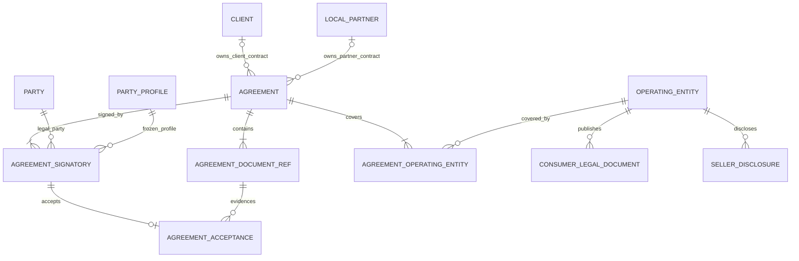

# CCT Agreement 与 Consumer Legal 精简设计

> **后续决策提示：** 本文保留 48 表阶段的 Agreement/Legal 决策与当时统计；Pricing/Partner Share 的八表结构、组件/Scope/父级 Hash 和 Commercial Context V2 已被 [44 表 Commercial Term 合并与 Hash 精简设计](./2026-08-23-cct-commercial-term-consolidation-design.md) 取代，不得据此恢复旧结构。

最后更新：2026-08-22  
状态：已实施并通过自动验证；PDManer 4.9.3 应用内检查待人工确认

## 1. 目标与边界

本设计将 Client & Contract 当前 Agreement 与 Consumer Legal 的 10 张表精简为 7 张，同时保留下列已经确认的业务能力：

- Client Agreement 与 Local Partner Agreement 的独立归属；
- 一份 Agreement 明确覆盖一个或多个 Operating Entity；
- 合同签约方、合同文件和每个签约方的签署证据；
- Operating Entity 级统一的消费者条款、退款政策与隐私声明；
- Operating Entity 面向 Consumer 的结构化法律卖方披露；
- 交易时点唯一解析、Fail Closed 和 Commerce 不可变订单快照；
- 文件字节级校验、CCT 通用行级变更历史、留存与 Legal Hold。

本次删除没有当前产品用例支撑的 Agreement Root/Version、合同交易维度 Scope、Client 级 Consumer Legal Override、业务 Content/Scope Hash 和 Hash Schema Version。Client Pricing、Partner Share、Business Profile、Eligibility 等其他领域确有消费者的业务 Version/Hash 不因本设计自动删除。

本设计只改变 CCT 逻辑与首套 PDManer 物理目标，以及必要的需求目录和下游书面快照契约。本阶段仍不创建 Migration、Java 模块、物理数据库或运行环境，也不修改其他五个系统尚未获准的 PDManer 模型。

## 2. 已确认的核心结论

| 主题 | 结论 | 原因 |
|---|---|---|
| Agreement Version | 删除 `agreement_version`，一行 `agreement` 表示一份独立法律合同 | 已签条款变化时签署新合同并创建新 ID，不需要 Root/Version 两层 |
| 合同归属 | `agreement` 直接保存 `client_id` 或 `local_partner_id`，按类型做 XOR | 保留真实 FK，避免无 FK 的多态 `owner_type + owner_id` |
| 多 OE 合同 | 允许一个 Agreement 覆盖一个或多个 Operating Entity | 适配平台统一路由和主协议 + OE 清单；单 OE 是 N=1 的自然情况 |
| 签约方 | `agreement_version_party` 改为 `agreement_signatory` | 表只记录真正签署合同的法律主体，避免与“被合同覆盖的 OE”混淆 |
| 合同适用范围 | 删除 `agreement_scope_binding`，新增含三个业务标识与两个审计时间的 `agreement_operating_entity` | 合同只表达 OE 覆盖，不再承载国家、币种、行业、MCC 或优先级 |
| 合同 Hash | 删除 Agreement 聚合 `content_hash/scope_hash/hash_schema_version/binding_revision_no` | Agreement ID 指向封存后的独立法律合同；跨系统组合完整性继续由 `commercial_context_hash` 负责 |
| 文件 Hash | 保留文件引用的 SHA-256 | 它证明具体文件字节未变化，不是需要 Canonical Schema 的业务聚合 Hash |
| Consumer Legal | Root/Version 合并为 `consumer_legal_document` | 一行表示一份可独立发布的法律文档；内容变化创建新文档 ID |
| Client Override | 删除 `CLIENT_OVERRIDE`、`client_id`、`scope_type` 和 `scope_key` | V1 统一按 Operating Entity + 国家 + Locale 提供法律文档 |
| Seller Disclosure | Root/Version 合并为结构化 `seller_disclosure` | 一行表示一套获准公开的法律卖方信息；历史订单冻结实际展示字段 |
| 乐观锁与 Active Slot | 不新增结构化 `version` 或 `active_slot` | CCT 使用 BCR CAS；唯一解析由确定性锁定、有效期冲突检查和 Fail Closed 保证 |

## 3. 目标表清单

目标为 7 张表：

```text
agreement
agreement_signatory
agreement_document_ref
agreement_acceptance
agreement_operating_entity
consumer_legal_document
seller_disclosure
```

当前 10 张表中的下列 5 张被删除、重命名或替换：

```text
agreement_version
agreement_version_party
agreement_scope_binding
consumer_legal_document_version
seller_disclosure_version
```

其中 `agreement_version_party` 是重命名并重构为 `agreement_signatory`，`agreement_scope_binding` 是替换为 `agreement_operating_entity`；其余三张 Version 表删除并将必要业务字段并入对应主表。按本文完整字段清单机器核算：

- Agreement/Legal 由 10 表、112 字段、28 个索引、16 条出向关系，变为 7 表、77 字段、17 个索引、12 条出向关系；
- 再计入 Pricing/Share 两个 Plan 冗余 `agreement_id` 的删除，CCT 整体预计由 51 表/576 字段变为 48 表/539 字段，索引由 137 个变为 124 个，关系由 78 条变为 72 条；
- 最终字段、索引、关系、Diagram Cell 和 Digest 必须以实施时生成器实算和自动测试为准。

核心关系：



## 4. Agreement 五表设计

### 4.1 `agreement`：合同

完整字段：

```text
agreement_id
agreement_no
agreement_name
agreement_type
client_id
local_partner_id
status
effective_from
effective_to
signed_time
activated_time
create_by
create_time
update_time
```

枚举：

```text
agreement_type = CLIENT | PARTNER
status = DRAFT | PENDING_SIGNATURE | SIGNED | ACTIVE | EXPIRED | TERMINATED | CANCELLED
```

约束：

- `uk_agreement_no(agreement_no)`；
- `ix_agreement_client_time(client_id,effective_from,effective_to)` 与 `ix_agreement_partner_time(local_partner_id,effective_from,effective_to)` 支持两类 Owner 的 As-Of 候选查询；当前状态不能放在历史解析的必选前缀中；
- CLIENT 要求 `client_id` 非空、`local_partner_id` 为空；PARTNER 反之；
- 除 Owner XOR、`effective_from/effective_to/signed_time/activated_time` 的生命周期可空规则外，其余字段均非空；
- `effective_to IS NULL OR effective_from < effective_to`；DRAFT 可暂不填写 `effective_from`，进入 PENDING_SIGNATURE 前必须确定非空 `effective_from`，并明确 `effective_to` 为合法结束时间或 `NULL`（开放结束）；
- 一行就是一份法律合同，不再有业务版本号、Current Pointer、Active Slot 或聚合 Content Hash；
- 已签署内容发生变化时创建新 Agreement，不覆盖原合同文件、签约方或 OE 覆盖范围；
- 最后一位签约方完成接受且所有文件规则满足时设置 `signed_time`；首次真正进入可用状态时设置 `activated_time`。两者一经写入不得覆盖；
- 一旦存在 `activated_time`，必须满足 `effective_from <= activated_time` 且 `signed_time <= activated_time`；任何 Acceptance 的 `accepted_time` 都不得晚于 Agreement 的 `signed_time`；
- DRAFT/PENDING_SIGNATURE/CANCELLED 的 `signed_time/activated_time` 均为空；SIGNED 的 `signed_time` 非空且 `activated_time` 为空；ACTIVE/EXPIRED 两者均非空；TERMINATED 的 `signed_time` 非空，若从未生效则 `activated_time` 可空；EXPIRED/TERMINATED 的 `effective_to` 必须非空；
- 同一 Owner、Agreement Type、Operating Entity 和任一时点只能有一份可用 Agreement。进入 PENDING_SIGNATURE 时按 Owner 与 OE 稳定顺序加锁，冻结范围并检查与其他 PENDING_SIGNATURE/SIGNED/ACTIVE 合同的区间冲突；进入 SIGNED 和 ACTIVE 时再做防御性复查；
- 正常流程发现重叠即拒绝。替换旧合同时使用显式“合同替换”命令，在同一本地事务中收窄旧合同 `effective_to`、记录 BCR 与必要的终止证据，再冻结新合同；除 `status/effective_to` 外，旧合同内容、Scope 和 `effective_from` 不得变化；
- 历史解析不能只过滤当前 `status=ACTIVE`。给定 `context_as_of_time=t`，候选合同必须满足 `signed_time <= t`、`activated_time <= t`、`effective_from <= t` 且 `(effective_to IS NULL OR t < effective_to)`；后来变为 EXPIRED/TERMINATED 的合同仍可在其历史有效区间被解析，零条或多条均 Fail Closed。

状态转换：

```text
DRAFT             -> PENDING_SIGNATURE | CANCELLED
PENDING_SIGNATURE -> SIGNED | CANCELLED
SIGNED            -> ACTIVE | TERMINATED
ACTIVE            -> EXPIRED | TERMINATED
```

- `SIGNED` 且 `effective_from` 在未来即可表达等待生效，不增加 `SCHEDULED`；到达生效点后由受控命令写入 `activated_time` 并进入 ACTIVE；
- `CANCELLED` 只用于签署完成前的放弃；
- `TERMINATED` 表示已签或已生效合同提前终止；提前终止必须收窄 `effective_to`，并关联同一 Agreement 的 `TERMINATION_NOTICE` 或可审计的等效法律依据；
- 到期、激活和终止仍通过 CCT BCR CAS、业务历史和本地可靠任务执行，不增加工作流表。

### 4.2 `agreement_signatory`：合同签约方

完整字段：

```text
agreement_signatory_id
agreement_id
party_id
party_profile_id
signatory_role
create_time
update_time
```

枚举：

```text
signatory_role = CLIENT | LOCAL_PARTNER | PLATFORM_SIGNATORY | OPERATING_ENTITY
```

约束：

- `uk_agreement_signatory(agreement_id,party_id,signatory_role)`；
- `ix_agreement_party(party_id)`、`ix_agreement_profile(party_profile_id)` 支持反查法律主体和冻结 Profile；
- 全部字段非空；
- `party_profile_id` 必须属于同一 `party_id`，并在提交签署时已经封存；
- CLIENT Agreement 至少有 CLIENT 与平台侧签约方，且 CLIENT 行的 `party_id` 必须等于 `agreement.client_id -> client.party_id`；PARTNER Agreement 至少有 LOCAL_PARTNER 与平台侧签约方，且 LOCAL_PARTNER 行必须等于 `agreement.local_partner_id -> local_partner.party_id`；
- `PLATFORM_SIGNATORY` 必须是平台批准用于签约的法律 Party；若某个 OE 依法也需要签字，`OPERATING_ENTITY` 行的 Party 必须匹配同一 Agreement 已覆盖的 Operating Entity；
- 本表只保存实际需要签署或接受合同的法律主体，因此删除 `required_acceptance_flag`；
- 进入 `PENDING_SIGNATURE` 后不得新增、删除或修改签约方；
- 被合同覆盖但没有签署的 OE 不进入本表，而进入 `agreement_operating_entity`。

`agreement.client_id/local_partner_id` 表达合同治理的业务关系，用于交易解析；`agreement_signatory.party_id/party_profile_id` 表达实际法律签约主体及签约资料快照，两者不是重复字段。

平台签约主体不再单建一张“Platform Contracting Entity”关联表：它就是 `agreement_signatory.signatory_role=PLATFORM_SIGNATORY` 的法律 Party。若该 Party 同时也是某个 Operating Entity，是否签约和是否被合同覆盖仍分别由 Signatory 与 `agreement_operating_entity` 表达，不能因 Party 相同而合并两种事实。

### 4.3 `agreement_document_ref`：合同文件引用

完整字段：

```text
agreement_document_id
agreement_id
document_type
file_id
content_hash
create_time
update_time
```

枚举：

```text
document_type = SIGNING_DOCUMENT | ANNEX | EXECUTED_DOCUMENT | TERMINATION_NOTICE
```

约束：

- `uk_agreement_doc_file(agreement_id,document_type,file_id)`；
- 全部字段非空，`content_hash` 固定为 64 位小写 Hex SHA-256；
- 每份 Agreement 必须且只能有一个 `SIGNING_DOCUMENT`；`ANNEX` 可有多份；相同文件不得以同一种类型重复关联。该基数由提交签署命令在锁内校验，不能由普通唯一键单独表达；
- `file_id + content_hash` 必须来自 Platform Support 同一个 AVAILABLE、已通过所需扫描的不可覆盖 File；CCT 不保存文件正文；
- `SIGNING_DOCUMENT` 与 `ANNEX` 在进入 `PENDING_SIGNATURE` 后不可替换；
- 完成签署时允许追加最终 `EXECUTED_DOCUMENT`；同一 Agreement 最多一份最终执行文本；ACTIVE 后只允许追加 `TERMINATION_NOTICE`；
- 文件 Hash 固定为 Platform Support 返回的 SHA-256，不增加 `hash_schema_version`；
- Draft 阶段替换文件使用删除旧引用、创建新引用并写 BCR 历史，不原位改变 `file_id`。

### 4.4 `agreement_acceptance`：合同签署记录

完整字段：

```text
acceptance_id
agreement_signatory_id
acceptance_method
accepted_by_actor_id
accepted_time
evidence_document_id
acceptance_reference
create_by
create_time
update_time
```

枚举：

```text
acceptance_method = E_SIGNATURE | CLICK_ACCEPTANCE | MANUAL_SIGNATURE
```

约束：

- `uk_agreement_accept_signatory(agreement_signatory_id)`；
- `uk_agreement_accept_ref(acceptance_reference)`；`acceptance_reference` 非空，是平台生成的全局唯一稳定接受事件编号，不直接依赖外部 Provider 编号是否全局唯一；
- `ix_accept_evidence_doc(evidence_document_id)` 支持从最终文件反查接受证据；
- 仅 `accepted_by_actor_id` 可空，其余字段均非空；
- `accepted_by_actor_id` 是实际执行在线接受的 Platform User 逻辑引用，可空且不建立跨库 FK；`create_by` 是把证据登记进 CCT 的平台用户或系统身份，非空。二者不得混为“签约法律主体”，后者始终由 `agreement_signatory` 确定；
- Email OTP 只是 CLICK/E-Sign 的身份验证因子，不新增 Acceptance Method；
- `CLICK_ACCEPTANCE` 要求 `accepted_by_actor_id` 非空，`evidence_document_id` 指向同一 Agreement 唯一的 `SIGNING_DOCUMENT`，不强制生成 `EXECUTED_DOCUMENT`；
- `E_SIGNATURE` 与 `MANUAL_SIGNATURE` 的 `evidence_document_id` 必须指向同一 Agreement 的 `EXECUTED_DOCUMENT`；外部署名或线下签署时 `accepted_by_actor_id` 可空，由全局唯一 `acceptance_reference`、最终执行文本和 `create_by` 共同构成证据；
- 每个 Signatory 恰有一条 Acceptance 后 Agreement 才能进入 SIGNED。只要存在 E_SIGNATURE/MANUAL_SIGNATURE，进入 SIGNED 前必须且只能有一个 EXECUTED_DOCUMENT；全为 CLICK_ACCEPTANCE 时可不生成该文件；
- Acceptance 是追加式法律证据，创建后不得修改或删除，也不再重复保存 Agreement、Party、Role、File ID 或 File Hash。

### 4.5 `agreement_operating_entity`：合同覆盖经营主体

完整字段：

```text
agreement_operating_entity_id
agreement_id
operating_entity_id
create_time
update_time
```

约束：

- `uk_agreement_entity(agreement_id,operating_entity_id)`；
- `ix_agreement_oe_entity(operating_entity_id)` 支持按 OE 锁定和解析候选合同；
- 全部字段非空；
- 一份 Agreement 提交签署前至少关联一个 Operating Entity；
- 进入 `PENDING_SIGNATURE` 后不得新增、删除或替换覆盖关系；
- 状态和有效期完全继承 Agreement，不在关联行重复保存；
- 不保存国家、币种、行业、MCC、Priority、Scope Hash、Content Hash、Schema Version、Binding Revision 或 Active Slot；
- 该关系只证明法律覆盖，不授予交易资格。Client 仍必须命中同一 OE 的 Affiliation/Assignment；PARTNER 来源还必须命中同一 Local Partner 的 `entity_source_relation`。

`agreement_signatory` 与本表保存不同事实：前者回答“谁签署”，后者回答“合同允许哪些 OE 承接交易”。平台集团主体可以签署主协议，而未签署的 UAE/Saudi OE 通过本表被明确覆盖。

## 5. Consumer Legal 两表设计

### 5.1 `consumer_legal_document`：消费者法律文档

完整字段：

```text
legal_document_id
document_code
document_type
operating_entity_id
country_code
locale
content_file_id
content_hash
status
effective_from
effective_to
approved_time
published_time
create_by
create_time
update_time
```

枚举：

```text
document_type = CONSUMER_TERMS | REFUND_POLICY | PRIVACY_NOTICE
status = DRAFT | APPROVED | ACTIVE | EXPIRED | WITHDRAWN
```

约束：

- `uk_legal_doc_code(document_code)`；
- `uk_legal_doc_scope_time(document_type,operating_entity_id,country_code,locale,effective_from)`；
- `ix_legal_doc_resolve(operating_entity_id,country_code,locale,document_type,effective_from,effective_to)` 支持精确 As-Of 解析；当前状态不能屏蔽历史有效行；
- `effective_to/approved_time/published_time` 按生命周期可空，其余字段非空；`country_code` 使用 ISO 3166-1 alpha-2，`locale` 使用受支持的 BCP 47 Tag，`content_hash` 为 64 位小写 Hex SHA-256；
- `country_code` 表示这份消费者文档适用的 Consumer 国家/司法辖区，不是重复保存 OE 的注册国家；
- 一行是一份可独立发布的法律文档；进入 APPROVED 后文件、Scope 与 `effective_from` 不再修改，内容变化创建新的 `legal_document_id`；
- 不再使用 Root/Version、Client Override、Scope Type、Generated Scope Key、Version Number、Active Slot 或业务 Content Hash；
- 审核通过时设置不可覆盖的 `approved_time`，首次正式发布时设置不可覆盖的 `published_time`；
- 一旦存在 `published_time`，必须满足 `approved_time <= published_time` 且 `effective_from <= published_time`；已发布后转为 EXPIRED/WITHDRAWN 时 `effective_to` 必须非空；
- DRAFT 的 `approved_time/published_time` 均为空；APPROVED 的 `approved_time` 非空、`published_time` 为空；ACTIVE/EXPIRED 两者均非空；WITHDRAWN 的 `approved_time` 非空，若尚未发布即撤回则 `published_time` 可空；
- 同一 OE/Country/Locale/Document Type 的有效区间不得重叠。进入 APPROVED 时锁定 Operating Entity，检查与其他 APPROVED/ACTIVE 文档的区间冲突；进入 ACTIVE 时防御性复查；
- 替换当前开放区间文档时，显式发布命令可在同一本地事务中仅收窄旧文档 `effective_to`、将其转为 EXPIRED/WITHDRAWN、记录 BCR，再批准或发布新文档；旧文档的内容、Scope 和 `effective_from` 不得变化；
- 三种文档在同一 `context_as_of_time` 分别准确解析，不允许相互替代或隐式 Locale 回退；任一缺失或并列都 Fail Closed；
- 历史解析不能只过滤当前 `status=ACTIVE`。给定 `t`，候选必须满足 `published_time <= t`、`effective_from <= t` 且 `(effective_to IS NULL OR t < effective_to)`；后来 EXPIRED/WITHDRAWN 的文档仍可在历史区间被解析；
- `content_file_id + content_hash` 必须来自同一个 AVAILABLE File；文件 Hash 进入订单法律证据快照；
- APPROVED 且生效时间在未来即可表达待生效文档，不增加 SCHEDULED 状态。

状态转换固定为：

```text
DRAFT    -> APPROVED
APPROVED -> ACTIVE | WITHDRAWN
ACTIVE   -> EXPIRED | WITHDRAWN
```

V1 的唯一 Scope 是：

```text
Operating Entity + country_code + locale + document_type
```

所有使用同一 Scope 的 Client 共用同一文档。未来只有出现经过确认的 Client 专属法律条款用例时，才重新设计 Override，而不提前保留空字段。

### 5.2 `seller_disclosure`：法律卖方披露

完整字段：

```text
disclosure_id
operating_entity_id
country_code
locale
public_legal_name
public_registration_number
public_tax_registration_number
public_address_text
public_support_email
public_support_phone
status
effective_from
effective_to
approved_time
published_time
create_by
create_time
update_time
```

枚举：

```text
status = DRAFT | APPROVED | ACTIVE | EXPIRED | WITHDRAWN
```

约束：

- `uk_seller_disclosure_time(operating_entity_id,country_code,locale,effective_from)`；
- `ix_seller_disclosure_resolve(operating_entity_id,country_code,locale,effective_from,effective_to)` 支持精确 As-Of 解析；当前状态不能屏蔽历史有效行；
- `public_tax_registration_number/public_support_phone/effective_to/approved_time/published_time` 按业务或生命周期可空，其余字段非空；`country_code` 与 `locale` 分别使用 ISO 3166-1 alpha-2 和受支持的 BCP 47 Tag；
- `country_code` 表示该披露面向的 Consumer 国家/司法辖区；它允许同一 OE 按当地展示义务发布不同文案，不是 OE 主档 `operating_country` 的副本；
- 同一 OE/Country/Locale 的有效区间不得重叠；进入 APPROVED 时锁定 Operating Entity 并检查与其他 APPROVED/ACTIVE 披露的区间冲突，进入 ACTIVE 时防御性复查；
- Legal Name、Registration Number、Address 和 Support Email 必填；Tax Registration Number 与 Support Phone 可空；
- 一行是一套获准公开的结构化卖方信息；进入 APPROVED 后展示字段、Scope 与 `effective_from` 不再修改，内容变化创建新的 `disclosure_id`；
- 审核通过时设置不可覆盖的 `approved_time`，首次正式发布时设置不可覆盖的 `published_time`；
- DRAFT/APPROVED/ACTIVE/EXPIRED/WITHDRAWN 的时间字段矩阵、先后约束及已发布后关闭区间规则与 Consumer Legal 相同；
- 替换当前开放区间披露时，显式发布命令可在同一本地事务中仅收窄旧披露 `effective_to`、将其转为 EXPIRED/WITHDRAWN、记录 BCR，再批准或发布新披露；
- Operating Entity 主资料变化不能自动改写公开披露，必须形成新的待审核记录；
- 不保存文件、业务 Content Hash、Hash Schema Version、Version Number、Active Slot 或 Client Override；
- 历史解析不能只过滤当前 `status=ACTIVE`。给定 `t`，候选必须满足 `published_time <= t`、`effective_from <= t` 且 `(effective_to IS NULL OR t < effective_to)`；后来 EXPIRED/WITHDRAWN 的披露仍可在历史区间被解析；
- Checkout 精确解析后，Commerce 把全部实际展示字段复制到不可变 Order Seller Snapshot；缺失或并列时 Fail Closed。

Seller Disclosure 使用与 Consumer Legal 相同的 `DRAFT -> APPROVED -> ACTIVE -> EXPIRED/WITHDRAWN` 生命周期和替换事务规则。

Seller Disclosure 不能由 Commerce 直接拼接 `party`、`party_identity_key` 或 `party_address`：CCT 的主体资料包含内部字段，而本表是经过审核、支持本地化、明确允许公开的投影。

## 6. 现实场景 Showcase

假设：

```text
Client: CloudLearn
平台签约主体: Code-MoR Holdings Ltd
Operating Entity A: PMX UAE LLC
Operating Entity B: PMX Saudi LLC
```

一份平台主协议明确覆盖两个 OE：

```text
agreement AG-10001
├── agreement_signatory
│   ├── CloudLearn Inc. / CLIENT
│   └── Code-MoR Holdings Ltd / PLATFORM_SIGNATORY
├── agreement_document_ref
│   ├── SIGNING_DOCUMENT / FILE-80001
│   ├── ANNEX / FILE-80002（列明两个 OE）
│   └── EXECUTED_DOCUMENT / FILE-80003
├── agreement_acceptance
│   ├── CloudLearn / E_SIGNATURE
│   └── Code-MoR Holdings / E_SIGNATURE
└── agreement_operating_entity
    ├── PMX UAE LLC
    └── PMX Saudi LLC
```

CloudLearn 的 UAE/英文订单：

```text
Assignment -> PMX UAE LLC
Agreement -> AG-10001 covers PMX UAE LLC
Consumer Legal
├── CONSUMER_TERMS / AE / en-AE
├── REFUND_POLICY / AE / en-AE
└── PRIVACY_NOTICE / AE / en-AE
Seller Disclosure
└── PMX UAE LLC / AE / en-AE
```

CCT 必须在同一一致性读取和同一 `context_as_of_time` 下唯一解析以上结果。任一合同未覆盖 OE、法律文档缺失、Seller Disclosure 缺失、有效期不匹配或结果并列时，整个交易上下文 Fail Closed。

确定性解析顺序固定为：

1. Assignment 返回准确 Client、Operating Entity、Source Relation 与交易 Scope；
2. 按 `agreement_type=CLIENT + client_id + operating_entity_id + context_as_of_time` 唯一解析 Client Agreement；
3. Source Type 为 PARTNER 时，从 Source Relation 得到 Local Partner，并按同一 OE/As-Of 唯一解析 Partner Agreement；其他 Source Type 不返回 Partner Agreement；
4. Client Pricing Version 必须引用刚解析的 Client Agreement，再在自己的 Pricing Scope 中匹配国家、币种、行业、MCC 和 Payment Method；
5. PARTNER 来源的 Partner Share Version 必须引用刚解析的 Partner Agreement，再在自己的 Share Scope 中匹配；
6. 按同一 OE、Consumer Country、Locale 和 As-Of 分别解析三类 Consumer Legal 与 Seller Disclosure；
7. 全部结果唯一且一致后，才计算一个 `commercial_context_hash` 并整体返回。

Agreement 不再自行匹配国家、币种、行业或 MCC；这些维度分别属于 Assignment、Pricing 和 Partner Share。任何步骤不得通过“取第一条”掩盖并列配置。

## 7. CCT-I12/I13 与下游快照

### 7.1 Agreement Proof

删除下列旧输出：

```text
agreement_scope_binding_id
agreement_scope_binding_version
agreement_scope_binding_hash
agreement_version_id
agreement_content_hash
partner_agreement_binding_id
partner_agreement_binding_ver
partner_agreement_binding_hash
partner_agreement_version_id
partner_agreement_content_hash
```

替换为：

```text
client_agreement_id
client_agreement_operating_entity_id
partner_agreement_id                    # 仅 PARTNER 来源时存在
partner_agreement_operating_entity_id   # 仅 PARTNER 来源时存在
```

Agreement 在进入 PENDING_SIGNATURE 后封存签约包，签署后同一 ID 的法律内容不可覆盖。`agreement_id` 证明使用哪份合同，`agreement_operating_entity_id` 证明该合同中哪一行明确覆盖本 Order 的 OE；二者都必须与 Bundle 顶层的 Owner、Operating Entity、As-Of Time 一致。只返回 Agreement ID 无法直接证明多 OE 合同中的准确覆盖行，因此不能省略关联 ID。内部 BCR Revision 不再作为 Wire Version 外发。

### 7.2 Consumer Legal 与 Seller Disclosure Proof

旧 Wire 名称：

```text
consumer_terms_version_id
refund_policy_version_id
privacy_notice_version_id
seller_disclosure_version_id
seller_disclosure_content_hash
```

替换为：

```text
consumer_terms       = legal_document_id + content_file_id + content_hash
refund_policy        = legal_document_id + content_file_id + content_hash
privacy_notice       = legal_document_id + content_file_id + content_hash
seller_disclosure    = disclosure_id + operating_entity_id + country_code + locale
                       + public_legal_name + public_registration_number
                       + public_tax_registration_number? + public_address_text
                       + public_support_email + public_support_phone?
```

三个 Consumer Legal 结果仍然是三个独立显式对象，不能合并成不带类型的一组数组；落入 Commerce 时分别映射为 `consumer_terms_*`、`refund_policy_*`、`privacy_notice_*` 列。Seller Disclosure 返回结构化展示字段；旧的单列 `public_support_contact` 拆为 Email 与 Phone。Commerce 将 ID 与全部展示值冻结到 Order Seller Snapshot，不再依赖 Seller Disclosure 聚合 Hash；如 Commerce 需要子快照校验，可计算自己的 `seller_snapshot_hash`，但不得冒充 CCT 来源 Hash。

### 7.3 `commercial_context_hash`

边界 Hash 继续保留。其 Agreement & Legal 输入改为覆盖：

```text
client_id
local_partner_id or null
context_as_of_time
client_agreement_id
client_agreement_operating_entity_id
partner_agreement_id or null
partner_agreement_operating_entity_id or null
operating_entity_id
consumer_terms.legal_document_id + content_file_id + content_hash
refund_policy.legal_document_id + content_file_id + content_hash
privacy_notice.legal_document_id + content_file_id + content_hash
seller_disclosure_id + 全部实际展示字段
```

Pricing/Partner Share 的 Version、Scope、Content Hash 与 Component Canonical Hash 继续按现行规范进入 `commercial_context_hash`。删除 Agreement 内部 Version/Binding Hash 不得被扩展为删除整个交易上下文边界 Hash。

由于本次删除并替换了 Hash 输入字段，旧输入与新输入不得共用同一个 Canonical Domain。本轮实施时把 CCT-I13 的边界 Hash Domain 明确升级为 `CODE-MOR:CCT:COMMERCIAL_CONTEXT:2`，并在接口契约中固定字段顺序、NULL 表达、UTF-8 与金额/时间格式；不为每张 Agreement/Legal 表重新增加 `hash_schema_version`。Commerce、Finance 只能逐值接收并冻结同一次 V2 Bundle，不能拿 V1/V2 输入互算。

### 7.4 Pricing 与 Partner Share 外键

当前两个商业版本表引用已删除的 `agreement_version_id`，必须改为引用不可变的 `agreement_id`：

```text
client_pricing_version.agreement_id -> agreement.agreement_id
partner_share_version.agreement_id  -> agreement.agreement_id
```

这两个字段分别证明该 Pricing/Share Version 基于哪一份已签法律合同。对应 Agreement 必须属于同一 Client/Local Partner、覆盖该 Scope 的 Operating Entity，并在 Pricing/Share 生效时为 SIGNED 或 ACTIVE。

同时删除 `client_pricing_plan.agreement_id` 与 `partner_share_plan.agreement_id`，只在每个不可变 Pricing/Share Version 保存准确 Agreement ID。Plan 继续只表达 Client/Partner 的稳定商业配置根，避免 Plan 当前值改动后让历史 Version 被错误解释为属于新合同。

写入和解析必须同时执行以下约束，不能只依赖 FK 存在：

- `client_pricing_version.agreement_id` 必须指向 `agreement_type=CLIENT` 且 `agreement.client_id=client_pricing_plan.client_id`；
- `partner_share_version.agreement_id` 必须指向 `agreement_type=PARTNER` 且 `agreement.local_partner_id=partner_share_plan.local_partner_id`；
- Version 下每个 Pricing/Share Scope 的 `operating_entity_id` 都必须存在于该 Agreement 的 `agreement_operating_entity`；
- Partner Share 的 OE 还必须在交易 As-Of 命中同一 Local Partner 的 `entity_source_relation`；
- Pricing/Share 的起始时间不得早于 Agreement 的 `effective_from`；有界 Agreement 下其计划结束时间不得晚于 Agreement 的 `effective_to`；
- Agreement 后续提前终止时不覆盖历史 Pricing/Share Version，但新交易解析必须以收窄后的 Agreement 区间 Fail Closed，并触发对应 Client/Partner 资格重新评估，不能继续使用仍显示 ACTIVE 的孤立商业版本。

### 7.5 Commerce、Finance 与其他下游

Commerce 的不可变快照同步替换为：

- `order_snapshot` 与 `order_contract_snapshot` 冻结 `client_agreement_id + client_agreement_operating_entity_id`，PARTNER 来源再冻结可空的 `partner_agreement_id + partner_agreement_operating_entity_id`；
- 三类 Consumer Legal 分别冻结 `legal_document_id + content_file_id + content_hash`，不得只保存一个通用 Legal ID；
- `order_seller_snapshot` 冻结 `seller_disclosure_id` 和全部公开字段，`public_support_contact` 拆为 `public_support_email/public_support_phone`；删除伪装成 CCT 来源字段的 `seller_disclosure_content_hash`，由 Commerce 自己的 `snapshot_hash` 覆盖整个不可变订单快照；
- `ConsumerDocumentRequested` 使用订单本地快照 Hash 和三份法律文件 Hash，不再发送已删除的 Agreement/Seller Content Hash。

Finance 的 `economics_snapshot` 只冻结两组 Agreement/Association ID、仍保留的 Pricing/Share Proof 和 `cct_commercial_context_hash`；不复制 Agreement 文件。`calculation_hash`、PAYMENT/REFUND/DISPUTE/COST_ADJUSTMENT 的继承规则及 `EconomicsCalculated` 都使用这些新稳定 ID，不再校验 Agreement Binding Revision 或 Content Hash。

Risk 如需合同依据，只保存稳定 `agreement_id`，确需证明 OE 覆盖时同时保存 `agreement_operating_entity_id`；Payment 不新增 Agreement/Legal 物理字段，只继续继承 Commerce 的不可变 Order Snapshot/Ready Hash。Platform Support 继续拥有文件字节，其文档生成输入改为 Commerce 本地快照 Hash 加三份 Legal File Hash。

本轮直接替换尚未实施的 V1 书面契约，不保留旧字段兼容别名。未来若已有真实外部消费者，再通过 HTTP API 明确版本化迁移，不能让旧字段继续暗示已经删除的物理 Version/Binding。

## 8. 并发、历史与不可变边界

- Agreement、Consumer Legal 和 Seller Disclosure 都使用 CCT `business_change_record.current_version` 作为普通聚合唯一 CAS Token，不增加结构化乐观锁字段；
- `agreement` 是 Agreement 聚合根；`agreement_signatory`、`agreement_document_ref`、`agreement_operating_entity` 是其 Child。`consumer_legal_document` 与 `seller_disclosure` 各自是独立聚合根；
- Draft 修改、Child 增删、冻结、审批、签署、发布、替换、终止等状态转换与 `compensation_event` 必须在同一本地事务写结构化表、BCR Snapshot 和可靠事件；
- `agreement_signatory`、`agreement_document_ref`、`agreement_operating_entity` 在 PENDING_SIGNATURE 后封存；`agreement_acceptance` 自创建起不可变；
- Consumer Legal/Seller Disclosure 进入 APPROVED 后内容不可变，新内容创建新业务 ID；只有受控替换/撤回命令可以更新其 `status/effective_to`；Agreement 同理只允许受控生命周期命令更新 `status/effective_to/signed_time/activated_time`；
- 生命周期命令不得回溯修改已经发生的可用区间：收窄 `effective_to` 时必须满足 `effective_to >= operation_context_time`，且不得早于已经写入的 `activated_time/published_time`。否则相同 `context_as_of_time` 的幂等重试会解析出不同历史结果；
- 新增 `agreement_acceptance` 必须推进 Agreement Root BCR 并记录根状态变化；Acceptance 本身是追加式法律证据，不再为相同内容额外写一份通用 BCR 完整快照；其他 Root/Child 继续按批准的 CCT 行级历史规则记录；
- 文件正文不进入 BCR、事件或 CCT 数据库；BCR 只保存文件 ID、文件 Hash 及其他白名单业务字段；
- Agreement 终止或失效后，其合同、签约方和 Acceptance 证据至少保留 10 年；Consumer Legal/Seller Disclosure 按订单合同证据和适用法定留存策略处理，ACTIVE Legal Hold 优先。

物理规范要求除 `business_change_version` 外的所有表都包含 `create_time + update_time`。因此本轮对话中曾提出在不可变 Child 上删除 `update_time` 的简写不进入最终物理设计：不可变行在 INSERT 时令 `update_time=create_time`，之后禁止覆盖。这是为了与当前 CCT 统一物理规则保持一致，不代表这些证据可修改。

所有适用区间统一采用半开区间 `[effective_from,effective_to)`。当前状态用于运营和状态机校验，As-Of 解析由结构化签署/发布时间与半开区间决定；运行时禁止读取 BCR JSON 计算合同或文档是否在历史时点有效。

## 9. 明确不做

- Agreement Root/Version、Current Version Pointer、业务 `version_no` 或 `supersedes_version_id`；
- Agreement 的 Country/Currency/Industry/MCC/Payment Method Scope 或 Priority；
- Agreement Scope/Content Hash、Hash Schema Version、Binding Revision 或 Wire Binding Version；
- Consumer Legal Client Override、Scope Type、Generated Scope Key 或隐式 Locale 回退；
- Seller Disclosure Client Override 或从 OE 主资料自动发布；
- 通用合同工作流、可配置审批节点、协议规则脚本或历史版本回放；
- Java、Migration、物理数据库或其他五个系统的 PDManer 工件。

未来若实际法律合同允许“所有当前及未来关联 OE”而不逐项列明、需要 Client 专属消费者条款，或者要表达主协议/补充协议法律链，必须用新的真实用例重新设计，不能恢复旧 Scope Binding 的全部复杂字段作为默认方案。

## 10. 已同步的当前权威工件

本设计实施已同步覆盖：

- `agent-docs/database/CLIENT_CONTRACT_DATABASE.md`；
- `client-contract-service/docs/database/CLIENT_CONTRACT_PHYSICAL_DECISIONS.md`；
- `AGENTS.md`、`agent-docs/README.md`、`agent-docs/PROJECT_CONTEXT.md`、`agent-docs/DATABASE_DESIGN_GUIDE.md`、`agent-docs/database/README.md` 中的当前统计和 Agreement 边界；
- `agent-docs/plans/2026-08-20-cct-row-history-design.md`、`2026-08-21-cct-model-slimming-design.md`、`2026-08-21-cct-model-slimming-implementation-plan.md`、`2026-08-22-client-industry-mcc-design.md`、`2026-08-22-client-industry-mcc-implementation-plan.md` 中仍把旧 Agreement/Legal 结构视为现行边界的段落；历史正文原则上保留并标注被本设计取代，不伪造旧实施记录；
- `requirements-site/content/requirements.ts`；
- `requirements-site/content/global-use-case-sequences.mjs`；
- `agent-docs/database/COMMERCE_DATABASE.md`；
- `agent-docs/database/FINANCE_DATABASE.md`；
- `agent-docs/database/RISK_COMPLIANCE_DATABASE.md` 与 `agent-docs/database/PLATFORM_SUPPORT_DATABASE.md` 的跨系统引用；核对 `agent-docs/database/PAYMENT_ORCHESTRATION_DATABASE.md`，除非发现旧字段，不增加物理改动；
- `scripts/pdmaner/client-contract-field-metadata.mjs`；
- `scripts/pdmaner/generate-client-contract-model.mjs`；
- `scripts/pdmaner/client-contract-model.test.mjs`；
- `client-contract-service/docs/database/client-contract.pdma.json`，只能由生成器重建，不手改；
- 新增本设计的实施计划和导航入口，不改写历史实施记录。

最终自动验证运行：

```bash
node --test scripts/pdmaner/client-contract-model.test.mjs
node scripts/pdmaner/generate-client-contract-model.mjs --check
node -e 'JSON.parse(require("node:fs").readFileSync("client-contract-service/docs/database/client-contract.pdma.json","utf8")); console.log("client-contract PDManer JSON OK")'
npm --prefix requirements-site test
npm --prefix requirements-site run lint
shasum -a 256 agent-docs/templates/pdmaner/template.pdma.json client-contract-service/docs/database/client-contract.pdma.json
```

最终仍需在本机 PDManer 4.9.3 打开模型并运行应用内检查；自动测试不能替代该人工兼容性门禁。
