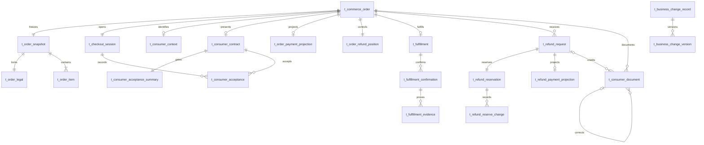

# Commerce 平衡型物理模型设计（历史）

> 历史设计：本文记录 2026-08-23 的建模基线，其中 Order Snapshot、`external_order_id` 与 `creation_request_hash` 已被 [Commerce 订单上下文精简设计](./2026-08-24-commerce-order-context-simplification-design.md) 取代，消费者、网络证据和履约边界又被 [Commerce 隐私与履约精简设计](./2026-08-24-commerce-privacy-fulfillment-simplification-design.md) 取代。当前任务不得按本文恢复已删除字段、履约结构或旧跨系统契约。

状态：历史基线，已被 2026-08-24 两次精简设计共同取代

日期：2026-08-23

## 1. 设计定位

本文固化 Commerce 进入 PDManer 的平衡型 23 表引用型快照物理设计决策。它保留已经确认的 Order、Hosted Checkout、消费者接受、履约、amount-based Refund、跨系统投影、幂等与本地补偿边界，但不复制 CCT/Finance 已拥有的不可变内部事实。

本次确认后的实施边界：

- `agent-docs/database/COMMERCE_DATABASE.md`、现实场景、需求目录与全局序列必须同步采用本决策；
- 用户已授权本轮创建 Commerce PDManer 设计资产；该授权未授权 Migration、Java 实现或运行环境；
- PDManer 资产必须从项目模板派生并通过自动契约验证，PDManer 4.9.3 应用内检查仍是人工门禁；
- 不改变 Client & Contract、Payment、Risk、Finance、Platform Support 或 Vault 拥有的事实。

本决策的目标不是追求最少表数，而是让每张表都能回答：保存什么事实、由谁写入、如何查询或约束、为什么不能并入现有表、删除后会破坏哪个当前场景。

## 2. 已确认且不得改写的业务边界

### 2.1 Order 创建边界

采用已经确认的“完整前置校验后才创建 Order”模式：

```text
CreateOrder
  -> CCT-I13 原子解析商业与法律上下文
  -> Risk Checkout Assessment
  -> Finance Tax Calculation
  -> 全部成功后，Commerce 才提交 Order 与不可变快照
```

- CCT、Risk 或 Finance 未通过、冲突、超时或技术失败时，不创建 `commerce_order`、Checkout Session 或不完整快照。
- `command_idempotency` 保留请求 Hash、首次操作时点、预分配资源 ID 和恢复结果；Risk 已执行的 Assessment 由 Risk 自己保存。
- 完整 Order Snapshot 已在本地事务提交后，若 Vault Binding、Payment Intent 创建或响应返回失败，则 Order 已经存在，必须从 `CREATED + PREPARING` 恢复，不能删除或重新创建。
- Client 改变失败请求内容时必须使用新的幂等键；未成功创建的 External Order ID 不形成永久 Order 唯一占用。

### 2.2 固定交易不变量

- 一笔 Order 只属于一个 Client 和一个 Operating Entity；Client 不得选择 Operating Entity、Provider 或 MID。
- 一笔 Order 只有一个 Checkout Session、一个 Payment Intent，但可以有多次顺序 Payment Attempt，且最多一笔成功、最多一个非终态 Attempt。
- Order 与 Checkout 共用 `commerce_order.expires_at`；Session 不重复保存到期时间。
- 每笔 Order 只冻结一组准确 `industry_code + mcc_code`，并与同一次 CCT-I13 Profile/Classification Proof 和 V4 `commercial_context_hash` 一致。
- Checkout Risk 与每个 Payment Attempt 的交易风控是两个独立事实；只有 Checkout Risk `ALLOW` 才创建 Order。
- Consumer 必须接受具体法律内容 Hash；Payment 只能在服务端读取 COMPLETE Readiness 后创建 Attempt。
- Refund 只按金额；Client 发起不需要审批，但 Commerce 可退额度与 Finance 资金预占都成功后才能调用 Payment。
- Payment Refund `UNKNOWN` 时两侧预占继续占用；失败或取消必须经过 `RELEASE_PENDING -> Finance Released -> Commerce Released -> FAILED/CANCELLED`。
- 每个系统只访问自己的数据库；跨系统引用只保存稳定 ID、来源版本、Event Key、Payload Hash 或交易时点快照，不建立跨库外键。

## 3. 方案评审记录

### 3.1 方案 A：保留原 32 表基线（未采用）

优点是与当前逻辑文档完全一致，改动最少；缺点是存在多张没有独立生命周期的一对一 Snapshot 表、五张高度相似的状态 History、固定为 1 的 Snapshot Version，以及 Commerce 提前冻结 Platform Webhook Endpoint 等超前结构。

### 3.2 方案 B：激进合并到约 18 至 21 张表（未采用）

做法是把全部一对一快照、Checkout、Consumer Contract、Refund Reservation 和外部 Projection 尽量并入聚合根。表数最低，但会把可变状态、不可变交易事实、外部系统投影和资金并发控制混在宽表中，增加热点竞争、条件更新矩阵和误改历史事实的风险。

### 3.3 方案 C：平衡型 26 张表（历史阶段）

只合并没有独立基数、生命周期、权限或并发边界的一对一表；保留真正的一对多快照、不可变法律/履约事实、外部 Current Projection、退款资金状态面和可靠执行表。

该方案相对当前模型：

- 从 32 张表收敛到 26 张；
- 一份 Order 只存在一个 Snapshot 聚合，不再把每个子对象都命名为 Snapshot；
- 四类普通状态历史进入受控 BCR，不再每个聚合复制一张结构相似的 History；
- Acceptance、Confirmation、Reserve Change 等本身就是不可变领域证据，继续使用专项表，不重复写 BCR；
- 高并发 Current Projection 和资金 Position 继续结构化保存，不用 BCR JSON 参与业务判断。

### 3.4 已批准引用型压缩

在 26 表阶段完成的四项简化继续有效；本轮再删除 Commerce 对 Finance Tax Line、CCT Commercial Term 与 Component 的三份副本。

1. 四张普通状态 History 由 Commerce BCR 替代；
2. 单向 Acceptance 门禁不再保留 `acceptance_state_change`，改由不可变 Acceptance 与冻结的完成触发 Tuple 证明；
3. Acceptance 不再保存 IP/UA Blind Index，只保存独立法律证据 Purpose 下的 Vault Token/Record Version/Metadata Hash；
4. 删除 `fulfill_callback_snapshot`，由 Platform Support 在收到 `FulfillmentRequested` 时冻结有效 Subscription/Endpoint Version。

当前目标为 23 表、329 字段、37 个唯一索引、18 个访问索引、26 条本库关系和 6 个图组。Commerce 的三表 Snapshot 只保存 Checkout 常用事实与外部不可变 ID/Hash；Finance、CCT 分别保留并长期读取详细 Tax/Term 事实。引用不表示跨库外键、共享表、视图或查询。

## 4. 目标结构总览



`t_business_change_record` 通过稳定业务类型和业务 ID 逻辑关联五类受审计业务根，不为多态关系建立物理外键。`t_command_idempotency` 和 `t_compensation_event` 同样通过业务标识工作，不进入领域 ER 的强外键树。

## 5. 23 张表职责清单

| 分组 | 物理表 | 基数与可变性 | 核心职责 |
|---|---|---|---|
| Order | `t_commerce_order` | 聚合根，可变 | Order 身份、所有权、状态、统一到期时间与并发版本 |
| Order | `t_order_snapshot` | 每 Order 一行，不可变 | 分类、Assignment、Scope/Tax/Risk 精确引用、金额和 V2 Hash |
| Order | `t_order_legal` | 每 Snapshot 一行，不可变 | Agreement、三份 Consumer Legal 与 Seller Disclosure 的交易时点证明 |
| Order | `t_order_item` | 每 Snapshot 多行，不可变 | 商品/服务与逐行金额快照 |
| Payment View | `t_order_payment_projection` | 每 Order 至多一行，可变 | Payment Intent 与当前/最近 Attempt 的可重建 Current View |
| Refund Position | `t_order_refund_position` | 每 Order 一行，可变 | 原子控制 refundable、reserved、refunded 三个金额 |
| Checkout | `t_checkout_session` | 每 Order 一行，可变 | Hosted Checkout 访问 Token Hash、当前状态与时间 |
| Checkout | `t_consumer_context` | 每 Order 至多一行，可变当前引用 | Consumer/账单 Vault 引用、必要检索值与脱敏展示值 |
| Legal | `t_consumer_contract` | 每 Order 至多一行，不可变 | 实际呈现给 Consumer 的合同文件与内容证明 |
| Legal | `t_consumer_acceptance_summary` | 每 Contract 一行，可变投影 | Required/Accepted Set、完成触发与 Payment Readiness |
| Legal | `t_consumer_acceptance` | 每 Contract 多行，不可变 | 每类具体法律内容的接受时间、Hash 与网络证据 |
| Fulfillment | `t_fulfillment` | 每 Order 至多一行，可变 | 履约请求、失败、成功和纠正后的当前状态 |
| Fulfillment | `t_fulfillment_confirmation` | 每 Fulfillment 多行，不可变 | Client 确认事实与失败纠正链 |
| Fulfillment | `t_fulfillment_evidence` | 每 Confirmation 多行，不可变 | 受控 File ID/Hash 履约证据 |
| Refund | `t_refund_request` | 聚合根，可变 | amount-based Refund 的唯一对外业务状态 |
| Refund | `t_refund_reservation` | 每 Refund 一行，可变 | Commerce 额度与 Finance Funding 两个独立状态面 |
| Refund | `t_refund_reserve_change` | 每 Reservation 多行，不可变 | 两侧预占变化、来源事件版本与冲突证据 |
| Refund | `t_refund_payment_projection` | 每 Refund 至多一行，可变 | Payment Channel Refund Current View |
| Document | `t_consumer_document` | 每业务文档一行，可变投影 | Commerce 请求、Finance Fiscal Fact、Platform 文档与文件证明的对齐 |
| Audit | `t_business_change_record` | 每受审计业务行一行，可变指针 | 业务行身份、聚合身份与最新审计版本 |
| Audit | `t_business_change_version` | 每次审计变化一行，不可变 | 白名单化行快照、Trigger、Reason 与操作者 |
| Reliability | `t_command_idempotency` | 每命令键一行，可变 | HTTP/内部命令幂等、多阶段恢复与结果复用 |
| Reliability | `t_compensation_event` | 临时可靠任务，可变 | 本地事务后 MQ 发布、Vault Bind/Retire 与恢复任务 |

## 6. Order 与不可变快照

### 6.1 `t_commerce_order`

建议核心字段：

```text
order_id
order_no
client_id
external_order_id
creation_request_hash
operating_entity_id
entity_source_type
local_partner_id                 nullable
order_status
expires_at
paid_at                          nullable
fulfilled_at                     nullable
version
create_time
update_time
```

关键约束：

- `uk_order_no(order_no)`；
- `uk_order_external(client_id,external_order_id)`；
- `entity_source_type IN (PLATFORM,CLIENT,PARTNER)`；只有 PARTNER 来源时 `local_partner_id` 非空；
- `client_id`、`operating_entity_id`、来源与到期时间在创建后不可修改；
- 状态更新必须携带 Expected Version 或精确旧状态；
- CCT/Risk/Finance 前置失败时不插入本表；完整 Snapshot 已提交后，后续失败只能恢复。

`creation_request_hash` 与 `t_command_idempotency.request_hash` 都保留：前者伴随永久 External Order 唯一性，后者服务某次命令的重放和恢复，生命周期不同。

### 6.2 `t_order_snapshot`

这是唯一名为 Snapshot 的 Order 根。V2 只保存 Checkout 本地事实与外部不可变事实的精确引用：

```text
身份：order_snapshot_id, order_id
Schema：snapshot_schema_version=2
CCT Proof：cct_context_as_of_time, industry_code, mcc_code, assignment_id,
           cct_commercial_context_hash, client_pricing_scope_id,
           partner_share_scope_id nullable
Risk/Finance Proof：risk_checkout_assessment_id, finance_tax_snapshot_id,
                   finance_tax_snapshot_hash
金额：merchandise_amount, discount_amount, net_amount, tax_amount,
      rounding_amount, total_amount, currency
展示上下文：consumer_country_code, locale
完整性：snapshot_hash, create_time
```

规则：

- `uk_order_snapshot(order_id)`；每笔 Order 只允许一份快照，不存在业务 Snapshot Version 切换。
- V2 的 Hash Domain 固定为 `CODE-MOR:COMMERCE:ORDER_SNAPSHOT:2`。Schema Version 只标识 Canonical Schema/Hash Domain，不是业务版本或 CAS；不得以 V2 输入重算 V1。
- Risk 只保存实际采用的 Assessment ID；`ALLOW` Outcome、Reason、Rule Hit 和 `OrderPreparationContext` Input Hash 由 Risk 保存。
- `client_pricing_scope_id` 必填，Partner Scope 只在 PARTNER 来源存在。Scope ID 唯一定位 CCT 的不可变 Plan/Version/Agreement/Component，不在 Commerce 重复保存。
- `finance_tax_snapshot_id + finance_tax_snapshot_hash` 成组必填，Hash 等于 Finance `tax_snapshot.calculation_hash`。完整 Tax Line 只在 Finance 保存。
- `snapshot_hash` 使用版本化 Domain，覆盖根、Legal、Item、两个 Term Scope ID、Finance Tax Snapshot ID/Hash、Risk Assessment ID 与 CCT V4 Hash。Hash 不替代本地结构化字段，也不伪装为 Tax/Term 明细副本。
- Hash 输入中的 Order 身份与参与方 Tuple 直接取 `t_commerce_order` 创建后不可变的 `order_id/client_id/operating_entity_id/entity_source_type/local_partner_id`，不在 Snapshot 根重复保存同一组字段；`entity_source_type=PARTNER` 时 `local_partner_id` 必须参与 Canonical 输入。
- Assignment、Agreement、Client Pricing 和条件存在的 Partner Share 必须全部来自同一次 CCT-I13 原子响应，并与 `cct_commercial_context_hash` 对齐；不能把不同请求返回的稳定 ID 拼成一份 Snapshot。
- 下游使用 `snapshot_schema_version + snapshot_hash` 识别交易事实；Schema Version 变化只代表 Canonical 结构或算法变化，绝不产生同一 Order 的第二个业务快照。
- 本表以及所有 Snapshot 子表只有 `create_time`，没有 `update_time`、乐观锁或 Active Slot。

### 6.3 `t_order_legal`

该表合并原 `order_seller_snapshot` 与 `order_contract_snapshot`，一行表达消费者交易时点看到并受其约束的完整法律上下文：

```text
order_legal_id, order_snapshot_id
client_agreement_operating_entity_id
partner_agreement_operating_entity_id                                nullable
consumer_terms_document_id, consumer_terms_file_id, consumer_terms_content_hash
refund_policy_document_id, refund_policy_file_id, refund_policy_content_hash
privacy_notice_document_id, privacy_notice_file_id, privacy_notice_content_hash
seller_disclosure_id
public_legal_name, public_registration_number,
public_tax_registration_number                                      nullable
public_address_text, public_support_email, public_support_phone       nullable phone
create_time
```

- `uk_order_legal(order_snapshot_id)`；
- Client Agreement Association 始终非空；PARTNER 来源时 Partner Agreement Association 非空，其他来源为空。Association ID 可唯一定位所属 Agreement/OE，因此不重复保存 Agreement ID；
- 三份法律文件分别冻结 ID/File/Hash，不能合并成一个通用 Document ID；
- 公开卖方字段逐值来自同一次 CCT-I13 Seller Disclosure，不回查当前 Party 自行拼接；Seller 命中 Scope 与 Order `consumer_country_code + locale` 严格相同，故不重复保存 Country/Locale；
- 所有字段参与 Commerce `snapshot_hash`，但不新增无消费者的 `legal_hash` 或 `seller_hash`；Seller Disclosure 不是 CCT Commercial Context 的组成部分，不得反向混入 `cct_commercial_context_hash`。

### 6.4 Checkout Item 与外部不可变读取

`t_order_item` 是唯一保留的一对多 Snapshot Child：一笔 Order 可有多个商品/服务行；`product_type_code/tax_category_code` 是 Finance 税务请求输入，逐行金额和 `line_tax_amount` 是 Checkout 展示及金额退款校验所需本地事实。

Finance 在创建前返回 `tax_snapshot_id/calculation_hash/total_collected_tax/total_reverse_charge_tax` 与每个预分配 Item ID 的实收税额；Commerce 校验逐 Item 汇总后写 Root/Item。完整 Tax Line、Registration、Jurisdiction、Rule/Rate/Treatment 与责任模式只经 `GetImmutableTaxSnapshot(tax_snapshot_id, expected_calculation_hash)` 查询 Finance。

CCT-I13 仍解析和 Hash 完整 V4 Bundle，但 Commerce 只写两个实际命中的 Scope ID。Finance 在 PaymentSucceeded 后先交叉校验 Payment 与 Commerce 的 Snapshot ID/Schema/Hash，再调用 `GetImmutableCommercialTermScope(term_scope_id, agreement_operating_entity_id, context_as_of_time)`；该查询按历史 ID 返回 Owner、Plan/Version/Agreement、完整 Scope/Component 并校验 Scope 闭包，不重新选择当前 ACTIVE Scope，也不使用整包 V4 Hash 验证单个 Scope。暂时调用失败不 ACK 原事件并等待 Broker 重投；永久完整性错误告警并进入 DLQ，绝不生成 Journal 或使用当前、默认、零费率。

## 7. Checkout 与消费者法律证据

### 7.1 `t_checkout_session`

- 每 Order 一行；保存 `public_token_hash`，不保存明文访问 Token。
- 状态为 `PREPARING/OPEN/PAYMENT_PROCESSING/COMPLETED/CANCELLED/EXPIRED`。
- 不保存 `expires_at`，统一读取 Order。
- 保留 `version`，因为 Payment Attempt 事件、取消和到期可能并发更新 Session。
- 状态历史进入 BCR，不保留专用 `checkout_status_history`。

### 7.2 `t_consumer_context`

Commerce 使用一个已登记的 `COMMERCE_CONSUMER_CONTEXT_V1` Vault Field Set 保存 Consumer Ref、Email、Phone、Billing Name、Billing Address、IP 和完整 User-Agent 原值；业务库只保存：

```text
consumer_context_id, order_id
consumer_pii_vault_token, vault_record_version, vault_metadata_hash
ref_blind_index + key_version
email_blind_index + key_version
必要的 ref/email/phone/name/address masked value
country_code, locale
version, create_time, update_time
```

MVP 不保存 Phone、IP 或 User-Agent Blind Index，因为当前没有已确认的本库等值检索、唯一约束或关联查询。Risk 所需的交易特征由当前请求和授权接口传递；Commerce 不用 Blind Index 充当风控特征库。

该表不是不可变交易快照，而是 Order 当前有效的 Vault 引用。首次 Token Tuple 与本地 `VAULT_BIND_REFERENCE` 任务在同一事务登记；Bind 成功前 Session 保持 PREPARING。受控纠正时先保护并 Bind 新 Token，再使用 Expected Version 原子切换整组 Token/Record Version/Metadata Hash、Masked Value 和 Blind Index，提交后才登记旧 Token Retire，禁止字段跨 Metadata Version 拼接或提前退役旧值。

Consumer Context 进入 BCR 白名单，但审计快照只记录“引用已变更”、Vault Record Version、Metadata Hash、Key Version 与脱敏值，不记录 Vault Token、Blind Index 或敏感原值。Reveal 值不得进入数据库、缓存、事件、BCR 或日志。

### 7.3 `t_consumer_contract`

该表只保存实际呈现给 Consumer 的不可变合同证据，不与可变 Payment Readiness 投影合并：

```text
consumer_contract_id, order_id
order_legal_id
rendered_file_id, rendered_content_hash
locale, presented_at
create_time
```

- `uk_consumer_contract(order_id)`；
- `order_legal_id` 必须属于同一 Order 的唯一 Snapshot，Rendered Content 必须由该法律上下文确定性生成；
- `rendered_file_id + rendered_content_hash + locale + presented_at` 一经写入不得修改；需要新的法律内容时应创建新 Order，不能覆盖已呈现证据。

### 7.4 `t_consumer_acceptance_summary`

该表是每份 Contract 一行的可变 Payment Readiness 投影：

```text
acceptance_summary_id, consumer_contract_id
required_type_set_hash, accepted_type_set_hash
acceptance_status                 PENDING/COMPLETE
completion_acceptance_id          nullable until COMPLETE
completed_at                      nullable until COMPLETE
version, create_time, update_time
```

- `uk_acceptance_summary(consumer_contract_id)`；Required Set 由 `t_order_legal` 的三类 `acceptance_type + content_hash` 按稳定顺序计算，创建后不可修改；
- 每个接受命令先通过 `command_idempotency + VAULT_BIND_REFERENCE` LOCAL_HANDLER 完成网络证据 Bind；因为不可变 Acceptance 不保存 Binding 状态，只有 Bind 得到确定成功后的第二个本地事务才插入 Acceptance、以 Expected Version 锁定 Summary 并重算 Accepted Set。状态只能 `PENDING -> COMPLETE`，不支持回退或撤销；
- 最后一条补齐 Required Set 的 Acceptance ID 原子写入 `completion_acceptance_id`，`completed_at` 等于该 Acceptance 的 `accepted_at`。该 Acceptance 必须属于同一 Contract；
- PENDING 时 `completion_acceptance_id/completed_at` 必须同时为空；COMPLETE 时两者同时非空且 `accepted_type_set_hash=required_type_set_hash`。完成更新必须以 `status=PENDING AND version=:expected` 为条件，成功后 Summary 全行冻结，`version` 即完成时版本，不再增加冗余 `completion_summary_version`；
- COMPLETE 后任何普通更新、回退、重算或覆盖都必须拒绝。因此可精确回答“哪条事实、在哪一版使门禁完成”，无需通用状态历史；
- Payment Readiness 返回 Contract ID、Summary ID/Version、Accepted Set Hash、Order Version 和 Expires At；前端布尔值不能替代服务端门禁；
- Summary 可由不可变 Acceptance 集合重建，不写 BCR。

### 7.5 `t_consumer_acceptance`

每个 `acceptance_type` 一条不可变事实：

```text
consumer_acceptance_id, consumer_contract_id, checkout_session_id
acceptance_type                    CONSUMER_TERMS/REFUND_POLICY/PRIVACY_NOTICE
content_hash, accepted_at
network_evidence_vault_token, vault_record_version, vault_metadata_hash
command_idempotency_id, request_hash
create_time
```

- `uk_consumer_acceptance(consumer_contract_id,acceptance_type)`；
- `content_hash` 必须等于 `t_order_legal` 对应类型的 Content Hash；
- 网络证据原值保存在独立 Vault Purpose 下；Commerce 当前没有 IP/UA 等值查询，因此不保存其 Blind Index；
- `command_idempotency_id + request_hash` 关联产生该法律事实的写命令；同幂等键不同 Hash 必须拒绝；
- Acceptance 本身就是法律证据，不写 BCR，也不建立 `acceptance_state_change`。Summary 的 `completion_acceptance_id + version + completed_at` 已保存唯一且不可歧义的完成触发。

## 8. Payment Current View 与可退款位置

### 8.1 `t_order_payment_projection`

继续保留独立表，不并入 Order：

- Payment 是权威所有者，Commerce 只维护可重建 Current View；
- Intent Version 与 Attempt Version 是不同命名空间；
- 新 Attempt 可从 Version 1 开始，必须同时比较 Attempt ID、Attempt No 和 Version；
- `UNKNOWN` 保持 Active Attempt；迟到失败不能覆盖新 Attempt 或唯一成功事实；
- Source Event Key/Payload Hash 用于当前或仍保留事件的幂等与冲突检测；Payment 自身保留权威全量历史。

该表保留本地 `version`，用于不同 MQ 事件并发更新 Current View；它不写 BCR。

### 8.2 `t_order_refund_position`

继续使用每 Order 一行的金额并发控制：

```text
refundable_base_amount
reserved_amount
refunded_amount
currency
version
```

强制 `reserved_amount + refunded_amount <= refundable_base_amount`。创建或完成 Refund 必须锁定此行或以 Expected Version 条件更新；不能把这组金额塞入 Order 状态行造成无关竞争。

## 9. Fulfillment

### 9.1 三表结构

- `t_fulfillment`：当前状态与 CAS 根；只在 Order Paid 后创建并进入 REQUESTED。
- `t_fulfillment_confirmation`：Client 的不可变成功/失败确认；失败纠正必须创建新 Confirmation，并以 `corrects_confirmation_id` 引用旧失败。
- `t_fulfillment_evidence`：每个 Confirmation 的多份 File ID/Content Hash。

`t_fulfillment` 的普通字段和状态历史进入 BCR；Confirmation 与 Evidence 本身就是领域证据，不重复写 BCR。不可变两表只有 `create_time`。

所有 Fulfillment Confirmation 必须经过 Commerce Command 入口。通用 `t_command_idempotency` 保存调用方的 Idempotency Key；`t_fulfillment_confirmation` 不重复保存该 Key，但保留 `client_confirmation_id + request_hash`，永久识别同一 Client 业务确认 ID 的相同重放或不同内容冲突。

### 9.2 删除 `fulfill_callback_snapshot`

Commerce 只发布 `FulfillmentRequested` 业务事实，不冻结 Platform Webhook Endpoint/Version。Platform Support 在接收来源事件时，按 Client 当前 ACTIVE Subscription 和经过验证的 Endpoint Version 冻结 `webhook_event`、Delivery 与实际 Endpoint Version。

理由：

- Webhook Endpoint、Subscription、Secret、验证与投递完全由 Platform Support 拥有；
- 当前需求没有“每笔 Order 指定或冻结履约回调地址”；
- Commerce 提前保存 Endpoint Version 会复制 Platform Current 配置并引入过期引用；
- 未来若确认每订单回调目标，应作为显式下单字段和新安全设计加入，不能用当前表暗中保留。

## 10. Refund

### 10.1 `t_refund_request`

继续作为 Commerce 唯一对外退款状态源。保留：

```text
refund_request_id, refund_request_no
order_id, client_id
request_origin, origin_scope_key, origin_request_ref
requested_amount, currency
reason_code, reason_summary
refund_status, pending_terminal_status
version, create_time, update_time
```

删除根上的重复 `channel_refund_id`；该 ID 只由 `t_refund_payment_projection` 保存。生成 `RefundStatusChanged` 时通过一对一 Projection 读取，不在两张表维护同一外部 ID。

### 10.2 `t_refund_reservation`

保留独立表，不并入 Refund Request。虽然是一对一，但它由 Commerce 与 Finance 两个独立状态面驱动，具有独立并发、来源版本和恢复规则：

```text
refund_reservation_id, refund_request_id
reserved_amount, currency
commerce_reserve_status            HELD/CONSUMED/RELEASED
refund_funding_reservation_id      nullable until Finance HELD
finance_reserve_status             PENDING/HELD/CONSUMED/RELEASED/REJECTED
finance_source_version, finance_event_key, finance_payload_hash
version, create_time, update_time
```

删除六个可由 Change 事实推导的 held/released/consumed 时间列。MVP 运营量不需要用重复 Current 时间字段做 SLA 索引；需要时查询 Change 表。若将来证明这是性能热点，再以明确投影字段增加。

### 10.3 `t_refund_reserve_change`

这是领域专项不可变事实，不被 BCR 替代：

```text
refund_reserve_change_id, refund_reservation_id
reserve_side                       COMMERCE/FINANCE
from_status, to_status
source_system, source_event_key, source_version, source_payload_hash
reason_code, reservation_version, occurred_at, create_time
```

它长期保留两侧状态变化、来源事件与 Payload 冲突证据，并支持 `UNKNOWN`、Release Ack 和 Consume Ack 的完整恢复。每个来源 Event/Side/Reservation 唯一；同 Key 不同 Hash 必须拒绝并告警。

### 10.4 `t_refund_payment_projection`

保留 Channel Refund Current View：

- 唯一保存 `channel_refund_id` 与 `channel_refund_attempt_id`；
- 一个 Channel Refund 固定一个 Provider 执行上下文，传输重试不创建第二个业务 Attempt；
- `UNKNOWN` 非终态，不释放任何预占；
- 区分 Payment `projection_version` 与 Commerce 本地 CAS `version`；
- Source Event Key/Hash 处理重复与冲突。

Refund Request 的普通变化进入 BCR；Reservation Change 和 Payment Projection 不写 BCR。

## 11. Consumer Document

保留一张 `t_consumer_document`，不在 MVP 拆成 Request、Fiscal Join、Rendered Document 三张表。它是 Commerce 对一个业务文档的跨系统对齐投影：

```text
consumer_document_id
order_id, refund_request_id
business_ref_type, business_ref_id, document_type
generation_key_version, document_generation_key, generation_scope_hash
request_event_key, commerce_source_version, commerce_request_hash
finance_fiscal_record_id, finance_fiscal_event_key,
finance_fiscal_source_version, finance_fiscal_source_hash
platform_consumer_document_id, platform_document_version_id
file_id, content_hash, document_status
source_aggregate_version, source_event_key, source_payload_hash
original_document_id
issued_at, version, create_time, update_time
```

- `business_ref_type IN (ORDER,REFUND)`；Order 文档必须只有 `order_id`，Refund 文档必须同时指向所属 `order_id + refund_request_id`，且 `business_ref_id` 与对应业务根逐值一致；该矩阵使用 `CHECK` 固化；
- `uk_document_generation(generation_key_version,document_generation_key)` 和 `uk_document_request(request_event_key)` 固定 Commerce 请求；算法版本、Key、Scope Hash、Business Ref、Commerce Source Version 与 Request Hash 发布后不可修改；
- `uk_fiscal_document(finance_fiscal_record_id,document_type)` 与 `uk_fiscal_doc_event(finance_fiscal_event_key,document_type)` 对齐 Finance Fiscal Fact；Version/Hash 和同一 Generation Key 不匹配时拒绝；
- `uk_platform_document(platform_consumer_document_id)` 与 `uk_consumer_doc_event(source_event_key)` 对齐 Platform 文档聚合；同 Event Key/Hash 幂等、同 Key 不同 Hash 冲突，只允许同一聚合更高 `source_aggregate_version` 更新 Current Projection；
- Platform 的 Document ID/Version/File ID/Content Hash 必须同时引用原 `request_event_key` 与 Finance Fiscal Event；Commerce 原子冻结 `file_id + content_hash`；
- Credit Note 通过 `original_document_id` 引用本库原始文档，并校验同一 Client、Order 和币种语境；
- PDF 与正文仍由 Platform 管理，Commerce 只保存稳定引用与授权关系。

该表是可重建 Current Projection，不写 BCR；Platform 和 Finance 分别保留自己的权威生成与财政历史。由于两个来源可能并发到达，物理模型应增加本地 `version` 做条件更新。

## 12. BCR 与专项不可变事实

### 12.1 Commerce BCR 白名单

Commerce 使用项目统一的 `t_business_change_record + t_business_change_version`，但只对白名单内确需审计的可变聚合启用：

```text
ORDER
CHECKOUT_SESSION
CONSUMER_CONTEXT
FULFILLMENT
REFUND_REQUEST
```

五类记录在 V1 都是各自审计与 CAS 根，`aggregate_root_type/id` 等于自身，`parent_history_id` 为空。特别地，Consumer Context 虽然由 Order 拥有且一对一，但受控 Vault 引用纠正不改变 Order 的不可变交易上下文，也不应无意义推进 Order Version，因此它以 `CONSUMER_CONTEXT + consumer_context_id` 作为独立审计根；授权仍必须通过所属 Order/Client 校验。纠正命令只 CAS Context 的结构化 `version`，并在同一事务写相同 Version 的 BCR。未来 Child 接入必须单独证明用途并登记固定映射，不能默认审计所有子表。

`t_business_change_record` 固定字段与索引：

```text
history_id
record_type, record_id
aggregate_root_type, aggregate_root_id
parent_history_id                  V1 always null
current_version
create_time, update_time

uk_bcr_record(record_type,record_id)
idx_bcr_aggregate(aggregate_root_type,aggregate_root_id,history_id)
idx_bcr_parent(parent_history_id)
```

`t_business_change_version` 固定字段与索引：

```text
change_version_id, history_id
version_no
operation_type                     CREATE/UPDATE/DELETE
snapshot_json
create_by
create_time

uk_bcv_history(history_id,version_no)
```

Version 明细创建后不可更新或删除；`record_type/record_id`、Aggregate Tuple 与 Parent 创建后不可修改。V1 没有受审计 Child，因此 Parent 索引暂时没有业务数据，但保留统一模型能力，不因此复制具体 History 表。

Order、Checkout、Fulfillment 和 Refund 的状态轨迹按同一 `history_id` 的 `version_no` 升序读取：每份行快照保存本版最终结构化状态，`_meta.triggerType/triggerId/reasonCode/occurredAt` 保存迁移来源与业务发生时间。相邻版本即可得到 From/To；CREATE 以 From 为空表示。BCR 只替代这四类普通状态 History，不替代 Acceptance、Fulfillment Confirmation 或 Refund Reserve Change 等专项事实。

Commerce 与 CCT 的并发规则不同：

- 结构化业务根上的 `version` 是 Commerce 唯一业务 CAS Token；
- BCR `current_version` 只是最新审计坐标，必须在同一事务推进，不承担独立业务并发控制；
- BCR Version No 必须等于该次成功业务变更后的 Root Version；
- 任一结构化更新、BCR Snapshot 或应登记 Event 失败，整个本地事务回滚。

### 12.2 明确排除

下列事实不重复进入 BCR：

- Order Snapshot、Legal、Item：Commerce 本地不可变 Checkout 事实；Tax Line 与 Term/Component 分别是 Finance/CCT 的外部不可变事实；
- Consumer Contract：不可变呈现证据；Acceptance Summary 是可由 Acceptance 重建的 Current Projection；
- Consumer Acceptance：不可变法律接受事实；
- Fulfillment Confirmation/Evidence：不可变履约事实；
- Refund Reserve Change：不可变双侧资金状态事实；
- Payment/Refund/Document Projection：其他系统权威事实的 Current View；
- Refund Position：由 Refund/Reservation 事实驱动的并发位置；
- BCR、Command Idempotency、Compensation Event：技术表不自审计。

### 12.3 BCR Snapshot 规则

- `snapshot_json` 只保存白名单化业务字段和 `_meta`；不能反射序列化 DO。
- `_meta` 至少包含 `schemaVersion/triggerType/triggerId/reasonCode/occurredAt/integrityAlgorithm/integrityHash`；操作者只保存于独立 `create_by`，不重复塞入 JSON。
- `occurredAt` 是业务发生时间：API 使用首次冻结的命令上下文时间，MQ 使用已校验的来源事件发生时间，定时任务使用首次冻结的逻辑触发时间；重试必须复用，不能改成重放或落库时间。`create_time` 仍只表示本地不可变 Version 的持久化时间，两者不能互相替代。
- 不保存 Vault Token、Blind Index、敏感原值、文件正文、Event Payload、Lease、重试计数、Root Version 或 create/update time。
- Consumer Context 的快照只允许 Vault Record Version、Metadata Hash、Blind Index Key Version、脱敏值和“引用变更”标记；禁止保存 Token 与 Blind Index 值。
- Integrity 使用服务和 Schema 版本化 Domain Tag 与 UTF-8 RFC 8785/JCS；Snowflake ID 编码为十进制字符串、金额编码为无指数规范十进制、时间编码为六位微秒 UTC 字符串。
- `t_business_change_version` 只有 `create_time`，插入后不可修改或删除。

## 13. Version、Hash 与时间规则

### 13.1 保留乐观锁的表

只在存在真实并发或乱序更新的 Current 记录保留 `version`：

- `t_commerce_order`
- `t_order_payment_projection`
- `t_order_refund_position`
- `t_checkout_session`
- `t_consumer_context`
- `t_consumer_acceptance_summary`
- `t_fulfillment`
- `t_refund_request`
- `t_refund_reservation`
- `t_refund_payment_projection`
- `t_consumer_document`
- `t_command_idempotency`
- `t_compensation_event` 的技术 `lock_version`

所有不可变快照、Acceptance、Confirmation、Evidence 和 Reserve Change 不保存乐观锁。

### 13.2 Hash 白名单

Hash 只有存在明确输入、重放或消费者时才保留：

- Create Request Hash：幂等与永久 External Order 冲突；
- CCT Commercial Context Hash：跨系统来源 Proof；
- Finance Tax Snapshot Hash：精确 Tax Snapshot 历史读取与冲突校验；
- Order Snapshot Hash：Payment/Attempt Risk/Readiness 使用的 Commerce 本地交易快照证明；
- Legal/Rendered/File Content Hash：消费者呈现、接受和文件证据；
- Required/Accepted Set Hash：Payment Readiness；
- Finance Fiscal Scope/Generation Hash：文档对齐；
- Source Payload Hash：MQ 幂等、冲突和乱序处理；
- Vault Metadata Hash：受保护字段元数据证明；
- BCR Integrity Hash：受控审计快照完整性。

不增加 Seller Hash、Legal Aggregate Hash、Item Hash、Tax Line Hash、Term Hash、通用 Assignment/Commercial-Term Scope Hash 或 Component Hash。V4 Commercial Context Hash、Finance Tax Calculation Hash 与各来源精确 ID 共同证明外部不可变事实；Finance `fiscal_scope_hash` 与文档 `generation_scope_hash` 是已有明确跨系统消费者的专项证明，不属于应删除的泛化 Hash。

### 13.3 时间与不可变表

- 瞬时时间统一 `DATETIME(6)` UTC；有效期使用 `[from,to)`。
- 可变 Current 表保留 `create_time + update_time`。
- 创建后不可变事实只保留 `create_time`；业务发生时间使用明确的 `accepted_at/occurred_at/presented_at` 等字段，不用 `update_time` 冒充。

## 14. 幂等与可靠执行

### 14.1 `t_command_idempotency`

- 唯一键为 `(caller_scope,operation_type,idempotency_key)`；同键不同 Request Hash 冲突。
- Create Order 首次写入时冻结 `operation_context_time` 与预分配 Order ID；重试不能换时间或 ID。
- `recovery_stage` 只对多阶段操作非空。Create Order 当前阶段为 `STARTED -> ORDER_PREPARED -> INTENT_CREATED -> COMPLETED`。
- 其他写操作不得机械使用 Create Order 的阶段枚举；其合法阶段由 `operation_type` 明确登记。
- `lock_owner/lock_until/version` 只用于未完成命令恢复，不代替业务聚合锁。

### 14.2 `t_compensation_event`

- 业务变化、BCR 和 Event 在同一事务提交；只在提交后唤醒 Dispatcher。
- `execution_type IN (MQ_PUBLISH,LOCAL_HANDLER)`；本地 Handler 包括 Vault Bind/Retire 和明确可恢复动作。
- Event Key、Source Tuple、Schema、Payload 与 Payload Hash 创建后不可修改，重试始终复用。
- XXL-Job 只做兜底扫描/分片；数据库 Claim/Lease/`lock_version` 是多实例最终互斥边界，访问路径为 `(execute_status,next_execute_at,lock_until)`。
- 成功可以删除；失败达到上限保留、告警并带 Actor/Reason/Ticket 人工重开。
- 不增加通用 Inbox/Outbox；消费者用本地 Projection、专项 Fact 与业务唯一键幂等。

## 15. 现实场景验证

场景 ID：`NOVA_COMMERCE_UAE_2026`

### 15.1 创建 Order

Nova Learning 以 `external_order_id=NOVA-ORDER-9001` 创建一笔 USD 100.00 的软件许可订单，分类为 `industry_code=SOFTWARE`、`mcc_code='5734'`。

1. `t_command_idempotency` 冻结请求 Hash、操作时点和预分配 Order ID。
2. CCT-I13 返回 Client、Operating Entity、准确分类、Assignment、Agreement Association、Legal、Seller、Client Pricing Scope，以及条件存在的 Partner Share Scope；Commerce 不复制 Profile/Classification 内部行或 Component。
3. Commerce 以预分配 Order/Item ID 和 CCT 结果构造 `OrderPreparationContext`；Risk 返回不可变 `ALLOW` Assessment。Finance 返回 Tax Snapshot ID、Calculation Hash、USD 5.00 税费、逐 Item 税额与总额 USD 105.00。
4. 本地事务写 `t_commerce_order`、`t_order_snapshot`、`t_order_legal`、Item、`t_order_refund_position`、PREPARING Session、Consumer Context、Order BCR Version 1、Checkout BCR Version 1、Consumer Context BCR Version 1 和 Vault Bind Task。
5. Vault Bind 成功后创建唯一 Payment Intent；第二事务写 `t_order_payment_projection`，Order/Session 进入 OPEN，在各自 Root Version 推进后追加匹配的 Order/Checkout BCR，并登记 Order/Checkout Event。

如果步骤 2 或 3 失败，不写任何 Order 表。如果步骤 4 已提交而步骤 5 失败，则复用同一命令、Order ID 和 Snapshot 继续恢复。

### 15.2 Consumer 接受与多次支付尝试

1. Platform 渲染合同文件，Commerce 原子写不可变 `t_consumer_contract` 和 `PENDING` 的 `t_consumer_acceptance_summary`；Required Set 来自三份 Legal Hash。
2. Consumer 对三类内容分别发起接受命令；每个命令先以 `command_idempotency + VAULT_BIND_REFERENCE` LOCAL_HANDLER 确认网络证据 Bind 成功，随后第二个本地事务才插入不可变 `t_consumer_acceptance` 并以 CAS 重算 Summary。最后一条 Acceptance 在该事务写入 `completion_acceptance_id`，Summary 进入 COMPLETE；未绑定 Token 不进入 Accepted Set。
3. Payment 读取版本化 Readiness 后创建 Attempt 1；失败事件更新 `t_order_payment_projection`，Session 返回 OPEN。
4. Attempt 2 成功；Projection 冻结唯一 Successful Attempt，Order 进入 PAID，Refund Position 设置可退款基数 USD 105.00。
5. 迟到的 Attempt 1 事件不能覆盖 Attempt 2 或回退 Order。

### 15.3 履约

1. Order Paid 后创建 `t_fulfillment=REQUESTED`，写 Fulfillment BCR 并发布 `FulfillmentRequested`。
2. Platform Support 按当前有效 Webhook Subscription 投递给 Nova，不需要 Commerce 的 Endpoint Snapshot。
3. Nova 首次 Confirmation 返回 FAILED；不可变 Confirmation 和 Fulfillment BCR 保留。
4. Nova 创建新 Confirmation，引用原失败并成功；Evidence 保存受控 File ID/Hash，Fulfillment 与 Order 进入成功状态。

### 15.4 部分退款成功

1. Client 申请 USD 20.00；`t_refund_request` 创建，Refund Position 原子预占 20.00。
2. `t_refund_reservation` 记录 Commerce HELD；Finance 返回 Funding HELD 后记录独立状态和来源版本。
3. Payment Channel Refund 先返回 UNKNOWN；`t_refund_payment_projection` 保持非终态，两侧预占不释放。
4. 后续查询确认 SUCCEEDED；Commerce 消费本地可退款预占并使 Refund Request 成功，Finance 的 Consume Ack 再推进 Finance 投影。

### 15.5 部分退款失败并释放

另一笔 USD 10.00 Refund 被 Provider 明确拒绝：

1. Payment 终态使 Refund Request 进入 RELEASE_PENDING，但不释放 Commerce 额度。
2. Finance 原子释放 Funding，并发布带 Commitment Version 的 Released 事实。
3. `t_refund_reserve_change` 保存 Finance Release；Commerce 在同一事务释放本地 Position、推进 Refund Request 到 FAILED、写 BCR 和 `RefundStatusChanged`。
4. Client 若仍要退款，必须使用新的 Origin Request Ref 创建新 Refund，不能复活旧 Channel Refund。

### 15.6 Receipt 与 Credit Note

1. Order 支付成功后，Commerce 以固定 Generation Key Version 生成 Receipt Key，写 `t_consumer_document` 的 Commerce Request Tuple 并发布 `ConsumerDocumentRequested`。
2. Finance 返回相同 Key 的 Fiscal Record/Event/Version/Hash；Platform 只有同时匹配 Commerce 与 Finance 两个来源后才生成 Receipt。
3. `ConsumerDocumentGenerated` 到达后，Commerce 按 Event Key/Hash 幂等并以更高 Source Aggregate Version 更新 Platform Document/Version/File/Content Tuple。
4. USD 20.00 Refund 成功后使用新的 Credit Note Generation Key；Credit Note 投影通过 `original_document_id` 指向上述 Receipt，不能覆盖原文档。

该场景覆盖 23 张表的写入、当前查询、不可变事实、乱序处理、失败恢复与历史追溯；完整 Tax Line 与 Term Component 的外部历史读取同样有精确 ID/Hash 验证门禁。

## 16. 当前 32 表到目标 23 表的映射

| 当前逻辑表 | 目标处理 |
|---|---|
| `commerce_order` | 保留为 `t_commerce_order` |
| `order_snapshot` | 保留为唯一 `t_order_snapshot` 根；删除业务 Snapshot Version，增加明确 Schema Version |
| `order_amount_snapshot` | 合并到 `t_order_snapshot` |
| `order_seller_snapshot` | 与 Contract 合并为 `t_order_legal` |
| `order_contract_snapshot` | 与 Seller 合并为 `t_order_legal`，删除根上重复 Agreement 字段 |
| `order_item_snapshot` | 重命名为 `t_order_item` |
| `order_tax_line_snapshot` | 删除；Finance Tax Snapshot/Line 是唯一详细税务事实，Commerce 只保存 Snapshot ID/Calculation Hash 与总额/逐 Item 税额 |
| `order_commercial_term_snapshot` | 删除；Commerce 只保存 CCT Client Pricing/Partner Share Scope ID 与 V4 Hash |
| `order_commercial_term_component_snapshot` | 删除；CCT 按 Scope ID 长期返回不可变 Component，Finance 在 Economics Snapshot 冻结 |
| `order_status_history` | 由 Commerce BCR 的 ORDER Record Type 替代 |
| `order_payment_projection` | 保留 |
| `order_refund_position` | 保留 |
| `checkout_session` | 保留 |
| `checkout_status_history` | 由 Commerce BCR 的 CHECKOUT_SESSION Record Type 替代 |
| `consumer_context` | 保留为可纠正 Current Vault 引用，增加业务 CAS/BCR；删除无当前查询用途的 Phone/IP/UA Blind Index |
| `consumer_contract_snapshot` | 重命名为不可变 `t_consumer_contract`，删除误导性的 Snapshot 后缀与 `update_time` |
| `consumer_acceptance_summary` | 保留为 `t_consumer_acceptance_summary`，增加完成触发 Acceptance ID |
| `consumer_acceptance` | 保留；删除无查询用途的 IP/UA Blind Index |
| `acceptance_state_change` | 删除；Acceptance 是不可变证据，Summary 的完成 Acceptance ID/Version/Time 保存唯一状态触发 |
| `fulfillment` | 保留 |
| `fulfillment_confirmation` | 保留 |
| `fulfillment_status_history` | 由 Commerce BCR 的 FULFILLMENT Record Type 替代 |
| `fulfillment_evidence` | 保留 |
| `fulfill_callback_snapshot` | 删除；Platform 在 Event 到达时冻结有效 Subscription/Endpoint Version |
| `refund_request` | 保留，删除重复 `channel_refund_id` |
| `refund_reservation` | 保留，删除可由 Change 推导的六个时间投影字段 |
| `refund_reserve_history` | 保留专项事实并重命名为 `t_refund_reserve_change` |
| `refund_payment_projection` | 保留为 Channel Refund ID 唯一 Commerce 投影 |
| `refund_status_history` | 由 Commerce BCR 的 REFUND_REQUEST Record Type 替代 |
| `consumer_document_ref` | 重命名为 `t_consumer_document` 并保留统一投影 |
| `command_idempotency` | 保留 |
| `compensation_event` | 保留 |
| 无 | 新增 `t_business_change_record` |
| 无 | 新增 `t_business_change_version` |

数量校验：当前 32 张，删除/合并净减少 11 张，新增 2 张 BCR，共 23 张。

## 17. 已确认取舍与实施门禁

用户已确认以下业务取舍：

1. 一份 Order 只有一个 Snapshot 聚合，金额合并根、Seller 与 Legal 合并一表是否清晰；
2. Consumer Contract 与 Acceptance Summary 分离后，“不可变呈现证据”和“可变支付门禁”是否清晰；
3. Commerce 不再冻结 Webhook Endpoint，改由 Platform 在业务事件到达时冻结当前有效订阅是否符合产品预期；
4. 四类普通状态历史统一进入 BCR，而 Acceptance/Confirmation/Reserve Change 保留专项不可变事实是否合理；
5. Refund Reservation 与 Payment Projection 仍独立保留，是否足够表达 UNKNOWN 和 Finance 延迟释放；
6. 23 张表的复杂度与引用型历史读取边界是否与当前 MVP 相称。

本轮按以下顺序实施：

1. 同步 Commerce 权威逻辑文档、跨系统说明与现实场景；
2. 增加结构、枚举、关系、BCR 白名单和场景覆盖测试；
3. 从统一模板生成 Commerce PDManer；
4. 执行自动门禁并保留 PDManer 4.9.3 人工检查；
5. 不创建 Migration、Java 实现、物理数据库或运行环境，除非再次明确授权。
