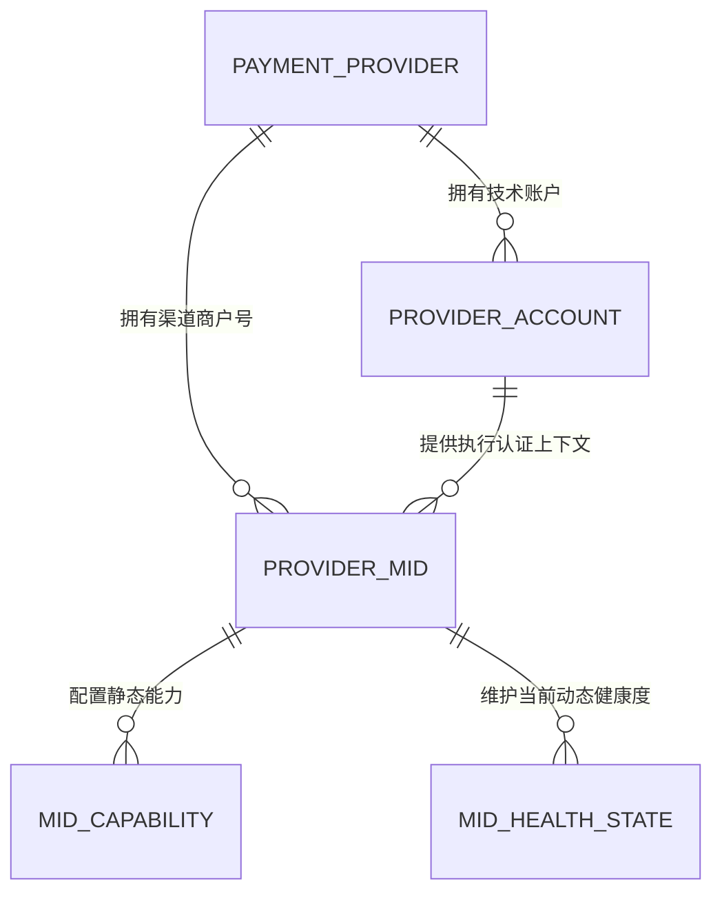

# Payment Provider Account 与 MID 精简设计

> **已被后续决策取代：** 本文中的旧 31 表/399 字段与后续 29 表/382 字段基线、`t_payment_execution_gate`/`t_payment_execution_gate_result` 持久化设计、`t_three_ds_context` 和 `provider_token_ref` 均已取消。当前权威依据为 [Payment Execution 精简设计](./2026-08-25-payment-execution-simplification-design.md)、[`PAYMENT_ORCHESTRATION_DATABASE.md`](../database/PAYMENT_ORCHESTRATION_DATABASE.md) 与 [`PAYMENT_ORCHESTRATION_PHYSICAL_DECISIONS.md`](../../payment-orchestration-service/docs/database/PAYMENT_ORCHESTRATION_PHYSICAL_DECISIONS.md)，当前基线为 29 表/376 字段/63 关系。本文仅对 Provider Account/MID 对应五表模型的历史决策仍有参考意义，其余内容仅供历史追溯。

最后更新：2026-08-25  
状态：已确认并落模；本设计覆盖《Payment Orchestration 平衡型物理模型设计》中 Provider/MID、连接版本、MID 凭据、MID 限额和动态健康度相关内容

## 1. 目标与范围

本设计把 Payment 的 Provider/MID 配置从 8 张表精简为 5 张表，并明确区分五类事实：

1. `t_payment_provider`：支付渠道身份与 Adapter；
2. `t_provider_account`：调用渠道 API 时使用的技术账户；
3. `t_provider_mid`：归属于唯一 Operating Entity 的渠道商户号；
4. `t_mid_capability`：MID 的静态、可扩展路由能力；
5. `t_mid_health_state`：MID 的当前动态运行质量。

本轮删除：

- `t_provider_connection`；
- `t_provider_connection_version`；
- `t_mid_limit`；
- `t_mid_credential_ref`；
- 原 `t_mid_health`，由 `t_mid_health_state` 替代。

Payment 总表数由 34 张收敛为 31 张；确定性工件精确包含 399 个字段、43 个唯一索引、48 个访问索引、70 条本库关系、8 条强制一对一关系和 7 个 Diagram Groups，并已通过自动验证。本轮仍只修改文档、测试、生成器和 PDManer 设计资产，不创建 Migration、Java 模块、物理数据库、运行环境或真实渠道配置。

## 2. 核心关系



关系语义固定为：

- 一个 Provider 可以有多个 Provider Account；
- 一个 Provider 可以有多个 MID；
- 一个 Provider Account 可以服务多个 MID；
- 一个 MID 当前只绑定一个 Provider Account；
- 一个 MID 只属于一个 Operating Entity；
- 同一个 Provider Account 不能跨 Provider 绑定 MID；
- 一个 MID 对每个支付方式最多保留一条当前 Health State，但可以拥有多条不同 Scope/Capability Code 的静态能力。

`t_provider_mid.provider_id` 虽然可以通过 Provider Account 推导，仍作为有意的业务冗余保留，用于直接表达 MID 的渠道归属、按 Provider 快速停用/筛选、约束 Provider 内外部 MID 号唯一和简化 Adapter 路由。创建或调整 MID 时必须验证 `provider_mid.provider_id = provider_account.provider_id`。PDManer 当前关系节点只表达单列关系，因此模型建立 MID→Provider 和 MID→Provider Account 两条关系，并在 Provider Account 上保留 `(provider_account_id, provider_id)` 唯一键；未来获得 Migration 授权时使用组合外键或等价事务约束落实该一致性。

## 3. 五张表

### 3.1 `t_payment_provider`

保持现有职责和字段：

```text
provider_id
provider_code
provider_name
adapter_code
provider_status
create_time
update_time
```

`provider_status` 允许值：`DRAFT、ACTIVE、SUSPENDED、CLOSED`。`provider_code` 创建后不可修改，`CLOSED` 不恢复。`uk_payment_provider_code(provider_code)` 保持唯一。

### 3.2 `t_provider_account`

Provider Account 表示 Payment Adapter 的技术认证账户或租户，不表示 MID，也不表示 Finance 的清算账户。

```text
provider_account_id
provider_id
account_code
external_account_id
integration_config_key
account_status
create_time
update_time
```

字段语义：

- `account_code`：Payment 内稳定、可读的技术账户代码；
- `external_account_id`：Provider 返回的账户/租户标识；Provider 不提供时允许为空；
- `integration_config_key`：Adapter 解析运行配置的非敏感定位键，不是 Endpoint、Secret、证书或 KMS/Secrets Manager 引用本身；
- `account_status`：允许值 `DRAFT、ACTIVE、SUSPENDED、CLOSED`。

约束与索引：

```text
uk_provider_account_code(provider_id, account_code)
uk_provider_account_external(provider_id, external_account_id)
uk_provider_account_config(provider_id, integration_config_key)
uk_provider_account_owner(provider_account_id, provider_id)
idx_provider_account_status(provider_id, account_status)
```

MySQL 对唯一索引中的 `NULL` 允许多行，因此多个不提供 `external_account_id` 的账户不会互相冲突。`account_code` 创建后不可修改；账户停用使用 Expected Current Status 条件更新，不增加机械 `version`。

### 3.3 `t_provider_mid`

```text
mid_id
provider_id
provider_account_id
external_mid_code
operating_entity_id
mid_status
activated_at
closed_at
create_time
update_time
```

约束与索引：

```text
uk_provider_mid(provider_id, external_mid_code)
idx_provider_mid_account(provider_account_id, mid_status)
idx_provider_mid_entity(operating_entity_id, mid_status)
```

`mid_status` 允许值：`DRAFT、ACTIVE、SUSPENDED、CLOSED`。`operating_entity_id` 创建后不可变；归属错误关闭旧 MID 并新建。`provider_account_id` 是当前执行账户，可以在 MID 非活动状态下通过受控配置命令调整；历史 Action 已冻结自己的 Provider Account，不随当前绑定漂移。

### 3.4 `t_mid_capability`

MID Capability 使用“固定路由 Scope + 有类型的 Key-Value”，避免无 Scope EAV 把 VISA、USD、MCC 或国家条件错误组合，同时避免每扩展一种能力都新增物理列。

```text
mid_capability_id
mid_id
payment_method_code
scheme_code
country_code
currency
mcc_code
capability_code
value_type
boolean_value
decimal_value
integer_value
code_value
capability_status
create_time
update_time
```

字段规则：

- Scope 五列全部非空；`payment_method_code` 必须使用精确目录值，`scheme_code/country_code/currency/mcc_code` 可使用精确目录值或控制通配符 `*`；
- `capability_code` 来自 MID Capability Catalog，是开放代码；
- `value_type` 允许值：`BOOLEAN、DECIMAL、INTEGER、CODE`；
- 每行必须且只能填写与 `value_type` 对应的一个值列；
- `boolean_value` 只允许 `0/1`；
- `capability_status` 允许值：`ENABLED、DISABLED`；
- 不保存 Hash、Version、有效期或 JSON。

唯一约束：

```text
uk_mid_capability_scope(
  mid_id,
  payment_method_code,
  scheme_code,
  country_code,
  currency,
  mcc_code,
  capability_code
)
```

首批目录示例：

| Capability Code | Value Type | 示例值 | 用途 |
|---|---|---:|---|
| `ACTION.SALE` | BOOLEAN | 1 | 是否支持直接扣款 |
| `ACTION.AUTHORIZE` | BOOLEAN | 1 | 是否支持授权 |
| `ACTION.CAPTURE` | BOOLEAN | 1 | 是否支持捕获 |
| `ACTION.VOID` | BOOLEAN | 1 | 是否支持撤销 |
| `ACTION.REFUND` | BOOLEAN | 1 | 是否支持退款 |
| `SECURITY.3DS_MODE` | CODE | `SUPPORTED` | 3DS 支持模式 |
| `AMOUNT.MIN` | DECIMAL | 1.00000000 | 单笔技术最小金额 |
| `AMOUNT.MAX` | DECIMAL | 5000.00000000 | 单笔技术最大金额 |

`t_mid_limit` 的职责由 `AMOUNT.MIN/AMOUNT.MAX` 接管。配置发布必须验证同一生效 Scope 的最小金额不大于最大金额。未来多 Capture 可新增 `CAPTURE.MULTIPLE=1`、`CAPTURE.MAX_COUNT=5`，无需改表。

对每个必需 `capability_code`，路由器从所有匹配交易维度的 ENABLED 行中选择最高 Scope 精确度；同一 Code 出现两个相同精确度但不可唯一决胜的匹配行时视为配置冲突并失败关闭。必需能力缺失也失败关闭。运行时应读取已校验并编译的缓存配置，不在每笔支付中执行大量 EAV JOIN。

### 3.5 `t_mid_health_state`

本表只保存路由需要的当前短窗口聚合结论，不保存每次请求的原始指标或时序历史。

```text
mid_health_state_id
mid_id
payment_method_code
health_status
circuit_status
health_score
sample_count
technical_success_count
provider_error_count
timeout_count
technical_success_rate
provider_error_rate
timeout_rate
p95_latency_ms
consecutive_failure_count
window_started_at
window_ended_at
observed_at
valid_until
create_time
update_time
```

约束：

- `uk_mid_health_state(mid_id, payment_method_code)`；
- `health_status` 允许值：`HEALTHY、DEGRADED、UNHEALTHY、UNKNOWN`；
- `circuit_status` 允许值：`CLOSED、OPEN、HALF_OPEN`；
- `health_score` 范围为 `0..100`；
- 三个 Rate 范围为 `0..1`，计数和延迟均不得为负；
- `sample_count = technical_success_count + provider_error_count + timeout_count`；
- `window_started_at < window_ended_at <= observed_at < valid_until`；
- 仅当新 `observed_at` 晚于当前值时允许覆盖，防止旧窗口回退。

`technical_success_count` 表示渠道在协议层完成响应的次数，包含支付获批和正常业务拒绝；Issuer/Consumer 的正常拒绝不计为渠道故障。原始 Metrics、Trace 和长周期分析数据由监控平台保存，熔断/健康阈值由运行配置管理，不进入本表。

## 4. 下游冻结字段

删除全部 `connection_version_id`、`selected_connection_version_id` 和 `mid_credential_ref_id`，并按下表替换：

| 表 | 新字段/变化 | 作用 |
|---|---|---|
| `t_routing_decision` | `selected_provider_account_id` | SELECTED 时冻结最终执行账户 |
| `t_route_candidate_eval` | `provider_account_id` | 记录候选 MID 对应账户；静态阶段已淘汰时可空 |
| `t_route_candidate_eval` | `circuit_status、health_score、technical_success_rate、timeout_rate、p95_latency_ms、sample_count、health_observed_at` | 冻结本次路由真正使用的动态健康证据 |
| `t_payment_action` | `provider_account_id` | 冻结该 Action 的执行账户，网络重试不得漂移 |
| `t_provider_callback` | `provider_account_id` | 在尚未映射到 MID/Action 时提供验签和归一化账户上下文 |
| `t_provider_dispute_action` | `provider_account_id` | 冻结举证/查询使用的执行账户 |

`t_route_candidate_eval` 已有的 `health_status` 继续保留。候选在 Provider/MID/Capability/Account 静态阶段已被淘汰时，健康快照字段允许为空；候选进入动态健康阶段后，所使用的指标必须完整冻结。当前 `t_mid_health_state` 会被覆盖，因此历史 Decision 不得反查当前状态来解释当时路由。

## 5. 路由顺序

每次 Attempt 的固定顺序为：

1. 只取得 Order 已冻结 Operating Entity 下的候选 MID；
2. 校验 Provider 和 MID 当前状态；
3. 按支付方式、Scheme、国家、币种、MCC、动作、3DS 和金额执行静态 Capability 过滤；
4. 从 MID 直接解析唯一 `provider_account_id`，校验 Account 为 ACTIVE 且运行配置可解析；
5. 使用未过期的 `t_mid_health_state` 做熔断、样本量和健康硬过滤；
6. 对剩余候选使用策略优先级、权重和 `health_score` 选择唯一 MID；
7. 在 Decision、Candidate 和首个资金 Action 中逐值冻结 Provider、Provider Account、MID；
8. Adapter 使用 Action 冻结的 Provider Account 执行，不重新选择账户。

Provider Account 的可用性属于静态执行门槛，不参与 Health Score。动态健康只比较已通过静态能力和账户可用性校验的 MID。

## 6. 配置与凭据边界

Payment 数据库不再保存 Endpoint、超时、Credential Secret Ref、Webhook Secret Ref 或其业务版本。`integration_config_key` 只定位 Adapter 当前运行配置；真实 Secret、证书、Endpoint、超时、轮换版本和 Webhook 验签密钥集合由 Nacos/环境配置与云 Secrets Manager/KMS 管理。

固定取舍：

- Action 以 `provider_account_id + provider_idempotency_key + Provider Transaction Ref` 保留业务执行身份；同一 Action 重试复用这些字段；
- Secret 轮换不创建 Payment 业务版本表；Adapter 通过稳定配置键读取当前可用 Secret；
- Callback 以 `provider_account_id` 选择当前加轮换宽限期内的验签密钥集合；事件编号或载荷指纹在 `provider_id + provider_account_id` 作用域内去重，不在 Payment 表记录“曾使用哪一个 Secret Version”；
- 若未来某 Provider 明确要求精确历史 Endpoint/Secret 版本才能重放或审计，再基于真实用例新增专项配置版本，不在 V1 预建；
- Payment `t_provider_account` 与 Finance 的 `provider_account` 含义不同、ID 不共享、无跨库外键：前者是渠道技术账户，后者是清算/应收账户。

## 7. 现实映射

Stripe Connect 共享平台账户示例：

```text
Provider: STRIPE
Provider Account: STRIPE_CONNECT_PLATFORM_AE
  integration_config_key = payment.stripe.connect.ae

MID A: external_mid_code=acct_oe_a, operating_entity_id=50001
MID B: external_mid_code=acct_oe_b, operating_entity_id=50002
MID C: external_mid_code=acct_oe_c, operating_entity_id=50003
```

三个 MID 可以共用一个 Provider Account；Adapter 使用同一平台认证配置并以 MID 的外部账户号选择目标 Connected Account。

独立密钥示例：如果三个 Operating Entity 在某 Provider 各自拥有独立 API Credential，则创建三个 Provider Account，每个 MID 分别绑定自己的 Account。模型关系不变，不需要恢复 Connection 或 Credential Ref 表。

## 8. 删除影响与兼容边界

- 删除 Connection/Version：不再在业务库保存技术配置历史，换取更小的模型和统一运行配置管理；
- 删除 MID Credential Ref：凭据归 Provider Account 配置，不在 MID 下维护第二套 Secret 生命周期；
- 合并 MID Limit：金额能力与其他静态能力使用同一 Scope 和发布校验；
- 扩展 Health State：从单一结论升级为可解释的当前动态指标，但不把原始监控时序搬入 MySQL；
- 保留 Provider→MID 直接关系：便于业务归属、唯一约束和路由查询；
- 保留 Candidate 健康快照：当前 Health State 会覆盖，只有不可变 Candidate 才能解释历史决策。

本设计不改变 Operating Entity 在 Order 创建前由 CCT/Commerce 冻结、Payment Attempt 不得切换 Operating Entity、同一 Intent 最多一笔业务成功、退款必须走原 Provider/MID/原交易引用等现有不变量。
