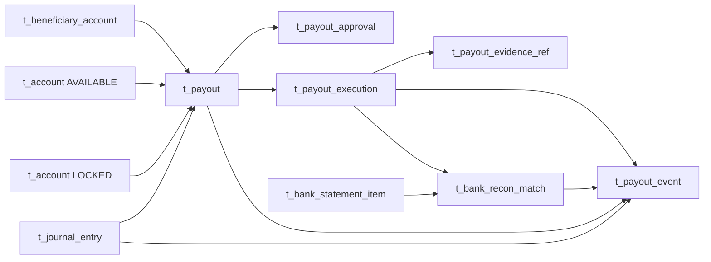

# Finance Manual Payout Simplification Implementation Plan

> **For agentic workers:** REQUIRED SUB-SKILL: Use superpowers:subagent-driven-development (recommended) or superpowers:executing-plans to implement this plan task-by-task. Steps use checkbox (`- [ ]`) syntax for tracking.

**Goal:** Replace the 20-table scheduled Settlement/Obligation model with a seven-table, user-initiated manual Payout model while preserving shared Client/Local Partner T+N balance maturity, immutable Journal accounting, Risk fail-closed checks, and final Bank Statement confirmation.

**Architecture:** `t_account + Journal` remains the only source of accounting truth: Payment first credits Client and Local Partner `PENDING`, one Economics-level maturity transaction moves both to `AVAILABLE`, Payout creation locks the Owner liability, and confirmed bank debit reconciliation clears `LOCKED` against `BANK_CASH`. Finance stores one immutable approved Risk result snapshot directly on Payout and on every Execution using `assessment_id + evaluation_id`; it does not add a Risk Result root, Settlement Obligation, Candidate, Funding, Availability, Balance Lot, Reserve Case, or Recovery workflow. One compact Manual Payout diagram replaces the two current Settlement diagrams.

**Tech Stack:** Node.js ESM manifests and deterministic generator, `node:test`, PDManer 4.9.3 JSON, Markdown/Mermaid authority documents, TypeScript requirements catalog.

**Spec:** `agent-docs/plans/2026-08-28-finance-manual-payout-simplification-design.md`

## Global Constraints

- The starting Finance model is exactly `97 tables / 1,211 fields / 166 unique indexes / 160 access indexes / 172 local relations / 28 one-to-one relations / 7 Diagram Groups`; Tax/Fiscal remains exactly 23 primary tables.
- The target contains exactly 84 tables and exactly seven Manual Payout tables: `t_beneficiary_account`, `t_finance_restriction_proj`, `t_payout`, `t_payout_approval`, `t_payout_execution`, `t_payout_evidence_ref`, and `t_payout_event`.
- Delete all 18 tables listed in the approved design; do not restore automatic Settlement Run/Candidate/Profile/Obligation/Payment layers.
- Preserve the Client Agreement-OE `T+N`, calendar, timezone, Cutoff, and `FOLLOWING` maturity concept. Rename `client_available_time` to `balance_available_time`; both Client Principal and Local Partner Share use that same frozen time.
- Local Partner Account buckets become `PENDING/AVAILABLE/LOCKED`; Partner recovery uses `PARTNER_RECOVERY_RECEIVABLE/NONE` Account plus immutable Journals and no workflow table.
- External fee `ADDED_ON_TOP`: request 100, fee 2, Owner debit/cash 102, beneficiary 100. Internal fee `DEDUCTED_FROM_PAYOUT`: request 100, fee 2, Owner debit/cash 100, beneficiary 98.
- Client/Local Partner always bears the fee under the approved agent/advance-payment policy. Do not create platform fee revenue or expense unless a later contract/accounting review changes that policy.
- Payout and each Execution freeze the full successful RCO-I09 result plus `assessment_id + evaluation_id`; Finance `eligibility_hash` is local evidence and never replaces Risk `input_hash/control_set_hash` or a fresh Evaluation.
- Operations must create a `CREATED` Execution and reserve derived `BANK_CASH` capacity before external submission. `UNKNOWN` reserves capacity and blocks retry/cancel.
- Receipt upload never means paid. Only complete `CONFIRMED` Bank Statement debit matching and any separately resolved fee difference may move Payout to `PAID`.
- Preserve Provider reconciliation, Tax Payment, Client Security Deposit, Client Recovery, Finance Entity dual-ledger, Trial Balance, and Close semantics outside the explicitly listed changes.
- Do not create Java, Migration, a physical database, runtime infrastructure, deployment assets, a branch, or a Git commit.
- Preserve the intentionally dirty worktree and all unrelated concurrent changes; use `apply_patch`, never whole-file checkout/revert.
- Until Risk sends `Risk 专属实施完成；共享仍冻结` with final statistics, do not write the twelve frozen shared/requirements paths listed in Task 8.

---

## File Map

### Finance executable model and tests

- Create `scripts/pdmaner/finance-manual-payout-simplification.test.mjs`: focused RED/GREEN contract for table deletion, seven-table shape, amount formulas, Risk snapshots, event scope, maturity rename, Account buckets, and Bank Match target.
- Modify `scripts/pdmaner/finance/manifests/01-accounting-foundation.mjs`: clarify Partner PENDING and `PARTNER_RECOVERY_RECEIVABLE` Account semantics.
- Modify `scripts/pdmaner/finance/manifests/02-tax-economics-cost.mjs`: rename the frozen maturity field/index and generalize its comments.
- Modify `scripts/pdmaner/finance/manifests/05-provider-cash-recon.mjs`: rename cash purpose/Bank Match target and add Payout debit component classification.
- Create `scripts/pdmaner/finance/manifests/06-payout.mjs` and delete `scripts/pdmaner/finance/manifests/06-settlement.mjs`: define only the seven approved tables under current terminology.
- Modify `scripts/pdmaner/finance/manifest.mjs`: import/export the new module as `PAYOUT_TABLES`, removing the stale `SETTLEMENT_TABLES` alias.
- Modify `scripts/pdmaner/finance/model-policy.mjs`: replace Settlement CHECKs/bindings/diagram/file tuples with Manual Payout contracts.
- Modify `scripts/pdmaner/finance/generate-finance-model.mjs`: replace the hard-coded 97-table Manifest gate with the approved 84-table gate.
- Modify `scripts/pdmaner/finance-test-oracle/schema.oracle.mjs`: independently freeze the exact generated structure, totals, paths, CHECKs, and digests.
- Modify `scripts/pdmaner/finance-model.test.mjs`: replace old Settlement assertions with Manual Payout invariants and stale-token bans.
- Modify `scripts/pdmaner/finance-scenario-doc.test.mjs`: require the approved real-world maturity, payout, fee, retry, reconciliation, and Partner recovery scenarios.
- Regenerate `finance-service/docs/database/finance.pdma.json`: deterministic PDManer model.

### Finance authority documents

- Modify `agent-docs/database/FINANCE_DATABASE.md`: authoritative logical relationships, states, journals, events, interfaces, and invariants.
- Modify `agent-docs/database/scenarios/FINANCE_REAL_WORLD_SCENARIOS.md`: every-table examples plus external/internal fee and failure/reconciliation examples.
- Modify `finance-service/docs/database/FINANCE_PHYSICAL_DECISIONS.md`: exact physical inventory, constraints, statistics, hashes, and manual PDManer gate.

### Deferred shared integration after Risk handoff

- Modify Finance-only portions of `AGENTS.md`, `README.md`, `agent-docs/README.md`, `agent-docs/PROJECT_CONTEXT.md`, `agent-docs/DATABASE_DESIGN_GUIDE.md`, and `agent-docs/database/README.md`.
- Modify `requirements-site/content/requirements.ts`, `requirements-site/content/global-use-case-sequences.mjs`, `requirements-site/components/architecture-diagrams.tsx`, `requirements-site/tests/domain-decisions.test.mjs`, `requirements-site/tests/global-use-case-sequences.test.mjs`, and `requirements-site/tests/site-content.test.mjs`.

---

### Task 1: Freeze the approved simplification with one focused failing contract

**Files:**
- Create: `scripts/pdmaner/finance-manual-payout-simplification.test.mjs`
- Read: `agent-docs/plans/2026-08-28-finance-manual-payout-simplification-design.md`

**Interfaces:**
- Consumes: aggregate `TABLES` from `scripts/pdmaner/finance/manifest.mjs` and `CHECK_CONTRACTS/CHECK_BINDINGS/DIAGRAM_GROUPS` from `model-policy.mjs`.
- Produces: an executable contract used by Tasks 2-5; it must remain independent of the generated PDManer JSON and independent Oracle.

- [ ] **Step 1: Create helpers and exact table-deletion assertions**

```js
import assert from "node:assert/strict";
import test from "node:test";

import { TABLES } from "./finance/manifest.mjs";
import { CHECK_BINDINGS, CHECK_CONTRACTS, DIAGRAM_GROUPS } from "./finance/model-policy.mjs";

const byKey = (tables) => new Map(tables.map((table) => [table.defKey, table]));
const fieldKeys = (table) => table.fields.map((field) => field.defKey);

const expectedPayoutTables = [
  "beneficiary_account", "finance_restriction_proj", "payout", "payout_approval",
  "payout_execution", "payout_evidence_ref", "payout_event",
];

test("Finance manual payout simplification has exactly 84 tables and seven payout tables", () => {
  assert.equal(TABLES.length, 84);
  assert.deepEqual(
    TABLES.filter((table) => expectedPayoutTables.includes(table.defKey)).map((table) => table.defKey),
    expectedPayoutTables,
  );
  const tables = byKey(TABLES);
  for (const removed of [
    "beneficiary_account_ver", "settlement_profile", "settlement_profile_ver", "profile_review",
    "payout_request", "settlement_run", "settlement_candidate", "candidate_requirement_snapshot",
    "settlement", "settlement_req_snapshot", "settlement_approval", "settlement_cancel",
    "settlement_cancel_approval", "settlement_state_change", "settlement_payment",
    "settlement_payment_attempt", "settlement_payment_event", "settlement_evidence_ref",
  ]) assert.ok(!tables.has(removed), `restored removed table ${removed}`);
});
```

- [ ] **Step 2: Add exact field, relation, CHECK, and diagram assertions**

```js
test("Finance payout freezes approved owner, fee, Risk and accounting coordinates", () => {
  const tables = byKey(TABLES);
  for (const key of [
    "owner_type", "owner_id", "operating_entity_id", "currency", "beneficiary_account_id",
    "beneficiary_content_hash", "available_account_id", "locked_account_id", "requested_amount",
    "fee_mode", "fee_amount", "owner_debit_amount", "beneficiary_amount", "cash_required_amount",
    "assessment_id", "evaluation_id", "eligibility_decision", "eligibility_reason_codes",
    "eligibility_matched_controls", "risk_required_amount", "risk_required_currency",
    "control_set_hash", "eligibility_hash", "request_hash", "approval_hash", "journal_entry_id",
    "reconciled_time", "status", "version",
  ]) assert.ok(fieldKeys(tables.get("payout")).includes(key), `missing payout.${key}`);

  assert.ok(fieldKeys(tables.get("payout_execution")).includes("active_slot"));
  assert.ok(fieldKeys(tables.get("payout_event")).includes("payout_version_after"));
  assert.ok(fieldKeys(tables.get("payout_event")).includes("execution_version_after"));
  assert.match(CHECK_CONTRACTS.ck_payout_amounts, /ADDED_ON_TOP.*DEDUCTED_FROM_PAYOUT/u);
  assert.match(CHECK_CONTRACTS.ck_payout_event_scope, /event_scope='PAYOUT'.*event_scope='EXECUTION'/u);
  assert.deepEqual(CHECK_BINDINGS.ck_payout_amounts, ["payout"]);
  assert.deepEqual(
    DIAGRAM_GROUPS.find((group) => group.defKey === "manual_payout")?.primary,
    expectedPayoutTables,
  );
  assert.equal(DIAGRAM_GROUPS.length, 6);
});
```

- [ ] **Step 3: Add maturity, Partner recovery, and Bank Match boundary assertions**

```js
test("Finance shares maturity and reconciles payout execution to bank debits", () => {
  const tables = byKey(TABLES);
  const economicsFields = fieldKeys(tables.get("transaction_economics"));
  assert.ok(economicsFields.includes("balance_available_time"));
  assert.ok(!economicsFields.includes("client_available_time"));
  assert.match(CHECK_CONTRACTS.ck_account_owner_bucket, /LOCAL_PARTNER.*PENDING.*AVAILABLE.*LOCKED/u);

  const bankMatchFields = fieldKeys(tables.get("bank_recon_match"));
  assert.ok(bankMatchFields.includes("payout_execution_id"));
  assert.ok(bankMatchFields.includes("payout_component_type"));
  assert.ok(!bankMatchFields.includes("settlement_payment_attempt_id"));
  assert.match(CHECK_CONTRACTS.ck_bank_recon_match_target, /PAYOUT_DEBIT.*payout_execution_id/u);
  assert.match(CHECK_CONTRACTS.ck_bank_recon_payout_component, /BENEFICIARY_TRANSFER.*BANK_FEE.*COMBINED/u);
});
```

- [ ] **Step 4: Run the focused test and confirm RED for the intended old model**

Run: `node --test scripts/pdmaner/finance-manual-payout-simplification.test.mjs`

Expected: FAIL because the current model has 97 tables, 20 Settlement tables, `client_available_time`, and `settlement_payment_attempt_id`.

- [ ] **Step 5: Review the failure list**

Confirm every failure maps to the approved design; remove any assertion that demands a new business fact not present in the spec.

---

### Task 2: Generalize maturity and Account semantics for Client and Local Partner

**Files:**
- Modify: `scripts/pdmaner/finance/manifests/01-accounting-foundation.mjs`
- Modify: `scripts/pdmaner/finance/manifests/02-tax-economics-cost.mjs`
- Modify: `scripts/pdmaner/finance/model-policy.mjs`
- Test: `scripts/pdmaner/finance-manual-payout-simplification.test.mjs`

**Interfaces:**
- Consumes: existing `t_account`, `t_transaction_economics`, `field`, `accessIndex`, and CHECK policy structures.
- Produces: `t_transaction_economics.balance_available_time` and CHECK names `ck_txn_economics_type`, `ck_txn_economics_maturity_time`, and `ck_account_owner_bucket` with shared Owner semantics.

- [ ] **Step 1: Rename the Economics maturity field and index**

Change the PAYMENT-only field to:

```js
field(
  "balance_available_time",
  types.dateTime,
  "N",
  "余额可用时间",
  "仅 PAYMENT 结果按精确 CLIENT Agreement-OE 工作日数、日历、时区和 Cutoff 计算并冻结的 UTC 微秒到期时间；同时控制 Client Principal 与 Local Partner Share 从 PENDING 成熟到 AVAILABLE，Provider 实际结算不改变该值",
)
```

Rename the access index to `idx_econ_balance_available(economics_type,balance_available_time)` and replace every active Manifest/Policy occurrence of `client_available_time`.

- [ ] **Step 2: Change the exact maturity CHECKs**

Use `balance_available_time` in every branch of `ck_txn_economics_type`, and set:

```js
ck_txn_economics_maturity_time:
  "balance_available_time IS NULL OR balance_available_time>=payment_succeeded_time"
```

- [ ] **Step 3: Permit Partner PENDING and clarify Partner recovery accounting**

Set the exact Owner/Bucket CHECK to:

```sql
(owner_type='CLIENT' AND balance_bucket IN ('PENDING','AVAILABLE','LOCKED','NONE'))
OR (owner_type='LOCAL_PARTNER' AND balance_bucket IN ('PENDING','AVAILABLE','LOCKED'))
OR (owner_type IN ('OPERATING_ENTITY','FINANCE_ENTITY','PROVIDER_ACCOUNT','CASH_ACCOUNT','TAX_AUTHORITY')
    AND balance_bucket='NONE')
```

Update `t_account` comments to name `PARTNER_RECOVERY_RECEIVABLE/NONE` as an asset Account used only when a Partner reversal cannot be absorbed by PENDING/AVAILABLE/LOCKED liability.

- [ ] **Step 4: Run the focused maturity assertions**

Run: `node --test --test-name-pattern='shares maturity' scripts/pdmaner/finance-manual-payout-simplification.test.mjs`

Expected: the maturity/Owner assertions PASS; the overall contract remains RED because the seven payout tables and Bank Match changes are not implemented yet.

---

### Task 3: Replace the 20-table Settlement manifest with the seven-table Manual Payout model

**Files:**
- Create: `scripts/pdmaner/finance/manifests/06-payout.mjs`
- Delete: `scripts/pdmaner/finance/manifests/06-settlement.mjs`
- Modify: `scripts/pdmaner/finance/manifest.mjs`
- Modify: `scripts/pdmaner/finance/model-policy.mjs`
- Test: `scripts/pdmaner/finance-manual-payout-simplification.test.mjs`

**Interfaces:**
- Consumes: `defineTable`, `field`, `primaryKey`, `uniqueIndex`, `accessIndex`, `relation`, and shared scalar types from `schema-dsl.mjs`.
- Produces: exactly seven table definitions and payout CHECK/file-reference/diagram contracts consumed by the generator and Oracle.

- [ ] **Step 1: Switch the aggregate Manifest to current terminology**

Create `06-payout.mjs`, change `manifest.mjs` to `import { TABLES as PAYOUT_TABLES } from "./manifests/06-payout.mjs"`, spread `...PAYOUT_TABLES` in the same position, and delete `06-settlement.mjs` only after the aggregate Manifest imports the new module and the focused test starts without a module-resolution error.

- [ ] **Step 2: Define one-table Beneficiary lifecycle**

Keep one mutable root whose bank/Vault identity freezes after submission. Use these business fields in order after `id`:

```text
owner_type, owner_id, account_code,
beneficiary_vault_token, beneficiary_name_masked, bank_country, currency,
bank_account_blind_index, bank_account_blind_key_ver, account_last4,
vault_record_version, vault_metadata_hash, bank_code,
content_hash, maker_id, checker_id, checker_decision, decision_time,
status, version
```

Use `uk_beneficiary_acct(owner_type,owner_id,account_code)`, `idx_beneficiary_owner(owner_type,owner_id,status)`, and `idx_beneficiary_blind(bank_account_blind_key_ver,bank_account_blind_index)`. Do not keep `current_ver_id` or any relation to `beneficiary_account_ver`.

Bind this lifecycle CHECK:

```sql
(status='DRAFT' AND content_hash IS NULL AND checker_id IS NULL
 AND checker_decision IS NULL AND decision_time IS NULL)
OR (status='PENDING_REVIEW' AND content_hash IS NOT NULL AND checker_id IS NULL
    AND checker_decision IS NULL AND decision_time IS NULL)
OR (status='VERIFIED' AND content_hash IS NOT NULL AND checker_id IS NOT NULL
    AND checker_id<>maker_id AND checker_decision='APPROVED' AND decision_time IS NOT NULL)
OR (status='REJECTED' AND content_hash IS NOT NULL AND checker_id IS NOT NULL
    AND checker_id<>maker_id AND checker_decision='REJECTED' AND decision_time IS NOT NULL)
OR (status IN ('SUSPENDED','CLOSED') AND content_hash IS NOT NULL AND checker_id IS NOT NULL
    AND checker_id<>maker_id AND checker_decision='APPROVED' AND decision_time IS NOT NULL)
```

- [ ] **Step 3: Retain only the current Finance restriction projection**

Keep the existing `t_finance_restriction_proj` fields/indexes unchanged. Rewrite comments from generic Settlement wording to current Payout restriction projection wording; it remains a mutable source-version projection and never freezes money.

- [ ] **Step 4: Define `t_payout` as the single request/lock/approval/payment root**

Use these business fields in order after `id`:

```text
payout_no, request_key,
owner_type, owner_id, operating_entity_id, currency,
beneficiary_account_id, beneficiary_content_hash,
available_account_id, locked_account_id,
requested_amount, fee_mode, fee_amount,
owner_debit_amount, beneficiary_amount, cash_required_amount,
assessment_id, evaluation_id, eligibility_decision,
eligibility_reason_codes, eligibility_matched_controls,
risk_required_amount, risk_required_currency, control_set_hash, eligibility_hash,
request_hash, approval_hash, approved_time,
journal_entry_id, reconciled_time,
status, version
```

`eligibility_reason_codes` and `eligibility_matched_controls` are JSON arrays used as immutable evidence, not query/config blobs. `assessment_id/evaluation_id` are external stable IDs with no cross-database relation. Add relations to Beneficiary, AVAILABLE Account, LOCKED Account, and final Journal; make only `journal_entry_id -> journal_entry` one-to-one.

Use these indexes:

```text
uk_payout_no(payout_no)
uk_payout_request(owner_type,owner_id,request_key)
uk_payout_journal(journal_entry_id)
idx_payout_owner(owner_type,owner_id,currency,status)
idx_payout_oe(operating_entity_id,currency,status)
idx_payout_beneficiary(beneficiary_account_id,status)
idx_payout_available(available_account_id,status)
idx_payout_locked(locked_account_id,status)
```

- [ ] **Step 5: Bind exact Payout amount and Risk snapshot CHECKs**

Use this amount expression:

```sql
requested_amount>0 AND fee_amount>=0 AND owner_debit_amount>0
AND beneficiary_amount>0 AND cash_required_amount=owner_debit_amount
AND beneficiary_amount+fee_amount=owner_debit_amount
AND (
  (fee_mode='ADDED_ON_TOP'
   AND owner_debit_amount=requested_amount+fee_amount
   AND beneficiary_amount=requested_amount)
  OR
  (fee_mode='DEDUCTED_FROM_PAYOUT'
   AND requested_amount>fee_amount
   AND owner_debit_amount=requested_amount
   AND beneficiary_amount=requested_amount-fee_amount)
)
```

Use an all-null/all-frozen Risk snapshot matrix. A frozen snapshot requires `assessment_id`, `evaluation_id`, `eligibility_decision='ALLOW'`, both JSON arrays, `control_set_hash`, and Finance `eligibility_hash`; Client additionally requires `risk_required_amount>=0` and `risk_required_currency=currency`, while Local Partner requires both requirement fields null. Require `approval_hash` and `approved_time` to be both null or both non-null, and only allow the non-null pair when a complete successful snapshot exists.

Require `journal_entry_id/reconciled_time` both non-null exactly for `status='PAID'`; all other statuses keep both null. Allowed Payout states are exactly `PENDING_APPROVAL/APPROVED/ON_HOLD/PAYING/PAYMENT_UNKNOWN/RETRY_REQUIRED/PAID/REJECTED/CANCELLED`.

- [ ] **Step 6: Define immutable Payout approvals**

Use fields `id,payout_id,action_type,action_no,approval_role,actor_id,decision,requested_from_status,reason_code,evidence_ref_id,approved_content_hash,decision_time`. Allowed action types are `PAYOUT_APPROVAL/PAYOUT_CANCEL`, roles are `MAKER/CHECKER`, and decisions are `APPROVED/REJECTED`. Each immutable row freezes the action's starting Payout status, controlled reason, optional no-debit Evidence, and reviewed Canonical Hash; the Maker and Checker rows for one action must repeat the same action inputs and content hash. Use:

```text
uk_payout_approval(payout_id,action_type,action_no,approval_role)
idx_payout_approval_evidence(evidence_ref_id)
idx_payout_approval_actor(actor_id,decision_time)
```

Bind the action shape as follows: `PAYOUT_APPROVAL` requires `action_no=1`, `requested_from_status='PENDING_APPROVAL'`, and null Evidence; `PAYOUT_CANCEL` requires `action_no>0` and `requested_from_status IN ('APPROVED','ON_HOLD','RETRY_REQUIRED')`. Require `reason_code` for every Cancel and every REJECTED decision. Relate `evidence_ref_id` to `payout_evidence_ref.id`. Maker/Checker inequality, identical action inputs, and identical reviewed hash are same-transaction cross-row gates documented in table comments and tested in scenarios; do not duplicate Maker/Checker columns on `t_payout`. The cancellation Canonical Hash covers `payout_id/action_no/requested_from_status/reason_code/evidence_ref_id/locked_account_id/owner_debit_amount` so deleting the old Cancel root does not discard the release plan evidence.

- [ ] **Step 7: Define Payout Execution with pre-submission cash reservation**

Use fields:

```text
id, payout_id, attempt_no,
cash_account_binding_ver_id, cash_account_id,
execution_key, request_hash,
assessment_id, evaluation_id, eligibility_decision,
eligibility_reason_codes, eligibility_matched_controls,
risk_required_amount, risk_required_currency, control_set_hash, eligibility_hash,
bank_payment_ref, status, failure_code, active_slot,
submitted_time, resolved_time, version
```

Use `uk_payout_execution(payout_id,attempt_no)`, `uk_payout_execution_key(execution_key)`, `uk_payout_bank_ref(cash_account_id,bank_payment_ref)`, `uk_payout_active_execution(payout_id,active_slot)`, `idx_payout_execution_binding(cash_account_binding_ver_id)`, `idx_payout_execution_cash(cash_account_id,status)`, and `idx_payout_execution_status(status,create_time)`. Relate Payout, Cash Binding Version, and Cash Account.

Bind exact state rules: `CREATED/SUBMITTED/UNKNOWN` have `active_slot=1`; `ABORTED/FAILED/RECONCILED` have null. `CREATED` has no submit/resolve/failure; `SUBMITTED/UNKNOWN` have submit time but no resolve/failure; `ABORTED` has no submit time and has resolve time; `FAILED` has submit/resolve/failure; `RECONCILED` has submit/resolve and no failure. Every row contains one complete successful Risk snapshot; required amount/currency are both null or both non-null and the amount is non-negative.

- [ ] **Step 8: Define immutable Evidence and Event tables**

`t_payout_evidence_ref` fields are `id,payout_execution_id,file_id,file_content_hash,evidence_type`; allowed evidence types are exactly `PAYMENT_PROOF/NO_DEBIT_PROOF/BANK_CONFIRMATION/RECONCILIATION_SUPPORT`. Add unique `(payout_execution_id,file_id,evidence_type)` and file tuple access index.

`t_payout_event` fields are:

```text
id, payout_id, execution_id, event_scope, event_no,
from_status, to_status, reason_code, actor_id,
source_type, source_id, source_event_key,
approval_id, evidence_ref_id, bank_recon_match_id, journal_entry_id,
payout_version_after, execution_version_after, occurred_time
```

Use these exact indexes so every relation has a left-prefix access path:

```text
uk_payout_event_no(payout_id,event_no)
uk_payout_event_source(source_type,source_event_key)
idx_payout_event_execution(execution_id,event_no)
idx_payout_event_approval(approval_id)
idx_payout_event_evidence(evidence_ref_id)
idx_payout_event_bank_match(bank_recon_match_id)
idx_payout_event_journal(journal_entry_id)
idx_payout_event_actor(actor_id,occurred_time)
```

Bind:

```sql
(event_scope='PAYOUT' AND execution_id IS NULL AND execution_version_after IS NULL)
OR (event_scope='EXECUTION' AND execution_id IS NOT NULL AND execution_version_after IS NOT NULL)
```

Document that Root locking allocates consecutive `event_no`, and `payout_version_after/execution_version_after` must equal the versions produced in the same transaction.

- [ ] **Step 9: Replace Settlement diagrams and file tuples**

Delete `settlement_obligation` and `settlement_payment` groups. Add one group:

```js
Object.freeze({
  defKey: "manual_payout",
  defName: "手工出款与银行确认",
  primary: Object.freeze([
    "beneficiary_account", "finance_restriction_proj", "payout", "payout_approval",
    "payout_execution", "payout_evidence_ref", "payout_event",
  ]),
})
```

Replace old Settlement file tuples with `{ table: "payout_evidence_ref", id: "file_id", hash: "file_content_hash" }`.

- [ ] **Step 10: Run the focused payout contract**

Run: `node --test scripts/pdmaner/finance-manual-payout-simplification.test.mjs`

Expected: payout table/amount/Risk/event/diagram assertions PASS; Bank Match assertions remain RED until Task 4.

---

### Task 4: Connect Manual Payout to cash binding and Bank Statement reconciliation

**Files:**
- Modify: `scripts/pdmaner/finance/manifests/05-provider-cash-recon.mjs`
- Modify: `scripts/pdmaner/finance/model-policy.mjs`
- Test: `scripts/pdmaner/finance-manual-payout-simplification.test.mjs`

**Interfaces:**
- Consumes: `t_payout_execution`, existing Cash Account Binding, Bank Statement Item, Provider Batch, Tax Payment, Recon Exception, and Recon Resolution.
- Produces: `account_purpose=PAYOUT`, `match_type=PAYOUT_DEBIT`, nullable `payout_execution_id`, and conditional `payout_component_type`.

- [ ] **Step 1: Rename the cash purpose without changing Binding version history**

Change `t_cash_account_binding.account_purpose` values from `PROVIDER_SETTLEMENT/SETTLEMENT/TAX` to `PROVIDER_SETTLEMENT/PAYOUT/TAX`. Update Binding Version comments to say historical Payout use; do not add a new binding table or direct Account relation.

- [ ] **Step 2: Replace the Settlement Attempt bank target**

In `t_bank_recon_match`:

```text
match_type: PROVIDER_CREDIT | PROVIDER_DEBIT | PAYOUT_DEBIT | TAX_PAYMENT_DEBIT
payout_execution_id: nullable BIGINT relation to payout_execution.id
payout_component_type: nullable code BENEFICIARY_TRANSFER | BANK_FEE | COMBINED
```

Delete `settlement_payment_attempt_id`. Rename its UK to `uk_bank_recon_payout(payout_execution_id,bank_item_id,match_type)` and add `idx_bank_recon_payout(payout_execution_id,status)`. Keep Provider, Tax, Bank Item, and Binding indexes/relations unchanged.

- [ ] **Step 3: Bind exact target and component matrices**

Set the target CHECK to:

```sql
(match_type IN ('PROVIDER_CREDIT','PROVIDER_DEBIT')
 AND provider_batch_id IS NOT NULL AND payout_execution_id IS NULL AND tax_payment_id IS NULL)
OR (match_type='PAYOUT_DEBIT'
    AND provider_batch_id IS NULL AND payout_execution_id IS NOT NULL AND tax_payment_id IS NULL)
OR (match_type='TAX_PAYMENT_DEBIT'
    AND provider_batch_id IS NULL AND payout_execution_id IS NULL AND tax_payment_id IS NOT NULL)
```

Set the component CHECK to:

```sql
(match_type='PAYOUT_DEBIT'
 AND payout_component_type IN ('BENEFICIARY_TRANSFER','BANK_FEE','COMBINED'))
OR (match_type<>'PAYOUT_DEBIT' AND payout_component_type IS NULL)
```

The table comment must state that split Payout rows reconcile beneficiary and fee separately; a COMBINED debit needs the same Bank Payment Ref or authoritative evidence and cannot be inferred from an accidental equal sum.

Before a Match becomes `CONFIRMED`, the transaction must lock `t_bank_statement_item`, require the sum of all confirmed allocations not to exceed the Item amount, and require all confirmed allocations on that Item to use one compatible funding purpose and Cash Binding. This cross-row gate prevents the same Statement Item from being confirmed once for Provider and again for Payout/Tax while preserving legitimate amount allocation; do not pretend nullable per-target UKs alone enforce it.

- [ ] **Step 4: Preserve generic Recon Exception/Resolution and late-debit behavior**

Update active wording from Settlement Attempt to Payout Execution. Keep `FEE_DIFFERENCE`, `SHORT_AMOUNT`, `EXCESS_AMOUNT`, `LATE_DEBIT`, `applied_resolution_id`, and existing `RE_MATCH/ACCOUNTING_ADJUSTMENT/WRITE_OFF/ACCEPT_TIMING_DIFFERENCE`; do not add a Payout Adjustment table.

- [ ] **Step 5: Run the complete focused contract**

Run: `node --test scripts/pdmaner/finance-manual-payout-simplification.test.mjs`

Expected: PASS.

---

### Task 5: Regenerate PDManer and refresh the independent Finance Oracle

**Files:**
- Modify: `scripts/pdmaner/finance-test-oracle/schema.oracle.mjs`
- Modify: `scripts/pdmaner/finance-model.test.mjs`
- Modify: `scripts/pdmaner/finance/generate-finance-model.mjs`
- Regenerate: `finance-service/docs/database/finance.pdma.json`
- Test: `scripts/pdmaner/finance-model.test.mjs`

**Interfaces:**
- Consumes: all Finance manifests/policy from Tasks 2-4.
- Produces: deterministic 84-table PDManer bytes plus independent exact totals, diagrams, paths, CHECK bindings, model SHA-256, and structural SHA-256.

- [ ] **Step 1: Make the independent Oracle structurally expect the approved model**

Remove the 18 deleted table names and append the five new Payout table names after the two retained tables. Replace the two Settlement diagrams with `manual_payout: "手工出款与银行确认"`, making six Diagram Groups. Update version paths to keep Beneficiary/Payout/Execution mutable and Payout Approval/Evidence/Event immutable. Update hash paths, file tuples, active-slot paths, required fields, forbidden fields/tables, CHECK contracts, and CHECK bindings to exactly match Tasks 2-4.

- [ ] **Step 2: Change the generator's explicit approved-table gate**

In `validateManifest()`, change the exact `TABLES.length === 97` invariant to `TABLES.length === 84` and keep the separate invariant that the sum of Diagram Group primary tables equals `TABLES.length`. Do not weaken either check into “non-empty” or derive the approved count from the same Manifest being validated.

- [ ] **Step 3: Rewrite old Settlement model tests as Manual Payout tests**

Replace assertions for Profile/Candidate/Settlement/Payment with tests that verify:

```text
exactly 84 approved tables and seven Manual Payout tables
18 deleted tables and all old Settlement fields/tokens absent
single-table Beneficiary lifecycle and no current_ver_id
shared balance_available_time and Partner PENDING
external/internal fee formula CHECK
Payout/Execution Risk snapshot fields and no eligibility_result_id/result_version/result_hash
Execution active-slot and state matrix
Event Scope XOR, source idempotency, versions, and relation indexes
Bank Match payout target/component matrix
Payout Journal one-to-one relation and evidence file tuple
six diagrams with all relations drawn exactly once
```

Keep all unaffected Provider/Tax/Trial/Finance Entity/security-deposit tests intact.

- [ ] **Step 4: Run tests to confirm RED against the old generated JSON**

Run: `node --test scripts/pdmaner/finance-model.test.mjs`

Expected: FAIL because `finance.pdma.json` is stale and Oracle digests/totals still need the newly generated exact values.

- [ ] **Step 5: Regenerate the model and record exact totals**

Run: `node scripts/pdmaner/finance/generate-finance-model.mjs`

Expected: output begins `Wrote Finance model` and reports exactly `84 tables`; copy the emitted exact fields, unique indexes, access indexes, relations, one-to-one relations, and `6 diagram groups` into `EXPECTED_TOTALS`.

- [ ] **Step 6: Record the exact model digest**

Run: `shasum -a 256 finance-service/docs/database/finance.pdma.json`

Copy the 64-character result into `EXPECTED_MODEL_DIGEST`.

- [ ] **Step 7: Record the independent structural digest**

Run: `node --test --test-name-pattern='independent structural digest and totals' scripts/pdmaner/finance-model.test.mjs`

Expected on the first run: one assertion failure showing the actual 64-character structural digest. Copy that actual value into `EXPECTED_STRUCTURAL_DIGEST`, rerun the same command, and require PASS.

- [ ] **Step 8: Run focused and full Finance model gates**

Run:

```bash
node --test scripts/pdmaner/finance-manual-payout-simplification.test.mjs
node --test scripts/pdmaner/finance-model.test.mjs
node scripts/pdmaner/finance/generate-finance-model.mjs --check
```

Expected: all PASS and generator prints `Finance model is up to date` with the same Oracle totals.

---

### Task 6: Rewrite the Finance authority and relationship explanations

**Files:**
- Modify: `agent-docs/database/FINANCE_DATABASE.md`
- Modify: `finance-service/docs/database/FINANCE_PHYSICAL_DECISIONS.md`
- Test: `scripts/pdmaner/finance-model.test.mjs`

**Interfaces:**
- Consumes: exact generated schema/statistics/digests from Task 5 and the approved accounting/state semantics from the Spec.
- Produces: one authoritative logical relationship graph and one physical inventory that match the model byte-for-byte.

- [ ] **Step 1: Replace the Settlement table catalog with the exact seven-table catalog**

For each table, list its actual fields, UK/access indexes, mutability, relations, and CHECK/cross-row gates. Remove every active Profile, Run, Candidate, Obligation, Cancel root, Settlement Payment, and Settlement Attempt description.

- [ ] **Step 2: Replace the relationship graph**

Use this relationship core and add the existing Cash/Statement parents around it:



Explain in plain language: Account says how much is pending/available/locked; Payout says why that available balance is being paid; Execution says what Operations tried at the bank; Bank Match proves the debit; Journal alone changes the books.

- [ ] **Step 3: Rewrite maturity and Journal sections**

Use `PAYABLE_BALANCE_MATURED:<economics_id>` and `balance_available_time`; show Client and Partner PENDING-to-AVAILABLE in the same idempotent transaction. Document `PAYOUT_LOCK:<payout_id>`, `PAYOUT_RELEASE:<payout_id>`, `PAYOUT_PAID:<payout_id>`, and `PAYOUT_FEE_DIFF:<recon_exception_id>` with balanced entries.

State that `t_payout.journal_entry_id` identifies the normal/final Payout-clearing Journal only. Fee-difference releases/recoveries and late-debit suspense Journals remain discoverable through `t_payout_event` and the existing Recon Exception/Resolution accounting coordinates; do not add extra nullable Journal columns or a Payout Adjustment table.

- [ ] **Step 4: Rewrite Risk and failure/retry boundaries**

Document four fresh RCO-I09 checkpoints: Payout create, final Finance approval, Execution create, and external submit. The approval/Execution snapshots must freeze `assessment_id + evaluation_id` and the complete result; queries validate their 1:1 and Scope. Explicitly state that Finance `eligibility_hash` cannot skip any checkpoint.

- [ ] **Step 5: Update interfaces/events without creating new tables**

Replace active `SettlementCreated/SettlementPaid/SettlementPaymentRetryRequired` with `PayoutCreated/PayoutPaid/PayoutRetryRequired`, carrying stable Payout/Execution IDs and immutable accounting/evidence coordinates. Rename `BalanceAvailable` to `PayableBalanceMatured`, covering Client and Local Partner at `balance_available_time`; preserve `compensation_event` as the local maturity wake-up and reliable publisher.

- [ ] **Step 6: Update physical totals and hashes**

Copy only the exact Task 5 generator totals and both exact hashes into `FINANCE_PHYSICAL_DECISIONS.md`. State that Tax/Fiscal remains 23 tables, Manual Payout is seven tables, Diagram Groups are six, and PDManer 4.9.3 in-app review remains manual.

- [ ] **Step 7: Run stale-semantic scans**

Run:

```bash
rg -n 'client_available_time|CLIENT_BALANCE_MATURED|Local Partner Share 直接进入 AVAILABLE|SCHEDULED_CANDIDATE|SETTLEMENT_DEBIT|settlement_payment_attempt_id|t_settlement_(profile|run|candidate|req_snapshot|approval|cancel|state_change|payment)|t_payout_request|t_beneficiary_account_ver' agent-docs/database/FINANCE_DATABASE.md finance-service/docs/database/FINANCE_PHYSICAL_DECISIONS.md
```

Expected: no active-model matches. Historical plan links may remain only when explicitly labeled superseded.

---

### Task 7: Rebuild Finance real-world scenarios and scenario tests

**Files:**
- Modify: `scripts/pdmaner/finance-scenario-doc.test.mjs`
- Modify: `agent-docs/database/scenarios/FINANCE_REAL_WORLD_SCENARIOS.md`

**Interfaces:**
- Consumes: the 84-table Oracle and generated field enums from Task 5.
- Produces: at least one schema-valid row for every approved table and executable prose assertions for all high-risk payout branches.

- [ ] **Step 1: Change scenario tests to demand the approved cases**

Replace current Candidate/Settlement assertions with exact patterns for:

```text
Client and Partner both PENDING, one balance_available_time, one PAYABLE_BALANCE_MATURED key
Partner recovery Account, future Share netting, and payout block while recovery is non-zero
Beneficiary single-row review/freeze and new ID on bank-account change
ADDED_ON_TOP 100+2 => debit/cash 102, beneficiary 100
DEDUCTED_FROM_PAYOUT 100+2 => debit/cash 100, beneficiary 98
PAYOUT_LOCK, PAYOUT_RELEASE, PAYOUT_PAID, PAYOUT_FEE_DIFF
CREATED before bank submit; ABORT only before submit; UNKNOWN blocks retry/cancel
FAILED frees bank capacity but retains Owner LOCKED
CONFIRMED Bank Match only; split and COMBINED component checks
Risk assessment_id/evaluation_id Scope mismatch fail-closed
actual fee lower/higher handled through existing Recon Exception and Journal
```

Keep the generic validator that checks every assigned field exists and every closed value is valid.

- [ ] **Step 2: Run scenario tests to confirm RED**

Run: `node --test scripts/pdmaner/finance-scenario-doc.test.mjs`

Expected: FAIL on removed Settlement rows and missing new Payout/maturity scenarios.

- [ ] **Step 3: Replace all 18 removed-table example rows**

Add schema-valid rows for the seven Manual Payout tables. Use separate Client external-fee and Local Partner internal-fee Payout examples; include Risk coordinates and hashes on approved roots/executions, and include Approval, Evidence, Event, Bank Match, Journal, and Account IDs that resolve within the Finance scenario.

- [ ] **Step 4: Rewrite the full business walkthrough**

Explain these times and amounts in order: Payment success -> both PENDING -> shared T+N maturity -> Owner AVAILABLE -> active request locks the exact Owner debit -> Maker/Checker -> CREATED Execution reserves cash -> external bank submit -> receipt retained -> Statement debit match -> final Journal -> PAID. Add the no-debit retry, UNKNOWN, late debit, and fee-difference branches.

- [ ] **Step 5: Run scenario and model tests**

Run:

```bash
node --test scripts/pdmaner/finance-scenario-doc.test.mjs
node --test scripts/pdmaner/finance-model.test.mjs scripts/pdmaner/finance-scenario-doc.test.mjs
```

Expected: PASS; scenario field assignment count remains above the existing coverage threshold after deleted rows are replaced.

---

### Task 8: Integrate requirements and shared entries under one writer after Risk handoff

**Files:**
- Modify: `requirements-site/content/requirements.ts`
- Modify: `requirements-site/content/global-use-case-sequences.mjs`
- Modify: `requirements-site/components/architecture-diagrams.tsx`
- Modify: `requirements-site/tests/domain-decisions.test.mjs`
- Modify: `requirements-site/tests/global-use-case-sequences.test.mjs`
- Modify: `requirements-site/tests/site-content.test.mjs`
- Modify Finance-only sections: `AGENTS.md`, `README.md`, `agent-docs/README.md`, `agent-docs/PROJECT_CONTEXT.md`, `agent-docs/DATABASE_DESIGN_GUIDE.md`, `agent-docs/database/README.md`

**Interfaces:**
- Consumes: Risk final changed-files/statistics/handoff, Finance exact totals from Task 5, and Finance authority/scenarios from Tasks 6-7.
- Produces: one conflict-free current global story; it must preserve Risk, Platform Support, Commerce, Payment, and CCT content verbatim outside the Finance semantic delta.

- [ ] **Step 1: Wait for the exact Risk safety phrase and inspect current diffs**

Do not edit these files until Risk sends `Risk 专属实施完成；共享仍冻结`. Then run `git diff -- <all twelve paths>` and read the current Risk changes before any patch.

- [ ] **Step 2: Add failing requirements tests**

Require the current Finance catalog/global sequence to state: no automatic Settlement Run/Candidate/Obligation, shared Client/Partner T+N maturity, manual Client/Partner request, two fee modes, approval, pre-submit Execution cash reservation, fresh RCO-I09 at every checkpoint, evidence retention, Bank Statement-only completion, and UNKNOWN/retry boundaries. Require the architecture diagram to show Finance-owned Beneficiary and Payout, not CCT-owned bank data.

- [ ] **Step 3: Run requirements tests to confirm RED**

Run:

```bash
node --test --test-name-pattern='Finance|payout|settlement|global' requirements-site/tests/domain-decisions.test.mjs requirements-site/tests/global-use-case-sequences.test.mjs requirements-site/tests/site-content.test.mjs
```

Expected: FAIL only on the old active Finance Settlement semantics.

- [ ] **Step 4: Apply narrow semantic patches**

Update only relevant FIN requirements and affected E2E sequences. Preserve the current Risk Eligibility contract verbatim: `assessment_id + evaluation_id`, ALLOW/RESTRICT result fields, no Result root/version/hash, and fresh Evaluation at Promotion/Execution/Bank submission checkpoints. Replace active Finance statistics with Task 5 exact values and add links to the approved design and this implementation record.

- [ ] **Step 5: Run requirements build/tests/lint**

Run:

```bash
npm --prefix requirements-site run build
npm --prefix requirements-site test
npm --prefix requirements-site run lint
```

Expected: all PASS; no other system statistics or semantics change.

---

### Task 9: Run final deterministic gates and independent review

**Files:**
- Verify all files changed in Tasks 1-8.
- Do not modify unrelated files.

**Interfaces:**
- Consumes: completed Finance model/docs and merged current shared requirements.
- Produces: evidence-backed final statistics, digests, changed-file list, remaining manual gate, and Risk/shared unfreeze response.

- [ ] **Step 1: Run all six generators in check mode**

Discover the current six generator paths with `rg --files scripts/pdmaner | rg 'generate-.*model\.mjs$'`, then run each with `--check`. Require all PASS and record Finance's exact line.

- [ ] **Step 2: Run the complete PDManer/scenario test set**

Run: `node --test scripts/pdmaner/*.test.mjs`

Expected: all PASS with no skipped Finance contract.

- [ ] **Step 3: Re-run requirements gates**

Run:

```bash
npm --prefix requirements-site run build
npm --prefix requirements-site test
npm --prefix requirements-site run lint
```

Expected: all PASS.

- [ ] **Step 4: Scan stale active tokens and structural hazards**

Run:

```bash
rg -n 'client_available_time|CLIENT_BALANCE_MATURED|SCHEDULED_CANDIDATE|SETTLEMENT_DEBIT|settlement_payment_attempt_id|eligibility_result_id|result_version|result_hash' scripts/pdmaner/finance finance-service/docs/database agent-docs/database/FINANCE_DATABASE.md agent-docs/database/scenarios/FINANCE_REAL_WORLD_SCENARIOS.md requirements-site/content requirements-site/components requirements-site/tests
rg -n '^(<<<<<<<|=======|>>>>>>>)' . --glob '!node_modules/**' --glob '!finance-service/docs/database/finance.pdma.json'
git diff --check
```

Expected: no active old Finance semantic matches, no conflict markers, and no whitespace errors. A `result_hash` belonging to an unrelated non-Risk domain is not removed; review every match by path and context.

- [ ] **Step 5: Perform an independent read-only audit**

Audit exact table deletion/counts, both fee formulas and Journal balance, Partner PENDING/recovery, Risk coordinate/scope integrity, Beneficiary freeze, Execution reservation/UNKNOWN, Bank Match component totals, fee differences, event continuity, shared statistics, and cross-database boundaries. Fix every Critical/Important finding and rerun the affected gates.

- [ ] **Step 6: Report completion without claiming the manual gate**

Report exact Finance totals, model SHA-256, structural SHA-256, CHECK count, changed files, all fresh command results, and the remaining `PDManer 4.9.3 应用内人工兼容/视觉检查未执行`. Do not say the model is fully complete until that manual check is performed.
