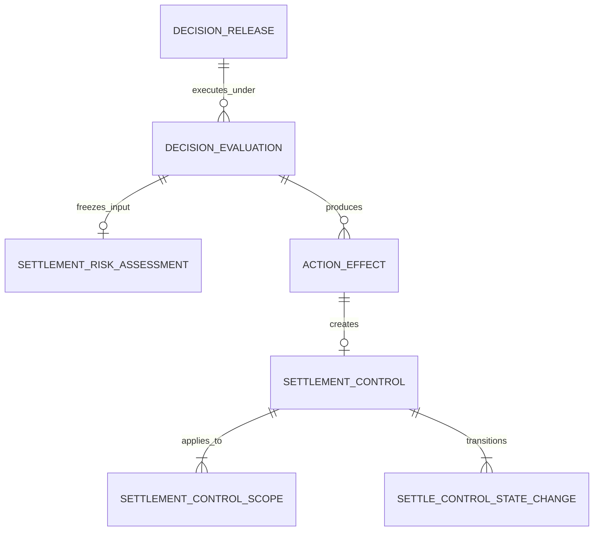

# Risk Settlement Eligibility 平衡精简设计

> 历史记录：本文保留三表 Control 精简的原始决策与当时基线；其 Candidate/Promotion/Bank 三检查点、旧 Finance 来源事实和 `beneficiary_account_ver` 已由 [Manual Payout 四检查点对齐实施记录](./2026-08-29-risk-manual-payout-eligibility-checkpoint-alignment-implementation-plan.md) 取代；当前契约以该记录、Risk 权威数据库文档和生成模型为准。

状态：本文三表设计的 Risk 侧 manifest、Policy、静态 Validator、PDManer、Oracle 与专属权威文档已实施；最终基线为 `71 tables / 869 fields / 103 unique indexes / 76 access indexes / 112 local relations / 9 one-to-one relations / 8 Diagram Groups / 78 CHECK constraints`。Finance Projection、requirements 与共享入口配套仍待后续任务，本文不得被解读为跨系统实施完成。

## 1. 决策

Risk & Compliance 中原名为 Settlement Restriction 的能力，业务模块名称收口为：

> **Settlement Eligibility Control（结算资格控制）**

它只控制 Finance 向 Client 或 Local Partner 支付其已形成可结算余额的资格，不计算结算金额、不锁定或移动 Finance Account、不创建银行付款，也不覆盖 Client 委托平台向第三方 Beneficiary 代发资金的 Disbursement 场景。

Settlement 图组从 4 张表收敛为 3 张表：

1. `t_settlement_control`
2. `t_settlement_control_scope`
3. `t_settle_control_state_change`

删除：

- `t_reserve_requirement`

原 1:1 Requirement 没有独立生命周期、权限、查询入口或并发边界，其最终最低保证金字段并入 `t_settlement_control`。Evaluation 图组中的 `t_settlement_risk_assessment` 继续保留，用于冻结每次使用点检查的输入，不计入上述三张 Settlement 当前控制表。

Risk 实施已将总表数从历史阶段 72 张降为 71 张；确定性生成器冻结的精确结果为 869 字段、103 个唯一索引、76 个访问索引、112 条本库关系、9 条 1:1 关系、8 个 Diagram Groups 和 78 条 CHECK 契约。

## 2. 术语与边界

### 2.1 Settlement

本设计中的 Settlement 只表示 Finance 将 Client 或 Local Partner 的可结算负债转为一项经审批、可执行和可对账的结算义务。

固定 Decision Point Code 为：

```text
SETTLEMENT_CANDIDATE_EVALUATION
SETTLEMENT_PROMOTION
SETTLEMENT_BANK_SUBMISSION
```

`SETTLEMENT_BANK_SUBMISSION` 同时适用于首次提交和失败后的重试。银行指令已经进入 SUBMITTED、PROCESSING、BANK_ACCEPTED 或 UNKNOWN 后，新控制不能伪造未付款事实、撤销银行结果或释放 Finance 余额，只能阻止后续重试并触发处置。

### 2.2 Payout 与 Disbursement

Finance 当前的 Client/Partner 出款申请仍属于 Settlement 的入口请求，不改变其资金义务性质。

未来 Client 委托平台向主播、供应商或其他下游 Beneficiary 代发资金时：

- 产品侧可以称为 Payout；
- 内部能力属于 Disbursement；
- 必须使用独立 Decision Point、输入快照和控制语义；
- 不得给本设计三表增加 `business_type`、Beneficiary、收款账户或代发用途字段；
- 不得把 `SETTLEMENT` Decision Point 当作通用出款决策点。

### 2.3 Security Deposit Requirement

Risk 只表达 Client 的最终最低预存保证金要求。Finance 继续以 `CLIENT_SECURITY_DEPOSIT/NONE` Account 保存实际余额，并独立检查 `CLIENT_RECOVERY_RECEIVABLE/NONE`、保证金和银行现金容量。

Risk 不保存：

- Finance Account ID 或余额；
- 实际冻结、迁移或使用金额；
- Ledger、Journal、Settlement Payment 或银行执行状态；
- 百分比公式、计算基数或 Finance 资金预占。

## 3. 当前结构需要收敛的问题

### 3.1 Requirement 1:1 子表没有独立事实边界

原 `t_reserve_requirement` 始终依赖一条 `restriction_type=RESERVE_REQUIREMENT` 的根记录：

- 与根同时创建；
- 与根同时生效和终止；
- 没有独立状态、版本、权限或查询；
- Finance 只消费最终金额，不单独操作 Requirement 行。

因此拆表只增加 Join、1:1 关系和跨行类型校验，没有形成独立聚合价值。

### 3.2 Percentage 无法独立得到最终金额

原模型允许：

```text
requirement_type=PERCENTAGE
reserve_rate=0.10
```

但没有冻结计算基数。Risk 无法仅凭本库重算最终 `required_amount`，Finance 又明确不接收公式或基数。新模型只保存规则执行后的最终最低金额；如果策略内部使用比例，AST/Feature 必须在 Action 生效前基于显式输入完成计算和舍入。

### 3.3 HOLD 与 BLOCK 没有独立下游语义

实施前，原 RCO-I09 只返回 `ALLOW/RESTRICT`，Finance 在任一不通过条件下进入自身 `ON_HOLD`。Risk 的 `SETTLEMENT_HOLD` 没有独立人工工作流、恢复状态或不同的 Finance 执行动作，因此与 `SETTLEMENT_BLOCK` 重复。

新模型只保留一个阻断类型；临时性由有效期、原因和准确释放表达，Finance 的 `ON_HOLD` 继续是 Finance 自己的 Settlement 状态。

### 3.4 来源链路存在重复列

原根同时保存 `decision_evaluation_id`、`release_id` 和 `action_effect_id`，但：

```text
Action Effect -> Decision Evaluation -> Decision Release
```

已经可以完整推导来源。三份直接引用会产生不一致组合。新根只保存唯一 `source_action_effect_id`；Evaluation 与 Release 沿本库关系读取。

## 4. 目标关系



一个 REAL Action Effect 最多创建一个 Settlement Control；一条 Control 必须至少有一条 Scope 和一条初始 State Change。SHADOW/REPLAY 的 SIMULATED Effect 不创建 Control。

## 5. `t_settlement_control`

### 5.1 业务事实

该表是一条长期结算资格控制的稳定聚合根：

```text
control_id
control_no
role_type
role_id
control_type
reason_code
source_action_effect_id
status
effective_from
effective_to
required_amount
required_currency
release_condition_code
control_instance_key
content_hash
active_slot
version
create_time
update_time
```

### 5.2 类型矩阵

`control_type` 只允许：

```text
SETTLEMENT_BLOCK
MIN_SECURITY_DEPOSIT
```

固定矩阵：

| Control Type | Role | 金额字段 | 执行语义 |
|---|---|---|---|
| `SETTLEMENT_BLOCK` | `CLIENT/LOCAL_PARTNER` | `required_amount/required_currency/release_condition_code` 全空 | 命中后 Risk 返回 RESTRICT |
| `MIN_SECURITY_DEPOSIT` | 只允许 `CLIENT` | `required_amount>0`、`required_currency` 和 `release_condition_code` 非空 | Risk 返回最终最低保证金金额；Finance 比较实际 Account |

Local Partner 出现 `MIN_SECURITY_DEPOSIT` 必须在 Release 静态校验和运行时同时 Fail-Closed。

### 5.3 来源、幂等和索引

- `control_no` 是唯一业务编号。
- `source_action_effect_id` 非空、建立本库关系并唯一；一个 Effect 的重试只能返回同一 Control。
- `control_instance_key` 是 Action 必填的稳定业务实例键，Canonical 形式为 `RULE_ACTION:<rule_action_id>:<business_instance_key>`；Business Instance Key 只允许来自受控 Literal 或已声明为稳定业务标识的 Context（例如 Dispute Case ID），不得来自 Feature 计算结果、Evaluation/Effect ID、当前时间或随机值。没有独立案件维度时使用固定 Literal `DEFAULT`。不同 Rule Action 即使结果相同也天然得到不同实例键，避免释放一个来源时误释放另一个。
- `content_hash` 使用 `CODE-MOR:RISK:SETTLEMENT_CONTROL_CONTENT:1`，覆盖 Control Instance Key、Action Version ID、Role、Type、Reason、生效区间、金额矩阵和按字典序排序的完整 Scope Hash；不包含 Evaluation/Effect、Control ID/No、状态、Active Slot、Version 或审计时间。沿用本文 JCS/UTF-8/SHA-256 规则。
- `active_slot` 在 ACTIVE 时固定为 `1`，RELEASED/EXPIRED 时为空；`(role_type,role_id,control_instance_key,active_slot)` 唯一。同一实例键重复命中且 Content Hash 相同则复用已有活动 Control；同键异 Hash 固定报 `ACTIVE_CONTROL_KEY_CONFLICT`，不能覆盖旧内容。新区间、延期或另一政策实例必须使用新的 Business Instance Key；终态后同一实例键再次命中可以建立新 Control。
- Handler 必须先按 Role + Instance Key 锁定并查找活动 Control，再解析新窗口：已存在时返回其原冻结窗口，重试不得把 `effective_from` 滑到当前 Evaluation Time，也不得延长 `effective_to`；显式请求不同窗口按同键异 Hash 冲突。只有不存在活动行时，`IMMEDIATE` 才把本次 Evaluation Time 冻结为首次 `effective_from`。
- Role 当前查询与 Phantom 防护共同使用 `(role_type,role_id,active_slot,control_id)` 访问索引，并在读到行后再次校验 `status=ACTIVE`。
- 生效判断使用半开区间 `[effective_from,effective_to)`；`effective_to IS NULL` 表示没有预定结束时间。
- 有结束时间时必须满足 `effective_from < effective_to`；`effective_to <= source Evaluation.evaluation_time` 的已过期窗口不得创建 REAL Control。
- Role、Type、Reason、来源 Effect、实例键、生效区间、金额字段和 Content Hash 创建后不可修改；延期或业务内容变化必须使用新 Business Instance Key 创建新 Control。
- `effective_from` 不得早于来源 Evaluation 的 `evaluation_time`，禁止事后创建一条可回溯命中过往评估的 Control。
- `release_condition_code` 只是 Operations 可解释的受控释放条件目录，不自动读取 Finance 余额或执行释放。
- `version` 只用于根状态 CAS；Scope 创建后不可修改。

### 5.4 Instance Key 与 Content Hash

`business_instance_key` 必须是 1~96 位规范大写 ASCII，满足 `^[A-Z0-9][A-Z0-9._:-]{0,95}$`；不做 Trim、Unicode/Locale Case Fold 或隐式转码，输入不满足即拒绝。无独立案件维度时固定为 `DEFAULT`。完整 `control_instance_key` 为：

```text
RULE_ACTION:<无前导零十进制 rule_action_id>:<business_instance_key>
```

字段使用 `VARCHAR(160)`，逐字节区分，不接受另一种前缀、空段或前导零 ID。

`content_hash` 的 Canonical Object 固定为：

```json
{
  "control": {
    "controlType": "MIN_SECURITY_DEPOSIT",
    "effectiveFrom": "2026-08-28T10:15:30.123456Z",
    "effectiveTo": null,
    "reasonCode": "DISPUTE_EXPOSURE",
    "releaseConditionCode": "MANUAL_REVIEW",
    "requiredAmount": "20000",
    "requiredCurrency": "USD"
  },
  "origin": {
    "actionVersionId": "240001",
    "controlInstanceKey": "RULE_ACTION:250001:DISPUTE_CASE:610101",
    "ruleActionId": "250001"
  },
  "owner": {
    "roleId": "200001",
    "roleType": "CLIENT"
  },
  "schema": "CODE-MOR:RISK:SETTLEMENT_CONTROL_CONTENT:1",
  "scopeHashes": [
    "0a4d000000000000000000000000000000000000000000000000000000000001"
  ]
}
```

编码规则固定为：

- BIGINT 全部使用无前导零十进制 JSON String；金额使用非指数、去无意义尾零的非负十进制 JSON String；
- 时间统一为 UTC、六位微秒和 `Z` 后缀；nullable 值必须显式为 JSON Null；
- `SETTLEMENT_BLOCK` 的 `requiredAmount/requiredCurrency/releaseConditionCode` 全为 Null；`MIN_SECURITY_DEPOSIT` 三者按类型矩阵非空；因此 Release Condition 明确进入 Hash；
- Code、Currency、Role 和 Business Instance Key 使用已经通过目录/格式校验的规范大写值；Hash 使用 64 位小写十六进制；
- `scopeHashes` 包含全部且仅包含本 Control 的 Scope Hash，按小写十六进制字典序排序；Scope ID 不进入 Content Hash，保证重试可以在分配新 ID 前复算；
- 对象字段不得省略或增加，按 RFC 8785 JCS 序列化为 UTF-8 后计算 SHA-256 小写十六进制。

首次 `IMMEDIATE` 创建以本次 Evaluation Time 解析 `effectiveFrom`；同 Instance Key 重试先读取已有活动 Control，并使用其已冻结窗口复算上述对象，不用新的 Evaluation Time 滑动窗口。显式绝对窗口与已存窗口不同即 `ACTIVE_CONTROL_KEY_CONFLICT`。

### 5.5 Source Effect 跨行合同

Release 静态 Validator 只能检查发布配置：

- Action Version 为 `action_category=SETTLEMENT + terminal_flag=false + status=ACTIVE`，声明 Risk 本地同步 Handler，并具有已登记的实现版本与 Hash；
- 参数 Schema 能完整形成 Control Instance Key、Type/Reason/生效区间/金额矩阵/Scope，Target 固定为 `SETTLEMENT_CONTROL`，解析键格式为 `<role_type>:<role_id>:<control_instance_key>`；
- Local Partner 不可能解析出 `MIN_SECURITY_DEPOSIT`，Action 支持 SHADOW 且 SIMULATED 分支不调用真实 Handler。

运行时本地事务再检查具体执行事实：

- Effect 为 `effect_mode=REAL + effect_status=APPLIED + execution_type=LOCAL_SYNC + execution_status=SUCCEEDED`；
- 所属 Evaluation 为 `evaluation_mode=PRIMARY + technical_status=SUCCEEDED`；
- Effect 的 Action Version 正是 Release 已冻结并通过静态检查的版本；
- Effect 恰好具有一个 `source_type=RULE` 的 MERGED Intent；持久 Control Action 不允许多个 Rule Action 合并，也不允许 Obligation 直接创建；
- 实际 `target_type/target_key` 与 Control Role、Instance Key 及唯一 `rule_action_id` 逐值一致；Intent 的 Evaluation、Action Version 与解析目标均和 Effect 一致；
- SIMULATED、异步 Handler、MQ Publish、失败 Effect 或终态 Decision Action 均不得创建 Control。

静态配置不合法时拒绝 Release；运行时事实不合法时令 PRIMARY Evaluation 技术失败，不能混用两个阶段的证据或静默忽略 Action。

### 5.6 Action Scope Tuple 编排

现有 `t_rule_action_parameter` 对 `(rule_action_id,parameter_definition_id)` 唯一，只能为一个参数定义保存一个标量，无法真实表达一次 `CREATE_SETTLEMENT_CONTROL` Action 的 1..N Scope。实施时为该表增加非空正整数 `value_sequence`，唯一键改为：

```text
(rule_action_id, parameter_definition_id, value_sequence)
```

编排契约固定为：

- 非 Settlement 参数以及 Control 根参数的 `value_sequence` 固定为 `1`；
- Settlement Action 以同一连续 `value_sequence` 对齐 `SCOPE_OPERATING_ENTITY_KEY`、`SCOPE_CURRENCY_KEY`、`SCOPE_BANK_COUNTRY_KEY` 三个 STRING 参数，形成一个 Scope Tuple；
- 三类 Key 分别只允许无前导零的正十进制 ID/三位大写币种/两位大写国家，或受控通配值 `*`；Handler 必须在持久化前把 `*` 规范化为相应数据库 NULL；
- Scope Sequence 必须从 `1` 连续递增，任一 Tuple 缺维、重复或断号均使 Release 静态校验失败；
- 多 Scope 政策版本可使用 Literal Tuple；仅限当前结算上下文的单 Scope 版本可使用 Context Tuple，且必须符合既有 `allowed_source_type` 与类型白名单；
- Release 内容冻结和静态校验必须把 `value_sequence` 纳入参数身份，不得依赖数据库返回顺序。

这是对现有类型化 Action 参数的最小扩展；不新增配置表，不引入 JSON、EAV、分隔符列表或通用集合值类型。

## 6. `t_settlement_control_scope`

### 6.1 业务事实

一条 Control 可以适用于一个或多个 OE、币种和 Settlement Bank Country 组合：

```text
scope_id
control_id
operating_entity_id
currency
bank_country
scope_hash
create_time
```

`bank_country` 的唯一含义是 Finance `t_beneficiary_account_ver.bank_country`：Client 或 Local Partner 接收自身 Settlement 的开户银行国家。它不是 OE 注册法域、Consumer/订单国家、付款目的地国家，也不得复用于未来 Client-to-Beneficiary Disbursement。

三个业务维度允许 NULL，分别表示全部 Operating Entity、全部币种或全部 Settlement 收款银行国家。每条 Control 至少创建一条 Scope；全局控制使用三个业务维度均为空的一条显式 Scope，不能用零行暗示全局。

同一 Control 下多条 Scope 使用 OR 语义：任意一条完整匹配即适用。

### 6.2 Scope Hash

`scope_hash` 使用 `CODE-MOR:RISK:SETTLEMENT_CONTROL_SCOPE:1`：

```json
{
  "schema": "CODE-MOR:RISK:SETTLEMENT_CONTROL_SCOPE:1",
  "scope": {
    "bankCountry": "AE",
    "currency": "USD",
    "operatingEntityId": "210001"
  }
}
```

- nullable 值显式编码为 JSON Null；
- BIGINT 使用无前导零十进制 JSON String；
- Bank Country 和币种使用大写规范值；
- 按 RFC 8785 JCS 序列化为 UTF-8，再计算 SHA-256 小写十六进制；
- `(control_id,scope_hash)` 唯一，解决 MySQL 联合唯一键中 NULL 不冲突的问题。

`MIN_SECURITY_DEPOSIT` 的每条 Scope 必须具有非空 `currency`，并与根的 `required_currency` 相同。一个金额不能跨币种直接比较；需要多个币种时创建多条独立 Control。

## 7. `t_settle_control_state_change`

### 7.1 业务事实

状态历史只追加：

```text
change_id
control_id
from_status
to_status
reason_code
trigger_type
trigger_id
actor_id
aggregate_version
occurred_time
create_time
```

`trigger_type` 只允许：

```text
ACTION_EFFECT
OPERATION_COMMAND
SYSTEM_TIMER
```

Control 创建只允许来自可追溯 REAL Action Effect，并以 Effect ID 作为初始 Trigger；V1 不开放绕过 Decision Engine 的人工直接创建。人工精确释放使用经过 IAM 授权且写入 `t_command_idempotency` 的类型化操作命令，并以其稳定命令引用作为 `OPERATION_COMMAND` Trigger，不伪造 Rule、Evaluation 或 Action Effect。系统按 `effective_to` 结束控制时使用 `SYSTEM_TIMER`。

### 7.2 状态机

```text
NULL -> ACTIVE
ACTIVE -> RELEASED | EXPIRED
RELEASED / EXPIRED 为终态
```

不保留 `SCHEDULED`：未来生效时间由 `effective_from` 表达。`status=ACTIVE` 表示控制尚未终止，是否已经处于生效窗口仍按 Evaluation Time 与半开区间判断。

首行固定 `aggregate_version=1 + NULL->ACTIVE + active_slot=1`；后续版本连续递增，前一行 `to_status` 必须等于后一行 `from_status`。进入 RELEASED/EXPIRED 时同一 CAS 把 `active_slot` 清空。根状态、Active Slot、根 Version、State Change 和需要发布的 `compensation_event` 在同一本地事务提交。

触发字段矩阵固定为：

| Trigger | `trigger_id` | `actor_id` | `reason_code` |
|---|---|---|---|
| `ACTION_EFFECT` | Effect ID 的 Canonical 十进制字符串 | 空 | 创建 Action 的受控原因 |
| `OPERATION_COMMAND` | `risk-command:<command_idempotency_id>` | 已授权操作人，非空 | 人工释放原因，非空 |
| `SYSTEM_TIMER` | `settlement-control-expiry:v1:<control_id>:<expected_version>:<effective_to>` | 空 | 固定 `EFFECTIVE_WINDOW_ENDED` |

Timer 必须锁定根并以 Trigger ID 幂等执行 `ACTIVE + expected_version -> EXPIRED` CAS；重复触发返回原结果，Version 不符时只在根已处于同一 EXPIRED 结果时视为幂等，否则进入冲突处置。业务匹配已由 `effective_to` 立即停止，Timer 延迟只影响状态投影，不得延长控制有效期。

## 8. Settlement Risk Assessment

`t_settlement_risk_assessment` 继续属于 Evaluation 图组并保持一 Evaluation 一行。它不是当前控制表，也不保存 Finance 余额。

在现有字段基础上增加：

```text
checkpoint_type
gross_amount
eligibility_decision
required_amount
required_currency
control_set_hash
```

`checkpoint_type` 只允许：

```text
CANDIDATE_EVALUATION
SETTLEMENT_PROMOTION
BANK_SUBMISSION
```

`gross_amount` 冻结 Finance 在该检查点提交的结算业务负债金额，必须大于零；它不是 `cash_required_amount`、银行手续费或保证金余额。Assessment 中原 `country_code` 同步重命名为 `bank_country`，逐值来自 Finance 冻结的 `t_beneficiary_account_ver.bank_country`。

每个 Checkpoint 必然创建新的 Evaluation 和 Assessment，旧行永不覆盖。Candidate、Payout Request、Settlement 与 Settlement Payment 的本地关系只存在于 Finance；Finance 必须沿 `Settlement Candidate -> Settlement -> Settlement Payment` 或 `Payout Request -> Settlement -> Settlement Payment` 的实际本库路径逐值校验 Role、OE、币种、Bank Country 与 Gross Amount，并把准确来源 Type/ID/Version 传给 Risk。不一致时 Finance Fail-Closed。Risk 只校验和冻结单次调用契约，不伪造跨库外键，也不声称仅凭不同 Source ID 可以证明跨阶段 Lineage。

`source_fact_type` 使用受控目录：

```text
SETTLEMENT_CANDIDATE
PAYOUT_REQUEST
SETTLEMENT_PAYMENT
```

- Candidate Evaluation 只接受 `SETTLEMENT_CANDIDATE`；
- Promotion 接受 `SETTLEMENT_CANDIDATE` 或 `PAYOUT_REQUEST`；
- Bank Submission 只接受稳定的 `SETTLEMENT_PAYMENT`，首次和重试以新的请求 ID 与来源版本形成新的 Evaluation。

`input_hash` 升级为 `CODE-MOR:RISK:SETTLEMENT_ELIGIBILITY_INPUT:1`，覆盖 Checkpoint、Role、OE、Bank Country、Gross Amount、币种和来源事实 Type/ID/Version。Canonical Object 固定包含 `schema` 和上述全部字段；BIGINT 使用无前导零十进制 JSON String，金额使用无指数且去无意义尾零的十进制 JSON String，代码值使用规范大写，nullable 值显式为 JSON Null。按 RFC 8785 JCS 序列化为 UTF-8 后计算 SHA-256 小写十六进制。Hash 不代替结构化字段。

结果四列只在 Eligibility Obligation 成功执行时成组冻结：`eligibility_decision` 为 `ALLOW/RESTRICT`，`control_set_hash` 非空；Client 使用同请求币种的非负 `required_amount + required_currency`，Local Partner 两个金额字段均为空。规则已先给出 REVIEW/DENY 或技术执行未完成时，四列全部为空。它们让同一 `evaluation_request_id` 的重试可以返回原最终门槛并校验 Control Set，而不读取当前时点后来的状态。

原响应中的 `matched_controls[]` 不另建映射表。Control 内容和 Scope 创建后不可变，状态只追加，且禁止回溯生效；重放时以原 Evaluation 的 `evaluation_time + completed_time` 重建当时已存在且适用的版本，并必须复算等于 Assessment 冻结的 `control_set_hash`，否则 Fail-Closed。Eligibility、Control 创建和释放必须遵守第 10 节的同一 Role Range/Root 锁顺序，避免完成边界内出现不可重放的并发状态。

## 9. 系统强制义务

读取并执行当前 Settlement Control 不能依赖运营规则是否配置。`t_decision_point_obligation.obligation_type` 增加：

```text
CHECK_SETTLEMENT_ELIGIBILITY
```

它具有以下固定约束：

- 只允许绑定 `business_domain=SETTLEMENT` 的 Point Version；
- `trigger_decision=ALLOW`；
- `action_version_id` 为空；
- 不允许 Limit Binding；
- 上述三个固定 Settlement Decision Point 的每个 Point Version 恰好一条且固定 `FAIL_CLOSED`；
- 运营不能删除、禁用或改写执行语义；
- 不创建 Action Intent/Effect，因为它是读取并执行当前控制的系统门禁，不是持久副作用。

Settlement Control Action 必须是 Risk 本地同步副作用。所有 PRIMARY Evaluation 先物化已经确定的 REAL 本地 Action；是否继续执行 Eligibility Obligation 由 Proposed Decision 决定：

```text
Rule/Predicate Evaluation
  -> 收集并合并 Action Intent/Effect
  -> 在同一事务物化本次 REAL Settlement Control
  -> proposed REVIEW/DENY：原样形成正式决定，跳过 Eligibility Obligation
  -> proposed ALLOW：CHECK_SETTLEMENT_ELIGIBILITY 读取既有和本次新建 Control
       -> Block 未命中：正式 ALLOW
       -> Block 命中：正式 DENY + decision_adjustment_reason_code=SETTLEMENT_CONTROL_MATCHED
```

规则给出的 REVIEW/DENY 不能被 Control 查询覆盖为 ALLOW；二者在 RCO-I09 均映射为 RESTRICT。只有 Proposed ALLOW 才执行系统义务，义务失败或超时没有正式业务决定并令 Finance Fail-Closed。因此，同一次 Evaluation 新建的 `SETTLEMENT_BLOCK` 会阻断当前 Settlement，而不是只影响下一笔；新建的 `MIN_SECURITY_DEPOSIT` 也会进入本次最终门槛。事件发布可以在提交后可靠执行，但本地 Control 不允许异步延后创建。

## 10. 匹配与聚合算法

门禁以 `decision_evaluation.evaluation_time` 为唯一时间锚：

为防止“查询完当前 Control 后又并发插入一个同 Role 新 Root”的 Phantom，PRIMARY Eligibility 事务固定使用 MySQL InnoDB `REPEATABLE READ`，并通过 `(role_type,role_id,active_slot,control_id)` 索引执行该 Role 活动区间的 `SELECT ... FOR UPDATE`。即使当前零行，也必须取得对应 Next-Key/Gap Lock；所有 Settlement Control 创建、`OPERATION_COMMAND` 释放和 `SYSTEM_TIMER` 过期统一遵守 `Role Range -> control_id 升序 Root -> Scope/Event` 锁顺序，Timer 不能先锁 Root 再反向获取 Range。任何写路径都不能通过另一条未锁索引绕过。当前 Evaluation 的本地 Action 先取得 Range Lock 并插入本次 Control，再执行范围读取，因此可以看见自己的新 Control。

Control 的 `create_time` 与首条 State Change `occurred_time` 必须在取得 Role 区间锁后使用数据库 UTC 时间生成；RELEASED/EXPIRED 的 State Change `occurred_time` 和 Root `update_time` 也只能在成功取得 Role Range + Root Lock 后采样数据库 UTC，不能在等待锁前预填。命令接收时间、Timer 计划时间或 Worker 唤醒时间如需审计，应由对应命令/任务事实保存，不得冒充状态实际发生时间。Evaluation 的 `completed_time` 在 Eligibility 结果冻结后生成。这样并发写入要么先于本次锁并被本次读到，要么在本次完成后才发生，不会落入“原结果没读到、历史重建却看起来早已存在或终止”的中间状态。若未来改用 `READ COMMITTED` 或不能证明 Gap Lock 生效，必须增加显式 Role Guard/匹配明细事实，不能静默降低一致性。

1. 按 Role 查询 `status=ACTIVE` 的 Control；
2. 过滤 `effective_from <= evaluation_time < effective_to`，无结束时间时只检查起点；
3. 至少一条 Scope 对 OE、币种、Bank Country 逐维匹配；NULL 维度为受控通配；
4. 对同币种全部 `MIN_SECURITY_DEPOSIT` 完整聚合并取最大 `required_amount`，无论是否同时命中 Block；
5. 无 Requirement 时 Client 的最终最低金额为同币种 `0`；Local Partner 不返回保证金要求；
6. 单独计算 `block_matched`；任意 `SETTLEMENT_BLOCK` 命中时最终 Eligibility 为 `RESTRICT`，否则为 `ALLOW`；
7. 返回全部命中 Control ID/Version、Reason、有效期、Scope Hash 和最终最低金额，供 Finance 冻结 Requirement Set；
8. 数据缺失、跨币种、Local Partner Requirement、重复来源、版本不连续或依赖异常全部 Fail-Closed。

多个 `MIN_SECURITY_DEPOSIT` 都表示 Client Security Deposit Account 的最终余额下限，因此只取 MAX，绝不相加；它们不是多笔增量补缴要求。

Block 只覆盖最终 Eligibility 决定，不短路 Requirement 聚合；因此 Block 与 Requirement 同时命中时，Assessment、RCO-I09 和 `control_set_hash` 仍冻结完整最终最低金额。Finance 因 RESTRICT 不得继续，但相同结果可以稳定审计和重放。

Risk 的正式 Evaluation 决策矩阵固定为：

| Proposed Decision | Eligibility | Business Decision | RCO-I09 |
|---|---|---|---|
| `REVIEW` | 跳过 | `REVIEW` | `RESTRICT` |
| `DENY` | 跳过 | `DENY` | `RESTRICT` |
| `ALLOW` | 无 Block | `ALLOW` | `ALLOW` + 最终最低保证金 |
| `ALLOW` | 命中 Block | `DENY` + `SETTLEMENT_CONTROL_MATCHED` | `RESTRICT` |
| 任意 | 技术失败/超时 | 空 | 无业务决定，Finance Fail-Closed |

RCO-I09 的 `reason_codes[]` 为去重后按字典序排序的受控原因集合：规则 REVIEW/DENY 使用命中 Rule 的 `reason_code`，Control 调整使用命中 Block 的 `reason_code`。不得用自由文本代替代码，也不得在没有执行 Eligibility 时伪造 `matched_controls[]`。

Settlement 三个 Point Version 中，任何可能产生 REVIEW/DENY 的启用 Rule 都必须具有非空 `reason_code`；Release 静态校验拒绝缺失原因的配置，避免运行时生成无原因 RESTRICT。

保证金余额不足不是 Risk DENY。Risk 返回 ALLOW 和最终门槛后，由 Finance 在本库 Account 锁内决定是否继续。

## 11. 创建、释放与政策变更

### 11.1 创建

PRIMARY Evaluation 中的真实 Action 创建 Control 时，同一本地事务必须提交：

```text
Decision Evaluation
Action Intent / Action Effect
Settlement Control
1..N Control Scope
Control Instance Key + Content Hash + active_slot=1
NULL -> ACTIVE State Change
Compensation Event
```

任一 Scope、类型矩阵、Hash、来源 Effect 或事件登记失败，整笔事务回滚。相同 Control Instance Key 已有 ACTIVE Control 且 Content Hash 相同时不插入重复 Root/Scope/State Change，Action Handler 返回该稳定 Control；同键异 Hash 冲突。SHADOW/REPLAY 只形成 SIMULATED Effect，不创建任何 Control。

### 11.2 精确释放

释放命令必须指定准确 `control_id + expected_version`、受控原因和幂等键。它先经过 IAM 权限校验并写入 `t_command_idempotency`；同键异 Hash 冲突。同一 Role 的其他 Control 不受影响。释放以 `OPERATION_COMMAND` 作为 Trigger，并在一个本地事务中：

- CAS 根 `ACTIVE -> RELEASED`；
- 同一 CAS 清空 `active_slot`；
- 追加连续 State Change；
- 登记可靠释放事件。

### 11.3 政策变更

V1 不提供人工创建、人工替换、`SUPERSEDED` 状态或管理型 Decision Point。政策变化先发布新的 Rule/Action；下一次匹配的 PRIMARY Settlement Evaluation 通过真实 Action Effect 创建新 Control，并在同一次 Eligibility 中立即纳入。旧 Control 保持 ACTIVE，聚合期间采用“任一 Block / Requirement 取 MAX”的保守结果；确认新 Control 已生效后，Operations 再用 11.2 的精确释放命令终止旧 Control。因此可能短暂更严格，但不会出现控制空档。

未来生效的独立 Control 可以由真实 Evaluation 提前创建并按 `effective_from` 自然开始匹配。若业务以后需要无真实 Settlement Evaluation 的预创建或原子换挡，必须另行设计受审批的 Control Administration Point 及输入事实，不能在 V1 中通过直接插行或孤立 Effect 暗中实现。

## 12. Finance 接口与事实所有权

RCO-I09 的语义收口为“检查 Settlement Eligibility”；`assessment_id + evaluation_id` 是不可变且可检索的 Risk 坐标，同一幂等命令重放返回原坐标和原冻结结果：

```text
decision = ALLOW | RESTRICT
assessment_id
evaluation_id
reason_codes[]
matched_controls[]
required_amount
required_currency
control_set_hash
```

规则已给出 REVIEW/DENY 时，`decision=RESTRICT`，返回规则 `reason_codes[]`，`matched_controls=[]`，金额与 `control_set_hash` 均为空。Eligibility 成功执行时返回完整匹配集合、最终门槛和 Hash；技术失败或超时不返回伪造的 `ALLOW/RESTRICT` 业务决定。

Client 没有命中 Requirement 时固定返回 `required_amount=0 + required_currency=本次 Settlement Currency`；Local Partner 固定返回 `required_amount=NULL + required_currency=NULL`。

`matched_controls[]` 至少包含：

```text
control_id
control_version
control_type
reason_code
effective_from
effective_to
scope_count
scope_set_hash
scopes[] { scope_id, scope_hash }
required_amount / required_currency
```

`control_set_hash` 使用 `CODE-MOR:RISK:SETTLEMENT_CONTROL_SET:1`。它是可跨三个检查点比较的内容 Hash，因此不包含 Assessment、Evaluation、Checkpoint 或请求身份。Canonical Object 包含：

- 固定 `schema`；
- `decision`；
- `requiredAmount/requiredCurrency`；
- 全部命中 Control，按数值型 `control_id` 排序；
- 每个 Control 只含 ID、Version、Type、Reason、有效期、金额币种、`scope_count/scope_set_hash`，以及按数值型 `scope_id` 排序的全部 `scope_id + scope_hash`。

BIGINT 使用十进制 JSON String，金额使用无指数且去无意义尾零的十进制 JSON String，时间使用六位微秒 UTC 字符串，nullable 值显式为 JSON Null；按 RFC 8785 JCS 序列化为 UTF-8 后计算 SHA-256 小写十六进制。空 Control 集也必须按该 Schema 计算，Finance 冻结同一 Hash，不能自定义重排或省略 Null。

Finance 当前 Candidate/Settlement Requirement Snapshot 两表继续保留，并按每个命中的 Risk Control 冻结 `control_id + control_version`。Finance 还必须冻结 RCO-I09 的完整响应，并按 Finance 本地 Canonical Contract 计算自己的 `eligibility_hash`；Risk 的 `input_hash` 与 `control_set_hash` 都不能冒充该完整响应 Hash。现有外部代码 `SETTLEMENT_RESTRICTION/RESERVE_REQUIREMENT` 只允许在明确标注的 Finance 兼容层分别映射自 `SETTLEMENT_BLOCK/MIN_SECURITY_DEPOSIT`，Risk 当前模型与新文档统一使用 Control 与最低 Security Deposit 语义。

### 12.1 Restriction Projection 兼容边界

Risk 的 Scope 是 1:N OR 组合，并包含 OE、币种和 Bank Country；Finance 当前 `t_finance_restriction_proj` 却是一条来源限制一行，且只有单一 OE 与币种范围。它不能无损表达本文 Scope，不能把多行 Scope 压成一行、丢掉 Bank Country 后仍宣称是准确投影，也不能让一条 Scope 覆盖另一条 Scope。

因此实施时采用以下最小配套调整，不新增 Finance 表：

- 只有 `SETTLEMENT_BLOCK` 进入 `t_finance_restriction_proj`；`MIN_SECURITY_DEPOSIT` 只通过同步 RCO-I09 结果进入 Candidate/Settlement Requirement Snapshot，不伪装成 Restriction Projection；
- Control 每个版本只发布一个 `SettlementControlChanged` 聚合事件，Payload 携带按数值型 `scope_id` 排序的完整 Scope Set、`scope_count` 和 `scope_set_hash`；Finance 必须在一个本地事务中校验后展开全部行，不能逐 Scope 独立发布后假设天然完整；
- `scope_set_hash` 使用 `CODE-MOR:RISK:SETTLEMENT_CONTROL_SCOPE_SET:1`，Canonical Object 固定包含 Schema、Control ID、Control Version 和排序后的 `scope_id + scope_hash`；沿用本文 BIGINT/JCS/UTF-8/SHA-256 规则；
- 一条 Risk `t_settlement_control_scope` 对应一条 Finance Projection 行；Finance 继续以 `source_restriction_id=control_id` 保留来源根，同时新增非空 `source_scope_key`，Risk 使用十进制 `scope_id`，不分 Scope 的来源使用受控值 `ROOT`；
- Finance Projection 同时增加 `source_scope_count`、`source_scope_set_hash` 和 `country_scope_key`；Country 使用 ISO 3166-1 alpha-2 或受控通配符 `*`，OE、币种、Bank Country 逐维准确匹配；
- 来源唯一键调整为 `(source_system,source_restriction_id,source_scope_key)`；同一聚合事件会展开多行，Event 唯一约束也必须纳入 `source_scope_key`，不能让第二条 Scope 与第一条冲突；
- Control 激活、释放或过期时均发布完整 Scope Set；同一 Control 只接受严格更高 Control Version。同一版本全部行的 Count/Set Hash 必须一致，实际行数与复算 Hash 必须相等；缺号、同版本异 Hash 或事务内部分展开全部 Fail-Closed；
- Projection 生命周期映射固定为 `ACTIVE -> decision=RESTRICT`、`RELEASED/EXPIRED -> decision=ALLOW`；终态事件保留并以更高 Source Version 完整替换全部 Scope 行，不删除投影。ACTIVE 行仍只在检查时间命中 `[effective_from,effective_to)` 时阻断；
- Projection 只是异步当前阻断防线；三个检查点仍必须同步调用 RCO-I09，并以返回的完整 Control Set 与最终保证金门槛作为本次业务权威，不能只靠 Projection 推导 ALLOW；
- 完全漏收一个聚合事件时，仅靠 Projection 不可能自证缺失；检查点必须把同步 RCO-I09 返回的 Block Control ID/Version/Scope Set Hash 与投影逐值交叉校验，缺失或不一致即 Fail-Closed；
- Candidate/Settlement Snapshot 的来源 ID 始终使用 `control_id`，不会因 Projection 采用 Scope 行粒度而改变。

新增字段对共享投影来源的 CHECK/回填矩阵固定为：

| Source | `source_scope_key` | Scope Count / Set Hash | `country_scope_key` |
|---|---|---|---|
| `RISK` | 非空十进制 `scope_id` | `source_scope_count>0` 且 `source_scope_set_hash` 非空，同一 Control Version 全行一致 | ISO 国家或 `*` |
| `CCT` | 固定 `ROOT` | 两列均为空；CCT 当前限制是一行一个权威根，不伪造 Risk Scope Set | 固定 `*` |

迁移时现有 CCT 行确定性回填 `source_scope_key=ROOT + country_scope_key=*`，Count/Hash 保持空；Risk 行必须从 Risk 权威 Control 聚合事件完整重建，不允许把旧单行投影猜测成完整 Scope Set。重建未完成前 Finance 保持 Fail-Closed。对应 CHECK 必须把两种来源矩阵固化，不能只靠消费者约定。

这会使 Finance 表数和领域所有权保持不变，但会改变 Finance 字段、索引或 CHECK 统计；只有在 Risk 与 Finance 联合实施、重新生成并通过两侧门禁后才能生效。本文只冻结这个兼容契约，不直接修改 Finance PDManer。

Finance 的检查点矩阵固定为：

| Checkpoint | Risk | Client Account | Local Partner | BANK_CASH |
|---|---|---|---|---|
| Candidate Evaluation | 锁定适用 BLOCK Projection + 同步 RCO-I09 | 锁定 `CLIENT_SECURITY_DEPOSIT/NONE` 与 `CLIENT_RECOVERY_RECEIVABLE/NONE`，检查追偿为零且保证金覆盖门槛 | 跳过两类 Client Account | 不锁 |
| Settlement Promotion | 同上，不能复用 Candidate 结论 | 同上 | 同上 | 不锁 |
| First/Retry Bank Submission | 同上，不能复用 Promotion 结论 | 同上 | 同上 | 锁定并检查当前现金容量 |

Risk RESTRICT、Projection/RCO 不一致、同步失败、Client 追偿非零或保证金不足都会使 Finance Fail-Closed；Local Partner 不得查询或伪造 Client Security Deposit/Recovery Account。`BANK_CASH` 只在实际首次/重试银行 Attempt 前占用，不能在 Candidate 或 Promotion 阶段提前长期锁定。

Risk 不指令 Finance 做任何余额迁移。

## 13. 现实示例

Client `200001`、OE `210001`、USD/AE 存在两条独立 Control：

```text
Control A
type=SETTLEMENT_BLOCK
reason=KYB_EXPIRED
scope=OE 210001 + USD + AE

Control B
type=MIN_SECURITY_DEPOSIT
required_amount=20,000 USD
reason=DISPUTE_EXPOSURE
scope=OE 210001 + USD + AE
```

Finance 评估 82,000 USD Settlement Candidate：

1. Risk 冻结 Candidate Assessment；
2. Control A 命中，因此返回 RESTRICT；
3. 即使 Finance 实际保证金为 25,000 USD，也不得 Promotion；
4. KYB 恢复后只释放 Control A；Control B 继续 ACTIVE；
5. Risk 下一次返回 ALLOW + required_amount=20,000 USD；
6. Finance 实际保证金为 15,000 USD 时在本库 Fail-Closed；补足至 25,000 USD 后才可继续；
7. Risk 全程没有读取或修改 Finance 余额。

## 14. 明确不做

- 不设计 Client-to-Beneficiary Payout/Disbursement。
- 不把 Settlement Control 泛化为 Outbound Funds Control。
- 不新增通用 Gate、Workflow、Case、Formula、EAV、JSON 或跨库 View。
- 不在 Risk 保存 Finance Account、余额、Journal、银行账户或付款 Attempt。
- 不让规则作者删除系统强制 Eligibility Obligation。
- 不恢复 `SETTLEMENT_HOLD`；Finance `ON_HOLD` 继续由 Finance 拥有。
- 不保存百分比 Requirement 或未冻结计算基数。
- 不删除 Scope 或 State Change：前者表达 1:N 作用域，后者证明完整生命周期。
- 本设计不授权 Migration、Java 实现、物理数据库、运行环境、自动银行付款或基础设施变更。

## 15. Risk 实施结果与剩余门禁

Risk 侧已经按 TDD 完成三表清单、字段矩阵、Control Instance Key/Content Hash/Active Slot、Scope Hash、状态边、Effect 唯一来源、强制义务、Assessment 输入/结果矩阵、静态 Validator、Oracle、确定性生成和专属文档同步。最终摘要固定为：

```text
model_sha256=33acdef24ba3af5ab6ed9df592d0c6ca364f88fd70bd44009a3d3615e253ce1d
structural_projection_sha256=3c402225f055a9e456a944ce7901937adb69b4d547d79d47f68bebaa4306bff0
check_policy_sha256=a3cb288112e0c7836216bd509452d2cc266a29e1db003679c38f98dc2d640b7e
```

仍未完成且不得在本任务越界实施的内容：

1. Finance Projection 的 Scope 行粒度、完整集合字段、`country_scope_key`、来源 CHECK、回填和 RCO-I09 完整响应冻结；
2. requirements、全局序列与共享入口的跨系统配套；
3. PDManer 4.9.3 应用内人工视觉 Review；
4. Migration、Java、数据库和运行环境实现。
