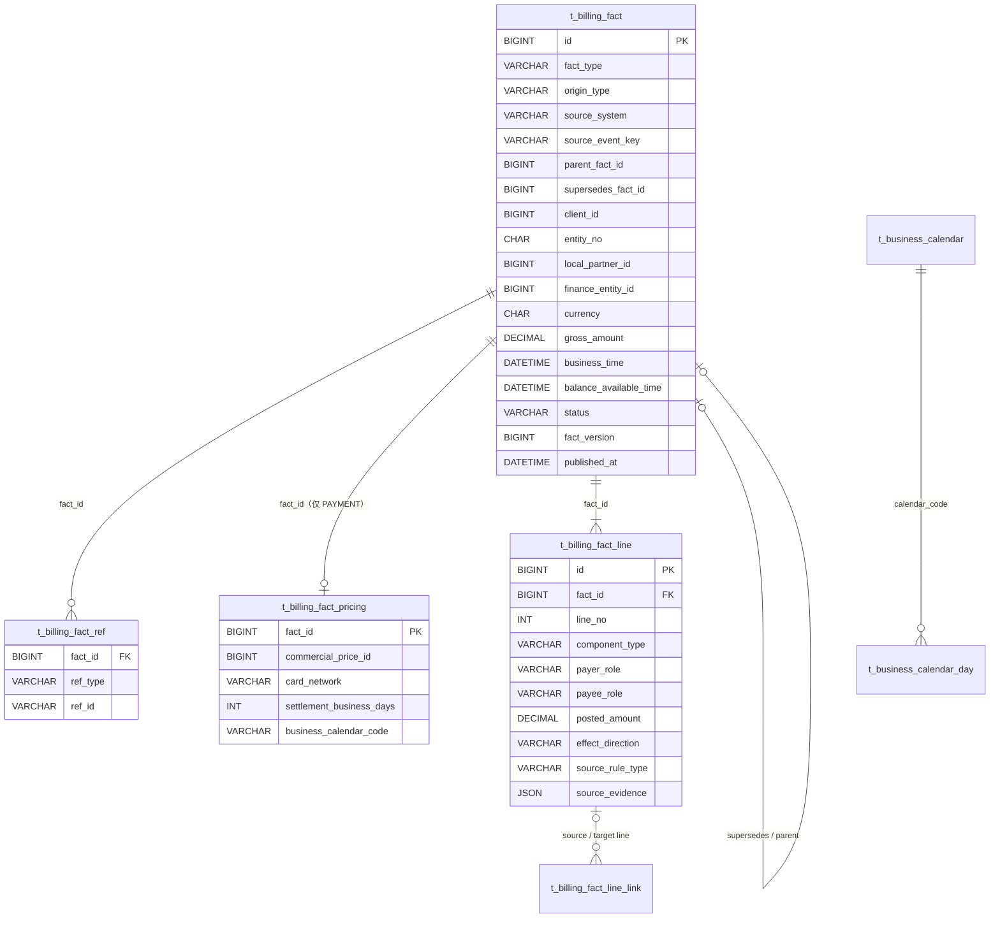

# billing 数据库模型（`mor_billing`）设计 · 精简版

> 状态：讨论中（2026-10-19 第 2 版，按"业务锚拆窄表、定价输入拆侧表、行证据合并 JSON"精简）。配合 [design.md](./design.md)。现状以 `paytech/billing/docs/database/sql/billing-schema.sql`（9 张表，事实头 49 列、明细行 35 列）为准。
>
> **阶段 3 细化（2026-10-19，[REQ technique 2.6](../../requirements/20261019/billing-计费事实模型重构与渠道成本迁出/technique.md)）：** 组件 15 个（成本差异用 `CHANNEL_COST` + `ADJUSTMENT`）、规则族 `COMMERCIAL_PRICE`、定价列 `commercial_price_id`、明细行加 `target_bucket`（20 列）、`AmountSource` 迁 ledger-api。待执行 DDL 以 [REQ db/billing/ddl.sql](../../requirements/20261019/billing-计费事实模型重构与渠道成本迁出/db/billing/ddl.sql) 为准，与本稿冲突处以 technique 为准。

> **命名（2026-10-19 用户已定）：** `billing_fact`（计费事实）代替 `economic_fact`；事件 `BillingFactRecorded`，枚举 `BillingFactType`。字段级 DDL 草案见 [ddl-draft.sql](./ddl-draft.sql)（讨论稿，未执行）。

## 1. 表清单：9 → 11（渠道成本四表迁出）

| 表 | 作用 | 与现状 |
|---|---|---|
| `t_billing_fact` | 事实头：是什么、谁的、多少钱、什么时候、版本与状态 | 由 `t_economic_fact` 精简：49 → 25 列 |
| `t_billing_fact_ref` | 事实引用的外部业务对象（订单、出款单、清算明细……），一行一个 | **新增**，替代头上 17 个可空 ID 列 |
| `t_billing_fact_pricing` | PAYMENT 的定价输入与结算输入（命中价格用的事实、T+N 参数） | **新增**，与头 1:1，替代头上 15 列 |
| `t_billing_fact_line` | 明细行：付方 → 收方、金额、方向、目标桶、规则来源 | 由 `t_economic_fact_line` 精简：35 → 20 列（阶段 3 加 `target_bucket`） |
| `t_billing_fact_line_link` | 冲回 / 调整行到原行的链接与封顶 | 改名，结构不变 |
| `t_channel_cost_plan` / `_ver` / `_scope` / `_component` | 渠道成本配置（Maker-Checker） | **迁出 billing** 到渠道 Owner（design.md Q12）；billing 只经命中接口取组件并冻结在行证据 |
| `t_business_calendar` / `t_business_calendar_day` | 工作日日历只读副本 | **新增** |
| `t_currency_spec` | 币种只读副本 | 不变 |
| `t_consumed_event` / `t_consumed_aggregate_version` | 消息消费幂等（标准表） | **新增** |
| `t_compensation_event` | 本地补偿事件 | 不变 |

## 2. `t_billing_fact`（事实头，25 列）

| 列 | 类型 | 说明 |
|---|---|---|
| `id` | BIGINT PK | Snowflake |
| `fact_type` | VARCHAR(64) | `PAYMENT`、`REFUND`、`DUPLICATE_CAPTURE`、`DUPLICATE_COMPENSATION`、`DISPUTE`、`COST_ADJUSTMENT`、`CHANNEL_SETTLEMENT`、`PAYOUT_SETTLED`（本金 + 手续费两行，Q13）、`TAX_PAID`、`MANUAL_ADJUSTMENT`；外汇模块启用时加 `FX_SELL`、`FX_BUY`（一笔兑换两条事实，各一个币种，同引用一个 `FX_DEAL`） |
| `origin_type` | VARCHAR(16) | `AUTO`（事件 / 系统命令生成，登记即 APPROVED）、`MANUAL`（人工，DRAFT → APPROVED） |
| `source_system` | VARCHAR(64) | 来源系统代码 |
| `source_event_key` | VARCHAR(128) | 来源事件键 / 命令业务键；与 `source_system` 组成唯一键 |
| `source_version` | BIGINT | 来源版本 |
| `source_payload_hash` | CHAR(64) | 来源载荷 RFC 8785 SHA-256，同键再来时比对 |
| `parent_fact_id` | BIGINT NULL | 派生来源：退款 / 争议 / 重复 / 成本调整指向原支付事实 |
| `supersedes_fact_id` | BIGINT NULL | 更正链：本事实替代的前一事实 |
| `client_id` | BIGINT NULL | 资金类事实为空 |
| `entity_no` | CHAR(5) | Operating Entity |
| `local_partner_id` | BIGINT NULL | 与 `finance_entity_id` 同有同无 |
| `finance_entity_id` | BIGINT NULL | 平台服务费收取方（ledger 主数据主键） |
| `currency` | CHAR(3) | 全部金额币种 |
| `gross_amount` | DECIMAL(24,8) | 业务事实总额（非负） |
| `business_time` | DATETIME(6) | 通用业务时间：支付成功 / 退款成功 / 争议结论 / 银行确认 / 批准时间；ledger 过账日期统一取它 |
| `balance_available_time` | DATETIME(6) NULL | 仅 PAYMENT：应付到期转可用的 UTC 时间，account 定时任务读 |
| `status` | VARCHAR(16) | `DRAFT`（仅 MANUAL）、`APPROVED`、`SUPERSEDED` |
| `fact_version` | BIGINT | DRAFT 0；批准定稿：首次 1，替代为前版本 + 1；事件聚合版本 |
| `maker_id` / `checker_id` | BIGINT NULL | 仅 MANUAL |
| `approved_time` | DATETIME(6) NULL | 批准时间 = 事件 occurredAt；AUTO 为登记时间 |
| `published_at` | DATETIME(6) NULL | 事件首次收到 Broker 确认 |
| `create_time` / `update_time` | DATETIME(6) | — |

索引：`uk_fact_source (source_system, source_event_key)`、`idx_fact_book_oe (entity_no, currency, id)`、`idx_fact_book_fe (finance_entity_id, currency, id)`、`idx_fact_client (client_id, entity_no, currency)`、`idx_fact_supersedes (supersedes_fact_id)`、`idx_fact_parent (parent_fact_id)`、`idx_fact_maturity (fact_type, balance_available_time)`。

## 3. `t_billing_fact_ref`（业务引用）

| 列 | 类型 | 说明 |
|---|---|---|
| `id` | BIGINT PK | — |
| `fact_id` | BIGINT | 所属事实 |
| `ref_type` | VARCHAR(32) | 引用类型代码（下表） |
| `ref_id` | VARCHAR(64) ascii | 稳定 ID 的十进制字符串；OE 类为 entityNo |
| `create_time` | DATETIME(6) | — |

唯一 `(fact_id, ref_type)`；索引 `(ref_type, ref_id)`。

| `ref_type` | 用于 | Owner |
|---|---|---|
| `ORDER`、`ORDER_CONTEXT` | 交易类 | 收单 |
| `PAYMENT_INTENT`、`PAYMENT_ATTEMPT`、`PAYMENT_CHANNEL_ACCOUNT`、`MID` | 交易类 | Payment |
| `REFUND_REQUEST`、`CHANNEL_REFUND` | REFUND | 收单 / Payment |
| `DUPLICATE_ITEM` | DUPLICATE_* | Payment |
| `DISPUTE_NOTICE`、`DISPUTE_CASE` | DISPUTE | Payment / 争议 |
| `TAX_SNAPSHOT` | PAYMENT（有税时） | 税务 |
| `CLEARING_ACCOUNT` | PAYMENT、COST_ADJUSTMENT、CHANNEL_SETTLEMENT | 对账 |
| `SETTLEMENT_BATCH`、`SETTLEMENT_ITEM` | CHANNEL_SETTLEMENT | 对账 |
| `CASH_ACCOUNT` | CHANNEL_SETTLEMENT、PAYOUT_SETTLED、TAX_PAID | 对账 |
| `PAYOUT` | PAYOUT_SETTLED | 出款 |
| `TAX_PAYMENT` | TAX_PAID | 税务 |
| `TICKET` | MANUAL_ADJUSTMENT（工单号，可选） | 工单 |
| `FX_DEAL`、`FX_QUOTE` | FX_SELL、FX_BUY | 外汇交易 / 汇率 |

每种事实类型必填的 `ref_type` 由应用层目录约束（例如 PAYMENT 必须有 ORDER、ORDER_CONTEXT、PAYMENT_INTENT、PAYMENT_ATTEMPT、MID）。新事实类型只加代码，不改表。

## 4. `t_billing_fact_pricing`（PAYMENT 的定价与结算输入，1:1）

| 列 | 说明 |
|---|---|
| `fact_id` PK | 对应事实头 |
| `client_agreement_id`、`partner_agreement_oe_id`、`commercial_context_time` | 冻结的合同坐标 |
| `consumer_country_code`、`payment_method`、`industry_code`、`mcc_code` | 订单上下文里的命中维度 |
| `card_network`、`funding_type`、`card_level`、`authentication_class` | Payment 给的定价支付事实 |
| `commercial_price_id` | commercial 命中的 Price（阶段 3 由 `client_price_id` 改名，见 technique 2.6） |
| `settlement_business_days`、`business_calendar_code`、`settlement_timezone`、`cutoff_second_of_day` | 来自同一条命中价格的结算输入 |
| `create_time` | — |

索引 `idx_pricing_price (commercial_price_id)`。只有 PAYMENT 有行；退款等反向事实沿 `parent_fact_id` 回看原支付的输入。

## 5. `t_billing_fact_line`（明细行，20 列）

| 列 | 类型 | 说明 |
|---|---|---|
| `id` | BIGINT PK | — |
| `fact_id` | BIGINT | 所属事实 |
| `line_no` | INT | 事实内从 1 连续 |
| `component_type` | VARCHAR(64) | `CLIENT_PRINCIPAL`、`CLIENT_FEE`、`SELLER_TAX`、`PARTNER_SHARE`、`PLATFORM_SERVICE_CHARGE`、`CHANNEL_COST`（成本差异也用它，增提或冲减由付方 / 收方表达）、`PAYOUT_FEE`、`PAYOUT_AMOUNT`、`SETTLEMENT_AMOUNT`、`CHANNEL_COST_SETTLED`（清算时实扣的渠道成本）、`TAX_PAYMENT_AMOUNT`、`DUPLICATE_AMOUNT`（重复扣款应退消费者款）；外汇：`FX_SOLD_AMOUNT`（Client → 平台外汇账户）、`FX_BOUGHT_AMOUNT`（平台外汇账户 → Client）、`FX_FEE`（Client → OE，点差或手续费） |
| `payer_role` / `payer_id` | VARCHAR(32) / VARCHAR(64) ascii | 必填；角色 `CLIENT`、`LOCAL_PARTNER`、`CHANNEL`、`OPERATING_ENTITY`、`FINANCE_ENTITY`、`TAX_AUTHORITY`、`CASH_ACCOUNT`、`FX_ACCOUNT`（平台外汇账户）、`CONSUMER`（只用于重复扣款两类事实的应退消费者款） |
| `payee_role` / `payee_id` | 同上 | 必填 |
| `basis_amount` | DECIMAL(24,8) | 计算基数 |
| `rate_value` | DECIMAL(18,10) NULL | 实际费率 |
| `raw_amount` | DECIMAL(24,8) | 舍入前 |
| `posted_amount` | DECIMAL(24,8) | 舍入后正金额 |
| `effect_direction` | VARCHAR(16) | `CHARGE`、`REVERSAL`、`ADJUSTMENT` |
| `target_bucket` | VARCHAR(16) NULL | 仅 `MANUAL_ADJUSTMENT`：收方 Owner 账户的目标余额桶 `PENDING` / `AVAILABLE`，为空按 `AVAILABLE`（决定第 14 条）；本期只校验、落库、进载荷，account 映射随后续切片启用 |
| `source_rule_type` | VARCHAR(32) NULL | `COMMERCIAL_PRICE`、`PARTNER_SHARE`、`PLATFORM_SERVICE_CHARGE`、`TAX_RULE`、`CHANNEL_COST`、`FX_RATE`（汇率、点差、报价 ID 进 `source_evidence`）；资金类与人工行为空 |
| `source_rule_version_id` | BIGINT NULL | 实际用的规则版本 |
| `source_price_id` | BIGINT NULL | commercial Price（仅 `COMMERCIAL_PRICE`） |
| `source_rule_component_id` | BIGINT NULL | 命中的组件 / 阶梯规则 ID |
| `source_evidence` | JSON NULL | `{schemaVersion, profileCode, scopeId, componentCode, triggerCode, calculationBase, calculationMethod, rate, fixedAmount, currency, minAmount, maxAmount, contentHash, roundingMode, bands:[…], taxLineId}`；最大 64 KiB |
| `create_time` | DATETIME(6) | — |

唯一 `(fact_id, line_no)`；索引 `(payee_role, payee_id, component_type)`、`(source_rule_type, source_rule_version_id)`。

## 6. 其余表

- **`t_billing_fact_line_link`**：`source_line_id`、`target_line_id`、`link_type`（`REVERSAL` / `ADJUSTMENT`）、`linked_amount`；唯一 `(source_line_id, target_line_id, link_type)`。冲回行累计 ≤ 原行 `posted_amount`。
- **渠道成本四表**：随 Q12 迁到渠道 Owner，本库不再有；到期自动切换由新 Owner 的 Job 做。
- **`t_business_calendar`**（`calendar_code` PK、`display_name`、`timezone`、`status`）与 **`t_business_calendar_day`**（`calendar_code`、`calendar_date`、`day_type` WORKING / NON_WORKING；唯一 `(calendar_code, calendar_date)`）：只登记例外日，默认周一至周五为工作日。Owner 建议为平台参考数据，billing 只读副本（同币种，D41）。
- **消息两表**：逐字复用 `messaging-consumed-event.sql`。

## 6a. 枚举目录（精简版，2026-10-19）

所有枚举以稳定 Code 存库（`VARCHAR`），Java 侧为 `CodeEnum`，放在 `paytech-billing-api`；不建数据库 CHECK。

| 枚举 | 所在列 | 值 | 说明 |
|---|---|---|---|
| `BillingFactType`（原 `EconomicsType`） | `t_billing_fact.fact_type` | `PAYMENT`、`REFUND`、`DUPLICATE_CAPTURE`、`DUPLICATE_COMPENSATION`、`DISPUTE`、`COST_ADJUSTMENT`、`CHANNEL_SETTLEMENT`、`PAYOUT_SETTLED`、`TAX_PAID`、`MANUAL_ADJUSTMENT`、`FX_SELL`、`FX_BUY` | 12 个；外汇两个随外汇模块启用；出款手续费是 `PAYOUT_SETTLED` 的一行，不单独成类型（Q13） |
| `FactOriginType`（新） | `t_billing_fact.origin_type` | `AUTO`、`MANUAL` | 决定是否走 Maker-Checker |
| `BillingFactStatus`（原 `EconomicFactStatus`） | `t_billing_fact.status` | `DRAFT`、`APPROVED`、`SUPERSEDED` | DRAFT 仅 MANUAL |
| `FactRefType`（新） | `t_billing_fact_ref.ref_type` | `ORDER`、`ORDER_CONTEXT`、`PAYMENT_INTENT`、`PAYMENT_ATTEMPT`、`PAYMENT_CHANNEL_ACCOUNT`、`MID`、`REFUND_REQUEST`、`CHANNEL_REFUND`、`DUPLICATE_ITEM`、`DISPUTE_NOTICE`、`DISPUTE_CASE`、`TAX_SNAPSHOT`、`CLEARING_ACCOUNT`、`SETTLEMENT_BATCH`、`SETTLEMENT_ITEM`、`CASH_ACCOUNT`、`PAYOUT`、`TAX_PAYMENT`、`TICKET`、`FX_DEAL`、`FX_QUOTE` | 21 个；每种事实类型的必填集合由代码目录给出 |
| `FactComponentType`（新建；`AmountSource` 整体迁 `paytech-ledger-api`） | `t_billing_fact_line.component_type` | `CLIENT_PRINCIPAL`、`CLIENT_FEE`、`SELLER_TAX`、`PARTNER_SHARE`、`PLATFORM_SERVICE_CHARGE`、`CHANNEL_COST`、`CHANNEL_COST_SETTLED`、`DUPLICATE_AMOUNT`、`PAYOUT_FEE`、`PAYOUT_AMOUNT`、`SETTLEMENT_AMOUNT`、`TAX_PAYMENT_AMOUNT`、`FX_SOLD_AMOUNT`、`FX_BOUGHT_AMOUNT`、`FX_FEE` | 15 个（阶段 3 删 `CHANNEL_COST_INCREASE / DECREASE`：成本差异用 `CHANNEL_COST` + `ADJUSTMENT`，方向由付方 / 收方表达）；account 的 `OwnerAccountType` 映射与 ledger 规则包按它匹配；争议费用用 `CHANNEL_COST` 行、证据 `componentCode = DISPUTE_FEE` |
| `FactPartyRole` | `payer_role` / `payee_role` | `CLIENT`、`LOCAL_PARTNER`、`CHANNEL`、`OPERATING_ENTITY`、`FINANCE_ENTITY`、`TAX_AUTHORITY`、`CASH_ACCOUNT`、`FX_ACCOUNT`、`CONSUMER` | 9 个；`CONSUMER` 只用于重复扣款两类事实；删 `PLATFORM`（平台方用 `FINANCE_ENTITY` 表达） |
| `FactLineDirection` | `t_billing_fact_line.effect_direction` | `CHARGE`、`REVERSAL`、`ADJUSTMENT` | 不变 |
| `SourceRuleType` | `t_billing_fact_line.source_rule_type` | `COMMERCIAL_PRICE`、`PARTNER_SHARE`、`PLATFORM_SERVICE_CHARGE`、`TAX_RULE`、`CHANNEL_COST`、`FX_RATE` | 6 个；原 `CLIENT_PRICING` 与 `CCT_PRICE_COMPONENT` 合并后按 2026-10-19 commercial 决定命名为 `COMMERCIAL_PRICE`（讨论稿曾用 `CCT_PRICE`） |
| `FactTargetBucket`（新，billing-core） | `t_billing_fact_line.target_bucket` | `PENDING`、`AVAILABLE` | 仅人工调整行；为空按 `AVAILABLE` |
| `LineLinkType` | `t_billing_fact_line_link.link_type` | `REVERSAL`、`ADJUSTMENT` | 不变 |
| `CalendarDayType`（新） | `t_business_calendar_day.day_type` | `WORKING`、`NON_WORKING` | 例外日 |
| `CalendarStatus`（新） | `t_business_calendar.status` | `ACTIVE`、`INACTIVE` | 与币种表同形 |
| `RoundingMode`（证据内） | `source_evidence.roundingMode`、`t_currency_spec.rounding_mode` | `HALF_UP` | 固定一个值 |
| `CalculationMethod`（证据内） | `source_evidence.calculationMethod` | `PERCENTAGE`、`FIXED`、`TIERED_WHOLE_BASE`、`TIERED_PROGRESSIVE`、`PASS_THROUGH` | 规则行必填；`PASS_THROUGH` 用于税额、实际成本等直接取值 |
| `CurrencySpecStatus` | `t_currency_spec.status` | `ACTIVE`、`INACTIVE` | 平台副本，不变 |

代码级常量（不落库）：事件 `BillingFactRecorded`（原 `EconomicFactRecorded`）、聚合类型 `BILLING_FACT`、Schema 版本 1、补偿事件类型 `BILLING_FACT_RECORDED`、`source_evidence.schemaVersion = 1`。

迁出或删除的枚举：`AutoInstructionType` 与 `AmountSource`（ledger 规则键与规则行金额来源，阶段 3 定为原样迁到 `paytech-ledger-api`，值与代码不变，ledger 规则行 DML 不动）；渠道成本的 `ChannelCostPlanStatus`、`ChannelCostVersionStatus`、`ChannelCostComponentType`、`ChannelCostCalculationBase`、`AmountRoundingMode` 随四表迁到 channel-connector；`ContextFormat`（`TERM_PRICE` / `LEGACY_SCOPE`）随列删除。

## 7. 不变量（应用层）

1. `(source_system, source_event_key)` 唯一；同键再来：Hash 相同返回原事实，不同返回 400。
2. AUTO 登记即 `APPROVED`、`fact_version = 1`；MANUAL 从 `DRAFT`（版本 0）经 Checker 批准。
3. 替代事实与被替代事实同 `client_id`、`entity_no`、`currency`；被替代事实 `APPROVED → SUPERSEDED` 与批准同事务。
4. 每种 `fact_type` 的必填 `ref_type` 集合与标准行集合由代码目录约束；PAYMENT：`gross = CLIENT_PRINCIPAL + CLIENT_FEE + SELLER_TAX`，有合作伙伴时 `PARTNER_SHARE` 与 `PLATFORM_SERVICE_CHARGE` 同有同无且服务费收方 = `finance_entity_id`。
5. 反向行必须 `link` 到原事实的同类型行并受原金额封顶。
6. 行：`payer ≠ payee`，`posted_amount > 0`，精度 ≤ `t_currency_spec.minor_unit`。
7. 事实内容登记后不改；只推进 `status`、`fact_version`、`checker_id`、`approved_time`、`published_at`。
8. 不建 CHECK、外键；跨库引用只存 ID。

## 8. 关系图

## 9. 从现有 Schema 到目标

本机与 mor-test 的事实表只有已清理的测试数据：按新模型重建四张事实表（重命名 + 重建），其余表不动；新增 4 张。随表名一起改的代码名：`EconomicFactPayload` → `BillingFactPayload`、`EconomicsType` → `BillingFactType`、事件 `EconomicFactRecorded` → `BillingFactRecorded`（account 消费者、事件目录、补偿事件类型同步）；这是实现切片的事，模型讨论先定名字。

## 10. 要定的点

| 编号 | 问题 | 建议 |
|---|---|---|
| N-1 | 名字 | **已定 `billing_fact`**（2026-10-19）："transaction" 在仓库里有三重含义且这些事实已含非交易项 |
| DB-1 | 业务锚抽成 `t_billing_fact_ref` | 做 |
| DB-2 | 定价输入抽成 `t_billing_fact_pricing` | 做 |
| DB-3 | 行证据合成 `source_evidence` JSON，保留 4 个可索引列 | 做 |
| DB-4 | `business_time` 取代 `payment_succeeded_time` | 做 |
| DB-5 | 所有行强制付方 / 收方，删 `party_type` / `party_id` | 做 |
| DB-6 | 工作日日历 Owner = 平台参考数据，billing 只读副本 | 建议 |
| DB-7 | 资金类事实与交易事实同一张表（靠 `fact_type` 与 `ref_type` 区分） | 建议 |
| DB-8 | 税额冻结在行上，`taxLineId` 只进证据 | 建议 |
