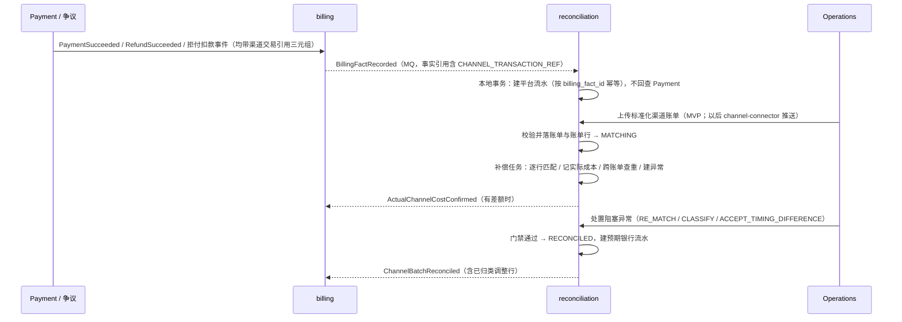
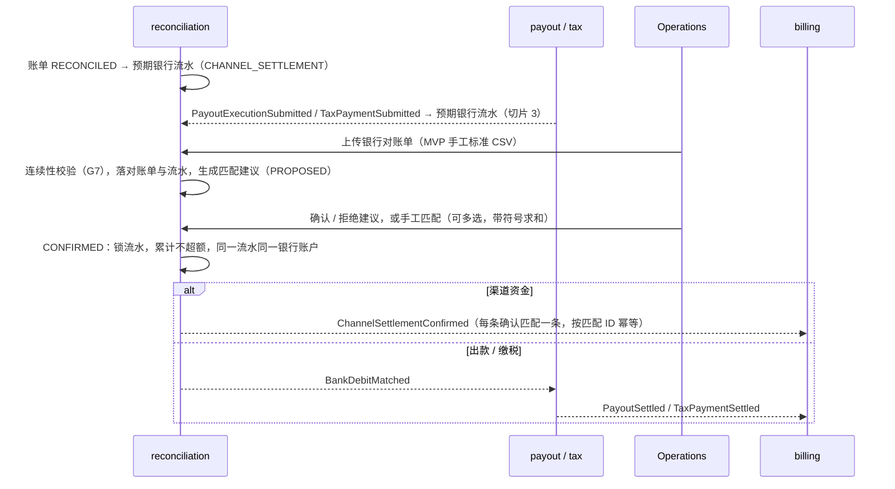
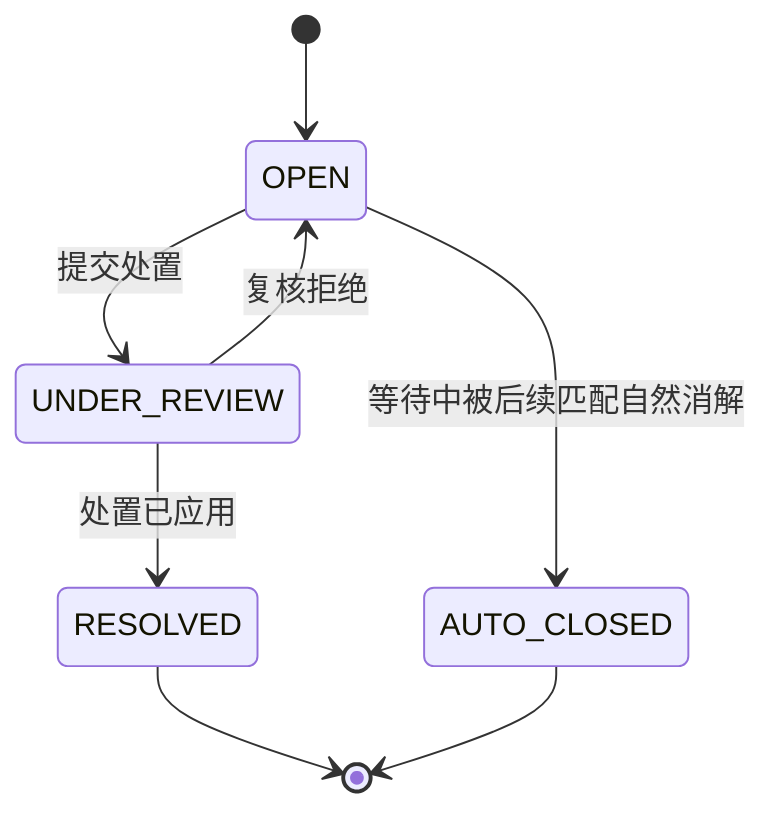
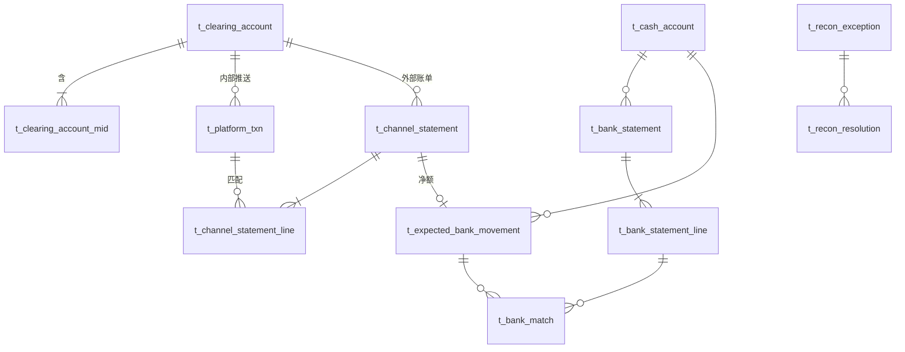

# reconciliation（对账）设计讨论稿

> **状态：已确认（2026-10-20，两轮）。** 本稿把 `mor_reconciliation` 从旧 Finance 单体"对账直接写 Journal"的模型，改为 V2 / V3 链路下"对账只认定事实、记账经 billing"的模型。第一轮确认边界与 Q1–Q11；第二轮确认命名与 13 张表、Q12–Q16 与缺口 G1–G15 的处理方式（能闭环的做，要等真实对接才清楚的先人工处置或暂缓）。均已登记为[决定](../../agent-docs/decisions/2026-10-20-reconciliation-facts-via-billing.md)。配图见同目录 `reconciliation.pen`。切片 1 已进入实施（阶段 4），需求与技术方案见 [requirements/20261020/reconciliation-渠道资金对账切片1](../../requirements/20261020/reconciliation-渠道资金对账切片1/requirement.md)。

## 1. 定位与边界

**一句话：** reconciliation 回答两个问题，并把答案以事实交给 billing。
1. **交易层：** 渠道账单里的每一行，对应平台的哪一笔平台流水（预期应收或应付）？
2. **银行层：** 每一笔应到或应付的钱，是否真的进出了平台的银行账户？

| reconciliation 拥有 | reconciliation 不拥有 |
|---|---|
| 渠道清算账户（MID 集合 + 币种 → 经营主体的清算边界） | 渠道、技术账号、MID 主数据（channel-connector） |
| 平台流水（由 billing 已入账的事实生成，"内部推送"） | 金额计算、费用、分润（billing） |
| 渠道账单与账单行（不可变原始事实，"外部账单"） | 渠道文件的拉取与各家格式解析（channel-connector，见 Q1） |
| 交易匹配与实际渠道成本确认（记在账单行上） | 分录、余额（ledger / account）——对账只有进度字段，没有余额 |
| 平台银行账户主数据与用途（Vault 令牌） | 银行账号明文（Vault） |
| 银行对账单与流水、预期银行流水、银行匹配 | 出款与缴税是否完成（payout / tax 自己宣布） |
| 对账异常与处置决定（含人工归类） | 记账证据（处置产生金额时登记到 billing） |

**与旧模型的三处根本差异：**
1. **不写分录。** 旧模型的 `CHANNEL_BATCH_SETTLEMENT`、`CHANNEL_BANK_MATCH`、`LATE_DEBIT` 三种 Journal，全部改为向 billing 登记事实（决定 2026-10-19 第 8 条：ledger 只有一个上游）。
2. **平台流水来自 billing 事实，不来自 Payment 事件。** 对账手里的预期金额，与账上实际记的金额同源；渠道交易引用由 Payment 事件 → billing 事实原样带过来，对账不回查 Payment（Q2）。
3. **只为渠道资金登记事实。** 出款、缴税的银行扣款，对账只做匹配并通知 Owner；由 payout / tax 发 `PayoutSettled` / `TaxPaymentSettled`，每类资金事实只有一个来源。

**和 account / ledger 账户怎么对应：** 对账不存账户 ID，对账表的主键就是账户维度值，经 billing 事实引用带过去。渠道待清算 / 结算应收应付按 `t_clearing_account.id` 分户（事实引用 `CLEARING_ACCOUNT`）；银行现金按 `t_cash_account.id` 分户（account 的 `owner_type = CASH_ACCOUNT`，事实引用 `CASH_ACCOUNT`）。ledger 渠道维度的 owner 取值名在规则包实施时对齐。

**手工优先原则（第二轮）：** 很多场景要真实对接渠道和银行才知道形态。本期只对"逻辑能闭环"的场景写专门逻辑；其余一律走通用出口——**挂异常 → 人工处置（`CLASSIFY` 带归类码）→ 经 billing 记账**。等真实数据跑一段时间，按频率把高频场景逐个改成自动。

## 2. 三段账户与两次登记

一笔渠道资金在账上经过三段，对账负责推动后两次转换：

```
                交易发生（billing 事实）       账单对平（对账 → billing）       银行确认（对账 → billing）
渠道待清算应收 / 应付  ─────────────────▶  渠道结算应收 / 应付  ─────────────────▶  银行现金
CHANNEL_UNSETTLED_*                   CHANNEL_SETTLEMENT_*                   BANK_CASH
```

| 时点 | 对账发出 | billing 事实类型 | 账务效果（ledger 规则包） |
|---|---|---|---|
| 实际渠道成本与预估不一致 | `ActualChannelCostConfirmed` | `COST_ADJUSTMENT`（已有） | 渠道费预提调到实际值 |
| 账单逐笔对平 | `ChannelBatchReconciled` | **`CHANNEL_BATCH_RECONCILED`（新增）** | 待清算应收 / 应付净额化为结算应收或应付，冲掉本批实际渠道费预提；已归类的调整行按归类码入科目 |
| 银行流水确认 | `ChannelSettlementConfirmed` | `CHANNEL_SETTLEMENT`（已有） | 结算应收 / 应付转为银行现金 |
| 平台流水、预期银行流水、银行流水的归类处置批准 | `ReconAdjustmentApproved` | **`RECON_ADJUSTMENT`（新增）** | 按「来源对象 + 归类码」选科目（第 4 节 F3） |
| 未识别借方流水暂记 | `BankLineSuspended` | **`BANK_SUSPENSE`（新增）** | 借 暂记资产 / 贷 银行现金；之后只能经处置重分类（Q5） |

**为什么登记两次，而不是只在到账时登记一次：** 合并成一次，账上就分不出"渠道已认账、钱还在路上"和"渠道还没认账"。关账时在途资金要单独列示，长款、短款也要能先定位到是哪一层出的问题。

**银行到账为什么常常不等于在途累计数：** 银行层对的是**每一次打款**（预期银行流水），不是在途余额；在途余额是 ledger「渠道结算应收」的余额，对账不存。一次打款可能对应多张账单（合并到账）、一张账单可能分几次到（分笔到账）、负净额账单可能滚到下一批抵扣、中间行可能扣费、渠道可能扣保证金。前三种靠银行匹配的多对多与带符号求和解决（第 6.4 节不变量 5），后两种走人工归类（G11、Q14）。

## 3. 一笔生意走一遍（接 billing 设计稿的 100 USD 例子）

Client 收一笔 100 USD，billing 预估渠道费 0.50；之后退款 30。渠道 T+2 出一张账单，里面有这笔支付（实扣费 0.45）、这笔退款，以及一笔 2.00 的渠道月费。

| 步 | 发生什么 | 对账做什么 | 账上（经 billing → account → ledger） |
|---|---|---|---|
| 1 | `PaymentSucceeded`（带渠道交易引用）→ billing 生成 PAYMENT 事实并原样带上引用 | 消费 `BillingFactRecorded`，建平台流水 P1：应收 100，预估费 0.50，冻结外部交易号 | 借 待清算应收 100；预提渠道费 0.50 |
| 2 | `RefundSucceeded` → billing 生成 REFUND 事实 | 建平台流水 P2：应付 30 | 贷 待清算应付 30 |
| 3 | 运营上传标准化账单 S1：PAYMENT 行 100（费 0.45）、REFUND 行 30、ADJUSTMENT 行 2.00 DEBIT（月费）；净额 67.55 CREDIT | 导入、校验恒等式：100 − 0.45 − 30 − 2.00 = 67.55 | — |
| 4 | 自动匹配 | 行 1 → P1（行上记 `actual_fee` 0.45），行 2 → P2；0.45 ≠ 0.50 → 发 `ActualChannelCostConfirmed`；行 3 归属不到交易 → `UNEXPLAINED_ADJUSTMENT` 异常 | billing `COST_ADJUSTMENT` −0.05：预提调到 0.45 |
| 5 | 运营处置异常：`CLASSIFY` 归类码 `CHANNEL_FEE_OTHER`，Checker 批准 | 行 3 → `MATCHED`（已归类）；不单独发事件，金额随账单事实带出 | — |
| 6 | 账单门禁全部通过 | S1 → `RECONCILED`；P1、P2 → `SETTLED`；生成预期银行流水 M1（CREDIT 67.55）；发 `ChannelBatchReconciled` | 借 结算应收 67.55、渠道费预提 0.45、待清算应付 30、其他渠道费 2.00 / 贷 待清算应收 100 |
| 7 | 财务上传银行对账单，有一笔入账 67.40（中间行扣 0.15） | 建议 M1 ↔ 该流水（金额不等，只在人工搜索时给出），运营确认部分匹配 67.40 → 发 `ChannelSettlementConfirmed`；M1 剩 0.15 → `BANK_AMOUNT_MISMATCH` 异常 | 借 银行现金 67.40 / 贷 结算应收 67.40 |
| 8 | 运营处置：`CLASSIFY` 归类码 `BANK_FEE`，Checker 批准 | M1 → `CONFIRMED`、S1 → `CASH_CONFIRMED`；发 `ReconAdjustmentApproved` | `RECON_ADJUSTMENT`：借 银行手续费 0.15 / 贷 结算应收 0.15 |

第 4、6 步的两条事实谁先入账都可以：预提科目在两条都入账后归零，不依赖顺序。

## 4. 业务流程

### F1 渠道交易对账（主流程）



**匹配规则（按优先级）：**
1. 键：`清算账户 + 引用类型 + 外部交易号`，命中唯一一条 `OPEN / PARTIALLY_MATCHED` 平台流水；在账单行上写 `platform_txn_id`。
2. 方向必须一致：PAYMENT 行对应应收，REFUND / CHARGEBACK 行对应应付。
3. 金额：行金额等于平台流水剩余金额 → `MATCHED`；小于 → 平台流水 `PARTIALLY_MATCHED`（多次 Capture、分批清算，一笔平台流水可以被多行覆盖）；大于 → `AMOUNT_MISMATCH` 异常。
4. 未命中：先进入等待期（billing 事实可能尚未到达，按清算账户 `unmatched_wait_days`），期满仍未命中 → `CHANNEL_LINE_UNMATCHED` 异常（渠道有、平台没有，G1：人工到 Payment 核实补状态后 `RE_MATCH`）。
5. 命中多条 → 立即开 `AMBIGUOUS_REFERENCE` 异常，不猜测。
6. **跨账单查重（G4）：** 同一清算账户下，未作废账单里已有「引用类型 + 外部交易号 + 行类型 + 方向 + 金额」完全相同的行 → `DUPLICATE_SETTLEMENT` 异常，由人判断。
7. FEE 行：带外部交易号的，记到对应交易行的实际费用上；ADJUSTMENT 行以及不带交易号的 FEE 行 → `UNEXPLAINED_ADJUSTMENT` 异常，人工 `CLASSIFY`（月费、保证金扣留 / 释放等，G11 / Q16）。

**账单对平门禁（全部满足才 `RECONCILED`）：**
- 每条 PAYMENT / REFUND / CHARGEBACK 行都已匹配到平台流水；
- 每条 ADJUSTMENT 行和不带交易号的 FEE 行都已有 `APPLIED` 的归类处置；
- 本账单不存在阻塞性的开放异常；
- 各行按方向回放后，与账单头的总额、费用、净额一致（导入时已校验，这里在锁内复核）。

### F2 银行对账



**自动建议规则：** 同一银行账户、方向一致、币种一致、金额相等，起息日在预期日 ±N 个工作日内；出款还要求银行付款参考号一致（COMBINED 借记不能靠金额偶然相等推断）。只给一对一建议；合并到账、分笔到账、负净额抵扣由运营在手工匹配里多选。

**新预期流水触发重新建议（钱比账单先到）：** 预期银行流水生成时，对同一银行账户里仍未匹配的流水（包括已挂 `BANK_LINE_UNMATCHED` 的贷方）再跑一次建议；确认后原异常 `AUTO_CLOSED`。

**对账单连续性（G7）：** 导入时校验 ① `opening_balance + Σ 流水 = closing_balance`，不通过拒绝导入；② 同一银行账户上一张对账单的 `closing_balance` 等于本张 `opening_balance`、期间相接，不通过开 `BANK_STATEMENT_GAP` 异常（不阻塞，提示漏传）。这是对账唯一核对的"余额"，而且是银行自己报的余额。

### F3 异常处置



- Maker 提交处置，内容冻结 Hash；Checker 独立复核（不得同人）。权限只有两个点：对账操作、对账审批（G15）。
- **审批只在对账做一次（Q3）。** Checker 批准的同一本地事务内应用处置：处置 → `APPLIED`、异常 → `RESOLVED`。处置类型三种：
  - `RE_MATCH`：在账单行上写匹配，或追加一条银行匹配。
  - `ACCEPT_TIMING_DIFFERENCE`：不动金额，只解除阻塞或延长等待。
  - `CLASSIFY`：带归类码与金额（第二轮把原 `BILLING_ADJUSTMENT`、`WRITE_OFF` 并入）。**入账路径由来源对象决定：**

| 来源对象 | 怎么入账 | 对方科目（借贷另一边） | 可用归类码 |
|---|---|---|---|
| 渠道账单行（ADJUSTMENT / 无交易号 FEE） | 不单独发事件；随该账单的 `ChannelBatchReconciled` 作为「已归类调整行」带出 | 结算应收 / 应付（并入净额） | `CHANNEL_FEE_OTHER`、`CHANNEL_RESERVE_HOLD`、`CHANNEL_RESERVE_RELEASE`、`RECON_DIFFERENCE` |
| 平台流水（长期未结算） | `ReconAdjustmentApproved` → `RECON_ADJUSTMENT` | 待清算应收 / 应付 | `RECON_DIFFERENCE` |
| 预期银行流水（到账金额不足或超出） | 同上 | 结算应收 / 应付 | `BANK_FEE`、`RECON_DIFFERENCE` |
| 银行流水（未识别） | 同上 | 银行现金；已暂记（`SUSPENDED`）的取暂记科目 | `BANK_FEE`、`BANK_INTEREST`、`INTERNAL_TRANSFER`、`UNALLOCATED_RECEIPT`、`PAYOUT_RETURN_PENDING`、`RECON_DIFFERENCE` |

- 归类码的科目映射在 ledger 规则包配置。`INTERNAL_TRANSFER`（自有账户调拨，G9）两边各归类一次，在途科目自然归零；`UNALLOCATED_RECEIPT`（Client 打来的保证金、注资等暂不能直接认定的收款）和 `PAYOUT_RETURN_PENDING`（出款被退回，G10）进待处理负债，后续由财务经 billing `MANUAL_ADJUSTMENT` 转到最终科目、通知 payout 线下处理。
- 一个异常只有一条最终 `APPLIED` 处置，且必须完整覆盖差异金额。

### F4 超期检测（定时任务）

| 检测 | 条件 | 结果 |
|---|---|---|
| 平台有、渠道无 | 平台流水创建超过 `unmatched_wait_days` + 渠道周期仍为 `OPEN` | `PLATFORM_ITEM_UNSETTLED` 异常（不阻塞任何账单）；上游冲正、渠道未清算等都落在这里，人工 `ACCEPT_TIMING_DIFFERENCE` 或 `CLASSIFY RECON_DIFFERENCE`（G5） |
| 应到未到 | 预期银行流水超过预期日 + `cash_grace_days` 仍未确认 | `BANK_MOVEMENT_OVERDUE` 异常 |
| 迟到扣款 | 银行出现借记，参考号指向已 FAILED / CANCELLED 的出款或缴税 | `LATE_DEBIT` 异常 + 立即暂记 + 发 `LateBankDebitDetected`（切片 3，Q5） |
| 未识别借方 | 借方流水过了匹配窗口（默认 1 个工作日）仍未匹配 | `BANK_LINE_UNMATCHED` 异常 + 暂记（`BankLineSuspended`）（Q5） |
| 未识别贷方 | 贷方流水过了匹配窗口仍未匹配 | 只开 `BANK_LINE_UNMATCHED` 异常，不暂记（Q5） |

### F5 期末

关账不被对账异常阻塞（时间差属正常）。MVP 不做独立期末报告（G13），控制台提供查询：在途账单（`RECONCILED` 但未到账）、开放异常（按账龄）、未匹配银行流水的金额汇总。已确认但还没登记到 billing 的对账事实，纳入关账检查 `CHECK_ACCOUNT_POSTING_PROGRESS` 的上游追平检查。

## 5. 业务用例

| 编号 | 用例 | 参与者 | 入口 | 产出 |
|---|---|---|---|---|
| UC-R01 | 维护渠道清算账户与所含 MID（新建、增减 MID、停用） | 财务运营 | Operations 控制台 | 清算账户 + MID 映射；同一 MID + 币种只属一个清算账户；MID 的渠道与经营主体向 channel-connector 核对；提示已激活但未归属清算账户的 MID（Q10） |
| UC-R02 | 维护平台银行账户（含用途） | 财务运营（Maker-Checker） | Operations 控制台 | 银行账户（账号经 Vault Protect）；同一主体 + 币种 + 用途只允许一个 `ACTIVE` |
| UC-R03 | 解析清算账户 | billing | 内部 HTTP | MID + 币种 → 清算账户 ID + 经营主体（billing 事务外调用，写入事实引用 `CLEARING_ACCOUNT`） |
| UC-R04 | 查询当前用途的银行账户 | payout、tax | 内部 HTTP | 主体 + 币种 + 用途 → 银行账户（不含明文） |
| UC-R05 | 登记平台流水 | 系统 | 消费 `BillingFactRecorded` | 平台流水（PAYMENT、DUPLICATE_CAPTURE、CHARGEBACK_REVERSAL → 应收；REFUND、DUPLICATE_COMPENSATION、CHARGEBACK → 应付） |
| UC-R06 | 导入渠道账单 | 财务运营（上传标准文件）；以后 channel-connector | 控制台 / 内部 HTTP | 账单 + 账单行；结构或恒等式不通过 → `REJECTED` |
| UC-R07 | 逐笔交易匹配与实际成本 | 系统 | 补偿任务 | 账单行的匹配与实际费用、平台流水进度、异常；有成本差额 → `ActualChannelCostConfirmed` |
| UC-R08 | 作废未对平账单 | 财务运营 | Operations 控制台 | 账单 `VOIDED`，其行的匹配失效、平台流水回到未匹配（Q11） |
| UC-R09 | 账单对平登记 | 系统 | 匹配或处置完成后触发 | 账单 `RECONCILED`、预期银行流水、`ChannelBatchReconciled` |
| UC-R10 | 登记出款 / 缴税的预期银行流水 | 系统 | 消费 payout / tax 事件 | 预期银行流水；执行失败或取消 → `CANCELLED`（切片 3） |
| UC-R11 | 上传银行对账单 | 财务运营 | Operations 控制台 | 对账单 + 流水；连续性校验；按 `银行账户 + 银行交易号` 去重 |
| UC-R12 | 生成银行匹配建议 | 系统 | 对账单导入后、预期银行流水生成后触发 | `PROPOSED` 匹配 |
| UC-R13 | 确认、拒绝或手工建立银行匹配 | 财务运营 | Operations 控制台 | `CONFIRMED` 后：渠道 → `ChannelSettlementConfirmed`；出款 / 缴税 → `BankDebitMatched` |
| UC-R14 | 超期检测 | 系统 | XXL-Job | 第 4 节 F4 的异常 |
| UC-R15 | 提交异常处置 | 财务运营（Maker） | Operations 控制台 | 处置草稿 → 待复核 |
| UC-R16 | 复核并应用处置 | 财务运营（Checker） | Operations 控制台 | 处置应用；`CLASSIFY` 按来源对象登记 billing 或随账单带出 |
| UC-R17 | 对账工作台查询 | 财务运营 | Operations 控制台（经 BFF） | 账单进度、平台流水、银行流水、异常列表（含账龄）与详情、在途汇总 |

## 6. 领域模型

### 6.1 聚合与表（18 → 13 张）

第一轮从旧模型 18 张收到 16 张；第二轮按"内部推送 / 外部账单"对称改名，并把匹配与成本合到账单行、用途合到银行账户，收到 13 张。

| 聚合 | 表 | 中文 | 可变性 | 来源 |
|---|---|---|---|---|
| 清算账户 | `t_clearing_account` | 清算账户 | 可变（状态、配置） | 旧 `t_channel_account` 改名 |
| 　└ 所含 MID | `t_clearing_account_mid` | 清算账户 MID | 可增删 | **新增**（G2）：一个清算账户含多个 MID；唯一 `(mid_id, currency)` 保证解析唯一，JSON 列做不到这个约束 |
| 平台流水 | `t_platform_txn` | 平台流水（内部推送） | 可变（进度、状态） | 旧 `t_channel_open_item` + `t_channel_debit_item` 合并改名；`direction` 区分应收应付 |
| 渠道账单 | `t_channel_statement` | 渠道账单（外部账单） | 头不可变，`status` 可变 | 旧 `t_channel_settle_batch` 改名；一个渠道结算批次一张账单 |
| 　└ 账单行 | `t_channel_statement_line` | 渠道账单行 | 内容不可变；匹配、实际费用、状态可变 | 旧 `t_channel_settle_item` 改名；**吸收**旧交易匹配表与成本确认 / 分配表（一行最多对一笔平台流水） |
| 银行账户 | `t_cash_account` | 银行账户 | 可变（状态） | 不变；**吸收**用途绑定（`account_purpose` 字段），删除绑定槽与版本表 |
| 银行对账单 | `t_bank_statement` | 银行对账单 | 不可变 | 不变；加期初、期末余额与期间（G7） |
| 　└ 银行流水 | `t_bank_statement_line` | 银行流水 | 内容不可变，`match_status` 可变 | 旧 `t_bank_statement_item` 改名 |
| 预期银行流水 | `t_expected_bank_movement` | 预期银行流水 | 可变（已确认金额、状态） | 第一轮新增：渠道账单净额、出款执行、缴税三种银行层目标 |
| 银行匹配 | `t_bank_match` | 银行匹配 | 状态可变 | 旧 `t_bank_recon_match` 改名；银行层确实多对多，保留 |
| 对账异常 | `t_recon_exception` | 对账异常 | 可变 | 类型重新分层（7.9） |
| 　└ 处置 | `t_recon_resolution` | 异常处置 | 审批流可变 | 删除 `instruction_id`；加归类码 |
| 可靠执行 | `t_compensation_event` | 补偿事件 | — | 不变 |

**删除的 5 张：** `t_duplicate_capture_item`（补偿流程归 Payment）、`t_channel_transaction_match`、`t_channel_cost_confirm`、`t_channel_cost_alloc`（并入账单行）、`t_cash_account_binding` + `t_cash_account_binding_ver`（并入银行账户；用途换绑极少，换绑即停用旧户、启用新户，历史由预期银行流水上冻结的 `cash_account_id` 保留）。

消费幂等直接靠业务表唯一键（`t_platform_txn.billing_fact_id`、`t_expected_bank_movement(movement_type, source_id)`），不另建业务消费表。**实施修订（2026-10-20）：** 开启 MQ 消费时公共消息库还要求 `t_consumed_event`、`t_consumed_aggregate_version` 两张去重机制表（与 billing、account 相同），库内共 15 张。

### 6.2 关系



### 6.3 关键字段（新增或改动的部分）

**`t_clearing_account`**：`clearing_account_code`、`channel_code`、`entity_no`、`currency`、`status`；配置字段 `unmatched_wait_days`（默认 3）、`cost_tolerance_amount`、`cash_grace_days`（Q7）；`settlement_cash_account_id`（渠道打款进哪个银行账户，生成预期银行流水用）。

**`t_clearing_account_mid`**：`clearing_account_id`、`mid_id`、`currency`（冗余自清算账户，用于唯一键）；唯一 `uk_clearing_account_mid(mid_id, currency)`。

**`t_platform_txn` 平台流水**

| 字段 | 说明 |
|---|---|
| `clearing_account_id` | 所属清算账户 |
| `direction` | `RECEIVABLE` / `PAYABLE` |
| `txn_source` | `PAYMENT`、`DUPLICATE_CAPTURE`、`REFUND`、`DUPLICATE_COMPENSATION`、`CHARGEBACK`、`CHARGEBACK_REVERSAL` |
| `billing_fact_id` | 来源 billing 事实，唯一（消费幂等） |
| `source_ref_type` / `source_ref_id` | Payment Attempt、Channel Refund 或 Dispute Notice |
| `channel_transaction_ref_id`、`reference_type`、`external_transaction_id` | 从 billing 事实的 `CHANNEL_TRANSACTION_REF` 引用冻结，源头是 Payment 事件 |
| `currency`、`expected_amount`、`expected_fee` | 预期金额与 billing 预估的渠道费 |
| `matched_amount`、`actual_fee`、`settled_amount` | 已被账单行覆盖的金额 / 累计实际费用 / 已随账单对平登记的金额 |
| `status`、`version` | 见 7.3 |

唯一键：`uk_platform_txn_fact(billing_fact_id)`、`uk_platform_txn_external(clearing_account_id, reference_type, external_transaction_id, direction)`。

**`t_channel_statement` 渠道账单**：`clearing_account_id`、`channel_batch_ref`、`revision`（唯一 `(clearing_account_id, channel_batch_ref, revision)`，Q11）、`settlement_date`、`currency`、`gross_amount`、`fee_amount`、`net_amount`、`cash_direction`、`file_id`、`file_content_hash`、`status`、`cash_confirmed_amount`、`reconciled_time`。

**`t_channel_statement_line` 渠道账单行**

| 字段 | 说明 |
|---|---|
| `statement_id`、`line_no` | 所属账单与行号 |
| `line_type`、`direction`、`amount`、`fee_amount` | 来自文件，不可变 |
| `reference_type`、`external_transaction_id`、`transaction_date` | 来自文件，不可变；ADJUSTMENT 行可为空 |
| `raw_attributes` | 渠道特有字段原样存 JSON，不建模（G3） |
| `platform_txn_id`、`match_method`、`matched_time` | 匹配结果（一行最多对一笔平台流水） |
| `actual_fee` | 确认的实际渠道费（取自本行或同交易的 FEE 行） |
| `resolution_id` | 已归类调整行指向的处置 |
| `match_status`、`version` | 见 7.8 |

**`t_cash_account` 新增**：`account_purpose`（`CHANNEL_SETTLEMENT` / `PAYOUT` / `TAX`）；同一 `entity_type + entity_id + currency + account_purpose` 只允许一个 `ACTIVE`（应用内校验）。

**`t_bank_statement` 新增**：`period_start`、`period_end`、`opening_balance`、`closing_balance`（G7）。

**`t_expected_bank_movement` 预期银行流水**

| 字段 | 说明 |
|---|---|
| `movement_type` | `CHANNEL_SETTLEMENT` / `PAYOUT` / `TAX_PAYMENT` |
| `source_id` | 账单 ID / 出款执行 ID / 缴税 ID；唯一 `(movement_type, source_id)` |
| `cash_account_id` | 预期进出的银行账户（冻结） |
| `direction`、`currency`、`expected_amount`、`expected_date` | 预期方向、金额与日期 |
| `bank_payment_ref` | 出款 / 缴税的银行付款参考号（渠道为空） |
| `confirmed_amount`、`status`、`version` | 见 7.10 |

**`t_recon_exception` 改动**：`exception_type` 重分类，新增 `recon_layer`（`TRANSACTION` / `BANK`）与 `blocking`；`source_type` 收敛为本库资源：`CHANNEL_STATEMENT`、`CHANNEL_STATEMENT_LINE`、`PLATFORM_TXN`、`BANK_STATEMENT`、`BANK_STATEMENT_LINE`、`EXPECTED_BANK_MOVEMENT`；`difference_amount`（带符号）；`opened_time` 用于账龄（G14 只显示账龄，不做分派与到期日）。

**`t_recon_resolution` 改动**：`resolution_type` 收为三种；新增 `classification_code`（仅 `CLASSIFY`）、`amount`（带符号）；`maker`、`checker`、`content_hash` 保留。

### 6.4 不变量

1. 平台流水：`settled_amount ≤ matched_amount ≤ expected_amount`，金额均为正。
2. 一条账单行最多匹配一笔平台流水；一笔平台流水被多行覆盖时，各行金额合计不超过 `expected_amount`。
3. 账单一旦 `RECONCILED`，不得再改变其行的匹配、实际费用或归类；纠错只能经 billing 追加调整事实。
4. 净额只能在同一清算账户同一账单内抵销。
5. 同一银行流水的全部 `CONFIRMED` 匹配：按预期流水方向带符号求和（与流水同向为正、反向为负），合计不超过流水金额；所有匹配的预期流水与流水属于同一银行账户。确认事务锁该流水。负净额账单因此能和下一批一起被一笔贷方到账确认。
6. 同一预期银行流水的 `CONFIRMED` 合计不超过 `expected_amount`；`cash_direction = NONE` 的账单不生成预期银行流水。
7. 异常归属的主体由来源父链确定，不得人工改挂；一个异常最多一条 `APPLIED` 处置，且完整覆盖差异金额。
8. 事务内只写本库；调 billing、读 Platform File 都在事务外，对外事件经补偿事件表发出。正常匹配不在线查询 Payment。
9. 只暂记借方流水；已暂记（`SUSPENDED`）的银行流水不再参与建议与匹配，只能经 `CLASSIFY` 重分类，不再改变银行现金。
10. `CLASSIFY` 的入账路径与对方科目由异常来源对象决定（第 4 节 F3 表），归类码只选科目，不改变路径。
11. 银行对账单 `opening_balance + Σ 流水 = closing_balance`，否则不得导入。

## 7. 枚举目录

| # | 枚举 | 用于 | 取值 | 说明 |
|---|---|---|---|---|
| 7.1 | `ClearingAccountStatus` | `t_clearing_account.status` | `ACTIVE`、`INACTIVE` | 停用后不再接受新的平台流水和账单 |
| 7.2 | `ClearingDirection` | `t_platform_txn.direction` | `RECEIVABLE`、`PAYABLE` | 渠道欠平台 / 平台欠渠道 |
| 7.3 | `PlatformTxnStatus` | `t_platform_txn.status` | `OPEN`、`PARTIALLY_MATCHED`、`MATCHED`、`SETTLED`、`EXCEPTION` | `MATCHED`：逐笔已对上；`SETTLED`：所在账单已对平并登记 billing |
| 7.4 | `PlatformTxnSource` | `t_platform_txn.txn_source` | `PAYMENT`、`DUPLICATE_CAPTURE`、`REFUND`、`DUPLICATE_COMPENSATION`、`CHARGEBACK`、`CHARGEBACK_REVERSAL` | 与 billing 事实类型对应 |
| 7.5 | `ChannelStatementStatus` | `t_channel_statement.status` | `REJECTED`、`MATCHING`、`VOIDED`、`RECONCILED`、`CASH_CONFIRMED` | 导入不通过 → `REJECTED`（留档）；`NONE` 净额账单对平后直接 `CASH_CONFIRMED` |
| 7.6 | `ChannelLineType` | `t_channel_statement_line.line_type` | `PAYMENT`、`REFUND`、`CHARGEBACK`、`FEE`、`ADJUSTMENT` | ADJUSTMENT 必须显式声明方向；保证金扣留 / 释放在真实渠道样本出来前按 ADJUSTMENT 处理（Q16） |
| 7.7 | `SettlementDirection` / `CashDirection` | 账单行方向 / 账单净额方向 | `CREDIT`、`DEBIT`（账单另有 `NONE`） | 相对平台 |
| 7.8 | `LineMatchStatus` | `t_channel_statement_line.match_status`、`t_bank_statement_line.match_status` | `UNMATCHED`、`PARTIALLY_MATCHED`、`MATCHED`、`EXCEPTION`、`SUSPENDED` | 账单行被归类也记 `MATCHED`；`PARTIALLY_MATCHED`、`SUSPENDED` 只用于银行流水 |
| 7.9 | `ReconExceptionType` | `t_recon_exception.exception_type` | 交易层：`CHANNEL_LINE_UNMATCHED`、`AMBIGUOUS_REFERENCE`、`AMOUNT_MISMATCH`、`DUPLICATE_SETTLEMENT`、`UNEXPLAINED_ADJUSTMENT`、`COST_DEVIATION`、`PLATFORM_ITEM_UNSETTLED`；银行层：`BANK_LINE_UNMATCHED`、`BANK_AMOUNT_MISMATCH`、`BANK_MOVEMENT_OVERDUE`、`BANK_STATEMENT_GAP`、`LATE_DEBIT` | 不阻塞账单的：`PLATFORM_ITEM_UNSETTLED`、`BANK_MOVEMENT_OVERDUE`、`BANK_STATEMENT_GAP`；`COST_DEVIATION` 仅在差额超过容差时产生；原 `WRONG_ACCOUNT_OR_PURPOSE` 因银行匹配只能同户而删除 |
| 7.10 | `ExpectedMovementStatus` | `t_expected_bank_movement.status` | `OPEN`、`PARTIALLY_CONFIRMED`、`CONFIRMED`、`CANCELLED`、`EXCEPTION` | 出款 / 缴税执行失败或取消 → `CANCELLED`；差额经 `CLASSIFY` 后视为 `CONFIRMED` |
| 7.11 | `ExpectedMovementType` | `t_expected_bank_movement.movement_type` | `CHANNEL_SETTLEMENT`、`PAYOUT`、`TAX_PAYMENT` | 决定确认后发哪个事件 |
| 7.12 | `BankMatchStatus` | `t_bank_match.status` | `PROPOSED`、`CONFIRMED`、`REJECTED` | 只有 `CONFIRMED` 产生下游事件 |
| 7.13 | `MatchMethod` | `t_bank_match.match_method`、`t_channel_statement_line.match_method` | `AUTO`、`MANUAL` | 银行层 `AUTO` 只表示系统建议、人工确认（Q6） |
| 7.14 | `PayoutComponentType` | `t_bank_match.payout_component_type` | `BENEFICIARY_TRANSFER`、`BANK_FEE`、`COMBINED` | 只用于 PAYOUT（切片 3） |
| 7.15 | `ReconLayer` | `t_recon_exception.recon_layer` | `TRANSACTION`、`BANK` | |
| 7.16 | `ReconExceptionStatus` | `t_recon_exception.status` | `OPEN`、`UNDER_REVIEW`、`RESOLVED`、`AUTO_CLOSED` | `AUTO_CLOSED`：未经处置自然消解 |
| 7.17 | `ResolutionType` | `t_recon_resolution.resolution_type` | `RE_MATCH`、`ACCEPT_TIMING_DIFFERENCE`、`CLASSIFY` | 原 `ACCOUNTING_ADJUSTMENT` / `BILLING_ADJUSTMENT`、`WRITE_OFF` 并入 `CLASSIFY` |
| 7.18 | `ReconClassification` | `t_recon_resolution.classification_code` | 交易层：`CHANNEL_FEE_OTHER`、`CHANNEL_RESERVE_HOLD`、`CHANNEL_RESERVE_RELEASE`；银行层：`BANK_FEE`、`BANK_INTEREST`、`INTERNAL_TRANSFER`、`UNALLOCATED_RECEIPT`、`PAYOUT_RETURN_PENDING`；通用：`RECON_DIFFERENCE` | **新增**；每个来源对象可用的子集见 F3 表；科目映射在 ledger 规则包；新增归类码只需加枚举值与规则包映射 |
| 7.19 | `ResolutionStatus` | `t_recon_resolution.status` | `DRAFT`、`PENDING_CHECK`、`APPROVED`、`REJECTED`、`APPLIED` | 不变 |
| 7.20 | `CheckerDecision` | `t_recon_resolution.checker_decision` | `APPROVED`、`REJECTED` | 不变 |
| 7.21 | `CashAccountStatus` | `t_cash_account.status` | `PENDING_VERIFICATION`、`ACTIVE`、`SUSPENDED`、`CLOSED` | 不变 |
| 7.22 | `ReconEntityType` | 银行账户、异常的主体 | `OPERATING_ENTITY`、`FINANCE_ENTITY` | 不变 |
| 7.23 | `AccountPurpose` | `t_cash_account.account_purpose` | `CHANNEL_SETTLEMENT`、`PAYOUT`、`TAX` | 从绑定表移到银行账户；`CashBindingStatus` / `CashBindingVersionStatus` 随表删除 |

## 8. 合同

**进来的**

| 合同 | 提供方 | 对账用它做什么 |
|---|---|---|
| `BillingFactRecorded`（MQ） | billing | 只处理 PAYMENT、DUPLICATE_CAPTURE、REFUND、DUPLICATE_COMPENSATION、CHARGEBACK_DEBIT、CHARGEBACK_REVERSAL，生成平台流水（Q9）；渠道交易引用取自事实引用 `CHANNEL_TRANSACTION_REF` |
| MID 归属核对、MID 列表（内部 HTTP） | channel-connector | 维护清算账户 MID 时核对渠道与经营主体；提示未归属的 MID |
| 渠道账单导入 `POST /reconciliation/v1/channel-statements` | 控制台手工上传；以后 channel-connector | 标准账单文件（见下）的 `file_id + file_content_hash` |
| `PayoutExecutionSubmitted` / `PayoutExecutionFailed`，`TaxPaymentSubmitted` / `TaxPaymentFailed`（MQ） | payout / tax | 建立或取消预期银行流水（切片 3） |
| Platform File 读取 | Platform | 读标准账单文件、银行对账单原文件 |
| Vault Protect | Vault | 银行账号入库前令牌化 |

**标准渠道账单文件（G3，最小字段集）：** 账单头——`clearing_account_code`、`channel_batch_ref`、`settlement_date`、`currency`、`gross_amount`、`fee_amount`、`net_amount`、`cash_direction`；账单行——`line_no`、`line_type`、`direction`、`amount`、`fee_amount`、`reference_type`、`external_transaction_id`、`transaction_date`；其余列原样进 `raw_attributes`。MVP 用 CSV，文件格式说明随切片 1 需求给出。

**标准银行对账单文件：** 头——银行账户、期间、期初余额、期末余额、币种；行——银行交易号、起息日、方向、金额、对方名称、附言 / 参考号。MVP 用 CSV。

**出去的**

| 合同 | 消费方 | 说明 |
|---|---|---|
| `ActualChannelCostConfirmed` | billing | 按平台流水一条：实际成本、预估成本、清算账户、来源支付 / 退款 / 争议；只在差额 ≠ 0 时发 |
| `ChannelBatchReconciled`（新） | billing → `CHANNEL_BATCH_RECONCILED` | 账单头、净额方向、本批应收合计、应付合计、实际渠道费合计、**已归类调整行（归类码 + 带符号金额 + 处置 ID）**；聚合 `CHANNEL_STATEMENT:{id}` |
| `ChannelSettlementConfirmed` | billing → `CHANNEL_SETTLEMENT` | 每条已确认的渠道银行匹配一条；聚合 `BANK_MATCH:{id}`；引用 `CLEARING_ACCOUNT`、`SETTLEMENT_BATCH`、`CASH_ACCOUNT` |
| `ReconAdjustmentApproved`（新） | billing → `RECON_ADJUSTMENT` | 来源对象为平台流水、预期银行流水、银行流水的 `CLASSIFY` 批准时发一次；聚合 `RECON_RESOLUTION:{id}`；带来源对象类型、归类码、主体、币种、带符号金额、清算账户或银行账户引用、Maker / Checker 与批准 Hash |
| `BankLineSuspended`（新） | billing → `BANK_SUSPENSE` | 借方银行流水暂记时发一次；聚合 `BANK_STATEMENT_LINE:{id}`（切片 2） |
| `BankDebitMatched`（新） | payout、tax | 预期银行流水达到 `CONFIRMED` 时发一次（切片 3） |
| `LateBankDebitDetected`（新） | payout、tax | 迟到扣款识别时发一次（切片 3） |
| 清算账户解析 `POST /reconciliation/v1/clearing-accounts/resolutions` | billing | MID + 币种 → 清算账户 + 经营主体 |
| 当前用途银行账户 `GET /reconciliation/v1/cash-accounts/current` | payout、tax | 主体 + 币种 + 用途 → 银行账户（脱敏） |
| 对账工作台查询、处置命令 | Operations BFF | UC-R01、R02、R06、R08、R11、R13、R15–R17 |

## 9. 问题与结论

### 9.1 第一轮（Q1–Q11）

| # | 问题 | 结论 |
|---|---|---|
| Q1 | **渠道文件谁拉取、谁解析？** | **已定（2026-10-20，按建议）：**解析成统一账单放 channel-connector；对外拉取是否经 Platform Integration 执行，实现自动拉取时与 [2026-09-21 Platform Integration 决定](../../agent-docs/decisions/2026-09-21-platform-integration-http-execution.md)对齐。MVP 只支持控制台上传标准文件 |
| Q2 | **渠道交易引用从哪取？** | **已定（2026-10-20）：不回查，由事件链原样带过来。** ① Payment 侧事件统一带三元组 `channelTransactionRefId`、`referenceType`、`externalTransactionId`（对应 `t_channel_transaction_ref`）：`PaymentSucceeded` 现在只有外部交易号字符串（字段名 `channelTransactionRef`），要补另两项；`RefundSucceeded`、`DisputeLost` / `DuplicatePayment*` 尚未实现，实现时按此带上。② billing 新增引用类型 `CHANNEL_TRANSACTION_REF`，`ref_id` 存内部引用 ID；外部交易号最长 255，放不进 `ref_id VARCHAR(64)`，在引用行增加可空列 `external_reference_type`、`external_transaction_id` 仅供该类型使用，`BillingFactRecorded` 载荷随引用一起带出。③ 对账消费时直接冻结，正常流程不调用 Payment |
| Q3 | **处置的审批做几次？** | **已定（2026-10-20）：只在对账审批一次（方案 A）。** 批准事务内处置即 `APPLIED`；需要记账的登记 `ReconAdjustmentApproved`，billing 生成 AUTO 事实 `RECON_ADJUSTMENT`（组件 `RECON_DIFFERENCE`），不走 billing 的人工 Maker-Checker；不复用 `MANUAL_ADJUSTMENT`。第二轮把处置类型收为 `RE_MATCH` / `ACCEPT_TIMING_DIFFERENCE` / `CLASSIFY`，结论不变 |
| Q4 | **`CHANNEL_BATCH_RECONCILED` 的行结构** | **已定（2026-10-20，按建议；第二轮补充）：**结算应收或应付（净额）、待清算应收冲销、待清算应付冲销、实际渠道费（`CHANNEL_COST_SETTLED`），**加上已归类调整行（组件 `CHANNEL_BATCH_ADJUSTMENT` + 归类码）**；ledger 规则包按组件与归类码匹配科目；必填引用 `CLEARING_ACCOUNT`、`SETTLEMENT_BATCH` |
| Q5 | **未识别的银行流水是否暂记？** | **已定（2026-10-20）：只暂记借方（方案 C）。** ① `LATE_DEBIT` 导入即暂记并发 `LateBankDebitDetected`；② 其他未识别借方过 1 个工作日窗口后暂记；③ 未识别贷方只挂异常、期末列示；④ 金额不符的已确认部分正常入账、差额挂异常。暂记经 `BankLineSuspended` → billing `BANK_SUSPENSE`。**payout 前置条件（切片 3 之前定稿）：** 收到 `LateBankDebitDetected` 后冻结该 Client 后续出款或重新锁定对应金额；认定"实际已付"时不发会扣现金的 `PayoutSettled`，改为只冲 Client 应付、贷记暂记科目。tax 同理 |
| Q6 | **银行匹配能否自动确认？** | **已定：**MVP 全部人工确认；稳定后对「金额相等 + 参考号一致」开放自动确认 |
| Q7 | **等待期与容差在哪配？** | **已定：**清算账户上的 `unmatched_wait_days`（默认 3）、`cost_tolerance_amount`、`cash_grace_days`；不建独立配置表 |
| Q8 | **多币种结算** | **已定：**本期不支持，账单币种必须等于清算账户币种 |
| Q9 | **拒付扣款时点** | **已定：**渠道实际扣款时就记账：billing `CHARGEBACK_DEBIT` / `CHARGEBACK_REVERSAL`；DISPUTE 事实只做 Client 侧结转。事件名与行结构在 billing、争议实现时定稿 |
| Q10 | **清算账户什么时候建？** | **已定（用户）：暂不自动创建，运营手工创建。**缺清算账户时 billing 事实停在补偿 ERROR 重试，建好后自动恢复；控制台提示未归属清算账户的 MID |
| Q11 | **渠道重发更正文件** | **已定：**账单加 `revision`；未对平的旧版可 `VOIDED` 后导入新版；已 `RECONCILED` 一律拒绝，差额走后续账单 ADJUSTMENT 行 |

### 9.2 第二轮（Q12–Q16、缺口 G1–G15）

原则：能闭环的做；要等真实对接才知道形态的，先人工处置（异常 + `CLASSIFY`）或暂缓。

| # | 问题 | 结论（2026-10-20，用户按建议确认） | 处理方式 |
|---|---|---|---|
| Q12 | 银行账户开立后 account / ledger 怎么跟上 | 不发 `CashAccountActivated`；银行账户很少，财务手工在 account 开 `CASH_ACCOUNT` 户 | 暂缓 |
| Q13 | 对账事实的业务日期 | 取处理当天；落入已关账期间时按 ledger 现有规则记到下一开放期间开始日 | 简化实现 |
| Q14 | 到账被中间行扣费 | 差额挂 `BANK_AMOUNT_MISMATCH`，人工 `CLASSIFY BANK_FEE`；不做容差内自动草稿 | 人工 |
| Q15 | 切片 1 是否含控制台 | 含 Operations BFF 与最小页面：导入（渠道账单、银行对账单）、列表（清算账户、银行账户、账单、平台流水、银行流水与匹配）、异常处置 | 做 |
| Q16 | 渠道扣留保证金（rolling reserve） | 账单里的扣留 / 释放行按 ADJUSTMENT 挂异常，人工 `CLASSIFY CHANNEL_RESERVE_HOLD / RELEASE`，随账单事实进「渠道保证金应收」；拿到真实渠道样本后再定专门行类型 | 人工 |
| G1 | 渠道有、平台没有（长款、未识别的重复扣款） | `CHANNEL_LINE_UNMATCHED` 异常；运营到 Payment 核实补状态，平台流水生成后 `RE_MATCH`；以后频率高再加 `OrphanChannelTransactionDetected` | 人工 |
| G2 | 清算账户与 MID 基数 | 一对多，新增 `t_clearing_account_mid` | 做 |
| G3 | 标准账单合同 | 最小字段集 + `raw_attributes`（第 8 节） | 做 |
| G4 | 同一交易跨账单重复出现 | 跨账单查重，命中挂 `DUPLICATE_SETTLEMENT` | 做 |
| G5 | 上游冲正（退款被退回、事实更正） | 不接冲正事实；平台流水超期 → `PLATFORM_ITEM_UNSETTLED`，人工处置 | 人工 |
| G6 | 上游事件未实现 | 切片 1 只依赖 `PaymentSucceeded`（补字段）与 `RefundSucceeded`；拒付、重复扣款随切片 2 | 依赖 |
| G7 | 银行对账单连续性 | 导入时校验期初 + 流水 = 期末（拒绝）、上下张相接（`BANK_STATEMENT_GAP`） | 做 |
| G8 | 与渠道 / 出款 / 缴税无关的银行流水 | `CLASSIFY`：`BANK_FEE`、`BANK_INTEREST`、`UNALLOCATED_RECEIPT` | 人工 |
| G9 | 自有账户调拨 | 两边各 `CLASSIFY INTERNAL_TRANSFER` | 人工 |
| G10 | 出款被退回 | `CLASSIFY PAYOUT_RETURN_PENDING`，线下通知 payout | 人工 |
| G11 | 与交易无关的渠道费 | `CLASSIFY CHANNEL_FEE_OTHER`，随账单事实 | 人工 |
| — | 合并到账、分笔到账、负净额滚动抵扣 | 银行匹配多选、带符号求和（不变量 5） | 做 |
| — | 钱比账单先到 | 新预期银行流水触发重新建议，异常自动关闭 | 做 |
| G12 | Q12–Q15 | 见上 | — |
| G13 | 期末报告 | 只做控制台查询 | 暂缓 |
| G14 | 异常分派与时效 | 只显示账龄 | 暂缓 |
| G15 | 权限 | 两个权限点：对账操作、对账审批；Maker ≠ Checker | 做 |

**明确不做：** 多币种结算（Q8）、渠道文件自动拉取（Q1）、银行 API 直连、匹配自动确认（Q6）、跨渠道资金池、`MidActivated` 自动建清算账户（Q10）、`CashAccountActivated`（Q12）。

## 10. 切片建议

1. **切片 1（渠道资金主链路，全部人工兜底）：** 清算账户与 MID 映射 + 解析接口；消费 `BillingFactRecorded`（PAYMENT、REFUND）生成平台流水；上传标准渠道账单；逐笔匹配、实际成本、跨账单查重、账单作废、账单对平；银行账户（含用途）；上传银行对账单（含连续性校验）；匹配建议（含新预期流水触发）与人工确认（多选、带符号）；异常与处置（`RE_MATCH`、`ACCEPT_TIMING_DIFFERENCE`、`CLASSIFY`）；向 billing 发 `ActualChannelCostConfirmed`、`ChannelBatchReconciled`、`ChannelSettlementConfirmed`、`ReconAdjustmentApproved`；Operations BFF 与最小页面。**上游依赖：** billing 新增 `CHANNEL_BATCH_RECONCILED`、`RECON_ADJUSTMENT` 与引用类型；`PaymentSucceeded` 补字段；`RefundSucceeded`（未就绪时先只做 PAYMENT）；ledger 规则包映射归类码。
2. **切片 2：** 超期检测 Job、未识别借方暂记（`BANK_SUSPENSE`）、拒付 / 重复扣款来源、净 DEBIT 账单。
3. **切片 3：** 出款 / 缴税借记匹配（依赖 payout、tax）、`LATE_DEBIT` 暂记与 `LateBankDebitDetected`（依赖 payout 前置条件）。
4. **后续（按真实数据频率决定）：** 长款通知 Payment、保证金专门行类型、中间行扣费自动草稿、期末报告、异常分派、channel-connector 自动拉取、银行 API、自动确认、多币种结算。

## 11. 影响清单

| 位置 | 改动 |
|---|---|
| `reconciliation.pdma.json`、Schema SQL | 18 → 13 张：改名、合并、新增 `t_clearing_account_mid`、删除 5 张；字段注释去掉 Journal 语义 |
| `paytech/tools/arch-rules/.../table-ownership.yaml` | 表名与张数同步 |
| billing | 新增事实类型 `CHANNEL_BATCH_RECONCILED`（含组件 `CHANNEL_BATCH_ADJUSTMENT`）、`RECON_ADJUSTMENT`（组件 `RECON_DIFFERENCE`，事实带来源对象类型与归类码）、`BANK_SUSPENSE`、`CHARGEBACK_DEBIT` / `CHARGEBACK_REVERSAL`，DISPUTE 事实不再产生渠道应付；新增引用类型 `CHANNEL_TRANSACTION_REF`（引用行两列外部引用）、`RECON_RESOLUTION`；消费对账五类事件 |
| Payment / 争议 | `PaymentSucceeded` 补 `channelTransactionRefId`、`referenceType`；`RefundSucceeded`、拒付扣款 / 退回、`DuplicatePayment*` 实现时带渠道交易引用三元组 |
| ledger 规则包 | `CHANNEL_BATCH_RECONCILED`（含归类码）、`RECON_ADJUSTMENT`（来源对象 × 归类码）的科目映射；新增科目：渠道保证金应收、内部调拨在途、待查明收款、出款退回待处理、对账差异损益、银行手续费、利息收入（以 ledger 科目表现有项优先） |
| payout、tax | 发布执行提交 / 失败事件，消费 `BankDebitMatched`、`LateBankDebitDetected`；满足 Q5 的前置条件；查询当前用途银行账户接口路径改为 `/cash-accounts/current` |
| channel-connector | 提供 MID 列表与归属核对；以后标准账单推送（Q1） |
| `FINANCE_DATABASE.md` §4.5、§6.2 | 进入实现时标注被本设计取代的部分 |
