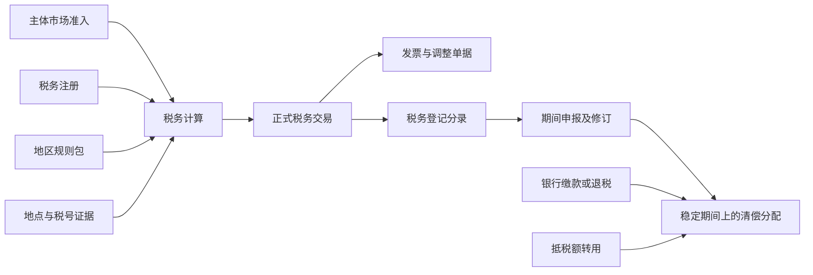

# Tax 服务：职责、公共模型与地区扩展

状态：**已确认**（2026-10-29）。本文是 [2026-10-29 tax 决定](../../agent-docs/decisions/2026-10-29-tax-domain-fact-service.md)的详细设计，不代表已实现、已注册税务或已完成当地合规。日期：2026-10-26 起稿，2026-10-29 三轮修订。

**2026-10-29 修订：** 按评审结论调整三处——① Tax 是领域层的税务事实服务，正式登记消费 acquiring 事件而不是接受写命令，billing 直接使用事件携带的冻结计算结果入账、不等待 Tax；② 纳税主体由其持有方（PayFac Partner 或平台自身）在各自控制台操作准入、申报与缴款，平台提供工具与证据链，不替 OE 申报缴税；③ 税务责任方不是平台登记的纳税主体时（PSP、Direct Merchant），消费者销售返回 `NOT_MANAGED`，首期平台自身的销项只有服务费税。修订涉及第 1、3、4、8、9、10、11 节及 [database.md](database.md)、[flows.md](flows.md)、[cases.md](cases.md)、[example-data.md](example-data.md)、[uml.md](uml.md)；画板 [tax.pen](tax.pen) 与 PNG 预览仍是 2026-10-27 版本，尚未同步。

**2026-10-29 第二轮：** 按用户确认并入——首批纳税主体只有 PayFac Partner 的 AE / SA / EG 主体，平台是纯技术提供方、不登记自身为纳税主体；申报缴纳由 Partner 财务在税局系统完成，系统只是工具。同时并入评审提出的六项：采购侧最小事实前移到第 2 切片（F5）、billing / ledger 税务维度（第 4、9 节）、事件清单定稿（第 9 节）、总金额退款分摊规则（F2）、counterparty 决定修订与两阶段报价（第 7 节）、模型小修（database.md）。三国注册与申报的通用调研见 [regional-policies.md 第 6 节](regional-policies.md#6-注册与申报的通用要求2026-10-29-调研)。

**2026-10-29 首个需求阶段 1：** 用户决定 Partner 控制台本期不做，税务页面只做在 Operations；首期 `managed_by=PLATFORM_OPERATIONS`，由平台运营代 Partner 操作，见 [tax 决定第 17 条](../../agent-docs/decisions/2026-10-29-tax-domain-fact-service.md#修订2026-10-29首个需求阶段-1)。下文"持有方在 Partner 控制台操作"首期均由 Operations 代行。

**2026-10-29 第三轮：** 按用户决定，把不确定且暂无好方案的点降级为人工处理，新增第 10 节"人工处理的边界"（原第 10、11 节顺延为第 11、12 节）。首期自动化收窄为：结账算税、事件登记、B2C 简化票据、底稿与申报版本；采购进项、B2B 核验与税票、电子报送、复杂退款分摊、服务费税、汇差与税局错配全部改为"系统给数据和证据位，Partner 财务做决定"。F5、第 3、7、9、11、12 节及 database.md、flows.md、cases.md 同步调整。

## 1. 设计结论

Tax 管理一件事：**对一笔已经明确交易双方、标的和价格的交易，确定税务处理，留下可解释的正式记录，并完成单据、申报和税款清偿的追溯。**

推荐一个公共业务模型，配合有版本的地区规则包。第一版按数字产品 / SaaS、AE / SA / EG 买家设计；例子采用 AE 法律卖方，且没有参与该交易的 SA / EG 本地机构。卖方所在地和机构参与情况是输入事实，不能从买家国家反推。

Tax 位于目标架构的领域层（[2026-10-17 决定](../../agent-docs/decisions/2026-10-17-target-architecture-v2.md) D03 / D08）：它是所有实例必装的基座能力，不持有交易状态机，与 billing、account、ledger 同层。流程层（acquiring 等）同步调用它取报价；交易生命周期事件由它消费后登记正式事实；它不接受其他领域服务代为发起的写命令。Tax 服务的是**平台登记的纳税主体**，首批只有 PayFac Partner 持有的 AE / SA / EG 主体；平台是纯技术提供方，不登记自身为纳税主体，平台向 PayFac 收取技术服务费的税务由平台财务在系统外处理。纳税主体的持有方（Partner）在 Partner 控制台操作准入、申报与缴款，法定申报与缴纳由 Partner 自己的财务在税局系统完成；系统只提供底稿、申报版本、缴款记录与证据链，不是纳税人，也不替主体完成法律提交。`t_tax_market.managed_by` 首期恒为 `SUBJECT_HOLDER`。

设计材料按主题关联：

- 本文：业务边界、流程、扩展方式及实施顺序。
- [database.md](database.md)：19 张业务表的逻辑字段、关系、唯一约束和不变量。
- [uml.md](uml.md)：表关系总览与完整字段 UML，附可编辑 PlantUML 及 SVG 预览。
- [regional-policies.md](regional-policies.md)：地区包结构、AE / SA / EG 初始适用条件、官方来源。
- [cases.md](cases.md)：价格、退款、申报修订、缴款和异常的验收案例。
- [flows.md](flows.md)：四组14个业务流程，逐一说明触发、步骤、Owner、数据输出和异常。
- [example-data.md](example-data.md)：同一笔交易贯穿销售、退款、申报和缴款的字段级走数；附 [36条合成记录](examples/sale-refund-filing.json)。

19 张表覆盖完整闭环，不要求首个切片全部实现。其中抵税额转用表随申报清偿切片引入；消息可靠性复用项目机制，不计入业务表数。

配套画板（2026-10-27）：[tax.pen](tax.pen)，可编辑；[PDF 预览](assets/tax-design.pdf)。画板是本讨论稿的可视化投影，不增加已确认决定或实现状态。

| 画板 | 内容 | PNG 预览 |
|---|---|---|
| 01 | Tax 职责与系统边界、三种供应关系 | [预览](assets/01-responsibilities.png) |
| 02 | 19 张表的模型关系与证据链 | [预览](assets/02-model-relationships.png) |
| 03 | 字段模型 A：规则与计算，表 1–8 | [预览](assets/03-fields-rules-calculation.png) |
| 04 | 字段模型 B：正式记录与清偿，表 9–19 | [预览](assets/04-fields-records-settlement.png) |
| 05 | 从结账到申报缴税的五条流程与恢复边界 | [预览](assets/05-lifecycle.png) |
| 06 | 公共模型、动态地区包及 AE / SA / EG 对照 | [预览](assets/06-regional-policies.png) |
| 07 | 含税价格、退款、申报修订及关键控制算例 | [预览](assets/07-examples-controls.png) |
| 08 | 四组14个流程：触发、执行、输出与异常 | [预览](assets/08-process-catalog.png) |
| 09 | 同一笔销售与退款：金额和逐表关联数据 | [预览](assets/09-sale-refund-data.png) |
| 10 | 申报、付款状态、修订、抵税与退税的数据 | [预览](assets/10-filing-settlement-data.png) |

## 2. 先理解几个概念

| 概念 | 含义与建模影响 |
|---|---|
| VAT / GST / Sales Tax | 本次聚焦交易相关间接税。VAT 既有销项税，也可能有进项抵扣；并非所有税都是向买家多收一笔钱 |
| 法律卖方 | 在这笔供应中向买家出售产品的一方。不能用收款账户、MID 或品牌替代 |
| 税务责任 | 谁依法计算、收取、自行申报或缴纳税。合同角色和当地法规共同决定 |
| 税务注册 | 某法律主体在某地区、某税种、某制度下的注册；一个主体可以有多份注册 |
| 供应地 | 法律认定这笔供应在哪里征税。账单地址、实际使用地等是证据，不是同一个概念 |
| Tax point | 法定纳税义务发生时间。可能由供应、付款、开票等触发，不统一等于支付成功时间 |
| Reverse charge | 买方自行计税。卖方本次收取税额可能为零，但绝不是免税或税率为零 |
| Calculation / Transaction | 前者是报价与判断；后者是已发生的税务事实。只有正式事实进入税务登记与申报 |
| 申报 / 缴款 | 申报说明应承担多少税，缴款说明实际付了多少钱。修订申报不等于重新支付整张申报金额 |

这种区分符合常见产品做法：[Stripe](https://docs.stripe.com/tax/standalone-tax-api) 分开 calculation、transaction 与 reversal；[Avalara](https://developer.avalara.com/avatax/reportable-transactions/) 区分预估与可申报的正式交易。采用这些业务语义，不照搬供应商表结构。

## 3. MoR 之外必须分清的场景

业务模式与 OE 提供方决定谁是消费者销售的税务责任方（[2026-10-23 决定](../../agent-docs/decisions/2026-10-23-platform-tech-provider-and-partner-payfac.md) 9.2 的 `TAX_RESPONSIBLE`）。Tax 只对平台登记的纳税主体执行完整链路：

| 模式 | 消费者销售的卖方 / 税务责任方 | Tax 做什么 | Tax 不做什么 |
|---|---|---|---|
| C1 Partner OE × MoR | Partner 的 OE | 计算、以 OE 名义开票、申报底稿、申报与缴款工作台；Partner 在 Partner 控制台操作 | 平台不是纳税人，不替 OE 做法律提交 |
| C2 Partner OE × PSP | Client（Partner 只是收单方） | 消费者销售返回 `NOT_MANAGED`，Client 自报税额只作展示与收据记录；PayFac 向 Client 收取的服务费首期不计算，Partner 财务按 billing 费用明细自行开票申报（第 10 节），模型保留 `PLATFORM_SERVICE` 供应类型供后续自动化 | 不为 Client 做准入、注册、申报 |
| C3 Direct Merchant | Client | 消费者销售返回 `NOT_MANAGED`；没有 PayFac 参与，平台技术服务费不在模型内 | 不计算、不登记任何税 |
| 平台自身（技术提供方） | 不是任何消费者销售的卖方；对 PayFac 的技术服务费是平台自己的销项 | 首期不登记为纳税主体，不进入本模型 | 平台技术服务费的开票与申报由平台财务在系统外处理 |

`NOT_MANAGED` 不是免税，也不是零税率：它表示该供应的税务责任方不在本系统登记，Tax 不判断、不登记、不申报，支付不被阻断。将来若把 Tax 作为计算服务开放给 Client（类似 Stripe Tax），Client 需先成为平台登记的纳税主体，走同一套准入、注册与规则包，不另建分支。

| 场景 | 责任与系统处理 |
|---|---|
| MoR 向 Consumer 销售 | 商业关系快照指定 PayFac 的 OE 作为卖方；tax 计算销售税、出具单据、纳入该主体的申报 |
| Client 向 MoR 提供产品 / 权利 | 是另一笔供应；可能涉及供应商发票、进项税、进口服务反向征税。每笔消费者销售都派生一笔；首期不自动登记，由 Partner 财务按 Client 发票人工登记进项底稿（F5、第 10 节） |
| 独立收费服务 | billing 算服务费基数，tax 按 commercial 条款的 `fee_tax_treatment`（含税 / 不含税）算这笔服务费的税。首期不自动计算：PayFac 向 Client 收取的服务费由 Partner 财务按 billing 费用明细自行开票申报，平台自身的技术服务费不进入。仅限合同确有独立服务，不把 MoR 转售差价再虚构成服务费征税 |
| PSP / 代理收款 | 不能因为平台或 PayFac 经手钱就成为销售税责任人。消费者销售返回 `NOT_MANAGED`，不登记、不申报；平台或 PayFac 自己的服务费是独立供应，另行计税 |
| 平台被依法视为供应商 | 当地区规则满足时，即使商业模式名叫 PSP / marketplace，也可能承担税务责任；必须先明确事实与适用规则 |
| B2B / B2C | 公司名称不等于已验证纳税人。境内 B2B 也不必然反向征税；身份、注册状态、供应地、供应方状态共同决定 |
| 退款、折让、税额纠正 | 引用原正式交易及原行，按原税务处理做调整；支付争议失败不能直接当税款可退 |
| 订阅、试用、续费、按量计费 | 每个应税周期 / 供给事件形成独立税务事实；免费试用和 100% 折扣也要明确处理原因 |

MoR 行业的责任口径可参考 [Paddle 的法律转售安排](https://www.paddle.com/help/start/intro-to-paddle/how-paddle-is-able-to-take-on-your-vat-and-tax-responsibilities)。它不能证明任意名为 MoR 的合同都具备相同法律效果。

本模型完整覆盖上述间接税生命周期。企业所得税、工资税、关税、代发预提税不是第一版能力；未来新增专门事实与法定算法，不能只换一个 `tax_type` 就宣称支持。

### 3.1 与行业 MoR 做法的对照（2026-10-29）

以下是对 Paddle、FastSpring、Digital River、2Checkout、Lemon Squeezy 等 MoR 通行做法的归纳，基于行业常识，未逐家核实公开资料；对外引用前需查证。

| 方面 | 行业 MoR 通常做法 | 本设计 | 判断 |
|---|---|---|---|
| 税的产生 | 结账逐笔判定；预付数字商品以收款为税点；税款记负债 | 同（F1；`TAX_PAYABLE` 控制科目） | 一致 |
| 消费者发票 | 由 MoR 以卖方身份开具 | 由纳税主体（PayFac OE）开具，tax 生成 | 一致 |
| 法律卖方与纳税人 | MoR 自有的一个或少数主体，以非居民身份在几十个辖区注册，大量使用简化制度（欧盟 OSS、各国非居民 / 简化注册） | PayFac Partner 的 OE；平台只是技术方（类似白标 MoR） | 结构差异，已体现在第 1、3、4 节 |
| 申报执行 | 规模化后多外包给税务合规服务商或当地代理，系统产出底稿与对账结果 | 首期由平台运营在 Operations 代录，法定提交由 Partner 财务完成（第 10 节） | 方向一致；演进见第 11 节第 5 项 |
| 厂商 → MoR 这一段 | 合同写明转售；跨境 B2B 多按反向征税或不在范围；部分 MoR 为厂商出具自开发票 | 首期人工登记进项，合同性质待确认（F5） | 待确认事项与行业关注点一致 |
| 阈值与准入 | 持续监控各地销售额，接近门槛再注册；未注册前不收税 | 市场准入 + 阻断；首期无自动阈值监控 | 一致，阈值监控待后续 |
| 新进入辖区 | 先注册再开放销售，避免补报补缴 | 无准入即 `BLOCKED` | 一致 |

结论：流程主线与行业一致；差异集中在"谁是卖方 / 纳税人"和"申报谁来执行"，两者都已作为设计前提确认。

## 4. 与现有系统的边界

| Owner | 拥有什么 | Tax 的关系 |
|---|---|---|
| client-master / commercial | Party、OE、协议、MoR / PSP、商业关系快照中的 `TAX_RESPONSIBLE`、`fee_tax_treatment`、商业价格 | Tax 校验并冻结输入，不选择卖方、不重路由 OE、不计算商业费率；`TAX_RESPONSIBLE` 不是登记主体时返回 `NOT_MANAGED` |
| acquiring | 订单、商品行、支付准备与支付结果 | 付款前同步取得并冻结有效计算（calculation_id 与金额落在 Order）；支付成功、退款成功以事件发布，Tax 消费后登记；acquiring 不调用 Tax 写接口 |
| counterparty | Customer / 访客的个人资料保护与受控读出 | 提供交易时证据快照与派生维度；不把当前 Customer 档案当历史税务证据 |
| billing | 费用基数、资金事实的标准金额分解 | 直接使用事件携带的冻结计算结果生成 `SELLER_TAX` 行并引用 calculation_id，不读 Tax、不等待登记；`SELLER_TAX` 按税组件逐行生成，行上带纳税主体、辖区、注册三个可索引证据列；缴税、退税等资金事实仍经 billing，缴款币种与负债币种不同时由 billing 增加 `TAX_FX_DIFFERENCE` 行 |
| account / ledger | 明细账、余额、现金锁定、控制科目与账簿 | Tax 不写 Journal、不维护税务现金账户或另一套财务余额。ledger 每账本每币种一个 `TAX_PAYABLE` 控制科目，不按注册或辖区拆科目；Tax 的申报底稿是它的子分类账，期末按账本 + 币种汇总与控制科目核对，沿用 account / ledger V3 的子分类账模式 |
| reconciliation | 银行账户事实、银行流水、匹配与暂记处置 | 通知匹配；Tax 认定税款支付并向 billing 发布事实 |
| channel-connector | 外部服务渠道的配置与执行 | 税号核验、电子单据、申报等外部调用都经 SERVICE 出口 |
| file / Platform | 文件、操作审计、入口与通用支撑 | 文件只存 `FileAddress`；不在 Tax 再造文件服务或通用审批引擎 |
| Partner 控制台 / Operations 控制台 | 入口与授权 | 纳税主体持有方在 Partner 控制台操作准入、申报、缴款并上传回执；平台运营只读或协助。授权边界是 `tax_subject_party_id`，不是 OE 来源 |
| client-master（Client 税务档案） | Client 的国家、税务注册状态、税号引用 | F5 采购事实的卖方税务身份来源；Tax 只引用，不维护 Client 档案 |

引用现行边界：[counterparty](../../agent-docs/decisions/2026-10-19-counterparty-repositioning.md)、[commercial](../../agent-docs/decisions/2026-10-19-commercial-six-layer-product-pricing.md)、[billing](../../agent-docs/decisions/2026-10-19-billing-fact-engine.md)、[account / ledger](../../agent-docs/decisions/2026-10-18-account-ledger-subledger-control-account.md)、[reconciliation](../../agent-docs/decisions/2026-10-20-reconciliation-facts-via-billing.md)、[统一对外出口](../../agent-docs/decisions/2026-10-20-channel-connector-unified-outbound.md)。

一次计算至少冻结以下不同角色：`seller_party_id`、`tax_subject_party_id`（商业关系快照中的 `TAX_RESPONSIBLE`；若已在 `t_tax_market` 登记，即由其持有方操作的纳税主体）、`acquiring_entity_no`、`book_subject_ref`；另外记录本条税的法定承担角色。它们可能相同，也可能不同，不能合为 `entity_id`。商业合同确定候选责任主体，Tax 根据地区法律校验；发生不一致时阻断并交业务处理，不自动改写商业关系。`TAX_RESPONSIBLE` 未在 Tax 登记时结果为 `NOT_MANAGED`，这不是不一致，不阻断。该完整输入元组是本稿提出的跨服务合同，仍需与目标架构 D02 一起评审。

Partner 操作税务与 AGENTS「Partner transaction access is read-only」冲突。本稿建议随 tax 决定登记一条例外：Partner 对其持有主体作为 `TAX_RESPONSIBLE` 的税务事实拥有操作权，范围限于准入评估审批、申报冻结与提交回填、缴款登记与证据，不扩展到订单、支付、退款、路由、MID 或账务。例外登记前，这些写操作只能由平台运营代为执行。

## 5. 公共模型

这里的“税务登记分录”是申报底稿，不是财务 Journal。它保存申报币种、进销项类别、税务期间及原事实引用，供申报和与 ledger 对账。

六层业务事实各有独立生命周期：注册与配置、计算、正式交易、单据、申报、清偿。计算结果不覆盖；正式交易不改金额；发票不因订单档案变化而重写；申报修订留旧版本；缴款不随申报修订重做。

## 6. 动态扩展的边界

采用 **固定领域模型 + 有版本的地区规则包 + 有限能力适配器**。

| 变化 | 处理方式 |
|---|---|
| 新国家沿用已有机制、新税率、不同生效日期 | 新规则包 / 新版本，无需新表或新增国家 Java 枚举 |
| 商品税类、地点证据要求、B2B 验证要求、发票文字、申报栏位 | 包内受 Schema 校验的配置 |
| 新税号验证 API、电子发票或申报协议 | 新标准 API / 协议适配能力；外部出口仍为 channel-connector |
| 新计税算法，例如复合税、固定额税、阶梯税 | 增加有测试的公共算法，再允许规则包引用；不允许配置执行任意脚本 |
| 新税种需要不同事实，例如薪资、海关或预提税 | 另行设计事实边界，复用适用的注册 / 单据 / 清偿能力 |

首版只提供已使用的按比例计税、同基数多税组件、含税反算、行级折扣与确定性尾差分配。包中引用未支持算法、没有匹配规则、规则重叠、必要证据缺失、注册状态不明，均返回明确的 `BLOCKED`，不能默认零税。

地区包是一个一起评审、发布和回放的有限配置文档，不拆为规则、税率、证据条件、开票模板、申报映射等十几张配置表。公共金额、状态、关联键保持结构化列；JSON 仅用于有具体 Schema 的规则包与法定单据内容。细节见 [地区包](regional-policies.md)。

## 7. 交易证据与个人资料

拟增加 counterparty 的窄合同：按交易准备身份生成不可变 `tax_buyer_snapshot_ref`，用于 Customer 或访客。受保护内容明确包括：法定姓名 / 名称、主体类型、完整账单地址、税务标识的类型 / 国家 / 原值；EG 验证需要的 UIN 也属于受保护内容。当前档案后续改变，不覆盖旧快照。

Tax 只持有快照引用、批准的国家 / 地区维度、验证结果、来源、时间及有效期，不保存原始地址、税号、UIN 或完整 IP。税号格式正确、已登记、正在有效期、可适用反向征税是不同判断，不用一个 `is_business` 布尔值代替。

当前架构要求原始个人资料只经 counterparty 读出。因此拟由 counterparty 对指定用途执行两项窄能力：① 受控组成验证输入，直接交 channel-connector，返回规范化验证结果；② 依据 Tax 冻结的单据金额、号码、模板版本填入受保护身份字段，生成私有文件，或交 channel-connector 提交。Tax 保留单据法律语义与状态所有权；counterparty 只做资料组合。这是对 [counterparty 决定](../../agent-docs/decisions/2026-10-19-counterparty-repositioning.md) 的**修订请求**，不是假定现有服务已有能力：该决定把 Customer 档案定为"最近一次填写、不是交易证据"，现需新增不可变税务身份快照（含 B2B 税号类型 / 国家 / 原值与 EG UIN）、上述受控渲染能力，以及 Hosted Checkout consumer-details 入口的税号采集字段。

**首期降级（第 10 节）：** 系统只自动开具不含买方个人资料的 B2C 简化税票 / 收据，因此首期不需要受控渲染能力；需要买方名称、地址或税号的 B2B 税票由 Partner 财务在税局系统或自己的开票系统开具，系统只冻结金额与税务事实并回填外部单据号与回执（`issuance_mode=EXTERNAL`）。不可变税务身份快照仍是第一期必需的证据引用，受控渲染与税号采集字段推到 B2B 自动开票的第二期。各地区允许简化票据的条件（买方类型、金额上限）由地区包给出，需 Partner 税务顾问复核。

报价分两阶段，但只有一个 CalculateTax：Client 建单时以 Client 提供的国家、税类与金额先报价，证据来源记为 Client 声明；消费者在 Hosted Checkout 提交资料后，acquiring 取得快照引用并重算，绑定新的 `source_revision`；支付只能基于最后一次 `READY` 计算。两阶段的 calculation 都保留，前者不能供支付使用。

保护引用不进入普通日志、MQ 或 BCR；事件只携带非敏感业务 ID，消费者通过授权查询获取必要数据。不假设 Vault 具有业务快照、版本查询、绑定或统一 Blind Index 能力。法定留存与 Customer 删除分开，纳入后续数据合规专项。

## 8. 五条关键流程

### F1：报价、付款与正式登记

1. acquiring 冻结卖方、OE、协议、商品税类、价格模式、商品行、买家证据引用及业务准备版本。Tax 在事务外取得必要授权事实与验证结果，再完成本地计算落库。
2. 计算返回 `READY / BLOCKED / NOT_MANAGED`、净额、向买家收取的税、总额、逐行处理原因、证据与有效期。`NOT_MANAGED` 时金额取源 Owner 传入的自报税额，不阻断支付。地址、税号、商品、折扣、卖方或准备版本变更，原计算不能复用。
3. acquiring 只在准备版本仍一致、计算未过期时收款。税点跨税率生效日时必须重新核对；不能在支付完成后悄悄增加买家应付额。
4. 法定事件发生后，Tax 消费源 Owner 的交易生命周期事件完成正式登记。首个 SaaS 预付切片消费 acquiring 的 `OrderPaymentSucceeded`、`RefundSucceeded`；其他税点必须具备独立源事件，不把所有场景硬编码为付款成功。事件携带 calculation_id、冻结税额与完整可信事实，Tax 不回读 acquiring，也不接受 billing 或其他领域服务代为发起的登记命令。
5. Tax 以 `source_system + source_fact_type + source_fact_id + tax_scope_key` 唯一确定正式事实。`tax_scope_key` 表示源事件中的独立供应，区分销售与独立费用；它不含随意生成的请求 ID。事件重复投递对应同一事实；事件内容与已冻结计算冲突时进死信并告警，不覆盖。
6. 本地事务同时建立正式交易、税务登记分录、必要单据任务及可靠事件。billing 消费同一事件，直接按事件携带的冻结计算结果生成 `SELLER_TAX` 行并引用 calculation_id；它不读 Tax，不等待 Tax 登记。两者都派生自同一份不可变 calculation，金额必然一致；Tax 登记失败只影响申报底稿，不影响入账。

`NOT_MANAGED` 的计算没有正式事实：Tax 消费事件后不建 transaction，billing 也不生成 `SELLER_TAX` 行。输入不足时保持明确待处理状态并告警，不以零税继续。消息重试与本地恢复机制保障最终完成。不可恢复错误必须形成运营待办，支付已经成功的事实不能丢弃。

首次登记前所需汇率、主体、证据等均在事务外准备；事务内只校验本地状态并写本库。已经发生的交易即使暂缺申报汇率也要保留正式交易，标为 `reporting_status=PENDING`；补全后原子生成唯一登记分录。待补全项阻止相关期间封存，不能消失在申报汇总之外。

### F2：发票、退款与纠错

单据号码由 Tax 本地序列分配；按注册 / 序列唯一，不能跨主体共用。`ISSUED` 后内容不可覆盖；必要时开引用原单据的贷项 / 借项通知。联网超时用同一单据身份查询 / 重试，不重新分号，作废号码保留原因。

退款依据原正式行及税组件，在原交易锁保护下累计封顶。首版支持全退、按原行数量 / 基数部分退款、明确的金额退款及必要尾差。只带总金额的退款按两档处理：原交易各行税务处理相同时，按各行剩余可退 gross 的比例分摊退款额，尾差给剩余额最大的行，再按原组件税率拆出税额；原交易存在多种税务处理（税率、treatment 或辖区不同）时拒绝，要求 Commerce 提供行级退款金额。退款比例用 `refund_basis_amount`（退回的原税前基数）表达，`quantity` 保持真实数量语义。最后一次全额退清精确冲完剩余值；不按今天的税率重新算。多次并发退款不能累计超退。税额纠正用单独 `ADJUSTMENT`，保留更正理由与审批证据，不修改原价或伪装普通退款。

支付 chargeback、坏账与法定减税条件不同。只有满足适用法规与证据后才产生税务调整；资金损失事实本身不能自动冲税。[Stripe 的 reversal](https://docs.stripe.com/api/tax/transactions/create_reversal) 也以原 transaction / line 为依据；法定可抵减条件仍由当地规则决定。

### F3：期间申报与修订

每份注册按实际法定周期建立期间，不假定每国一律月报。每条登记分录记录税点与归属期间；迟到事实保留原税点，由地区规则 / 经批准处理决定补原期还是进入允许的调整期。

申报由纳税主体的持有方在其控制台操作：生成草稿 → 对账和补齐例外 → 冻结申报版本及栏目明细 → 持有方在税局系统提交并回填回执（将来可经主体授权的 channel-connector 能力提交）→ 记录法定提交 / 接受状态和回执。平台运营只读或协助，不代替主体提交。每个 `return_item` 都能追溯至登记分录、正式交易、计算行和证据。零申报允许没有交易行，但必须有真实申报版本与回执。

首版修订采用完整替代口径：原版与修订版均完整保存；当地具有法律效力的新版本替代旧版本成为有效应纳数。未来若接入只报差额的制度，需要明确新增算法，不能混合两种口径。付款归属于稳定的期间，另记录当时依据的申报版本。

**例：原申报 100、已缴 100，修订为 120，只新增待缴 20；修订为 80，形成 20 的超缴 / 可申请抵退额度，不自动再付或自动退款。** 税局接受的抵税额度与仅由系统推算的差额分开。

### F4：缴款、银行匹配与税局分配

首期保持人工缴税，由纳税主体的持有方在其控制台操作：创建税款支付 → 复核付款主体、注册、期间、币种、收款税局及缴款参考 → 锁定待缴额度与 account 中该主体账本的银行现金 → 持有方人工付款并提交证据 → reconciliation 匹配银行扣款 → Tax 确认支付事实 → billing → account → ledger。C1 下消费者资金在收单 OE 账本（`FUNDS_CUSTODIAN`），税款从 OE 的银行账户支出，路径与 payout 对称。

付款创建与恢复任务先落本库；account 锁定、外部查询与其他服务调用均在事务外。以稳定 `tax_payment_id` 作为现金锁定与业务恢复身份；远程成功但本地回写失败时查询同一身份恢复。准备完成前不得允许人工提交；失败清理也走可重试恢复。

`UNKNOWN` 保留现金锁与税款分配占用；只有权威证据证明未扣款，才进入失败并释放。银行扣款确认与税局将款项归属到正确注册 / 期间是两件事，分别记录状态；付款截图不能替代二者。期间财务清偿与法定关闭分别检查，不能把 `BANK_CONFIRMED` 显示为税局已确认结清。

税款分配与预留都在本地注册锁下核对有效申报与既有支付，防止两个人同时创建两笔全额付款。审批之后申报修订时，提交前必须重新核对；不允许靠旧申报版本继续超付。一次付款可以分配同一注册的多个期间，一个期间也可以多次付款。

若 reconciliation 已经将借记暂记入账，后续确认税款时只发重分类事实，**不再发会扣银行现金的普通 `TaxPaymentSettled`**。未事先创建的真实税款借记可建立 `IMPORTED_DEBIT` 支付事实，关联真实流水与处置证据；不得伪造事前审批。税局退税、跨期抵税额转用见数据模型；首版允许人工确认，禁止自动假定可抵退。

### F5：采购及反向征税

Client → Partner OE 的供应有自己独立的基数、税点与单据证据。MoR 下每笔消费者销售都派生一笔这样的供应，它决定申报期的进项和 Client 结算款是否含税。但合同性质（转售 / 许可 / 代理 / 独立服务）与进项抵扣规则都尚未确定，按第 10 节的原则**首期不自动登记采购事实**：

- 系统按期向 Partner 财务提供销售与结算明细导出（按 Client、OE、币种、期间汇总，附逐笔引用），作为核对 Client 发票的依据。
- Partner 财务按收到的 Client 发票或自行计税依据，在 Partner 控制台人工登记进项底稿：建立 `origin=MANUAL`、`transaction_kind=MANUAL_INPUT` 的 transaction 与对应 calculation，底稿角色 `INPUT` 或 `RCM_OUTPUT + RCM_INPUT`，附发票文件地址与摘要，Maker-Checker 审批。可抵扣额由登记人填写并由复核人确认（`deductibility_status=CONFIRMED`），不确认则为 0。
- 系统校验：同一 Client 发票号在同一注册内只能登记一次；RCM_INPUT 不超过 RCM_OUTPUT；期间未关闭。不默认全额抵扣，也不从 Consumer 付款金额减手续费推导采购供应。

当合同性质确认并稳定后，再把 `supply_kind=PURCHASE` 的自动登记接到 `OrderPaymentSucceeded`（不同 `tax_scope_key`），届时人工登记通道保留为例外路径。Client 结算款是否含税由 commercial 合同的采购价口径决定，Tax 只冻结不推导。

## 9. 拟新增的业务合同

下面是能力合同，不是已批准 HTTP 路径或 Java 接口实现。

| 能力 / 事实 | 主要输入 | 主要输出 / 消费者 |
|---|---|---|
| CalculateTax | 可信角色元组、源准备版本、供应类别、商品行、币种、价格模式、证据引用、候选税点、自报税额（仅 NOT_MANAGED 使用） | 不可变 calculation（READY / BLOCKED / NOT_MANAGED）；缺失条件清单；逐行金额与原因 |
| 消费 `OrderPaymentSucceeded` / `RefundSucceeded`（替代原 RegisterTaxTransaction 命令） | 事件中的源事实身份、calculation_id、实际供应 / 税点与确认事实 | 稳定 transaction、登记状态；按源事实身份幂等；不提供对外登记写命令 |
| AdjustTaxTransaction（仅 ADJUSTMENT） | 原交易及原行、更正身份、数量 / 基数 / 明确税差、理由与授权证据 | 独立修正事实及调整单据；普通退款由 `RefundSucceeded` 事件登记，不走此命令 |
| 人工登记（Partner 控制台，第 10 节） | `MANUAL_INPUT` / `ADJUSTMENT` 的金额、角色、期间、证据文件与摘要，Maker-Checker | `origin=MANUAL` 的 calculation、transaction 与底稿；执行时重新校验上限、唯一性与期间状态（D13），审批通过不等于可执行 |
| 人工核验 / 外部开票 / 人工报送回填 | 核验结果与截图摘要；外部单据号与回执；税局受理回执 | `source_code=MANUAL` 的 evidence；`issuance_mode=EXTERNAL` 的 document；`submission_source=MANUAL` 的报送状态 |
| GetTaxTransaction | 授权主体与业务引用 | 正式金额、法律主体、证据摘要；供控制台与对账使用，billing 不依赖它 |
| TaxTransactionRecorded | 正式交易 ID、非敏感源引用与状态 | 运营 / 单据 / 申报准备；billing 不消费它，不产生第二条销售账务 |
| TaxPaymentSubmitted | 支付 ID、现金账户与付款参考、金额币种 | reconciliation 建预期银行流水 |
| TaxPaymentFailed（拟新增） | 支付 ID、失败 / 取消原因 | reconciliation 取消预期银行流水；仅在权威证据证明未扣款或付款在提交前撤销时发布，与 payout 的 `PayoutExecutionFailed` 对称 |
| TaxPaymentSettled | 正常匹配的支付及分配证据、纳税主体 / 注册 / 期间、缴款币种与负债币种两组金额 | billing 的 TAX_PAID；每笔确认现金事实只有一次；两币种不同时 billing 加一行 `TAX_FX_DIFFERENCE` |
| TaxPaymentReclassified（拟新增） | 已暂记流水、支付、处置与分配 | billing 只重分类，不第二次扣现金 |
| TaxRefundReceived（拟新增） | 真实到账的税局退税、分配与证据 | billing 新事实类型 `TAX_REFUND_RECEIVED`（银行现金增加、应付减少），不复用 TAX_PAID 的资金方向 |

抵税额跨期转用（`t_tax_credit_application`）没有现金流，也不改变应付总额，不向 billing 发布事件，只改变 Tax 内部的期间清偿视图；原拟的 `TaxCreditApplied` 取消。

acquiring 的 `OrderPaymentSucceeded` / `RefundSucceeded` 载荷需扩展 calculation_id、冻结税额与 `tax_scope_key`（替代现有 `financeTaxSnapshotId`），billing 的引用类型 `TAX_SNAPSHOT` 改为 calculation 引用；这是对 acquiring 事件合同与 billing 决定的修订请求，见第 12 节。

Tax 外部适配只输出规范化结果和来源，不让供应商对象成为本系统主键。可以接 Stripe Tax / Avalara 等计算提供方，但仍以我们自己的主体、证据、正式事实和原交易引用为准；供应商返回零也必须解释原因。换供应商不重算已完成交易。

## 10. 人工处理的边界

不确定且暂无好方案的点，首期降级为人工处理。这与 reconciliation 的异常加 `CLASSIFY` 处置、billing 的 `MANUAL` 事实 Maker-Checker、人工出款是同一模式。降级有三条不能越过的线：

1. **结账时算税必须自动。** 消费者付多少钱由系统按规则包算出，不能事后人工补。这是地区包、证据与 `NOT_MANAGED` 出口存在的理由。
2. **逐笔不可变事实必须自动。** 每笔销售与退款的 calculation、transaction、底稿由系统按事件登记，保证唯一身份、不重不漏；人工不能逐笔操作，而且它是所有人工决定的依据。
3. **人工决定必须留证据。** 谁、何时、依据什么文件做了什么决定，系统记录且不可改；人工处理不等于不留痕。

| 不确定点 | 系统保留什么 | 人工做什么 | 频率 |
|---|---|---|---|
| 采购侧合同性质、进项是否可抵扣 | 不建 PURCHASE 自动事实；按期导出销售与结算明细 | Partner 财务按 Client 发票登记 `MANUAL_INPUT` 底稿，附发票文件与摘要，Maker-Checker | 每期 |
| B2B 买方税号核验（EG UIN、SA VAT 号） | 记 `validation_status=UNKNOWN`，不自动免税 | Partner 财务在税局门户核验后登记结果，`source_code=MANUAL`，附截图摘要；核验前按 B2C 收税或阻断由地区包定 | 每个 B2B 买家一次 |
| 需要买方名称 / 税号的 B2B 税票 | B2C 简化税票 / 收据自动开具，不含个人资料；B2B 只冻结金额与事实 | Partner 财务在税局系统或自己的开票系统开具，回填外部单据号与回执（`issuance_mode=EXTERNAL`） | 每笔 B2B |
| 电子发票 clearance / 报送协议 | 单据内容、号码、状态 | 人工在税局平台报送并回填回执，`submission_source=MANUAL` | 每笔或每批 |
| 多种税务处理的总金额退款 | 拒绝自动分摊，挂异常 | 人工建 `ADJUSTMENT`，写明分摊依据 | 例外 |
| 缴款汇差、税局错配、迟到扣款 | 事实与状态 | reconciliation 的 `CLASSIFY` 与 billing 的 `MANUAL_ADJUSTMENT` | 例外 |
| 税局退税、跨期抵税 | 额度校验、唯一约束 | 人工登记，附税局批复 | 例外 |
| PayFac 向 Client 的服务费税（C2） | 首期不计算 | Partner 财务按 billing 费用明细自行开票申报 | 每期 |
| 申报与缴款 | 底稿、申报版本、缴款记录、期间清偿视图 | Partner 财务在税局系统提交并缴纳，回填回执 | 每期 |

首期自动化因此只剩四件事：结账算税、事件登记、B2C 简化票据、底稿与申报版本生成。其余都是"系统给数据和证据位，人来做决定"。

对模型的影响限于三个口径，19 张表不增减：`t_tax_transaction` 增加 `origin=AUTO / MANUAL` 与 `transaction_kind=MANUAL_INPUT`，人工事实带审批引用与证据文件，审批走 Platform workflow，执行时按 D13 重新校验上限与唯一性；`t_tax_evidence.source_code`、`t_tax_document.issuance_mode / submission_source` 允许 `MANUAL / EXTERNAL`，必须附文件地址与摘要；Partner 控制台增加"待人工处理"清单（未核验 B2B 买家、待开 B2B 税票、待登记进项、拒绝的退款分摊、待报送单据、待回填回执），与 reconciliation 异常队列同一种页面。

代价要说清楚：人工只能按期或按例外做，B2B 税票量大时 Partner 财务会先顶不住，这是第二期自动化的触发条件；人工进项、外部票据与系统事实的一致性只能靠期末核对与控制科目比对，不能靠事务；降级后系统的责任边界是"算对消费者的税、记全事实、留好证据"，税务结论的责任在 Partner 财务及其顾问，这与"平台只是技术提供方"一致。

## 11. 精简取舍与实施顺序

不建：每国一组业务表、万能规则 DSL、任意脚本执行器、通用税务工作流、独立税率历史副本、可变税务余额表、重复的 liability summary、专用 HTTP 请求重放表、对外的正式登记写命令、没有消费者的 provider 抽象层。

保留版本的地方都有不可替代的用途：规则版本用于解释历史；申报版本用于法定修订；源准备版本用于防止按过期买家信息收款。正式事实的不可变副本保存交易证据，不是为每张表机械增加 history / hash / version。

推荐顺序：

1. **身份与地区准入**：确认纳税主体及其持有方（PayFac Partner、平台自身）、三国注册与适用方案、商品分类、counterparty 证据合同；登记 Partner 税务操作权例外；地区包经当地税务复核。
2. **计算、事件登记、B2C 简化票据与退款**：接真实 acquiring 事件与 billing，含税与未税、B2C 与人工核验的 B2B、证据不足阻断、PSP / Direct 的 `NOT_MANAGED` 出口、同处理行的总金额退款分摊、事件重复投递幂等与恢复；加人工登记通道（`MANUAL_INPUT`、`ADJUSTMENT`、人工核验、外部开票回填）与 Partner 控制台待处理清单。这是上线收税的最小业务闭环。
3. **税务底稿、申报和人工缴款**：首个申报截止前可用，支持币种转换、修订、零申报、人工进项、银行匹配、迟到扣款；申报由 Partner 财务在税局系统提交并回填回执。
4. **抵退税与税局退税**：跨期转用与真实退税登记，仍以人工确认为主。
5. **第二期自动化**：按量触发，逐项把第 10 节的人工点收回系统——采购自动事实（合同性质确认后）、B2B 税号核验接口、受控渲染的 B2B 税票、电子报送 / clearance、服务费税、新地区、各辖区阈值监控；未支持能力不能靠配置绕过。
6. **申报对接合规服务商**：规模上来后不优先自建逐国自动申报，而是把申报底稿、对账结果与缴款记录按标准格式导出或经 channel-connector 的 SERVICE 出口对接 Partner 选用的税务合规服务商或当地代理；回执与税局确认再回填本系统。

## 12. 当前模型的迁移方向与待确认业务事实

本稿不修改现有 PDManer、DDL、代码或部署。现状只以 [CURRENT_IMPLEMENTATION](../../agent-docs/CURRENT_IMPLEMENTATION.md) 为准；现有 `tax-schema.sql` 是迁移输入，不是本稿已经实施的证据。

| 当前结构 | 建议目标 |
|---|---|
| jurisdiction / authority、rule / rate / treatment / place / evidence-rule 多组配置 | 稳定地区与机关代码 + 经过 Schema 校验的地区包；注册与市场准入独立 |
| snapshot / tax_line | calculation 三表 + 独立 transaction；显式分离报价和正式事实 |
| fiscal_record / fiscal_record_line | document + sequence；从不可变税务事实生成固定单据内容，不复制可变行模型 |
| liability_summary | reporting_entry + return_item；金额汇总查询导出，不再维护第二份应纳余额 |
| return / return_line | 稳定 period + 有版本 return + 可追溯 item |
| payment / payment_event | 保留领域职责，增加多期间 allocation 与抵税额转用，区分银行确认与税局认领 |

迁移要单独核对当前 Finance / Tax 生成脚本的归属、历史记录、billing TAX_SNAPSHOT 引用与正式交易新引用，不能只改表名或将已有零税 Mock 当合法税事实导入。

本修订需要同步修订的现行决定与合同（均未执行，待 tax 决定登记时一起处理）：

| 文档 | 修订内容 |
|---|---|
| `AGENTS.md` Partner 只读边界 | 登记 Partner 对其持有主体税务事实的操作例外（见第 4 节） |
| [billing 决定](../../agent-docs/decisions/2026-10-19-billing-fact-engine.md) 第 10 条与需求 B 的 S11 | `SELLER_TAX` 改为按事件携带的冻结计算结果生成并引用 calculation_id；删除 `TAX_SNAPSHOT` 引用类型与"有快照读不到则失败等待" |
| acquiring `OrderPaymentSucceeded` / `RefundSucceeded` 载荷 | 增加 calculation_id、冻结税额与 `tax_scope_key`，替代 `financeTaxSnapshotId`；Tax 成为新的消费方 |
| [2026-10-23 PayFac 决定](../../agent-docs/decisions/2026-10-23-platform-tech-provider-and-partner-payfac.md) U8 | 补充"纳税主体 = `TAX_RESPONSIBLE` 且已在 Tax 登记；未登记时 `NOT_MANAGED`"；平台自身首期不是纳税主体 |
| billing 决定（第二轮） | `SELLER_TAX` 按税组件逐行并带纳税主体 / 辖区 / 注册三列；新增事实类型 `TAX_REFUND_RECEIVED`、组件 `TAX_FX_DIFFERENCE`；`TAX_PAID` 载荷带两币种金额 |
| [account / ledger V3 决定](../../agent-docs/decisions/2026-10-18-account-ledger-subledger-control-account.md) | 每账本每币种一个 `TAX_PAYABLE` 控制科目；Tax 底稿作子分类账，期末汇总核对纳入关账检查 |
| [counterparty 决定](../../agent-docs/decisions/2026-10-19-counterparty-repositioning.md) | 首期：不可变税务身份快照；第二期：受控渲染能力、consumer-details 税号采集字段（第 7、10 节） |
| Platform workflow | Tax 人工登记（`MANUAL_INPUT`、`ADJUSTMENT`）的 Maker-Checker 审批类型，Partner 控制台可发起 |
| acquiring 事件载荷、client-master Client 税务档案 | 推到第二期采购自动事实时再修订（F5） |
| reconciliation 切片 3 | 消费 `TaxPaymentFailed` 取消预期银行流水 |

2026-10-29 第二轮评审提出的六项待议事项已全部并入正文（F2、F5、第 4、7、9 节及 database.md），不再单列；第三轮把其中采购自动事实、B2B 渲染、服务费税降为人工，见第 10 节。

用户已确认的业务事实（2026-10-29）：首批纳税主体是 PayFac Partner 的 AE / SA / EG 主体，平台没有自己的纳税主体；三国注册均尚未取得，通用要求见 [regional-policies.md 第 6 节](regional-policies.md#6-注册与申报的通用要求2026-10-29-调研)；准入、申报、缴款由 Partner 自己操作，法定申报缴纳由 Partner 财务在税局系统完成，系统只是工具。

仍需确认的业务事实：Client → Partner OE 合同究竟是转售、许可、代理或独立服务（首期人工登记进项，不阻塞上线；自动化前必须确认）；PayFac 在 SA / EG 是设有本地主体，还是以 AE 主体做非居民注册（两种路径的注册与申报要求不同，见 regional-policies.md 第 6 节）；实际订阅税点与单据要求。模型不依赖这些答案才能评审，但启用具体收税规则必须具备它们。
