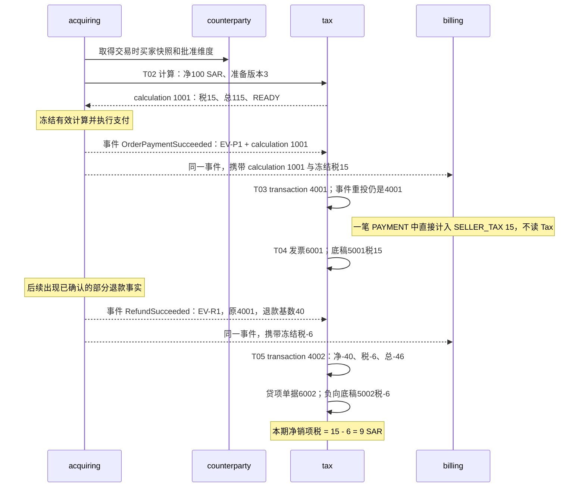

# Tax 业务流程清单与执行说明

状态：**讨论稿，待评审**。补充日期：2026-10-27。依据 [主设计](design.md) 与 [数据模型](database.md)，不新增独立工作流引擎或业务表。具体数据见 [example-data.md](example-data.md)。

**2026-10-29 修订：** T03 / T05 改为消费 acquiring 事件登记，billing 不再等待 Tax；P01、R02、S01 的操作者改为纳税主体持有方；T02 增加 `NOT_MANAGED` 分支。**第二轮：** T01 两阶段报价、T05 总金额退款分摊、S01 `TaxPaymentFailed`、S02 不向 billing 发事件、采购供应随每笔销售登记；持有方 = PayFac Partner 财务，平台无自身纳税主体。**第三轮（人工降级，[design.md 第 10 节](design.md#10-人工处理的边界)）：** 采购改为人工登记进项底稿，B2B 核验与税票人工，服务费税首期不算，新增第 8 节人工处理清单；T01、T03、T04、R01 及第 5 节相应调整。

## 1. 一条主线，四组流程

正常业务主线是：**完成税务准入 → 识别买家与供应地 → 计算 → 确认正式税务事实 → 开具单据 → 按期申报 → 缴款及确认归属**。退款、更正、修订和抵退税是其中的分支。

这里“流程”指业务如何执行，不等于每个流程必须建设审批引擎、任务表或独立微服务。逐笔动作由源业务事实触发；申报、缴税等按期间或人工操作触发。

| 组 | 编号 | 流程 | 发生频率 / 触发 |
|---|---|---|---|
| 上线准备 | P01 | 主体责任评估、税务注册与市场准入 | 新主体 / 新地区 / 注册或责任变化 |
| 上线准备 | P02 | 商品税类与地区规则发布、变更 | 新产品、新地区、法规 / 税率变化 |
| 逐笔交易 | T01 | 买家税务身份与供应地识别 | 结账资料提交 / 资料变化 |
| 逐笔交易 | T02 | 税务报价与重新计算 | 付款准备、价格 / 证据 / 税点变化 |
| 逐笔交易 | T03 | 正式税务登记 | 已发生的供应、付款或其他批准的税点事件 |
| 逐笔交易 | T04 | 发票与调整单据发行 | 正式税务事实及法定开票要求 |
| 逐笔交易 | T05 | 退款、折让与对应税额调整 | 经确认的退款 / 折让事实 |
| 逐笔交易 | T06 | 税务错误更正与特殊减税 | 经审核的税类 / 税额错误、坏账等法定条件 |
| 期间申报 | R01 | 申报底稿补全与账税核对 | 正式交易进入登记、日常巡检、期末准备 |
| 期间申报 | R02 | 初次申报与零申报 | 本注册的法定申报期间结束 |
| 期间申报 | R03 | 申报修订与迟到事实处理 | 原申报后发现遗漏 / 更正 / 可调整事项 |
| 税款清偿 | S01 | 缴款、银行匹配与税局归属 | 有效应纳税款、付款审批与银行结果 |
| 税款清偿 | S02 | 跨期抵税与税局退税 | 合法可用抵税额及本次批准 / 真实退税 |
| 税款清偿 | S03 | 未知结果、迟到扣款与错配恢复 | 超时、重复通知、迟到银行流水或税局错配 |

P / T / R / S 是本目录的流程编号，不替换主设计第 8 节 F1–F5 的分组。F1 对应 T01–T03，F2 对应 T04–T06，F3 对应 R01–R03，F4 对应 S01–S03，F5 是采购场景对 T / R 流程的复用。

## 2. 每个流程做什么、写什么

| 流程 | 输入与负责方 | 执行步骤 | 输出 / 表 | 关键分支 |
|---|---|---|---|---|
| P01 | commercial / client-master 提供 Party、合同角色及参与机构；纳税主体持有方（PayFac Partner 或平台自身）在其控制台提供注册证据并审批，平台运营只读或协助 | 识别法定义务 → 审核注册与生效期 → 确认申报币种 / 周期 → 指定 `managed_by` → 放行市场 | `market`、`registration` | 应注册却未注册：保持 BLOCKED；纯买方自计税与未达条件需有独立评估依据；Partner 的写操作依赖 AGENTS 只读边界的例外登记 |
| P02 | 产品事实、法律依据、已有算法与外部能力 | 分类 → 编写规则包 → 校验互斥 / 生效区间 → 跑场景 → 审批发布 | `category`、`policy` | 不支持的算法 / 协议不能靠配置启用；历史版本仍可解释旧交易 |
| T01 | counterparty 保护买家资料；B2B 税号首期由 Partner 财务在税局门户人工核验 | Client 建单时先以 Client 声明的国家 / 税类报价 → 消费者在 Hosted Checkout 提交资料后生成不可变税务身份快照 → 汇总地点证据 → B2B 买家进入"待核验"清单，人工核验后登记 `source_code=MANUAL` 证据 → 判定是否充分 → 重算并绑定新 `source_revision` | 随计算冻结 `evidence`；受保护原资料仍归 counterparty | 身份 UNKNOWN 不等于未登记；核验前按地区包决定按 B2C 收税或阻断；建单阶段的计算不能供支付使用 |
| T02 | acquiring 的商品、金额、折扣、价格模式、准备版本、商业关系快照的 `TAX_RESPONSIBLE`；或费用 / 采购 Owner 的税基 | 判断责任方是否为登记主体 → 匹配责任与供应地 → 判定税点 / 规则 → 逐行计算 → 分配尾差 → 返回结果 | `calculation`、`line`、`component`、`evidence` | READY / BLOCKED / NOT_MANAGED；`NOT_MANAGED`（PSP、Direct Merchant）只保存自报税额，不阻断支付；地址、价格或准备版本改变，建立新计算，不覆盖旧计算 |
| T03 | 消费 acquiring 的 `OrderPaymentSucceeded` 事件（携带 calculation_id、冻结税额与源事实身份） | 核对事件与冻结计算 → 源事实去重 → 写销售正式交易 → 生成底稿 / 单据任务 → 可靠发布。采购进项首期不在此流程自动登记，见 R01 的人工登记 | `transaction`、`reporting_entry` 与消费去重记录 | 事件重复投递对应同一交易；内容冲突进死信；`NOT_MANAGED` 不建交易；缺汇率保留 PENDING，不能丢弃已经发生的交易。billing 消费同一事件直接入账，不等待本流程 |
| T04 | 正式交易、发行主体、单据规则；B2B 另需 Partner 财务外部开票 | B2C：本地分号 → 渲染不含买方个人资料的简化税票 / 收据 → 冻结正式文件；B2B：进入"待开票"清单 → Partner 财务在税局 / 自有系统开具 → 回填外部单据号与回执（`issuance_mode=EXTERNAL`）；需报送的制度人工报送并回填（`submission_source=MANUAL`） | `document`、`document_sequence` | 未知结果查询同一单据；已经发行不改内容，调整另开法律单据；简化票据的适用条件由地区包给出 |
| T05 | 消费 acquiring 的 `RefundSucceeded` 事件；原交易、原行、行级金额或总金额；退款前可先同步报价 | 在原交易锁下核对累计可调金额 → 行级金额直接按原组件税率拆分；只有总金额且各行处理相同则按剩余可退 gross 比例分摊、尾差给最大行；处理不同则拒绝要求行级 → 追加负向正式事实（`refund_basis_amount`）→ 调整底稿和单据 | 新的计算 / 行 / 组件 / 交易 / 底稿 / 贷项单据 | Tax 计算可退税额，但不自行发起支付退款；实际现金退款由支付链路负责；billing 的 `REFUND` 事实同样直接用事件中的冻结税额 |
| T06 | 原交易、明确更正原因与证据、审核结果 | 判断法定可更正条件 → 算差额 → 建独立 ADJUSTMENT → 生成必要调整单据 / 申报影响 | 追加 `transaction` 及关联事实 | 不把资金 chargeback 自动当作税额可抵减；不覆盖原税额 |
| R01 | 所有已发生交易、底稿、法定汇率、Client 发票与抵扣证据、billing / ledger 授权投影 | 查遗漏 → 补汇率 → Partner 财务按 Client 发票人工登记 `MANUAL_INPUT` 事实与进项底稿（Maker-Checker，附发票文件）→ 按角色形成底稿 → 核对税额与账务引用 | `reporting_entry` 完整（含人工进项）；待处理差异 | 不能仅扫描已经生成的 entry；还要检查有 transaction 却缺 entry 的项；人工进项执行时重校验发票号唯一与 RCM 上限 |
| R02 | 期间、完整底稿、申报规则、持有方审批及真实提交结果 | 生成栏目明细 → 核对与冻结 → 持有方在税局系统提交并回填回执（将来可经授权能力提交）→ 保存回执及法定生效结果 | `period`、`return`、`return_item` | 平台不替主体提交；没交易但有申报义务也做零申报；未提交 / 被拒绝不能显示已完成 |
| R03 | 原有效申报、新的正式更正 / 迟到事实、调整期规则 | 判断归属期 → 冻结完整替代版 → 提交 / 生效 → 旧版本标 SUPERSEDED → 重算待缴差额 | 同 period 的新 `return` 与 `return_item` | 不重置已缴款、不重复计入历史底稿；不得手工改申报总数绕过逐笔依据 |
| S01 | 有效申报、尚未占用的待缴金额、该主体账本的现金账户、缴款指引；操作者为持有方（PayFac 财务） | 本地预留 → 事务外 account 锁该主体账本现金 → `TaxPaymentSubmitted` → 持有方人工付款并上传证据 → 银行匹配 → `TaxPaymentSettled`（两币种金额）→ 税局确认归属 | `payment`、`allocation`、`payment_event` | BANK_CONFIRMED 与 authority CONFIRMED 分开；税额入账只经过 billing；权威证据证明未扣款或提交前撤销时发 `TaxPaymentFailed` 取消预期银行流水；平台运营不替持有方付款 |
| S02 | 期间净贷方余额、本次合法认可及证据 | 核对可用额 → 转用到同注册其他期，或记录实际税局退税 → 更新派生清偿结果 | `credit_application`（不发 billing 事件）；或入站 `payment` + `allocation` + event → `TaxRefundReceived` | 转用没有银行现金流、不改变应付总额；退税才有现金事实；退款和转用不能重复使用同一额度 |
| S03 | 既有业务身份、未知 / 迟到 / 错配证据 | 查询原身份 → 核对外部真实事实 → 本地幂等推进 / 挂差异 → 可靠发布正确资金路径 | 既有状态与不可变事件；必要时新纠正事实 | UNKNOWN 不自动失败；已暂记现金只重分类，不再普通扣现金 |

表名在表内省略 `t_tax_` 前缀。所有跨服务命令 / 查询均在事务外；本地事务只操作本库。核验输入中的个人资料继续只经 counterparty 的受控路径。

## 3. 销售与退款主流程

该序列只展示税务与账务协作，不把 Tax 描述成扣款 / 退款执行者。Tax 与 billing 是同一事件的两个独立消费者，都派生自同一份不可变 calculation；两者之间没有调用，也没有等待。退款前需要金额预览时可先计算；正式负向税务事实的建立时机依据批准的退款 / 折让法定触发条件。这个例子采用“已确认退款事实后登记”。单据本身会提前触发税点的制度，应使用对应批准源事件，不能机械沿用支付成功触发。

## 4. 申报和缴税是两个流程

申报与缴税的操作者是纳税主体的持有方（C1 下是 PayFac Partner，在 Partner 控制台），平台运营只读。用户界面需要同时能回答三件事：**本期有效申报多少、银行已经付了多少、税局已正确认领多少**。例如有效申报9、银行已扣9、税局未认领时，应显示“银行已付，待税局确认”；不能显示“未付款”导致重复支付，也不能显示“已法定结清”。

## 5. 其他业务怎样复用

| 业务 | 复用流程 | 数据差异 / 例子 |
|---|---|---|
| 月度续费 | T01–T04、R、S | 新周期是新源事实；复用仍有效证据可以，不能复用上期正式交易身份 |
| 按量计费 | T02–T04、R、S | billing / 原业务 Owner 先确认周期税基，Tax 不自己累计商业用量 |
| PayFac 向 Client 收取的服务费 | 首期不进入；后续 T02–T04、R、S | `supply_kind=PLATFORM_SERVICE`；基数10、例示5%时税0.50。首期 Partner 财务按 billing 费用明细自行开票申报；平台自身的技术服务费不进入本模型 |
| Client 向 Partner OE 的采购 | R01 人工登记；R02–R03 | 首期 `origin=MANUAL`、`transaction_kind=MANUAL_INPUT`，按 Client 发票逐张或按期登记；若自计税5，RCM_OUTPUT 5 与 RCM_INPUT 5 均登记，可抵扣额由复核人确认 3 后净税负 2。合同性质确认后再改为随 T03 自动登记 |
| 跨境 B2B 反向征税 | T01–T04、R | 卖方收税0、买方依法自计；不是替外部买方登记本平台 RCM_OUTPUT |
| PSP / Direct Merchant 的消费者销售 | 仅 T02 | 税务责任方是 Client，不在平台登记：结果 `NOT_MANAGED`，保存 Client 自报税额，不登记、不申报；平台或 PayFac 的服务费按下一行独立处理 |
| 免费试用 / 全额折扣 | T02–T03 按法定事实适用 | 明确零基数 / 处理理由；不能把“没有收款”当成所有制度下都无税务事实 |

5% 与采购抵扣比例在这张复用表中仅是教学假设，不是对未明确合同和地区的税务结论。

## 6. 必须单独看见的异常

| 情况 | 正确结果 | 禁止行为 |
|---|---|---|
| 核验服务超时 | 结果 UNKNOWN，补证 / 重试或批准的明确降级 | 当作 VALID 或自动免税 |
| 计算完成后改地址 | 新计算与新准备版本 | 直接覆盖旧 calculation |
| 登记事件重复投递 | 同源唯一身份对应同一 transaction | 消费两次生成第二笔税务交易 |
| 事件携带的税额与冻结 calculation 不一致 | 进死信并告警，人工处理 | 以事件金额覆盖计算，或静默取其一 |
| 总金额退款，原交易含 15% 与反向征税两种处理 | 拒绝，要求 Commerce 提供行级金额 | 自行猜测比例分摊 |
| 采购进项尚未登记即到申报期 | "待登记进项"清单非空，期间不能关闭；可按零进项申报但须复核人明确确认 | 默认全额抵扣，或系统推算进项 |
| 人工登记的进项超过 RCM_OUTPUT 或重复发票号 | 审批通过后执行时拒绝，退回登记人 | 以审批通过为准直接落库 |
| `TAX_RESPONSIBLE` 未在 Tax 登记（PSP） | `NOT_MANAGED`，支付继续 | 返回 BLOCKED 阻断结账，或当作零税率登记 |
| 开票 / 报送超时 | 原单据身份查询恢复 | 重新分号重开第二张 |
| 已发生交易缺申报汇率 | 正式事实保留，底稿 PENDING | 用税0或漏掉交易来完成申报 |
| 未知缴款9，银行尚未确定 | 保留预留与占用，待查原付款 | 超时释放后再缴9 |
| 失败后迟到扣款且已暂记 | 确认真实事实，只重分类 | 再发布普通扣现金事件 |
| 税局把缴款归错期间 | 银行已确认、税局 DISPUTED；有证据纠正 | 修改历史分配金额掩盖差异 |

## 7. 这次补充的模型边界

这14个流程是现有19表模型的执行视图，不新增表、请求重放机制或编排框架。自动正式登记只有事件消费一个入口，人工登记是带审批与证据的第二入口；准入、申报、缴款的操作权归纳税主体持有方，依赖 Partner 只读边界的例外登记。

## 8. 人工处理清单（首期）

Partner 控制台提供一个与 reconciliation 异常队列同类的"待人工处理"页面，按注册与期间分组。每一项都有系统给出的数据、证据位和完成后的状态回写：

| 清单项 | 触发 | 人工动作与证据 | 完成后 |
|---|---|---|---|
| 待核验 B2B 买家 | 买家提交税号、系统无自动核验能力 | 税局门户核验，登记结果与截图摘要（`source_code=MANUAL`） | 后续计算引用该证据；地区包决定核验前如何收税 |
| 待开 B2B 税票 | B2B 正式交易建立 | 在税局 / 自有系统开具，回填外部单据号与回执 | `issuance_mode=EXTERNAL`、ISSUED |
| 待报送单据 | 制度要求报送且无自动协议 | 人工报送，回填受理回执 | `submission_source=MANUAL`、ACCEPTED / REJECTED |
| 待登记进项 | 期间内有销售、尚无对应 Client 发票登记 | 登记 `MANUAL_INPUT`，附发票文件，Maker-Checker | 进项底稿进入申报；期间可关闭 |
| 拒绝的总金额退款 | 原交易多种处理 | 人工建 `ADJUSTMENT`，写明分摊依据 | 负向事实与贷项单据 |
| 待确认汇差 / 税局错配 / 迟到扣款 | reconciliation 或税局回执差异 | `CLASSIFY` 处置或 billing `MANUAL_ADJUSTMENT` | payment / allocation 状态更新 |
| 待申报 / 待回填回执 | 期间结束 / 已提交 | 税局系统提交，回填回执与生效状态 | return 进入 EFFECTIVE |
| 待缴款 / 待上传付款证据 | 有效应纳 > 已付 | 人工付款并上传凭证 | payment 进入 SUBMITTED，等待银行匹配 |

清单项非空时对应期间不能关闭。所有人工动作都记录操作者、时间、文件地址与摘要；没有证据的完成不被接受。首次实现仍需先确认实际税点、法定单据与报送条件，以及采购 / 费用事实 Owner；状态不能直接当成具备全部转换条件的可执行状态机。

国家、行政区、币种使用 [Platform 参考数据](../../agent-docs/decisions/2026-10-27-platform-reference-data.md) 的开放编码；Tax 只保存编码及交易冻结事实。税类、税务制度、处理理由仍由 Tax 管理，不创建自己的国家 / 币种主表。
