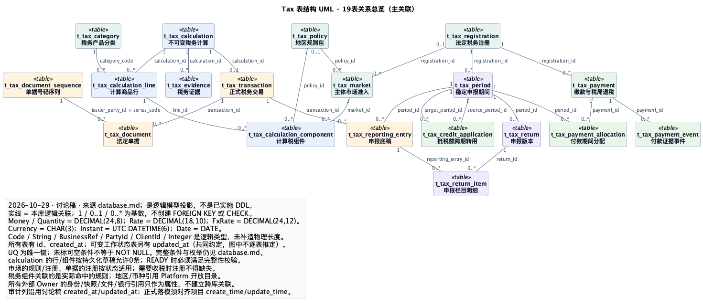

# Tax 表结构 UML

状态：**讨论稿的可视化投影**。输出日期：2026-10-29。来源：[database.md](database.md)。不新增表或业务规则，不代表当前数据库已经采用这套结构。

**2026-10-29 晚修订：** 随 database.md 两轮修订增加 `t_tax_market.managed_by`、`t_tax_calculation.tax_amount_source`、`t_tax_calculation_line.refund_basis_amount`、`t_tax_reporting_entry.deductibility_status / deductibility_confirmed_by / deductibility_confirmed_at`，并把 `t_tax_document_sequence` 唯一键改为 `issuer_party_id + registration_id + series_code`；第三轮再加 `t_tax_transaction.origin`、`t_tax_document.issuance_mode / submission_source`，已同步到 [完整字段 PlantUML](tax-schema-full.puml)（现 310 个显式业务字段）；本机无 PlantUML，SVG / PNG 预览仍是修订前渲染，下次渲染时更新。关系数量未变，一条关联标签更新。

| 文件 | 内容 |
|---|---|
| [关系总览 PlantUML](tax-schema-overview.puml) | 19张表、23条主关联，省略属性和辅助引用以便阅读 |
| [完整字段 PlantUML](tax-schema-full.puml) | 19张表、310个显式业务字段、主键、共同创建时间、唯一键及43条逻辑关联 |
| [关系总览 SVG](assets/uml/tax-schema-overview.svg) | 可缩放查看的关系总览 |
| [完整字段 SVG](assets/uml/tax-schema-full.svg) | 完整字段图，建议放大查看 |



## 图的读法

- 每个 `<<table>>` 类表示一张表，属性表示列；连线是逻辑关联，**不是物理外键**，也不表示级联删除。
- 连线端点的 `1`、`0..1`、`0..*` 分别表示恰好一个、可选一个、零到多个。标签是引用方字段名。例如 calculation 对 transaction 为 `1 → 0..1`：一次计算最多成为一笔正式税务事实。
- `document_sequence → document` 通过 `issuer_party_id + registration_id + series_code` 关联；没有额外虚构 `sequence_id`。
- `return_item` 连接申报版本和逐笔底稿；`payment_allocation` 连接银行支付和稳定期间，并额外引用作为付款依据的申报版本。申报修订不会迁移或清零既有付款。
- `credit_application` 分别引用来源 / 目标期间和来源 / 目标申报版本；它没有银行支付关联，因为转用本身没有现金流。
- `original_*`、`replaces_return_id`、`reverses_application_id` 的自关联只在完整图展示。总览省略这些关系不代表删除这些字段。
- 计算可能因资料不足为 BLOCKED，所以计算到行、行到组件按存储中间状态允许零条；READY 时仍须满足正文的完整性要求。准入、注册与单据的可选引用须按具体状态和制度校验。

## 类型和范围

图中 `Money / Quantity` 对应 `DECIMAL(24,8)`，`Rate` 对应 `DECIMAL(18,10)`，`FxRate` 对应 `DECIMAL(24,12)`；`Currency` 对应 `CHAR(3)`，`Instant` 对应UTC `DATETIME(6)`，`Date` 对应 `DATE`。

`Code / String / BusinessRef / PartyId / ClientId / Integer` 是逻辑类型，不是已经批准的物理列定义。原稿未明确的长度、可空性和默认值不在本次导图时补造。`UQ` 是唯一键组合；完整枚举、条件必填和业务约束继续以 [database.md](database.md) 为准。审批身份、Party、Client、OE、counterparty快照、银行账户和文件均只保留外部引用，不画成Tax拥有的表。

所有表的 `id` 和 `created_at` 在完整图逐表展开；`updated_at` 按原稿“仅可变工作状态表增加”的共同约定在图例中列出，未擅自给每张表加列。这里有一项既有命名差异：讨论稿使用 `created_at / updated_at`，项目 [数据库规范第9节](../../agent-docs/DATABASE_DESIGN_GUIDE.md#9-默认字段和主键) 使用 `create_time / update_time`。本次忠实输出讨论稿；进入正式物理建模时应统一为项目命名，而不是把这份UML作为例外批准。

## 编辑与重新渲染

结构修改先更新 `database.md`，再同步这两份 `.puml` 和预览；UML不是第二份表结构权威。`.puml` 可直接在支持PlantUML的编辑器中查看和编辑。

本次用PlantUML 1.2025.2在本机生成预览，未向在线渲染服务上传模型。文件使用内置 [Smetana布局引擎](https://plantuml.com/smetana02)，不要求另装Graphviz。使用自己已有的PlantUML JAR可按 [官方命令行方式](https://plantuml.com/command-line) 渲染：

```sh
java -jar /path/to/plantuml.jar -charset UTF-8 -tsvg tax-schema-overview.puml tax-schema-full.puml
```

验证范围：PlantUML语法与本地渲染；逐表字段覆盖、关联字段存在性、唯一键字段检查；不包含数据库实施或法规适用验证。
