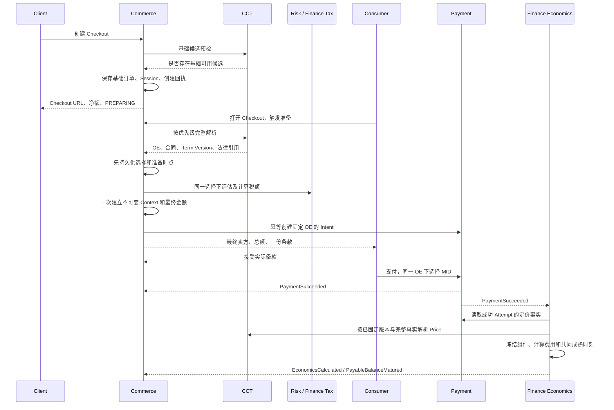

# 阶段 3：交易时序、接口与兼容设计

> 2026-09-12 Commerce 实现范围修正：用户确认旧代码未发布，基础创建直接替换，不保留快照/回执 Schema 版本、
> 历史创建分支或旧 Owner Mock。本文此前针对 Commerce 旧创建代码的兼容要求在该切片内不再适用；
> 幂等恢复、并发 CAS、已执行 SQL 记录及其他系统边界保持。具体合同见 [Commerce 基础创建切片](./commerce-precheck-implementation.md)。

> **2026-09-11 实施范围更新：** 用户已授权 CCT、Commerce、Payment、Finance 的本期模型调整，并明确 PDManer 一起改；Risk 暂缓。前文各阶段“不改 PDManer/待进入阶段4”仅为当时记录。当前模型、SQL 工件和未迁移边界见 [本期模型实施记录](./model-implementation.md)。Java 业务实现不计入本次模型完成声明。

本方案影响 CCT、Commerce、Payment、Risk、Finance 五个核心系统，以及 Checkout 入口和 Platform/Gateway 注册；确定新增2张30列业务表，有存量时另增1张3列身份映射表；涉及42张旧表，新增47列、调整46列、20列退出新写目标，物理删表0。12个确定新增/1个条件新增HTTP合同、5个已有HTTP修改及索引/DML清单见第7节。设计新增 1 个 Checkout 页面状态方案，不代表页面已经实现。

这是本需求阶段 3 的可审阅设计，与 [字段及关系设计](./technique.md) 第 12–14 节组成一个方案。D1–D3 已由用户确认；本文件新增的接口、字段、枚举和恢复细节等待整体设计评审。现行权威合同和生产状态不被本稿自动替换；本阶段不改 PDManer、Java、正式 OpenAPI 或 SQL。

## 1. 业务时点与责任

| 时点 | 固定的事实 | 尚未确定的事实 |
|---|---|---|
| 创建 Checkout | Client、client_order_id、商品/优惠/净额、币种、消费者国家、Locale、创建时间、原始到期时间 | 最终 OE、税额/总额、合同及定价版本、Payment Intent |
| 支付准备取得 CCT 结果并本地提交 | OE、来源、Affiliation、批准 Scope、Primary Classification、合同、Term Version、法律文件/卖方披露引用、商业时点 | Risk/Tax 结果、最终金额、Payment Intent |
| 支付准备完成 | 唯一 Order Context、Tax Snapshot、最终金额、可用的 Payment Intent | 具体成功 Attempt、准确 Price 与费用 |
| Consumer 接受并执行支付 | 三份真实法律接受证据；每个 Attempt 的支付方式与同一 OE 下的渠道 | 未产生的 Provider 支付结果及晚到定价事实 |
| 支付成功、定价事实齐备 | 成功 Attempt 的 Price/Profile/Component/Band；Finance 计算的费用与资金可用时间 | Provider 对账差异按既有独立链路处理 |

Client Fee 是 Client 的商业费用，不在支付成功后追加到 Consumer 总额。本期不新增消费者手续费。相同订单内不修改商品、币种、消费者计税国家、最终卖方或已经确认的金额；此类变化由 Client 用新的 client_order_id 创建新订单。



## 2. CCT 最终解析与价格合同

### 2.1 通用规则

新接口为私有 HTTP，分别放在 Owner 的轻量 API 模块。64 位 ID 使用无前导零正十进制字符串、上限 Long.MAX_VALUE；entityNo 为五位代码；UTC 时间为带 Z 的 RFC 3339 字符串、最多 6 位小数；金额和 Decimal 沿用项目规范字符串，不使用 JSON 浮点。错误沿用项目 RFC 9457 Problem，不新增另一种 Envelope。

调用方身份必须来自可信服务身份与既有内部网络边界；它不代替 Client/Order 归属校验。不把浏览器传入的 entityNo、Term Version、MCC、Risk 结果或签署账号当权威。任何仅按 ID 的读取都校验授权调用方及完整业务父链。

### 2.2 最终上下文解析

`POST /checkout-context/v1/resolutions`，CCT 提供给 Commerce；这是只读查询，POST 用于结构化请求，不保存 Assignment 或另一个 Resolution 表。模型名 `CheckoutContextModels.ResolveRequestBody/ResolveResponseBody`。

请求全部必填：`clientId`、`orderNo`、`consumerCountryCode`、`currency`、`locale`、`contextAsOfTime`。前三类代码使用现行国家/币种/Locale 目录。orderNo 长度沿现行 Commerce 合同；contextAsOfTime 由 Commerce 准备命令首次取得并冻结，不能来自外部 Client 或浏览器。重试该命令使用原时点；新的未选择准备命令才能使用新时点。没有 paymentMethod/card/industry/MCC/entityNo 输入。

响应 200 的精确分组如下。除 PARTNER 分支外均非空，所有 ID 均为字符串；contextAsOfTime 不得晚于 CCT 当前时刻，且由 Commerce 保证处于创建时间与原到期之间；不返回数字 operatingEntityId、assignmentId、ruleId 或旧 Pricing Scope。

| 对象 | 字段及约束 |
|---|---|
| 根 | `contextAsOfTime`（逐值回显）、`evaluatedAt`（本次检查时间）、`clientId`、`orderNo`、`entityNo`、`sourceType` |
| classification | `businessProfileId`、`classificationId`、`industryCode`、`mccCode`；来自此 Client 适用资料的唯一 Primary |
| eligibility | `affiliationId`、`priorityNo`（正整数）、`entityScopeId`、`entitySourceRelationId`；四者与 Client、OE、准确四要素逐值一致 |
| clientTerms | `agreementId`、`planId`、`versionId`；同一 Client/OE 父链；Version 在商业时点适用且已封存 |
| partnerTerms | 非 PARTNER 时整个对象为 null；PARTNER 时 `localPartnerId`、`agreementId`、`agreementOperatingEntityId`、`sharePlanId`、`shareVersionId`、`serviceChargePlanId`、`serviceChargeVersionId`、`platformSignatoryPartyId` 全部非空 |
| legal | `clientAgreementId`、`consumerTermsDocumentId`、`refundPolicyDocumentId`、`privacyNoticeDocumentId`、`sellerDisclosureId`，以及对应不可变 Profile/文件证据引用；精确 Locale，不作隐式回退 |
| revisions | `clientChangeVersion`、`entityChangeVersion`、`clientAgreementChangeVersion`；PARTNER 时另有 `partnerAgreementChangeVersion`，否则 null；用于检查查询期间变化及恢复证据，不是新 Assignment 版本 |

处理顺序：先校验 Client/Primary 全局条件；按 Affiliation priority_no 升序；每个候选检查准确 ACTIVE Affiliation、ACTIVE OE、唯一 ACTIVE Source、已批准准确 Scope、Risk 当前资格、适用且已完成签署的合同、唯一生效 Term Version、三份法律文件及卖方披露。Partner 来源还检查 Partner 资格、合同、两类版本和唯一 PLATFORM_SIGNATORY。定价版本至少有此准确 OE 的已批准有效 Price/组件，但此阶段不按支付方式选择 OE，也不承诺所有方式均有价格。

候选范围、合同或法律资料明确缺失/失效，可以检查下一个 OE。Client 级资格拒绝结束本次查询；Owner 超时、无权读取、数据冲突、多个 Primary、同优先级或同一时点多份适用合同均停止，不能降级为“该 OE 不可用”继续。

本地配置按同一读快照取得；跨 Owner 检查不持有数据库行锁。输出前复核 Client/OE/相关 Agreement 的 Root 修订及当前阻断状态。Affiliation 或 Classification 修改推进 Client Root；Source/Scope/卖方披露/OE 法律文件修改推进 OE Root；新增或改变可匹配 Agreement、Plan/Version 也须推进相关 OE Root，Client 合同同时推进 Client Root，从而覆盖“原来没有，现在新插入”的候选变化。各写命令使用固定 Root 排序及数据库 CAS，不能只复核原先命中的一行。

若配置变动返回 409 `CCT_CONTEXT_CHANGED`，同一未选定命令有限重试；输出并非跨服务原子快照，后续支付仍执行新鲜 Risk/OE 门禁。CCT 响应后若 Commerce 尚未存下选择即崩溃，可以重新解析；一旦存下，就只校验/读取原选择，不能重新路由。

其他结果：422 `NO_ELIGIBLE_ENTITY` / `CLIENT_NOT_ELIGIBLE`；409 `CCT_CONTEXT_AMBIGUOUS`；503 `OWNER_UNAVAILABLE`，超时 504。缺失或越权 Client 使用统一 404。现行 Problem requestId/timestamp 等字段保持。

### 2.3 Price 解析和不可变读取

`POST /commercial-prices/v1/resolutions`，CCT 提供给 Finance；模型名 `CommercialPriceModels.ResolveRequestBody/ResolveResponseBody`。一次只解析一个 Term Version，以相同接口分别取得 CLIENT_PRICING、PARTNER_SHARE、PLATFORM_SERVICE_CHARGE。

必填请求：`termVersionId`、`entityNo`、`agreementId`、`contextAsOfTime`、`termType`、`paymentFactId`、`paymentFacts`。paymentFacts 为第 4 节的受控事实对象，不传 Provider 原始信息。Client 价格请求 `clientId` 必填、`localPartnerId=null`；另两类相反。paymentFactId 用于追溯，CCT 校验事实内容但不跨库读取 Payment；Finance 负责取得并核对原始受控响应。

解析使用已冻结版本的完整历史内容，不能改为当前 ACTIVE Version/Profile。精确验证 Version/Plan/Agreement/Owner/OE 父链及 contextAsOfTime 的原适用关系；后来普通换版或自然到期不改变此交易的约定。真正交易阻断由支付前新鲜门禁承担，不能用当前状态让历史 Reader 无法还原价格。

响应 200：`termType`、`agreementId`、`planId`、`termVersionId`、`entityNo`、Owner ID、`priceId`、`paymentMethodProfileCode`、`paymentMethodCode`、`priorityNo`、`conditions`、`components`、`settlement`。conditions 按 dimensionCode/conditionValue 排序；components 沿现行 Price 模型全量返回 `componentId/componentNo/componentType/triggerCode/calculationBase/rate/fixedAmount/currency/minAmount/maxAmount/bandMode` 及各 Band 的 `bandId/bandNo/lowerBound/upperBound/rate/fixedAmount/currency`，不存在的属性显式 null。组件及 Band 使用现行批准类型，不能构造未定义组合。Client settlement 四字段非空，Partner 两类 settlement=null。

匹配采用既定“支付方式准确匹配 → 条件等值 → 不同维度数量多者先 → priority_no 小者先”。在准确 Version/OE/支付方式候选所使用的维度里，任何影响匹配的事实尚未知，返回 422 `PRICING_FACTS_INCOMPLETE`；不能借宽泛 Profile 把未知当作不匹配。无命中 422 `PRICE_NOT_FOUND`；非法枚举 422 `INVALID_PRICING_FACT`；歧义或父链冲突 409；技术失败 503/504。

`GET /commercial-prices/v1/{priceId}`，仅授权 Finance 历史读取，返回同一不可变 Price/父链/Profile/组件/Band/Settlement 对象；不重新选择价格。不存在为 404、数据冲突为 409。Price/Profile 终止新引用后仍能读；不新增 Content Hash 或在本接口延续 V5 Scope Hash。

Price 解析示例：固定版本下 CARD 的普通 Profile priority=20，CARD+CREDIT 的 Profile priority=10；已确认 fundingType=CREDIT 时命中后者，fundingType 未知则返回事实缺失。即使普通 Profile 可匹配，也不在缺失事实时自动收取其费用。

## 3. Commerce 的两段持久化和恢复

### 3.1 字段与不可变边界

| 表/载体 | 新流程的字段变化与规则 |
|---|---|
| t_commerce_order | 新增 `context_format VARCHAR(32) NOT NULL`，新值 `TERM_PRICE`、旧分支 `LEGACY_SCOPE`；entity_no CHAR(5)、entity_source_type、local_partner_id、industry_code、mcc_code 创建时可空；选择持久化时仅补齐一次。tax_amount/rounding_amount/total_amount 创建时为 null，Context 本地提交时补齐一次；净额相关字段创建即冻结。新增 `preparation_command_id BIGINT NULL`，指向当前/成功准备命令；`termination_requested_at DATETIME(6) NULL` 保留取消/到期竞争意图 |
| t_order_context | 基础创建不建行；Context 提交时一次 INSERT。新写去 assignment_id、三个旧 Scope ID、旧 commercial_context_hash；保存 `affiliation_id/entity_scope_id/entity_source_relation_id/client_pricing_version_id`，PARTNER 成组保存 `partner_share_version_id/platform_service_charge_version_id/platform_service_party_id`；保留 commercial_context_time、Risk Assessment、Tax Snapshot/Hash、国家/Locale。agreementId 从同一 Context 的 Legal 读取 |
| t_order_legal | 新 Client 行直接 `client_agreement_id`，不新写 Client Agreement-OE Association；Partner 保留 `partner_agreement_id/partner_agreement_operating_entity_id`。三份法律文件及卖方披露引用保持，不新增可替换当前指针 |
| t_order_item | 创建时只写不可变商品/优惠/净额事实；新流程不写旧 line_tax_amount/line_total_amount。最终逐行税额与总额使用 Finance 不可变 Tax Snapshot 的明细，以稳定 client_item_id 对齐；避免先插入假税额后 UPDATE 不可变 Item |
| t_checkout_session | 创建为 PREPARING；只有 Context 和 Payment Intent 已确定才转 OPEN，opened_at 在该时刻写入；Token、public_origin、原 expires_at 规则保持 |
| Foundation 本地 command / Snapshot | 增加 Commerce 自己的 CHECKOUT_PREPARE 业务类型与阶段枚举；不修改 Foundation 通用算法。保存原请求、选择响应、稳定商业时点和调用键；受控 Snapshot 上限 64 KiB，选择响应预算 32 KiB，只存明确业务字段/ID，不存 URL/Token 等凭据 |

物理存量列的保留方式见第 6 节。类型可空不代表任意状态都可缺省，应用在每个事务检查矩阵。Order、Session、Context 一对一约束和 client_id/client_order_id 永久唯一保持。

创建请求里的商品计税属性、国家和 Locale 保存在创建命令的不可变请求 Snapshot；Order/Item 仍保留其已有业务字段。准备通过 Order 对应的已完成创建命令读取最小计税输入，不复制完整消费者隐私信息。创建命令与请求 Snapshot 必须在订单存续及历史读取期间保留，不能被通用幂等过期清理提前删除。

### 3.2 创建与准备检查点

创建沿现有 `CLAIMED → ORDER_COMMITTED → COMPLETED`，但 TERM_PRICE 分支的 ORDER_COMMITTED 表示基础 Order/Item、PREPARING Session、退款/资金可用性初始投影均已在一事务提交。创建 Owner 调用只有基础预检；不得提前做 Tax、订单 Risk 或 Create Intent。201 回执冻结原创建结果；随后 GET 可返回最新准备状态，创建幂等重放不变成后来 GET 结果。

准备业务阶段建议为：

```text
CLAIMED → SELECTION_COMMITTED → CONTEXT_COMMITTED → INTENT_CONFIRMED → COMPLETED
```

1. 同一 Order 的所有准备请求先串行检查 Order/CAS 和 preparation_command_id。存在在途命令就恢复它，不因浏览器换 Idempotency-Key 新建第二条路线；完成则返回原 Context/Intent；未选定且已明确失败的命令允许后续显式请求重新检查，届时创建新准备命令与商业时点。
2. CLAIMED 使用服务端当前时刻固定 contextAsOfTime，再只读解析 CCT。SELECTION_COMMITTED 在一事务保存完整选择 Snapshot、补齐 Order 的 OE/来源/分类并推进 CAS；此后禁止重选。进程在这个提交前没有以候选 OE 执行任何副作用。
3. 相同选择下依次做订单级 Risk 和 Finance Tax，调用幂等键由准备 commandId + operation 派生并保存。每次恢复核对 Owner 原结果、输入与原 Order；技术超时用相同键恢复，不换主体、版本或商业时点。
4. Risk/Tax 结果齐备后，单事务建立 Context、Legal 和最终金额，进入 CONTEXT_COMMITTED。金额以 Finance 税快照为权威，汇总与 Item 一一对齐；Owner 返回缺行、多行、国家/币种/净额/主体冲突均失败关闭。
5. 调用 Payment 创建 Intent 前，持有 Order 协调/CAS 记录该次外部创建已开始；跨网络不持 DB 事务。固定键创建 Intent，结果未知时恢复同一调用；取得明确 Intent 后标记 INTENT_CONFIRMED，再本地转 Order OPEN/Session OPEN 并完成命令。OPEN 之前不能创建 Consumer Acceptance 或 Attempt。

“已开始创建 Intent”使用 CHECKOUT_PREPARE Snapshot 的固定 `intentCreationStartedAt` 及 `intentCreateKey`，先持久化再发送。不用“尚无 intentId”推断远端没有 Intent。Payment 为创建键提供原 Create Intent 的同键幂等重放能力；重放不得把已过期或终止的 Intent 变成新 Intent。

每次恢复先校验终止意图、原到期和当前 OE 阻断。合同自然到期/换版不替换已冻结条款；明确撤销/关闭门禁按 Owner 原规则停止执行。冻结后不可恢复的业务拒绝进入既有取消/终止链，不留一个可跨 OE 再试的订单。短暂依赖失败保留同一命令可重试，原到期不延长。

### 3.3 取消、超时及未知结果

取消/到期先与准备串行记录 termination_requested_at，阻止新的准备副作用和 Attempt。无 Intent 创建开始标记时，可以同一事务终止准备、取消/过期本地 Order/Session；有开始标记时，必须恢复远端创建的最终事实并执行既有 Intent 终止协议。不能仅凭一次查询“暂未找到”宣告取消完成，也不能让取消路径用新键创建支付资源。

若原创建在网络中，取消命令保持在途；取得 Intent 后检查未支付/无 UNKNOWN Action 等既有条件再终止。若远端明确保证该创建键未产生且永不再产生资源，才可无 Intent 完成本地关闭。未知状态不释放恢复责任、不改为业务失败重建。成功授权走既有 Reversal/Void，已 Capture/Sale 走既有 Refund；不改变取消所有权。

取消意图与一个已被 Payment 接受的支付动作竞争时，以 Payment 最终事实收敛；不得关闭 Commerce 后丢弃迟到 PaymentSucceeded。CLOSED OE 的现有“等待活动/UNKNOWN Attempt 收敛后终止”规则继续有效。

### 3.4 Create/Get 与 Checkout 交互

现有 Client API Method/Path 和版本保持：POST /external/client-api/v1/checkouts、GET /external/client-api/v1/orders/{orderNo}/checkout；这两个是 Owner 服务落点，公开前缀仍由原 Gateway Route 映射。原创建全部固定金额字段调整为两种状态：

```json
{
  "preparationStatus": "PENDING",
  "amountStatus": "ESTIMATED",
  "merchandiseAmount": "42.90",
  "discountAmount": "0.00",
  "netAmount": "42.90",
  "taxAmount": null,
  "roundingAmount": null,
  "totalAmount": null,
  "currency": "USD"
}
```

以上是金额片段，原 orderNo/clientOrderId/checkoutUrl/status/createdAt/expiresAt 等回执字段及外部长度/金额上限保持。`ESTIMATED` 仅说明总应付额未确定，商品净额本身已固定。准备完成 GET 返回 preparationStatus=READY、amountStatus=FINAL，后三项全部是明确金额；税为零时返回明确零。字段不可空的现有消费者必须先适配，不能静默启用新创建行为。

Checkout 新动作建议 `POST /checkout/v1/sessions/{publicToken}/preparation`：Browser 经 CHECKOUT Channel 和 Checkout BFF 到 Commerce；请求只含 `expectedOrderVersion`（字符串），幂等键沿现行命令头。publicToken 精确复用现有长度/随机性/存储规则，不额外暴露 Client/OE 输入。200 READY，202 PENDING（Retry-After=2 秒），409版本冲突/已终止，410过期，422明确不可准备，503技术不可用。BFF 仅转发和组装页面，不拥有准备事务。重复点击返回同一准备结果。

页面状态：PREPARING 展示商品、明确“税费和总额确认中”，禁用支付与条款接受；失败展示可理解的重试或关闭原因；READY 展示实际卖方、净额、税额、最终总额与三份独立条款；PROCESSING 保持原订单状态；过期/取消不展示继续支付入口。保持现有页面整体风格，桌面/移动端均不得裁切最终总额或接受控件。本期新增的是这一页面的状态设计，不额外设计运营控制台。

支付方式切换仅重新评估同 OE 下的 Payment 能力和定价覆盖，不改变上述 Consumer 总额/条款，因此不重新创建 Context 或覆盖三份 Acceptance。COM-I10 仍以三份准确记录及同 Order/Session LEGAL_ACCEPTANCE 证据推导就绪；CCT agreement_party 与该链无关。

## 4. Payment 事实与支付前价格覆盖

### 4.1 标准化合同

新增 `GET /payment-attempts/v1/{attemptId}/pricing-facts`，Payment 提供给 Finance。未形成最终快照返回 202 + Retry-After；形成后返回 200；不存在 404、身份/金额冲突 409、技术异常 503。响应包含 attemptId/intentId/orderNo/orderContextId/entityNo/paymentSucceededAt/amount/currency，Finance 与 PaymentSucceeded 和 COM-I04 逐值比较。

`paymentFacts` 固定对象属性为 `schemaCode=PAYMENT_PRICING_FACTS_1`、`paymentMethodCode`、`consumerCountryCode`、`currency`、`cardNetwork`、`fundingType`、`cardLevel`、`authenticationClass`。前四项非空且由 Payment 验证 Order/Attempt；后四项为受控代码或 null，不收任意 JSON Conditions。所需维度有未知值时尚不能形成可用快照；确认不适用的维度为 null，另由标准化的方式类型说明其不适用，不能把 null 解释为普通卡或非 3DS。

本期定价维度目录：CONSUMER_COUNTRY、CURRENCY、CARD_NETWORK、FUNDING_TYPE、CARD_LEVEL、AUTHENTICATION_CLASS；支付方式是 Profile 必填属性，不作为 Condition 重复计数。国家/币种沿现行批准目录；fundingType 初始代码 CREDIT/DEBIT/PREPAID；authenticationClass 初始代码 THREE_DS_AUTHENTICATED/THREE_DS_ATTEMPTED/NON_THREE_DS。后者必须来自可信 Provider 结果，不能从没有 Challenge 推断。cardNetwork/cardLevel 使用 Payment 已批准的稳定映射清单；没有验证过的渠道映射，不允许激活依赖该值的 Profile。此清单是接入验收制品，不根据本文示例声称某 Provider 已支持。

若出现合法但当前目录不支持的 Provider 原值，保留在 Payment 已批准的受控来源记录中等待映射审查，不传给 CCT、不编码为普通值、不猜 UNKNOWN 的价格。扩展应用代码目录需版本化审核，不新增动态维度表或自由文本规则。

### 4.2 持久化

新增一对一、不可变 `t_payment_pricing_fact`，仅最终事实齐备时创建：

| 字段 | 类型与规则 |
|---|---|
| payment_fact_id | BIGINT PK |
| payment_attempt_id | BIGINT NOT NULL，唯一；成功 Attempt 的最终快照 |
| fact_schema_code | VARCHAR(32) NOT NULL，PAYMENT_PRICING_FACTS_1 |
| source_action_id | BIGINT NOT NULL，支付成功权威来源 Action |
| payment_method_code | VARCHAR(64) NOT NULL |
| consumer_country_code / currency | CHAR(2) / CHAR(3)，均 NOT NULL |
| card_network / funding_type / card_level / authentication_class | 四列 VARCHAR(64)，仅所需且已确认适用的值非空 |
| payment_succeeded_time | DATETIME(6) NOT NULL |
| amount | DECIMAL(24,8) NOT NULL，与成功金额一致 |
| client_pricing_version_id | BIGINT NOT NULL |
| partner_share_version_id / platform_service_charge_version_id | 两列 BIGINT，可空且 PARTNER 时成组非空 |
| create_time | DATETIME(6) NOT NULL |

原始 Provider 证据仍在现有 Action/受控来源链内，不复制原始 Payload、PAN、BIN 或认证凭据。Intent 新增 context_format VARCHAR(32) NOT NULL（TERM_PRICE/LEGACY_SCOPE）和相同三个 Term Version ID（新 Client 非空，Partner 成组），从已提交 Commerce Context 校验后保存；用于执行前覆盖判断。事实表的冗余版本必须逐值等于 Intent。

若成功时资料已齐，可与成功状态同事务写入事实；否则成功事实先发布，事实行稍后只插入一次。Payment 使用现有本地 compensation_event 按 attemptId 恢复查询/标准化，事件 Payload 不放敏感来源。Finance 收到成功后可重试读取，不要求新增 PricingFactsReady MQ 事件。

### 4.3 执行前覆盖与晚到失败

实际 Provider 提交前，在已选 OE/Method 下，Payment 必须能取得固定 Term Version 的 Price/Profile 所需维度（由 Commerce/CCT 的不可变版本读取适配提供，见接口清单），并核对本 Provider 适配器承诺产出的标准值域。可使用最宽泛 Price 作为经明确配置的后备覆盖；不能自动生成免费价格。

检查覆盖应证明：在该方式、国家、币种以及已知事实下，所有适配器可能返回的剩余合法值组合，均可唯一命中 Client Price，PARTNER 时两类价格也有覆盖；未知或不可枚举的实际值域不能被宣称覆盖完整。实现可对离散集合做交集/包含检查，不能用概率抽样代替证明。失败时阻止此次 Provider 提交，允许在同一 OE 下换方式/渠道，不回到 CCT 重选 OE。

支付前覆盖无法保证 Provider 永不丢字段。若已扣款成功而必要事实暂缺，Payment 仍为 SUCCEEDED，Finance 延迟 Economics、保持可重试；Commerce 资金可用性保持 PENDING。禁止改支付失败、费用填零、选当前版本或重发扣款。恢复任务失败留在既有失败/人工处理入口；完善映射必须有真实来源证据，不能由操作员猜测卡属性。最终快照若发现错误，不覆盖原行；停止相关经济处理并按现有受控更正机制追加修正，不能悄悄改已入账金额。

## 5. Finance 计算与证据

### 5.1 税额与商业费用分别计算

Tax 仍由 Finance 在支付准备阶段计算。输入固定 OE、商品行/优惠/净额、币种、国家/必要地址派生字段、商业时点与原幂等键；不读取晚到支付卡特征，也不把 Client 商业收费加入消费者金额。响应的 Tax Snapshot ID/Hash、行税额及最终金额保持现行税务算法；本需求仅改变调用时点与 OE 身份类型。

PAYMENT Economics 先验证 PaymentSucceeded、COM-I04 固定 Context 及 Payment Pricing Fact 的订单/成功 Attempt/OE/金额/币种/版本一致，再用第 2.3 节解析 Client 及可选 Partner 两类 Price。Finance 负责取基数和运算；CCT 不计算扣款金额或余额。

每个经济组件冻结准确 termVersionId、priceId、Profile Code、componentId、实际参与的 bandId/参数、计算基数/结果、paymentFactId。现有 source_rule_scope_id 可能指向 Finance Provider Cost Scope，不能整体改名；新 CCT 来源通过明确 `source_rule_type=CCT_PRICE_COMPONENT` 和专用 Price/Component/Band 引用表达，旧 CCT Scope 与 Finance Cost Scope 分支继续独立读取。Header 保留稳定本地 Economics/Book ID，不恢复一组全局定价 Hash。

具体字段：t_transaction_economic_component 复用 source_rule_version_id/source_rule_component_id，新增 `source_price_id BIGINT NULL`、`source_profile_code VARCHAR(64) NULL`、`source_band_evidence JSON NULL`。新 CCT 来源前两列必填；TIERED 的 evidence 为最多1000项、最多64 KiB 的不可变数组，按 bandNo 排序，每项仅 bandId/bandNo/lowerBound/upperBound/rate/fixedAmount/currency/basisAmount/rawAmount，数字表示遵守既有精度合同。WHOLE_BASE 保存命中一档，PROGRESSIVE 保存实际参与各档；先汇总 rawAmount 再按组件舍入，不逐档额外舍入。非阶梯为空，旧来源三列为空，不把它扩成通用 EAV 或保存外部 Payload。新 CCT 来源不写旧 source_rule_scope_id/source_rule_content_hash；归属已由明确 Price/Component 证据表达。

Client Price 的四个成熟字段在 PAYMENT Economics 中冻结：`settlement_business_days INT`、`business_calendar_code VARCHAR(64)`、`settlement_timezone VARCHAR(64)`、`cutoff_second_of_day INT`；本期 Client 必填 UTC/86399，Partner 价格不自行配置周期。Finance 同时新增并冻结 context_format VARCHAR(32)、payment_fact_id BIGINT、client_price_id BIGINT（新 PAYMENT 事实必填；历史和负向事实按原分支/父链读取），以及计算得到的 payment_succeeded_time/balance_available_time，以便即便没有费用组件输出也能追溯成熟条款。

各组件按原 triggerCode/calculationBase 目录计算，百分比与固定费用相加，WHOLE_BASE/PROGRESSIVE 按已批准 Band 语义，不支持本期未定义的周期累计基数。涉及 ACTUAL_CLIENT_FEE 的 Partner 组件先等待 Client 费用结果，循环依赖在版本发布校验时拒绝。金额精度、舍入、最低/最高费及负向分摊沿 Finance 当前合同；新增组件类型接入必须附原目录映射和数值向量，不借模型存在就开放未知触发码。

Economics、组件证据、原有应付/服务费会计及共同成熟任务在一个 Finance 本地事务中提交。后续退款、争议、更正沿原成功 Economics/Component Link 冲回，不能查询当前 Price 重算过去。费用待补期间若发生退款等真实资金事实，继续保留并重试关联原成功事件，不丢事件、不制造无来源账务。消费到达的可靠记录与待处理任务必须在本地事务持久化后才 Ack；缺完整事实的任务使用已有补偿机制，不 Ack 后仅存在进程内存。

### 5.2 UTC/Cutoff 算法

1. 采用此 Price 的日历，成功日为工作日且成功时刻不晚于当日 UTC 23:59:59.000000，则该日为 T。
2. 否则 FOLLOWING 到下一工作日作为 T。
3. 从 T 增加 N 个工作日；N=0 保留 T。
4. 结果为目标工作日 UTC 23:59:59.000000。必须验证结果不早于成功时间。

`cutoff_second_of_day=86399` 是精确秒，不是整日最后一微秒。23:59:59.000001 已越过 Cutoff，按上述规则滚日。初期仅允许 UTC，其他 IANA 时区的夏令时测试不是本期放行条件，也不因此删除字段。日历缺失/区间未覆盖时失败关闭，不静默按周一至周五猜测。

下表使用**纯测试日历**：2026-09-14 周一至周五工作、周末休息；只有注明时才将 09-15 设为节假日，不能当成实际运营日历。

| 成功时间 UTC | N | 日历条件 | T | balance_available_time UTC |
|---|---:|---|---|---|
| 09-14 15:00:00 | 2 | 无节假日 | 09-14 | 09-16 23:59:59 |
| 09-14 23:59:59.000000 | 0 | 无节假日 | 09-14 | 09-14 23:59:59 |
| 09-14 23:59:59.000001 | 0 | 无节假日 | 09-15 | 09-15 23:59:59 |
| 09-18 15:00:00 | 2 | 周五支付 | 09-18 | 09-22 23:59:59 |
| 09-19 15:00:00 | 0 | 周六支付 | 09-21 | 09-21 23:59:59 |
| 09-14 15:00:00 | 2 | 09-15 休假 | 09-14 | 09-17 23:59:59 |

Finance 在计算事务中读取一致日历配置并保存最终结果；后来修正日历不重算已冻结余额成熟时间。需要人工更正时走明确更正事实。Provider 现金到账不阻断 Client Principal/Partner Share 的共同成熟，实际银行 Payout 仍是独立操作。

## 6. Scope 审批与历史兼容

### 6.1 Scope 管理命令与审核输入

复用 CCT OE Application 聚合，新增 HTTP 落点如下；都是 OPERATIONS 受权操作或内部 Risk 协作，不授权 Client/Partner 自批范围。

| Method / Path | 输入、结果、约束 |
|---|---|
| POST /operating-entity-applications/v1 | applicationType、ONBOARDING 的 partyId/operatingCountry 或 SCOPE_CHANGE 的 entityNo、expectedChangeVersion；201 applicationId/entityNo/changeVersion/status=DRAFT；现有资料/材料要求保持 |
| PUT /operating-entity-applications/v1/{applicationId}/scopes | expectedChangeVersion、完整 scopes 数组（0..1000，每项准确国家/币种/industry/MCC；完整规范化提交内容另限48 KiB，为64 KiB审计快照预留封装空间）；重复组合422、ONBOARDING 提交时不得为空；200 当前集合及 changeVersion；只允许 DRAFT |
| POST /operating-entity-applications/v1/{applicationId}/submission | expectedChangeVersion；200 返回 applicationId/submissionHash/hashSchemaVersion/status；同一请求幂等；提交后不可修改目标范围 |
| GET /operating-entity-applications/v1/{applicationId} | 200 申请、资料/材料引用、完整范围、状态、changeVersion 与可披露审核结果；不存在/越权404 |

命令均用既有 CCT 幂等机制、Root CAS/业务行唯一约束，版本冲突409、状态冲突409、缺资料或非法目录422、无操作权限403、技术503。资料附件上传仍走 Platform File 现有入口，不把完整文件放入提交请求。

OE Submission 新 Hash Schema 取 **3**；现行文档虽标题写 V1，实际 domain 与 hashSchemaVersion 已是 2，不能重复使用 2。新对象固定：

```json
{
  "domain": "CODE-MOR:CCT:OPERATING_ENTITY_APPLICATION_SUBMISSION:3",
  "hashSchemaVersion": 3,
  "application": {
    "applicationId": "101",
    "applicationType": "SCOPE_CHANGE",
    "entityNo": "AE001",
    "baseEntityChangeVersion": "17",
    "operatingEntityPartyId": "201",
    "operatingCountry": "AE",
    "partyProfile": {"profileId": "301", "contentHash": "<原不可变资料的64位小写十六进制Hash>"},
    "qualificationType": "ENTITY_SCOPE_REVIEW",
    "source": {"sourceType": "PLATFORM", "sourceClientId": null, "sourcePartnerId": null, "clientSourceBasis": null}
  },
  "scopes": [{"consumerCountryCode": "AE", "currency": "USD", "industryCode": "SOFTWARE", "mccCode": "5734"}],
  "documents": []
}
```

示例标记不是有效 Hash 向量。ONBOARDING 使用 ENTITY_UNDERWRITING；baseEntityChangeVersion 是已创建 PENDING OE 的实际 Root 修订，非占位零。Source XOR 与 Document 属性/排序继承现行 Schema 2；scopes 按 country/currency/industry/MCC 的 UTF-8 字节序排序，拒绝重复；全部属性固定，空集合为 []，可空属性显式 null。用 Foundation 已批准 JSON Object Profile/JCS 生成字节后由 CCT SHA-256；版本号为小整数，ID/修订/金额/时间均为字符串。操作人、时间、Risk 结果和状态不进入这个输入 Hash。

Risk 输入在现有 CCT Application source_namespace 下增加 applicationType、entityNo、资格类型、Schema 3 Hash 和不可变提交内容读取坐标；roleId 为 AE001 等新代码。Risk Checkout Input Snapshot 与 Transaction Assessment 增加 context_format VARCHAR(32)，用于 TERM_PRICE/LEGACY_SCOPE 的明确解析；新写去 Assignment，旧 Snapshot/评估 Hash 不修改。Risk Case/Decision 绑定这份准确输入。回传沿现有 Risk 事实事件，不另建“直接批准 CCT”公开接口；CCT 消费时验证 Case/Decision、Role、applicationId、Hash、Schema、base 修订并原子激活 Scope。ENTITY_SCOPE_REVIEW 结果仅用于该申请批准，不能覆盖普通 OE 准入资格。重复相同 Decision 幂等、冲突或过时结果拒绝，原有效 Scope 保持。

Schema 3 的首个确定性基准向量：将上例唯一占位 Hash 替换为64个小写 a，保留其余值（它们仅为测试资料），则规范化 UTF-8 输入为下列单行；不含换行，SHA-256 为 `6fb7ccb8f70f4b21e8f116cb337262207a842ed9d03b07cfd9f5694db4bd15a2`。空白和对象属性顺序变化不得改变此结果；Scope/Document 数组先按 Owner 规则排序。重复 Scope 是输入错误，不能先去重再计算一个看似有效的审批 Hash。此向量只核对本例规范化结果，不替代 Foundation 完整 JCS 一致性测试。

```text
{"application":{"applicationId":"101","applicationType":"SCOPE_CHANGE","baseEntityChangeVersion":"17","entityNo":"AE001","operatingCountry":"AE","operatingEntityPartyId":"201","partyProfile":{"contentHash":"aaaaaaaaaaaaaaaaaaaaaaaaaaaaaaaaaaaaaaaaaaaaaaaaaaaaaaaaaaaaaaaa","profileId":"301"},"qualificationType":"ENTITY_SCOPE_REVIEW","source":{"clientSourceBasis":null,"sourceClientId":null,"sourcePartnerId":null,"sourceType":"PLATFORM"}},"documents":[],"domain":"CODE-MOR:CCT:OPERATING_ENTITY_APPLICATION_SUBMISSION:3","hashSchemaVersion":3,"scopes":[{"consumerCountryCode":"AE","currency":"USD","industryCode":"SOFTWARE","mccCode":"5734"}]}
```

### 6.2 新旧格式与映射载体

1. 新交易显式使用 `TERM_PRICE`，旧创建/订单/经济上下文使用 `LEGACY_SCOPE`。为旧行添加判别元数据只允许在 Owner 的迁移辅助载体内建立或用新增列默认值表达，不更新原订单的旧身份、原 Snapshot、Hash、费用或金额。任何历史读取都按持久化格式分支，不能靠字符串首字符判断整套合同。
2. 若存在旧数字 OE 引用，CCT 建只读 `t_legacy_oe_identity`：`legacy_operating_entity_id BIGINT PK`、`entity_no CHAR(5) NOT NULL UNIQUE`、`create_time DATETIME(6) NOT NULL`。经核对的一对一映射只 INSERT，禁止改绑/复用；没有存量则不建空表。它不是新 OE 的代理 PK，不能用于新路由/新事件输出。
3. CCT 提供迁移期内部精确身份解析 Reader；消费者不能各维护不同映射。旧交易的专用 operating_entity_id、assignment_id、Scope/Association 列及旧签署 ID 保留为只读 legacy 存储，新流程对应列为空。新增 entity_no/Price 引用列只用于新事实；不把旧数字列直接 ALTER 成五字符并覆盖原值。
4. Ledger Book/Account 等持续资源不能因两种引用形式重复开户。Finance 的主体解析先以格式识别旧引用，经 CCT 映射取得当前 entityNo，再查找同一本地主键；迁移时通过下述受控映射查询，现有 Journal、Book、Account 主键及旧 Journal 内容不修改。选择具体方案为双键只读查询：以 entityNo 反查 CCT 旧号，再查询原 type + 新代码/旧号两个键；仅一个命中则复用其本地主键，两个命中则409停止。开户协调资源统一用 entityNo，所有新旧开户入口先适配后切换；不存在记录才以新代码建账，本地唯一约束作为额外保护，不新建 Finance 别名表。启用新创建前必须验证同一法律 OE 只落一个活动 Book，出现冲突停止切换。
5. CCT 旧 Scope/Component、Agreement-OE Association、Rule/Assignment 与 Signatory/Acceptance 不再新写，但被历史引用的行保持原表/原 ID 只读；不把多份旧角色签名折为一次新共签。旧 BCR JSON、CCT V5 Hash、签署证据及原 API 回执原样保留；CCT business_change_version 增加 snapshot_format VARCHAR(32)，旧行为 LEGACY_NUMERIC，新行为 ENTITY_NO，判别列不进入或重算旧 JSON/Hash；新字段例外不能反向修改历史 Canonical。
6. Partner 多 OE 关联继续写原共享关系表的新 entity_no 分支；Client Agreement-OE 的历史行仍在，不因 Client 简化删除整个共享表。定价 Version.agreement_id 按共享矩阵保留。
7. 尚在途的旧命令/Intent/Action 继续原恢复代码及键，旧 Consumer Acceptance 继续绑定原上下文。新 Consumer Context 不复用旧数字 Assignment 路由。不得为迁移重新创建付款、重发资金动作或延长订单到期。

旧数据盘点决定迁移 DML 的实际行数与条件表是否需要，不改变以上读写规则。步骤为：盘点和备份 → 核实映射及旧引用闭包 → 部署新旧 Reader → 下游接受新格式 → 切换新创建 → 保留旧命令/事件收敛。回退只能停止新创建并保留两种 Reader，不能退回只支持数字 OE 的程序。

## 7. 接口、Schema 与注册清单

### 7.1 接口清单及界限

| 分类 | Method / Path 或现行业务合同 | 变更 |
|---|---|---|
| 新增 1 | GET /checkout-eligibility/v1/precheck | technique.md 第 14 节 |
| 新增 2–4 | POST /checkout-context/v1/resolutions；POST /commercial-prices/v1/resolutions；GET /commercial-prices/v1/{priceId} | 本文第 2 节 |
| 新增 5 | GET /commercial-term-versions/v1/{versionId}/prices | CCT 给 Payment/Finance；必填 entityNo、termType；返回完整已固定版本下此 OE 的 Price/Profile/Condition，不含动态余额；最多1000条，超限拒绝发布版本，不截断覆盖检查；200/404/409/503，授权与历史语义同 Price Reader |
| 新增 6–9 | OE Application 的四个 Method/Path | 本文第 6.1 节 |
| 新增 10 | POST /agreements/v1/{agreementId}/parties/{partyId}/acceptance | technique.md 第 13 节 |
| 新增 11 | GET /payment-attempts/v1/{attemptId}/pricing-facts | 本文第 4 节 |
| 新增 12 | POST /checkout/v1/sessions/{publicToken}/preparation | 本文第 3.4 节 |
| 条件新增 13 | GET /operating-entity-identities/v1/resolve | CCT 私有迁移 Reader；查询参数 legacyOperatingEntityId 或 entityNo 二选一，缺失/同时给出422；200返回 legacyOperatingEntityId/entityNo，仅供旧引用解析，404无映射、409冲突、503不可用；无存量不注册 |
| 修改 | 现行 Client Create/Get Checkout（2 个业务 Method/Path） | 原路径/版本，基础创建金额可空与准备状态；不改变 client_order_id/幂等/到期合同 |
| 修改 | Finance 两个余额 GET、Risk Manual Payout POST（3 个业务 Method/Path） | 原路径/版本；OE 输入新字段 entityNo、五位校验；历史兼容仅内部适配，不在新外部请求里同时提供两套身份 |
| 修改逻辑合同 | COM-I04、PAY Create Intent/执行 Readiness、Risk Checkout/Transaction、Finance Tax、PaymentSucceeded/EconomicsCalculated 等现行 Owner Wire | 按本文字段矩阵更新 OE、Term Version、格式与事实引用；保留当前已存在路径，不因旧标题 V5 自动建 HTTP V6；没有真实 HTTP 落点的 Owner 合同在实现切片内落实路径及授权，不冒称已有 API |
| 停止新交易使用 | CCT Assignment 解析/新写、CCT-I13/I14 V5 Scope | 迁移期保留只读及旧流程，不能立刻删除服务/表 |
| 保持 | 三份 Consumer Acceptance、Refund/Cancel/Reversal 业务规则、Partner 多 OE 合同、Provider Cost Scope、Platform IAM | 仅必要的 OE 格式适配，不扩张业务权限 |

上述计数为 **12 个确定新增、1 个条件新增、5 个已有 HTTP 修改**；跨系统既有逻辑 Wire 单列，不伪造 Method/Path 纳入 HTTP 计数。两个 Client Owner 路径已按实际 ClientApiPaths 核对并列在第 3.4 节；部署仍复用原 Gateway 映射。

### 7.2 Schema 与 DML

确定新增 Scope 的 13 列与 2 个唯一键、1 个访问索引；Pricing Fact 的 17 列、1 个唯一键；条件新增旧 OE 映射的 3 列、1 个唯一键。以上不把 PK 算非主键索引。对现有表，身份变更完整盘点见 technique.md 第 11.4 节；Scope/Application、Affiliation、合同/Plan/Price、共签字段矩阵见第 12–13 节；Commerce、Payment、Finance 变化见本文第 3–5 节。

旧表物理删除为 **0**：Rule/Assignment/Acceptance 等先退出新写，历史保留。存量环境采用增加新格式列和应用约束，空库目标可直接使用简化列集合；不能把两个场景混成一个可直接执行的 DDL。索引变更包括替换 OE PK/引用索引类型、Affiliation 的三个唯一键、Client Plan 的合同/类型唯一键、共签占用列的两个唯一键、Party 三列唯一键；共享 Price 的 Version/OE/Profile 及 Priority 唯一键保持维度。

业务 DML 分为编号映射、OE Scope 审批初始依据、Client 全局 Priority、Client/OE 合同拆分、Price 结算输入、Profile 值域和共签证据归类。**没有静态通用初始化行**可安全编造，实际行数由环境盘点得到，不填0冒充无需迁移。旧 Profile/Scope 无明确批准等价映射时不能自动激活新 Price。

逐列目标计数见第7.4节。正式物理工件及可执行 DDL/DML需在“允许正式模型修改”的实现切片中从已审查字段矩阵生成，并区分空库/存量；本次不输出不符合 PDManer 的 SQL。此项是模型工件实施前置，不是已经完成的数据库变更。

### 7.3 Route、权限与页面

私有 CCT/Payment 查询不注册公共 Route。新增 Checkout preparation 为 **1 条 CHECKOUT Route**，复用 Checkout Target 和既有 Token/匿名入口安全配置；最终 Order/Session/Token/到期校验在 Commerce，Gateway 不判业务就绪。API Scope/人类 Permission/Console Resource 均不因该消费者动作新增。本文不授权激活此前未部署的 Checkout Target；Target 不存在时整个入口保持禁用，由后续页面实现切片补齐已批准入口基础。

OE Application 的新 HTTP 与 Agreement 签署命令本次先定义核心内部合同，运营 BFF/页面尚无获准实现，故当前公共 OPERATIONS Route/Permission/Console Resource **新增0**。不能用内部接口存在作为给运营用户开放功能的证据。未来运营页面需要独立提交权限/资源和 BFF 聚合落点。本期不建 Shadow 管理 API 绕过权限。

外部 Client 原 Create/Get Route 保持原标识，Schema 兼容迁移不新建路径；不能给下单 Client 增加选 OE/MID 的权限。计划注册 DML：Checkout Route 1 行，前置 Target/Guard 只复用或保持未启用，不猜环境 ID；实际应用 SQL 为0。

### 7.4 新写目标的逐列差异盘点

本表只读比较当前六库模型与本方案的新写目标，未修改模型文件。字段重命名/改型/可空变化在“调整”计一次；新增表的30列另计，不混入旧表新增列。空库目标的退出列不代表存量执行 DROP：所有历史仍引用的旧列按第6节保留；三张历史表退出新写，物理删表0。

| 系统 | 涉及旧表 | 新增列 | 调整列 | 退出新写目标列 |
|---|---:|---:|---:|---:|
| client-contract | 13 | 21 | 12 | 9 |
| commerce | 4 | 10 | 8 | 7 |
| payment-orchestration | 2 | 4 | 2 | 1 |
| risk-compliance | 8 | 2 | 9 | 2 |
| finance | 15 | 10 | 15 | 1 |

新写目标涉及42张旧表：新增47列、调整46列、退出20列；另有1次参与方表更名，3张旧表退出新写但物理删除0。非主键索引计划新增10个（9个唯一、1个Scope访问索引），现有42个索引随改名/改型/可空变化受影响，5个索引从空库新写目标退出；条件映射表另增加1个唯一键。OE主键改用entity_no，参与方主键只改列名并保留原值。退出索引在存量兼容期是否保留由旧查询路径决定，不能据此直接DROP。

细项（→表示改名；未列出的旧字段保持）：

| 系统/旧表 | 新增 | 调整 | 退出新写目标 |
|---|---|---|---|
| client-contract/t_agreement | agreement_format、entity_no | — | — |
| client-contract/t_agreement_operating_entity | — | operating_entity_id → entity_no | business_calendar_code、cutoff_second_of_day、settlement_business_days、settlement_timezone |
| client-contract/t_agreement_signatory | acceptance_method、acceptance_recorded_at、acceptance_recorded_by、acceptance_ref_slot、acceptance_reference、accepted_by_actor_id、accepted_time、create_by、evidence_document_id | agreement_signatory_id → agreement_party_id、signatory_role → party_role | — |
| client-contract/t_business_change_record | — | aggregate_root_id、record_id | — |
| client-contract/t_business_change_version | snapshot_format | — | — |
| client-contract/t_client_entity_affiliation | priority_no | operating_entity_id → entity_no | industry_code、mcc_code、scope_country、scope_currency |
| client-contract/t_commercial_term_plan | agreement_id、entity_no | — | — |
| client-contract/t_commercial_term_price | business_calendar_code、cutoff_second_of_day、settlement_business_days、settlement_timezone | operating_entity_id → entity_no | — |
| client-contract/t_consumer_legal_document | — | operating_entity_id → entity_no | — |
| client-contract/t_entity_source_relation | — | operating_entity_id → entity_no | — |
| client-contract/t_operating_entity | — | entity_no | operating_entity_id |
| client-contract/t_operating_entity_application | application_type、base_entity_change_version | operating_entity_id → entity_no | — |
| client-contract/t_seller_disclosure | — | operating_entity_id → entity_no | — |
| commerce/t_commerce_order | context_format、preparation_command_id、termination_requested_at | entity_source_type、industry_code、mcc_code、operating_entity_id → entity_no、rounding_amount、tax_amount、total_amount | — |
| commerce/t_order_context | affiliation_id、client_pricing_version_id、entity_scope_id、entity_source_relation_id、partner_share_version_id、platform_service_charge_version_id | — | assignment_id、cct_commercial_context_hash、client_pricing_scope_id、partner_share_scope_id、platform_service_charge_scope_id |
| commerce/t_order_item | — | — | line_tax_amount、line_total_amount |
| commerce/t_order_legal | partner_agreement_id | client_agreement_operating_entity_id → client_agreement_id | — |
| finance/t_cash_account | — | entity_id | — |
| finance/t_cash_account_binding | — | entity_id | — |
| finance/t_finance_restriction_proj | — | operating_entity_id → entity_no | — |
| finance/t_fiscal_calendar | — | entity_id | — |
| finance/t_fiscal_record | — | operating_entity_id → entity_no | — |
| finance/t_ledger_book | — | entity_id | — |
| finance/t_payout | — | operating_entity_id → entity_no | — |
| finance/t_provider_account | — | operating_entity_id → entity_no | — |
| finance/t_provider_cost_scope | — | operating_entity_id → entity_no | — |
| finance/t_recon_exception | — | entity_id | — |
| finance/t_tax_line | — | liable_oe_id → liable_entity_no | — |
| finance/t_tax_registration | — | entity_id | — |
| finance/t_tax_snapshot | — | operating_entity_id → entity_no | — |
| finance/t_transaction_economic_component | source_band_evidence、source_price_id、source_profile_code | — | — |
| finance/t_transaction_economics | business_calendar_code、client_price_id、context_format、cutoff_second_of_day、payment_fact_id、settlement_business_days、settlement_timezone | client_agreement_oe_id → client_agreement_id、operating_entity_id → entity_no | assignment_id |
| payment-orchestration/t_payment_intent | client_pricing_version_id、context_format、partner_share_version_id、platform_service_charge_version_id | operating_entity_id → entity_no | assignment_id |
| payment-orchestration/t_provider_mid | — | operating_entity_id → entity_no | — |
| risk-compliance/t_checkout_input_snapshot | context_format | operating_entity_id → entity_no | assignment_id |
| risk-compliance/t_due_diligence_case | — | role_id | — |
| risk-compliance/t_qualification_decision | — | role_id | — |
| risk-compliance/t_role_qualification | — | role_id | — |
| risk-compliance/t_settlement_control | — | role_id | — |
| risk-compliance/t_settlement_control_scope | — | operating_entity_id → entity_no | — |
| risk-compliance/t_settlement_risk_assessment | — | operating_entity_id → entity_no、role_id | — |
| risk-compliance/t_transaction_risk_assessment | context_format | operating_entity_id → entity_no | assignment_id |

t_agreement_signatory 逻辑更名为 t_agreement_party，原主键值和历史 Acceptance 引用继续可定位；Agreement 增加 agreement_format VARCHAR(32)，新值 MERGED_PARTY、旧值 LEGACY_ROLE_SIGNATURE，冻结后不改。新共签命令拒绝写旧格式合同，旧 Reader 不按空签署列推断新签署规则。

## 8. 实施顺序与验收映射

| 切片 | 可审阅实施产物及门禁 | 验收对应 |
|---|---|---|
| S1 身份、Scope、合同/共签 | 正式模型/生成源差异、字段计数、空库与存量 SQL 清单；CCT Root/CAS 与 Scope Review、并发签署用例 | AC-01..13、16、18、20..24 |
| S2 CCT 新 Wire 与 Reader | 预检/解析/Price/版本覆盖 API、Schema 3 字节向量、历史 V5 Reader；Owner 值域及错误契约测试 | AC-03、05、10..13、16..19 |
| S3 Commerce 基础创建/准备 | Create/Get 兼容、恢复检查点、不可变 Context、取消竞争、页面状态及 Route 注册草案 | AC-06、08、09、14、15、18 |
| S4 Payment / Finance / Risk | 受控事实与覆盖检查、成功事实延迟恢复、税时点、组件及成熟算法、准确 OE 格式；Finance 余额和 Risk 出款原合同回归 | AC-07、09、15、17..19 |
| S5 综合验证 | 本地真实服务/数据库、Owner Wire Simulator、重复/超时/并发/迁移案例、Checkout 视觉与功能验收 | 全部 AC-01..24 |

业务用例必须补充：高优先级合同失效选择下一项、Owner 超时停止遍历、预检后配置变化、选择提交前后崩溃、Tax 响应丢失、Intent 创建未知与取消并发、同 Order 不同键重复准备、期限不延长、卡事实缺失不回退价格、收费版本换版不影响旧单、成功支付等待费用、退款先于 Economics、历史 Scope/签名读取、多 OE Partner 父链、T+0/Cutoff 精确边界与节假日。

视觉验收：PREPARING/READY/PROCESSING/错误/过期状态在桌面和移动宽度下信息完整；最终总额与实际卖方可见；三项接受独立且对应实际文档；按钮禁用/重试行为与后端状态一致；无 OE、内部版本、Provider 调试字段外泄。

依赖实际 Provider 的标准化值域、已有环境数据量和部署注册 ID 是后续接入/迁移门禁；没有证据就不启用相应 Profile、迁移或入口。未明确 OE 必须 Organization、预计交易规模口径等既有待研究属性，本期保持现行行为，不用本次设计顺便加限制。

阶段 3 本次交付的是以上详细方案与验收设计；它不等于研发可绕过正式模型和真实 Owner 接入。下一步只可先审阅本方案，再明确允许实施的切片及模型边界。
