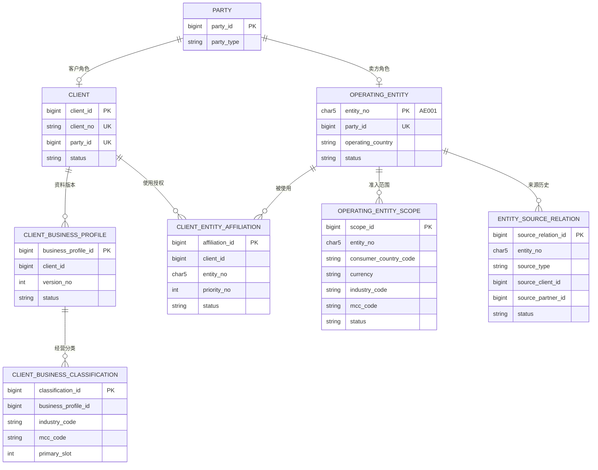
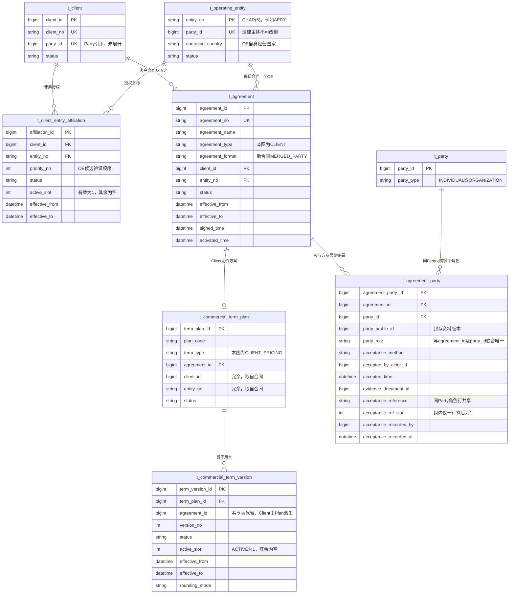
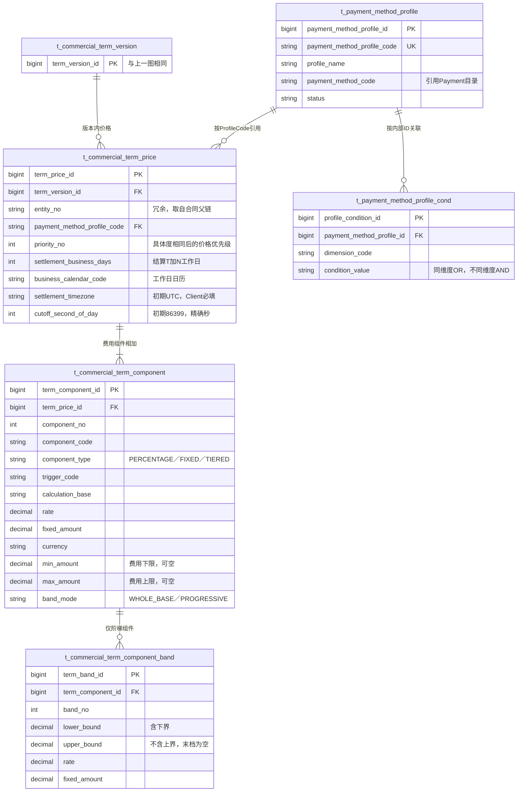

# OE 与 Client 概念模型评审稿

> **2026-09-11 实施范围更新：** 用户已授权 CCT、Commerce、Payment、Finance 的本期模型调整，并明确 PDManer 一起改；Risk 暂缓。前文各阶段“不改 PDManer/待进入阶段4”仅为当时记录。当前模型、SQL 工件和未迁移边界见 [本期模型实施记录](./model-implementation.md)。Java 业务实现不计入本次模型完成声明。

本文沿用第八版概念基线。第 10 节为已确认的 agreement_party 单表共签方向，第 11 节保留阶段 2 影响分析，第 12–14 节为阶段 3 的身份/关系/共签/预检方案。最新 D1–D3 均已确认，结算采用 UTC/86399，支付准备固定 Agreement/Term Version，完整支付事实齐备后解析 Price，创建只返回基础金额。完整时序、接口、恢复、Scope Canonical、历史兼容和验收见 [阶段 3 合同设计](./stage3-contracts.md)。本稿为待整体审阅的方案，没有实施 PDManer、SQL 或代码；历史阶段的待决说明以第 15 节最新决定为准。确认记录见 [delivery.md](./delivery.md)。

新接口删除 assignmentId，OE 引用改用字符串 entityNo。第 6 节为基础预检与支付准备两段业务过程，第 8 节说明具体时点及待完成的接口/数据边界，第 9 节记录最新定价归属和结算配置方向；不再把创建时冻结 OE 作为本需求目标。

最新范围：用户要求支付信息参与 OE 选择的优化以后再做，本期暂时使用 Affiliation 优先级及四要素、合同等既定验证。支付方式/具体卡特征作为新增 OE 筛选输入、按成本或利润排序均不在本期实施范围。定价采用第 15 节已确认的两步时点，Payment 在固定 OE 下的既有方式/MID 能力校验保持。

## 1. 建模基线

Party 说明法律上是谁，OE/Client 说明在平台承担什么角色；业务范围说明能承接什么，Affiliation 说明某个 Client 可以使用哪个 OE。一个“OE 详情”或“Client 详情”页面可以组合这些信息，但不能因此把它们全部塞进角色主表。

| 层次 | 事实与所有权 | 处理建议 |
|---|---|---|
| Party 与资料 | 自然人/机构身份，名称、注册/身份标识、地址、联系资料、必要的法律关系 | 保留现有结构和版本化资料 |
| Client/OE 角色根 | 稳定身份、Party 引用、业务生命周期 | Client 保留；OE 改用不可变 entity_no 作为唯一主键及对内、对外引用 |
| OE 交易准入范围 | OE 独立获准的准确国家/币种/行业/MCC 组合 | 建议补充，现行模型缺失 |
| Client Business Profile/Classification | Client 经营描述与已批准业务分类 | 保留；澄清预计规模口径 |
| Client–OE Affiliation | Client 使用某个 OE 的整体授权及优先顺序 | 删除重复四要素；本版将 priority_no 放在关系上 |
| Assignment Rule | 原准确范围内的候选优先顺序 | 本版合并进 Affiliation，不保留独立表 |
| Client Entity Assignment | 原预先生成的生效分配结果 | 按用户要求取消；CCT 创建时预检候选、支付准备时只读解析，Commerce 保存最终选定的 OE |
| 合同、法律文档、价格 | 独立法律事实、展示事实和不可变商业条款 | Client 合同改为准确 Client/OE，Plan 归属合同，结算到期条款随 Price；第 10 节合并 CCT 参与方和签署结果，Consumer Legal 等未涉及结构保持 |

现有角色关系保持：一个 Party 至多一个 Client 角色、至多一个 OE 角色，可同时承担两个角色。Client/OE 状态与资格独立，复用 Party 不代表复用审核结论。

## 2. 共用法律身份

| 属性类别 | 当前归属 | 说明 |
|---|---|---|
| Party 身份 | party_id、party_no、party_type | 类型为 INDIVIDUAL/ORGANIZATION；Client 类型由 Party 得到 |
| 机构资料 | organization_profile | legal_name、trade_name、incorporation_country、organization_type、incorporation_date |
| 个人资料 | individual_profile | given_name、middle_name、family_name、birth_date、nationality_country、residence_country |
| 法律标识 | party_identity_key / party_profile_identifier | 标识类型、签发国家、规范化标识及与资料版本的关联 |
| 地址 | party_address | 按用途维护地址，属于对应 Profile |
| 联系资料 | party_contact | 使用已批准的语义明确的敏感值引用；本稿不沿用旧文档中的 Vault 元数据四元组作为新合同 |
| 法律关系 | party_relation | 必要的持股、控制、董事等关系；不增设通用多层权属计算 |

注册国家、OE 经营国家与订单消费者国家是不同字段。当前国家路由输入由 Commerce 的 consumerCountryCode 提供，不得用 Party 注册国家或 OE operating_country 隐式替换。

## 3. OE 对象

### 3.1 角色主档

目标 operating_entity 只保留一个身份字段，不再保留数字 operating_entity_id：

| 字段 | 含义 |
|---|---|
| entity_no | 不可变字符串主键，例如 AE001；也是所有 OE 关联使用的身份；建议物理类型 CHAR(5) |
| party_id | 创建后不可改绑的法律主体引用；更换法律卖方必须创建新 OE |
| operating_country | OE 自身经营国家，单值 |
| status | PENDING / ACTIVE / SUSPENDED / CLOSED；CLOSED 不重开 |
| create_time | 记录创建时间 |
| update_time | 记录更新时间 |

不在主表复制公司名称、税号、地址、行业列表、币种列表、MID、余额或审核结果。来源继续由 entity_source_relation 表达：PLATFORM/CLIENT/PARTNER，Client/Partner 来源的供应方是来源关系的 Owner，不代表所有使用该 OE 的 Client。

编号规则与分配建议：

- 固定五个 ASCII 字符：创建时 OE operating_country 的平台目录二位大写国家代码，加三位数字 001–999；例如 AE001、AE002、SA001。不使用 000。
- 每个国家前缀最多分配 999 个编号，包含已关闭主体；编号创建后不改、不回收复用。容量接近上限时另行评审扩容，不能静默复用旧号。
- 前缀只表示创建时的编号来源。后续资料或国家目录变化不重编号；所有路由始终读取 OE Scope，不能解析编号前缀代替消费者国家或准入范围。
- 由平台受控分配并保证并发唯一，允许序号有空缺；本稿不新增通用编号服务或序列表。不要用无并发保护的 MAX+1 分配。
- 新交易的 CCT 引用及跨系统持久化字段统一使用 entity_no；用户已明确新接口使用字符串 entityNo，删除 assignmentId 及数字 operatingEntityId 的新合同依赖。目标不保留另一套数字 OE 身份或新增 oe_code，历史合同只读兼容另行处理。Client 等其他对象主键不随本次改变。

这是用户明确指定的 OE 专项主键方向，与现行统一 Snowflake 规则不同；当前正式规范和工件尚未修改。后续影响分析需要覆盖 BCR Record/Root 坐标、通用 ID 假设、API/事件、索引和所有消费者，不能只把主表类型改为 CHAR(5)。

用户已确认 OE 自身经营国家为单值，编号及前缀不参与路由。entity_no 对应的法律身份终身固定；同一 Party 的名称、地址等资料继续通过现有 Profile 版本维护，不能借修改 party_id 将旧 OE 交给另一个法律卖方。

### 3.2 交易准入范围——新增建议

一个 OE 可以有多条范围；每条都表达一组不可拆开的准确组合：

| 候选业务属性 | 用途 |
|---|---|
| scope_id、entity_no | 范围自身的稳定 ID、所属 OE 的字符串主键引用 |
| 消费者国家、交易币种 | 下单范围匹配，与经营/注册国家区分 |
| industry_code、mcc_code | 准确业务分类；不接受通配 |
| 状态、有效起止时间 | 控制当前是否可用于新交易，保留历史 |
| 批准依据的可追溯关联 | 证明哪些范围经哪个受控流程批准，不由手工 ACTIVE 标记替代审核 |

这是候选业务属性，不在本阶段确定物理表名、状态词表、版本形态、索引或新的 Hash。稳定身份、区间与历史读取满足后，不再机械新增 Root/Version/Hash 层。

必要性：简化后的 Affiliation 只表达双方授权，四要素准入统一由 OE Scope 表达；当前正式模型尚无此独立结构。Payment 的 MID 能力只证明支付执行能力，也不能证明法律卖方的业务准入。OE Scope 与 Client Classification 保持独立：前者是法律卖方的准入组合，后者是 Client 的经营分类，审批生命周期不同；只复用 Industry/MCC 目录及校验规则。

范围维护必须关联冻结的申请/审核输入与可检索结果。现有 operating_entity_application 尚无完整范围输入及范围变更合同；是否扩展该申请还是采用其他受控变更入口，在下一阶段比较并评审。本稿不默认新增审批引擎、通用工作流或独立资格数据库。Risk 继续拥有 Qualification Decision，CCT 拥有被批准后生效的 OE 业务范围。

用户已确认：Scope 必须经批准才生效，同一 OE 的同一准确组合不能出现重叠、冲突的有效记录。扩展 Scope 不自动补齐合同或法律文件；这些条件仍需在逐候选验证中满足。

### 3.3 OE 的关联属性

- 一个当前有效的来源关系；
- 多个 Client 的整体使用授权及各自配置的优先级；
- 多份覆盖该 OE 的合同；
- 按 OE/消费者国家/语言生效的消费者法律文件及卖方披露；
- 属于不同合同条款版本、准确指向该 OE 的 Price；
- Payment 拥有的多个 MID，通过内部合同查询；
- Risk 拥有的角色资格，通过内部合同查询。

这些对象不是主档的重复字段。多个 MID 不使 OE 变成多个法律主体，多个来源也不能同时成为同一 OE 的当前来源。

## 4. Client 对象

### 4.1 角色主档

现有 client 九个字段保留：

| 字段 | 含义 |
|---|---|
| client_id | Client 稳定身份 |
| client_no | 唯一业务编号 |
| party_id | 个人或机构 Party 引用 |
| status | PENDING / ACTIVE / SUSPENDED / TERMINATED |
| activation_time | 激活时间 |
| suspension_time | 暂停时间 |
| termination_time | 终止时间 |
| create_time | 记录创建时间 |
| update_time | 记录更新时间 |

Client 类型通过 Party 的 INDIVIDUAL/ORGANIZATION 取得；如果页面需要 clientType，可在读模型投影，不创建第二个可独立修改的类型字段。Client 不等于人类登录 Account、Tenant 或 API Credential。

### 4.2 经营资料与分类

| 属性 | 当前归属与规则 |
|---|---|
| 经营模式、网站 | client_business_profile.business_model_code / website_url |
| 预计交易规模、客单价与 currency | 当前 Business Profile 已有字段；统计周期、口径应明确，currency 不能被解释成允许交易币种清单 |
| 资料版本、状态、有效期 | 保留 Business Profile 的冻结、审批和替换规则 |
| 多组 Industry/MCC | client_business_classification，一条一个准确组合，不拼成字符串或列表 |
| Primary 分类 | 一个有效 Profile 最多一个 Primary；当前 Checkout 成功下单要求唯一有效 Primary |

当前 Client API 不提交 industry/MCC，也不从商品行自行推导分类。Client 有多条 Classification，不等于当前能逐订单选择不同分类；改变这一点属于单独的下单合同变更。

### 4.3 国家、币种及 OE 使用范围

Affiliation 只表示双方授权，不再拥有国家、币种、Industry 或 MCC：

| 字段 | 本版建议 |
|---|---|
| affiliation_id | 关系自身的稳定 ID |
| client_id、entity_no | 被授权的 Client 和提供服务的 OE |
| priority_no | 同一个 Client 对各 OE 的统一偏好，数值越小越优先，不按国家或其他维度变化 |
| status、active_slot | 沿用 ACTIVE/ENDED 和活动槽语义 |
| effective_from、effective_to | 使用授权的有效期 |
| create_time、update_time | 维护时间 |

建议同一 Client/OE 最多一条有效关系，同一 Client 的有效 priority_no 不重复。关系身份或优先级变化结束旧行、创建新行，保留历史；唯一键及有效区间并发约束在物理设计阶段确定。

用户已确认：关联 OE 后，授权覆盖该 OE 当前及以后支持、且符合 Client 批准分类的范围。OE 新范围生效后不需要给每个 Client 再补 Affiliation；范围匹配成功仍不替代合同、法律文件、Risk/Payment/Platform 等必要门禁。Client 当前 Checkout 仍只使用唯一 Primary 分类。

本期不增加 Client 独立国家/币种清单或双方范围例外。将来如需某个 Client 只能使用 OE 的部分范围，再按具体业务场景扩展，不能预留通配、空值例外或通用条件表。

### 4.4 Client 的关联属性

- 多次入驻/资料变更申请，及由 Risk 提供的相应资格结果；
- 多条 Client–OE 使用关系；CCT 每次为新交易解析唯一 OE，不预先持久化分配结果；
- Client 合同与合同覆盖的 OE；
- 每份准确 Client/OE 合同下的 Client Pricing Plan、历史版本、按支付特征配置的 Price 及结算到期条款；
- Platform 的 Tenant、成员、权限、API Credential；
- Finance 的余额、保证金、应收及出款事实。

后两组由相应系统拥有；页面可以聚合查询，不能搬入 Client 主档成为 CCT 自有事实。

## 5. 概念关系图

以下是第二版目标模型的核心逻辑 ER 图，字段仅展示身份与本轮讨论的属性。审计时间、有效期、现有资料版本字段、申请/合同/法律文档及 Partner 主档未全部展开；图中关系不是物理外键。

char5 在图中代表建议的 CHAR(5)。Profile/Scope 的零条关系表示可存在尚未就绪的草稿角色；可交易 Client 必须具备唯一有效 Primary，可交易 OE 必须具备命中的有效范围。Source 可有多条历史，但必须只有一个当前有效来源，PLATFORM/CLIENT/PARTNER 及供应方 XOR 语义保持。分类和范围按值匹配，不建立相互引用表。

## 6. 创建预检、支付准备、维护与历史

### 6.1 创建 Checkout 的基础预检

创建阶段先校验请求、Client 和基础交易范围，并判断是否存在基础合格的 OE 候选。本版建议最低清单为：

1. Client 身份有效，创建输入及 client_order_id、币种、商品、到期等满足创建合同。
2. Client 存在可用于本次预检的有效 Primary Classification；与请求消费者国家、币种组成准确四要素。
3. 至少存在一条有效 Affiliation，其 OE 状态、唯一来源关系及有效 OE Scope 满足基础条件。

无基础合格候选则拒绝创建；有候选则可以建立基础 Checkout。此时不确定或持久化最终 entityNo，不生成 Assignment，不预占某个 OE，也不生成依赖最终卖方的完整订单上下文。具体预检项目和错误合同在后续设计阶段列明；基础合格不等于合同、所有实时资格及最终付款条件已经全部验证通过。

预检只表示这次检查时存在基础候选，不输出供支付直接复用的准入凭证。创建命令的重复请求继续复用已创建的 Checkout 及原创建结果；真正进入支付准备时再判断届时是否可用，不能通过重放创建接口替代准备校验。

### 6.2 支付准备时按优先级逐个完整验证

1. 校验 Checkout 归属、未过期及可进入准备的业务状态，根据可信 Client 身份重新确认有效 Business Profile 的唯一 Primary，取得准确 industry_code/mcc_code；不把创建预检结果直接当作最终分类证明，也不接受 Client 指定 OE、MID 或随意切换分类。
2. 与订单 consumerCountryCode/currency 组成准确四要素。
3. 取得该 Client 的有效 Affiliation，按 priority_no 升序形成候选顺序；同优先级冲突不能用数据库行顺序或 entity_no 打破。
4. 按上述顺序逐个完整验证候选：OE 状态、唯一有效来源、准确四要素准入、Client/需要时的 Partner 合同覆盖与有效期、商业条款、消费者法律文件，以及该次 CCT 解析所需的候选资格检查。
5. 候选自身明确不满足条件（例如不支持范围、合同缺失或过期、法律文件未就绪）时，继续验证下一个候选；第一个全部通过的候选立即成为结果。全部候选均未通过则返回无可用 OE，不返回部分通过的上下文。
6. CCT 返回选定 entity_no 及同次解析中实际消费的上下文引用，不写 Rule/Assignment，不生成新的 assignment_id。Commerce 承担选择结果的持久化与准备命令恢复，完成最终卖方、税额/应付金额和法律内容的准备，供消费者确认实际交易条件；后续 Payment 只能在固定 OE 下选择 MID。

候选遍历期间，CCT 自有事实使用同一次一致性读取和同一个上下文时点，不能将不同配置时点的范围、合同和法律材料拼接为通过结果。证据歧义、读取失败或依赖超时表示无法完成判断，不当作候选明确不合格而静默跳过；Client 整体资格失败终止整次解析。具体逐候选检查项、作用域和错误映射在接口设计时列明。

逐候选验证发生在最终主体选择完成之前。现行 Commerce 在 CCT 返回后执行的订单级 Risk 命令，仍须基于 Commerce 可恢复固定的 OE 执行；其拒绝不启动另一轮主体选择，也不能把同一子幂等键依次用于多个 OE。新定价目标依赖晚到 Payment 事实，逐候选验证不得提前猜测卡组织、3DS 等事实或声称已经解析最终 Price。

### 6.3 维护及失败示例

以下为合成场景；国家均为消费者国家，业务分类仅作结构示例，不构成现实收单能力声明。

- AE001 主档 operating_country=AE；初始准入范围为 AE/USD/DIGITAL_SERVICES/5734。
- Client-X 当前 Primary 为 DIGITAL_SERVICES/5734；建立 Client-X → AE001，priority_no=10。
- AE/USD 下单可进入候选；SA/USD 最初无匹配范围而拒绝。
- AE001 后续批准 SA/USD/DIGITAL_SERVICES/5734 后，同一关系自动覆盖新增组合，无需新增 Client 的范围授权。
- AE001 后续批准另一个 Industry/MCC，不会自动把 Client-X 的 Primary 改成那个分类。
- 若 Client-X 另关联 SA001，priority_no=20，先完整验证 AE001；其全部通过则返回 AE001。
- AE001 范围匹配但合同过期，继续验证 SA001；SA001 全部通过则返回 SA001。两个都未通过则拒绝。
- AE001 验证时依赖超时或来源证据冲突，返回对应无法确定/配置错误，不把异常伪装成明确未通过后静默跳过。
- 创建预检时 AE001 基础合格，进入支付准备前其范围被结束：重新验证时可以选择届时完整合格的 SA001；若全部候选不合格，则保留基础 Checkout 的身份但不进入支付。预检阶段并没有冻结 AE001，因此这不是更换已冻结主体。
- 不存在预先重算 Assignment 的维护任务。已经冻结交易上下文的订单及正在恢复且已有固定选择的准备命令，不会因后续配置变化而切换到 SA001。

### 6.4 Commerce 的冻结与恢复要求

取消 Assignment 是本版目标，不以新增另一张 CCT 分配结果表补回。Commerce 在现有订单/恢复数据中承担交易选择的持久化，至少保留 entity_no、实际四要素和既有必需的不可变合同/法律引用。是否另存 affiliation_id、scope_id、source_relation_id，须以明确历史消费者决定，不机械复制整个 CCT 解析路径或新增聚合 Hash。

目标需要区分创建基础 Checkout 与准备最终交易两段恢复责任。创建阶段没有最终 OE；首次支付准备一旦其选定 OE 被后续步骤使用，恢复就必须继续使用该选择。当前 [恢复决策](../../../agent-docs/decisions/2026-09-09-commerce-checkout-recovery-simplification.md)仍属于创建时准备完整 Order 的旧实现边界，不能未经设计把 CLAIMED/ORDER_COMMITTED 等旧含义直接套到新流程。选择 AE001、Risk 已处理后中断，随后用相同子幂等键改为 SA001 的输入漂移，在新准备流程中同样必须避免。

Commerce 必须在需要稳定 OE 的下游调用前可恢复地固定选择。创建命令时点继续服务创建幂等和原到期时间；首次支付准备还需要稳定的商业上下文时点，准备重试不得重新取时间或直接复用创建预检的资格结果。两个过程的具体命令身份、存储字段、事务/恢复位置、CCT 精确历史读取与停用门禁须在合同设计阶段明确。本轮不预造新检查点或写代码；固定主体后停止支持按已定义失败边界处理，不为同一冻结订单更换 OE。

用户已确认，本次模型和配置调整不修改任何历史订单：不回填或替换原 OE 身份，不重算原分类/合同依据，不因解除关联、调整优先级或变更 Scope 而改写订单。历史授权与商业依据保持可追溯；正常支付、退款等既有业务生命周期不由这次配置维护触发。

旧 assignment_id 及数字 operating_entity_id 已进入模型、代码和跨系统合同。后续设计需覆盖 CCT、Commerce、Risk、Payment、Finance、事件及历史 Reader，并按实际数据确认兼容范围。新交易目标引用 entity_no；历史订单按原身份和合同保留读取能力，不做批量改写。取消目标表不等于现在物理删除历史行；旧 ID 不能直接改解释为 entity_no、scope_id 或 affiliation_id。

## 7. 详细设计入口与实施边界

概念阶段提出的编号、审核、签署、两段 Checkout、Price 与兼容问题，具体方案已在第 12–14 节和 [阶段 3 合同设计](./stage3-contracts.md)收敛。第 11 节保留阶段 2 当时发现的差异，不表示这些问题仍全部待业务答复。

OE 是否限定机构、预计规模计量周期本期维持原行为，不引入新限制。实际 Provider 事实目录映射、存量数据核对、正式模型工件和部署注册 ID 为后续实施前置；没有证据不能启用。阶段 3 方案仍需整体评审，本阶段不生成或执行 SQL，不修改 PDManer。实际实现状态只读 [CURRENT_IMPLEMENTATION.md](../../../agent-docs/CURRENT_IMPLEMENTATION.md)。

## 8. 已确定的业务时点与待完成的数据合同

### 8.1 需要分开的事实与时点

| 事实 | 时点约束及评估方向 |
|---|---|
| Client、client_order_id、商品行、币种与到期 | 创建 Checkout 时保留稳定请求与幂等身份；不因延后 OE 丢失命令恢复基础 |
| OE、对应合同、卖方披露、最终税额/应付金额、消费者法律文件 | 必须在消费者对最终交易条件进行有效确认之前确定，并让确认对应实际使用内容；不能用旧 OE 的接受证据支付给新 OE |
| 商业条款/定价规则版本 | 在明确的商业约定时点固定，防止支付期间费率配置变化改写原约定；已确认在支付准备时固定，详见阶段 3 合同 |
| Payment Method、Provider/Account/MID | Payment Method 由消费者选择并由 Payment 校验；在已确定 OE 下按 Attempt/Action 的实际执行边界选取并固定 Provider/Account/MID |
| 具体 Price、Component/Band、费用金额 | 等相应已验证支付事实可用后按固定规则解析，在实际收费触发点计算/记录；不能为等最终 3DS 结果而推迟消费者应付金额确认 |
| Client 结算到期输入与资金可用时间 | 结算输入来自同一命中 Client Price；Finance 使用实际支付成功时间计算并冻结 balance_available_time，详细查询/冻结合同见阶段 3 合同 |

Client Fee/Partner Share 等平台与业务方之间的费用，与消费者在 Checkout 确认的应付金额不同。若某项费用需要进入消费者应付金额，必须在付款确认前明确展示并确认，不能支付后再补加。Provider 最终成本也不自动等于 CCT 商业定价；是否使用成本参与路由是另一个需明确消费者及事实来源的需求。

### 8.2 基础预检与最终解析的职责

创建 Checkout：完成基础校验，确认存在基础合格的 OE 候选后建立基础请求与会话；不选定最终 OE，也不将预检结果当作未来的支付保证。

支付准备：重新调用 CCT，按 Affiliation 优先级逐候选完整验证四要素、合同等既定条件，固定最终 OE 和相应上下文，完成卖方、税额/应付金额及条款的展示与确认准备，然后进入支付。用户明确保留此延后方向；精确接口和字段矩阵见阶段 3 合同，正式模型尚未修改。

创建时冻结完整 OE 上下文不再是本需求的推荐或待选择方案。新增支付信息参与 OE 选择的优化仍已延期，本期不增加这类筛选输入；延后时点并不恢复该优化范围。

OE 选择仍归 CCT，MID 选择仍归 Payment。OE Scope 继续表达四要素，不因新增 payment_method_code 请求输入就在 CCT 复制 Payment 的 MID 能力。CCT 只能使用实际 Owner 已提供的事实，不依赖跨库查询。

冻结前的选择变更可重新评估；冻结后的同一订单/Intent 不跨 OE 重试。任何允许改变卖方、金额或法律内容的确认前流程都必须刷新展示并让消费者确认实际使用内容，不能覆盖已有 Acceptance 或复用另一主体的证据。本方案只在准备时一次建立 Context；其后不更改卖方/商品/金额，详见阶段 3 合同第 3 节。

### 8.3 支付时也不是所有事实都已知

用户此前认为按支付方式与具体卡特征选择 OE 两种场景都会存在，随后明确要求先不做这项优化，暂时使用优先级。下述卡特征用于跨 OE 选择的分析作为后续参考，不要求本期实现或验证前置采集能力；支付事实的实际可用时点仍与定价评估相关。

选择 CARD/某种钱包只提供支付方式，不保证此刻就取得卡组织、资金类型、卡等级等信息；实际 3DS 分类更是在支付过程中确定。[定价决策](../../../agent-docs/decisions/2026-09-10-cct-payment-method-profile-pricing.md)明确由 Payment 标准化这些晚到事实，不由 CCT 推测。

当前 Payment Instrument 归属于 Attempt，而当前 Attempt 的 Intent 已固定 OE。现有设计未证明具体卡特征能在 OE/Provider/MID 选定之前取得，也未证明 Provider 工具引用可跨 OE/账户/渠道使用。若需利用具体卡特征跨 OE 选择，应先核对 Provider 托管采集的输入、返回时点与工具引用作用域，不能让 PAN/CVV 进入 Code-MoR 或用未知字段参与预先路由。

若实际渠道支持在最终主体确认前返回可由 Payment 验证的受控卡特征，并且工具引用可用于最终选定的执行范围，则这些已知事实可以参与候选 OE 的校验。若获取这些信息本身要求先选定 OE 或限定的 Provider/账户/MID，便形成前置依赖，不能假设同一信息仍可用于任意跨 OE 重选；此时仅用提前可用的支付方式等事实选 OE，较晚取得的卡特征服务于允许范围内的支付执行和定价。消费者自报卡组织/卡类型不能代替 Payment 验证后的事实。

尚未得到的事实不能作为先前决策的必需输入。可以用当时已知事实做候选筛选或价格预估，再用实际事实计算最终费用；不能支付完成后倒推并更换已经使用的 OE/MID。

### 8.4 当前模型与实现的影响边界

- CCT 的 OE、Scope、Affiliation、Classification 结构仍可作为基础预检和完整解析的数据来源；两种查询职责的具体请求/响应需另定。
- [Commerce 模型](../../../agent-docs/database/COMMERCE_DATABASE.md)当前在创建事务固定 Order、Order Context、Legal、金额与 OE；目标需明确确认前数据、最终上下文创建时点、返回语义与幂等恢复，不用占位 OE 或假税额绕过当前必填结构。
- [Payment 模型](../../../agent-docs/database/PAYMENT_ORCHESTRATION_DATABASE.md)的 Intent 已携带固定 OE、金额与 Order Context，现有 Create Checkout 会创建 Intent；目标需在 OE 和金额确定后创建相应 Intent，不能直接保持当前必填合同而传空 OE。
- [Finance 模型](../../../agent-docs/database/FINANCE_DATABASE.md)的 Tax Snapshot 依赖卖方主体等实际输入；延后 OE 需要同步税额确认时点和恢复键，不能复用另一主体的税快照。
- Risk 订单级评估、COM-I10 接受证据、消费者确认与支付方式变更都需按最终交易上下文对齐。此前确认的 Commerce 恢复责任和历史订单不回写要求保持。

创建预检、支付准备再确定 OE 的方向已明确；具体字段、状态、接口和检查点见阶段 3 合同。本轮不修改正式模型、SQL、代码。两类新增支付信息参与 OE 选择的优化仍移至后续范围。

## 9. Client 合同、定价和结算到期条款

### 9.1 合同与方案的管理粒度

用户提出一份 Agreement 应对应一个 Client 和一个 OE，Agreement 下包含定价 Plan，Plan 下只能有一个有效 Version；随后继续调整结算字段归属。本稿据此收敛 Client 合同分支，不再采用 Client 全局唯一 Plan 或一份 Client 合同覆盖多个 OE 的目标。

| 对象 | 本轮目标归属与职责 |
|---|---|
| Client Agreement | 直接关联 client_id 和 entity_no；同一对主体可先后签订多份合同，同一业务时点至多一份适用合同 |
| Client Pricing Plan | 属于一份 Agreement；该合同的稳定定价方案，不再以 client_id 单列作为唯一归属约束 |
| Commercial Term Version | 属于 Plan；允许历史、草稿、待生效版本，同一时点至多一个有效版本，供交易使用时必须存在适用版本 |
| Commercial Term Price | 属于 Version，关联准确 Payment Method Profile；同时承载 Client 的结算到期输入 |
| Component / Band | 继续表达收费公式、多个组件相加及阶梯，不各自定义交易资金成熟时间 |
| Client–OE Affiliation | 继续表达整体使用授权和候选优先级，不随每次合同续签重建，也不取代当前合同及价格校验 |

合同 Client/OE 和版本归属冻结后不可改绑；Version 有效区间必须包含于 Agreement 有效区间，合同和版本在交易时点均须解析唯一。这里只定义时间约束，不新增合同路由优先级或恢复 Assignment。

Client 分支不再需要 agreement_operating_entity 作为合同到 OE 的中间层。但现行共享 Agreement 模型还承载 Partner 合同覆盖及 Partner 定价消费者，本次没有确认 Partner 也改为单 OE 合同，不能据此直接删除整个共享表或其 Partner 数据。正式迁移另行核对双方合同分支，历史 Association/Scope 仍按原合同读取。

### 9.2 结算到期条款跟随 Price

结算到期条款随 Client Price。用户已确认保留四个字段，初期 UTC/23:59:59；不增加结算策略表。

| commercial_term_price 字段 | 含义 |
|---|---|
| settlement_business_days | 非负工作日数 N，Client Price 必填 |
| business_calendar_code | Finance 支持的工作日/节假日日历代码，Client Price 必填 |
| settlement_timezone | 保留，Client Price 初期显式写入 UTC |
| cutoff_second_of_day | 保留，Client Price 初期显式写入 86399，代表 23:59:59.000000 |

四字段随不可变价格版本保存；Partner 两类价格为空，共同成熟跟随 Client Price。Agreement/Plan 不另维护可写结算默认值，后续换版不影响历史条款。Finance 采用成功日/Cutoff/FOLLOWING/N 工作日算法，精确秒边界、非工作日和 N=0 算例见阶段 3 合同第 5 节；未证明日历不可按默认周历猜测。

假设同一合同 Version 下，卡支付 Price 为 T+3，某钱包 Price 为 T+1：交易准确命中哪个 Price，就采用该 Price 的费用组件和结算输入。此处数字仅为模型示例，不是现有渠道或已签合同条款。

Price 绑定的是完整 Payment Method Profile，因而结算输入也随国家、币种、卡类型等已有 Profile 条件共同匹配。若业务只希望按支付方式区分周期，同一方式的多个 Profile Price 应配置相同结算输入；不能另行挑选一条 Price 计算费率，再选另一条 Price 计算 T+N。Profile 包含实际 3DS 等晚到条件时，必要事实齐备前不能声称最终 Price 或最终结算输入已确定。

CCT 提供并保留精确 Price 及其不可变条款，Finance 负责按实际支付成功时间计算和冻结 balance_available_time；换版不得回算历史资金可用时间。该时间表示资金合同到期后可转为可用余额，不等于 Provider 实际到账或银行自动打款，也不改变已确认的 Client Principal 与可选 Partner Share 共同成熟语义。[现行 Finance 计算语义](../../../agent-docs/database/FINANCE_DATABASE.md)仍拥有现行算法基线和结果所有权。字段选择已确认，输入引用与 Reader 见阶段 3 合同，历史交易继续按已冻结结果及原合同读取。

Price 的费率或结算到期条款变化都按现有不可变定价版本机制创建新 Version/Price，不能直接更新已经批准的行。必要输入缺失、父链冲突或 Price 无法唯一确定时，不能以默认 T+0 或缺省费率继续生成最终结果。

### 9.3 有用途的字段冗余

用户允许合理冗余，本稿不再把删除每个可推导字段作为目标。本版图建议保留 Plan 的 client_id/entity_no 以支持按客户或 OE 查询方案，Price 保留 entity_no 便于准确 OE 的价格过滤及归属校验；本节的 Client 概念图不重复展开 Version.agreement_id；共享物理表按第 12.4 节保留该列，以承接 Partner 分支，Client 值由父 Plan 派生。以上是本轮可审阅字段建议，不代表正式物理列或索引已经修改。

Agreement 仍是 Client/OE 合同归属权威，Version 的 Plan 父链和 Price 的 Version 父链必须一致。冗余身份由服务端从该链带出，在同一本地事务校验，不允许作为独立输入改绑；不能用命中某个冗余字段跳过合同/版本检查。结算条款保持在 Price 单处配置，冗余身份不等于多处配置同一个费率、周期或有效状态。

本节仅更新需求与概念评审基线，不修改 PDManer、生成器、Java、SQL 或已存在的历史引用。新的定价接口、冻结时点、共享 Partner 分支和兼容方案见第 12.4 节及阶段 3 合同。

### 9.4 调整后的合同与定价字段图

以下仅展开 Client 合同及 Client Pricing 分支，字段为本轮评审建议，使用简化类型；不创建 SQL 或更改正式模型。create_time/update_time 等通用审计列、Party 资料、OE Scope、Client Classification、来源和 Consumer Legal 本图不重复展开；参与方及签署结果的最新合并方案见第 10 节。PK 为主键，UK 为单列唯一键，FK 为逻辑引用，不建立物理外键；未画出冗余身份的额外连线。

一份 Client 合同对应一个 Client/OE，合同下管理 Plan 和版本。零条关联允许草稿尚未配置完整；进入交易时必须满足合同及价格就绪条件。

下图继续展开同一 Version 的价格。时区和截止时间两列已确认保留；Client Price 初期固定 UTC/86399。

### 9.5 关键约束建议

| 范围 | 唯一性与校验 |
|---|---|
| Affiliation | 同一 Client/OE 至多一条有效授权；建议有效 priority_no 在 Client 内唯一。活动槽组合唯一不替代有效区间重叠校验 |
| Client Agreement | 同一 Client/OE 的适用合同区间不冲突；不能对 client_id/entity_no 建永久唯一而阻止历史续签 |
| Plan | Client Pricing 分支按 agreement_id/term_type 唯一；plan_code 继续按 term_type 唯一，client_id 不再单列唯一 |
| Version | term_plan_id/version_no 唯一，term_plan_id/active_slot 唯一；仅 ACTIVE slot=1，其余为空，适用区间不重叠且包含于合同区间 |
| Price | term_version_id/payment_method_profile_code 唯一；term_version_id/priority_no 唯一。Version 已确定一个 OE，不再依靠将冗余 entity_no 放入唯一键区分价格 |
| Profile Condition | payment_method_profile_id/dimension_code/condition_value 唯一；Profile 按 Code 被 Price 引用，内部 Condition 按 ID 关联 |
| Component | 同一 Price 内 component_no、component_code 分别唯一，至少一项组件，触发点与计算基数来自受控目录 |
| Band | 同一 Component 内 band_no、lower_bound 分别唯一；从零起连续无重叠，末档无上界，只有 TIERED 使用，PROGRESSIVE 首期仅比例 |
| 冗余与不可变历史 | Plan/Price 的身份投影必须与同一合同父链一致；已批准 Version 的价格、组件及结算条款不可原地覆盖 |

这些约束是后续物理方案的输入，不构成共享 Partner 分支的索引或字段迁移批准；Plan/Agreement 的通用类型矩阵仍需专项核对。

## 10. Agreement Party 与最终签署结果合并

### 10.1 已确认的签署粒度

用户同意将 agreement_acceptance 合并到 agreement_party，并明确一次签署可以覆盖同一法律 Party 在同一合同中的多个角色。现行 [CCT 签署模型](../../../agent-docs/database/CLIENT_CONTRACT_DATABASE.md)本就限制每个 Signatory 最多一份最终 Acceptance；本次保留单次最终结果的边界，调整参与方与角色的基数，不引入多次签署尝试、转签或签署工作流。

目标关系为 Agreement 一对多 Agreement Party，每行表示一个 Party 在合同中的一个角色；不单设角色子表。行按 agreement_id/party_id/party_role 唯一，签署业务事实按 agreement_id/party_id 分组：同一组的多个角色行冗余保存同一份最终签署结果，由应用事务保证一致。这部分有明确用途的冗余用于减少表和关联，不表示每个角色需要独立签署。Party 的 INDIVIDUAL/ORGANIZATION 类型继续由 Party 根拥有。

### 10.2 字段与唯一性

agreement_party 的建议业务字段如下，另保留通用 create_by/create_time/update_time；它们不能替代签署登记元数据：

| 字段 | 用途 |
|---|---|
| agreement_party_id | BIGINT 主键；稳定定位一条参与方角色行，不能将行数当作签署方数量 |
| agreement_id | 所属合同 |
| party_id | 准确法律 Party |
| party_role | CLIENT、OPERATING_ENTITY、PLATFORM_SIGNATORY、LOCAL_PARTNER 等已有受控合同角色 |
| party_profile_id | 该 Party 在此合同中采用的封存资料版本 |
| acceptance_method | E_SIGNATURE、CLICK_ACCEPTANCE 或 MANUAL_SIGNATURE |
| accepted_by_actor_id | 实际在线签署的可信 Actor，不以参与方 Party ID 或登记人代替 |
| accepted_time | 实际签署时间，由签署方式对应的可信证据提供 |
| evidence_document_id | 同一合同的 agreement_document_ref 业务记录 ID，不是直接的 Platform File ID |
| acceptance_reference | 参与方级最终签署引用，同一合同/Party 的各角色行重复保存同一值 |
| acceptance_recorded_by | 登记签署结果的 Actor，承接原 Acceptance.create_by |
| acceptance_recorded_at | 首次登记签署结果的时间，承接原 Acceptance.create_time，不与 accepted_time 或参与方创建时间混用 |

唯一键为 UNIQUE(agreement_id, party_id, party_role)。它只限制同一合同、同一个 Party 不重复承担同一个角色，并不禁止不同 Party 担任相同角色。是否允许某个角色对应多个 Party 由合同类型规则决定，不机械增加所有角色通用的 agreement_id/party_role 唯一键。

原 Acceptance 的 acceptance_reference 单列全局唯一索引不适用于新表，因为同一合同/Party 的各角色行共用签署引用。引用仍必须标识同一合同/Party 的最终结果，不得跨组复用；整份电子合同的共享信封号不能直接当作参与方级签署引用。跨组防重采用第 13 节的占用列及唯一约束，不能只锁某一 Agreement 就声称解决不同合同间的引用竞争。具体 Provider 引用格式属于后续接口合同，不在这里增加猜测字段。

一份 Client 合同的 CLIENT 和 OPERATING_ENTITY 角色，必须分别映射到 Agreement.client_id 和 Agreement.entity_no 的 Party，并校验各自唯一必需的角色。实际需要的平台或 Partner 角色仍按合同类型的既有业务要求校验；角色不能被自由添加来扩展权限。party_profile_id 必须属于同一 party_id，且同一合同/Party 各角色行采用相同的封存版本。跨角色共签不把同一个 Party 变成多个独立法律主体。

### 10.3 身份和签署结果分阶段冻结

1. DRAFT 期间允许受控维护参与方、角色和资料版本，业务签约文件及合同类型要求必须在待签前校验完整。
2. 进入 PENDING_SIGNATURE 时，封存参与方身份、角色集合、资料版本和待签内容。此时不是冻结整行所有列：签署结果组仍允许后续通过受控签署命令补齐。
3. 首次成功登记以 agreement_id/party_id 为单位，按签署方式一次性向该组全部角色行写入相同的完整结果组，不能先写 accepted_time 再异步补证据，也不能只更新请求指定的一条角色行。实际签署 Actor 的身份和代表该 Party 的权限必须从可信授权或签署证据验证，不能仅检查传入 ID 存在。
4. 签署组写入后只读；同一结果重复提交返回原结果并保留原登记时间，不同结果或另一证据不能覆盖。同组行出现部分完成或结果不一致时拒绝正常完成，不任选一行作为权威自动修复。签约方资料或角色在待签后改变，不能复用之前的签署来接受新增内容。
5. 参与方行存在不等于完成签署。必签集合必须由冻结合同要求明确且非空，按不同 Party 去重；某个 Party 的全部角色行结果完整且一致才算该 Party 完成。不能把签署字段为空的行动态排除；如需保存无需签署的参与者，要先明确合同类型规则，本轮不自行增加免签能力。

原 Acceptance 的追加式证据语义改由签署字段组从空到完整的一次性状态转换承接；不允许通用行更新接口覆盖该字段组，也不允许删除已签参与方或其角色。

### 10.4 合同完成、证据和审计

签署命令与取消、参与方/角色变更在同一 Agreement 的受控本地事务及 Root CAS 下串行校验。该事务原子保存本次 Party 全部角色行的一致结果，重新检查全部必签 Party 和文档条件，再决定是否首次推进 Agreement 到 SIGNED；同时推进 Agreement Root 的变更证据及相应可靠事件。不能按角色行或参与方各自加锁后在事务外分别统计已签数量，也不新增另一套通用审计表。合同根的并发保护不替代前述跨合同签署引用约束。

两个最后签约方同时回调时，前一事务保存本方结果，后一事务看到完整集合后完成合同；重复回调不能重复发出 SIGNED 事实。取消或终止后的迟到回调不得恢复合同或覆盖历史签署；真实外部迟到证据的异常登记与恢复入口由后续接口设计明确，不把它伪装为正常签署完成。

evidence_document_id 必须属于同一 Agreement，CLICK_ACCEPTANCE 引用该合同的 Signing Document，E-Sign/Manual 引用 Executed Document；签署文件和已登记证据不可被另一份文件替换。agreement_document_ref、文件引用与文件 Hash 保持独立，签署完成不因合并而跳过文件条件。Agreement 的 signed_time 与 activated_time 继续分开：全体签完不自动等于合同已经到生效时间。

### 10.5 逐场景逻辑检查

| 场景 | 本版要求 |
|---|---|
| 一个 Party 同时为 OE 和平台签约方 | 两条参与方角色行、同一份签署结果；一次签署原子更新两行相同的引用、方式、签署人、时间及证据，只计一个必签 Party |
| 同一合同/Party 重复写入同一角色 | 三列唯一键拒绝重复；其他 Party 是否可承担同一角色另按合同类型校验 |
| 同组只有一条角色行已签或证据不同 | 不视为该 Party 已完成，不以其中一行覆盖其他行 |
| 同一签署引用出现在不同合同或不同 Party | 拒绝复用；跨组并发保护需在实施前设计并验证 |
| Client 方与 OE 方各自签署 | 按不同 Party 保存独立结果，全部满足才完成合同 |
| 签署未完成时 Party 主资料变更 | 历史合同继续使用已封存 party_profile_id，不回读当前资料替换 |
| 重复或乱序回调 | 同结果幂等，冲突拒绝覆盖；错误状态不恢复合同 |
| 两方并发完成或完成与取消竞争 | 同一合同事务/CAS 决定唯一状态，不在事务外根据旧计数判定 |
| 只写时间、缺证据或使用另一合同文件 | 不构成完整签署结果，不推进 SIGNED |
| 合同方晚于实际签署时间人工登记 | accepted_time 保留证据时间，acceptance_recorded_at 保存实际登记时间，两者不互相冒充 |
| 新增角色、重新签订或续约 | 已封存内容不原地改写，按合同替换/新签规则处理；不重置旧签署组 |
| 旧 Acceptance/Signatory ID 被历史引用 | 设计精确历史 Reader/映射，不机械改号，不回写历史订单或原签署证据 |

以上是需求和数据关系的逻辑检查，不是已运行的签署测试。合并的结构在当前单次最终签署范围内成立；实施仍需明确签署方式字段矩阵、Provider 引用、可信授权、异常恢复及共享 Partner 分支消费者。Commerce 的消费者法律 Acceptance 和支付就绪检查不在本次合并范围。

## 11. 阶段 2：现状差异与影响分析

分析日期：2026-09-11。输入为第八版已确认方向及保留的待决项；用户已同意进入本阶段。本节是对既有模型、合同和源码的只读核对，不表示目标模型、接口或数据库已经变更。第 1–10 节的概念基线不因发现旧实现依赖而改回旧方案。当前实现、验证、环境与迁移状态仍只由 [当前状态台账](../../../agent-docs/CURRENT_IMPLEMENTATION.md)及其组件证据维护，本节不另建持续更新的状态矩阵。

### 11.1 结论与证据入口

本次涉及 CCT 的业务模型和真实能力建设、Commerce 的创建与支付准备流程、Payment/Risk/Finance 的身份及交易证据合同。Platform/Gateway 主要涉及依赖合同和未来入口配置检查。OE 编号替换、删除 Assignment、合同与定价归属、签署合并不能各自独立上线后再补消费方。

核对中应区分三类事实：

- **现行设计已有、目标要替换：** 六库模型仍保留数字 OE、Assignment 与部分旧 Scope 引用；CCT 的 Profile/Price/Component/Band 已进入模型，不能重复作为本次新建需求。
- **现有源码需要改造：** Commerce Create/Get 的本地切片、Finance 余额查询，以及 Risk Manual Payout 契约入口含旧身份/时点假设。它们存在代码不代表目标流程已经通过真实 Owner 联调。
- **目标业务能力仍需实现：** CCT README 明确目前是应用基础，api 模块尚无业务接口；CCT 解析、审批、签署和定价不能仅靠改 PDManer 获得。Payment 的完整执行、定价晚到事实、Checkout 页面等能力状态按台账核对，不从逻辑模型推断部署。

| 证据 | 精确核对入口 | 本次用途 |
|---|---|---|
| E01 | [CCT 逻辑模型](../../../agent-docs/database/CLIENT_CONTRACT_DATABASE.md)第 3、5–7 节；[CCT PDManer](../../../client-contract-service/docs/database/client-contract.pdma.json) | 当前字段、基数、Assignment、BCR/CAS 与旧 Wire |
| E02 | [CCT README](../../../client-contract-service/README.md)；[构建边界](../../../client-contract-service/pom.xml) | 业务 API/持久化尚不属于已有 CCT 应用基础，后续需批准真实切片与所需依赖 |
| E03 | [定价模型决定](../../../agent-docs/decisions/2026-09-10-cct-payment-method-profile-pricing.md) | Profile/Price 已有目标，V5 Scope 与晚到支付事实仍需迁移 |
| E04 | [Commerce 模型](../../../agent-docs/database/COMMERCE_DATABASE.md)；[PDManer](../../../commerce-service/docs/database/commerce.pdma.json)；[公共 API 设计](../../../docs/superpowers/specs/2026-09-05-commerce-client-api-v1-design.md)第 5、8、10 节 | 创建即冻结、完整金额返回、无 Intent 时的查询/取消缺口 |
| E05 | [CreateCheckoutProcessor](../../../commerce-service/paytech-commerce-web/src/main/java/com/paytech/commerce/service/processor/checkout/CreateCheckoutProcessor.java)；[Owner 参数转换](../../../commerce-service/paytech-commerce-web/src/main/java/com/paytech/commerce/domainservice/service/checkout/CheckoutOwnerCommandConverter.java)；[CCT 本地端口](../../../commerce-service/paytech-commerce-web/src/main/java/com/paytech/commerce/integration/cct/CctClient.java)；[Payment 本地端口](../../../commerce-service/paytech-commerce-web/src/main/java/com/paytech/commerce/integration/payment/PaymentClient.java) | 当前 CCT → Risk → Finance → 订单提交 → Intent 绑定的源码顺序；端口不是真实 Owner Wire |
| E06 | [Commerce 恢复决定](../../../agent-docs/decisions/2026-09-09-commerce-checkout-recovery-simplification.md)；[Create HTTP 测试](../../../commerce-service/paytech-commerce-test/src/test/java/com/paytech/commerce/auto/ext/http/clientapi/v1/checkout/ClientCheckoutCreateHttpAutoTest.java) | 旧三检查点含义和完整事实/金额断言均需随新流程调整 |
| E07 | [Payment 模型](../../../agent-docs/database/PAYMENT_ORCHESTRATION_DATABASE.md)第 3–4、10 节；[PDManer](../../../payment-orchestration-service/docs/database/payment-orchestration.pdma.json) | MID/Intent 的 OE、Assignment、支付能力与固定主体执行边界 |
| E08 | [Risk 模型](../../../agent-docs/database/RISK_COMPLIANCE_DATABASE.md)第 3、5、6 节；[PDManer](../../../risk-compliance-service/docs/database/risk-compliance.pdma.json)；[出款请求模型](../../../risk-compliance-service/risk-api/src/main/java/com/paytech/risk/api/evaluation/ManualPayoutEligibilityModels.java)；[本地契约评估器](../../../risk-compliance-service/risk-decision/src/main/java/com/paytech/risk/decision/domainservice/service/BootstrapManualPayoutEligibilityService.java) | OE/Role 身份、Checkout 输入、出款校验与 Hash；评估器明确为本地内存能力 |
| E09 | [Finance 模型](../../../agent-docs/database/FINANCE_DATABASE.md)第 3–5、12 节；[PDManer](../../../finance-service/docs/database/finance.pdma.json)；[余额查询 API](../../../finance-service/paytech-finance-api/src/main/java/com/paytech/finance/api/balance/BalanceQueryApi.java)；[余额 Mapper](../../../finance-service/paytech-finance-accounting/src/main/resources/mapper/accounting/BalanceAccountMapper.xml) | 混合主体坐标、现存数字参数、Scope Reader、税务和成熟计算 |
| E10 | [Platform 模型](../../../agent-docs/database/PLATFORM_SUPPORT_DATABASE.md)；[入口架构](../../../agent-docs/APPLICATION_ARCHITECTURE.md)；[需求目录](../../../requirements-site/content/requirements.ts)；[全局时序](../../../requirements-site/content/global-use-case-sequences.mjs) | 身份/文件/准备度职责、BFF/Gateway 边界及后续必须同步的旧流程描述 |
| E11 | [CCT 生成器](../../../scripts/pdmaner/generate-client-contract-model.mjs)；[模型门禁](../../../scripts/pdmaner/client-contract-model.test.mjs)；[字段元数据](../../../scripts/pdmaner/client-contract-field-metadata.mjs) | 后续模型变更需同步生成源、字段类型/注释、唯一键、白名单与断言，不能只改 JSON |

### 11.2 需求差异与处理建议

下表中的“删除”是新写目标的逻辑删除方向，不能解释为现在执行 DROP 或删除仍被历史引用的证据。

| 需求项 / 验收 | 当前行为及证据 | 目标行为 | 缺口或无法满足原因 | 处理建议 |
|---|---|---|---|---|
| OE 唯一身份，AC-09 | E01：主键 operating_entity_id 为 BIGINT，entity_no 为 VARCHAR(64) 唯一业务号；E05/E08/E09 存在数字消费 | 不可变五字符 entity_no 主键，新 Wire 使用 entityNo | 不能只更名；通用坐标、数字校验、索引、消息与 Hash 均有旧类型假设 | 替换 OE 身份；其他 Client/Party/Finance Entity 主键不随之改变，历史路径单独保留 |
| OE 独立四要素，AC-03/04/13 | E01：OE 只有 operating_country，范围存于 Client Affiliation/Rule/Assignment；OE Application 没有完整准入范围申请 | OE 拥有准确国家/币种/Industry/MCC 组合，经批准才生效 | 缺独立范围及其批准证据、变更入口、有效区间并发约束 | 新增 OE Scope 概念及受控维护；物理表名/状态/CAS 归属在阶段 3 设计 |
| Client 资料，AC-01/02/05 | E01：Party、业务资料版本、Classification 与唯一 Primary 已有 | 保留各自所有权和批准分类 | 本次不需要重建 Client；预检与准备各自如何取分类时点需要细化 | 保留主档/分类；新解析校验 OE Scope 与有效分类的交集 |
| 整体 Affiliation，AC-10 | E01：每条授权带准确四要素，可同一 Client/OE 多行 | 一次授权覆盖 OE 当前及未来、且符合 Client 分类的范围 | 旧多行不能直接删维度后插入；有效区间重叠及授权扩大需识别 | 替换为整体关系，按 Client/OE 合并前核对状态/区间；不恢复例外 Scope |
| 统一优先级，AC-11/12 | E01：priority_no 在按交易范围的 Rule 中，不在 Affiliation | 每个 Client 的 Affiliation 统一排序，逐候选完整验证 | 不同旧 Scope 可能有相反顺序；无法机械取最小旧 priority_no | 删除新写 Rule，给每个 Client 明确统一顺序；歧义和依赖异常失败关闭 |
| 取消 Assignment，AC-11/14/15 | E01：状态变化事务内预生成 Assignment，调用只读该事实；E05 结果强制含 assignmentId | CCT 只读解析，Commerce 保存交易选择并恢复 | 删除表不自动产生新解析能力；下游仍强制校验 Assignment | 删除新写 Assignment 与重算机制，设计读一致性、实时停用门禁和最小选择证据 |
| 创建/支付准备两段，AC-14/15 | E04–E06：创建阶段完成 CCT/Risk/Tax、不可变 Context 与 Intent；模型关键列非空 | 创建基础 Checkout，支付准备再确定最终 OE/卖方/金额/条款 | 旧 Order/Context/Projection 和命令恢复不能表达未确定 OE 的基础资源 | 调整 Commerce 生命周期、可空/建立时点和两段恢复；不使用假 OE 或覆写旧不可变 Context |
| 一个 Client/OE 合同，AC-16 | E01：Agreement 本身无 OE，由 agreement_operating_entity 支持多个 OE | Client Agreement 直接归属准确 client_id/entity_no | CLIENT/PARTNER 共表，整表删除会破坏 Partner 分支 | CLIENT 增加准确 OE 归属；Partner 多 OE 覆盖与历史 Association 保留路径另定 |
| 合同拥有 Plan，AC-16/18 | E01：Plan 每 Client 全局唯一，Version 自带 agreement_id；Price 在 Version/OE 下唯一 | Client Agreement 一个 Plan，Plan 多版本、至多一个有效 | 旧唯一键阻止同 Client 多 OE 合同；共享 Partner Plan/Version 仍有不同基数 | 替换 Client Plan 唯一性/归属；不能把旧 Version 原地改挂，也不能机械全表删除 Version.agreement_id |
| Price/Profile/Component，AC-17/18 | E03：当前已是 Profile + 准确 OE Price + 组件/档位；E04/E09 仍消费 Scope | 保留此结构，Client Price 的 OE 由合同父链确定 | 数据模型与旧 Wire 并存；Scope ID 不等于 Price ID | 完成新合同/历史 Reader；Client 分支可收敛唯一键，Partner 分支仍需区分 OE |
| 结算随 Price，AC-17/19 | E01/E09：四项输入在 CLIENT Agreement-OE，Finance 从该关联取得 | 从实际命中 Client Price 取得成熟条款并冻结结果 | 原查询入口、输入归属及 Price 条件矩阵需改；时区/Cutoff 尚待决 | 移动 Client 条款，Finance 保持金额与成熟结果 Owner；不改写历史成熟时刻 |
| 单表 Parties/签署，AC-20–24 | E01：Signatory 三列唯一，Acceptance 按 Signatory 单条且引用全局唯一 | agreement_party 一行一角色，合并最终签署字段，同 Party 一次覆盖全部角色 | 现有行级签署结果不能直接当作 Party 级共签；引用索引也冲突 | 演进原 Signatory 并合并 Acceptance；保留资料与文档，原子写整组、完成按 Party 去重 |
| OE 支付方式 | E07：MID/Capability 表达渠道能力；E03 的 Profile 是定价条件 | 支付方式能力继续归 Payment，在固定 OE 下校验 | 尚无完整新阶段查询合同；定价 Profile 不能替代执行能力 | 复用 Payment 能力，暂不新建 CCT OE–Payment Method 表；支付信息参与跨 OE 优选仍延期 |
| 历史不变，AC-06/13/18 | E03–E09：旧订单、评估、经济结果和 Hash 有精确旧坐标 | 新交易用新模型，历史按原事实读取与后续处理 | 新旧标识、Scope/Price、合同关联和签署证据不一一等价 | 设计可区分的历史 Reader/映射；不回填旧订单，不把旧 Hash 重新计算为新值 |

### 11.3 逐系统与仓库影响

“需要改”表示目标落地时的范围，不是本阶段已经改动。接口/DDL 的精确列表在阶段 3 形成。

| 系统 / 仓库 | 业务职责 | 影响点 | 代码 / 模型 / 配置判断 | 依赖及兼容风险 |
|---|---|---|---|---|
| Client & Contract / client-contract-service | 身份、范围、授权、合同、商业条款与只读解析 | OE 主键/Scope、Affiliation、取消 Rule/Assignment、Client Agreement/Plan、Price 结算、Party 共签、BCR | 模型需改；api/web/test 需真实业务实现；当前基础构建的持久化/中间件禁用范围需随获批切片调整 | 先定义提供方合同；不能让 Commerce 本地端口反向变成 CCT 已发布接口 |
| Commerce / commerce-service | 基础 Checkout、最终选择、交易上下文与恢复 | 创建/支付准备分段、Order/Context/Legal、Payment/Funds 投影、Get/Cancel/expiry、Scope/Association 和 Hash Reader | 现存代码、Java/OpenAPI、模型/人工 SQL、测试需改；Token 和永久 clientOrderId 规则保留 | 201 回执当前包含计算金额；最终卖方未定时返回哪些金额需设计，不能仍称最终金额 |
| Payment / payment-orchestration-service | OE 下 MID 能力及支付执行 | MID/Intent 身份、去 Assignment、Intent 创建时点、方式查询、成功事件与晚到支付事实 | 模型与目标 API/事件需改；具体 Java 工作按台账与真实切片实施 | 不改为跨 OE 重试；COM-I10 三份消费者接受证据、当前资格与首次 Provider 提交门禁保留 |
| Risk / risk-compliance-service | OE 尽调、Checkout/Attempt 风险、出款资格 | OE Role ID、范围批准输入、Checkout Snapshot 时点、Assignment/Scope 去依赖、出款 OE 参数和规范 Hash | 模型与契约需改；现有 Manual Payout 请求正则及本地评估器需适配；不是完整风险运行期已经实现 | OE 的 role_id 与其他角色数字 ID 区分；旧评估不可按新规则回算；不借本需求重写其他任务的规则管理 |
| Finance / finance-service | 税务、费用、账簿、成熟与余额 | 显式/混合 OE 坐标、余额 API、税快照、经济组件 Price/Band 证据、成熟输入、出款 | 现存余额代码/API/Mapper 需改；模型与对应人工 SQL 需设计；经济/税务/成熟能力按台账补齐 | Finance Entity 仍是独立数字会计身份；历史账簿/账户不能因代码转换被重复建立；退款/争议继承原交易依据 |
| Platform / platform-support-service | Tenant/IAM、File、Readiness、Webhook、审计 | 核对 CCT 所需准备度查询、文件引用、资源字符串兼容 | 本次未发现直接 OE/Assignment 业务列，不新增此类主表；具体 Adapter/注册配置依新增入口确定 | Client/Tenant 绑定和 Platform IAM role_id 不随 OE 改号；不可把所有名为 role_id 的列批量改型 |
| API Gateway / api-gateway | 公共入口 Guard/路由 | 核对公共入口是否新增/改动、DTO 错误传播 | 目前未证明需要修改 Gateway 核心逻辑；Route/权限 DML 是否需要由阶段 3 路由差异决定 | 不让 Gateway 解析 OE、排序候选或承担合同校验；内部 CCT 调用绕过 Gateway |
| BFF / Web / Hosted Checkout | 页面聚合与消费者选择/确认 | 基础 Checkout 等待/失败状态、最终卖方与条款呈现、方式列表和金额刷新 | 新流程需要页面/聚合合同；本阶段不把所有 CCT 运营管理页面扩大为必做项 | 未确认入口和页面字段前不编造 Route；CCT 管理维护至少要有受控业务入口，不以手工改表代替业务验证 |
| 根模型生成源与 requirements-site | 模型生成、全局需求/时序与静态门禁 | 生成器/Manifest/元数据/模型测试；CCT/COM/PAY/RCO/FIN 用例及 E2E | 后续同步设计源及测试断言；本阶段只记录冲突，不改现行全局 Wire/时序 | 当前门禁仍验证旧流程，通过不表示新需求已满足；正式切换需一起更新 Owner 与薄投影 |
| local-environment / test-environment | 人工 SQL 与环境准备 | 实际存量、Schema 差异、构建/部署顺序和恢复 | 需后续只读盘点及评审手工脚本；本轮无数据库连接、SQL 或部署动作 | 不能因 CCT 尚无业务 Schema 就认定 Commerce/Finance/Risk 没有历史数据；环境事实按台账和授权盘点确认 |
| Foundation / Vault | 通用机制及批准的敏感值服务 | 检查调用方标识与业务 Hash 的适配 | 本轮无证据要求改通用 JAR/Vault API 或扩大数据范围 | CCT BCR 自有模型不等于 Foundation 需统一支持 OE；不引入新 Vault 字段或卡数据 |

### 11.4 OE 身份替换的完整检查面

仅搜索 operating_entity_id 会漏掉下列真实关系。本轮已只读解析六库 PDManer 的字段类型；以下按用途列出范围，不复制生成模型统计。

| 类别 | 已定位字段 / 消费点 | 必须处理的边界 |
|---|---|---|
| CCT 显式 OE | operating_entity、operating_entity_application、entity_source_relation、client_entity_affiliation、agreement_operating_entity、consumer_legal_document、seller_disclosure、commercial_term_price | 新写准确引用 entity_no；Rule/Assignment 从新写结构取消；Application ID 仍是自身申请 ID，不因字段名包含 operating_entity 而改成 OE Code |
| CCT 通用 BCR | business_change_record.record_id / aggregate_root_id 目前为 BIGINT；OPERATING_ENTITY 为 Root 白名单类型 | 必须容纳 AE001，保持 Root 身份、锁顺序、CAS 和历史可定位；不得为迁就 BIGINT 暗中恢复数字 OE 主键；具体列型/分支方案待设计 |
| Commerce / Payment | commerce_order.operating_entity_id；order_context.assignment_id/client_pricing_scope_id；order_legal 的 Agreement-OE 关联；provider_mid.operating_entity_id；payment_intent.operating_entity_id/assignment_id | 除显式列外同步 DTO、Mapper、恢复 Snapshot、幂等输入和事件；不同 Source/Scope/Association 坐标分别处理，不靠批量字符串替换 |
| Finance 显式 OE | tax_snapshot、fiscal_record、transaction_economics、provider_cost_scope、provider_account、finance_restriction_proj、payout 的 operating_entity_id；tax_line.liable_oe_id | 保持税务责任、Provider/MID/OE 一致性及原账务导航；Provider Cost Scope 是 Finance 自有结构，不能随 CCT Scope 删除 |
| Finance 混合主体 | ledger_book、fiscal_calendar、tax_registration、cash_account、cash_account_binding、recon_exception 的 entity_type/entity_id | entity_type=OPERATING_ENTITY 时承载 OE；FINANCE_ENTITY 继续引用本地 finance_entity_id。改变列型或拆分引用需保持分支唯一性，不扩大所有 Finance 主键 |
| Finance 现存代码 | BalanceQueryApi 对 operatingEntityId 使用数字正则；BalanceAccountMapper 用 long 入参查询 entity_type='OPERATING_ENTITY' 与 entity_id | 新字符串不能直接接入；输入校验、Domain/Repository/Mapper 和测试需一起改，而非只改响应字段名 |
| Risk 显式/混合身份 | checkout_input_snapshot、transaction_risk_assessment、settlement_risk_assessment、settlement_control_scope 的 OE；due_diligence_case、qualification_decision、role_qualification 的 role_type/role_id | 只有 OE 角色采用 entityNo；Client/Local Partner/RELATED_PERSON 原身份保持；Risk Settlement Scope 自有通配语义不等于本次 OE Scope，不能一并取消 |
| Risk 现存代码 | ManualPayoutEligibilityModels 对 operatingEntityId 强制纯数字；BootstrapManualPayoutEligibilityService 还做 BIGINT 上限校验，Canonical Input 使用旧属性名 | 即使 Java 是 String 也不兼容 AE001；需新属性/验证与历史 Hash Reader，不能把所有请求 String 当成已支持 |
| 消息、可靠任务、Hash | OE 变更事件、RoleQualification 事件、PaymentSucceeded、Application Submission、Risk Input、Commerce 恢复及旧 CCT V5 | 业务 Producer/Consumer 和身份命名空间一起调整；现有部分模型的 compensation_event.source_id 也是旧形态，必须按现行可靠执行 Owner 处理既有迁移债务，不能照旧模型新增 source_id BIGINT |

编号迁移还需要确认旧 entity_no 的实际格式、重复/占用、所属 Party 和经营国家。只有实际值符合新规则且身份一致时才可复用；不能从旧数字 ID 的尾数生成新编号，不能在 999 容量耗尽时静默扩位。唯一键、固定大小写、不可复用和并发分配方式在阶段 3 形成方案，本轮不分配任何实际编号。

### 11.5 关系与存量数据无法机械转换的地方

1. **旧授权合并与优先级。** 同一 Client/OE 可能有多组范围和区间；新整体授权会覆盖更广及未来新增准入，这是已确认方向，但仍需列出被合并记录与目标授权。若旧规则在 USD 下 A 优先、AED 下 B 优先，新统一顺序没有保持两者的无损转换；必须显式给出该 Client 的新排序，不能取 MIN(priority_no) 或按 OE 编号排序。现有 Affiliation/Rule 也不能单独证明 OE 自身已经获准全部相关范围，Scope 初始数据仍需批准依据，不做笛卡尔积。
2. **共表的 Client/Partner 分支。** Client Agreement 单 OE 不代表 Partner Agreement 单 OE。agreement_operating_entity 不可整表直接删除；Client Plan 改挂 Agreement 不代表 Partner Plan 已改归属。共享 Version.agreement_id 是否可删除、Plan.agreement_id 是否允许为空、Price 的唯一键是否还包含 OE，都要按 term_type 明确矩阵。尤其 Partner 一个 Version 下不同 OE 使用同 Profile 是合法候选，不能把 Client 分支的 (version, profile) 唯一键无条件加到共享表。
3. **合同与定价历史。** 旧同 Client 的 Plan/Version 可能跨合同/多个 OE；新交易需新归属，但历史 Version、Scope、Association 的原 ID/内容/时间不能改挂到另一份合同。新读取以 entityNo 和准确 Agreement/Version/Price 导航，旧读取继续识别原合同；具体历史载体和映射尚未决定，不在目标新写模型恢复 Assignment。
4. **签署合并。** 旧同 Party 多角色可能各有不同 Acceptance、引用和签署时间，不能任选一条当作共签或批量复制以声称历史全部角色被一次签署覆盖。新合同采用 Party 级共签；历史保持原证据语义并提供 Reader。新表允许组内重复 acceptance_reference，仍需阻止跨合同/Party 冒用；引用并发约束必须单独闭合，Agreement 锁只保护单合同。
5. **历史后续动作。** “历史不改”不等于只提供查询页面。旧订单的晚到支付回调、退款、争议、对账、资金成熟、取消和旧幂等命令恢复均可能在切换后发生，必须按原冻结事实处理；禁止用当前 Scope/Profile 或新 Price 重算原费用与成熟时刻。
6. **不能假定无存量。** 当前台账列出了本机 Commerce 数据库、Finance 余额路径与 Risk 组件验证。本轮没有查询业务数据库，无法确定某个环境实际旧数据数量或可直接清空。后续迁移设计先逐环境盘点，再选择新建/增量/兼容；保留、备份和恢复方案另行评审，删除或执行 SQL 不包含在本阶段。

### 11.6 两段 Checkout 和晚到支付事实的合同缺口

下列问题必须在阶段 3 闭合，不改回用户已经拒绝的“创建时固定 OE”方案：

- **基础资源表达。** 现有 Order/Context/Legal 在创建事务同时完整插入，OE/Assignment/Scope 等列非空。需明确创建后哪些事实已存在、哪些支付准备时才建立，以及 Order/Session/Payment Projection 的合法组合。不能填 0/默认 OE，也不能事后更新已宣称不可变的完整 Order Context。
- **创建成功返回。** 当前 Create/Get 返回确定 taxAmount/totalAmount。最终卖方在支付准备才确定时，哪些金额已经确定、哪些需要稍后计算，必须明确到接口与页面；当前 Finance 本地 Mock 只按商品行生成税额，不能据此推断真实税务不依赖 OE。
- **稳定选择与恢复。** 创建命令保持原身份和 expiry，首次准备另有稳定商业时点；CCT 查询只读。Commerce 必须在依赖选定 OE 的下游副作用前保存可恢复的选择。选择后准备中断，原命令重试不能换 OE 或换时点；尚未选择时的候选变化允许按当前事实重验，不延长原 Checkout 有效期。
- **资格时点与候选错误。** 预检不等于全量资格，准备时需要重新检查准入/授权/合同/当前停用状态与必要外部准备度。需要区分候选不合格、整次拒绝和依赖技术失败，并明确一次查询中配置变更的读一致性；不能把所有错误都吞掉后遍历下一个 OE。
- **Intent、税务、Risk 和消费者确认。** 定义它们各自调用/创建的准确前置与失败恢复，确保向消费者呈现和接受的是最终卖方、金额与三份文件；COM-I10 的三份不可变 Acceptance 和 Network Evidence 仍有效。基础 Checkout 未有 Intent 时，Get/Cancel/expiry 不能强行调用不存在的 Payment；准备与取消竞争需要共同的资源状态边界。
- **支付方式与价格时点。** 候选仍按已确认 Affiliation 优先级，暂不增加卡/方式参与跨 OE 选择。如果页面在选定 OE 之前展示方式，需要明确列表含义；若优先 OE 不支持所选方式，应阻止该方式/支付并提供明确状态，不能借此静默跨 OE 优化。具体交互留待设计。
- **合同版本与准确 Price。** 可提前固定的 Agreement/Term Version、须等标准化支付事实才能解析的 Price/Profile/Component/Band、Finance 实际金额是不同事实。谁调用准确 Price 解析、何时冻结、Payment 未成功/UNKNOWN/多 Attempt 时采用哪份事实尚未确定；必要事实缺失时不以低具体度默认价格代替。CCT-I13/I14 的新请求/响应、错误与历史协议需一起设计。
- **结算算法。** Client Price 承载成熟输入的归属已确认；时区/Cutoff 保留与否及默认值仍待定。保留时要给出 UTC/Cutoff 的边界算例；删除时要明确统一成熟时刻。工作日日历、N=0、非工作日、成功时刻晚于 Cutoff、不可早于成功及双方共同成熟均需验证。

### 11.7 后续验收与复杂度依据

本阶段没有执行新业务实现测试；下表是根据缺口列出的后续验证范围，不能把阅读现有测试当成目标已通过。

| 验证组 | 对应验收 | 需要证明 |
|---|---|---|
| OE 身份与泛化坐标 | AC-09/13 | AE001 可贯穿新写 API/DB/BCR/事件，非法/重复/复用编号被拒绝，非 OE 数字身份保持 |
| 范围与授权 | AC-03/04/10/13 | 精确组合、审批生效、无笛卡尔积；已授权 Client 自动覆盖新合格 Scope；并发范围重叠拒绝 |
| 排序与读一致性 | AC-11/12 | 高优先级合同不合格时选低优先级；同优先级歧义、技术不可用和全局拒绝不被吞掉 |
| 基础创建与准备 | AC-14/15 | 无候选拒绝；预检后变化重新验证；创建成功不冒充最终支付就绪；准备重试、取消/expiry 竞争无身份漂移 |
| 合同/Plan/分支矩阵 | AC-16/18 | 同 Client 多 OE 各自合同/Plan 可用；版本及合同有效区间唯一；Partner 多 OE 分支保持 |
| 定价与资金成熟 | AC-17/18/19 | 实际事实唯一命中 Price，组件/档位可追溯；费用和成熟来自同一 Price；缺失事实关闭；日历/Cutoff 算例正确 |
| Party 共签 | AC-20–24 | 一次签署原子覆盖同 Party 多角色；重放不变、冲突拒绝、跨组引用不冒用；并发最终签署与取消仅形成合法唯一状态 |
| 下游和旧交易 | AC-06/13/18 | 新旧路径可辨、无 Scope/Price 混用；旧签署、Hash、订单、账簿、退款/争议/成熟及未完成命令均保留原语义 |
| 入口和 Owner 边界 | AC-07/08 | 真实 Owner Wire 与 Simulator 联调，生产不使用 Local Mock；BFF/Gateway 不承担业务选择，Platform/Vault 不新增业务所有权 |

工作量主要来自状态机和消费面，而非表数量：CCT 真实业务能力与 Commerce 两段恢复为高复杂度；Finance 的混合主体/历史费用与 Risk 的类型/Hash/时点适配为中高复杂度；Payment 的 Intent/事件/事实合同取决于获批实现切片。单独添加一个字段或删一张表的低复杂度估计不能代表整体。API/时点、Partner 分支矩阵及实际存量未定前不提供伪精确工期。

### 11.8 阶段 3 应形成的可审阅设计包

下一阶段建议按以下依赖顺序形成方案，仍不实现或执行 SQL：

1. OE 字符串身份方案：所有显式与混合坐标、编号分配、BCR/CAS、角色与账簿身份、历史映射。
2. CCT 目标字段/索引/状态和分支矩阵：OE Scope 维护批准、Affiliation 优先级、只读候选解析、Client/Partner Agreement/Plan/Version/Price，以及单表共签。
3. 两段 Commerce 时序与合同：创建/准备各自请求响应、稳定时点、事务恢复、Context/Intent 建立、税务/Risk、消费者呈现/接受、取消/过期与失败语义。
4. Pricing 与 Settlement 新 Wire：提前可固定的版本、晚到事实 Owner、准确 Price 及组件/档位证据、Finance 成熟输入；逐项解决时区/Cutoff 等待决项。
5. 新旧兼容和交付顺序：逐系统 API/事件/Hash/Reader、旧交易后续动作、数据转换及手工 DDL/DML 清单，列明需要后续盘点和审批的执行动作。
6. 验收矩阵与入口变更清单：实际需要的页面/BFF/Route/权限、逐系统测试与端到端门禁，并同步正式 Owner、需求目录和全局时序的取代范围。

在这份设计包确认前，不生成正式模型变更或执行迁移；用户“不改 PDManer”的约束继续有效。具体版本号不能仅因为现行资料叫 V5 就自行命名 V6，需按项目接口命名规则及实际兼容冲突确定。本阶段交付的是缺口、边界与风险，阶段确认统一见 delivery.md。

## 12. 阶段 3：身份与关系设计草案

阶段 2 的差异和影响范围已获用户同意，本阶段获准形成详细设计，不修改 PDManer、Java、正式 OpenAPI 或执行 SQL。以下是供本阶段审阅的具体方案；三项金额、定价和结算业务选择已确认，最终时序及兼容方案见阶段 3 合同。尚未进入研发。

### 12.1 类型与身份

| 范围 | 目标类型与校验 | 历史与边界 |
|---|---|---|
| OE 根及专用引用 | entity_no：CHAR(5)，ASCII binary，NOT NULL（业务本来可空的引用仍可空）；Wire entityNo：String，模式 `[A-Z]{2}[0-9]{3}`，再校验后缀 001–999 及创建时国家目录 | 数字 operating_entity_id 从新写合同退出；前缀只在创建时形成编号，不用于交易范围匹配 |
| CCT BCR 通用身份 | record_id / aggregate_root_id：VARCHAR(64)，ASCII binary；OPERATING_ENTITY 分支为 entityNo，其余既有数字 ID 分支为无前导零正十进制字符串 | history_id / change_version_id / parent_history_id 仍为 BIGINT；旧 Snapshot 不重写，读取按保存的格式解释；不存在新的数字 OE 代理主键 |
| Finance 混合主体 | entity_type + entity_id 保留；entity_id：VARCHAR(64)，ASCII binary；OPERATING_ENTITY 分支为 entityNo，FINANCE_ENTITY 分支为规范数字字符串 | finance_entity.id、ledger_book.id、account.id 等本地主键保持 BIGINT；所有唯一键仍包含原主体类型，禁止跨类型混同 |
| Risk 混合角色 | role_type + role_id 保留；role_id：VARCHAR(64)，ASCII binary；OPERATING_ENTITY 为 entityNo，CLIENT/LOCAL_PARTNER/RELATED_PERSON 保持对应数字身份的规范文本 | 仅改实际承载 CCT Role 的字段和合同；Platform IAM role_id、Risk 出款 Owner 的 Client/Partner 身份不变 |
| API 和事件 | OE 专用属性统一 entityNo；有类型判别的既有 roleId/entityId 属性保持名称，按其 type 校验分支 | 现存 API 不自行升版；迁移期接受的旧输入必须明确区分，不能先 String→Long 再校验 |
| 时间、金额、其他 ID | UTC DATETIME(6)/Instant、DECIMAL(24,8)/BigDecimal；Wire 时间与金额、64 位 ID 按已批准合同使用规范字符串 | 本需求不更换全项目 ID、金额或 UTC 规则；枚举仍保存稳定 Code |

OE 不物理删除，CLOSED 也保留原号。编号分配采用国家前缀作为协调资源，并由本地数据库提供最终防重：在同一事务中对该前缀的主键区间执行当前锁定读，取历史最大后缀加一并插入；包括 CLOSED 在内的已占号都参与。空区间竞争、插入冲突或死锁必须回滚后有限重试，不能使用普通无锁 MAX+1。到 999 返回容量不足，不复用空洞或自动扩位。不新增序列表；若使用 Redis 协调，仍不能替代主键唯一与数据库事务。事务未提交不返回新号。

同 Party 重复创建依赖现有 party_id 唯一键及命令幂等：已存在 OE 时返回/报告原身份，不能因重试占用多个号。输入只给 Party 与经营国家，由服务端生成 entityNo；客户端不能修改已有编号或把 OE 改绑另一 Party。

### 12.2 OE Scope 与申请

建议扩展现有 operating_entity_application，使用一张 Scope 表同时承载申请的目标范围和批准后的范围事实，避免另建一套 Scope 版本或申请明细副本。下述申请目的与风险投影规则是本阶段新增设计建议，尚待整体审阅。

**t_operating_entity_scope 字段：**

| 字段 | 类型 / 可空 | 语义 |
|---|---|---|
| scope_id | BIGINT PK，非空 | 范围行稳定 ID |
| entity_no | CHAR(5)，非空 | 所属 OE；新身份规则 |
| application_id | BIGINT，非空 | 创建此目标范围的 OE Application，不可改绑 |
| consumer_country_code | CHAR(2)，非空 | 准入消费者国家，批准目录值 |
| currency | CHAR(3)，非空 | 交易币种，批准目录值 |
| industry_code | VARCHAR(64)，非空 | 平台行业代码 |
| mcc_code | CHAR(4)，非空 | 保留前导零，批准 MCC 目录值 |
| status | VARCHAR(16)，非空 | DRAFT / ACTIVE / ENDED |
| active_slot | TINYINT，可空 | ACTIVE 为 1，其余为空 |
| effective_from | DATETIME(6)，可空 | DRAFT 为空，批准生效时写入并冻结 |
| effective_to | DATETIME(6)，可空 | 无计划结束为空；受控结束时写入，不回溯改历史 |
| create_time / update_time | DATETIME(6)，非空 | 通用记录时间 |

唯一键：`(application_id, consumer_country_code, currency, industry_code, mcc_code)`；`(entity_no, consumer_country_code, currency, industry_code, mcc_code, active_slot)`。访问索引按准确消费者国家/币种/行业/MCC 和 OE 有效范围查询配置。字段组合、父申请归属、状态/时间和有效区间由应用事务校验，不生成 CHECK/FK。

Application 增加 `application_type`（ONBOARDING / SCOPE_CHANGE）与 `base_entity_change_version BIGINT`；已有 operating_entity_id 改 entity_no。目标 Scope 集合通过上述 application_id 关联，提交时整体冻结；申请的现有资料版本、材料、Risk Case/Decision 与 Submission Hash 保留。ONBOARDING 至少一组范围；SCOPE_CHANGE 提交完整目标集合，可为空以停止全部新交易范围。不是在请求中传增删脚本，也不由旧 Affiliation 推导批准范围。

建议处理规则：

1. ONBOARDING 继续使用 ENTITY_UNDERWRITING；SCOPE_CHANGE 使用单独的 `ENTITY_SCOPE_REVIEW` 资格类型与明确的申请目的。Risk 仍拥有审查决定，CCT 拥有准确范围。该新类型必须在 Risk 目录、Case/Decision 合同和测试中注册，不能由 CCT 自造 APPROVED。
2. Scope Review 的拒绝不自动撤销原 ENTITY_UNDERWRITING 或结束已批准 Scope；暂停原 OE 资格仍需 Risk 原有明确撤销/阻断事实。Scope Review 结果不能被 CCT 当成普通 OE 资格的替代品，也不成为 Payment 新增的持续资格门禁。
3. Draft Scope 只可在所属申请为 DRAFT 时修改；提交、拒绝或撤回后的行保持原内容。拒绝申请的 Scope 可保留 DRAFT 状态，由父申请终态说明结果，绝不进入交易查询。
4. 批准落地在同一 CCT 本地事务中校验准确 Application/Role/Decision/Submission Hash，以及提交时 base_entity_change_version；OE 已有相关配置变动则拒绝应用过时结果，不能覆盖后来批准的范围。
5. 批准即时生效：结束该 OE 原 ACTIVE Scope，激活此次完整目标集合，记录同一个生效时刻，推进 OE 与 Application Root 的 BCR/CAS 和必要事件。旧范围与新范围的区间首尾相接。当前命令不引入未来定时范围切换；存量未来区间须先专项分类。
6. Scope 无独立 BCR Root；Draft 修改受 Application Root CAS，批准/结束受 OE 与 Application Root 事务保护。审计 Snapshot 保存目标集合及实际批准依据，避免只记行数而无法追溯。不能为新查询重新引入 Assignment 重算。

Submission Hash 沿现有 OE Application 的 Owner Canonical 规则扩展：新格式纳入 application_type、entityNo、baseEntityChangeVersion 和按四要素稳定排序的完整 Scope 集合，替换旧数字 OE 字段。新格式必须注册独立 Hash Schema 版本并配逐字节向量；旧提交及 Risk Case 的 Hash 不重算。完整 Canonical Schema 3 与 Risk Scope Review 输入/结果绑定见阶段 3 合同第 6 节，旧格式不能直接承载新输入。

### 12.3 Affiliation 与查询一致性

**t_client_entity_affiliation 目标完整业务列：** affiliation_id BIGINT PK、client_id BIGINT、entity_no CHAR(5)、priority_no INT、status VARCHAR(16)、active_slot TINYINT 可空、effective_from DATETIME(6)、effective_to DATETIME(6) 可空、create_time/update_time DATETIME(6)。除注明可空外均非空。priority_no 为正数，状态 ACTIVE/ENDED，ACTIVE slot=1。

唯一键采用 `(client_id, entity_no, active_slot)`、`(client_id, priority_no, active_slot)`，保留历史的 `(client_id, entity_no, effective_from)`。默认受控维护即时生效；一次整体调序在同一 Client 协调范围内结束旧行并插入新行，数据库唯一键和 Client/受影响 Affiliation Root CAS 共同保护。不能逐行提交形成临时重复优先级，不能改写旧行的 priority_no。未来定时授权/调序不在此命令展开。

新写模型移除 entity_assignment_rule、client_entity_assignment，BCR 新写白名单移除对应两种 Root；历史记录、类型解码与查询保留，不删除旧 BCR 证据。Source Relation、Classification 等变动不再生成 Assignment。

解析采用一次本地一致读取得 Client 分类、候选、准入和合同资料；外部 Readiness/能力/资格调用不持有本地行锁。输出前检查本次读取的相关 Root 修订和当前阻断状态，发现变动返回可重试的上下文变化，不拼接前后两个版本。会改变候选集合的新增/结束授权须推进 Client Root，Scope/Source 变化须推进 OE Root，新增候选不能成为版本检查漏掉的幻读。合同/文件/Plan 各自 Root 的变化也要校验；对可能新插入匹配记录的作用域采用相应 Owner 协调修订。

这仍不是六系统的全局原子快照。最终执行前保留现行 Payment 对 Client/OE/Risk 的实时门禁；CCT 返回成功不能承诺未来状态永不变化。恢复读取使用冻结引用和时点，不能调用候选解析重新选 OE。

### 12.4 Client / Partner 共表矩阵

| 表 / 列 | CLIENT / CLIENT_PRICING | PARTNER / PARTNER_SHARE / PLATFORM_SERVICE_CHARGE |
|---|---|---|
| agreement.client_id / local_partner_id | Client 非空、Partner 空 | Client 空、Partner 非空 |
| agreement.entity_no（新增、可空） | 必填且唯一准确 OE | 空，多 OE 由原覆盖表表达 |
| agreement_operating_entity | 新 Client 合同不写此表；旧 Association 仅供历史读取 | 保留 coverage，OE 字段改 entity_no；一合同/OE 一行 |
| commercial_term_plan.agreement_id（新增、可空） | 必填，合同拥有 Plan | 空，保持 Partner 稳定 Plan 的现有归属 |
| commercial_term_plan.entity_no（新增、可空） | 必填，由 Agreement 派生 | 空，不能把 Partner Plan 限成单 OE |
| Plan.client_id / local_partner_id | Client 非空、Partner 空 | Client 空、Partner 非空 |
| commercial_term_version.agreement_id | 保留作受控冗余，必须等于 Plan.agreement_id | 保留现行准确 Partner Agreement 引用 |
| commercial_term_price.entity_no | 非空，等于 Client Agreement/Plan 的 OE | 非空，必须在 Version 的 Partner Agreement 覆盖内 |
| Price 的四项结算列 | 四项保留，Client 初期 UTC/86399；工作日数与日历必填 | 空，Partner Share 继续随 Client Principal 共同成熟 |

因此，第 9 节仅画 Client 分支时省略的 Version.agreement_id，在共享物理表中建议保留；这是为现存 Partner 分支保留有用途的字段，不增加独立合同归属权威。

Plan 删除 `uk_comm_term_client(client_id)`，增加 `(agreement_id, term_type)` 唯一；原 `(term_type, plan_code)` 与 `(local_partner_id, term_type)` 唯一保留。客户端不独立提交冗余 client_id/entity_no，服务端从父链带出；非法父链组合拒绝。

Price 两个唯一键全表保留 `(term_version_id, entity_no, payment_method_profile_code)`、`(term_version_id, entity_no, priority_no)`。Client 分支由父链保证一个 Version 只有一个 OE，因此也满足同 Version/Profile 唯一；Partner 分支允许不同 OE 使用同 Profile。无需为此增加按类型区分的第二套 Price 表。

Agreement 的准确 Client/OE 合同不得建立永久 `(client_id, entity_no)` 唯一键；通过同作用域事务保护其签约、生效区间不重叠，保留续签与历史。Version 继续保留 `(term_plan_id, version_no)` 和 `(term_plan_id, active_slot)` 唯一，只有一个当前有效版本，并受合同区间约束。

## 13. 单表 Party 共签的具体方案

### 13.1 字段与唯一键

在第 10.2 节业务字段基础上，建议只增加一个 nullable `acceptance_ref_slot TINYINT` 技术列，不新增角色或签署子表。字段用途是让数据库阻止同一个最终签署引用被其他合同/Party 并发占用，同时允许同 Party 的多个角色行重复该引用。

- 行身份：`UNIQUE(agreement_id, party_id, party_role)`。
- 同组至多一个引用占用行：`UNIQUE(agreement_id, party_id, acceptance_ref_slot)`。
- 同引用至多一组占用：`UNIQUE(acceptance_reference, acceptance_ref_slot)`。
- Draft/未签行的 acceptance_ref_slot 为空；签署时，同组最小 agreement_party_id 行写 1，其他行仍为空。角色集合已在待签时冻结，代表行不能随后变动或删除。
- 两个 UNIQUE 利用 nullable slot 表达占用，并不是恢复独立 Acceptance。slot 从不由调用方提交；取值、完整签署字段以及同组一致性仍由代码/事务验证。

`acceptance_reference` 使用带签署来源命名空间的参与方级引用，最长 128 个 ASCII 字符，大小写敏感；同组所有行保持相同值。禁止把共享电子签署信封号直接作为参与方引用。Provider 真实签署渠道尚未明确，来源目录与映射须随接入合同批准，不臆造一个已可用 Provider。

### 13.2 登记签署命令

建议新增私有 CCT `POST /agreements/v1/{agreementId}/parties/{partyId}/acceptance`。请求不含角色列表，由服务端读取冻结角色集合；顶层模型遵循 `AgreementPartyModels.RecordAcceptanceRequestBody/RecordAcceptanceResponseBody`，不在 Java 类型名追加协议版本。

| 请求字段 | 规则 |
|---|---|
| expectedChangeVersion | 必填正整数，当前 Agreement Root CAS；同键成功重放先返回原结果，不因当前版本改变而失败 |
| acceptanceMethod | E_SIGNATURE / CLICK_ACCEPTANCE / MANUAL_SIGNATURE |
| acceptedTime | UTC RFC 3339，实际签署时刻；与可信证据一致，不允许来自未验证浏览器自报 |
| evidenceDocumentId | 正十进制 ID，同 Agreement 的 agreement_document_ref |
| acceptanceReference | 必填参与方级引用，遵守前述命名空间与长度 |
| acceptedByActorId | 仅在线方法的可信签署人；由已认证上下文/已验证签署来源解析，不能冒用任意输入 ID |

登记操作者与登记时间由服务端生成，分别保存 acceptance_recorded_by/at。CLICK_ACCEPTANCE 要求当前认证人有代表该 Party 的权限，并引用 Signing Document；E_SIGNATURE 要求已验证来源且有准确参与方映射，并引用 Executed Document；MANUAL_SIGNATURE 引用 Executed Document，由有登记权限的操作者录入，真实纸签人由文档证据证明，不把登记人写成实际签署人。非已接入可信来源不得进入该命令。

处理在同一 Agreement 协调及本地事务内完成：校验状态/文档/Party/Profile；读取全部角色行；整组空时写完整结果并设置唯一引用占用行；整组已有相同结果时幂等返回；部分完成、冲突或跨组引用重复时拒绝。然后按不同必签 Party 检查完整一致结果与文档条件，仅在首次满足时推进 SIGNED，并在同事务保存 Root BCR/必要可靠事件。取消使用相同根的并发边界，迟到回调不能复活合同。

成功返回 200：agreementId、partyId、acceptedTime、acceptanceRecordedAt、agreementStatus、changeVersion。传输重试使用调用方范围/命令类型/Idempotency-Key，保留原回执；状态冲突、CAS 冲突、证据冲突或引用被其他组占用均为 409；输入/文档类型或归属错误为 422；未授权为 403；技术不可用为 503。错误沿全系统 Problem Profile，不另建 Writer。

这里选择了有数据库最终保护的单表方案，取代第 10 节尚未具体化的跨组引用并发待决项。它是本阶段的字段建议，尚未写入 PDManer 或批准实施；如后续调整代表行规则，必须同时复核两个唯一键和历史不可变性。

## 14. CCT 基础预检接口草案

以下是基础预检；最终解析、准确 Price 和支付准备请求/响应见阶段 3 合同。预检成功不代表支付就绪。

**GET /checkout-eligibility/v1/precheck**，CCT 提供，Commerce 私有调用，200 查询结果；新路径为建议值，CCT 尚无已发布业务 HTTP 路径。采用 `CheckoutEligibilityModels.PrecheckRequestBody/PrecheckResponseBody`；GET 参数通过 Query 传递，不增加 HTTP Body。

| Query 参数 | 必填 / 类型 | 约束 |
|---|---|---|
| clientId | 是 / String | 无前导零正十进制，符合 signed BIGINT；由 Commerce 可信 Client 身份提供 |
| consumerCountryCode | 是 / String | 两位大写批准国家代码 |
| currency | 是 / String | 三位大写批准币种代码 |

不接受 entityNo、priority、Industry/MCC、支付方式或卡特征，不接受用于回查旧资格的 asOf 参数。CCT 以本次查询时点检查当前基础条件；创建命令自己的首次时点仍用于原身份与 expiry，不强制将实时预检倒查到创建重试前的过去。

Response：`eligible boolean`、`evaluatedAt UTC String`、`reasonCode nullable String`。eligible=true 时 reasonCode 为空；false 时为 CLIENT_NOT_ACTIVE / CLASSIFICATION_NOT_READY / NO_ELIGIBLE_ENTITY 之一。响应不返回已选 OE，不返回 Assignment，不返回最终税额或价格。404 用于无权读取或不存在的 Client；非法参数/目录值 422；本地数据完整性或候选优先级冲突 409；CCT/必要依赖技术失败 503/504，不能改成 eligible=false。

预检最低条件为 Client ACTIVE、唯一有效 Primary 分类、至少一条 ACTIVE Affiliation、对应 OE ACTIVE、唯一有效 Source，以及准确命中该 OE 已批准 Scope。完整合同、三份法律文件、Seller、定价、Risk/Payment/Platform 门禁由后续支付准备承担；预检不会调用 Payment 创建 Intent，也不生成派生分配记录。

Commerce 将明确的 eligible=false 映射为现有 `422 CLIENT_CONFIGURATION_NOT_READY`；上游技术失败继续按 Problem 与技术错误合同传播。已成功完成创建命令的重放不重新预检；未完成且尚无成功业务资源的技术重试可以重新检查当前基础配置，保持同一 clientOrderId、Order No 候选和原到期时间。

内部访问采用项目已有私有 HTTP/调用服务范围约束，不经公共 Gateway；Commerce 不把外部任意 Client ID 直接当成访问权限。该查询不注册新的公共 Route、Permission 或 Console Resource，公开配置增量为 0。

## 15. 已确认的三项业务决定

2026-09-11，用户对三项推荐方案回复“可以”，本轮记录全部确认，不再作为 Pending 或重复请求答复。

| 编号 | 已确认选择 | 详细设计落点 |
|---|---|---|
| D1 | 保留 settlement_timezone/cutoff_second_of_day，初期 UTC/86399；N 仍是工作日，目标日精确 Cutoff 为资金可用时刻 | 阶段 3 合同第 5 节 |
| D2 | 支付准备固定 Agreement/Term Version；完整 Payment 事实到达后匹配准确 Price，Finance 计算费用 | 阶段 3 合同第 2、4、5 节 |
| D3 | 创建只返回商品基础金额；支付准备后固定税额和最终应付总额，先展示再接受条款/支付 | 阶段 3 合同第 1、3 节 |

上述确认没有授权模型、SQL、Java 或部署。技术细节属于本阶段待整体审阅方案。

## 16. 数据变更与兼容设计边界

本节是设计清单，不是可执行 SQL。完整 DDL/DML 仍受 PDManer 一致性要求约束；模型未获准修改前不生成看似可直接执行的迁移文件。

| Owner | 结构清单 | 数据清单与兼容 |
|---|---|---|
| CCT | OE 与全部引用改型；BCR 混合 ID；新增 Scope、扩展 OE Application；Affiliation 简化；新写移除 Rule/Assignment；Agreement/Plan/Version/Price 分支矩阵；Signatory 演进 Party 并合并最终 Acceptance | OE 旧号映射、批准 Scope 初始依据、Client 统一优先级、Client 合同/Plan 归属和历史签署分别分类。不能直接把旧多角色签署折成一次共签 |
| Commerce | OE 字符串；去新写 Assignment/Scope 依赖；创建与准备的模型/恢复见阶段 3 合同第 3 节 | 已完成的旧创建回执按原 Schema 返回；处理中旧命令按原恢复阶段处理，不转入新准备命令。新旧事实的持久化格式需显式标识 |
| Payment | MID/Intent 的 OE；去新写 Assignment；新 Context/事实接口见阶段 3 合同第 4 节 | 原 Intent、Attempt 和未收敛 Provider Action 保持原身份与幂等键；不能通过重新创建 Intent 迁移未决支付 |
| Risk | OE 专用与混合角色列；Scope Review 类型；Checkout/Attempt 输入格式；出款 OE 参数 | 旧评估/Case/Hash 长期按原格式读取；新增申请目的不自动替代原 OE 资格。其他任务的规则管理数据不批量重写 |
| Finance | OE 专用与混合主体列；余额请求适配；Price/组件/档位来源证据；成熟输入见阶段 3 合同第 5 节 | 账簿/账户使用稳定本地主键；转换 OE 引用前验证不会重复建账。旧经济结果、费用冲回和成熟时间按原事实继续 |
| Platform / Gateway | 当前独立 CCT 私有查询不需要业务表或公共 Route 改动 | 后续如确认 Hosted Checkout/运营新入口，另外列出具体 Route/Permission/Resource DML；当前不提前注册 |

历史映射由 CCT 拥有不可变的旧数字 OE → entityNo 关系，只用于旧引用解析，不参与新编号分配或候选排序；不允许消费者各自维护不同映射。只读映射表和旧 Scope/Association 原表保留方案见阶段 3 合同第 6 节，是否启用条件映射表由真实存量决定；不能因暂未查询到数据而假定无历史，也不为未证明的存量预建空档案体系。

新旧识别应落到真实持久化格式和协议：历史 Order/命令/事件仍保留原格式，不能只看属性“像数字还是像字母”决定整个业务语义；旧 CCT V5 Hash 与 Scope Reader 独立保留。对已经使用的 HTTP 路径遵守原版本内演进原则，优先提供迁移期 Reader 后再切换 Producer；若确有外部消费者无法兼容，则在具体合同清单中单独提交冲突，不自行加 V2/V6。

部署切换顺序须由最终合同确定，基本前置为：先准备历史 Reader 和身份映射、再准备接受新格式的消费者、最后切换新交易创建；旧流程有未收敛交易时不能删除其读取和回调处理。新增数据产生后，回退只能停止新创建并保留新旧处理能力，不能回退到只识别数字 OE 的程序。各环境执行/备份/恢复仍需后续明确授权。

## 17. 设计验证与阶段交付

后续实现验证至少包括：空国家编号区间的并发分配、CLOSED 不复用、数字/字符串混合类型隔离；Scope 提交冻结与过时批准拒绝、范围替换原子性、Scope Review 拒绝保留原范围；Affiliation 全量调序冲突；Client/Partner 共表合法及非法矩阵；Party 共签整组一致、同引用跨合同并发唯一、最后两方签署与取消竞争；预检正反例、配置变动、技术不可用与幂等重放。

Java 业务测试继续从获批公开入口经过真实生产链和仓库本地 MySQL/Redis；跨 Owner 使用有状态 Wire Simulator，不用方法 Stub 证明 HTTP 或事务正确。数据库初始化/迁移由评审后的人工 SQL 执行，测试与应用不自动建表。以上是验证计划，本阶段没有新增或运行业务实现测试。

D1–D3 已确认；上述第一批方案已与 [阶段 3 合同设计](./stage3-contracts.md)衔接，后者包含最终解析/Price、Payment 事实、Commerce 状态/恢复、Finance 成熟、Scope Review Schema 3、兼容载体、接口/注册及完整验收映射。实际文档检查结果见 delivery.md；本文场景是后续业务验收规格，不能当作已运行的 Java/数据库测试。正式模型与 SQL 工件仍须在单独获准的模型切片中完成，未进入研发。
