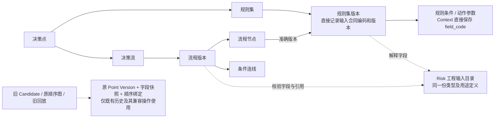

# 规则配置与旧顺序编排解耦：方案修订

状态：用户确认关系与全字段总图后回复“下一步”，阶段 3 修订已确认，阶段 4 研发与开发回归已完成；本次三表变更仅已在获批本机执行，用户已确认恢复阶段 5，进展见 [综合验证记录](./acceptance.md)。它只修订 RCO-17 的相关依赖，不重开已确认的页面及流程业务评审。原评审证据见 [表关系评审](./table-relationship-review.md)，确认及执行记录见 [delivery.md](./delivery.md)。

**一句话规模：本修订计划改 Risk、Operations BFF、Web 3 个应用，新增 API 0 个、调整原 API 合同/适用范围 6 个；修改 Risk 3 张旧表，新增 4 列、删除 2 列和 2 个旧索引，不增删表；停止规则保存对 3 张旧配套表的新增，初始化与路由注册 DML 均为 0，页面新增/重绘为 0。** 已观察的 test 回填为 33 个规则版本 + 418 个 Context 操作数 + 11 个 Context 动作参数，共 462 行；本机均为 0。数量是只读快照，执行前须重新核对。

## 1. 用户确认的目标与本次边界

用户在裁剪建议后回复“可以，先精简一下，不要有重复的逻辑”。本轮先处理已指出的重复数据与编排依赖：规则集保存不再复制协议及字段、不再生成顺序绑定，规则和流程共用输入定义，旧发布不再充当普通规则配置的必经路径。

保留原四张流程表、规则 AST、动作与字典；7 张执行预留表和 4 张 Feature/义务表暂不删除。本项不是以“空表”为依据改变后续执行、限额、争议或出款模型。旧 Candidate 是否整体下线尚未批准，不在本轮静默取消。

RCO-17 原阶段 5 因本次精简修订暂停；修订后的字段及接口可空性已确认，受影响的阶段 4 研发与开发回归已交付，现已获用户确认恢复综合验证；无关的阶段 1–4 成果仍有效。

## 2. 精简后的关系

整体确认图：[高清 PNG](./assets/table-review/decision-flow-schema-overview.png) · [可无损放大的 SVG](./assets/table-review/decision-flow-schema-overview.svg)。同一张图覆盖前述 32 张表的全部字段、类型、可空性、默认值、主键及字段引用：目标 391 个字段，另展示 2 行拟删除字段，共 393 行；新增 4 列和删 2 列/索引已标色。图上方展示主关系，卡片 Ref 与底部清单补齐逐字段关系；X 编号仅表示 Risk 库内图外领域，不展开其字段。图是本修订的派生确认材料，不是新的模型权威或已迁移状态。



区别：`规则集版本 -> 旧绑定 -> Point Version -> 输入字段` 从正常内容读取与流程引用校验中移除。旧绑定可用于返回历史兼容 ID、旧发布使用关系及原顺序图，不再决定一个新规则集能否被保存/读取。没有创建新的“协议主表/版本表/绑定表”替代原重复结构。

## 3. 输入定义只有一个来源

1. 延续 Risk 已有的工程目录，统一入口按 `(pointCode, inputContractCode, inputContractVersion)` 解析。现有配置合同实际为 `CHECKOUT_PREPARE / ORDER_PREPARATION / 4`；这里的 4 是输入数据合同版本，HTTP 路径仍使用原 `/v1`，本轮不升级任何版本。
2. 收敛 `CheckoutPrepareAuthoringDescriptor.fields()` 与 `RuleActionConfigurationCatalog.inputFields()` 的字段定义；规则表单、规则校验、动作目标校验、流程连线及引用核对都从同一目录按用途筛选。复用现有 9 个规则输入字段及仅动作目标可用的 `client_id`，不把后者开放为规则/连线条件，不新增动态管理接口或通用注册中心。
3. 规则版本直接保存准确合同编码/版本；Context 操作数与动作参数直接保存 `field_code`。写入必须核对字段存在、类型、规则/动作用途以及当前合同。Literal 的 `field_code` 必须为空；本期仍不开放 Feature。
4. 合同目录的历史定义必须保持可解析，禁止使用“当前最新合同”解释历史。新合同未来另行登记；本轮没有创建新输入合同。旧 Point Version 的 9/10 字段快照保留原内容，不能用目录全集重新计算它的 Hash。
5. 同一份类型/用途定义可以有不同校验规则：规则 AST 校验条件树，流程图校验连线、可达性、环及结束节点，发布校验冻结组成。不同业务不变量不机械合并，但不得各自维护字段名单或重复实现同一份规则内容还原与 Hash 投影。

## 4. 精确数据变更

| 表 | 新增 | 删除 | 目的 |
|---|---|---|---|
| `t_rule_set_version` | `input_contract_code VARCHAR(64) NOT NULL`；`input_contract_version INT NOT NULL`，均无默认值 | 无 | 准确保存本规则版本的输入合同，避免经旧绑定推导 |
| `t_rule_operand` | `field_code VARCHAR(64) NULL` | `input_field_id`；`idx_rule_op_input` | Context 直接按本规则合同中的字段代码解析 |
| `t_rule_action_parameter` | `field_code VARCHAR(64) NULL` | `input_field_id`；`idx_rule_param_input` | 动作 Context 参数使用同一目录 |

先加可空列、停写回填，核对后收紧两列并删除旧列/索引。代码切换后的最终写法只有一套，不保留双写、`COALESCE(新字段, 旧字段)` 或按“新字段为空”猜历史模式。字段按所属规则版本校验，不新增单独按字段反查的索引，因为本轮没有该查询用途。保留其他 PK/UK/索引，不添加 CHECK/FK。

三张旧配套表的物理定义和历史记录暂时保留：

- `t_decision_point_version`：不再随新规则版本增加行。既有版本的状态只在已存在的冻结/退休兼容操作中按原规则推进；不能将旧状态反向作为新规则生命周期前提。
- `t_decision_point_input_field`：不再复制新行；旧快照专用于发布历史完整性及原 ID 还原。
- `t_decision_point_rule_set`：不再写新绑定；保留既有发布/原顺序图和成功命令回放的真实坐标。

因此本修订先减少写入和代码依赖，**不宣称本轮物理少了 3 张表**。整表删除须在旧 Candidate 及其兼容合同正式退出后评审。

SQL 结构方案已随修订确认：[执行顺序](./db/risk-compliance-service/simplification/README.md)、[扩展 DDL](./db/risk-compliance-service/simplification/ddl.sql)、[回填 DML](./db/risk-compliance-service/simplification/dml.sql)、[收敛 DDL](./db/risk-compliance-service/simplification/finalize-ddl.sql)。执行仍需具体环境授权；本机准备见 [应用准备](./db/risk-compliance-service/simplification/local-application.md)。生成源、模型、最终 Schema、Mapper 与研发验证状态统一见 [当前台账](../../../agent-docs/CURRENT_IMPLEMENTATION.md)。

## 5. 接口与消费方

路径、鉴权、请求字段、分页、CAS、幂等键、规则内容格式均保持原合同；不新增 API、不使用 V2、不在新增代码类型名加入版本字样。

| 原业务操作（Risk 路径） | 具体变更 |
|---|---|
| `GET /decision-rule-sets/v1/rule-sets` | `items[].pointVersionId` 保留键，允许 JSON null |
| `GET /decision-rule-sets/v1/rule-sets/{ruleSetVersionId}` | `pointVersionId` 保留键，允许 JSON null |
| `POST /decision-rule-sets/v1/rule-sets` | 成功响应 `pointVersionId` 允许 null；新保存固定 null，不制造配套协议身份 |
| `POST /decision-rule-sets/v1/rule-sets/{ruleSetVersionId}/freeze` | 成功响应 `pointVersionId` 允许 null；新记录只冻结规则版本，执行就绪门禁保持 |
| `GET /decision-flows/v1/rule-set-reference` | 返回的规则详情内 `pointVersionId` 同样允许 null；归属、历史来源及读取权限不变 |
| `POST /decision-releases/v1/candidates` | 只接受实际有旧发布组成的历史规则版本；新配置版本无旧绑定时按既有业务校验失败返回 HTTP 400 / `BUSINESS_CHECK_FAILED`，不创建配套 Point Version 或 Release |

最后一项复用项目现有业务校验错误，不新增业务错误码或路由注册；研发时通过原 HTTP 入口确认映射。历史 Candidate 创建、查询及校验原有合同仍适用，原成功命令必须先走幂等回放，不能被新创建资格挡住。

可空字段说明：历史记录仍返回真实正十进制 ID；新保存没有旧编排，返回 null。禁止返回 `0`、空串或用 `ruleSetVersionId` 冒充。API 字段继续存在，缺键与非法字符串仍按严格协议错误处理。内容格式 `LEGACY/CONFIGURATION` 只选择原 Hash/动作合同，不用来判断记录是否有旧绑定。

例如新保存响应片段：

```json
{"ruleSetVersionId":"730400000000000101","pointVersionId":null,"ruleSetCode":"CHECKOUT_COUNTRY","versionNo":2,"status":"DRAFT"}
```

这是字段差异示例，不是完整响应。其余字段遵守现有合同。已保存的准确规则版本及流程引用 ID 均不变化。

## 6. 逐系统影响与代码去重

| 系统 | 修改范围 | 保留的边界 |
|---|---|---|
| Risk | `risk-decision` 输入目录、规则 Repository/Service、条件/参数映射、流程引用、旧发布适配；`risk-api` 可空合同；`risk-web` 转换及测试；唯一模型、Schema 和本需求 SQL | 业务校验、Hash、事务、锁及事实继续由 Risk 拥有 |
| Operations BFF | Owner 响应校验、展示模型与转换，规则引用内嵌详情一致调整 | 继续转发已授权接口，不复制输入目录或业务校验，不增加事务 |
| Operations Web | 模型、严格响应解码、列表/详情身份核对、保存/冻结回显与测试 | 表单、画布、历史、浏览器返回和页面布局保持；不根据 pointVersionId 是否为空判断配置可编辑 |
| Platform / Gateway | 本修订新增 Route、Permission、Resource、DML 为 0；Risk 既有服务地址不变 | RCO-17 原 118 行注册计划仍独立存在，不计入本次增量 |

删除/收敛的正常配置代码职责：

1. 删除保存中的 `nextPointVersionNo`、`materializeFields`、Point Version Hash 构造及三张旧表 INSERT；新规则保存只产生本规则事实。
2. 普通规则读取不再要求“恰有一个 Companion”，不为了规则详情加载 Feature/Obligation/旧协议快照；普通规则 Hash 由唯一的规则内容还原/投影逻辑验证。
3. 规则退休/冻结围绕规则状态和管理根 CAS 执行；仅已有旧绑定的记录进入窄兼容操作维持原 Point Version 状态，不继续创建、克隆旧组成。
4. `DecisionFlowReferenceServiceImpl.sameContract` 改读规则版本的准确合同；选择校验与历史描述共用同一个合同判断。不通过旧绑定、当前最新规则或当前最新合同间接推导。
5. 旧发布适配器读取原组成并复用同一份规则内容还原；保留旧发布专有的 ID/组成 Hash 投影，不复制第二套规则 AST/动作/字典解释器。普通规则响应中的历史 `pointVersionId` 只查已有绑定的可选元数据，0 条是新记录，超过 1 条或真实引用损坏仍按内部损坏处理，不用它解析字段。

## 7. 历史、Hash 与迁移约束

本次是存储引用转换。已保存的 Rule Set Hash 以字段代码形成投影，可在输入字段 ID 转代码后保持字节不变；现有 `content_format` 和幂等 Request Hash 均不变。**旧 Release Hash 却包含 input_field_id 等物理坐标，不能只验证规则 Hash 就宣称兼容。**

迁移要求：

- 每个已有规则版本必须有唯一且同决策点的旧来源，回填精确合同。Context 字段必须归属于该来源，逐项匹配类型与用途；未知字段/合同、缺失或多重绑定、Feature 数据均停下人工处理，不默认填入当前合同。
- 回填字段代码后，在删除两列前验证每个原 Context ID 都能经“原 Point Version + field_code”唯一还原为同一个 ID。删除后，旧 Release 专用投影仍由保留的旧字段快照还原准确 ID；新规则读取完全不用该适配。
- 对已有规则/协议/Release 做迁移前后的规范字节及 Hash 比对；只读结果、原顺序图、既有创建/冻结/Candidate 成功回放内容保持。Point Version Hash 使用原字段子集、规则绑定及原版本号，不重算成公共输入目录的 Hash。
- 所有原规则 ID、流程引用、根当前指针、版本号、原 Hash、业务字段及时间不因回填而变化；原 3 张配套表不清空、不合并历史行。对旧规则后续允许的冻结/退休，保留原状态更新语义。
- 规则集“使用中”继续从实际 ACTIVE Release 判断；新流程的普通配置引用不自动扩大删除阻断口径。迁移不能让旧 ACTIVE 引用从查询中消失。

[只读预检](./assets/table-review/simplification-precheck.json) 当前三项关系异常计数在 local/test 均为 0。它尚未检查全部历史规范字节、目录逐字段内容或新 Reader 行为，不能据此执行删列或宣称迁移通过。

## 8. 实施与验收

研发确认后，先写能暴露旧耦合的入口级失败场景，再同步模型及 Risk/BFF/Web 实现，准备本机迁移授权并完成开发回归。新增四张流程表维持原结构；修改的是后续读取它所引用的规则版本的方法。

| 编号 | 必须观察到的结果 |
|---|---|
| SIM-01 | 新建规则集并连续保存两个版本，旧 Point Version/Input Field/Binding 三表的行数增量均为 0；每次生成自己的规则版本，原 DRAFT 退休及 CAS 保持 |
| SIM-02 | 同一规则版本的列表、详情、流程引用、校验均成功，完全不需要配套协议；未知字段、错误类型、动作专用字段作为条件仍被拒绝 |
| SIM-03 | 新流程引用新旧规则版本并保存、重开、查看历史；准确合同不匹配、跨点、已删除及不允许的新 RETIRED 引用仍失败 |
| SIM-04 | 迁移前后旧规则/Point Version/Release Hash 和成功幂等回放一致；历史字段 ID 可精确还原，旧 Candidate 查询及静态校验可用 |
| SIM-05 | 新版本冻结只改变规则生命周期；既有绑定版本冻结/退休保持历史兼容状态；新规则创建旧 Candidate 明确业务失败且三张旧表无新增 |
| SIM-06 | BFF/Web 接受键存在且值为 null 或合法 ID；拒绝缺键、空串、0、错误类型；保存后导航、历史只读和未保存保护正常 |
| SIM-07 | 并发保存、冻结、删除维持资源锁与 CAS；实际 ACTIVE Release 阻止整集删除；无 Release/Evaluation/Action Effect 或业务 MQ 新副作用 |
| SIM-08 | 三表最终 Schema/模型/Mapper 一致；生产规则写入不含旧列或双写；旧表写入限定于既有记录状态兼容，无创建替代旧协议的隐式分支 |

按受影响范围运行 Risk/BFF 的真实服务内入口测试、Web 测试及构建、模型/Schema 和文档门禁；阶段 5 再衔接 RCO-17 的综合验证。旧历史读取是必要的兼容职责，不把保留一份专用历史投影误称为还需要两套新配置业务逻辑。

## 9. 本阶段交付与下一确认

用户已确认修订并授权 Risk/BFF/Web 研发；本阶段交付证据及 SIM 映射见 [修订开发检查](./simplification-development-checks.md)。SQL 执行仍单独按具体本机对象确认，旧四表 DDL 授权不覆盖此次三表回填及删列。后续确认点为接受修订后的阶段 4 结果并恢复阶段 5 综合验证，不包含部署或提交。
