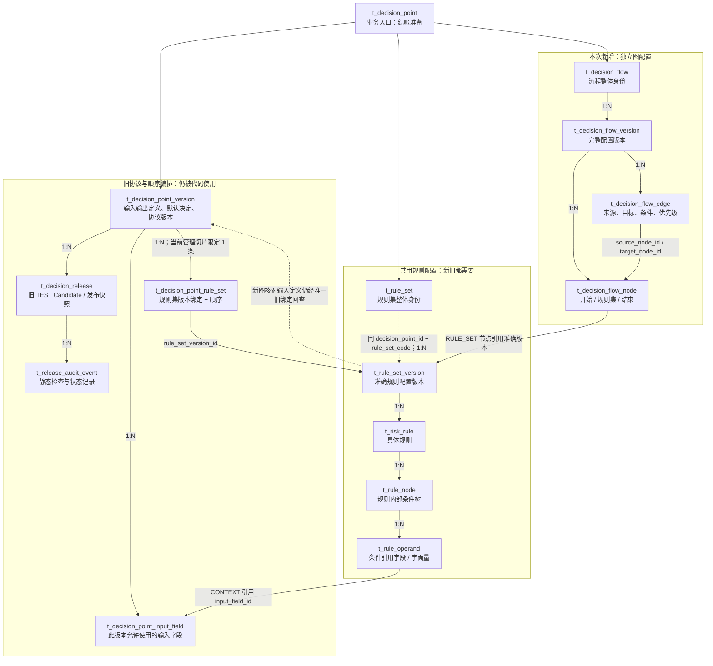
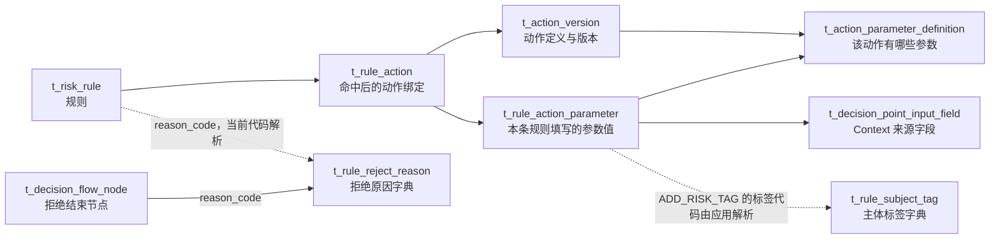

# 决策流相关表：关系与精简评审

这是 2026-09-12 的只读评审证据，不是删表决定，也不改变已确认业务合同。检查了 Risk 当前生产 Java/Mapper、唯一 PDManer、完整 Schema，以及本机 13306/test 23306 的 mor_risk 表行数；没有修改数据库或应用代码。跨阶段状态仍见 [当前台账](../../../agent-docs/CURRENT_IMPLEMENTATION.md)，逐表原始证据见 [evidence.json](./assets/table-review/evidence.json)。

结论：**当前存在旧顺序编排与新图配置两套结构，共用同一套规则集；新图尚未接入发布/执行，而且仍依赖旧协议绑定核对规则输入。** 最值得重评的是旧协议与规则集版本的配套关系，不宜把两种不同的“节点”直接合并。

## 1. 先看核心关系

箭头表示所属或引用关系，均为应用/模型逻辑关系，不是 MySQL 物理外键。虚线表示使用组合业务身份关联，或用于强调仍存在的兼容依赖；只画核心关系，省略根的 current 指针和部分冗余身份字段。

**三个容易混淆的地方：**

1. `t_rule_node` 保存“币种是 USD 且金额大于 100”这样的规则条件树；`t_decision_flow_node` 保存“先检查 A 规则集，再检查 B”的流程节点。两者不是重复表。
2. `t_decision_release` 目前引用的是 `point_version_id`，没有 `flow_version_id`。所以新流保存成功不等于旧发布链已开始使用它；未来应评审如何把发布快照统一绑定准确流程版本。
3. `t_rule_set_version` 没有 `rule_set_id` 列，当前按 `decision_point_id + rule_set_code` 关联规则集根。图中的根→版本是逻辑 1:N，不能误当成已存在的物理 ID 引用。

## 2. 动作和字典为什么仍有用

字典与动作配置都已有实际消费者。动作绑定允许为空，只表示该条规则没有配置动作，不代表整张动作表没用。标签引用是参数中的业务代码解析，不存在 `tag_id` 外键列。

## 3. 最值得精简的旧配套结构

test 快照为 **26 个规则集、33 个规则集版本、33 个决策点版本、33 条顺序绑定、304 条输入字段记录**。行数本身不能证明每行一一对应；代码进一步明确要求每个规则集版本恰有一个 Companion 绑定，并在保存规则版本时同时新建协议版本、输入字段和绑定。

因此，这三张表要分开判断：

| 表 | 为什么现在不能直接删除 | 建议 |
|---|---|---|
| `t_decision_point_rule_set` | 规则列表/详情、冻结、发布引用、原顺序查看和新图的输入定义核对都使用它 | **优先评估取消旧顺序绑定这层职责**。先将规则的输入定义与旧发布路径解耦，再决定是否删除整表或只保留历史 |
| `t_decision_point_version` | 仍拥有输入输出定义、默认决定、Hash 及 Release 准确引用 | 优先取消“每存一个规则版本就复制一个协议版本”的耦合；是否继续独立保存公共输入协议，应单独选择，不能仅改名为流程版本 |
| `t_decision_point_input_field` | 规则操作数与动作参数保存 `input_field_id`；删除后旧规则无法完整回读 | 可以先消除逐规则版本重复；若改为按协议/字段代码引用，必须迁移所有已有引用和历史读取，不能只删表 |

代码证据：

- [DecisionRuleSetRepositoryImpl](../../../risk-compliance-service/risk-decision/src/main/java/com/paytech/risk/decision/domainservice/repository/impl/DecisionRuleSetRepositoryImpl.java)：`requireClosure` 第 166 行起检查唯一 Companion 并加载协议字段；`findPage` 第 266 行起也依赖它；`insertDraft` 第 322 行起一起插入配套记录。
- [DecisionFlowReferenceServiceImpl](../../../risk-compliance-service/risk-decision/src/main/java/com/paytech/risk/decision/domainservice/service/impl/DecisionFlowReferenceServiceImpl.java)：`sameContract` 通过旧绑定和 Point Version 核对新流程引用；新功能也尚未脱离这层旧依赖。
- [DecisionConfigurationQueryMapper.xml](../../../risk-compliance-service/risk-decision/src/main/resources/mapper/decision/DecisionConfigurationQueryMapper.xml)：`ReleaseJoin` 仍按 Release → Point Version → Binding → Rule Set Version 查询。

这属于结构迁移，不能在阶段 5 以“测试修复”名义直接更换。当前报告只提供取舍依据。

## 4. 哪些当前没有业务读写

以下 **7 张表**在本机/test 均为 **0 行**。在所检查的生产源码中没有找到 SQL 读写入口，也无当前初始化 DML；它们主要是先前设计的旁路、执行和限额能力。

| 表 | 原设计用途 | 精简判断 |
|---|---|---|
| `t_release_shadow_run` | 新旧决策的旁路比较批次 | 若本期彻底不保留旁路结构，可作为优先裁剪候选 |
| `t_decision_evaluation` | 一次执行的总记录 | 当前配置管理用不到；以后执行功能仍需要结果存储，结构可届时重新评审 |
| `t_evaluation_feature_result` | 本次执行计算出来的 Feature 值 | 当前用不到；与 Feature 执行范围一起决定 |
| `t_evaluation_rule_trace` | 规则及条件的命中轨迹 | 当前用不到；与执行解释/排查需求一起决定 |
| `t_evaluation_action_intent` | 命中后待合并的动作贡献 | 当前用不到；应结合未来实际动作合并需求判断是否值得保留 |
| `t_action_effect` | 合并后的动作和执行状态 | 当前没有写入；未来限制/名单/结算控制等模型已引用它，不能只删除定义而不处理这些关系 |
| `t_decision_point_limit_binding` | 决策点系统义务对应的限额绑定 | 当前配置不用；如不交付限额义务，可一并裁剪 |

**它们是“当前配置版可裁剪候选”，不是已证明没有任何业务价值。** 模型仍存在跨表关系，例如评估被 Checkout/Payment/Payout 快照、尽调决定及争议责任引用，Action Effect 被限制/名单/结算控制引用。现有测试前置检查还要求 78 张表，部分测试会直接查询运行表以证明配置不产生运行副作用。裁剪时需要同步模型、Schema、测试及相关未来设计；不能直接 DROP 后期待原门禁不变。

另有 **4 张空表但已存在读取逻辑**：`t_decision_point_feature`、`t_feature_version`、`t_feature_dependency`、`t_decision_point_obligation`。旧规则完整读取/Hash/静态检查会读取它们，不能因为 0 行就归为没有依赖。如果确认本期取消 Feature/系统义务，应连同这段加载和检查逻辑一起精简。

## 5. 有历史的旧发布两表

`t_decision_release` 在 test 有 **10 行**（DRAFT 3、VALIDATING 7，均为 TEST；本次观察没有 ACTIVE），`t_release_audit_event` 有 **73 行**。后端仍有 Candidate 的列表、详情、创建和静态校验，以及规则集发布引用查询。

目前建议先保留，待新流程发布需求一起决定如何统一；如果用户决定彻底取消旧 Candidate，就应同时下线接口、转发/注册、静态校验入口及关联查询，并明确现有测试历史的处置。隐藏前端入口不代表这些数据和后端接口已经废弃。

## 6. 本次新增四表能否进一步减少

| 方案 | 表数 | 条件与代价 |
|---|---:|---|
| 保留流程根、版本、节点、连线 | 4 | 当前已实现；准确规则引用、原因反查、节点数量和顺序可直接查询 |
| 流程根 + 版本，图整体存受控 JSON | 2 | 节点/连线不是无用，而是合入版本内容；仍可保留同样 HTTP 合同，但需重写持久化、静态完整性校验、原因反查与计数，并重新回归 |

我的建议：**先处理旧协议与规则版本的配套耦合，再决定新图用四表还是两表。** 单纯少建两张新表，不能消除旧 Companion 依赖。若目标是“当前只保留配置所需结构”，再将上述 7 张未接入的运行表作为独立裁剪项评审，避免把“未来可能需要”当成现在必须保留的理由。

## 7. 逐表用途与观察数据

下表共 32 张，覆盖本次讨论的配置、规则、动作、字典、旧发布、Feature 和直接运行支撑。`未建` 表示该环境没有物理表，不等于空表。其余 Risk 领域表未逐一做删除评估。

| 表 | 用途 | 判断 | 本机行数 | test 行数 |
|---|---|---|---:|---:|
| `t_rule_reject_reason` | 拒绝原因字典 | 保留 | 0 | 3 |
| `t_rule_subject_tag` | 主体标签字典 | 保留 | 0 | 3 |
| `t_decision_point` | 决策点 | 保留 | 1 | 1 |
| `t_decision_point_version` | 旧协议版本 | 迁移后评估 | 0 | 33 |
| `t_decision_point_input_field` | 协议输入字段 | 迁移后评估 | 0 | 304 |
| `t_decision_point_feature` | 协议 Feature 绑定 | 空表但有读取 | 0 | 0 |
| `t_decision_point_rule_set` | 旧顺序绑定 | 迁移后评估 | 0 | 33 |
| `t_decision_point_obligation` | 协议系统义务 | 空表但有读取 | 0 | 0 |
| `t_feature_version` | Feature 版本 | 空表但有读取 | 0 | 0 |
| `t_feature_dependency` | Feature 依赖 | 空表但有读取 | 0 | 0 |
| `t_rule_set` | 规则集 | 保留 | 0 | 26 |
| `t_rule_set_version` | 规则集版本 | 保留 | 0 | 33 |
| `t_risk_rule` | 规则 | 保留 | 0 | 418 |
| `t_rule_node` | 规则条件节点 | 保留 | 0 | 418 |
| `t_rule_operand` | 规则条件值 | 保留 | 0 | 836 |
| `t_action_version` | 动作目录版本 | 保留 | 5 | 5 |
| `t_action_parameter_definition` | 动作参数定义 | 保留 | 4 | 4 |
| `t_rule_action` | 规则动作绑定 | 保留 | 0 | 427 |
| `t_rule_action_parameter` | 规则动作参数值 | 保留 | 0 | 24 |
| `t_decision_release` | 旧候选发布 | 仍有历史/接口 | 0 | 10 |
| `t_release_audit_event` | 旧发布审计 | 仍有历史/接口 | 0 | 73 |
| `t_release_shadow_run` | 旁路比较批次 | 裁剪候选 | 0 | 0 |
| `t_decision_flow` | 决策流 | 保留 | 0 | 未建 |
| `t_decision_flow_version` | 流程版本 | 保留 | 0 | 未建 |
| `t_decision_flow_node` | 流程节点 | 可合并 | 0 | 未建 |
| `t_decision_flow_edge` | 流程连线 | 可合并 | 0 | 未建 |
| `t_decision_evaluation` | 运行评估记录 | 裁剪候选 | 0 | 0 |
| `t_evaluation_feature_result` | 运行 Feature 结果 | 裁剪候选 | 0 | 0 |
| `t_evaluation_rule_trace` | 运行规则轨迹 | 裁剪候选 | 0 | 0 |
| `t_evaluation_action_intent` | 运行动作意图 | 裁剪候选 | 0 | 0 |
| `t_action_effect` | 运行动作结果 | 裁剪候选 | 0 | 0 |
| `t_decision_point_limit_binding` | 协议限额绑定 | 裁剪候选 | 0 | 0 |

## 8. 证据边界

- 关系来自 [risk-compliance.pdma.json](../../../risk-compliance-service/docs/database/risk-compliance.pdma.json)，字段以 [完整 Schema](../../../risk-compliance-service/docs/database/sql/risk-compliance-schema.sql) 核对；扫描提取的 75 条关系包含被其他领域表引用的外围关系。
- 行数只证明这次观察到的本机与 test 状态，不外推生产或其他环境，也不把合成数据当成真实业务运行。
- 生产读写扫描只用于定位消费者，已结合 Repository/Service 和当前切片边界人工核对；测试和预建模型关系单独列出，没有把“测试有引用”写成“线上有执行”。
- 本次没有删表、搬数据、改接口或部署，也没有把本报告的建议登记为用户已确认决定。
