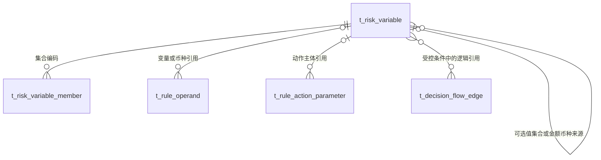

# 数据设计与字段清单

阶段 3 评审稿；没有修改现行 PDManer、生成源、Schema 或数据库。业务设计见 [design.md](./design.md)，SQL 位于 [db](./db/README.md)。

**新增 2 表 / 41 字段；4 张旧表受影响，其中 2 表新增 5 字段、共 3 列修改注释；新增 11 个索引（含 2 主键、2 唯一索引、7 普通索引）。总计新增 46 字段，删除 0 表、0 字段。**

## t_risk_variable

统一拥有风控变量定义、来源映射、适用范围及当前常量值；不保存变量历史或执行结果。

| 字段 | 类型 | 可空 | 用途 |
|---|---|---|---|
| variable_id | BIGINT | 否 | 变量的稳定标识，由 Risk 分配；不作为共享值版本。 |
| variable_code | VARCHAR(64) CHARACTER SET ascii COLLATE ascii_bin | 否 | 全库唯一且创建后不可修改、不可复用的变量编码，格式为大写字母开头的大写字母数字下划线。取值来源：Risk 统一变量库；非固定枚举。 |
| variable_name | VARCHAR(255) | 否 | 运营展示名称，可修改；不参与规则或流程内容 Hash。 |
| description | VARCHAR(500) | 是 | 变量用途的非敏感说明；未填写时为空。 |
| source_type | VARCHAR(64) | 否 | 来源类型，允许 INPUT、CONSTANT、COLLECTION、NODE_OUTPUT；创建后固定。允许值：INPUT、CONSTANT、COLLECTION、NODE_OUTPUT。 |
| value_type | VARCHAR(64) | 否 | 标量类型或集合成员类型，允许 STRING、NUMBER、BOOLEAN、DATETIME、DURATION；创建后固定。允许值：STRING、NUMBER、BOOLEAN、DATETIME、DURATION。 |
| point_code | VARCHAR(64) CHARACTER SET ascii COLLATE ascii_bin | 是 | 适用决策点；INPUT 和 NODE_OUTPUT 必填，常量和集合为空表示全部已支持决策点。取值来源：Risk 决策点目录；非固定枚举。 |
| source_contract_code | VARCHAR(64) CHARACTER SET ascii COLLATE ascii_bin | 是 | INPUT 的输入合同或 NODE_OUTPUT 的输出合同代码；其他来源为空。取值来源：Risk 精确输入或节点输出合同；非固定枚举。 |
| source_contract_version | INT | 是 | 来源合同的准确版本；仅 INPUT 和 NODE_OUTPUT 非空，不取最新版本兜底。 |
| source_field | VARCHAR(64) CHARACTER SET ascii COLLATE ascii_bin | 是 | 来源合同中的准确顶层字段键；仅 INPUT 和 NODE_OUTPUT 非空，不接受任意路径、SQL 或脚本。 |
| rule_condition_flag | TINYINT(1) | 否 | 是否可用于规则条件；0 或 1，受来源合同允许用途约束。 |
| flow_condition_flag | TINYINT(1) | 否 | 是否可用于流程连线条件；0 或 1，节点输出仅当前规则集节点出线可用。 |
| action_parameter_flag | TINYINT(1) | 否 | 是否可作为既有动作主体输入；0 或 1，本期只开放 INPUT 的批准主体槽位。 |
| system_managed_flag | TINYINT(1) | 否 | 是否为工程合同保留定义；0 或 1，系统定义的结构、状态、删除及系统集合成员不开放运营修改。 |
| format_code | VARCHAR(64) | 否 | 通用格式配置，允许 TEXT、UPPER_ALPHA_2、UPPER_ALPHA_3、DIGITS_4、TOKEN、BCP47、POSITIVE_ID、NONE；具体变量的关联由本行管理。允许值：TEXT、UPPER_ALPHA_2、UPPER_ALPHA_3、DIGITS_4、TOKEN、BCP47、POSITIVE_ID、NONE。 |
| numeric_unit | VARCHAR(64) | 是 | NUMBER 的量纲，允许 SCALAR 或 MONEY；其他类型为空。允许值：SCALAR、MONEY。 |
| currency_code | CHAR(3) CHARACTER SET ascii COLLATE ascii_bin | 是 | MONEY 的固定币种，三位大写字母；与 currency_variable_code 二选一，非 MONEY 为空。取值来源：ISO 4217 币种代码；非固定枚举。 |
| currency_variable_code | VARCHAR(64) CHARACTER SET ascii COLLATE ascii_bin | 是 | MONEY 的币种来源变量编码，指向同决策点 INPUT STRING 币种变量；与 currency_code 二选一，非 MONEY 为空。取值来源：Risk 统一变量库的币种输入；非固定枚举。 |
| allowed_values_variable_code | VARCHAR(64) CHARACTER SET ascii COLLATE ascii_bin | 是 | 可选值来源集合变量编码，必须同成员类型且适用范围覆盖本变量；为空表示无额外枚举范围，集合本身不再引用集合。取值来源：Risk 统一变量库的集合；非固定枚举。 |
| string_value | VARCHAR(512) CHARACTER SET utf8mb4 COLLATE utf8mb4_0900_bin | 是 | CONSTANT STRING 的当前值；仅匹配来源和值类型时非空，不接受敏感原值。 |
| number_value | DECIMAL(24,8) | 是 | CONSTANT NUMBER 的当前精确数值；仅匹配来源和值类型时非空。 |
| boolean_value | TINYINT(1) | 是 | CONSTANT BOOLEAN 的当前值，0 或 1；仅匹配来源和值类型时非空。 |
| datetime_value | DATETIME(6) | 是 | CONSTANT DATETIME 的当前 UTC 微秒值；仅匹配来源和值类型时非空。 |
| duration_value | BIGINT | 是 | CONSTANT DURATION 的当前非负毫秒值；仅匹配来源和值类型时非空。 |
| status | VARCHAR(64) | 否 | 当前状态，允许 ACTIVE、DISABLED、DELETED；停用禁止新保存引用，删除仅无任何引用时允许且保留编码。允许值：ACTIVE、DISABLED、DELETED。 |
| version | BIGINT | 否 | 变量根的正整数 CAS 版本，定义、值或集合成员成功变更时加一。 |
| create_by | BIGINT | 否 | 创建主体的稳定账号或正式系统主体标识。 |
| update_by | BIGINT | 否 | 最近修改主体的稳定账号或正式系统主体标识。 |
| create_time | DATETIME(6) | 否 | Risk 数据库中的 UTC 微秒创建时间。 |
| update_time | DATETIME(6) | 否 | 变量定义或成员最近成功更新的 UTC 微秒时间。 |

索引：

- `PRIMARY` (variable_id)：变量标识。
- `uk_risk_variable_code` (variable_code)：保证变量编码永久唯一。
- `idx_risk_variable_filter` (status, source_type, variable_code)：支持可用目录按状态和来源查询。
- `idx_risk_variable_options` (allowed_values_variable_code)：支持集合被用作可选值来源的反查。
- `idx_risk_variable_currency` (currency_variable_code)：支持币种变量使用关系和删除保护。
## t_risk_variable_member

保存同类型集合的当前成员及展示名称；由所属变量根统一事务与 CAS 管理，不建立成员版本。

| 字段 | 类型 | 可空 | 用途 |
|---|---|---|---|
| member_id | BIGINT | 否 | 集合成员行标识，整体替换时可重新分配；不是变量版本。 |
| variable_code | VARCHAR(64) CHARACTER SET ascii COLLATE ascii_bin | 否 | 所属 COLLECTION 变量编码，成员类型和量纲由变量根统一拥有。取值来源：Risk 统一变量库；非固定枚举。 |
| value_key | VARCHAR(512) CHARACTER SET utf8mb4 COLLATE utf8mb4_0900_bin | 否 | 成员按通用类型规范化后的精确字符串键，用于唯一去重；不包含 Hash，字符串大小写及前导零保留。 |
| string_value | VARCHAR(512) CHARACTER SET utf8mb4 COLLATE utf8mb4_0900_bin | 是 | STRING 成员值；仅该类型非空。 |
| number_value | DECIMAL(24,8) | 是 | NUMBER 成员精确数值；仅该类型非空。 |
| boolean_value | TINYINT(1) | 是 | BOOLEAN 成员值，0 或 1；仅该类型非空。 |
| datetime_value | DATETIME(6) | 是 | DATETIME 成员 UTC 微秒值；仅该类型非空。 |
| duration_value | BIGINT | 是 | DURATION 成员非负毫秒值；仅该类型非空。 |
| display_name | VARCHAR(255) | 是 | 成员的可选展示名称，不改变成员业务值；未填写时为空。 |
| sort_order | INT | 否 | 成员在管理与选项中的展示顺序，正整数；不参与集合包含判断。 |
| create_time | DATETIME(6) | 否 | 该成员行在 Risk 数据库中的 UTC 微秒写入时间。 |

索引：

- `PRIMARY` (member_id)：成员行标识。
- `uk_risk_variable_member` (variable_code, value_key)：保证同一集合的规范值唯一。
- `idx_risk_variable_member_order` (variable_code, sort_order, member_id)：支持集合成员稳定分页和展示。

## 旧表增量

### t_rule_operand

| 新字段 | 类型 | 可空 | 用途 |
|---|---|---|---|
| variable_code | VARCHAR(64) CHARACTER SET ascii COLLATE ascii_bin | 是 | VARIABLE 来源的统一变量编码；其他来源为空，历史 CONTEXT 仍使用原 field_code。取值来源：Risk 统一变量库；非固定枚举。 |
| numeric_unit | VARCHAR(64) | 是 | 新变量格式 NUMBER 字面量的量纲 SCALAR 或 MONEY；变量引用及旧格式为空。允许值：SCALAR、MONEY。 |
| currency_code | CHAR(3) CHARACTER SET ascii COLLATE ascii_bin | 是 | 新格式 MONEY 字面量的固定币种；与 currency_variable_code 二选一，其他情况为空。取值来源：ISO 4217 币种代码；非固定枚举。 |
| currency_variable_code | VARCHAR(64) CHARACTER SET ascii COLLATE ascii_bin | 是 | 新格式 MONEY 字面量的币种变量编码；与 currency_code 二选一，其他情况为空。取值来源：Risk 统一变量库的币种输入；非固定枚举。 |

新增索引：idx_rule_operand_variable (variable_code, node_id)；idx_rule_operand_currency (currency_variable_code, node_id)。
### t_rule_action_parameter

| 新字段 | 类型 | 可空 | 用途 |
|---|---|---|---|
| variable_code | VARCHAR(64) CHARACTER SET ascii COLLATE ascii_bin | 是 | VARIABLE 来源的统一变量编码，仅既有动作主体绑定可用；其他来源为空。取值来源：Risk 统一变量库；非固定枚举。 |

新增索引：idx_rule_param_variable (variable_code, rule_action_id)。

两表的 source_type 注释增加 VARIABLE；t_decision_flow_edge.condition_json 只更新受控条件格式注释，容量不变；t_rule_set_version.content_format 注释补充新格式判别。既有 t_rule_set_version.content_format 和图/条件 schemaVersion 复用，不增加重复版本列。新格式明细见 [API](./api.md)。

## 关系

关系为逻辑关系，无物理外键。流程条件仍整树解析；分批读取整树，不使用数据库JSON路径或文本预筛代替解析。删除保护、整批成员事务及历史策略见 design.md。

## 初始化数据

| 编码 | 名称 | 来源 | 类型 | 映射 / 初值 |
|---|---|---|---|---|
| INPUT_COUNTRY_CODE | 国家/地区 | INPUT | STRING | country_code |
| INPUT_LOCALE | 语言地区 | INPUT | STRING | locale |
| INPUT_INDUSTRY_CODE | 行业代码 | INPUT | STRING | industry_code |
| INPUT_MCC_CODE | MCC | INPUT | STRING | mcc_code |
| INPUT_CURRENCY | 币种 | INPUT | STRING | currency |
| INPUT_MERCHANDISE_AMOUNT | 商品金额 | INPUT | NUMBER | merchandise_amount |
| INPUT_DISCOUNT_AMOUNT | 折扣金额 | INPUT | NUMBER | discount_amount |
| INPUT_NET_AMOUNT | 实付金额 | INPUT | NUMBER | net_amount |
| INPUT_ENTITY_SOURCE_TYPE | 实体来源 | INPUT | STRING | entity_source_type |
| INPUT_CLIENT_ID | Client 标识 | INPUT | STRING | client_id |
| NODE_MATCHED | 本节点是否命中 | NODE_OUTPUT | BOOLEAN | matched |
| NODE_DECISION | 本节点处理结果 | NODE_OUTPUT | STRING | decision |
| ENTITY_SOURCE_VALUES | 实体来源可选值 | COLLECTION | STRING | 见集合成员 |
| NODE_DECISION_VALUES | 节点处理结果可选值 | COLLECTION | STRING | 见集合成员 |
| DEMO_AMOUNT_THRESHOLD | 示例金额阈值 | CONSTANT | NUMBER | 8000.00000000 |
| DEMO_STANDARD_CURRENCY | 示例标准币种 | CONSTANT | STRING | USD |
| RESTRICTED_COUNTRIES | 示例受限国家集合 | COLLECTION | STRING | 见集合成员 |

17 个变量定义、9 个集合成员，共 26 行；两个可选值集合属于合同的系统管理数据。RESTRICTED_COUNTRIES 是未被策略引用的演示集合，不声明真实国家风险或自动启用任何规则。节点结果真实 Wire 为 ALLOW/REVIEW/DENY，显示名 PASS/REVIEW/REJECT。
