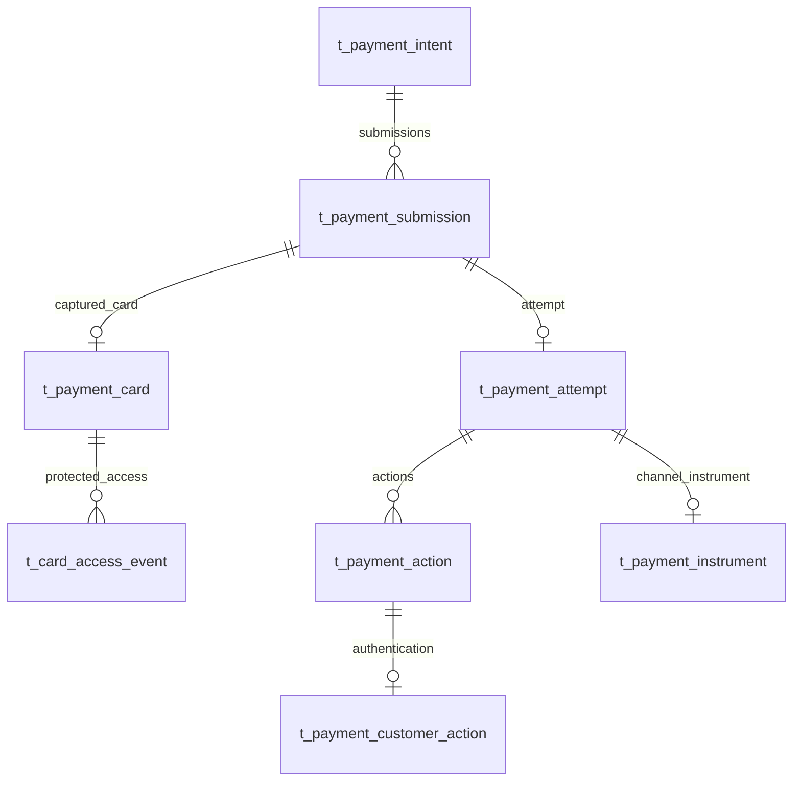

# Payment Card 数据、事务与实施设计

> **后继入口与工具绑定：** Customer 入口按[Commerce 后继](../../../paytech/acquiring/docs/requirements/20260912-customer-checkout/commerce-entry-amendment.md)归 Commerce；交易级工具 Token、统一 pay、无独立会话表及 Card 受控适配职责按[Execution 修订稿](../../20260913/payment-Execution设计/instrument-token-amendment.md)评审。本文的旧 Payment Submission、Card Token 和材料传递方案不能直接用于该新目标；未被取代的加密与审计约束保留。真实 Card 仍需独立接入验证。

2026-09-12 阶段 3 单请求修订稿；与 [API 合同](./api-contract.md)配套。以下是拟新增/调整的字段，不是已修改 PDManer、当前数据库或已执行 SQL。Card 模块独占卡库表；Payment `web` 编排同一 Payment 本地事务。

本稿业务增量为 Payment 新增3表/37字段/3主键及9个二级索引，原 Action 增加3个可空字段与1个查询索引；另有2张既有技术表按 Foundation 权威对齐，准确迁移列数须先盘点。相对前稿，Submission 来源列改为本地 payment_command_id，Card 独立 capture_command_id 及其唯一索引删除；均是未落模提案调整。Commerce 复用原接受/命令模型，前序准备字段增量继续由 Customer 专项拥有；本轮 SQL/DML 执行0、页面新增0。

## 1. 关系与表清单

关系是应用校验，不生成 FOREIGN KEY/CHECK。新增三张业务表：提交、加密卡记录、卡访问审计；不新增 Token、卡扩展、CVV 或泛化会话表。Submission 保存统一 Pay 命令的受理与跨服务恢复身份：调用 Commerce 确认前已存在、尚无合法 Attempt，响应丢失时仍可定位原命令。保留它的理由是这段实际生命周期，不再是前端先登记再收卡。Card 保存独立受保护数据，Access Event 保存每次实际访问证据。

现有 Instrument 仍只在 Channel 提供稳定工具引用时创建；平台 Card Token 不填到 channel_instrument_ref。同一 Submission 的 Card 与 Attempt 最多各一条，关联通过 Submission，不在 Attempt 再加重复 card_id。

全部字段按下列顺序落模，均无数据库默认值，由应用显式赋值；例外的技术表遵守各自规范默认值。BIGINT 主键由服务 Snowflake 生成、不自增；时间为 UTC DATETIME(6)。Token、幂等键与精确身份采用大小写敏感比较。所有字段的下表说明作为中文注释来源，闭合状态用应用校验。

## 2. t_payment_submission：支付提交

Owner：Payment 支付业务。保存 Payment 自己的一次真实 Pay 命令、固定 Intent/合同及唯一 Attempt 绑定；先建立恢复身份，确认接受事实后才创建 Attempt。正常请求从 PROCESSING 开始，WAITING_CARD 仅用于瞬时输入丢失的可恢复分支。

| 字段 | 类型 | 可空 | 说明 |
|---|---|---|---|
| payment_submission_id | BIGINT | 否 | 本次支付提交稳定ID，对外 submissionId |
| payment_intent_id | BIGINT | 否 | 同一订单已冻结的 Payment Intent，不得在提交后替换 |
| payment_command_id | BIGINT | 否 | 同库唯一 Pay 幂等命令ID；前稿 source_command_id 改名，已无 Commerce 登记来源命令 |
| checkout_session_id | BIGINT | 否 | Commerce 原 Checkout Session ID，用于每次访问授权和接受绑定 |
| consumer_contract_id | BIGINT | 否 | 本次请求声明且访问校验匹配的冻结合同ID；本列本身不代表已经接受，执行还须取得 Commerce 确认事实 |
| payment_attempt_id | BIGINT | 是 | 唯一关联 Attempt，三份接受已提交且卡输入绑定成功后创建，绑定后不可替换 |
| submission_status | VARCHAR(32) | 否 | 允许值：WAITING_CARD、PROCESSING、COMPLETED、CANCELLED、EXPIRED。COMPLETED 是提交执行阶段结束，不等于付款成功 |
| active_slot | TINYINT | 是 | WAITING_CARD/PROCESSING 为1；COMPLETED/CANCELLED/EXPIRED 为NULL；同Intent最多一个活动提交 |
| expires_at | DATETIME(6) | 否 | 首次受理时Checkout与Intent较早的到期时间，后续请求不延长；不替代渠道在途状态 |
| version | BIGINT | 否 | 认领、状态变更、取消与乱序恢复的CAS版本，初始1，每次有效修改加1 |
| create_time | DATETIME(6) | 否 | 受理记录首次创建时间 |
| update_time | DATETIME(6) | 否 | 最近一次有效更新的时间 |

索引：PK(payment_submission_id)；`uk_pay_submission_command(payment_command_id)`；`uk_pay_submission_attempt(payment_attempt_id)`；`uk_pay_submission_active(payment_intent_id,active_slot)`；`idx_pay_submission_intent(payment_intent_id,payment_submission_id)` 用于最近提交查询；`idx_pay_submission_expiry(submission_status,expires_at,payment_submission_id)` 用于等待输入到期扫描。

数据库唯一键不能代替资格校验。首次受理或改状态时先锁 Intent，再锁 Submission；新键遇到活动提交、active/UNKNOWN/已授权/成功 Attempt 均拒绝。COMPLETED 可对应确定 FAILED、VOIDED、AUTHORIZED 或 SUCCEEDED；后两者即使释放 Submission slot，Intent 的支付资格仍阻止新的提交。

WAITING_CARD 可包含确认尚未完成、已确认但未绑定卡，或已绑定卡/Attempt且资金从未发送的恢复场景；原 Pay HMAC 已固定，不能借尚无 Card 行换卡。PROCESSING 包括协议确认、正在执行、3DS 与 UNKNOWN，不能因输入到期自动清空slot。只有确定无可能已发送动作时可过期或取消；取消原 Intent 仍走 Payment 既有终止权威。

## 3. t_payment_card：受保护卡记录

Owner：paytech-payment-card。只服务同一 Submission 的原支付用卡，不建立消费者钱包或跨订单复用。卡绑定产生后不允许修改PAN、有效期或姓名；密钥重包裹不改变Card Token。

| 字段 | 类型 | 可空 | 说明 |
|---|---|---|---|
| payment_card_id | BIGINT | 否 | 受保护卡记录内部主键 |
| payment_submission_id | BIGINT | 否 | 唯一绑定本次Payment提交，禁止跨提交使用 |
| client_id | BIGINT | 否 | 从Intent确认并冻结的CCT Client ID，供Card模块独立检查使用范围 |
| card_token | VARCHAR(48) ascii_bin | 否 | Payment内部随机Card Token；不是NI Token或公开扣款凭据 |
| card_ciphertext | VARBINARY(2048) | 否 | 下述固定四字段Payload的AES-GCM密文及16字节认证标签；不包含CVV |
| encryption_nonce | BINARY(12) | 否 | 本条密文的独立随机GCM nonce；同一DEK绝不复用nonce加密不同内容 |
| wrapped_dek | BLOB | 否 | KMS包裹的本条256位数据密钥，应用限制最多6144字节；没有明文DEK列 |
| kms_key_ref | VARCHAR(512) | 否 | 解包本条DEK的准确非秘密KMS Key引用；不存凭据 |
| last4 | CHAR(4) ascii_bin | 否 | 从本次规范PAN产生的末四位，用于安全展示与核对；无额外BIN列 |
| usable_until | DATETIME(6) | 否 | 首次资金执行可用截止，不晚于Submission期限；到期后禁止重新用卡发起资金请求 |
| retired_at | DATETIME(6) | 是 | 原支付不再允许用卡或受控撤销时写入；NULL仅表示未主动退役，仍须校验期限及执行事实 |
| version | BIGINT | 否 | 加密材料重包裹与退役竞争的CAS版本，初始1；不对外暴露 |
| create_time | DATETIME(6) | 否 | 卡记录首次持久化时间 |
| update_time | DATETIME(6) | 否 | 最近重包裹/退役等有效修改时间 |

索引：PK(payment_card_id)；`uk_pay_card_submission(payment_submission_id)`；`uk_pay_card_token(card_token)`。统一支付只有一个命令，原 capture_command_id 列及其唯一索引从待落模提案删除；通过唯一 Submission 和其 payment_command_id 恢复命令，不建第二个 Card 命令。不做全局同PAN索引、卡号Hash检索或跨Client去重。没有当前查询消费者的KMS/末四位索引不添加。

### 3.1 加密结构与请求摘要

加密Payload是固定对象，仅含 `pan`、`expiryMonth`、`expiryYear`、`cardholderName`，类型与规范化按API字段表；按项目RFC8785受限JSON Object规范产生UTF-8字节，最大2000字节。这里明确业务字段，并非任意JSON容器；数据库不保存明文JSON或额外schemaVersion。

使用成熟密码库的AES-256-GCM，每条独立DEK和12字节nonce；AAD为规范JSON `{purpose:"PAYMENT_CARD",paymentCardId,submissionId,clientId}`，所有ID是规范十进制字符串。KMS Encryption Context使用同一组非秘密绑定，不含PAN、Token、姓名或CVV。KMS生成/解包/重包裹都在本地事务外；密文、nonce、wrapped_dek、kms_key_ref作为一组CAS写入，禁止混合新旧材料。依据[AWS数据密钥](https://docs.aws.amazon.com/kms/latest/developerguide/data-keys.html)与[Encryption Context](https://docs.aws.amazon.com/kms/latest/developerguide/encrypt_context.html)合同，Context会出现在审计日志中，因此只用上述非秘密坐标。

采用已批准的Foundation规范JSON JAR作为Card模块实际加密/摘要消费者的直接依赖；API JAR不传递该依赖。统一支付入口、Commerce内部确认/访问以及Payment临时材料响应使用Foundation metadata-only日志边界，校验失败、内部出站Client和NI Adapter同样禁止内容日志。网关/代理的Body缓冲文件、APM抓包、浏览器持久存储及崩溃转储均须在该入口的数据范围中核验，不能只关闭一条业务日志。

统一 Pay 命令的 Foundation request_hash 使用 HMAC-SHA-256，对规范 JSON `{operation:"SUBMIT_CHECKOUT_PAYMENT",clientId,checkoutSessionId,paymentIntentId,legalConfirmation:{consumerContractId,confirmed:true},card:{pan,expiryMonth,expiryYear,cardholderName}}` 计算并保存64位小写hex；ID均为规范十进制字符串。它校验整个支付请求的业务身份，排除 CVV、Checkout Token、请求时间与网络元数据。独立摘要密钥来自 KMS/Secrets 管理，准确 key 引用随首次命令冻结；旧命令按原 key 核对，轮换不能使同键误判异参。

命令作用域为可信 CHECKOUT Session，operation_type=SUBMIT_CHECKOUT_PAYMENT，idempotency_key 为浏览器本次 Pay 原键，不再固定为 submissionId。请求快照仅含 submissionId/clientId/checkoutSessionId/paymentIntentId/consumerContractId/confirmed/hashKeyRef，其中 confirmed=true；没有 Card Token、原值、网络证据或 CVV。先读取原命令选择原 key；首次并发竞争遇到获胜者时，退出事务后按其 key 重算，再恢复原命令。原 Hash/受限快照/Submission 在同一首次受理事务保存；基础验证拒绝不占键。Card 行及 Attempt 在 Commerce 确认提交后的另一个本地事务创建，不能把两个阶段声称为同一原子提交。

CVV不属于加密Payload或HMAC输入。存卡事务失败时丢弃未引用的密文和明文密钥；不在错误/重试文件保存原请求。明文副本只存请求内存，减少复制并在最早可行时释放/清零可变缓冲区；不声称Java或浏览器字符串能提供可验证的立即完全擦除。

### 3.2 用途与保留

Card模块仅开放当前提交的受控执行、必要描述查询和退役；不向普通支付编排返回完整PAN，不提供通用Detokenize API。即使持有Token，也必须校验同Client/Submission/Attempt/Action和允许执行阶段。

用卡资格在授权请求发送边界后即被原Action占用，渠道后续Capture/Refund/Query依赖Channel引用而非重新解密卡。Retired/超期卡不允许发新资金请求；HMAC重放核对不需要解密原PAN。

使用到期与物理数据保留不是同一件事。本期不自动提供“记住卡”，不按未来订阅需求保留PAN。合成数据阶段可验证加密/退役；真实卡上线前必须确定业务必要保存期、备份/副本到期、保留例外及受控销毁程序，不能套用全局默认永久保留。当前未有该业务期限，不虚构30/90天，也不把retired_at解释为已删除备份。

## 4. t_card_access_event：卡访问审计

Owner：Card模块。追加不可变的STORE、USE、RETIRE、REWRAP结果，明确独立访问证据；它不保存卡快照，也不加入通用BCR。

| 字段 | 类型 | 可空 | 说明 |
|---|---|---|---|
| card_access_event_id | BIGINT | 否 | 本次访问事件主键 |
| payment_card_id | BIGINT | 是 | 已解析到卡记录时填写；早期拒绝或存卡失败时可空 |
| payment_submission_id | BIGINT | 是 | 已授权并解析的提交ID；无法确认归属时可空，不记录伪造标识 |
| payment_action_id | BIGINT | 是 | 实际用卡对应的资金Action；其他操作为空 |
| operation | VARCHAR(32) | 否 | 允许值：STORE、USE、RETIRE、REWRAP。USE表示允许为原动作处理卡，不代表渠道支付成功 |
| actor_type | VARCHAR(32) | 否 | 允许值：CHECKOUT、PAYMENT。分别为已验证会话触发、系统执行/维护 |
| actor_ref | VARCHAR(128) | 否 | CHECKOUT为已验证Session ID；PAYMENT为运行身份标识；不把自报请求字段作为身份认证 |
| result | VARCHAR(16) | 否 | 允许值：SUCCEEDED、DENIED、FAILED。描述本次受控访问处理结果 |
| reason_code | VARCHAR(64) | 是 | 取值来源：Card访问安全原因目录；非固定枚举。成功通常为空；禁止自由异常文本 |
| request_id | VARCHAR(64) | 否 | 统一HTTP Request ID或系统任务关联ID，禁止原Token或卡字段 |
| create_time | DATETIME(6) | 否 | 本次访问证据生成的UTC时间；不可变记录不设update_time |

索引：PK(card_access_event_id)；`idx_card_access_card(payment_card_id,create_time)`；`idx_card_access_submission(payment_submission_id,create_time)`。访问审计保存失败时不释放受保护输入去执行NI；在提交前短事务写入获准USE证据，再在事务外用卡。NI结果属于原Action/Interaction，不能把访问成功误当作支付成功。解密/完整性失败记录FAILED后安全终止；没有业务权限的原值绝不外发。

## 5. 原表增量与发送边界

`t_payment_action` 增加以下三个可空列，仅对本次Card Direct的AUTHORIZE/SALE填写；其他已批准动作和历史记录保持NULL。

| 字段 | 类型 | 说明 |
|---|---|---|
| channel_order_ref | VARCHAR(255) ascii_bin | NI创建Order后返回的稳定Order引用；不是Commerce订单号，不包含链接或bearer参数 |
| channel_payment_ref | VARCHAR(255) ascii_bin | NI同一Order下的Payment稳定引用；与Order成组落库并绑定原Channel Account/MID |
| card_execution_stage | VARCHAR(32) | 允许值：ORDER_PENDING、ORDER_DISPATCHED、ORDER_READY、CARD_DISPATCHED、CARD_ACCEPTED。NULL表示不适用或前序记录 |

新增 `idx_pay_action_channel_order(channel_account_id,channel_order_ref)` 服务回调/恢复定位；Payment引用进一步校验精确Action坐标，不能只按金额时间近似匹配。前序 `channel_idempotency_key` 保留为原动作身份，但是否外传/被NI去重必须有协议证据；该字段非空不证明NI支持安全重发。

| 短事务提交后的阶段 | 允许的下一步与崩溃处理 |
|---|---|
| ORDER_PENDING | 资格/路由已满足；原执行者在短事务验证命令Lease/CAS及业务状态，将阶段改ORDER_DISPATCHED后才允许发创建NI Order请求 |
| ORDER_DISPATCHED | NI Order可能已创建；响应丢失且无稳定ref时保持占用，按确证查询能力或人工调查恢复，不自动再创建并付一次 |
| ORDER_READY | 原Order/Payment引用已成组落库，Card资金请求从未跨过发送边界；若当前CVV已丢失，可失效旧本地执行权并转WAITING_CARD，等待带原键的同一个 payments 请求重新输入原卡 |
| CARD_DISPATCHED | 在实际PUT卡请求前提交这一标记；可能已向NI提交资金请求，只能按原引用查询/继续原3DS，不重新PUT卡请求 |
| CARD_ACCEPTED | 已得到可解释的NI响应；Action/Attempt状态决定3DS、授权、成功或明确失败 |

标记DISPATCHED发生在外呼前，因此故障可能产生保守的未知状态；这是重复扣款保护所需，不能用超时推断未发送。恢复只能接管本地命令，不能撤销已发生的外呼。旧Worker在下一次外呼前必须用原Lease/CAS再通过短事务；一旦已拿到发送资格，恢复方只查询而不重新发同类副作用。

两阶段NI Direct为本稿实施候选：先创建NI Order并持久化ref，再提交卡。协议证据见[NI两阶段支付](https://docs.ngenius-payments.com/reference/two-stage-payments-orders)。真实账户能力、初次建Order响应丢失的关联/查询、3DS字段与临时指令恢复仍须沙箱核验；未证明的恢复分支不能以自动重试补齐。

## 6. 事务、并发及技术表

### 6.1 一个请求、两个系统的本地事务

1. **Payment 请求校验与首次受理：** 字段验证、Commerce 只读访问校验和 HMAC 计算都在事务外。Payment 短事务按 Intent 锁定，重验资格与原键，保存本地命令、Submission 和查询恢复任务；此时不建 Attempt，不调用 Commerce/KMS/NI。卡与 CVV 仍仅在当前请求内存。
2. **Commerce 接受事务：** Payment 提交后调用内部 confirmation，只传合同确认、稳定提交身份、当前 Token 与可信网络证据，不传卡。Commerce 重新验证当前授权与冻结合同，在自己的短事务原子保存三接受、网络证据和完成回执；已接受的同合同复用原行/证据。提交后直接返回，不调用 Payment 注册、创建 Attempt 或执行资金请求。
3. **Payment 绑定事务：** 已取得确认后，事务外查新鲜 COM-I10/必要 Owner 资格，Card 模块完成 KMS/加密准备。短事务锁 Intent → Submission，重验命令 Lease/CAS、本地资格和冻结坐标，保存 Card、唯一 Attempt、三个 Acceptance 等既有准备事实及 STORE 审计，推进 CARD_BOUND。回滚时这些本地事实全回滚，已经提交的 Commerce 接受不回滚。
4. **执行与写回：** 后续路由、Risk、NI 查询均在事务外，结果各用短事务重验并保存；Action 冻结 Channel/Account/MID。短事务保存发送标记及 USE 审计后，Card 模块在事务外使用当前瞬时输入调用 NI。结果另开短事务落库并登记必要事实发布，最终清除瞬时输入；不能依靠补偿重建 CVV。

确认已提交而响应丢失时，恢复只调用 Commerce confirmation queries 查原回执；Payment 在绑定前按 COM-I10 再检查，稳定回执不替代实时资格。如果查不到，不伪造接受，也不在后台重放确认：待原请求恢复时由当前合法确认/可信证据驱动同一个 Commerce 幂等命令。Payment 不保存网络原值或 Checkout Token 供后台重放。

协调使用 Foundation @ResourceLock，锁实际 Intent/Submission；数据库唯一键、短事务/CAS和命令 Lease 提供最终保护。资源锁不放宽事务公理。持久发送标记和每次外呼前的 Lease/CAS 防止旧 Worker 与恢复方重复发钱；当前请求结束后只允许查原确认/支付事实、发布既有事实或等待输入。

### 6.2 技术表不是新业务表

当前Payment模型的 `t_command_idempotency`、`t_compensation_event` 是前序结构，不能直接宣称已经可用现行Foundation接口。本切片建议明确批准Payment成为命令幂等JAR的新消费者，并将这两张现有技术表按各自现行Owner合同对齐，不新增第二套表。旧记录/实际库未盘点前，不生成猜测性ALTER或删除数据。

唯一技术字段清单分别引用[命令幂等决定](../../../agent-docs/decisions/2026-09-09-foundation-command-idempotency.md)、[当前幂等物理模型](../../../paytech/acquiring/docs/database/sql/acquiring-schema.sql)及[补偿规范第3节](../../../agent-docs/COMPENSATION_EVENT_GUIDE.md#3-compensation_event-最小模型)，不在本文复制一份会漂移的通用DDL。Payment 业务拥有统一 Pay 的 Hash、快照、阶段及恢复语义，Submission.payment_command_id 引用本库原命令；Commerce 独立拥有确认命令，不把 Payment 命令行当作跨库共享表。

该物理模型仅用于核对公共列形状，Payment的操作/恢复阶段中文注释由Payment自己定义，不复制Commerce业务枚举。当前Foundation要求request_hash_version，统一Pay写固定1；request/response_snapshot_schema_version均NULL，不建立业务schemaVersion字段、历史版本Reader或版本选择逻辑。这些公共技术列不进入Customer API。

| 统一Pay命令恢复阶段 | 技术状态与处理 |
|---|---|
| CLAIMED | PROCESSING；已有原 Pay 命令/Submission，可查询 Commerce 确认；无卡快照、Attempt 或自动确认权限 |
| CARD_BOUND | PROCESSING；Commerce 已接受、Card/唯一 Attempt 已绑定，无 CVV 快照 |
| EXECUTING | PROCESSING；按原Action发送边界或查询恢复，是否允许资金请求由Action事实决定 |
| AWAITING_INPUT | PROCESSING；只有确认未发送并失效旧执行权时进入，HTTP返回CARD_INPUT_REQUIRED但不completeFailure冻结命令。现有组件没有释放Lease接口，使用原有界Lease到期后接管；Handler不续租等待输入，也不尝试执行卡请求 |
| COMPLETED | 已得到可确定的原Pay受理结果时completeSuccess；真正的前置稳定拒绝可completeFailure。快照只存submissionId/attemptId等稳定标识，200/202动态视图与3DS材料不永久冻结 |

每次执行使用独立lockOwner并随CAS传递；原Worker失去Lease后不能用相同实例名冒充新Owner。AWAITING_INPUT 只能由下一次合法且带原键的统一 payments 请求恢复：先查询或确认原接受，缺少 Card/Attempt 时完成 CARD_BOUND，满足执行门禁后才进入 EXECUTING；不能跳过缺失阶段。须等当前 Lease 确实可接管，返回受限 Retry-After 而不是绕过锁。

200/202 只是 HTTP 当前视图，不能据此完成命令。协议响应未知、等待输入、仅 NI Order 创建未知且卡资金尚未发送时，原命令保持 PROCESSING 并保留恢复阶段。已经跨过 Card 资金发送边界且形成稳定原执行回执，或得到明确终止结果，才可完成提交命令；之后的3DS/资金UNKNOWN由原Action恢复，不能重新发送卡。命令完成不表示支付成功。

补偿仅保存稳定event_key与类型，payload默认NULL。取消前稿 Commerce 提交登记恢复 Handler；Commerce 接受和完成回执同一事务，不需要提交后注册任务。Payment 原命令恢复 Handler 查询 Commerce 确认及原 Action 状态，支付事实发布 Handler 发布已有事实；每个 Handler 自带纯 buildEvent 工厂和独立测试。Handler 不自动创建接受、不自动首次提交卡资金请求，不通过消息保存 CVV 或网络证据。前序技术表迁移是本切片评审内容，不扩大到Risk或其他服务。

## 7. 示例与验证矩阵

合成业务场景：Intent 1001 已固定原 OE/金额；浏览器一次 Pay 请求键 pay_example_01，Payment 命令2001受理 Submission3001；Commerce 以3001幂等确认并保存原三接受；同一个请求继续建立 Card4001、Attempt5001、Action6001。Card Token 只在 Payment 内部，CVV 无持久行。

- 同Checkout刷新：Commerce/Payment 返回3001；需要输入恢复时，授权 GET P 返回原键 pay_example_01，重发同一个 payments 请求定位5001，不增加行。
- Commerce 确认已提交、响应丢失：查询原3001确认，复用同一三行/首次时间；没有回执时只等待合法原请求，不从补偿伪造确认。
- 首次 Pay 响应丢失且浏览器原键遗失：GET B/P 找回原身份；新键不能绕过活动占用，同键更换合同或卡字段均409。
- KMS失败：没有资金外呼，返回安全依赖错误；不能写假Token或明文回退。
- NI Order ref已保存、发送卡前进程退出：保留3001/4001/5001/6001，恢复原卡输入；不新建Order/Attempt。
- PUT卡已可能发出而HTTP响应丢失：6001为CARD_DISPATCHED，原ref查询；新Pay键不能创建可扣款提交。
- NI明确失败：保存原Attempt失败和Submission COMPLETED；用户新Pay才产生3002/新Attempt，仍在原Intent/OE下。
- NI成功、回调先于同步响应：锁定同一Action/Attempt按权威幂等收敛，只发一次稳定成功事实；浏览器不写Commerce订单状态。

| 验证入口 | 必须证明 |
|---|---|
| Commerce 内部 confirmation HTTP/Processor | 三接受/网络证据/完成回执全有或全无；同提交并发重放及新Pay复用原接受；外部卡字段不能入参，事务及后续不反调Payment |
| Payment 统一payments HTTP/Processor | 一次带卡+确认的请求完成正常提交；原Checkout授权、解析失败无泄漏、卡/合同异参拒绝、CVV无持久记录、确认丢响应恢复、同Intent唯一活动提交与Attempt |
| Card模块入口 | AAD/密文篡改失败、密钥不可用、用卡范围/退役/期限、Token不可跨Client/Submission、审计失败不外发 |
| Payment恢复Handler | Lease失效和旧Worker、发送前/后崩溃、UNKNOWN保持占用、输入丢失不自动扣款；不以HTTP测试间接代替Handler测试 |
| Channel Adapter/前端 | NI单次资金请求、原ref查询、3DS frictionless/challenge/中断、SDK裁剪字段、返回AUTHORIZED不显示已支付 |
| 数据库/模块边界 | 真实MySQL唯一键/CAS、事务回滚；非Card模块不得引用其Repository/Mapper/DataObject；无跨库读写 |

使用项目本地MySQL/Redis/RabbitMQ及测试目录中的有状态HTTP Simulator；不使用Testcontainers、H2、Mockito行为Stub或业务Mock。日志采集应验证反序列化错误、出站失败、异常、追踪和所有恢复快照，而不只扫描成功响应。

## 8. DDL/DML清单与研发顺序

| 范围 | 拟变更 | 当前交付 |
|---|---|---|
| Payment业务DDL | 三张新表；Action三列及一个查询索引 | 本稿完整字段/约束评审；尚未修改模型或生成执行SQL |
| Payment技术DDL | 原命令幂等/补偿表对齐现行Foundation；确认旧数据保留与新消费者迁移 | 引用唯一Owner，先盘点实际环境，不猜测迁移基线 |
| Commerce | 复用命令幂等、三接受、网络证据及原准备模型；以Payment submissionId为内部确认幂等键，原接受ID存稳定回执；无提交登记回调，不单建卡表 | 原Customer模型缺口仍按其专项方案处理，不因本稿宣称全库零迁移 |
| 业务初始化DML | Card Token/Submission无静态目录行；准确Card Method/NI Channel Account/MID按实际目录审批 | 不生成默认NI账户、密钥、假MID或自动ALLOW |
| Gateway/Platform DML | 三个Commerce操作与两个Payment操作的准确Route/Guard/权限绑定；payments原路径改Owner，不新增公开/card | 后续入口交付，不在本轮新增或执行 |

本阶段是字段设计评审，依[数据库设计规范](../../../agent-docs/DATABASE_DESIGN_GUIDE.md)先确认模型增量，再更新唯一PDManer、生成完整Schema和经盘点的增量SQL；应用SQL/部署仍是后续独立动作。

研发分片：A Payment应用、统一Pay/Card/Submission本地闭环及Foundation技术表对齐 → B Commerce确认/访问/确认查询契约和Consumer/准备真实Owner链 → C NI Direct/3DS及故障恢复 → D Checkout Web和授权后的入口联调。每片都包含真实入口、Processor和独立Handler门禁，不把空JAR或Simulator成功称为NI已接通。

源码边界：唯一Payment `web`负责Controller/跨模块Processor；Card业务Service使用interface+Impl，封装卡表及接触明文的NI执行片段，模块不依赖web。Processor遵守六阶段编排；Handler直接编排自身任务，不再建Handler专属Processor；所有if保留花括号。

真实卡上线前仍需完成保存/销毁与备份政策、实际NI权限及恢复证据、3DS裁剪实测、完整入口/运行时卡数据范围和合规评估。Risk本期不改，权威缺失时失败关闭；本设计不能证明当前真实支付链已经可用。
