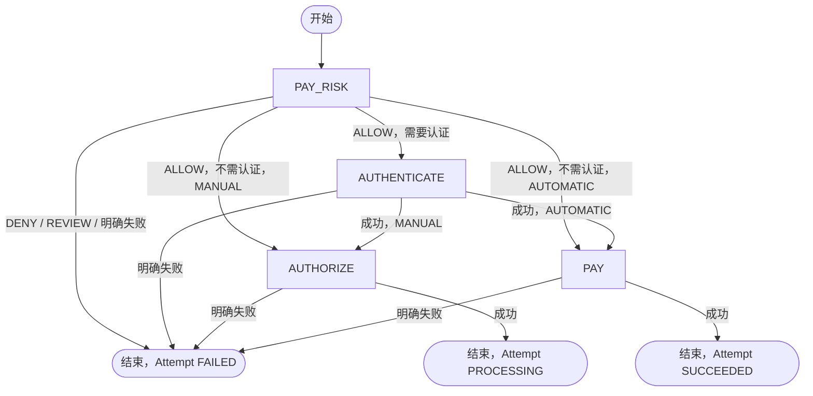

# CARD + PAY 动作流修订

> **Action 状态精简：** 用户已确认删除 CREATED。当前仅 PROCESSING / UNKNOWN / SUCCEEDED / FAILED；创建即进入 PROCESSING，与执行位同事务保存，不再使用 beginAction 或执行前启动事务。

> **2026-09-15 后续确认：** ActionFactory 管理实现；不使用补偿事件执行；先保存支付上下文，再创建首 Action 并通过 Attempt.active_action_id 占位。以下事务和执行边界已按本次要求更新。

用户在确认 Action 类型、条件对象、单动作执行位和 Attempt 状态后，授权开始开发。本修订拥有这部分后继设计；取代前序 `RISK_CHECK / SALE` 自有动作命名及把 Capture 放入同一次 pay Flow 的描述。其余字段、上游接口和渠道边界沿用原合同。实际实现、验证和数据库状态只见[当前台账](../../../agent-docs/CURRENT_IMPLEMENTATION.md#payment-execution-implementation)。

## 流程边界

Flow 按支付工具类型和入口操作定义，当前只实现 `CARD + PAY`。Attempt 仍冻结精确 `payment_method_code`，不能用 CARD 代替具体支付方式。Action 类型统一在 `core.action.ActionType`，不保留第二份枚举。

所有节点的 PROCESSING/UNKNOWN 均停留在原动作，图中的分支仅对可信终态执行。`AUTHENTICATE` 可等待 3DS 交互，交互不是新的 Action 状态。没有 `waitAfter`；AUTHORIZE 成功就是本次 Flow 的结束，后续 Capture 是独立入口。

`CardPayFlow` 集中维护转移定义；当前 CARD + PAY 的 FAILED 由公共 `ActionFlow` 统一结束 Attempt 并释放 Intent 活动尝试，随后停止，不再匹配转移。SUCCEEDED 才匹配规则，在到达 End 时调用当前 Actor 的 `doInTransaction` 处理业务结果，不按动作类型 switch 分派。条件采用 `BiPredicate<PayContext, PaymentAction>` 对象，以 and/or/negate 组合。成功结果须恰好命中一条规则，零命中或多命中均拒绝落库。一次动作只执行自己的业务，不自行调用下一动作。

## 状态与数据

| 当前 Action 的可信结果 | 下一 Action | Attempt | Intent 与金额 |
|---|---|---|---|
| PAY_RISK 评估完成，ALLOW | 按认证要求和 capture mode 选择 | PROCESSING | 保持占用；金额不变 |
| PAY_RISK 评估完成，DENY/REVIEW | 无 | FAILED | Intent 保持 OPEN，释放活动 Attempt |
| AUTHENTICATE 成功 | AUTHORIZE 或 PAY | PROCESSING | 保持占用；金额不变 |
| AUTHORIZE 成功 | 无 | PROCESSING | 更新 authorized_amount；保留 Intent 活动 Attempt |
| PAY 成功 | 无 | SUCCEEDED | authorized_amount、captured_amount 均记录本次支付金额；Intent SUCCEEDED，设置成功 Attempt |
| 本次流程任一步明确失败，尚无成功资金事实 | 无 | FAILED | Intent 保持 OPEN，释放活动 Attempt |
| PROCESSING/UNKNOWN | 原动作 | PROCESSING | 不释放执行位，不补默认资金结果 |

以上失败规则仅属于首次 CARD + PAY。后续 Capture/Void 失败不能抹去已有授权；Void 成功可使 Attempt CANCELLED。Refund 使用独立退款记录，不新建 Attempt，也不把原 SUCCEEDED Attempt 改成退款状态。本次不实现这些入口。

风控评估成功和允许支付分别判断：可信 assessmentId 与 ALLOW/DENY/REVIEW 属于评估结果；只有 ALLOW 继续。认证要求保存在原 PAY_RISK Action，后继 Actor 接入时按本次 Attempt 获取需要的原动作事实。真实 AUTHORIZE/PAY 成功必须同时保存匹配原 Action、冻结渠道、金额与币种的 `t_channel_transaction_ref`，不能仅凭状态码更新成功；引用获取、校验及持久化随资金 Actor 接入补齐。

结果校验归具体 ActionActor：PAY_RISK 校验评估身份、业务结论及认证要求，AUTHORIZE/PAY 各自校验资金引用。Actor 返回 ActionResult，AbstractActionActor 将执行异常或缺失状态转为 UNKNOWN；Flow 不集中校验各动作的业务结果。真实 Owner 调用及业务校验按当前 Actor TODO 接入。

## 事务和执行入口

1. PayProcessor 构建 Context、调用 RouteService，在一次受理事务中完成公共命令 Claim、Intent 占位、Attempt 和命令 Complete。
2. savePayContext 提交后调用 ActionExecutionService.execute，经 ActionFlowFactory 按工具类型和入口操作选定 CARD:PAY，再构造 PAY_RISK；独立事务以 active_action_id IS NULL、Attempt PROCESSING 和原版本为条件占位，同时插入状态为 PROCESSING 的首 Action。任何一步失败则本次动作创建整体回滚，已提交的受理事实保留。
3. execute 沿用当前 PayContext，由首动作创建事务的成功调用方直接执行。没有单独的启动事务；PROCESSING 只表示已进入处理流程，不代表已提交渠道，也不是可再次执行的凭据。
4. ActionFlow.execute 通过 ActionFactory 在事务外调用具体 Actor；结果事务保存 ActionResult 并同步到原 PaymentAction，再匹配转移。PROCESSING/UNKNOWN 只更新 Action 后停止循环，不额外更新或校验 Attempt；执行位继续关联原动作。
5. FAILED 由公共 Flow 在结果事务中调用 attempts.actionFailed 和 intents.attemptFailed：Attempt 按原版本、PROCESSING 和当前动作 ID 更新为 FAILED 并清空执行位，保留已有金额；Intent 按原版本及活动尝试 ID 释放占位，保持 OPEN。SUCCEEDED 有后继时，创建下一 Action 并按原版本、动作 ID 切换执行位，提交后才执行；到 End 时调用 Actor.doInTransaction 保存业务结果。评估成功但 DENY/REVIEW 仍由风控 Actor 处理。任一持久化操作失败则整体回滚，数据库更新成功后才同步对象。真实资金引用持久化随资金 Actor 接入后加入该事务。

原提交重放或补命令绑定不创建新动作；不通过补偿事件、线程池或后台任务启动动作。Repository 各自对应一张表，确认影响行数后同步对象的状态、指针、版本和时间。Context 贯穿 Service/Flow/Actor，Repository 不接收 Context；Action 结果写入接收原 PaymentAction 和 ActionResult，Attempt 结果写入接收原 PaymentAttempt、动作 ID、目标状态及金额。Mapper 使用对应的明确参数。旧 Action 不删除，同一动作重用原渠道幂等键和路由三元组。没有 QUERY 业务 Action，渠道标准操作内部仍负责自己的查询与幂等处理。

本期不增加用户暂缓的资源锁。Attempt 的动作指针与数据库条件更新用于创建/切换占位，执行入口只接收本次成功创建的动作，不从库中读取 PROCESSING/UNKNOWN 后直接重发；本地原子性和真实并发仍需数据库验收。

## Owner 待办与恢复限制

Risk、Card/Channel、3DS 交互交付和通知保留明确 TODO。尚未接入的 Actor 将不可用异常转为 UNKNOWN，Flow 保存并保留占位；不得生成假的 assessmentId、认证成功或渠道交易号。RouteService 仍使用原固定 Mock，真实资金能力启用前必须替换。

当前不做自动恢复。保存上下文后创建动作前、或切换到下一动作后直接执行前发生进程中断，持久化事实保留，但不会自动补建/续跑。PROCESSING/UNKNOWN 不通过原 pay 请求重发；回调与恢复入口后续单独实现。按当前 Actor 异常语义，UNKNOWN 保存成功后 pay 返回 202 / PROCESSING；数据库冲突与保存失败继续向上抛出。同键重放只读取已受理的 Attempt。

## 模型与历史切换

- `t_payment_action.action_type`：PAY_RISK / AUTHENTICATE / AUTHORIZE / PAY / CAPTURE / VOID / REFUND。
- `t_channel_transaction_ref.reference_type`：AUTHORIZE / PAY / CAPTURE / VOID / REFUND；PAY 表示原 SALE 的直接收款语义。
- 不新增表、列或索引。当前模型和 Schema 注释同步新名称，Channel 原协议的 sale、能力代码 ACTION.SALE 及外部合同不机械改名。
- 旧 RISK_CHECK/SALE 数据、任务、消费者和历史类型映射必须盘点后单独切换；新闭集枚举不兼容旧字符串。见[人工切换说明](./db/card-pay-action-migration.md)，本修订不授权执行数据库迁移。

旧 Excel 保留为前序设计附件，本次最新 Flow 与动作名称以本修订为准。
