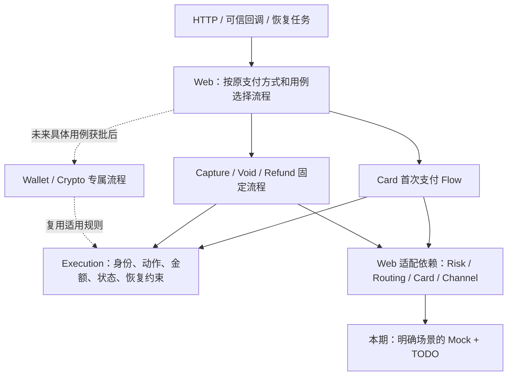
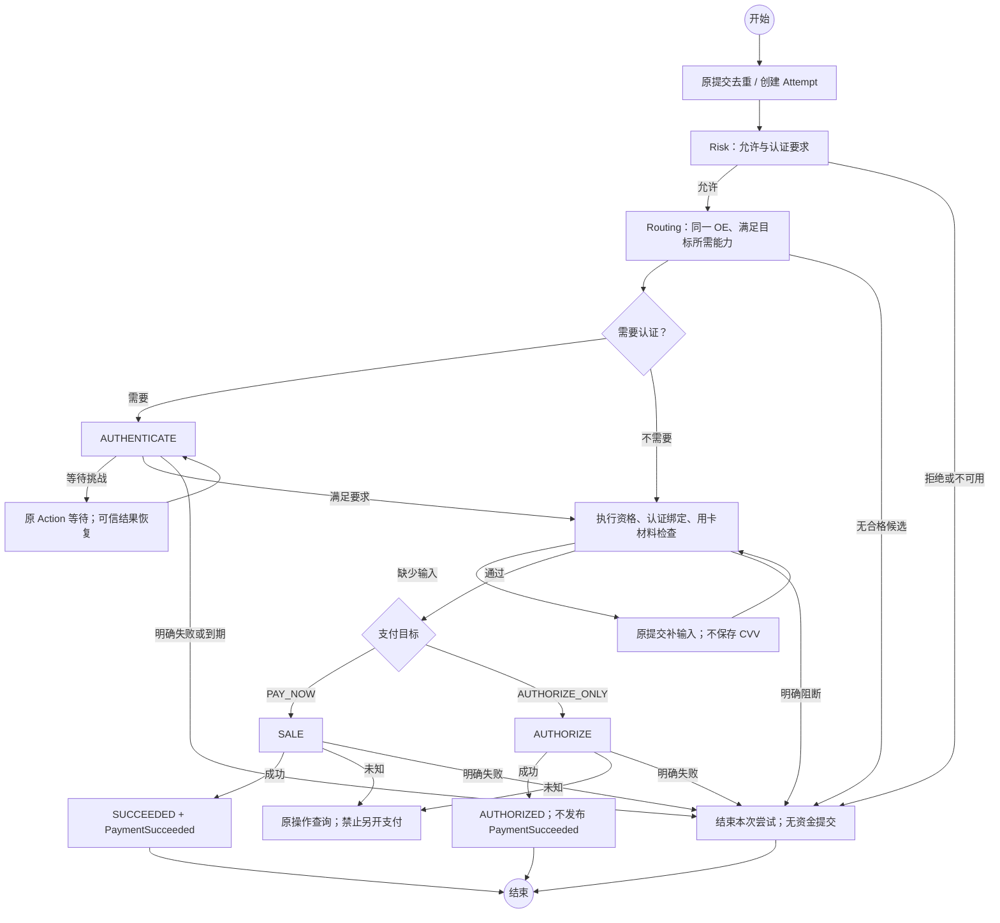

# Execution 详细设计

> **2026-09-15 删除来源 Binding：** 用户已确认删除 `t_payment_intent_binding` 和 EX-I03 `CloseCreation`，按已有 Intent 终止；创建结果未明确时由 Commerce 用原键恢复创建后再终止。本文涉及提前关闭、Binding 门禁和锁顺序的内容由[字段修订第 8 节](./execution-field-simplification-amendment.md#8-删除来源-binding)取代；其余历史基线保持。

> **字段维护后继：** [整批精简修订](./execution-field-simplification-amendment.md)已取代本文受影响的字段、渠道绑定位置、认证明细、Pricing Fact 与状态历史表要求。本文旧接口/流程细节保留为迁移前基线；后续 Java/HTTP/MQ 改造须逐项对齐，数据库执行状态只见当前台账。

> **首次风控流程后继：** [内部风控 Action 修订](./internal-risk-action-amendment.md)把 Risk 调用落为 RISK_CHECK，占用原 Attempt 执行位；仅 ALLOW 后进入 Routing/方式流程。下文无独立风险 Action 的流程图是前序基线，恢复分派及工具切换按后继合同执行。

> **状态与 Channel 恢复后继：** capture mode、三表 4/4/5 状态、active_action_id 及移除 QUERY 的现行设计目标以[状态与恢复修订](./execution-state-channel-recovery-amendment.md)为准；下文受影响内容保留为前序基线，未涉及合同继续有效。实现与 SQL 状态只见[当前台账](../../../agent-docs/CURRENT_IMPLEMENTATION.md#payment-execution-implementation)。

> **交易级 Token 修订评审：** 用户已确认统一 pay、交易级工具 Token、Attempt 直接关联及删除旧 Instrument 的方向；详细合同见[修订稿](./instrument-token-amendment.md)。下文保留上一版合同与评审上下文，受影响部分以修订稿的准确取代范围为准；新合同的实现与验证状态只读[当前台账](../../../agent-docs/CURRENT_IMPLEMENTATION.md#payment-execution-implementation)。

> 阶段 3 已获用户确认，当前进入阶段 4 Execution 本地切片研发；其他 Owner 仅测试 Mock + TODO。实际实现与验证边界见[当前台账](../../../agent-docs/CURRENT_IMPLEMENTATION.md#payment-execution-implementation)，阶段确认见[交付记录](./delivery.md)。

**建议采用：通用执行规则 + 按方式选择代码流程。Card 首次支付一份流程，后续资金命令各自独立。**

| 阅读入口 | 解决的问题 |
|---|---|
| [状态与 Channel 恢复修订](./execution-state-channel-recovery-amendment.md) | capture mode、精简状态、活动 Action 占位及 Channel 原操作恢复的现行设计目标 |
| [交易级 Token 与统一 pay 修订](./instrument-token-amendment.md) | 本轮已确认方向、接口改造、工具期限、Card 材料和 Commerce 幂等衔接的修订评审稿 |
| [接口合同](./api-contract.md) | 谁调用、传什么、返回什么、读写哪些表 |
| [数据方案](./data-design.md) | 去掉交互表后存什么、字段/索引增量及迁移边界 |
| [状态与恢复](./state-and-recovery.md) | 状态精简、崩溃、UNKNOWN、金额及并发规则 |
| [Mock 合同](./mock-contract.md) | 其他模块模拟哪些结果、未来怎样替换 |
| [研发与验收计划](./verification-plan.md) | 实施顺序、验收场景及需要的本地条件 |
| [阶段 4 开发检查](./development-checks.md) | 实现清单、验收编号映射和待综合核对项 |
| [DDL 评审草稿](./db/ddl.sql) | 精确结构增量；不自动执行，不替代当前 PDManer |

## 1. 流程抽象

箭头表示调用职责，不意味着 Execution 依赖 Web、API 或兄弟业务 JAR。依赖方向沿用[模块方案](../payment-业务模块划分/technique.md)。

| 位置 | 类型化合同与职责 |
|---|---|
| `paytech-payment-api` | 轻量 `@HttpExchange` 合同、请求/响应 DTO；枚举传 String code，无 DataObject、PAN 或 CVV |
| `paytech-payment-web` | Controller 映射 DTO；具体 Processor 编排；`PaymentFlowRegistry` 负责唯一匹配和恢复分发；依赖适配器负责 Owner 模型转换 |
| `paytech-payment-execution` | `PaymentIntentService`、`PaymentExecutionService`、`PaymentRefundService` 及各自 Impl；Owner 内部模型、Domain Service、Repository、状态/金额不变量 |
| `paytech-payment-test` | 其他 Owner 的场景替身、调用记录器与集成验证；不替换 Execution Service/Repository |

`PaymentMethodFlow<C>` 是 Web 内的可替换合同，`C` 为该方式明确的输入类型。首次执行使用 `execute(C)`，恢复使用 `recover(clientId, intentId, submissionId)` 读取原事实；同时声明精确 method code、useCase 和 commandType。`CardPaymentFlow` 是本期方式实现，`SubmitCardPaymentProcessor` 是 Card HTTP 用例入口，两者职责分离。Registry 注册时绑定类型，入口只做一次类型检查，不以强制转换散布方式分支。Service/Domain Service 均采用 interface + Impl，Processor 保持具体类。

- 匹配键为**精确 Payment Method Catalog code + 业务用例**，不是 Channel、MID 或流程版本。支付目标是 Card 首次支付内的分支，除非实际用例证明需要拆分。
- 零匹配明确拒绝，重复匹配启动失败；测试替身可验证扩展性，不创建生产 Wallet/Crypto 空实现。
- 原提交补输入通过明确的 `CardPaymentCommand` 进入，恢复任务只传原资源身份；认证/资金结果使用 Channel 的具体结果记录。不建立当前没有消费者的通用 `ResumeSignal`，不使用任意 Map、回调函数或 Bean Context。
- 恢复读取原 Attempt/Action 的方式、目标和引用，不能用当前路由重新选择执行者或从第一步重跑。代码升级必须继续识别在途记录；不能兼容时先停止新受理并排空，不能靠给记录换流程版本解决。
- Capture/Void/Refund 不实现首次支付接口，不要求未来 Wallet 实现 3DS 或 Authorize。

### 1.1 接口与 Processor 一一对应

按用户阶段 4 评审要求，每个接口有独立的用例 Processor。Controller 位于 `ext/rest/execution`，直接继承 API 的唯一 HTTP Mapping，经过无副作用的请求/响应 Converter 委托相应 Processor；Processor 的输入和结果均为内部应用模型。

| API 方法 | 独立用例入口 |
|---|---|
| `createIntent` | [CreatePaymentIntentProcessor](../../../payment-orchestration-service/paytech-payment-web/src/main/java/com/paytech/payment/service/processor/CreatePaymentIntentProcessor.java) |
| `getIntent` | [GetPaymentIntentProcessor](../../../payment-orchestration-service/paytech-payment-web/src/main/java/com/paytech/payment/service/processor/GetPaymentIntentProcessor.java) |
| `closeCreation` | [ClosePaymentIntentCreationProcessor](../../../payment-orchestration-service/paytech-payment-web/src/main/java/com/paytech/payment/service/processor/ClosePaymentIntentCreationProcessor.java) |
| `terminate` | [TerminatePaymentIntentProcessor](../../../payment-orchestration-service/paytech-payment-web/src/main/java/com/paytech/payment/service/processor/TerminatePaymentIntentProcessor.java) |
| `pay`（取代旧 `submitCard`） | [PayProcessor](../../../payment-orchestration-service/paytech-payment-web/src/main/java/com/paytech/payment/ext/rest/execution/processor/PayProcessor.java) |
| `getSubmission` | [GetPaymentSubmissionProcessor](../../../payment-orchestration-service/paytech-payment-web/src/main/java/com/paytech/payment/service/processor/GetPaymentSubmissionProcessor.java) |
| `capture` | [CapturePaymentProcessor](../../../payment-orchestration-service/paytech-payment-web/src/main/java/com/paytech/payment/service/processor/CapturePaymentProcessor.java) |
| `createRefund` | [CreatePaymentRefundProcessor](../../../payment-orchestration-service/paytech-payment-web/src/main/java/com/paytech/payment/service/processor/CreatePaymentRefundProcessor.java) |
| `getRefund` | [GetPaymentRefundProcessor](../../../payment-orchestration-service/paytech-payment-web/src/main/java/com/paytech/payment/service/processor/GetPaymentRefundProcessor.java) |
| `reverse` | [ReversePaymentProcessor](../../../payment-orchestration-service/paytech-payment-web/src/main/java/com/paytech/payment/service/processor/ReversePaymentProcessor.java) |
| `getPricingFact` | [GetPaymentPricingFactProcessor](../../../payment-orchestration-service/paytech-payment-web/src/main/java/com/paytech/payment/service/processor/GetPaymentPricingFactProcessor.java) |
| `getAction` | [GetPaymentActionProcessor](../../../payment-orchestration-service/paytech-payment-web/src/main/java/com/paytech/payment/service/processor/GetPaymentActionProcessor.java) |

七个写用例分别使用同名的 `*AcceptanceProcessor` 作为短事务受理阶段，只有该阶段的公开代理入口加 `@ResourceLock`。每个受理入口一次声明完整资源锁，内部 `TransactionTemplate` 原子提交业务事实、命令绑定和恢复任务；返回后才进入外部调用阶段。这样不依赖同类自调用、不在事务里访问 Owner，也不靠嵌套带锁代理拼装锁集合。

共享职责保持明确：`ExecutionCommandService + Impl` 管理本服务命令绑定；`ExecutionQueryService + Impl` 读取原事实及当次交互；`ChannelActionRequestService + Impl` 恢复原渠道坐标；`PaymentActionProcessor` 供同步命令、Card 流程和恢复任务复用原动作发送/查询及结果应用。Converter 不访问数据库或外部服务，Service 不依赖 Processor。当前接口拆分不改变 URL、JSON、幂等字段序列、锁资源、金额规则或状态机。

## 2. Card 与后续命令

AUTHENTICATE 超时同样进入 UNKNOWN；图中的循环表示原认证恢复，不表示重新创建认证。真实渠道是否支持独立认证，由后续 Channel 接入验证，本期 Mock 不提供这种证明。

| 后续命令 | 前提与处理 |
|---|---|
| Capture | 原 AUTHORIZE 成功，一次全额，尚无 Void 决策或在途 Capture；沿原账户/MID 执行 |
| Void | 内部调用；未扣款授权全额释放。创建 Void Action 即阻止新的 Capture；明确失败保留原授权并允许受控重试 Void |
| Refund | Commerce 已创建 Refund Request；Payment 自己预占退款额度，再沿原扣款交易执行 |
| Reversal | 锁内判定：未扣款授权建 Void；已全额扣款返回 REFUND_REQUIRED，由 Commerce 发起标准全额退款；在途资金动作返回 PENDING |

## 3. 持久化取舍

- 来源提交直接绑定 Attempt，不新增 Submission 表。
- 来源唯一关联保存在 Intent；取消须先确认 Intent 创建结果，再请求终止已有 Intent。
- 删除 `t_payment_customer_action`；交互类型、期限、稳定渠道操作引用归入 Action。`nextAction` 仍是响应模型，临时交互指令不落库。
- 新增 AUTHENTICATE 动作及认证事实；认证引用不进入资金交易引用表。
- 沿用已有业务状态枚举，缩小合法转换；不新增流程实例/节点状态表。保留 UNKNOWN、AUTHORIZED，因为它们分别影响重试和资金操作资格。
- 发现 Payment 当前补偿表仍是旧合同，需随本切片将 **Web 所属本地补偿表** 对齐 Foundation 现行合同；不迁移 Foundation 命令幂等 JAR，不扩展其他业务模块。

精确字段增量和历史处理以[数据方案](./data-design.md)为本评审稿唯一明细；当前正式物理模型仍以[服务 PDManer](../../../payment-orchestration-service/docs/database/payment-orchestration.pdma.json)为准。获批后先同步模型及生成器，再核对草稿 SQL，不能直接用本稿覆盖有历史交易的库。

## 4. 合同衔接与评审重点

Commerce 现有 `CheckoutCardPaymentPort` 接收瞬时 CardInput；本稿 Execution API 只接受受控 Card 引用。未来由 Payment Web/Card 专用入口完成转换，不能把本稿接口直接配置为该 Port 的 HTTP 实现。公开 submissionId 仍是 Commerce 命令 ID；不新增 Payment 公共 Customer 入口或反向法律确认回调。依据见 [Commerce 后继修订](../../../commerce-service/docs/requirements/20260912-customer-checkout/commerce-entry-amendment.md)。

本稿建议重点评审三个选择：**不公开单独的 authenticate/continue；基于已有 Intent 终止；Action 承担认证与交互恢复。** 其余系统的真实接入、页面、共享数据库操作均留在后续范围。

阶段 3 确认后，按[研发计划](./verification-plan.md)进入 Execution 本地切片实施。阶段确认不包含执行 SQL、部署、提交或推送；本轮证据见[交付记录](./delivery.md)。
