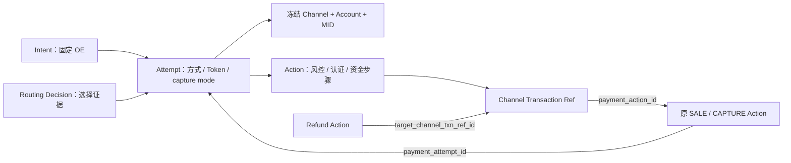

# Execution 字段精简与渠道绑定修订

> **Action Flow 后继：** [CARD + PAY 修订](./card-pay-action-flow-amendment.md)统一自有动作 PAY_RISK / PAY 名称、条件对象和执行位切换；AUTHORIZE 成功结束本次 Flow，Capture 为独立入口。前序 RISK_CHECK / SALE 表述按该范围被取代。

> **2026-09-15 后继确认：** 用户确认删除来源 Binding。第 8 节拥有来源唯一性、创建与终止顺序的现行合同，取代前序 Binding/CloseCreation 设计。

> **2026-09-15 路由顺序修订：** 第 9 节将选路移到 Context 构建后、本地受理事务前，取代此前 RISK_CHECK → Routing 的顺序；具体选路本期按用户要求 Mock。

用户于 2026-09-14 确认“把此前整批字段精简一起整理并落模”。本轮维护 Payment 数据设计、PDManer、Schema SQL 和场景；Java、HTTP/MQ 合同迁移及实际数据库执行属于后续阶段。实现与验证状态只见[当前台账](../../../agent-docs/CURRENT_IMPLEMENTATION.md#payment-execution-implementation)。

相对本轮前的目标模型：删除 2 张表；修改 Intent、Attempt、Action 3 张表。存续表移除 20 个旧列位置（其中 4 列迁移位置），新增 6 个列位置（4 个迁移、2 个渠道响应列）；另删除两表的 30 列，净减少 44 列。删除 2 个唯一索引、替换 1 个唯一索引，删除 7 个访问索引、新增 3 个访问索引；删除 3 条关系、移动 3 条关系。新增接口、业务 DML、注册 DML、页面均为 0。

本稿取代[数据方案](./data-design.md)、[状态修订](./execution-state-channel-recovery-amendment.md)、[风控 Action 修订](./internal-risk-action-amendment.md)及 2026-09-11 OE/Pricing 方案在下述 Payment 字段上的规定。其他 Owner 的业务事实、现有历史 Wire 和事件幂等不能随删列丢弃。

## 1. 最终字段取舍

| 表 | 字段 | 处理与归属 |
|---|---|---|
| Intent | source_order_context_id、context_format | 删除。来源仍由 source_type + source_id 定位；只接受当前合同的新写，不再用行内格式判别兼容旧 Scope |
| Intent | entity_no、金额/币种、行业/MCC、消费者国家、三个 pricing version | 保留原冻结事实；本轮不扩大为删除定价版本或重新选择 OE |
| Attempt | failure_stage、status_reason_code | 删除。运行诊断归日志/可靠任务；可信渠道结果看 Action，风控结果看 RISK_CHECK，路由拒绝看 Routing Decision；不将本地错误伪装成渠道返回码 |
| Attempt | consumer_contract_id、consumer_terms_acceptance_id、refund_policy_acceptance_id、privacy_notice_acceptance_id、acceptance_completed_at、order_version | 删除。法律接受及其校验属于 Commerce，Payment 不反查 Commerce，也不复制接受证据 |
| Attempt | transaction_assessment_id、risk_result | 延续前序决定，放在 RISK_CHECK Action |
| Attempt | limit_reservation_group_id | 延续前序删除，Risk 自己按原 Attempt 定位占用 |
| Attempt | payment_goal、card_reference | 不恢复旧字段；使用 capture_mode、payment_instrument_token_id |
| Attempt | authentication_requirement | 移到 RISK_CHECK Action；ALLOW 后冻结 NOT_REQUIRED / THREE_DS_REQUIRED / CHALLENGE_REQUIRED，不能直接丢掉是否挑战的决定 |
| Attempt | channel_id、channel_account_id、mid_id | 从 Action 移入；Routing 成功前全部为空，成功后成组写入且永久冻结 |
| Attempt | active_action_id | 保留；非终态 Action 独占执行位，终态按原指针 CAS 清空或接续 |
| Action | target_payment_action_id | 延续前序删除；没有 QUERY 业务动作 |
| Action | target_channel_txn_ref_id | **保留**。Capture/Void 指精确 AUTHORIZE Ref，Refund 指精确 SALE/CAPTURE Ref；不能用“最新成功动作”替代 |
| Action | authentication_action_id、channel_operation_ref | 删除。Execution 按同 Attempt 的认证步骤推进；渠道原操作及认证证明关联由 Channel 维护，不在此复制渠道会话引用 |
| Action | authentication_outcome、challenge_performed、authentication_valid_until | 删除。认证证明、挑战结论与有效期由 Channel 校验；AUTHENTICATE 成功必须表示满足本次内部认证要求，拿到表单或浏览器回跳不算成功 |
| Action | status_reason_code | 删除；新增可空 channel_response_code VARCHAR(128)、channel_response_msg VARCHAR(512)。仅渠道真实响应填写，消息先清洗、不存原始报文或敏感值、不驱动状态机 |
| Action | interaction_type、interaction_expires_at | 保留最小交互事实；3DS/Wallet 等待时 Action 为 PROCESSING，临时 URL、SDK Token、QR Payload 不落库 |
| 表 | t_payment_pricing_fact | 删除；本期 Execution 不再维护独立定价快照表。CCT/Commerce/Finance 所需的支付属性证据与旧 payment_fact_id 消费合同须另行迁移，不能改成零费率或猜测卡属性 |
| 表 | t_payment_state_transition | 删除；不新增通用历史替代表。Channel Transaction Ref、Callback/Item/Exception、Dispute Event、Duplicate Case 仍保留各自业务证据 |

未在上表修改的 Token 字段、状态枚举、可靠执行表及退款/争议业务字段维持原合同。AUTHENTICATE 名称沿用当前模型，不在本次另起同义枚举。

## 2. 渠道与原交易导航



- 选择成功的 Decision、Candidate 与 Attempt 三元组必须一致；在一个本地事务写入选择证据与 Attempt 绑定，后续动作只读冻结坐标。不可反查 MID 的当前 Account 来改写历史执行账户。
- 同 Attempt 不能换渠道、账户或 MID。明确失败后新提交、新 Token、新 Attempt 才能重选同一 OE 下的渠道。未知结果先恢复原动作。
- Action 仍以 Attempt / Channel Refund / Duplicate Case 三父级 XOR 表达归属。Refund 不为读取渠道再填 payment_attempt_id；经 target Ref → 原资金 Action → 原 Attempt 导航，核对原 Ref 的 Channel/MID 与冻结坐标一致。Dispute Action 自有坐标不受本次移动影响。
- 原 `(channel_id, channel_idempotency_key)` 唯一索引改成 `UNIQUE(channel_idempotency_key)`，ASCII 二进制比较。Payment 根据全局唯一 Action 身份生成非空稳定键，风险步骤为空；重试不换键。旧环境必须核查跨渠道同键冲突，不能直接收紧后假定兼容。

## 3. 风控、认证与方式流程

一次新 Attempt 按第 9 节修订为：`Routing → 本地受理 → RISK_CHECK → 可选 AUTHENTICATE → SALE / AUTHORIZE`。手动授权后等待同 Attempt 的 Capture/Void。Wallet 直接扣款使用 SALE；Wallet 跳转是原 SALE 的消费者交互，不伪装成卡的 AUTHENTICATE。Wallet/Crypto 的实际能力仍未启用。

一个新 Attempt 至多一条首次风控与一条付款前认证业务 Action；原操作的超时、查询、表单刷新都恢复同一 Action。程序在 Attempt 资源锁、事务、序号唯一约束和 active_action_id CAS 下保护该规则。Action 成功后按本次方式流程找后继，不靠“最新一条成功 Action”推断付款资格。

RISK_CHECK.ALLOW 必须同时保存明确的 authentication_requirement；选路不代表风控通过，没有允许结果时不能发款。Channel 在原 AUTHORIZE/SALE 中校验同 Attempt、工具、金额/币种和认证要求对应的证明，若证明过期或不匹配，首次资金提交须明确拒绝；不能只检查历史 AUTHENTICATE.SUCCEEDED 就发款。已经提交但 UNKNOWN 的资金仍恢复原操作，不能因证明过期推定没有扣款。详细 Channel 持久化及适配接口由 Channel 需求完成，本次不添加一组猜测的认证表。

Intent / Attempt / Action 状态仍为 4 / 4 / 5 个。Attempt.PROCESSING 覆盖风控、3DS、Wallet 跳转、未知资金和手动授权等待。AUTHORIZE 成功不等于收款成功，Capture/Void 失败不能抹掉原授权。

## 4. 删除历史表后的可靠性

Attempt 序号从本 Intent 的原 Attempt 计算，在 Intent 资源保护和 `UNIQUE(payment_intent_id,attempt_no)` 下分配，不能再计数状态流转行。

状态变化与本地补偿任务仍同事务提交。消息需稳定业务身份和发生时刻；禁止从最新状态反推过去事件。`t_compensation_event` 成功后删除，不能充当永久历史或长期去重依据。当前按 transition ID 构造通知的 Java/消费者在模型切换前必须改造并验证未知、终态、重复、乱序和迟到成功场景；本稿不将未经验证的新事件格式当成已实现合同。

不提供通用状态时间线。需要解释真实资金时使用原 Action、资金 Ref、Callback 和异常处置证据；业务未要求的每次状态中间变化不再永久复制。

## 5. 关联改造与落库前置

| Owner | 后续必须同步的内容 |
|---|---|
| Payment Execution | DO/Mapper/Repository、PayProcessor 序号、路由读取、认证流程、状态历史写入、查询投影、通知 Handler、测试 |
| Payment Channel | 以原 Action/Attempt 恢复渠道操作；认证证明绑定与有效期校验；安全 response code/msg；退款沿原 Attempt 读取账户 |
| Commerce | 保持自身法律接受校验；停传被删除的内部持久化字段时同步 Payment 请求合同；不由 Payment 反向查询 |
| Risk | 保持原评估与占用 Owner；Payment 将认证要求随 ALLOW 记录在风险 Action；更新受事件身份影响的消费者 |
| CCT / Finance / Commerce 定价 | 替换依赖 payment_fact_id / Pricing Fact 表的获取与追溯合同；既有财务事实不重算，事实缺失不得默认零费率 |

模型删除不等于已经删除这些能力的 Java 实现或实际库表；旧接口/事件不能直接套在新 Schema 上。Channel、定价、通知迁移完成且通过入口验证后，才具备切换执行条件。

当前空库创建使用[精简 Execution Schema](./db/execution-simplified-create-empty-schema.sql)，全库定义使用[正式 Schema](../../../paytech/payment/docs/database/sql/payment-schema.sql)。本机旧空表切换见[人工迁移说明](./db/execution-simplified-migration.md)。本轮没有业务 DML；非空环境不适用空库脚本，不删除未决资金、待发消息或历史定价引用。

## 6. 验收

1. PDManer、字段目录、独立测试清单、索引、关系、图组和 SQL 一致，删除目标无悬空引用；没有物理 FK/CHECK。
2. 三表不残留删除字段，风险决定不丢失，渠道绑定唯一，Capture/Void/Refund 保留精确原交易导航。
3. 场景记录匹配实际字段和枚举；保留 Card/Wallet/未知及退款语义。
4. 只声明实际完成的工件与验证；Java/数据库切换状态在台账独立记录。既有 Excel 的状态示例仍可参考，旧字段位置以本稿及现行 PDManer 为准。

## 7. Pay 受理链合同

用户另行要求按修改后的模型重构 pay，并确认“先完成 pay 受理链，后续流程保持 TODO”。本节取代前序 Pay 请求中的法律接受字段及 Hash 投影；不扩展到 Create Intent、工具准备、Channel 操作或 MQ 合同迁移。

私有 API 为 `POST /payment-execution/v1/intents/{intentId}/pay`，请求头 `Idempotency-Key: submission:<sourceSubmissionId>`。请求示例：

```json
{
  "clientId": "101",
  "sourceSubmissionId": "401",
  "captureMode": "AUTOMATIC",
  "payMethod": {
    "paymentMethodCode": "CARD_TEST",
    "paymentInstrumentToken": "synthetic-transaction-tool"
  }
}
```

- Intent ID 来自路径；金额、币种、OE、消费者国家和定价版本从原 Intent 读取。法律接受仍由 Commerce 校验，pay 不接收六个已删除的接受/订单版本字段。
- `captureMode` 为 `AUTOMATIC` / `MANUAL`。当前受理结果均为 PROCESSING；路由调用按第 9 节处理，后续风控、认证和扣款待方式流程实施。
- 幂等使用独立操作名 `PAY_INSTRUMENT_V1`，固定字段顺序为 `clientId, intentId, sourceSubmissionId, paymentMethodCode, captureMode, paymentInstrumentToken`。按用户确认直接使用请求 Token 字符串：幂等前只做基础校验和 Hash 计算，查询幂等记录后，未命中才查询工具并做业务验证。幂等表只保存 Hash，不保存 Token 明文。Attempt 仍关联业务验证阶段取得的 Token 内部 ID。
- 历史 `PAY_CAPTURE_MODE_V1` 及更早记录的 Hash 不改写。原提交没有新版绑定时，只核对存续的 Intent、来源提交、方式、捕获模式和工具身份；一致时复用原 Attempt，禁止根据删除字段猜测回填或新建替代 Attempt。
- 2026-09-15 用户确认删除 `allowExecution`：pay 只受理支付或幂等重放，不新增查询接口或替代开关。命令未命中时进入受理链；原提交已存在时仍只补新版命令绑定。匹配的原提交即使终态、Token 过期/撤销也可以重放，改方式/模式/工具仍为 409。该字段此前不参与 Hash，删除后 Hash 算法及版本保持不变。调用方必须停止传入已删除字段，继续按既有规则拒绝未知字段。
- 新受理只原子保存 Attempt、Intent 活动指针及命令绑定。序号来自原 Attempt 的最大值，初始授权/收款金额为零、活动 Action 为空；渠道三元组按第 9 节在受理前选定后随 Attempt 保存。没有状态历史、Pricing Fact 或推进任务写入。
- 2026-09-15 用户确认最小响应仅含 `attemptId` 和 `status`，直接取本次新建或幂等命中的 Attempt；不再查询 Action。删除回显身份、方式、capture mode、金额、动作标识、failureCode、last4、observedAt 及 NextAction。HTTP 按 Attempt 状态返回：PROCESSING 为 202，SUCCEEDED/FAILED/CANCELLED 为 200，保留 no-store；手动授权尚未收款仍为 PROCESSING，取消旧的按授权金额返回 200 的例外。本次受理错误继续使用公共 Problem。当前不新增查询接口、替代字段或占位交互模型。
- 2026-09-15 用户重构及确认：`PayProcessor` 归属 Execution 的 `service/processor`，使用内部 `PayRequest/PayResponse`。HTTP 层通过 `PayConverter` 转换 `PayRequestBody/PayResponseBody`，Controller 负责 HTTP 状态及缓存策略。Web 不再读取 Execution DataObject；此决定取代此前 ext Processor 直接消费/返回 Body 的局部例外。
- HTTP 支付方式及工具放在必填 `payMethod` 下；内部 ID 使用 Long。结构变化不改变幂等 Hash 的字段名、顺序和值，调用方需同步 JSON 结构。响应 JSON 按本节最小响应约定同步调整。
- `PayContext` 直接持有本次请求涉及的现有数据库对象与公共 Claim，幂等、构建、保存、响应使用同一个对象。Service 业务方法超过 3 个参数时封装成业务 Context；本地保存仍接收已验证的 `PayContext`，不重复业务预检。

完整的模型切换仍须完成第 5 节的后续改造。实际代码、数据库与测试状态仅见[当前台账](../../../agent-docs/CURRENT_IMPLEMENTATION.md#payment-execution-implementation)。

## 8. 删除来源 Binding

2026-09-15 用户确认删除 `t_payment_intent_binding`。删除该表的全部 8 个字段、主键、两个唯一索引及其与 Intent 的逻辑关系；不新增替代表、关闭标记或状态。

- 来源关联直接使用 `t_payment_intent.source_type/source_id`，保留 `uk_payment_intent_source`。同一来源只创建一个 Intent；幂等记录继续使用 Foundation 公共包。
- 移除 EX-I03 `POST /intent-creations/close`、CloseCreation/CloseResult 与“Intent 尚不存在时永久关闭未来创建”的能力。保留已有 Intent 的终止命令 EX-I04，不新增关闭接口。
- Commerce 决定取消时停止发起新的支付提交。若已发起 Intent 创建但结果未明确，先用原幂等键恢复创建结果，取得原 Intent 后再请求终止；不能把超时、暂时未查询到当作“没有创建”。Payment 不反向调用 Commerce。
- 终止与新受理基于同一个 Intent 的本地事务和条件更新竞争。确认可以终止后更新 Intent 状态；新 Attempt 要求 Intent 为 OPEN、未过期且无活动或成功 Attempt。
- 在途/UNKNOWN 等未决资金必须先确认，终止返回 PENDING，不写 CANCELLED、不宣告关闭完成，也不承诺 PENDING 已永久阻断首次发送。已有成功授权/扣款仍按既有 Reversal/Refund 规则处理，不能用状态覆盖资金事实。
- Token 准备和首次资金发送检查已存在 Intent 的资格，不读取 Binding。原支付幂等重放仍先恢复原 Attempt，不因为 Intent 已终态或 Token 已失效而丢失原结果。
- 当前 pay 删除 Binding 对象、Context 字段、仓储、Mapper 和查询/行锁；保留原 Intent 检查、CAS、工具有效性保护、Attempt 唯一约束与公共 Claim/Complete 的同一事务。`newAttempt` 的原提交补命令分支不受本次删除影响。

创建、终止、Token 准备和后续资金流程仍待实现；本次只修改现有 pay、模型及文档，不以此宣称 Commerce 已完成真实接入。前序数据方案、接口示例、状态恢复、工具修订和验收中涉及 Binding、提前关闭及锁顺序的部分由本节取代；历史执行记录与旧 SQL 保留为证据，不作为当前切换入口。

新建库使用已更新的正式 Schema 或 Execution 空库创建稿。已建库需先核对历史 Binding 关闭事实，非空记录不能直接删除或猜测映射到 Intent 状态；人工迁移入口见[精简迁移说明](./db/execution-simplified-migration.md)。本次不执行实际数据库变更。

## 9. 受理前路由

2026-09-15 用户确认在 Context 构建后执行 route，并要求“调用 RouteService，给定参数，返回路由结果，具体逻辑先 Mock”。当前 Routing 仍是 Payment 内部 Maven 业务模块，共用原进程；不增加独立服务或 HTTP 合同。

1. 顺序为 `幂等 → buildPayContext → route → savePayContext → 后续方式流程 → 响应`。仅新 Attempt 选路；命令重放、原提交补命令都沿用原 Attempt，不覆盖历史空渠道。
2. Execution 单向依赖 Routing 发布的 `RouteService.route(RouteContext)`，参数仅含 Client、冻结 OE、金额、币种、方式代码和 capture mode；返回 `RouteResult(channelId, channelAccountId, midId)`。不跨模块传 DataObject、Repository 或工具 Token，不反向依赖 Execution。
3. RouteService 只计算选路结果，不保存 Attempt 或发款。Processor 在事务外调用，成功后将三元组写入 Context 中的新 Attempt，再执行原一次本地受理事务；异常直接返回，不接受新支付提交。并发受理继续依靠原公共幂等、Intent CAS、工具保护与唯一约束，不新增锁。
4. 同一 Attempt 的三元组受理后冻结；真实 Routing 必须在给定 OE 内筛选有效渠道及所需能力。后续 Risk 决定仍是发款前置，路由成功不能代替 ALLOW。
5. 本次明确授权 RouteServiceImpl 暂用固定合成结果 `9001/9002/9003`，只用于先搭通受理调用；尚未证明同 OE、能力、配置或可用性。真实筛选、选择证据及其与 Attempt 同事务保存继续 TODO。接通真实资金前须替换 Mock 并补齐第 2 节的证据一致性，不能把 Mock 绑定当作可执行的真实渠道。

HTTP 请求、最小响应、幂等 Hash、表结构和状态枚举保持不变。此局部 Mock 授权不推广到 Risk、Channel、Card 或其他系统；代码与验证状态仍只记录在当前台账。
