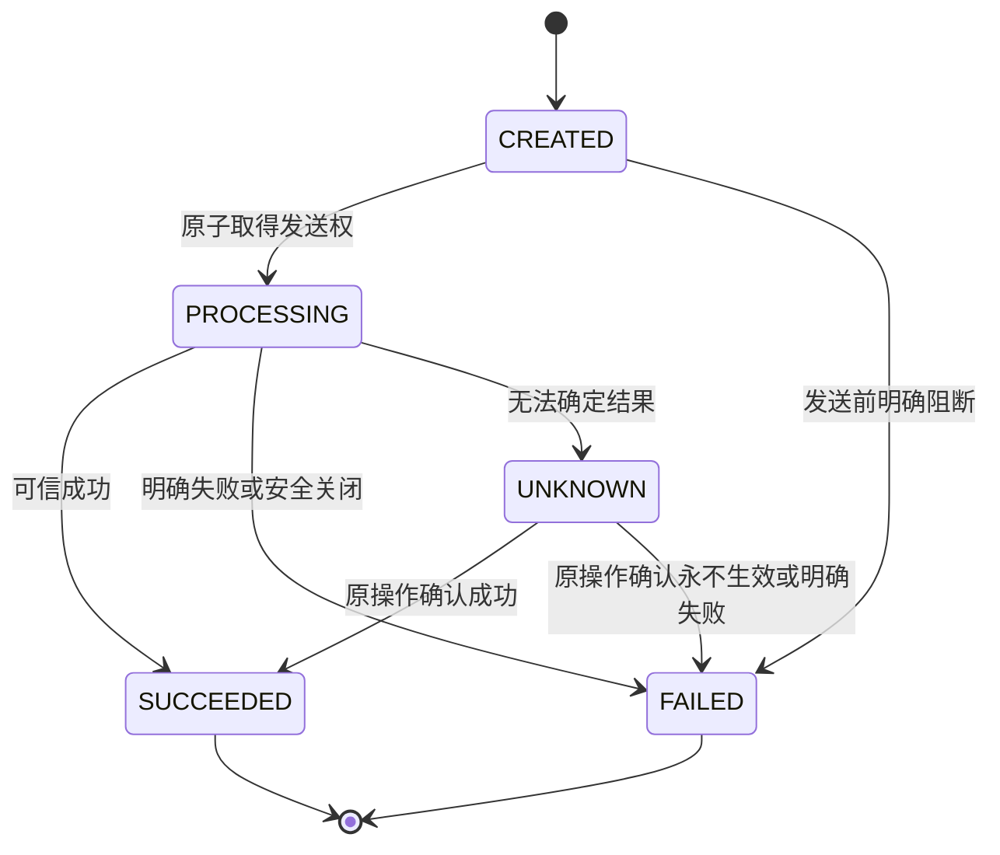

# Execution 状态与 Channel 恢复修订

> **Action Flow 后继：** [CARD + PAY 修订](./card-pay-action-flow-amendment.md)统一自有动作 PAY_RISK / PAY 名称、四状态（删除 Action.CREATED）、条件对象和执行位切换；AUTHORIZE 成功结束本次 Flow，Capture 为独立入口。前序 RISK_CHECK / SALE 表述按该范围被取代。

> **字段维护后继：** [整批精简修订](./execution-field-simplification-amendment.md)已取代本文受影响的字段、渠道绑定位置、认证明细、Pricing Fact 与状态历史表要求。本文旧接口/流程细节保留为迁移前基线；后续 Java/HTTP/MQ 改造须逐项对齐，数据库执行状态只见当前台账。

> **风控 Action 后继：** 用户已确认[内部风控修订](./internal-risk-action-amendment.md)：新增 RISK_CHECK，两个风控字段从 Attempt 移至该 Action；风险步骤由 Risk 恢复，渠道步骤仍由 Channel 恢复。Action 的执行状态与渠道字段必填条件按类型解释。下述规模清单对应前序状态修订，后继增量另计；Payment 删除 limit_reservation_group_id 及 Risk 原关联规则见[限额修订](./risk-limit-correlation-amendment.md)。

本次设计涉及 Payment 及 Commerce 的消费合同；不新增 HTTP 路由或表，调整 3 张主表的状态/字段语义：Attempt 新增 1 字段、重命名 1 字段，Action 删除 1 字段及其 1 个索引；另调整 4 处状态/类型列说明。业务与注册 DML、页面均为 0。

方向已由[2026-09-14 决定](../../../agent-docs/decisions/2026-09-14-payment-action-state-and-channel-recovery.md)确认。本稿将讨论收敛为可评审的设计合同；代码、正式模型、SQL 与数据库的实际状态只见[当前台账](../../../agent-docs/CURRENT_IMPLEMENTATION.md#payment-execution-implementation)。

## 1. 取代范围与不变量

本稿取代前序 [状态与恢复](./state-and-recovery.md)、[数据方案](./data-design.md)、[接口合同](./api-contract.md)、[工具 Token 修订](./instrument-token-amendment.md)中以下语义：payment_goal；三张主表的枚举与投影；QUERY 业务 Action 及 target_payment_action_id；Execution 自行决定渠道查询/重发；仅授权成功即 Attempt 成功的第一版 Excel 方案。

来源订单、Client/OE/币种金额冻结、交易级 Token、独立 Processor、Card 原值边界、禁止 Payment 回调 Commerce、事务外调用、全额 Capture、Void/Reversal、退款预占、首笔收款唯一及历史重复扣款处置保持有效。Wallet/Crypto 仅作为扩展设计，不能据此启用真实能力。

## 2. capture mode

| 模式 | 目标 | 路径与约束 |
|---|---|---|
| AUTOMATIC | Payment 自动完成收款 | 当前 Card 优先 SALE；未来只有路由证明完整能力且方式流程支持时，才可采用 AUTHORIZE → 自动 CAPTURE |
| MANUAL | 先授权，由上游明确决定 Capture 时机 | AUTHORIZE 成功后等待；上游 Capture 沿同一 Attempt 和原授权执行 |

`captureMode` 请求必填，无默认值，稳定 code 为 AUTOMATIC/MANUAL；Attempt 上受理后不可修改。方式不支持某模式时明确拒绝，不降级成另一模式。Routing 按精确方式、capture mode、认证要求与后续能力筛选；Action 冻结路由后，认证后资金操作和原操作恢复不得重新路由。

## 3. 三表状态与指针

| 对象 | 状态 | 准确含义 |
|---|---|---|
| Intent | OPEN / SUCCEEDED / CANCELLED / EXPIRED | 收款目标未结束 / 首次全额收款 / 安全取消或授权已释放 / 到期且安全结束 |
| Attempt | PROCESSING / SUCCEEDED / FAILED / CANCELLED | 一次支付尚未结束 / 实际收款 / 明确失败且无残留授权资金风险 / 安全终止或成功 Void |
| Action | CREATED / PROCESSING / UNKNOWN / SUCCEEDED / FAILED | 已建立未取得发送权 / 已取得发送权并处理或等待 / 结果不明 / 该操作成功 / 该操作明确失败或安全关闭 |

正常 Attempt 流程为 `开始 → PROCESSING → SUCCEEDED/FAILED/CANCELLED`。3DS、Wallet 交互、等待手动 Capture 和资金未知均保持 PROCESSING。`AUTHORIZE SUCCEEDED` 只更新已确认授权金额；原授权、Capture 或 Void 未结束时不能释放 Intent 占用。Capture/Void 明确失败后 Attempt 保持 PROCESSING，沿原授权处理；已决定 Void 后，即使 Void 失败也不得再创建 Capture。

Action 正常转换：

原 AUTHENTICATE 为 UNKNOWN，Channel 可信确认原认证仍在等待且原操作身份、期限均有效时，可回到 PROCESSING 并提供当次交互；此特例不允许资金未知重置为未发送。重复结果不新增状态转换；迟到等待/失败不覆盖成功。原窄范围重复收款纠正保持独立：存在 canonical 收款后，旧失败 Action 的真实额外扣款由专用处置转为 SUCCEEDED，Attempt 转 SUCCEEDED、建立 Duplicate Case，保留 canonical 指针且不再次发布 PaymentSucceeded；不开放通用失败重试转换。

### 3.1 两层占位

- `Intent.active_attempt_id`：当前仍占用该收款目标的支付尝试。
- `Attempt.active_action_id`：该 Attempt 当前唯一未终结业务 Action；CREATED、PROCESSING、UNKNOWN 均占位。
- `Intent.successful_attempt_id`：首次实际收款的 canonical Attempt；仅授权不能设置。

创建 Action、设置 active_action_id 与登记恢复任务同事务；同一资源的所有创建入口通过现有资源锁及本地行锁/CAS 协调，检查 Action 归属，不能先无锁读空再插入。指针是持久化占位事实，本身不代替并发控制。

应用可信终态时，仅在指针仍指向原 Action 的条件下清空或切换下一 Action；迟到回调不能清掉下一动作。原 Action 行永久保留。业务状态、金额、指针与续跑任务在同一事务提交，外部调用均在事务外；不能只依赖内存回调继续下一步。

手动授权成功时 active_action_id=NULL，但 active_attempt_id 保留。空 Action 指针仅允许按业务规则选择下一动作，不允许新 Attempt、第二次授权或 Sale。全额 Capture 成功才同时完成 Attempt/Intent 并释放两层占位；Void 成功安全取消并释放占位。

已收款后的普通 Refund 及 Duplicate Case 补偿继续使用既有退款/Case 父级和各自并发规则，不借用已经完成的 Attempt 占位。

### 3.2 交互与认证

AUTHENTICATE 表示整个认证过程。取得 3DS 表单只进入/保持 PROCESSING，可信认证满足冻结要求后才 SUCCEEDED；不能把“创建挑战”当成“认证通过”。认证成功后，代码流程根据 mode 和已冻结能力选择 SALE 或 AUTHORIZE。

删除 REQUIRES_ACTION 枚举不删除交互事实。Action 保留 `interaction_type / interaction_expires_at / channel_operation_ref`；认证结论及证明期限仍保留。nextAction 为当次可信结果或只读交互接口返回的瞬时指令；历史 interaction_type 非空不证明当前仍需挑战。缺少瞬时卡材料时仍可返回 PROVIDE_CARD_INPUT，Attempt 保持 PROCESSING，不新增空壳业务 Action。

Wallet 直接付款对应 SALE；跳转、扫码、SDK 在原 SALE 的 PROCESSING 阶段提供交互，可信付款结果后原 SALE 成功。不为 Wallet 人造 AUTHENTICATE 或卡 3DS。浏览器返回、关闭窗口或链接过期都不能直接判定资金成功/失败。

## 4. Channel 原操作恢复

ActionType 只保留 `AUTHENTICATE / AUTHORIZE / CAPTURE / SALE / VOID / REFUND`。没有 QUERY 业务动作，也没有 QUERY 对执行占位的例外。

| 层 | 职责 |
|---|---|
| Execution 与方式流程 | 选择业务动作、核验合法性、冻结身份与路由、应用结果、推进后继业务动作 |
| Channel 标准能力 | 同一业务动作安全幂等重入；返回原动作的 PROCESSING/UNKNOWN/SUCCEEDED/FAILED 与适用交互/资金事实 |
| 具体渠道适配 | 按渠道特性发送、识别重复响应、查询原请求、决定安全重发与等待；通信证据归 Channel |
| 服务级可靠任务 | 按原 Action 身份唤醒，再次调用同一个标准业务能力；复用既有补偿机制，不新增工作流表 |

以 `Channel.authorize(原 Action)` 为例，首次可能发起外部授权；超时后返回 UNKNOWN；下次标准接口调用可先查询、在证明安全时同 key 重发，或继续保持 UNKNOWN。Execution 不指定“本次查询”或记录查询成功 Action。

标准接口可重复调用是接入合同，不能推定所有外部协议都允许重复资金请求。原 Action ID、channel_idempotency_key、金额/币种、工具身份、Channel/Account/MID 及认证/原交易引用保持不变。适配层按真实幂等期限和恢复能力决定行为，不固定每次先重发再等重复错误；重复错误、单次 NOT_FOUND、超时、重试次数耗尽均不能伪装为确定资金结果。无法安全推进时保留 UNKNOWN 和占位，转既有告警/人工处置。

同一 Action 的并发恢复调用必须串行协调，不能因“标准接口可重入”而同时发送两个外部资金请求。可靠任务只保存原资源身份，重读稳定事实；不能重放或持久化 CVV。触及原始卡数据的适配仍留在 Card 受控边界。Channel 不读写 Execution DataObject/Repository，只通过公开合同返回归一化结果，由 Execution 落自己的状态与资金事实。

查询/通信可记录到既有 `t_channel_interaction` 并关联原业务 Action。该表记录技术通信，不拥有第二套授权/收款业务结果。删除 QUERY Action 不删除 Payment 自有 GET 查询接口；GET 只读本地事实及只读交互，不能调用可能发送资金的标准执行接口。

## 5. 字段与接口改造清单

### 5.1 数据目标（尚无执行 SQL）

| 表 | 调整 | 类型 / 默认 | 索引与约束 |
|---|---|---|---|
| t_payment_intent | intent_status 改为 4 个状态的应用枚举 | VARCHAR(64) 结构保留 | 原来源、active/success 唯一索引保留 |
| t_payment_attempt | payment_goal 重命名 capture_mode | VARCHAR(32)；历史兼容可空，新受理必填，无业务默认 | 同提交及 Token 唯一约束保留 |
| t_payment_attempt | 新增 active_action_id | BIGINT NULL，无业务默认 | 由父资源锁/CAS 与 Action 同父级校验维护；无新增索引消费需求，不再叠加 active_slot |
| t_payment_attempt | attempt_status 改为 4 个状态的应用枚举 | VARCHAR(64) 结构保留 | version/CAS 保留 |
| t_payment_action | 删除 target_payment_action_id | 删除字段 | 删除 idx_pay_action_target_action |
| t_payment_action | action_type 去 QUERY；action_status 合并为 5 个 | 原 VARCHAR(64) 结构保留 | 父级动作序号及渠道 key 唯一索引保留 |

不改 `authentication_action_id` 和 `target_channel_txn_ref_id`：前者证明资金动作所用认证，后者指成功授权或原收款交易，供 Capture/Void/Refund 使用。authorized_amount 与 captured_amount 保留累计确认语义；成功 Void 不把历史 authorized_amount 清零，可用授权需结合 Void 和未决动作判断。

### 5.2 HTTP 与内部消费合同

既有 12 条 Execution HTTP 路由与工具接口路径保持；没有新增或删除路由。直接请求结构变化发生在 EX-I05：`paymentGoal` 改 `captureMode`，必填 code 为 AUTOMATIC/MANUAL；其余受影响字段由共享响应模型传播到各返回该模型的接口。

- SubmissionView：`paymentGoal` 改 `captureMode`；status 使用新 Attempt 枚举，增加可空 `activeActionId`；既有 `actionId` 保留为本次观察的业务动作定位，可在手动授权结束后仍指向已成功 AUTHORIZE。两者不能混为一谈。
- IntentView：status 使用新 Intent 枚举；`newAttemptsAllowed` 仍是本地门禁投影，不能仅依据 OPEN。
- ActionView：status/type 使用新目录；删除只为 QUERY 关联的 target_payment_action_id 投影，原授权和原收款的业务定位不受影响。
- GET 接口保留只读语义。上游读取 Attempt PROCESSING 时，可结合 activeActionId、ActionView、授权/收款金额及 nextAction 展示当前阶段。
- 已受理仍需自动执行、等待交互或结果未知时返回 202。MANUAL 原授权已明确完成、仅等待未来业务 Capture 命令时可返回 200，但 Attempt 仍 PROCESSING；HTTP 200 不表示已收款。GET 始终 200 返回观察事实。
- 上游确认付款成功须读 Intent/实际收款结果；仅授权不发布 PaymentSucceeded。Finance 原收款事件触发条件保持，Commerce 需适配字段、状态及手动 Capture 的就绪判定。

mode 参与不可变命令内容和 Hash；不能把旧 PAY_V1 的 Hash 字段名原地替换。新写采用新的本地命令合同版本，历史命令保留其原字段序列和解释；具体兼容映射、旧 Writer 下线及启用顺序在实施包中逐项核验，不把历史 PAY_NOW/旧 HASH 字节静默重解释为新请求。新合同启用后，缺失 captureMode 或只传旧 paymentGoal 的新请求按严格字段校验拒绝。

## 6. 场景与验收

可筛选逐步数据见 [Payment Excel](../../../paytech/payment/docs/payment-execution-state-scenarios.xlsx)。它是合成场景附件，不是数据库导出；后继风险 Action、评估恢复和工具切换场景按[内部风控修订](./internal-risk-action-amendment.md)解释。附件当前规模与核验证据见[台账](../../../agent-docs/CURRENT_IMPLEMENTATION.md#payment-execution-implementation)，Wallet 仍为未来能力示例。

| 编号 | 必须验证的行为 |
|---|---|
| SCR-01 | AUTOMATIC/MANUAL 不可变；不支持模式拒绝，路由不静默降级 |
| SCR-02 | 有/无 3DS 的 Sale 和 Authorize+Capture；拿到表单不等于认证成功 |
| SCR-03 | MANUAL 授权成功：Attempt PROCESSING、active_action_id=NULL、Intent 占用保留 |
| SCR-04 | 创建和占位原子；两并发资金命令最多创建一个符合条件的活动 Action |
| SCR-05 | PROCESSING/UNKNOWN 恢复仍用同 Action；不存在 QUERY 业务行，Channel 可选择查询/安全重发 |
| SCR-06 | 重复响应、NOT_FOUND、调度耗尽不伪装资金结果；未知占位不释放 |
| SCR-07 | 终态清理核对原指针；迟到结果不清下一 Action、不降级成功、不重复发布收款事实 |
| SCR-08 | Capture 失败保留授权与 Attempt PROCESSING；Void 成功取消，Void 失败后不恢复 Capture 资格 |
| SCR-09 | 前一 Action 成功与续跑任务同事务，提交后进程退出仍能继续且不重复创建下一动作 |
| SCR-10 | Wallet 直接/跳转/扫码/SDK；浏览器返回、关闭、交互过期不代替可信资金结果 |
| SCR-11 | GET 不触发资金恢复，Channel 不直接写 Execution 表，事务内无外部调用 |
| SCR-12 | 历史查询行/旧状态/旧 Hash 隔离；重复付款按既有 Case 处理且保留 canonical 收款 |

## 7. 实施与历史边界

当前交付是确认方向的设计收敛和 Excel 更新。Java、PDManer、正式 Schema、迁移 SQL、API 示例 JSON 和旧测试证据仍是前序实现工件，不由这次文档更新自动迁移。

实施顺序：先核对旧 Writer、幂等/在途数据与消费方；完成新字段及接口/Hash 兼容设计和人工 SQL；改通用 Action 接续/占位与 Channel 标准重入合同；改 Card Flow 与合成 Channel、状态/并发测试；再同步 Commerce 消费和模型。真实 Channel、Wallet/Crypto 仍需对应能力接入，不由 Mock 通过推导上线可用。

有历史数据时不得直接批量替换状态或删 QUERY 证据：旧 AUTHORIZED 映射 PROCESSING，VOIDED 映射 CANCELLED，CONFLICTED 要结合真实收款及 Duplicate Case；Intent 旧 FAILED 按原原因核对。旧 REQUIRES_ACTION 映射 PROCESSING 之前须保留交互事实。存在多个未终结非 QUERY 动作时必须核对，不能猜测 active_action_id。旧查询证据保留于受控历史读取/归档，完成消费者迁移后才允许删除字段；SQL 应用、提交与部署仍按其各自授权处理。
