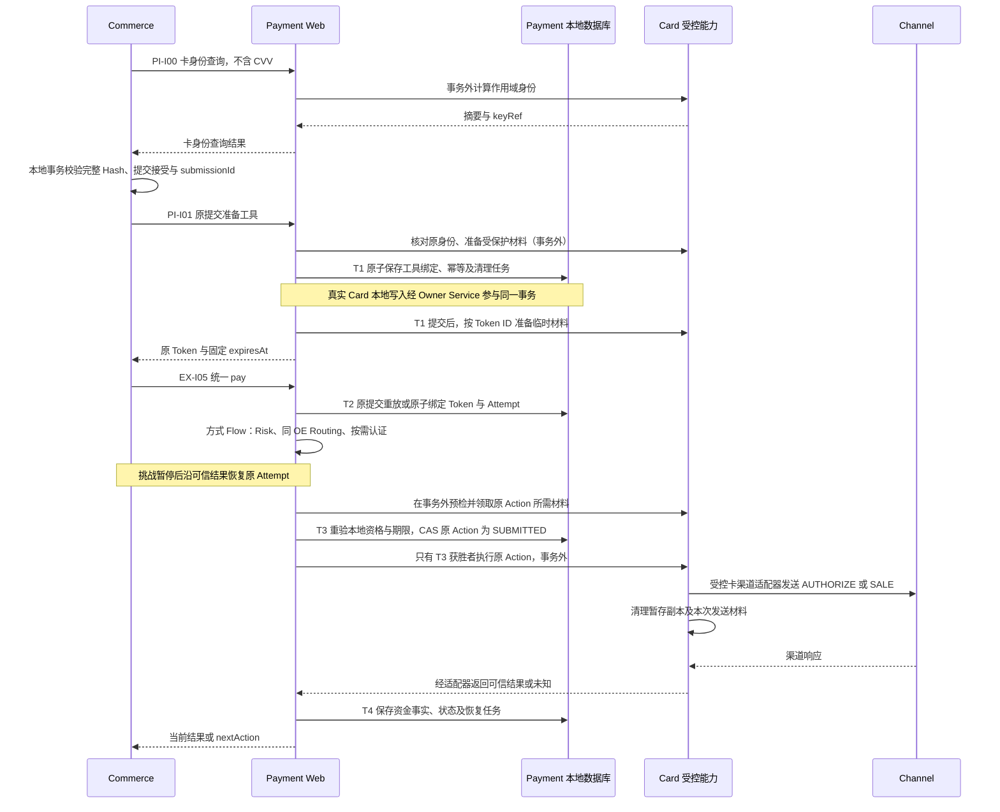

# 交易级支付工具 Token 与统一 Pay 修订

> **2026-09-16 申请工具后继：** 当前入口使用用户指定的 `applyCardInstrument`，Processor、精简请求、原工具重放与 Card Mock 范围见[工具申请修订](./apply-card-instrument-amendment.md)。下文旧准备接口和命令机制按该稿的准确范围取代，真实 Card 能力仍未接入。

> **2026-09-15 删除来源 Binding：** 用户已确认删除 `t_payment_intent_binding` 和 EX-I03 `CloseCreation`，按已有 Intent 终止；创建结果未明确时由 Commerce 用原键恢复创建后再终止。本文涉及提前关闭、Binding 门禁和锁顺序的内容由[字段修订第 8 节](./execution-field-simplification-amendment.md#8-删除来源-binding)取代；其余历史基线保持。

> **Pay 受理后继：** 现行精简请求与幂等投影见[字段修订第 7 节](./execution-field-simplification-amendment.md#7-pay-受理链合同)。本次只处理受理链，后续方式流程保持 TODO。

> **字段维护后继：** [整批精简修订](./execution-field-simplification-amendment.md)已取代本文受影响的字段、渠道绑定位置、认证明细、Pricing Fact 与状态历史表要求。本文旧接口/流程细节保留为迁移前基线；后续 Java/HTTP/MQ 改造须逐项对齐，数据库执行状态只见当前台账。

> **状态与 Channel 恢复后继：** capture mode、三表 4/4/5 状态、active_action_id 及移除 QUERY 的现行设计目标以[状态与恢复修订](./execution-state-channel-recovery-amendment.md)为准；下文受影响内容保留为前序基线，未涉及合同继续有效。实现与 SQL 状态只见[当前台账](../../../agent-docs/CURRENT_IMPLEMENTATION.md#payment-execution-implementation)。

> **调用方向补充：** Payment 不调用 Commerce；上游核验订单及接受事实后传入。创建时新增国家并冻结的边界见[2026-09-14 修订](./payment-commerce-direction-amendment.md)。

2026-09-13。用户已确认本修订并授权 Payment Execution 与依赖 Mock 研发；本文是交易级工具合同的现行权威。SQL 执行、Commerce 代码及真实 Card 接入仍按独立范围确认。当前实现、数据库与验证状态只见[台账](../../../agent-docs/CURRENT_IMPLEMENTATION.md#payment-execution-implementation)。

**本次方案涉及 Payment、Commerce 两个系统：Payment 新增 3 个 Method/Path（卡身份查询、工具准备、替换旧入口的 pay），停用 1 个旧路径；Commerce 调整 2 个既有接口。Payment 新增 1 表 12 字段，Attempt 增 1 列、删 1 列，删除旧 Instrument 表 9 字段；新增 3 个二级唯一索引、删除旧表 1 个二级唯一索引，主键新增/删除各 1。DML、公共路由注册和新页面均为 0。** Card 的真实存储、CVV 暂存介质及渠道适配仍为 Mock + TODO，不计入本期物理增量。

## 1. 已确认决定与取代范围

- Commerce 公开 `payments` 入口保持；上游支付命令统一使用基本信息、精确 `paymentMethodCode` 和交易级 `paymentInstrumentToken`。准备输入按支付方式区分。
- Token 绑定 Client、Intent、原 Commerce submissionId 及支付方式；一个 Token 对应零或一个 Attempt。一个 Intent 的新尝试使用新的来源提交和 Token。
- 新增 `t_payment_instrument_token`，Attempt 直接关联它；移除 `t_payment_instrument`，不新增 Submission 表、会话表、会话 ID 或会话状态机。
- Token 期限是使用上限。Card 临时材料直接按 Token 内部 ID 关联，可提前清理；Token 有效不等于材料一定存在。Token 记录不随 CVV 一起清理。
- Execution 决定 AUTHORIZE/SALE 并拥有原 Action；Card 拥有受控用卡；携带原始卡数据的渠道适配代码位于 Card 受控范围，普通 Channel 适配器不接收 PAN/CVV。
- 本期研发目标仍以 Execution 为主，其他 Owner 用测试侧有状态 Mock。真实 Card、Wallet、Crypto、渠道和生产 CVV 暂存不在本次研发范围。

本文拥有上述修订的唯一详细合同，窄范围取代本目录旧稿中的 `submitCard/card-payments`、`cardReference/cardUseSessionRef`、保留 Instrument、Card 瞬时输入恢复和 Commerce 端口映射。旧 API 样例、旧 DDL 和开发证据保留为前一版基线，不能用于验证本次修订。金额、退款、成功唯一性、原渠道恢复及其余接口继续服从[原详细设计](./design.md)。

[Commerce 入口后继](../../../paytech/acquiring/docs/requirements/20260912-customer-checkout/commerce-entry-amendment.md)继续拥有 Web → Commerce 的入口及法律接受事实；本稿只修订其 Payment 调用和支付方式合同。[旧 Card 数据稿](../../20260912/payment-自建CardVault/data-design.md)的加密与审计规则在未被取代处保留；其独立 Payment Submission、Card Token 及请求内材料传递方案不能机械复制到新模型。真正 Card 落库时需按来源提交及本稿工具引用重做窄映射，不在 Execution 模拟切片创建那些候选表。

## 2. 对外 API 与 Processor

以下都是目标合同，省略应用上下文 `/payment`。PI 接口仅对受信 Commerce 开放，不能注册公共 Gateway；浏览器继续只调用 Commerce。每个 HTTP 接口对应独立 Processor，REST DTO/Converter 不进入 Execution。

| 编号 | Method + Path | Processor / 用途 | 处置 |
|---|---|---|---|
| PI-I00 | POST `/payment-instrument/v1/card-identities` | `ResolveCardIdentityProcessor`；只读规范化并计算作用域卡身份，无 CVV | 将 Commerce 既有 `fingerprint` 端口明确为内部 HTTP 合同 |
| PI-I01 | POST `/payment-instrument/v1/card-tokens` | `PrepareCardInstrumentProcessor`；为原提交准备工具、返回统一 Token | 新增；Card 依赖本期 Mock |
| EX-I05 | POST `/payment-execution/v1/intents/{intentId}/pay` | `PayProcessor`；受理原提交并选择精确方式 Flow | 替换 `submitCard` 与 `/card-payments` |
| EX-I06 | GET `/payment-execution/v1/intents/{intentId}/submissions/{sourceSubmissionId}` | 复用 `GetPaymentSubmissionProcessor` | 路径与支付结果字段保留，调整工具描述来源 |

PI-I00 是现有幂等消费者所需的卡身份查询，不是新的业务登记步骤。最初会话图只画了准备、pay、结果查询；直接删掉原 fingerprint 会削弱“Commerce 已受理但 Payment 尚未绑定卡时，同键换卡仍拒绝”的保证，因此本稿保留它。以后若合并这次调用，必须同时证明提交身份和完整参数绑定，不先加登记表或省略校验。

PI-I00 不产生业务状态，不要求 Idempotency-Key。PI-I01 固定 `Idempotency-Key: instrument:<sourceSubmissionId>`；EX-I05 固定 `submission:<sourceSubmissionId>`。请求 ID、鉴权、Client 资源归属、字符串 ID/时间、严格未知字段、RFC 9457 错误与 no-store 沿用[公共约定](./api-contract.md#1-统一约定)。所有 Card API、内部出站和失败路径只记录元数据，Token、卡身份摘要、卡输入不进入路径、普通日志、MQ 或通用错误明细。

| 用例 | Execution / Web 表影响 | Card 边界 |
|---|---|---|
| PI-I00 | 只读 Intent 归属；无 Token、Attempt 或资金写入 | 只读卡身份计算；真实敏感访问审计按 Card 专项接入 |
| PI-I01 | 写 Token、Command Idempotency、Compensation Event；读 Intent 及已有 Attempt/Action 门禁 | Card 本地记录经 Owner Service 参与本库短事务；临时材料在提交后准备。本期不创建真实 Card 表 |
| EX-I05 | 读 Token；写 Attempt 绑定及原有 Intent/Action/状态/资金引用/额度/定价/补偿事实；不写旧 Instrument | 仅受控卡适配器取用必要材料，Execution 不接 PAN/CVV |
| EX-I06 | 只读原 Attempt/Action/Token 及资金事实 | 经只读 Owner 能力取获准描述；材料消失不影响资金结果 |
| EX-I04/10 | 基于已有 Intent 的资金事实终止或撤销；终止成功时在本地事务撤销 Token、登记清理任务 | EX-I03 已移除；PENDING 不等于关闭成功，原资金仍需确认 |

Token 的业务校验与写入由 Execution 的 `PaymentInstrumentService + Impl` 拥有；Web Processor 组织该 Service 与 Card 的协作。Card 的 API DTO 使用专用受控命名空间；通用 Execution API/应用命令不增加 card/PAN/CVV 字段。

### 2.1 卡身份查询与工具准备

| 模型 | 字段与限制 |
|---|---|
| `ResolveCardIdentityRequest` | 必填 `clientId, checkoutSessionId, intentId, consumerContractId, paymentMethodCode, cardIdentity`；可选 `identityKeyRef`，仅从原命令冻结的安全快照取得。ID 为正十进制 String，code ≤64 字符，keyRef 为非秘密不透明标识、≤128 ASCII 字符 |
| `cardIdentity` | `pan` 为 12–19 位数字；`expiryMonth` 为 01–12；`expiryYear` 为 4 位年份；`cardholderName` 非空、≤128 字符、无控制字符。进一步规范化、有效期和方法一致性归 Card。没有 CVV |
| `ResolveCardIdentityResponse` | `cardIdentityDigest` 为 64 位小写十六进制作用域 HMAC，`identityKeyRef` 标明本次实际使用的非秘密密钥身份；不返回 PAN |
| `PrepareCardInstrumentRequest` | 必填 `clientId, intentId, sourceSubmissionId, checkoutSessionId, consumerContractId, paymentMethodCode, sourceExpiresAt, cardIdentityDigest, identityKeyRef, allowPreparation, card`。`sourceExpiresAt` 为原 Commerce 回执的 UTC RFC 3339 时间，不得在重试延长；`allowPreparation` 为无默认值的 boolean |
| `card` | 包含上述 cardIdentity 四字段及 `cvv`（3–4 位数字）；只在受控入口到 Card 的链路中出现，不进入 Execution 应用模型、Hash 或业务表 |
| `PrepareCardInstrumentResponse` | `paymentInstrumentToken, paymentMethodCode, expiresAt`；Token ≤64 ASCII 字符，期限为 UTC RFC 3339 String。初次返回前应已准备好所需材料；重放返回原绑定和原期限，不保证材料仍然存在或当前可以支付 |

Card 身份 HMAC 的受限规范投影为 `{purpose:"CHECKOUT_CARD_IDENTITY",clientId,checkoutSessionId,intentId,consumerContractId,paymentMethodCode,cardIdentity:{pan,expiryMonth,expiryYear,cardholderName}}`。使用 Card 管理的密钥与 Foundation 规范 JSON，原值只在 Card 内参与计算，CVV 永不入摘要。没有原 keyRef 时由 Card 选择当前可用密钥；原命令明确给出 keyRef 时必须使用该准确版本，不得静默换成新密钥。密钥轮换及保留由真实 Card 接入验证，本期只测试合成 keyRef 与稳定身份。

PI-I01 必须由 Card 重新核对当前输入、上述摘要及 keyRef，不能只相信 Commerce 传来的摘要。相同来源提交的同内容重试返回原 Token；改卡、改方式、改归属、改原期限均冲突。`allowPreparation=false` 只校验并返回已有绑定，不建 Token、不补材料、不续期；它与 pay 的 allowExecution 一样，只能收窄资格，不能覆盖 Payment 自身关闭规则。

同一 Token 不提供任意修改或续期 API。材料丢失后的补输入沿 PI-I01 完成：先核对原卡身份，且 Token 未过期、未撤销、当前允许准备、原首次资金 Action 尚未提交。材料原子补齐而非覆盖另一执行者已领取的材料；绑定、工具和期限全部保持。资金已提交、UNKNOWN、已授权或已收款时仅重放原身份，不重新保存 CVV。

### 2.2 统一 pay、查询与错误

pay 保留原 SubmitCard 的 `clientId, sourceSubmissionId, paymentMethodCode, paymentGoal, consumerContractId, consumerTermsAcceptanceId, refundPolicyAcceptanceId, privacyNoticeAcceptanceId, acceptanceCompletedAt, orderVersion, allowExecution`；以 `paymentInstrumentToken` 替换 `cardReference`，删除 `cardUseSessionRef`。所有字段必填且无业务默认值；长度、格式和支付目标按[原字段合同](./api-contract.md#3-命令字段)。金额、币种和 OE 从原 Intent 取得，不允许利用 Token 更换。原 Token 解析为内部 ID 后，才进入通用应用命令和方式 Flow。

200/202 以及 SubmissionView、nextAction 保持原含义；AUTHORIZED 不是收款成功。查询不需要 Token，Token 过期或临时材料消失不妨碍读取原事实。仅准备了 Token、还没有 Attempt 时，EX-I06 仍返回 NOT_FOUND；该观察不证明在途 pay 不会随后受理。GET 不自动创建 Attempt、不重填 CVV、不发起资金请求；原 3DS 指令仍可按既有只读能力即时取得。

| 情况 | 行为 |
|---|---|
| 请求格式/字段不合法 | 400，既有统一校验错误；不回显原输入 |
| 跨 Client/Intent/提交或 Token 不存在 | 404；不得通过错误区别泄露其他资源 |
| 同键异参、Token 绑定另一 Attempt、已冻结方式不符 | 409；保留原事实 |
| Token 过期或撤销，且要进行新的首次受理/发送 | 候选业务码 `PAYMENT_INSTRUMENT_EXPIRED` / `PAYMENT_INSTRUMENT_REVOKED`，409；不制造渠道拒付事实 |
| Token 有效但材料缺失，尚未发送资金 | 原 Attempt 返回 `PROVIDE_CARD_INPUT`；不新增 Attempt。仅工具准备失败、尚无 Attempt 时返回准备错误，不伪造支付状态 |
| Card/KMS/暂存设施不可用 | 503；已提交的绑定保持，可用原键重试，不解释为支付失败 |
| 已有原提交的只读重放 | 先核对稳定身份，返回原支付事实；不能因 Token 到期拒绝历史查询，也不补材料 |

已受理的 Attempt 在发送前遭遇到期/撤销时按第 6 节收敛原状态，不能用一个 HTTP 409 代替必要的业务状态写入。执行过程中 UNKNOWN 继续用原 202/查询合同。

## 3. Commerce 幂等衔接与 Handler

当前证据：[原 Card 端口](../../../paytech/acquiring/paytech-acquiring-core/src/main/java/com/paytech/acquiring/domainservice/port/customer/CheckoutCardPaymentPort.java)、[提交 Processor](../../../paytech/acquiring/paytech-acquiring-core/src/main/java/com/paytech/acquiring/service/processor/customer/SubmitCustomerPaymentProcessor.java)、[本地受理 Service](../../../paytech/acquiring/paytech-acquiring-core/src/main/java/com/paytech/acquiring/domainservice/service/customer/impl/CheckoutSubmissionServiceImpl.java)。现有 submissionId 是本地命令 ID，在接受事实提交时产生，不应在 Payment 准备阶段猜造。

新调用次序：

1. Commerce 先查原浏览器键及其 Hash 版本。按当前或原冻结 keyRef 调 PI-I00，校验卡身份；未获得身份时不做首次本地受理。
2. 在一个本地短事务中认领原命令、核对完整参数身份、提交三份接受及网络证据，取得稳定 sourceSubmissionId。沿用既有命令表、接受记录和查询任务，不增加提交登记表。
3. `CardPaymentHandler.beforePay` 在事务外调用 PI-I01，传刚提交的原身份、固定期限及当前资格，取得工具 Token。
4. 共享支付调用使用 EX-I05；Handler 不复制 pay 的发送逻辑，也不决定 Risk、Routing、3DS 或资金动作。
5. `afterPay` 处理当前响应；支付中、需交互、未知和失败都可能进入。Commerce PAID 仍只来自权威 PaymentSucceeded 事实。

公开 POST `/customer-gateway-api/v1/checkouts/{checkoutToken}/payments` 新增必填 `paymentMethodCode`，仍接 card 和 legalConfirmation；卡输入的现有格式约束保持。此方法与公开 GET `/customer-gateway-api/v1/checkouts/{checkoutToken}/payment-submissions/{submissionId}` 的共享响应新增 `paymentMethodCode`：新提交必填，历史无法证明时为空，不能从 last4 猜测。新字段应在原安全回执中冻结，使 Payment 尚不可用时也能投影真实选择。Token、identityKeyRef 与卡身份摘要不返回浏览器。

Commerce Hash 新投影版本采用 `{paymentMethodCode,contractId,confirmed,cardFingerprint}`，其中 cardFingerprint 来自 PI-I00；仍由 Commerce 用 Foundation 规范 JSON 后 SHA-256。CVV、随机 Token、网络证据、当前 allowExecution、当前 orderVersion 不进入此 Hash。沿用同一公开幂等键空间，通过原命令已有的 Hash 版本区分新旧投影，禁止仅换 operation_type 绕开原键。

新命令的既有 request_snapshot 只增加明确的安全字段 `{paymentIntentId,paymentMethodCode,cardIdentityKeyRef}`，不增加 Commerce 表或列。真实 keyRef 是密钥身份，不是密钥。并发首次请求遇到不同密钥版本时，败者退出本地事务，按获胜命令的 keyRef 在事务外重算并比较，再重入；不能误报同卡冲突，也不能把外部 HMAC 查询搬进事务。原 Hash 永不覆盖。

先校验卡身份再重放是强制步骤：即使 Commerce 本地已完成受理、Token 已过期或支付已成功，同键换卡也必须拒绝。历史 Hash 继续走旧投影和旧适配，不能机械用新摘要重写。公开请求在接口切换时仍须携带原卡身份供原键核对，GET 则完全不需要卡。

## 4. Token 数据模型

Owner 为 Execution。Card 公开的 instrumentRef 是稳定、不具备持有即用权限的内部记录引用，不是新的 Card Token、渠道工具 Token 或 CVV 会话 ID。Card 的真实加密记录和访问审计仍归 Card，跨模块只经窄 Service 访问，不共享 DataObject 或跨模块 JOIN。

| 字段 | 类型 / 可空 | 写入与用途 |
|---|---|---|
| payment_instrument_token_id | BIGINT / 否 | Snowflake 主键，供 Attempt 及内部清理任务定位 |
| payment_instrument_token | VARCHAR(64) ascii_bin / 否 | CSPRNG 生成的不透明内部定位符；原准备命令可重放同值，不能由 PAN、订单号或顺序 ID 生成 |
| client_id | BIGINT / 否 | 从可信 Intent 核对的所属 Client |
| payment_intent_id | BIGINT / 否 | 本次工具固定关联的 Intent |
| source_submission_id | BIGINT / 否 | 已由 Commerce 本地事务提交的原命令 ID；当前只接受 Commerce 全局命令命名空间 |
| payment_method_code | VARCHAR(64) ascii_bin / 否 | 精确 Payment Method Catalog code，不是 CARD 类别或 Channel 名称 |
| instrument_type | VARCHAR(32) ascii_bin / 否 | 本期允许值：CARD。未来真实方式接入时评审目录扩展，不增加占位实现 |
| instrument_ref | VARCHAR(128) ascii_bin / 否 | 工具 Owner 返回的稳定记录引用，创建后不可变；无敏感原值或 bearer 材料 |
| expires_at | DATETIME(6) / 否 | 首次使用资格截止；UTC，创建时冻结，重试不延长 |
| revoked_at | DATETIME(6) / 是 | 主动撤销时间；只能从 NULL 变为时间，不等于取消渠道资金 |
| create_time | DATETIME(6) / 否 | 应用写入的 UTC 创建时间 |
| update_time | DATETIME(6) / 否 | 最近有效更新的 UTC 时间 |

无业务默认值；仅 revoked_at 可空。不保存 CVV、卡密文、卡描述 JSON、资金状态、会话状态或机械 version。撤销采用 `revoked_at IS NULL` 的条件写；绑定字段永不覆盖。

索引：主键；`uk_pay_token_value(payment_instrument_token)`；`uk_pay_token_scope(client_id,payment_intent_id,source_submission_id)`。当前查询与关闭扫描可用唯一索引前缀，不为不存在的全局扫描/展示消费者加索引。

Attempt 新增可空 `payment_instrument_token_id BIGINT` 和唯一索引 `uk_pay_attempt_token`；新 pay 写入必须非空且 Client、Intent、来源提交、精确方式全部一致。原 `source_submission_id` 唯一索引保留；一来源提交不能通过另一 Token 创建第二 Attempt。新目标删除 card_reference，不增加反向 attempt_id。关联仅为逻辑关系，无物理 FK/CHECK。

原 Instrument 的处置：删除整表；渠道工具引用/指纹在本期没有实际执行消费者，不迁入 Token。Card 提供获准尾号等描述，适用定价维度继续进入不可变 Pricing Fact；展示不可用不能抹除成功资金。Channel Transaction Ref 继续承接 AUTHORIZE/SALE/CAPTURE 等成功资金引用，不能拿工具 Token 代替交易引用。

Token 是受保护的内部定位符；按[内部信任修订](./trusted-internal-amendment.md)，Payment 信任内部调用方，仍逐次核对 Client、Intent、来源及工具绑定范围。为了原命令返回同值，本稿保存随机值；不将其设计为 bearer 扣款凭据。准备幂等记录与 Token 绑定共同保留，不能按短技术 TTL 删除后丢失原卡身份摘要；保留/销毁规则在真实 Card 接入前完成，不能借此默认永久保存真实 PAN。

## 5. 准备、发送与清理

期限固定为 `min(Intent.expiresAt, sourceExpiresAt, 首次创建时间 + 服务端准备窗口, 工具 Owner 支持的材料截止)`。配置没有有效值或 Owner 不能提供足够能力时不可用，不虚构固定五分钟；调用方不能自行延长。所有比较使用服务端时间，`now >= expiresAt` 即不可首次使用。若真实方式没有独立材料截止，Owner 明确采用平台窗口，而非返回无界期限。

Card 临时材料的绝对截止不得晚于 Token，直接按 Token 内部 ID 关联；不生成新的 sessionRef。若采用缓存，创建、查询、领取、删除均在 MySQL 事务外。Card 的存储、KMS、加密审计属于真实 Owner 后续实现；本期替身只表示“合成材料存在/缺失/已领取”，不存真实 CVV。

T1 的命令成功只代表“绑定已持久化”，不能冒充临时材料已准备好。进程在 T1 后崩溃，原键仍定位同 Token；带原卡输入且符合资格时可补齐，后台不能从 Token 重建 CVV。Card 真实本地写能力可参与 T1，但 KMS/缓存/渠道调用不能间接进入事务。

发送沿既有来源/Intent 资源锁、数据库唯一约束和 CAS。锁顺序为 Intent → Token → Attempt → 后续原有资源；所有写入口保持同序。Redis 协调在独立公开代理入口外围，不能以嵌套代理拼锁。材料领取绑定原 Action，不把完整 PAN/CVV返回 Execution 或普通 Channel 模块；它只产生 Card 内当次调用的控制上下文，不入表、不作为上游会话 ID。

在 T3 前领取材料并移出共享暂存，只留本次发送所需的受控内存；领取或预检失败不能把 Action 提前标成 SUBMITTED。T3 失败者丢弃材料，必要时在确认未发时补输入；T3 后任意崩溃都按可能已发送查询。若 T3 后发现材料或期限异常而不能发送，也不能在下一执行者中重新领取发送；按原发送占用保守恢复，不能把 UNKNOWN 改回 CREATED。所有控制上下文在最早可行点释放，不声称 JVM 字符串可验证地立即擦除。

Card 可能在独立认证时用到非 CVV 卡数据；这不等于可以重复领取已消费的 CVV。是否需要在认证前向渠道提交 CVV、是否支持后续无 CVV 资金动作，必须由具体适配器证明；能力不匹配时拒绝该执行路径，不默认渠道支持本图。

撤销先在本地事务写 revoked_at 并登记清理任务，提交后调用 Card 清理。Token 创建时登记有界的到期清理任务，Handler 按 expiresAt 判断重排；重排次数与退避必须覆盖配置允许的最大准备窗口，不能在尚未到期时耗尽尝试。复用既有补偿机制，不新增调度表。候选 event_type=`PAYMENT_INSTRUMENT_CLEANUP_V1`，event_key=`<clientId>:<tokenId>`，sub_event_type=`EXPIRY` 或 `REVOKED`；payload 为空。清理重入、重复唤醒和失败重试均不得触发支付。期限门禁不依赖任务准点执行，缓存写入晚到也不得延长绝对期限或越过原 Action 发送占用。

授权前暂存不是本稿对任意 Redis 配置的认可。卡组织/收单要求、加密、访问隔离、持久化/副本/备份/转储、提前清理及材料泄漏验证均由真实 Card 接入完成；仅 TTL 不能证明满足要求。规则依据为 [PCI SSC FAQ 1154](https://www.pcisecuritystandards.org/faqs/1154/)。不为 Capture、Refund 或后续交易保留 CVV。

## 6. 恢复与状态影响

Token 不新增枚举状态机；有效性由 expires_at/revoked_at 及原执行事实共同判断，材料可用性由 Card 即时查询。新的首次受理应检查 Token，但原结果重放优先于新执行门禁；身份核对不能省略。

| 场景 | 处理与不变量 |
|---|---|
| 准备响应丢失、同键重试 | 同 Token、同原期限；异卡冲突；不存在第二绑定 |
| T1 已提交、临时材料未准备或丢失 | 原身份重试补齐；不可用返回 503；不存在资金 Action 时不能返回扣款失败 |
| 同提交并发 pay | 两级唯一键与 Intent 锁只允许一个 Attempt；同原 Action 至多一个发送获胜者 |
| 3DS 等待、材料提前丢失 | 原 Attempt REQUIRES_ACTION，展示 PROVIDE_CARD_INPUT；补原卡材料后恢复原认证/原流程，不更换 Token |
| Token 到期/撤销，只有未提交资金 | 阻止首次发送；原未发送 Action FAILED（安全原因），原 Attempt 按安全终止规则 CANCELLED；Intent 尚开放且未到期时可回 REQUIRES_PAYMENT。不能因工具到期永久关闭订单 |
| 认证 UNKNOWN 或挑战尚未结束 | 保留原认证结果恢复。只有确认无已提交初始资金且认证无资金效应时，才能安全终止原尝试；不因 Token 到期直接宣布渠道失败 |
| 3DS 完成时 Token 到期 | 不发起 AUTHORIZE/SALE。旧认证不可移交新的 Token 或 Attempt |
| AUTHORIZE/SALE 已 SUBMITTED 或 UNKNOWN | 清理 CVV、继续原 Action 查询；Token 到期不释放活动支付占用、不允许新支付或补 CVV 重发 |
| 已授权，Token 到期 | 原 Capture/Void 与授权期限按原合同执行，不依赖 Token/CVV |
| 已支付，Token 到期 | 原 Refund、查询、可信晚到结果与 Pricing Fact 补齐继续处理；Token 记录保留关联 |
| 暂存设施故障、Redis 协调 Lease 失效 | 资格不足不发送；最终唯一性由数据库 CAS 保证，不能假设缓存与数据库原子提交 |

Token 到期后不续原 Token，也不为同 sourceSubmissionId 生成替代 Token。只有原 Attempt 安全结束且 Intent 仍允许新尝试，Commerce 才能按用户新的提交创建新 Token；不自动创建替代 Order。认证要求、原渠道与金额绑定继续保持。

## 7. Hash、历史与迁移

Payment 新准备 operation_type 为 `PREPARE_CARD_INSTRUMENT_V1`，按固定序列 `clientId,intentId,sourceSubmissionId,checkoutSessionId,consumerContractId,paymentMethodCode,sourceExpiresAt,cardIdentityDigest,identityKeyRef` 使用既有长度前缀 Hash 机制。allowPreparation、CVV、临时材料不入 Hash；`resource_type=PAYMENT_INSTRUMENT_TOKEN`、resource_id 指向 Token 行。生成的 Token 不进入请求 Hash。

新 pay operation_type 为 `PAY_V1`，沿旧字段序列，以解析后的 `paymentInstrumentTokenId` 替换 cardReference：`clientId,intentId,sourceSubmissionId,paymentMethodCode,paymentGoal,consumerContractId,consumerTermsAcceptanceId,refundPolicyAcceptanceId,privacyNoticeAcceptanceId,acceptanceCompletedAt,paymentInstrumentTokenId`。orderVersion 和 allowExecution 仍只影响本次资格。事务内重验解析结果，不能只信任事务前检查。

处理新旧协议前都必须先查同 Client/Intent/sourceSubmissionId 的原绑定。旧 `SUBMIT_CARD_V1` 的 Hash、旧卡引用和已存在 Action 不重写成 PAY_V1，不因 operation_type 不同再建 Attempt。旧 source 没有工具 Token 时，新 pay 拒绝执行型迁移并引导原查询/受控旧恢复；不能造一个 Token 当作已经迁移。现有 12 接口的旧样例继续只验证旧 Wire。

[空旧表候选 SQL](./db/instrument-token-empty-migration.sql)仅供评审：1 CREATE、1 ALTER（加一列/唯一索引、删一列）、1 DROP。执行前必须同步正式 PDManer、生成器及完整 Schema，停写、备份并验证恢复，确认所有相关 Execution 业务/命令/补偿记录为空、新 Token 表不存在。当前未连接数据库；前一轮“本机零行”证据不能作为本次执行前置。DML 与路由注册均为 0。

有任何旧 Attempt、Instrument、幂等键或未决任务时，本 SQL 禁止执行；本稿不提供猜值回填。应先保留旧读写/恢复入口，另行设计可空新列的兼容迁移及旧工具描述保留，排空在途后再评审移除旧结构。真实 Card 候选表未落模，不能在这份 SQL 中顺带创建或删除。

SQL 部分失败时按已执行语句停止核对，不盲目重跑。尚无新写入才能按核验的备份与旧代码回退；已有新 Token/Attempt 后须保留事实并前向修复。不得从设计确认推断建库、迁移、部署或提交权限。

## 8. 研发次序、Mock 与验收

1. 用户确认本修订后，先改 Payment 的 API、Execution Token 服务/持久化、独立 Processor、Pay Flow 输入、查询与清理 Handler；同步模型、完整 Schema、SQL、样例和架构门禁。Token/Attempt/Action 及金额规则真实实现，Card 材料由有状态测试替身模拟。
2. 为 PI-I00/PI-I01、Card 受控领取/清理、Risk/Routing/Channel 编写类型化 Owner Mock；每次外部调用断言事务不存在。生产 Owner 未配置时不可用，不添加默认成功或真实 CVV 缓存。
3. 后续再按明确范围改 Commerce 的两个公开合同、Hash 版本/原快照、Handler、内部端口及 OpenAPI。Payment 第一步测试只使用 Commerce Mock，不宣称真实跨系统链路完成。
4. 真实 Card / Channel 接入单独完成密钥、卡数据保护、临时材料和协议验证；Wallet/Crypto 按真实用例注册准备能力和 Flow，不继承强制 Card 步骤。

| 编号 | 验收场景 | 必须证明 |
|---|---|---|
| IT-V01 | 同提交并发准备、响应丢失 | 单 Token；固定到期；重放原身份 |
| IT-V02 | Commerce 受理后、Payment 准备前中断；同键换卡 | 在任何新资金效果前拒绝换卡，不依赖 Token 已创建 |
| IT-V03 | 同键换 CVV、换卡/方式/期限、旧 keyRef 重试与轮换竞争 | CVV 不入 Hash；异业务身份冲突；同卡不因轮换误判 |
| IT-V04 | 只持有 Token、跨 Client/Intent/source、方式不符 | 拒绝泄露/执行；不能用随机 Token 绕过授权 |
| IT-V05 | 两个 pay 竞争、不同 key 使用同 Token、旧新协议竞争 | 单 Attempt、原 Action 单发送；旧 source 不自动转换 |
| IT-V06 | T1 后材料写入失败、进程重启、材料提前丢失 | 原 Token 可定位；无材料不发送；后台不能补造 CVV |
| IT-V07 | 3DS 等待、完成前/后到期，认证 UNKNOWN | 期限二次检查；安全结束与未知查询严格区分 |
| IT-V08 | 领取材料后 T3 失败；T3 后发送前/后崩溃 | 失败者不发送；T3 后只查原 Action；没有二次取材重发 |
| IT-V09 | 撤销、清理失败、重复任务、晚到缓存写入 | 本地门禁先生效；清理幂等；绝对期限与发送占用不可越过 |
| IT-V10 | Token 到期后的授权 Capture/Void、支付 Refund、查询与晚到成功 | 原资金事实不丢，UNKNOWN 不释放占用，后续动作无 CVV 依赖 |
| IT-V11 | 未来方式测试替身、无匹配/重复 Flow、接口与 Processor | 非 Card 不携带卡字段、不强制 3DS；每接口独立用例入口 |
| IT-V12 | 所有外部调用、日志/Hash/DB/任务检查、Redis Lease 失效 | 事务外调用；无原始卡/CVV/临时材料泄漏；数据库保护仍有效 |
| IT-V13 | 合成卡身份 API、PI-I01、统一 pay、原查询及 Commerce HTTP | 字段/错误/方法/Hash 版本映射一致，Web 仍只调用 Commerce |

验收映射与代码导航见[研发检查](./instrument-token-development-checks.md)，实际验证范围只见当前台账。真实 Java/数据库/Redis 测试按[项目测试规范](../../../agent-docs/UNIT_TEST_GUIDE.md)执行；原 Execution 开发证据不作为新 Token 行为的验证。

## 9. 评审入口

需评审的新增技术细节是：保留并明确卡身份查询、原 keyRef 的安全快照与 Hash 版本、Card 原材料的领取/补齐规则，以及仅空旧表适用的迁移。用户已确认的 Token/Attempt 关系、统一 pay、无会话表和 Card 受控适配职责不再重新提问。

可核对[机器可读样例](./instrument-token-api-examples.json)、[候选 SQL](./db/instrument-token-empty-migration.sql)和[交付记录](./delivery.md)。下一阶段仅为 Payment Execution 研发及依赖 Mock，Commerce 代码适配、真实卡、SQL 执行与部署分别按范围确认。
