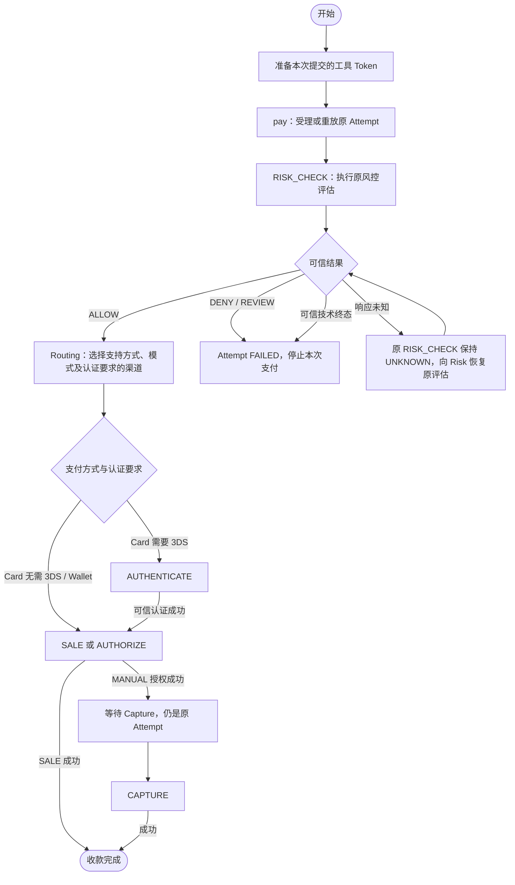

# Execution 内部风控 Action 与支付工具切换修订

> **Action Flow 后继：** [CARD + PAY 修订](./card-pay-action-flow-amendment.md)统一自有动作 PAY_RISK / PAY 名称、条件对象和执行位切换；AUTHORIZE 成功结束本次 Flow，Capture 为独立入口。前序 RISK_CHECK / SALE 表述按该范围被取代。

> **字段维护后继：** [整批精简修订](./execution-field-simplification-amendment.md)已取代本文受影响的字段、渠道绑定位置、认证明细、Pricing Fact 与状态历史表要求。本文旧接口/流程细节保留为迁移前基线；后续 Java/HTTP/MQ 改造须逐项对齐，数据库执行状态只见当前台账。

用户已确认：内部风控作为一个 Action，评估引用与结果从 Attempt 移至该 Action；Payment 删除限额占用组引用；更换工具或重新发起支付使用新 Attempt。对应[决定记录](../../../agent-docs/decisions/2026-09-14-payment-internal-risk-action.md)。本稿是设计目标，实现、验证与数据库迁移状态只见[当前台账](../../../agent-docs/CURRENT_IMPLEMENTATION.md#payment-execution-implementation)。

本稿继承[状态与 Channel 恢复修订](./execution-state-channel-recovery-amendment.md)、[限额关联修订](./risk-limit-correlation-amendment.md)和[交易级 Token 合同](./instrument-token-amendment.md)。只取代首次支付的风控步骤、两个风控字段位置及 Action 的渠道字段必填条件；此前讨论的其他字段删除、渠道坐标移至 Attempt、认证关联删除和 Pricing Fact 删除不因此获批。

## 1. 流程与职责

> 2026-10-22 修订：下图 Card 需要 3DS 时不再进入 AUTHENTICATE，而是由 PAY 携带 3DS 要求并在渠道内完成挑战，见 [Execution 3DS 修订](../../20261022/payment-3DS全链路/execution-3ds-amendment.md)。

- `RISK_CHECK` 是 Payment 记录的一次业务步骤，评估、规则和限额事实仍归 Risk。没有新的风控表、会话表或数据库流程图引擎。
- 每个新 Attempt 至多一个首次支付 `RISK_CHECK`。传输重试复用原 Action 和原评估；本期不引入 Capture/Void 二次评估，也不修改 Risk 的 `payment_attempt_id` 唯一约束。未来多个评估检查点需另行设计身份、有效期和占用关系。
- 对上游仍使用统一 `pay` 和既有查询/恢复入口，不新增公开风控操作接口。不同支付方式的代码流程消费同一风控结果，然后选择自己的认证/资金步骤；Processor 不通过调用另一个 Processor 组织流程。
- 新增 ActionType `RISK_CHECK`；其余仍为 `AUTHENTICATE / AUTHORIZE / SALE / CAPTURE / VOID / REFUND`。`QUERY` 不属于业务 Action。

## 2. 三表字段增量

| 表 / 字段 | 本次目标 | 类型、条件与用途 |
|---|---|---|
| Attempt.transaction_assessment_id | 移至 Action | `BIGINT NULL`；原评估的稳定业务引用 |
| Attempt.risk_result | 移至 Action | `VARCHAR(64) NULL`；现有归一化结果目录继续使用 |
| Attempt.limit_reservation_group_id | 删除 | 不增加替代字段；Risk 本地定位原 Group |
| Attempt.authentication_requirement | 保留 | 可信 ALLOW 落库时冻结；后续 Routing/3DS 消费；未放行时为空 |
| Attempt.active_action_id | 沿用已批准增量 | RISK_CHECK 与渠道业务 Action 共用一个执行位 |
| Action.transaction_assessment_id | 新位置 | 只允许 RISK_CHECK；取得可验证的原 Risk Assessment 身份后保存，取得前为空；普通渠道 Action 为空 |
| Action.risk_result | 新位置 | 只允许 RISK_CHECK；`ALLOW / DENY / REVIEW / FAILED / TIMED_OUT`，未获可信结论为空 |
| Action.channel_id / channel_account_id / mid_id / channel_idempotency_key | 改为结构可空 | RISK_CHECK 全部为空；所有渠道业务 Action 仍必须完整冻结四项 |
| Action.action_type | 扩展枚举 | 新增 RISK_CHECK，必须以 payment_attempt_id 为父对象 |

相对已批准的状态方案：涉及 Attempt、Action 两表；两个字段迁移位置、一个字段删除、四个字段放宽结构可空和一个类型枚举扩展。`limit_reservation_group_id` 删除已在前序修订单独计数，不重复累计。没有新增表或二级索引；一 Attempt 一次首次评估由资源锁、本地事务和现有 Action 序号约束保护。应用实施时核对对应历史索引，不机械删除其他索引。

RISK_CHECK 的 `channel_operation_ref`、资金/认证目标引用、认证结果及交互字段也全部为空。金额/币种是本次评估的冻结输入，不形成资金交易引用、Pricing Fact 或收款事件。既有 `authentication_action_id`、认证事实和资金目标引用继续用于渠道动作。

不能用临时分配的数值冒充真实 Risk 评估证据。新合同由 Risk 以原 Attempt 和请求身份幂等定位评估，返回其准确 Assessment ID；Payment 只保存已确认的引用。历史预分配 ID 按旧 Wire 处理，必须验证 Risk 关联后才能迁移。

## 3. 状态与占位

三表仍为 4 / 4 / 5 个状态，不增加 Attempt 的 UNKNOWN 或 REQUIRES_ACTION。Action.PROCESSING 统一表示已取得执行权并正在处理；实际外部执行方由 ActionType 决定。

| 原风控证据 | RISK_CHECK.status | risk_result | Attempt.status | 后继 |
|---|---|---|---|---|
| 已建行，未取得执行权 | CREATED | NULL | PROCESSING | 占位，等待执行 |
| 已取得执行权，评估未结束 | PROCESSING | NULL | PROCESSING | 占位 |
| 响应丢失、连接超时，不能确认评估结果 | UNKNOWN | NULL | PROCESSING | 保留占位，恢复原评估 |
| 可信评估允许 | SUCCEEDED | ALLOW | PROCESSING | 冻结认证要求，释放风险执行位并可靠接续 Routing |
| 可信评估拒绝 | SUCCEEDED | DENY | FAILED | 清 Action / Intent 占位，不创建渠道 Action |
| 可信评估要求内部复核 | SUCCEEDED | REVIEW | FAILED | 当前 Attempt 结束；复核不把旧结果改成 ALLOW |
| Risk 返回无业务决定、无占额的技术终态 | FAILED | FAILED / TIMED_OUT | FAILED | 安全结束当前 Attempt |

**评估完成不等于允许支付。** RISK_CHECK.SUCCEEDED 必须同时检查 `risk_result=ALLOW` 才能推进。Risk 的正式 TIMED_OUT 与 Payment 自己的网络超时不同；后者可能已经发生占额，必须保持 UNKNOWN，不能据此释放占用或允许换卡。

UNKNOWN 的恢复仍可保持 UNKNOWN，或取得可信结论后变为 SUCCEEDED/FAILED；不为查询评估另建 Action，不把 RISK_CHECK 发送给 Channel。`transaction_assessment_id` 尚未知时仍能以原 Attempt/请求身份恢复；已知后不可替换。终态风险结果不可原地改写。

## 4. 执行与恢复合同

1. 本地事务内建立/复用 RISK_CHECK，设置 `active_action_id` 并登记现有可靠任务；同一 Attempt 并发 pay 不得产生第二条风险 Action。
2. 取得原 Action 执行权并提交本地事务后，在事务外调用 Risk。输入包括原 Intent/Attempt/风险 Action 身份、精确支付方式、capture mode、冻结金额/工具及获准的最小风险上下文；不传原始卡数据、CVV 或 Group ID。
3. Risk 按原 Attempt 及稳定请求身份去重，返回准确 Assessment ID 与归一化结果；ALLOW 还包含认证要求，并且只能在正式决定与必要占额提交后返回。同身份异内容必须冲突，不重新评估或重复占额。
4. 另开本地短事务核对原 Action、Attempt、关闭资格和版本，保存结果，核对 `active_action_id` 仍等于原 Action 后清理/接续；结果、指针和下一步可靠任务原子提交。崩溃后从原任务续跑。
5. 恢复先按 ActionType 分派：RISK_CHECK 找 Risk；渠道类型才读取冻结路由并调用 Channel 的原标准操作。Routing 位于 ALLOW 之后，任何“第一条/最新一条 Action 就是渠道动作”的读取都需改为明确筛选渠道类型。
6. 在已 ALLOW 但路由尚未完成的间隙，Intent 继续占用原 Attempt；没有 active_action_id 也不能另起支付。关闭资格已生效时不得因迟到 ALLOW 继续发款，必须可靠发布安全终止事实，让 Risk 释放其原占用。未知风险评估仍先恢复到可信结果，不能遗失可能的占额。

已完成的旧回调/重放只能返回原结果，不能清理后继 Action 的执行位。终态响应和副作用的幂等沿既有业务版本/CAS与可靠事件机制实现，不新增通用编排表。

现有 Action 查询投影增加可空 `transactionAssessmentId / riskResult`；只读查询不主动执行评估。Mock 必须覆盖 ALLOW 的三种认证要求、DENY、REVIEW、Risk 可信技术终态、本地丢响应、同请求恢复、重复/乱序结果；其他 Owner 继续 Mock + TODO，不能默认 ALLOW。风险 UNKNOWN 不冒充原资金未知事件，限额结果仍按[既有事件语义](./risk-limit-correlation-amendment.md#2-新消费合同目标)处理。

## 5. 工具与 Attempt 身份

| 用户/系统行为 | Submission / Token / Attempt | 约束 |
|---|---|---|
| pay 前准备卡或钱包工具 | 建立本次提交 Token；尚无 Attempt | 准备工具不代表已开始支付 |
| 同一 pay 网络重试、重复点击的原命令重放 | 全部复用 | 返回原 Attempt，不能重复风控或扣款 |
| 同卡临时材料缺失，满足原工具合同的补输入 | 全部复用 | Card 核验仍是原卡；仅在可安全补充的原流程阶段使用，不重写支付身份 |
| 明确失败后重新输入卡并提交新支付 | 全部新建 | 同一个 Intent；原 Attempt 保留终态，新 Attempt 重新风控/路由 |
| 换卡、Card 改 Wallet、换钱包账户后正式提交 | 全部新建 | 不改旧 Attempt 的工具/方式；新 Token 仍限定原 Client/Intent 和新提交 |
| 原 Action UNKNOWN、交互未决、已授权待 Capture 或已收款时换工具 | 不创建新 Attempt | 先处理原支付；不能用新 Token 绕过 Intent 占位或成功事实 |

同卡“补材料”和“重新支付”的区别是是否仍在完成原业务提交，不能仅凭卡号相同决定复用。每个 Attempt 的方式、工具 ID、金额、币种和 capture mode 冻结。新 Attempt 继承同一 Intent 的固定 Operating Entity，不借换工具切换 OE。

## 6. 实施验收与迁移边界

| 编号 | 必须验证的行为 |
|---|---|
| RSK-01 | ALLOW 之前无渠道 Action；ALLOW 后认证要求正确，自动与手动捕获路径不变 |
| RSK-02 | DENY/REVIEW 为风险 Action SUCCEEDED，但 Attempt FAILED，绝不发款 |
| RSK-03 | Risk 可信技术终态与本地超时分别进入 FAILED 与 UNKNOWN，无默认放行 |
| RSK-04 | 请求丢响应后复用原 Risk Action/评估，只产生一次原占额，UNKNOWN 保留执行位 |
| RSK-05 | 并发受理与恢复只建一个风险 Action；结果/占位/后继任务原子变更，迟到回调不清新占位 |
| RSK-06 | 风险 Action 无渠道坐标且不调 Channel；后继渠道 Action 完整冻结路由与 key |
| RSK-07 | Payment 不保存 Group ID；成功、安全失败、未知及迟到 ALLOW 的占额由 Risk 原关联处理 |
| RSK-08 | 原提交重放/安全补材料保持身份；换工具用新身份；原支付未决、授权或成功时不能另起 Attempt |
| RSK-09 | 历史未验证的预分配评估 ID 不作为真实风控证据，不伪造 ALLOW 或重写旧 Hash |

后续实施须同步 API/Mock、类型分派与业务流程、DAL/投影、PDManer/Schema、可靠任务及关联事件消费者，再执行对应入口测试。历史记录必须按旧评估和资金证据核验；只有可验证的原评估才能形成迁移后的 RISK_CHECK，不能为了满足“每 Attempt 一次风控”回填虚构成功记录。存在未决资金或占额时保留旧恢复路径直至明确收敛。本次不提供可自动执行的迁移脚本。

逐步三表数据见[Card/Wallet 场景 Excel](../../../paytech/payment/docs/payment-execution-state-scenarios.xlsx)。它是设计样例，真实 Card、Wallet、Risk 和 Channel 接入仍按各 Owner 的实施范围推进。
