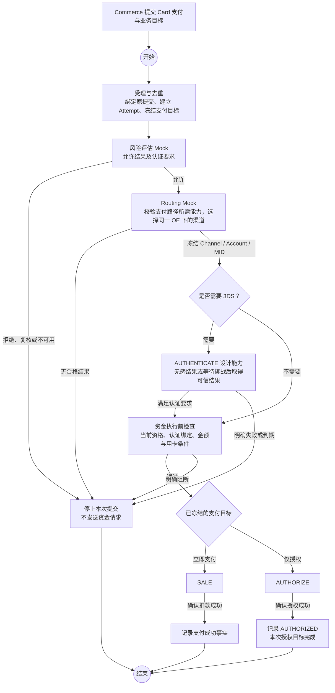

# Payment Execution 需求

> **字段维护后继：** [整批精简修订](./execution-field-simplification-amendment.md)已取代本文受影响的字段、渠道绑定位置、认证明细、Pricing Fact 与状态历史表要求。本文旧接口/流程细节保留为迁移前基线；后续 Java/HTTP/MQ 改造须逐项对齐，数据库执行状态只见当前台账。

> **状态与 Channel 恢复后继：** capture mode、三表 4/4/5 状态、active_action_id 及移除 QUERY 的现行设计目标以[状态与恢复修订](./execution-state-channel-recovery-amendment.md)为准；下文受影响内容保留为前序基线，未涉及合同继续有效。实现与 SQL 状态只见[当前台账](../../../agent-docs/CURRENT_IMPLEMENTATION.md#payment-execution-implementation)。

> **交易级 Token 修订评审：** 用户已确认统一 pay、交易级工具 Token、Attempt 直接关联及删除旧 Instrument 的方向；详细合同见[修订稿](./instrument-token-amendment.md)。下文保留上一版合同与评审上下文，受影响部分以修订稿的准确取代范围为准；新合同的实现与验证状态只读[当前台账](../../../agent-docs/CURRENT_IMPLEMENTATION.md#payment-execution-implementation)。

> 阶段 3 已获用户确认，当前进入阶段 4 Execution 本地切片研发；其他 Owner 仅测试 Mock + TODO。实际实现与验证边界见[当前台账](../../../agent-docs/CURRENT_IMPLEMENTATION.md#payment-execution-implementation)，阶段确认见[交付记录](./delivery.md)。

## 1. 目标与边界

建立统一的支付执行能力：Execution 管理支付事实、资金动作和恢复规则，Payment 内部通过代码组织支付流程。首先设计 Card；未来 Wallet、Crypto 可按实际执行模式扩展流程，共用适用的执行能力。

| 本期设计 | 本期依赖边界 | 后续需求 |
|---|---|---|
| Intent、提交身份、Attempt、Action、状态、金额、幂等及恢复 | Routing、Channel、Card、Risk、CCT、Commerce、Finance 等采用明确的 Mock 场景和替换 TODO | Wallet、Crypto 的真实流程与数据模型 |
| 一份 Card 首次支付流程，支持立即扣款和仅授权 | 不实现真实路由算法、渠道协议、Card Vault 或风控规则执行 | 真实渠道、真实卡、真实跨系统联调 |
| Capture、Void、Refund、Reversal 的 Payment 侧处理及查询 | API/Web/Test 仅设计 Execution 所需的入口、组合和验证边界 | 图形流程配置仅在出现真实需求时再评估 |
| 成功事实、退款额度、重复成功处理、最小定价事实 | 不新增公共 Checkout 页面或 Gateway 路由 | 绑卡、订阅、多次或部分 Capture 等新用例 |

本期保留一个 Payment 服务、一个数据库和已确认的七个 Maven 子模块，不新增工作流服务或编排 JAR。

## 2. 编排决定

| 问题 | 本次决定 |
|---|---|
| 谁编排支付步骤？ | Payment 内部代码编排；Commerce 提交业务目标，并在业务条件满足时发起后续命令 |
| 谁拥有执行规则？ | Execution 决定动作合法性、状态推进、金额及恢复规则；Web Processor 组织跨模块调用 |
| Card 需要几份主流程？ | 一份首次支付流程，根据已冻结的目标选择 SALE 或 AUTHORIZE，根据风险要求决定认证分支 |
| 是否配置数据库流程图？ | 本期不建设流程定义、节点、连线、发布版本或通用运行实例表；开始/结束节点只用于解释代码流程 |
| 风控和 Routing 是否仍能配置？ | 保留各自的配置职责，本期仅模拟其结果，不将其规则复制到 Execution |
| 如何支持 Wallet、Crypto？ | 按支付方式与业务目标选择适用的代码流程；能共用时复用，差异由真实用例证明，不提前创建空实现或推测性字段 |

此前讨论的数据库流程版本冻结不再作为本期要求。需要持久化的是实际支付目标、动作、外部稳定引用及必要的恢复事实；代码升级必须兼容尚未结束的原执行。

不同支付方式必须有明确的流程替换边界：通用能力管理身份、动作、金额和状态，具体流程解释自己的步骤、输入及恢复条件。不得让所有方式继承一套强制 3DS/Authorize/Capture 的 Card 模板，不把方式分支散布到所有入口，也不借扩展性新增空 Wallet/Crypto 实现。详细评审建议见[流程抽象](./technique.md#2-不同支付方式的流程抽象)。

## 3. Card 首次支付流程

图展示主路径；各节点还须遵守以下分支规则：

- 重复提交命中原执行后返回或恢复原结果，不创建新 Attempt，也不从头重复资金操作。
- 3DS 等待、必要输入缺失和渠道结果未知是暂停条件；结束当前请求不等于支付流程终结。恢复必须定位原提交和原 Action。
- 仅平台内部决定风险处理及认证要求。本期不设计渠道主动要求额外认证后的自动改道流程；遇到未支持情况应返回受控结果，不能默认免认证。
- 平台提出认证要求并校验是否满足，不能伪造 ACS 挑战或认证结果。浏览器回跳、SDK 结束均不能证明认证通过或支付成功。
- 独立认证后再执行资金动作是待细化的 Execution 能力；Mock 支持该场景不证明 NI 或其他真实渠道已支持它。
- 任何渠道调用超时或结果不确定时保留 UNKNOWN，查询原操作；认证等待到期也不能掩盖可能已经提交的资金请求。
- 资金执行前检查为代码内置约束，暂停后恢复仍需重验。缺少必要用卡材料时要求在原提交下补输入，不持久化 CVV，也不假设后台可以补造输入。
- 仅授权成功不是支付成功；只有确认 SALE 成功或满足本期全额 Capture 条件时，才产生支付成功事实。

## 4. 后续操作与对外能力范围

以下为业务能力范围，不是已批准的 HTTP Method/Path 或最终 Java 接口清单。

| 能力 | Execution 应完成的结果 |
|---|---|
| 创建、查询 Intent | 绑定唯一来源订单及其已冻结 OE、金额、币种和商业上下文；原身份重试返回原记录 |
| 终止已有 Intent | Commerce 先确认创建结果，再请求终止；创建超时用原键恢复，同一来源唯一。已有成功资金或已提交/UNKNOWN 动作时不能假称未支付终止；取消前置关闭能力已移除，见字段修订第 8 节 |
| 提交 Card 支付、查询原提交 | 按同一来源提交身份去重，执行 Card 主流程并返回安全状态和必要 nextAction |
| 认证、查询/继续原交互 | 表达独立认证能力及原交互恢复；是否单独对其他服务公开，随真实消费者在接口设计中确定 |
| Capture | 针对原成功授权进行扣款；本期沿用一次全额 Capture，不扩展部分、多次或增量授权 |
| Void | Payment 内部完整释放尚未扣款的成功授权，不直接公开给消费者或 Client |
| 创建、查询 Refund | 绑定 Commerce Refund 身份，原子预占本地可退金额，处理全额/部分退款及 UNKNOWN 保留预占 |
| Reversal | 接收 Commerce 的业务请求，根据锁内资金事实选择 Void 或既有完整 Refund 链；不新增 REVERSAL Action |
| 查询、回调应用与恢复 | 在同一原执行上收敛可信结果，处理重复、乱序和晚到；查询接口不隐式创建新支付 |
| 支付事实与 Pricing Fact | 保存成功动作、标准化支付事实及固定商业版本，输出下游所需事实；缺少适用定价事实不得猜值，也不得回退支付成功 |

Capture、Void、Refund 使用各自明确的代码处理流程；它们失败时不得抹除原授权或原支付的成功事实。已存在有效授权时，后续命令仍使用原 Attempt，不为 Capture 创建新的支付尝试。

## 5. 执行模型的设计要求

| 对象 | 本期要求 |
|---|---|
| Intent | 表达一次订单支付目标，保持唯一来源绑定和唯一有效支付；新流使用 entityNo 与 TERM_PRICE 语义 |
| 来源提交身份 | Commerce 的 submissionId 是来源命令身份，必须与 Payment 自身主键、Attempt、Action 区分并保持唯一绑定；持久化方案待设计 |
| Attempt | 冻结精确 Payment Method、业务目标、风险结果及认证要求；同一 Intent 不并发开启不同支付方式 |
| Action | 表达一次业务操作及稳定的提交/恢复身份，不按每次 HTTP 调用机械新增；独立 AUTHENTICATE 作为本期拟增动作细化 |
| 消费者交互 | 目标是移除 t_payment_customer_action，将必要交互阶段、稳定引用和期限归入原 Action；响应仍可有 nextAction |
| Instrument | 保留现有可选单表，只有稳定 Channel 支付工具引用时创建；平台 Card 引用和渠道订单号不能冒充 Instrument |
| 资金引用、退款额度 | 成功资金事实与其原交易引用保持可追溯；认证引用不能写入资金交易引用，退款 UNKNOWN 不释放额度 |
| 状态流转、重复成功 | 保留事实审计与第二笔真实成功的识别、补偿规则；重复通知不是重复支付，第二笔真实成功不覆盖第一笔成功或发布第二次 PaymentSucceeded |

状态机精简以真实业务差异为依据：认证成功、授权成功、扣款成功必须区分；REQUIRES_ACTION 和 UNKNOWN 仍有真实消费者，不因为移除交互表就删除等待与不确定性。最终枚举、合法转换、字段及索引在后续方案阶段逐项评审。

移除交互表是设计目标，本轮不修改现有 PDManer、Schema 或历史数据。交互指令中的临时 URL、SDK Token、Client Secret、QR Payload 和 bearer 参数不得进入普通业务表、日志或恢复 Payload。

## 6. Routing 的接入要求

- 先根据业务目标与风险结果形成能力要求，再选择渠道。仅授权流程还须检查已承诺的后续 Capture 能力；独立认证需求不能用笼统的“支持 3DS”替代。
- Routing 拥有候选筛选、排序和选择证据；Execution 校验返回结果与当前 Intent、OE、支付方式及动作要求的绑定一致性。
- 同一 Attempt 保持一个最终路由结论；重试原 Action 不改变 Channel、Account、MID 或幂等身份。
- Capture、Void、Refund 和原交易查询沿原交易渠道执行，不重新竞争选路。
- 当前 UNKNOWN 未解决时，不允许通过新渠道、新钱包或新 Crypto Attempt 绕过原资金结果。后续允许的新 Attempt 仍不能更换订单已冻结的 OE。

## 7. Mock + TODO 范围

“Mock + TODO”是对本期依赖的显式隔离，不代替 Execution 自身的状态、金额、幂等和恢复设计。详细替换清单见 [technique.md](./technique.md#3-mock-场景与替换-todo)。

| 依赖 Owner | Mock 必须表达的场景 | 暂不建设 |
|---|---|---|
| Routing | 合格选择、无候选、能力不兼容、返回 OE/绑定不一致 | 路由算法、规则管理与路由持久化实现 |
| Risk / CCT 等资格 Owner | 允许、认证要求、拒绝、复核、关闭、过期、不可用 | 真实风险规则、额度与资格服务接入 |
| Card | 合成的不透明用卡引用、可用/不可用、需补输入、受限卡片描述 | PAN 采集/保存/解密、真实指纹或 Card Vault、真实 CVV |
| Channel | 成功、明确失败、等待认证、未知、查询确认、重复/乱序/晚到结果 | NI 等真实 HTTP、验签、账户密钥、真实渠道交易 |
| Commerce | 冻结上下文及原提交身份、执行资格变化、后续 Capture/退款/Reversal 请求 | 真实 Checkout、法律接受、订单变更和跨系统发布 |
| Finance 等事件消费者 | 可观察的事实接收、重复消费场景 | 真实账务、定价计算和其他系统数据写入 |

未来实施时，依赖替身只能位于测试模块或显式本地模拟装配中；未配置场景应明确失败，不能默认为 ALLOW 或成功。生产装配缺少真实依赖时必须明确不可用。外部协议定稿后使用相应有状态 Simulator，不能用方法级 Stub 冒充真实协议验证；本期用户授权的模块替身不代表被替代模块已通过验证。

## 8. 设计验收标准

以下标准验收设计是否覆盖场景，不是本轮已经通过的运行测试。

| 编号 | 可审阅结果 |
|---|---|
| PEX-01 | 一份 Card 主流程具备明确开始、结束、立即扣款/仅授权分支和暂停恢复语义 |
| PEX-02 | 不需要认证、认证满足要求、挑战等待/失败/到期、输入不足、Risk 拒绝或不可用均有受控出口 |
| PEX-03 | 相同来源提交和原幂等键不重复执行；响应丢失、重启恢复及新键竞争不制造第二笔资金提交 |
| PEX-04 | 不引入数据库编排或空 Wallet/Crypto 实现；未来方式不会被默认为 Card，也不假定现有表已完整覆盖 Crypto |
| PEX-05 | 取消/创建竞态、Intent 终止、唯一活动 Attempt、固定 OE、UNKNOWN 禁止切换支付均有约束 |
| PEX-06 | 授权、一次全额 Capture、内部 Void、全额/部分退款与 Reversal 的目标、原交易引用和金额条件明确 |
| PEX-07 | 移除 Customer Action 表后，原交互仍可定位、恢复和判断到期；临时秘密不落库；认证引用不混入资金引用 |
| PEX-08 | 渠道能力要求、一次路由冻结和后续沿原渠道执行明确；不以 Mock 成功证明真实渠道支持独立 3DS |
| PEX-09 | 成功事实、定价事实不足、退款 UNKNOWN 保留额度、重复回调和第二笔真实成功分别处理 |
| PEX-10 | 本地状态与待发布事实原子提交，外部调用在事务外；恢复不盲目重放不支持幂等的资金请求 |
| PEX-11 | 每个依赖有可配置场景、调用观察、隔离和替换 TODO；Execution 自身逻辑不由替身替代 |
| PEX-12 | 不把业务流程移至 Commerce；不扩大 Execution 卡数据权限；不越过模块或数据库 Owner |
| PEX-13 | 方式分发、专属步骤和原执行恢复具备清晰边界；未支持方式明确拒绝，不回退 Card；扩展时复用适用约束，不强制非 Card 实现 Card 步骤 |

## 9. 依据与后续交付

- [本次代码编排与范围决定](../../../agent-docs/decisions/2026-09-13-payment-execution-code-orchestration.md)
- [已确认模块职责与协作](../payment-业务模块划分/technique.md)
- [当前 Payment 数据模型](../../../agent-docs/database/PAYMENT_ORCHESTRATION_DATABASE.md)与[现有 PDManer](../../../paytech/payment/docs/database/payment.pdma.json)
- [OE 与定价事实后继决定](../../../agent-docs/decisions/2026-09-11-cct-commerce-oe-pricing-model.md)
- [Commerce Customer 入口后继修订](../../../paytech/acquiring/docs/requirements/20260912-customer-checkout/commerce-entry-amendment.md)
- [Card 专项需求](../../20260912/payment-自建CardVault/requirement.md)及[数据草稿](../../20260912/payment-自建CardVault/data-design.md)
- [可靠执行规范](../../../agent-docs/COMPENSATION_EVENT_GUIDE.md)与[当前实施台账](../../../agent-docs/CURRENT_IMPLEMENTATION.md#payment-business-modules)

阶段 3 的 Execution 接口、最小模型/状态机、并发恢复、Mock 合同及验证方案见[详细设计](./design.md)，包含待评审 DDL 草稿。当前没有应用研发、SQL 执行、页面、部署或真实支付交付；Wallet/Crypto 和其他模块真实实现仍为后续范围。
