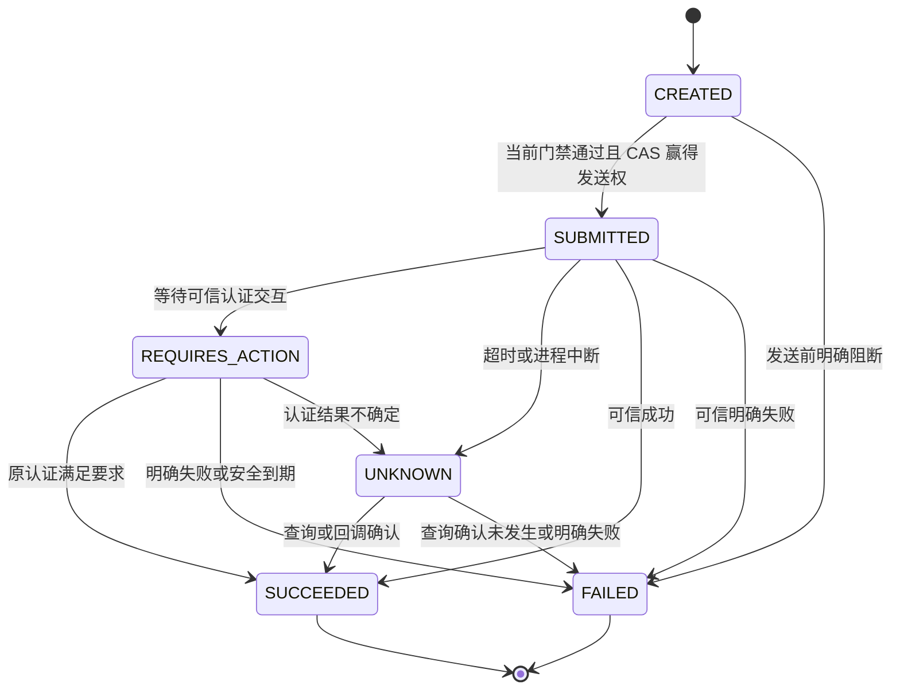
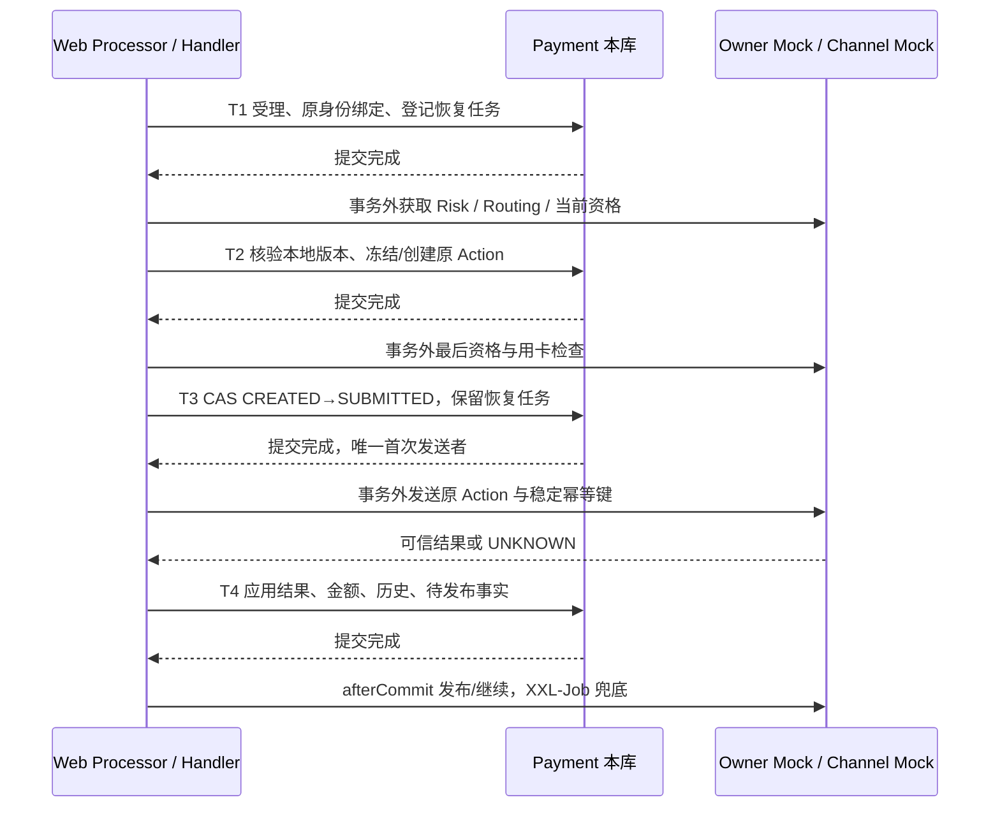

# Execution 状态、事务与恢复

> **2026-09-15 删除来源 Binding：** 用户已确认删除 `t_payment_intent_binding` 和 EX-I03 `CloseCreation`，按已有 Intent 终止；创建结果未明确时由 Commerce 用原键恢复创建后再终止。本文涉及提前关闭、Binding 门禁和锁顺序的内容由[字段修订第 8 节](./execution-field-simplification-amendment.md#8-删除来源-binding)取代；其余历史基线保持。

> **字段维护后继：** [整批精简修订](./execution-field-simplification-amendment.md)已取代本文受影响的字段、渠道绑定位置、认证明细、Pricing Fact 与状态历史表要求。本文旧接口/流程细节保留为迁移前基线；后续 Java/HTTP/MQ 改造须逐项对齐，数据库执行状态只见当前台账。

> **内部风控后继：** [RISK_CHECK 修订](./internal-risk-action-amendment.md)第 3–4 节补充风险执行状态、ALLOW 放行、原评估恢复与单动作占位。风险未知找 Risk，渠道未知找 Channel；Action 完成与业务放行分别判断，下文前置 Risk 的受影响叙述按该后继解释。

> **状态与 Channel 恢复后继：** capture mode、三表 4/4/5 状态、active_action_id 及移除 QUERY 的现行设计目标以[状态与恢复修订](./execution-state-channel-recovery-amendment.md)为准；下文受影响内容保留为前序基线，未涉及合同继续有效。实现与 SQL 状态只见[当前台账](../../../agent-docs/CURRENT_IMPLEMENTATION.md#payment-execution-implementation)。

> **交易级 Token 修订评审：** 用户已确认统一 pay、交易级工具 Token、Attempt 直接关联及删除旧 Instrument 的方向；详细合同见[修订稿](./instrument-token-amendment.md)。下文保留上一版合同与评审上下文，受影响部分以修订稿的准确取代范围为准；新合同的实现与验证状态只读[当前台账](../../../agent-docs/CURRENT_IMPLEMENTATION.md#payment-execution-implementation)。

> 本稿定义新 Card 切片的合法行为。保留当前模型的业务状态代码，不把所有枚举间的连线视为合法；对历史更宽的转换按本稿收窄，获批后同步模型说明和测试。

## 1. 哪些表有状态机

| 表 | 状态集合 | 精简结论 |
|---|---|---|
| Intent | REQUIRES_PAYMENT、PROCESSING、REQUIRES_ACTION、SUCCEEDED、FAILED、EXPIRED、CANCELLED | 保留；新流失败一个 Attempt 通常回 REQUIRES_PAYMENT，不写 Intent FAILED；FAILED 仅兼容旧记录 |
| Attempt | CREATED、PROCESSING、REQUIRES_ACTION、AUTHORIZED、UNKNOWN、SUCCEEDED、FAILED、CANCELLED、VOIDED、CONFLICTED | 保留；AUTHORIZED、UNKNOWN 有资金约束，不能并成“处理中” |
| Action | CREATED、SUBMITTED、REQUIRES_ACTION、UNKNOWN、SUCCEEDED、FAILED | 保留；不再增加独立交互状态机或流程节点状态 |
| Channel Refund | CREATED、PROCESSING、UNKNOWN、SUCCEEDED、FAILED、CANCELLED | 保留；UNKNOWN 必须继续占用退款额度 |
| Duplicate Case | OPEN、COMPENSATING、COMPENSATION_UNKNOWN、COMPENSATED、MANUAL_REVIEW | 保留；它表达额外资金的处理，不是回调接收状态 |
| Command Idempotency（Web） | PROCESSING、SUCCEEDED、FAILED | 技术受理状态，仅短事务内收敛；不长期用 PROCESSING 代表支付中 |
| Compensation Event（Web） | INIT、PROCESSING、ERROR、FAILED | 复用 Foundation；成功删除，不增加业务状态 |

其余 Execution 表没有枚举状态机：Pricing Fact/Transaction Ref/State Transition 为事实记录；Instrument 为可选描述；Refund Position 仅金额和 version。被移除的 Customer Action 状态全部停止新写，不再维护“双层等待”。

## 2. Action 和聚合转换

以上是通常路径；恢复重发继续原 Action，**不把 UNKNOWN 改回 CREATED 来取得第二次发送权**。认证可信结果早于等待响应时允许 SUBMITTED 直接成功；随后旧的等待响应不得降级。同状态通知无状态历史增量。

“查询确认未发生”必须包含渠道可以证明原请求不会再生效的终结依据；单次 NOT_FOUND、超时、客户端断连均不具备这个证明。

| 触发 | Action | Attempt | Intent / 其他事实 |
|---|---|---|---|
| 接受新提交 | 尚无 X | CREATED→PROCESSING | REQUIRES_PAYMENT→PROCESSING，冻结 active_attempt_id |
| Risk 拒绝/复核/失败/超时；无路由 | 可以没有 X | →FAILED，明确 failure_stage/reason | 清 active，若未关闭且未到期回 REQUIRES_PAYMENT；否则按终止条件关闭 |
| 等待认证或补输入 | 认证 X 为 REQUIRES_ACTION；缺用卡输入可尚无资金 X | →REQUIRES_ACTION | →REQUIRES_ACTION |
| 满足认证/补输入 | 原认证成功，不重建 | REQUIRES_ACTION→PROCESSING | →PROCESSING，再检查首次资金发送门禁 |
| SALE 成功 | SALE→SUCCEEDED | →SUCCEEDED，captured=完整金额 | 首次 I→SUCCEEDED；冻结成功指针，清 active；写 T、P、S、待发布事实 |
| AUTHORIZE 成功 | AUTHORIZE→SUCCEEDED | →AUTHORIZED，authorized=完整金额，captured=0 | I 保持 PROCESSING、active 保留；不写 PaymentSucceeded/P/收款 Pricing Fact |
| 初始资金明确失败 | AUTHORIZE/SALE→FAILED | →FAILED | 无成功资金才释放 active；开放时回 REQUIRES_PAYMENT |
| 资金结果未知 | 原 X→UNKNOWN | →UNKNOWN，保留已知金额 | active/预占均保留，I 保持 PROCESSING，禁止另开支付 |
| Capture 接受/成功 | CAPTURE CREATED→SUBMITTED→SUCCEEDED | AUTHORIZED→PROCESSING→SUCCEEDED | 成功才 I→SUCCEEDED；写完整扣款 T、P 与待发布事实 |
| Capture 明确失败 | CAPTURE→FAILED | PROCESSING/UNKNOWN→AUTHORIZED | 原 AUTHORIZE/T/authorized 不变；I PROCESSING，不能释放 active |
| Void 接受/成功 | VOID CREATED→SUBMITTED→SUCCEEDED | AUTHORIZED→PROCESSING→VOIDED | I→CANCELLED；清 active；不退款、不入账 |
| Void 明确失败 | VOID→FAILED | PROCESSING/UNKNOWN→AUTHORIZED | 原授权仍有效事实；存在 Void 决策时不再允许 Capture，需原业务受控恢复 |
| 取消/到期，确认尚未发送资金 | 未发送 X→FAILED，原因 EXECUTION_CLOSED | →CANCELLED（认证明确失败则保留 FAILED） | I→CANCELLED/EXPIRED；清 active |

Intent 到期不会撤销成功授权，也不能让 UNKNOWN 变为 EXPIRED。已授权需继续查询/显式业务处理，禁止自动新支付；成功资金回调必须如实处理，不因本地到期丢弃。现行模型已有 VOIDED；本稿沿用该精确状态，取代早期文档把 Void 后 Attempt 写成 FAILED(AUTHORIZATION_VOIDED) 的描述，仅在本稿获批的新执行范围生效。

认证 UNKNOWN 也保留原 Attempt 并查询；若原操作查询确认仍在等待挑战，可在校验原操作引用和期限后回到同一 Action 的 REQUIRES_ACTION，此规则仅适用于无资金效应的 AUTHENTICATE；认证操作没有资金效应且确认未创建任何初始资金 Action 时，认证到期可结束原认证。只要 AUTHORIZE/SALE/CAPTURE 已 SUBMITTED/UNKNOWN，认证到期不得把资金视为未发送。

## 3. 资金命令与退款状态

Capture 必须在同一 Intent/原授权锁内确认：授权金额=Intent 金额、captured=0、没有成功/活动 CAPTURE、没有任何已接受的 VOID 决策、当前授权仍可用；只允许一次全额成功。相同 key 回同 Action；前次 Capture **明确失败**后可用新业务命令尝试同一原授权，仍不创建新 Attempt。授权能力/期限缺失时不可提交，查询原授权，不推断默认有效期。

退款预占原子式：`available = original_amount - refunded_amount - reserved_amount`；创建 Refund、`reserved += amount`、注册执行任务在一个事务。以同一 position 行锁/CAS 保证竞争不超额。

| Refund 变化 | 预占处理 | 事件 |
|---|---|---|
| CREATED→PROCESSING | 保留 | 无 |
| PROCESSING→UNKNOWN | 保留 | 无 RefundFailed；Commerce 自己仍 PROCESSING |
| PROCESSING/UNKNOWN→SUCCEEDED | reserved 减、refunded 加，各一次 | RefundSucceeded → Commerce、Finance |
| CREATED/PROCESSING/UNKNOWN→FAILED | 仅确认未退款的明确失败才释放一次 | RefundFailed → Commerce |
| CREATED→CANCELLED | 仅尚未提交且本地撤销，释放一次 | RefundCancelled → Commerce |

UNKNOWN 不能因恢复次数耗尽、超时、人工“认为失败”而释放。已发生成功退款之后收到旧失败结果不回退。Refund 终态不直接重开；后续业务重试由新 Commerce Refund 身份发起，并重新检查额度。

Reversal 的分支在资源锁及本地事务中确定：

1. 发现已创建但未决的 CAPTURE/SALE/VOID 或 UNKNOWN：返回 PENDING/原 Void 状态，不产生第二个资金动作；未决动作最终明确后，同一 Reversal key 可再次计算。C 记录的是被接受的原 Intent，不缓存永久 PENDING 结论。
2. 仅有成功未扣款授权：原子创建 VOID 并关闭新初始支付；后来的 Capture 因已有 Void 决策拒绝。Void 失败保留原授权事实，返回 VOID_FAILED；同 key 不造新 Void，新命令才可在确定无未知后重试。
3. 已全额 SALE/CAPTURE：返回 REFUND_REQUIRED 和原成功 Action/金额/币种；不在 Payment 造 Commerce Refund ID，不预先占两个系统额度。Commerce 用自己的标准全额 Refund Request 接续 EX-I08。
4. 已有退款预占或部分退款时不创建另一笔“全额撤销”，返回 NOT_ELIGIBLE，调用方沿原 Refund 处理。并发发生在 REFUND_REQUIRED 返回后也由 EX-I08 原子额度检查拦截；这个返回是分支建议，不是退款额度承诺。
5. 部分 Capture（历史异常/未来模式）不自动拼 Void+Refund，返回 NOT_ELIGIBLE，受控原因 PARTIAL_CAPTURE_REVERSAL_NOT_SUPPORTED。未付款走 Terminate，Reversal 不扩大 Cancel 语义。

## 4. 事务与并发边界

每段通过 `TransactionTemplate` 开短事务；事务内只能本库读写，禁止间接 HTTP、Risk、Routing、Redis、Card 或 MQ。`@ResourceLock` Redis-first 协调在 Processor/独立 Handler 外层；DB row lock、CAS、唯一索引仍是最终并发保护。锁失效也不能重复资金成功处理。

资源锁键在事务前从授权命令/只读定位中解析，不从 Tenant 或操作者派生：来源 `payment:source:COMMERCE_ORDER:<orderId>`；已存在资源 `payment:intent:<intentId>`；退款另加 `payment:refund-position:<positionId>`。Create 使用来源键；已有 Intent 用例使用 Intent 键；退款/重复补偿在需要时加 position/case 键。全部已知键一次按 ASCII 顺序取得，事务内重验定位版本，禁止调用中途反向追加锁。key 都以原稳定资源标识生成，不以随机请求 ID 生成。

本地数据库锁顺序统一 Intent→Token→Attempt→Refund Position/Case→Refund→Action；所有入口共用同一 Repository 写边界。不同 operation key 的竞争仍受资金聚合规则约束。每个父对象 action_no 在锁内递增；Refund/Case 首个 REFUND 为 1，后续 QUERY ≥2。

实时资格在首次 AUTHORIZE/SALE/CAPTURE 的发送紧前查询；缺结果、不可用、明确关闭均 fail closed。查询结束后 T3 重新检查 Intent/Action 版本；若本地版本发生变化则重评估。不能承诺跨系统原子锁：真实 Owner 的资格版本/有效期与关闭事件接入是后续合同门禁，本期 Mock 只证明本地收到变化后的阻断。

## 5. 崩溃恢复决策表

| 断点或重复 | 恢复动作 | 禁止事项 |
|---|---|---|
| T1 前崩溃 | 原命令可重新受理 | 不猜测已创建资源 |
| T1 后、Risk 结果前 | 由原 assessment ID 查询/幂等取得结果 | 不重新创建 Attempt、伪造 ALLOW |
| Routing 返回、Action 未提交 | 允许原 Attempt 再请求 Mock 选择；只有成功冻结 Action 后才有执行路由 | 不声称已持久化 Routing 表；生产按 Routing Owner 唯一决策合同接入 |
| Action CREATED、还未赢得发送权 | 完成当前资格/材料校验，CAS 竞争原 Action | 不能绕过关闭或补造用卡材料 |
| T3 后、发送前或发送后崩溃 | 一律视为可能已发送；原 Action 查询 | 不把“未收到响应”当作从未发出 |
| SUBMITTED/UNKNOWN，无远程引用 | 通过原 channel key + account 查询原操作 | 不要求必须先有 Transaction Ref 才能恢复 |
| 渠道明确支持同 key 幂等 | 必要时同 Action/同 key/同坐标重发，先核验原请求内容一致 | 不换卡/金额/渠道，不用新 Action 重试未知资金 |
| 渠道不保证幂等 | 只查询或人工处理，保留 UNKNOWN | 单次 NOT_FOUND 不证明旧请求将来不会完成；不能据此重发 |
| 3DS 成功后进程重启 | 原认证引用、期限、要求满足后，取得有效用卡材料再继续 | 没有材料返回 PROVIDE_CARD_INPUT，不能从补偿 payload 恢复 CVV |
| 浏览器返回“成功” | 只触发可信查询信号 | 不直接修改认证/资金状态 |
| 回调与 HTTP 响应交错 | 原 Action 版本/CAS 应用一次，旧等待/失败不覆盖成功 | 不按到达顺序覆盖事实 |
| MQ Confirm 后、删除任务前崩溃 | 重发同 eventId；消费者业务幂等 | 不声称消息精确一次 |

本地切片恢复任务使用 `clientId:intentId` 或 `clientId:actionId` 的最小 event_key，event_type 为带 V1 的单职责 Handler；Attempt 任务的 sub_event_type 为原 submissionId，Action 任务为 `-`，Intent 任务为 `EXPIRY/CLOSE`。任务重新核对 Client 归属；不在 payload 中复制上下文。任务登记与状态变化同事务；CreateIntent 同事务登记到期任务。Foundation 当前接口不接收首次执行时刻；处理器按 expiresAt 检查并使用有界退避，后备扫描仍由 XXL-Job 配置提供；本地首次发送门禁直接检查 expiresAt，不依赖任务准点触发。到期任务关闭新初始支付资格，只在不存在成功授权/资金未决时终止；授权/UNKNOWN 继续由原操作恢复，不能以到期任务完成假称支付已取消。等待结果时按 Handler 退避继续保留任务，不能“查询一次仍 UNKNOWN”就删除；重试耗尽只把技术任务置 FAILED 并告警，原资金 UNKNOWN 不改失败。

## 6. 可信结果、重复成功与事件

归一化 ChannelResult 必須绑定 `actionId, channelId, accountId, midId, channelIdempotencyKey, operationRef?, result, amount, currency, occurredAt`，以及适用的认证/交易/定价事实。Channel Owner 负责真实验签、原始通知接收与关联；Execution 再核对冻结坐标和金额。时间戳晚不天然更权威；矛盾结果需可信查询证据。

同 Action、同成功交易引用的重复通知只重放现有结果。若原 Action 先被明确失败，后又确认第二笔实际扣款、且已存在 canonical 收款成功：同事务记录该资金引用、Action FAILED→SUCCEEDED、Attempt FAILED→CONFLICTED、Duplicate Case 与两条状态历史，保留第一成功指针，不再发布 PaymentSucceeded。Case 原子创建单一补偿 REFUND，沿 duplicate 交易执行，不消耗 canonical Refund Position；成功后 COMPENSATED，未知 COMPENSATION_UNKNOWN，明确失败/能力不足 MANUAL_REVIEW。

正常 AUTHORIZE→CAPTURE 不属于双成功。没有 canonical 收款、重复授权、同 Action 产生多个矛盾资金引用等超出上述窄纠正的结果，不强行套 Duplicate Case：关闭新初始支付，保留 Channel 接收证据并进入人工处置；本稿不新增通用纠错表或假造第二笔退款。测试 Mock 必须保留这些接收证据以验证拦截，真实证据存储仍属 Channel 后续接入。

| 事实 | 产生时刻 / 消费者 | 最小安全内容 |
|---|---|---|
| PaymentSucceeded | 第一笔 SALE/全额 CAPTURE 成功，同事务登记；Commerce、Finance Mock | 稳定 eventId、Intent/Attempt/Action/来源订单/Client、entityNo、金额币种、固定商业版本、实际成功时间；无 Card/Vault 引用或交互指令 |
| RefundSucceeded | 退款确认且额度落账后；Commerce、Finance Mock | 稳定 eventId、Commerce/Payment Refund ID、原支付 Action、Client/Intent、金额币种、成功时间 |
| RefundFailed / RefundCancelled | 确认未退款且释放额度后；Commerce Mock | 原 Refund 身份、金额币种、安全原因 |
| Intent 终止事实 | 实际终止后；Commerce Mock | 原来源/Intent、终止类型及时间；PENDING 不产生终止事实 |

本地事实发布用 `event_key=<clientId>:<transitionId>`、event_type=`PAYMENT_FACT_PUBLICATION_V1`、sub_event_type 为事件类型；eventId 由 `payment:<transitionId>:<eventType>:v1` 确定，重试不变。从不可变状态历史与成功交易引用重建该事件时刻的数据，不能读取后来变化的当前状态冒充原事件。Pricing Fact 缺失不阻断支付成功事实登记；补齐任务按原 Action/固定 context 查询、满足后插入，不重发第二次 PaymentSucceeded，消费者可查 EX-I11。

此处是 Mock 事实合同；真实 MQ exchange/routing key、Schema 和 Finance 定价衔接未迁移。重复支付补偿事实单独交给 Duplicate Case 的受控后续处理，不伪造 Commerce RefundRequest 或普通 RefundSucceeded；真实 Finance 对额外扣款及补偿的会计合同未接入前，不将该切片标成可真实收款上线。
