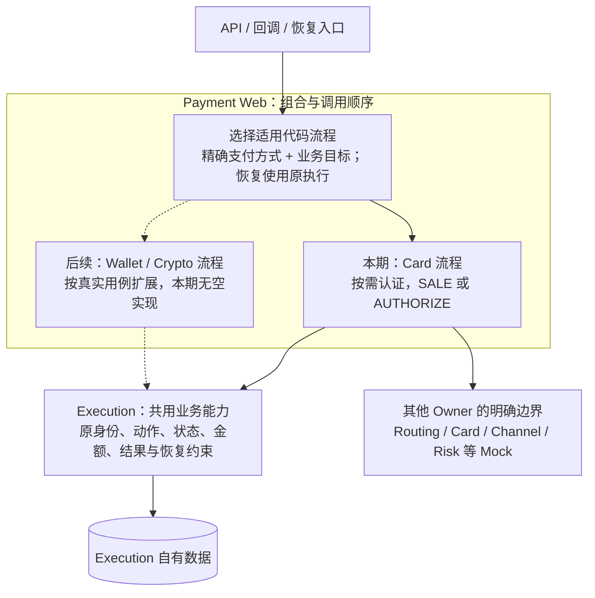

# Execution 技术方案与差异分析

> **公共幂等包后继：** 用户在差异评审后确认使用公共包，pay 的 Foundation Claim/Complete 消费约定、模型和人工迁移边界见[项目接入说明](../../../payment-orchestration-service/docs/development/command-idempotency-differences.md)。代码、验证和实际数据库状态只见当前台账。

> **字段维护后继：** [整批精简修订](./execution-field-simplification-amendment.md)已取代本文受影响的字段、渠道绑定位置、认证明细、Pricing Fact 与状态历史表要求。本文旧接口/流程细节保留为迁移前基线；后续 Java/HTTP/MQ 改造须逐项对齐，数据库执行状态只见当前台账。

> **状态与 Channel 恢复后继：** capture mode、三表 4/4/5 状态、active_action_id 及移除 QUERY 的现行设计目标以[状态与恢复修订](./execution-state-channel-recovery-amendment.md)为准；下文受影响内容保留为前序基线，未涉及合同继续有效。实现与 SQL 状态只见[当前台账](../../../agent-docs/CURRENT_IMPLEMENTATION.md#payment-execution-implementation)。

> **交易级 Token 修订评审：** 用户已确认统一 pay、交易级工具 Token、Attempt 直接关联及删除旧 Instrument 的方向；详细合同见[修订稿](./instrument-token-amendment.md)。下文保留上一版合同与评审上下文，受影响部分以修订稿的准确取代范围为准；新合同的实现与验证状态只读[当前台账](../../../agent-docs/CURRENT_IMPLEMENTATION.md#payment-execution-implementation)。

> 阶段 1/2 已确认，阶段 3 详细设计已形成评审稿：[完整方案](./design.md) → [接口](./api-contract.md) / [数据](./data-design.md) / [状态恢复](./state-and-recovery.md) / [Mock](./mock-contract.md) / [研发验收](./verification-plan.md)。下文保留阶段 2 的差异分析证据，其中“待设计”问题由上述分册回应，不代表仍无方案。当前未进入应用研发或数据库执行；确认记录见 [delivery.md](./delivery.md)。

分析结论：共用 Execution 的业务事实和约束，在 Web 内按支付方式与业务目标选择代码流程；Card 是本期唯一设计完整执行路径的方式。其他模块继续 Mock + TODO，Wallet/Crypto 只保留有明确职责的扩展边界。

工程和模型证据：[Execution POM](../../../payment-orchestration-service/paytech-payment-execution/pom.xml)、[包职责](../../../payment-orchestration-service/paytech-payment-execution/src/main/java/com/paytech/payment/execution/package-info.java)、[模块边界检查](../../../payment-orchestration-service/paytech-payment-test/src/test/java/com/paytech/payment/auto/architecture/PaymentModuleBoundaryAutoTest.java)、[当前 PDManer](../../../payment-orchestration-service/docs/database/payment-orchestration.pdma.json)及[完整 Schema](../../../payment-orchestration-service/docs/database/sql/payment-orchestration-schema.sql)。工程实现和验证状态仍由[当前台账](../../../agent-docs/CURRENT_IMPLEMENTATION.md#payment-business-modules)维护；本轮源码核对不构成支付业务验证。

## 1. 已识别的设计差异

| 主题 | 现有依据 | 本期目标与后续工作 |
|---|---|---|
| 模块协作 | [四模块方案](../payment-业务模块划分/technique.md) | 沿用 Execution 业务规则 + Web Processor 跨模块编排；api/web/test 只支撑本切片，不让 Execution 直接依赖其他业务 JAR |
| Card 流程 | 本次已确认代码编排；工程只提供模块边界，没有可复用的业务流程实现 | 设计一份首次支付流程；目标与认证要求分支，不引入流程配置表或流程版本字段 |
| 支付方式抽象 | Attempt 已有精确 payment_method_code；尚无执行方式选择或恢复分发实现 | 选择代码流程与选择渠道分开；通用入口不遍布 Card/Wallet/Crypto 分支，恢复按原执行事实分发 |
| 交互持久化 | 当前模型仍有 t_payment_customer_action | 按本次方向移除；需证明原 Action 可承接必要的定位、等待、到期和恢复事实，不只删除表 |
| 认证动作 | 模型 Action 类型只有 AUTHORIZE/CAPTURE/SALE/VOID/REFUND/QUERY；risk_result 没有独立表达认证要求 | 设计其输入、结果、原资金动作绑定及非资金引用；现有非空渠道字段、金额含义和恢复条件必须专项核对 |
| Commerce 入口 | [Commerce 修订](../../../commerce-service/docs/requirements/20260912-customer-checkout/commerce-entry-amendment.md)已取代旧 Payment 公共 Customer 入口及反向确认调用 | 以 Commerce 原提交身份和冻结上下文作为输入；allowExecution=false 只重放，true 仍受 Payment 自身约束 |
| 提交与终止 | Card 草稿有候选 t_payment_submission，旧草稿仍带原公共入口假设 | 重新评审来源身份唯一绑定和 Intent 创建关闭依据；不直接复用旧字段，也不先决定新增表 |
| 状态简化 | 当前模型按 Intent/Attempt/Action/Refund 等保存业务状态 | 输出“保留/合并/删除及理由”与场景化转换表，特别核对 Capture 失败后的原授权和 UNKNOWN 的占用 |
| 成功及定价事实 | [OE/Pricing 决定](../../../agent-docs/decisions/2026-09-11-cct-commerce-oe-pricing-model.md) | 新流使用 entityNo/TERM_PRICE；历史解释保持，不从旧描述恢复数字 OE、Assignment 或 Scope 替代值 |
| 可靠执行 | [补偿规范](../../../agent-docs/COMPENSATION_EVENT_GUIDE.md) | 复用服务本地技术机制；不添加工作流恢复表、通用 Inbox/Outbox，也不未经专项评审引入 Foundation 命令幂等新消费者迁移 |

## 2. 不同支付方式的流程抽象

### 2.1 模块依赖与流程职责

图表示能力调用，不表示一条请求必须执行全部步骤。真实回调先由 Channel 负责验签和归一化，再进入支付结果应用；本期只接受模拟的归一化事实。恢复 Handler 可以直接组织自身任务，不为其强行新增专用 Processor。Maven 依赖仍为 `test → web → api/execution/routing/channel/card`，各业务 JAR 默认互不依赖。

| 抽象边界 | 应共用 | 必须保留的差异 |
|---|---|---|
| 流程选择 | 明确的支付方式与业务目标匹配、重复匹配/不支持时的受控错误 | 精确方式可映射到同一兼容流程；不按显示名称或渠道数量复制实现 |
| 业务输入 | 原提交/Intent 身份、所属 Client/OE、目标、受信上下文与幂等语义 | 卡输入、钱包交互及未来 Crypto 专属事实采用各自有类型的输入；不用万能 Map、无 Schema JSON 或全部可空的大对象 |
| 执行流程 | 对 Execution 公开业务能力的合法调用、结果响应与恢复入口契约 | 3DS、Authorize/Capture 不是所有支付方式的必经步骤；钱包或 Crypto 无此能力时不能提供空实现伪装支持 |
| 执行事实 | 适用的 Intent/Attempt/Action、资金约束、唯一活动执行和成功事实 | 新方式如需要新的资金或确认语义，重新评审 Owner 模型，不承诺所有方式无需改表即可接入 |
| 渠道选择 | Routing 接收精确交易上下文与所需能力 | 流程选择不返回 MID；Routing 不选择 Java 流程实现，两者不共用一个混合规则集 |
| 结果应用与恢复 | 依据原提交、原 Action、可信结果、版本/CAS 和发送事实收敛 | 按原支付方式与执行阶段恢复；认证等待、资金 UNKNOWN、缺输入的继续条件由实际流程解释 |

### 2.2 对后续代码设计的约束

1. **先有真实替换边界，再定义接口。** 流程选择与执行可以采用窄策略契约；本阶段不固定类名、泛型层级或继承树。业务 Service 形态继续遵守项目规范，不为单实现增加无职责层。
2. **不建立强制 Card 步骤的大基类。** 不要求 Wallet/Crypto 实现无意义的 authenticate/authorize/capture 方法，不用空返回值跳过不支持的步骤。共用规则优先委托 Execution 业务能力。
3. **分支集中在各自边界。** 方式到流程的分发集中处理；3DS 与支付目标分支留在 Card 流程，渠道协议差异留在原 Adapter Owner。Controller、通用结果应用和每个恢复入口不重复维护方式 switch。
4. **不在通用链路传递卡原值。** Card 的受保护执行片段只返回受限业务结果，Execution 使用有范围约束的引用和最小事实；Mock 同样遵守该契约。
5. **不支持即明确拒绝。** 本期未实现的 Wallet/Crypto 请求不可回退 Card。未来允许多个精确方式共用一个流程，但必须有明确能力匹配，不能用兜底流程掩盖未支持情况。
6. **恢复继续原流程。** 重试不按新请求重选支付方式或渠道，不重建已发送资金动作；代码升级须覆盖原执行的恢复兼容，不为此自动引入数据库流程版本。
7. **扩展不等于提前实现。** 本期只交付 Card 的流程设计；后续方案可用测试侧最小非 Card 行为替身验证分发边界，但不把它写成钱包或链上支付已实现。

上述规则细化了用户对抽象的要求。实际接口方法、输入类型与恢复调用图仍在阶段 3 按真实使用者设计，不能据此预建一套通用工作流框架。

## 3. Mock 场景与替换 TODO

每个 TODO 均指定真实 Owner、替换内容和验收条件；接口字段还需后续设计，不使用未定稿 Mock 反向定义外部系统业务。

| TODO | Owner / 本期模拟场景 | 后续替换验收条件 |
|---|---|---|
| EXEC-T01 | Routing：合格/无候选/能力不足/错误 OE 或三元组 | 接入真实能力与策略选择，返回可验证证据；与 Attempt 和 Action 冻结一致；不跨模块写路由表 |
| EXEC-T02 | Risk 与资格 Owner：允许/认证要求/拒绝/复核/不可用/执行前关闭 | 接入真实风险及资格合同；评估引用可核验；依赖缺失或过期不可默认放行 |
| EXEC-T03 | Card：合成用卡引用、有效/不可用/需补输入、允许的卡描述 | 由 Card 完成真实受控用卡及权限检查；Execution 不接收 PAN/CVV，引用不能跨提交或跨 Action 任意复用 |
| EXEC-T04 | Channel：认证、资金动作、查询的有状态模拟及重复/晚到 | 验证真实渠道动作、账户、幂等、查询恢复和独立认证兼容性；归一化、验签与秘密处理由原 Owner 承担 |
| EXEC-T05 | Commerce：固定上下文、来源提交身份、资格变化及后续命令 | 与现行 Customer 入口合同对齐；无需 Payment 反向调用 Commerce 确认；恢复仍使用原提交身份 |
| EXEC-T06 | Commerce / Finance 等事实消费者：观察通知及重复交付 | 对齐最终事件合同与幂等消费；真实订单、账务及定价逻辑在各 Owner 中完成 |

隔离要求：

- 模拟数据只使用无真实价值的引用和场景数据；不导入真实卡、凭据或生产连接。
- 模块替身属于本次明确授权的依赖边界，不替换 Execution 的状态机、金额规则或持久化；真实模块后续单独验收。
- 场景保存原外部操作身份和可观察调用记录，支持“远端已成功但响应丢失”，不将超时统一映射为失败。
- Mock 的同步调用、回调和查询结果必须能按同一操作关联，覆盖重复与乱序；跨场景状态要隔离并可重置。
- 模拟实现只通过 test 或显式本地装配启用，不能静默进入生产装配；生产缺真实依赖明确不可用。
- 已有明确 HTTP/MQ 合同的外部依赖按真实协议使用有状态 Simulator；协议尚未确定的模块替身只证明 Execution 使用约定结果的行为。
- 本地 MySQL/Redis/RabbitMQ 是否参与由真实验证需求决定，不用业务 Mock 掩盖基础设施；DDL 人工执行，禁用自动建库迁移、Flyway 和 Testcontainers。

## 4. 逐表与持久化差异

### 4.1 Execution 现有表

以下清单与现有模型及模块 Owner 检查对照；“保留”指继续保留业务职责，不代表无需实现或无需字段评审。“调整/删除”均为待设计方向，本轮不改变模型。

| 表 | 建议 | 差异与下一阶段需证明的内容 |
|---|---|---|
| t_payment_intent | 保留并评审 | 已有来源订单、entity_no、TERM_PRICE 上下文及活动/成功 Attempt 指针；需定义创建关闭、晚到创建和终止竞争，不能靠查询不存在判定已关闭 |
| t_payment_attempt | 调整 | 已冻结精确支付方式，尚未独立表达本次支付目标与认证要求；需明确哪些最小事实支持方式选择及恢复，不增加通用流程状态 |
| t_payment_action | 调整 | 加入独立认证语义及承接交互后的最小恢复事实；复核现有 amount/currency/Channel/Account/MID 非空约束、认证绑定和原动作身份；一条业务动作可有多次协议交互 |
| t_payment_customer_action | 删除目标 | 当前仍承载类型、状态、稳定引用、到期和并发控制；需逐项迁移其必要语义，不用删除表代替恢复设计，也不迁移临时秘密进 Action |
| t_payment_instrument | 保留 | 可选的稳定 Channel 支付工具引用及允许的描述；不承载 Card Token、渠道订单号，也不预建 Wallet/Crypto 子表或属性包 |
| t_channel_transaction_ref | 保留 | 只保存成功资金操作的引用及原交易导航；独立认证引用需要其他准确归属，不能冒充 AUTHORIZE 引用 |
| t_payment_refund_position | 保留 | 原子预占与消费/释放可退额度；UNKNOWN 保留占用；不从 Channel 响应临时计算余额而绕过本地并发保护 |
| t_channel_refund | 保留 | 唯一 Commerce Refund 身份、退款金额与状态；通过原成功引用定位渠道；失败不覆盖原支付成功 |
| t_duplicate_payment_case | 保留 | 区分重复回调和不同资金动作的第二笔真实成功；保留原成功指针、狭窄终态纠正和独立补偿，不发布第二次 PaymentSucceeded |
| t_payment_state_transition | 保留 | 追加原业务聚合的状态事实及触发身份；不额外复制流程节点日志或通用工作流状态机 |
| t_payment_pricing_fact | 保留 | 不可变成功事实及商业版本；非适用属性与适用但未取得的事实必须区分；未齐备不按默认值计算，也不回退资金成功 |

### 4.2 相关记录与候选结构

| 事项 | 现状证据与边界 | 处理建议 |
|---|---|---|
| 服务命令幂等 | t_command_idempotency 属于 Web 服务级技术 Owner，已有 caller_scope/operation_type/key/hash/resource 等事实 | 评估现有记录能否覆盖原提交身份和创建关闭；不因有此表就假定已具备 Lease、完整恢复或 Foundation 新合同 |
| 本地补偿 | t_compensation_event 为服务本地技术机制 | 业务变更与待执行事实同事务登记，提交后执行；其行存在期间的去重不能替代长期业务幂等，不新增工作流恢复表 |
| t_payment_submission | 仅见 Card 专项候选稿，现有 PDManer 中不存在 | 原稿绑定旧公共入口，需重新论证独立基数、唯一身份和恢复职责；本阶段不先批准新增表 |
| Intent 创建关闭依据 | 尚未形成与新入口一致的专门合同 | 需要持久化的“原创建身份已关闭”证据；优先核对现有结构是否足够，随后决定最小增量 |
| Routing / Channel 表 | 仍由原模块独占 | 本期 Mock 返回可识别的测试业务结果，Execution 不替它们写策略、Decision、Callback 或 Interaction 表；后续真实接入再验证跨模块原子性 |
| Card 专项候选表 | 不属于 Execution | 卡库及访问审计延期，本期仅合成引用；不建立可被误当真实 Card 存储的替代表 |

### 4.3 状态精简的边界

- 保留 Intent、Attempt、Action、Refund 等实际不同的业务生命周期；删除 Customer Action 独立状态后，等待/期限/并发仍需由最小执行事实表达。
- 风险结论、认证要求、认证结果与资金结果不合并；认证成功不能推导授权成功，授权成功不能推导扣款成功。
- 待逐项确定 Capture 或 Void 明确失败、提交前拦截时 Attempt 的转换和原授权余额；不得机械复用“首次支付失败”路径抹除有效授权。
- 保留 UNKNOWN 与恢复限制；退款 UNKNOWN 保持预占，支付 UNKNOWN 阻止另一支付方式或另一渠道并发尝试。
- 保留只有可信矛盾资金事实才能触发的终态纠正；不得为了让代码恢复方便而普遍允许终态重开。

不在此阶段重新列一套完整枚举。阶段 3 以场景记录证明每个保留状态的必要性，再交付准确转换表和最小字段。

## 5. 跨模块与系统影响

| 模块/系统 | 当前切片的能力缺口 | 本期设计与 Mock 边界 | 后续真实接入影响 |
|---|---|---|---|
| Payment Execution | 需要完整的业务入口、状态/金额规则、持久化与恢复合同 | 本期唯一核心业务设计范围；后续研发不能以 Mock 替代这些规则 | 所有已批准 Execution 接口与模型统一由本模块实现 |
| Payment API / Web / Test | 需要方式分发、流程组合、入口与依赖隔离 | 只设计本切片所需支撑；保持 Controller 协议适配、Processor/Handler 组织用例及 Owner Service 规则边界 | 真实 HTTP/MQ/Job 入口和测试装配逐项落地，不新增部署单元 |
| Routing | 流程所需能力与冻结结果合同待定 | EXEC-T01；不实现候选算法、规则配置或其持久化 | 独立认证模式、原 OE 和决策/Action 一致性需共同验证 |
| Card | 受控引用、输入不足及独立认证协作合同待定 | EXEC-T03；不收集或保存真实卡数据 | 真实用卡权限、秘密瞬时生命周期、原提交补输入及认证绑定 |
| Channel | 归一化结果和未知恢复依据待定 | EXEC-T04；不做真实协议、验签或渠道账户配置 | 明确实际渠道支持的动作和恢复方式，替换前不得宣称可真实扣款 |
| Risk / CCT 等资格 Owner | 真实风险及执行前资格合同尚需对齐 | EXEC-T02；不修改其规则或数据库 | 认证要求、过期/不可用、状态变更和受限输入按 Owner 合同迁移 |
| Commerce | 现行 Customer 入口已有原提交及冻结上下文语义，Payment 专用合同需对齐 | EXEC-T05；用合成来源调用，不改变 Checkout、接受事实或订单投影 | 确认 source submission 绑定、执行资格、查询恢复及支付成功事实消费；不恢复旧反向确认 API |
| Finance 及其他事件消费者 | Payment 新事实和晚到定价合同需对齐 | EXEC-T06；只观察模拟消费，保留事实生成职责 | 原始支付/退款事实、不可变版本和幂等消费分别评审，不在 Payment 计算账务 |
| Gateway / BFF / 前端 | 本切片无新的公开产品入口 | 不做页面、路由激活或跨系统业务编排 | 真实入口联调在外部合同定稿后另行安排 |
| Foundation / 本地基础设施 | 本切片需按既有机制设计幂等与提交后恢复 | 不修改公共 JAR，不自动迁移数据库，也不创建新的基础设施替代品 | 如需命令幂等新消费者迁移，按既有专项门禁单独批准 |

本轮仅改变需求材料和检索记录；表、代码、API Wire、MQ Wire、公共路由及其他系统实施均未随本分析改变。上述“影响”是后续设计/接入需要评审的范围，不是本轮批量改造授权。

## 6. 尚未定稿的接口与数据问题

| 事项 | 方案阶段需要确定 |
|---|---|
| 独立认证 | 是否具有真实独立消费者；Action 的金额/渠道坐标、认证引用、有效期、挑战与资金动作绑定 |
| 去掉交互表 | 最小字段如何支持恢复；Action 多阶段与并发回调如何区分；安全指令如何重新取得或受控到期 |
| 原提交身份及创建关闭 | 复用既有命令记录还是新增业务记录；唯一约束、取消先到/创建晚到、原键换卡及输入不足恢复 |
| 幂等与发送边界 | 业务语义键与每个真实渠道调用的对应、超时后的查询依据、何时允许重发 |
| 回调/事件 | 归一化结果边界、验签责任、来源和关联身份、独立恢复入口；不会因 Mock 而宣称真实验签或 MQ 已接通 |
| 状态精简 | 精确转换、终态纠正、授权余额和退款预占；技术失败不得覆盖已确认的资金事实 |
| 流程抽象合同 | 支付方式/业务目标选择、类型化输入与结果、原执行恢复入口及代码升级兼容；不强迫非 Card 实现 Card 步骤 |

Wallet/Crypto 不在上述设计待办中展开；后续先确认实际支付用例和接入模式，再评审可复用边界及所需新事实。

## 7. 下一阶段交付与验证重点

1. **接口矩阵**：按真实消费者确定内部命令、查询和回调入口；给出输入、结果、权限、幂等及错误，不将所有内部步骤机械公开为 HTTP。
2. **模型与状态机**：逐表方案及 Card 无认证支付、认证后授权、Capture、Void、Refund、UNKNOWN 示例记录；决定最小字段、索引与历史处理。
3. **并发与恢复**：相同提交竞争、创建/关闭竞争、发送前后崩溃、查询/回调乱序、双成功与退款额度竞争；所有动作保留原身份和发送依据。
4. **流程与模块合同**：明确方式分发、Card 流程及恢复调用；Web 只组织模块协作，Execution 不依赖 api/web 或其他业务模块，传输 DTO 与 Owner 内部模型分开。
5. **模拟验证方案**：核心路径保持真实实现，按本轮授权模拟其他能力；场景同时观察响应、Execution 数据、待发布事实和依赖调用，真实协议测试按[测试规范](../../../agent-docs/UNIT_TEST_GUIDE.md)细化。

阶段 3 至少解释这些反例：不支持的支付方式不能落入 Card；重复流程匹配不能随机选择；只需钱包确认的未来方式不必实现 3DS；恢复原 Card Action 不重新选路；Capture 失败不清除原授权；缺少必要输入不盲目资金重发。非 Card 抽象验证只使用测试侧行为替身，不补造未来支付业务事实。

接口版本与错误体继续按项目 HTTP 规范。数据库方案按[数据库规范](../../../agent-docs/DATABASE_DESIGN_GUIDE.md)完成逐字段门禁后再定稿；本阶段不产生 SQL、PDManer 或应用代码。阶段 2 评审后进入上述详细设计，不自动进入研发。
