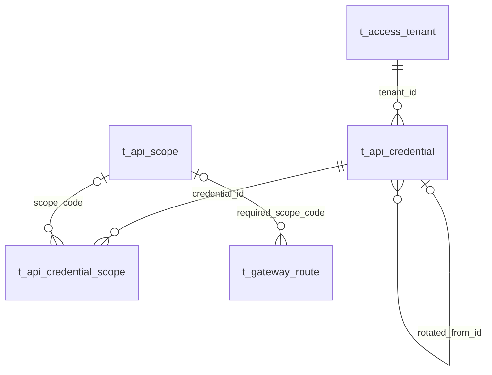

# Client API 数据设计与字段

**模型新增 1 表/7 字段；旧业务字段新增 0。在 2 张旧表各加 1 个查询索引。test 补齐两张既有凭证表后，本次环境合计建 3 表/28 字段。** 本页和 [增量 DDL](./db/ddl.sql) 已随阶段 3 确认；正式生成工件和各环境应用状态只在 [CURRENT_IMPLEMENTATION](../../../agent-docs/CURRENT_IMPLEMENTATION.md#platform-client-api-access-20260913) 维护。

查看 [Pencil 字段关系图](./assets/stage3/cRqny.png)。三张本期核心表列出全部字段；Tenant/Route 在图中只显示相关列，不表示删减它们的其他字段。机器核对资料见 [字段清单](./assets/stage3/field-inventory.json)，正式旧模型来源仍在 Platform 服务。

## 1. 关系与唯一来源

Scope 目录一行定义一个稳定能力，授权明细一行归属于一条 Credential。图中目录 0..1 表达旧数据未登记或非 API_SCOPE Route 的兼容性；新建/改绑的 API_SCOPE 必须关联恰好一个目录代码。旧值不自动注册。所有关系为逻辑关联，不建物理 FK/CHECK。

目录不保存 Tenant、Credential、状态、使用次数或历史；没有消费者需要的版本/回执/发布表不创建。`api_scope_id` 是目录主键，`t_api_credential_scope.scope_id` 是旧授权明细主键，两者不可互换；跨管理合同按 immutable scopeCode 引用目录。

新表回答精简门禁：运营先登记能力名称/说明，路由管理员可在尚无客户授权时选它；从授权明细 DISTINCT code 无法保存这种未被授予的定义，也不能管理独立名称/说明。删除此表会使 F-05/F-06 不成立。代码、名称、说明分别对应身份/显示/能力说明；version 用于实际并发编辑，时间用于展示与排查，没有冗余字段。

## 2. 新 Scope 目录：7 字段

| 字段 | 类型 | 可空 | 用途/约束 |
|---|---|---|---|
| api_scope_id | BIGINT | 否 | API Scope 目录的服务侧 Snowflake 主键；与凭证授权明细 scope_id 不同。 |
| scope_code | VARCHAR(128) CHARACTER SET ascii COLLATE ascii_bin | 否 | 机器 API 权限的稳定小写 ASCII 编码，取值由本目录管理；创建后不可修改或回收复用，Route 与授权记录按此编码引用。 |
| display_name | VARCHAR(255) | 否 | API Scope 的非空展示名称，可由获授权运营人员修改，不参与认证匹配。 |
| description | VARCHAR(500) | 是 | API Scope 的业务能力说明；未填写时为 NULL，不保存秘密、凭证值或客户资料。 |
| version | INT | 否 | 目录记录的乐观并发版本，创建为 1；每次成功修改递增 1，不表示历史业务版本。 |
| create_time | DATETIME(6) | 否 | 该记录在 Platform Support 数据库中的 UTC 微秒创建时间。 |
| update_time | DATETIME(6) | 否 | 该可变记录最后一次持久化更新的 UTC 微秒时间。 |

主键 api_scope_id，唯一索引 uk_api_scope_code(scope_code)。Snowflake 由服务生成；version 初始 1，每次更新 CAS +1；时间由统一 Clock 转 UTC 微秒提供。所有列无数据库自动默认值；description 未填为 NULL，其余必填。

scope_code 为 ascii/ascii_bin，长度与语法沿用现有认证约束，完全一致匹配；表其余字符列 utf8mb4_0900_ai_ci。名称允许重名，编辑不改变运行授权。非秘密配置文本直接结构化存本库；不增加 Vault Token、密文或 Hash。

## 3. 既有凭证及授权：不增字段

唯一补建执行来源为 [已存在的两表 SQL](../../../platform-support-service/docs/database/sql/changes/2026-09-08-add-api-credential-validation.sql)。该文件与正式 Schema 两表逐项一致，本需求不复制另一份同义 CREATE。

### t_api_credential（10 字段）

| 字段 | 类型 | 可空 | 用途/约束 |
|---|---|---|---|
| credential_id | BIGINT | 否 | 客户端接口凭证的稳定业务标识。 |
| tenant_id | BIGINT | 否 | 访问租户的稳定业务标识。 |
| key_prefix | VARCHAR(32) | 否 | 密钥前缀的业务值。 |
| key_verifier_phc | VARCHAR(512) | 否 | 密钥 PHC 校验值的业务值。 |
| expires_time | DATETIME(6) | 否 | 凭证到期时间对应的 UTC 微秒时间。 |
| status | VARCHAR(64) | 否 | 凭证状态的稳定业务代码。允许值：ACTIVE、REVOKED、EXPIRED。 |
| rotated_from_id | BIGINT | 是 | 轮换来源凭证的稳定业务标识。 |
| version | INT | 否 | 凭证并发版本的整数值。 |
| create_time | DATETIME(6) | 否 | 该记录在 Platform Support 数据库中的 UTC 微秒创建时间。 |
| update_time | DATETIME(6) | 否 | 该可变记录最后一次持久化更新的 UTC 微秒时间。 |

撤销只修改 status/version/update_time。PHC 是不可逆认证验证值，只限认证路径，不在后台管理 SELECT/DTO/日志/审计读取。rotated_from_id 用作只读来源关系，必须指向相同 Tenant 的既有凭证，本期不写该字段或级联撤销。

### t_api_credential_scope（11 字段）

| 字段 | 类型 | 可空 | 用途/约束 |
|---|---|---|---|
| scope_id | BIGINT | 否 | 接口凭证范围的稳定业务标识。 |
| credential_id | BIGINT | 否 | 接口凭证的稳定业务标识。 |
| scope_code | VARCHAR(128) | 否 | 授权范围代码的业务值。 |
| resource_pattern | VARCHAR(255) | 否 | 资源模式的业务值。 |
| action_code | VARCHAR(64) | 否 | 操作代码的稳定业务代码。取值来源：Platform Support 受控代码目录；非固定枚举。 |
| effective_from | DATETIME(6) | 否 | 生效时间对应的 UTC 微秒时间。 |
| effective_to | DATETIME(6) | 是 | 失效时间对应的 UTC 微秒时间。 |
| status | VARCHAR(64) | 否 | 范围状态的稳定业务代码。允许值：ACTIVE、REVOKED、EXPIRED。 |
| version | INT | 否 | 范围并发版本的整数值。 |
| create_time | DATETIME(6) | 否 | 该记录在 Platform Support 数据库中的 UTC 微秒创建时间。 |
| update_time | DATETIME(6) | 否 | 该可变记录最后一次持久化更新的 UTC 微秒时间。 |

既有复合唯一索引 `(credential_id,scope_code,resource_pattern,action_code)` 保持；本期不新增凭证授权写接口，legacy resource_pattern/action_code 不产生新的运行语义。A03 展示状态由区间/原状态派生，不写展示状态到数据库；父凭证撤销后仍保留原授权行。

## 4. 索引及查询口径

| 访问路径 | 使用索引 | 本期变化 |
|---|---|---|
| Scope 按 code 唯一查、目录稳定顺序 | uk_api_scope_code(scope_code) | 新唯一索引 1 |
| 某 Scope 涉及哪些 Credential | idx_api_scope_credential(scope_code,credential_id) | 新普通索引 1；用 EXISTS/去重 ID，分页及 count 不重复父项 |
| 某 Scope 的 Route 列表 | idx_gateway_route_scope(required_scope_code,route_id) | 新普通索引 1；新筛选与原条件 AND |
| 指定凭证的授权明细 | 既有 uk_credential_scope 的 credential_id 左前缀 | 不重复加索引 |
| Client 与其凭证 | 既有 uk_access_tenant(tenant_type,owner_ref_id)、idx_api_credential_tenant | 不另加同义索引 |
| 凭证标识/前缀 | 既有主键、uk_key_prefix | 不加索引 |
| 单对象审计 | 既有 idx_audit_resource(resource_system,resource_type,resource_id,occurred_time) | 只补查询条件，零索引变化 |

普通全列表使用稳定主键排序；包含名称搜索可扫描有界页的候选集，本期不加全文索引或搜索引擎。新目录名搜索不为 display_name 单独加对 `%keyword%` 无效的 B-tree。

旧 code 列仍是 utf8mb4_0900_ai_ci，不进行风险更高的全表排序规则迁移。索引条件用原字段 `scope_code = :code` 缩小候选，再以 `BINARY scope_code = BINARY :code` 精确复核；Route 同理，不能只在 WHERE 包 BINARY 而失去候选索引。目录按返回 code 关联时同样精确复核，大小写/非 ASCII 非法旧值不能被等同于新代码。

以上是按结构可证明的索引选择，尚无真实执行 EXPLAIN/压测结论；阶段 4 在已获准的本机结构下，用代表性合成数据验证优化器计划和业务分页。test 当前空数据不被当作性能证据。

## 5. 模型同步与环境应用

- 本期新增模型 1 表、主键 1、唯一 1、普通索引 2；旧表字段 0。完整模型应通过 `scripts/pdmaner/platform-support/manifests/01-identity-access.mjs`、`06-gateway.mjs` 及 Policy/Oracle 生成，不能直接手改 .pdma.json。新增目录→Grant/Route 的 code 关系作为带旧值兼容的可选逻辑关系；不新增 CHECK/FK DDL。
- 若两张旧表尚未建：先按其原 SQL 建 2 表/21 字段（含 2 主键、2 唯一、2 普通索引），再执行本次 ddl.sql（建目录、加两索引）。该路径合计 3 表/28 字段、3 主键、3 唯一、4 普通索引。
- 若旧两表已存在且匹配，跳过旧 SQL，执行本次增量；若只缺一表或结构有漂移，先核对具体对象后准备其精确缺口，不用 IF NOT EXISTS 遮蔽。
- DDL 自动提交；若途中失败，按实际完成项继续，不能盲目重跑整份。应用回退默认保留新增空闲表/索引和已写目录，避免删除操作数据。具体执行、停写、备份/恢复清单在阶段 6 根据目标环境定稿。
- Schema、正式模型、完整初始化与代码映射在阶段 4 同步；本页数字是已确认增量，当前已生成/已建表统计仍只在 CURRENT_IMPLEMENTATION 维护。

## 6. 注册 DML

[本期 dml.sql](./db/dml.sql) 插入 **127 行**：4 Permission + 4 未生效 RolePermission + 4 未启用 ConsoleResource + 9 未启用 Route + 30 Header + 22 Query + 54 Guard；更新两条原 Route 的版本/修改人/修改时间，使新增查询注册进入一致配置。

其中 22 条 Query 为新端点 19 条 + 旧端点 3 条。没有目录种子、Client、Credential、Grant 或外部 CLIENT_API Route。9 条新 Route 指向已有 Operations BFF，全部 HUMAN_PERMISSION，选择器直接使用原 GATEWAY_CONFIG_READ。新权限首次生效在后续部署材料显式授权，不因为目录存在而授予普通角色。

执行顺序、前置查询、行数与恢复边界见 [db/README.md](./db/README.md)。本阶段只准备文件，未执行。
