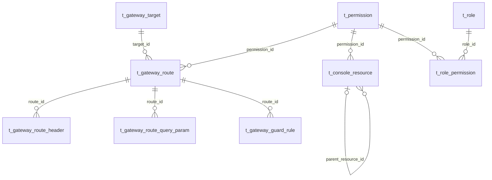

# 数据及注册 SQL 评审

本阶段只准备文件，不连接或修改数据库。唯一增量文件：[platform-support-service/dml.sql](./platform-support-service/dml.sql)。[ddl.sql](./platform-support-service/ddl.sql)只声明本期零 DDL，不包含建表或 ALTER。注册定义来自 [api-inventory.json](../api-inventory.json)，执行前仍需按已确认阶段核对具体环境。

## 1. 复用关系

图为业务关系，不创建物理 FK/CHECK。七张配置表为 Target/Route/三个子表/Resource/Permission；Role/Role Permission、现有命令幂等和审计另外复用。模型/列的现行定义只引用[Platform Schema](../../../../platform-support-service/docs/database/sql/platform-support-schema.sql)及[数据库权威](../../../../agent-docs/database/PLATFORM_SUPPORT_DATABASE.md)，不复制第二份字段表。

## 2. 零结构变更的依据

| 查询/写入 | 既有索引/保护 |
|---|---|
| Target 编码及 Channel/状态查询 | uk_gateway_target_code、idx_gateway_target_status |
| Route 编码、Target 引用、权限引用 | uk_gateway_route_code、idx_gateway_route_target、idx_gateway_route_permission |
| Method + 外部精确路径防重复 | uk_gateway_route_path；语义模板冲突由全量候选编译 |
| Route 子集合完整替换/去重 | 各子表 route_id 开头的唯一键 |
| Resource 树/权限反查 | idx_console_resource_channel、idx_console_resource_parent、idx_console_resource_permission |
| Permission 身份/分类 | uk_permission、uk_resource_action；小目录的状态/风险筛选先用现有路径，不为每个筛选加索引 |
| Permission 关联角色 | idx_role_permiss_permission_id、uk_role_permission |

因此新增/修改表结构 **0 张**，新增/修改字段 **0 个**，新增/修改索引 **0 个**。本期不修改 PDManer/完整 Schema。Permission 的 resourceType/actionCode 已是受控非枚举业务代码，本次目录管理复用它们，不添加 name/channel/deleted 标记。

## 3. 精确注册量

| 表 | INSERT 行数 | 内容 |
|---|---:|---|
| t_permission | 4 | 资源、权限各 READ/MANAGE |
| t_role_permission | 4 | 仅 PLATFORM_ADMIN 的本期四个入口权限，初始 REVOKED |
| t_console_resource | 4 | 两个 MENU、两个 MANAGE BUTTON，初始 DISABLED |
| t_gateway_route | 18 | 本期 BFF 管理入口，初始 DISABLED；无新 Target |
| t_gateway_route_header | 76 | 每接口 authorization CORS + origin 转发共 36；10 个写接口各补 content-type/Idempotency-Key 的 CORS 与转发共 40 |
| t_gateway_route_query_param | 13 | 权限列表 6、引用 3、selector 4；资源树完整返回无需 Query |
| t_gateway_guard_rule | 108 | 每接口三维度 Rate/Concurrency，18×6 |
| **合计** | **227** | **7 张表的增量 INSERT，不改存量业务数据** |

种子 ID 段为 900000000000041xxx..044xxx；执行前精确核对 ID、自然键、现有 Target/父菜单/PLATFORM_ADMIN 均唯一。不得用 INSERT IGNORE/REPLACE/ON DUPLICATE KEY UPDATE 掩盖差异。

停用注册与启用分开：本文件只插入，避免尚未部署 handler 时暴露入口。部署阶段在已确认具体制品后，另准备精确激活这 18 个 Route、4 个 Resource、4 个 Role Permission 以及 PLATFORM_ADMIN version+1 的 **27 行 UPDATE**；这些不是本阶段已执行或已授权的操作。激活前不运行平台管理员首次授权场景，因为新入口本身尚不可用。

权限初始 INACTIVE 是用户通过管理 API 创建对象的默认；本文件四个管理引导权限 ACTIVE，但角色映射 REVOKED，属于人工注册引导数据的明确例外。新增 Role Permission 并不自动给普通角色/创建者授权。第一次激活只增加现有系统管理员的四个配置管理入口权限，后续新业务权限由角色页明确分配。

## 4. 手工执行与后续同步

本文件是待评审增量，不是第二套完整初始化目录。阶段 4 在同一次实现中把同样注册定义合入 Platform 唯一[初始化 DML](../../../../platform-support-service/docs/database/sql/platform-support-initial-data.sql)，保持禁用注册口径；已有环境只执行增量，空库只走完整初始化，不重复执行两份。

实际应用前 SELECT 核对依赖/零冲突/角色状态，确认环境，按用户当阶段要求处理备份，停用自动续跑 SQL 客户端的 force 选项；事务中插入并检查 227 行及依赖关联，异常 ROLLBACK，成功才 COMMIT。本稿没有请求或使用本机/test 的 SQL 执行权限，也不推定后续 Channel 命名迁移已完成。
