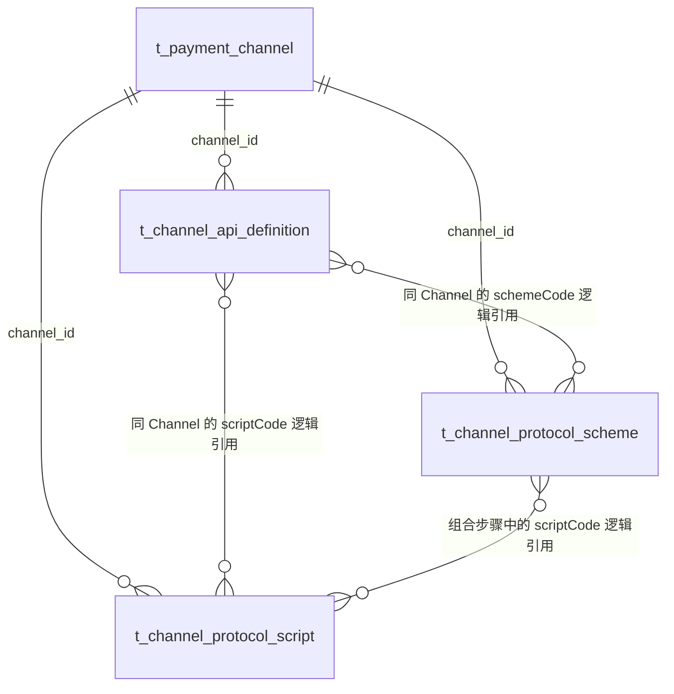

# 数据设计与待执行 SQL

> **2026-09-21 后继：** [Platform HTTP 执行修订](../platform-http-execution-amendment.md)确定配置管理、存储和执行归 Platform，业务系统通过内部 HTTP 调用。本文未同步的 Payment 落点或 Owner 未定表述仅作前序记录；字段与物理 SQL 继续评审。

**公共脚本后继：** [公共脚本与 HTTP 对象设计](../public-script-http-context-design.md)将公共方案与独立脚本合并；公共模型与响应合同也已有独立维护需求。因此本页前版三对象/三表方向不再是完整目标，最终物理设计需统一收敛。本次页面调整不修改任何 SQL 语句或执行数据库变更。

**通用化后本页为前版数据提案。** [通用执行修订](../generic-execution-amendment.md)移除 payment_method_code 并允许非支付接入；不能继续使用旧 Payment Channel 外键关系或唯一键作为通用模型。API/方案/脚本三个配置对象保留，通用管理 Owner、接入分组存储及最终物理表数量尚待确定。执行过程不新增或写入调用记录、幂等记录、重试任务。下列 DDL/DML 不可作为本修订的完整建库材料。

本目录属于[阶段 3 设计](../design.md)。**当前方向为 Payment 三张配置表：API、公共方案、独立脚本；旧表结构修改 0，业务初始化 DML 为 0。** 已有 DDL 只覆盖前两表的 17 列、2 个主键和 2 个业务唯一索引；脚本表物理字段/索引尚未冻结。Platform 原有 145 行注册数据只覆盖前版 13 项操作，脚本管理的注册增量待补齐。没有执行 SQL，也未并入正式 PDManer/完整 Schema。

数据库设计与协议合同在当前阶段一起整理，开发前确定。[模型与映射设计](../model-and-mapping-design.md)取代此前两表足以覆盖全部需求的结论；两表仍覆盖原有无独立脚本的 NI 样例，不能用该检查证明三表设计已经完整。关系、读取及 JSON 边界见第 7 节。

## 1. 三个独立对象对应三张表

| 表 | 写入者与消费者 | 独立存在的理由 |
|---|---|---|
| t_channel_api_definition | Operations 经 Payment 保存；配置详情、校验与单次调用读取 | 一份渠道 API 有稳定身份、精确支付方式归属和完整可执行定义 |
| t_channel_protocol_scheme | Operations 经 Payment 保存；多个 API/组合引用 | 共享规则有独立编辑和引用影响，不能复制到每个 API 后失去复用 |
| t_channel_protocol_script（拟定） | Operations 经 Payment 独立维护；API/组合方案引用 | 简单逻辑源码需要独立编辑、输入输出合同及复用，不内嵌复制到每份 API |

API 的步骤、绑定、Header、结果规则总是随所属定义一起校验和保存；不提供独立步骤 CRUD，所以不拆子表。目录代码是开发者注册/既有 Owner 的事实，不新建方法/能力/支付方式字典表。引用图可在每个 Channel 的有界定义集合内解析，不保存第二份可能失真的引用关系表。

## 2. 字段与索引

以下 API/方案两表的字段顺序、类型和完整注释体现在[前版 DDL 草稿](./payment-orchestration-service/ddl.sql)，脚本表暂列逻辑字段。严格配置 Schema 由[字段合同](../definition-contract.md)拥有；三表完整 DDL 尚未交付。

### API（9列）

| 字段 | 类型 / 空值 | 用途 |
|---|---|---|
| channel_api_id | BIGINT / 非空主键 | 服务侧 Snowflake；编辑与并发命令定位原对象 |
| channel_id | BIGINT / 非空 | 当前 Payment Channel ID；同库逻辑关系，由代码核验 |
| payment_method_code | VARCHAR(64) / 非空 | 唯一支付方式归属；取现行 Payment Method Catalog，不接受控制通配符 |
| api_code | VARCHAR(64) / 非空 | 该 Channel/支付方式内的稳定接口代码 |
| api_name | VARCHAR(128) / 非空 | 给配置者看的名称 |
| description | VARCHAR(512) / 可空 | 解释此 API 用途，可省略；不是通用扩展容器 |
| definition_json | JSON / 非空 | 完整 ApiDefinition，最多49,152 UTF-8字节，禁止凭据与业务原始上下文 |
| create_time | DATETIME(6) / 非空 | UTC创建时刻 |
| update_time | DATETIME(6) / 非空 | UTC最后修改时刻；更新时严格递增，用于旧值并发检查 |

唯一键 `uk_channel_api_code(channel_id,payment_method_code,api_code)` 同时服务 Channel 内按支付方式/代码筛选排序；不为 definition_json 建索引。按 apiId 查详情走主键再校验 Channel。

### 公共方案（8列）

| 字段 | 类型 / 空值 | 用途 |
|---|---|---|
| channel_scheme_id | BIGINT / 非空主键 | 服务侧 Snowflake；定位原方案 |
| channel_id | BIGINT / 非空 | 所属 Channel，不能跨 Channel 引用 |
| scheme_code | VARCHAR(64) / 非空 | Channel 内稳定方案代码 |
| scheme_name | VARCHAR(128) / 非空 | 方案名称 |
| description | VARCHAR(512) / 可空 | 方案用途/适用差异 |
| definition_json | JSON / 非空 | 单能力或步骤组合的严格互斥结构，最多49,152 UTF-8字节；只保存凭据用途，不保存材料 |
| create_time | DATETIME(6) / 非空 | UTC创建时刻 |
| update_time | DATETIME(6) / 非空 | UTC最后修改时刻，作为旧值并发条件 |

唯一键 `uk_channel_scheme_code(channel_id,scheme_code)` 支持当前 Channel 列表和按代码解析。kind 来自受控定义，不加冗余 kind 列。没有 version、active_slot、发布/历史表或持久化配置 Hash。

表采用 InnoDB/utf8mb4_bin；代码按合同校验，避免大小写/尾空格被数据库比较语义悄悄合并。名称/说明允许中文。时间由应用在事务内明确写入，不依赖 ON UPDATE 或数据库隐式时区。不建 CHECK/FOREIGN KEY。

### 独立脚本（逻辑字段，物理长度和完整 DDL 待补）

| 拟定字段 | 用途 |
|---|---|
| channel_script_id | 内部唯一标识，定位脚本记录 |
| channel_id | 所属 Channel，创建后不变，只接受同 Channel 引用 |
| script_code | 同 Channel 下稳定唯一的脚本代码 |
| script_name | 展示名称 |
| description | 用途说明 |
| engine | 引擎标识，当前以受限 Aviator 为方向 |
| source_code | 独立文本源码，不复制到 API/方案 JSON |
| definition_json | 严格的输入输出合同，不重复源码、引擎和身份 |
| create_time | UTC 创建时刻 |
| update_time | 最后修改时刻，沿用旧时间并发检查，不是发布版本 |

以上 10 项是拟定字段用途，不是已批准的物理字段统计。自然唯一性拟为 `(channel_id, script_code)`；字段类型、长度、源码及总预算、完整注释和索引须补齐。不引入版本、发布、历史或脚本执行记录表。金额、查询结果和实际请求/响应均不写进这些配置表。

## 3. 原交易数据不随配置新增

本次对 t_payment_action、t_channel_transaction_ref、Account/MID 字段改动为0。READ_ORIGINAL_CHANNEL_TRANSACTION 只投影已有事实；READ_REFUND_TARGET 当前无完整事实提供方，参见[查询合同](../query-contract.md)。明确其返回结构不等于授权把 NI 响应整体存入新 JSON 容器。

后续确认原支付/Capture 产生与消费的最小导航事实后，再决定能否复用现有结构及必要的有类型增量。该依赖未完成前，真实 NI 退款能力不能启用或声明已完成。

## 4. 模型与规则同步顺序

本提案首次允许非敏感相对路径、目标别名和 API 超时进入 Payment DB，批准前保留现行禁止规则。方案批准后：

1. 同步存储边界到 Payment 唯一业务权威及物理决定，保留旧决定的取代说明。
2. 补齐并评审脚本物理字段和完整三表合同，再在唯一正式模型 payment-orchestration.pdma.json 中加入三表及 Channel 逻辑关系；保留已有 PDManer ID、结构与其他任务改动，不创建第二份完整模型。
3. 运行模型门禁，将相同字段/注释同步到完整 Schema 来源及本增量 DDL，再进入 Java 持久化实现。
4. 获得确切目标库的执行授权后人工应用 SQL，核对真实结构和注释。DDL 草稿存在不代表模型、Java 或数据库已迁移。

本轮用户要求先整理文档，没有授权进入模型变更；不改正式模型/完整 Schema，不声明 PDManer 一致性已经通过。原两表 DDL 保留为部分草稿，不能作为三表一次性建库文件，实际研发须先完成上述合同与来源同步。

## 5. 注册数据清单

下列是前版 API/方案 13 项管理操作的既有草稿，尚不包含独立脚本 CRUD、脚本引用查询及校验增量；本轮保留 SQL 原内容。脚本管理路由合同确定后，再同步同一份注册 SQL，不另建一份初始化 DML。

[Platform DML 草稿](./platform-support-service/dml.sql)采用已存在表结构与 Operations 安全档案：

| 表 | INSERT 行数 | 初始行为 |
|---|---:|---|
| t_permission | 2 | READ/MANAGE 权限为 ACTIVE，但不自动授予角色 |
| t_console_resource | 2 | 顶层渠道API菜单及管理按钮，均 DISABLED |
| t_gateway_route | 13 | 13项管理操作，均 DISABLED；复用现有BFF Target |
| t_gateway_route_header | 40 | 6个GET各2项；7个Body操作各4项 |
| t_gateway_route_query_param | 10 | Channel列表3项、API列表4项、方案列表3项 |
| t_gateway_guard_rule | 78 | 每Route 6条，与既有 Operations 管理入口相同的有界规则 |
| 合计 | 145 | 无业务定义种子、无角色授权、无自动激活 |

Guard 拟采用现行管理切片的边界：SHARED_ROUTE 每分钟300、并发50；CLIENT_IP 每分钟30、并发3；AUTHENTICATED_PRINCIPAL 每分钟10、并发2。桶容量与每分钟配额相同。这些是注册提案，不修改 Gateway 代码或全局安全上限。

注册对象ID采用本需求的显式人工种子段，执行前仍须与目标库核对冲突。使用已有 ACTIVE operations-console-bff Target；不创建 Target、不绑定 PLATFORM_ADMIN、不伪造维护者身份。created_by/updated_by 由执行者设置为获准 Platform Account ID，不默认写1。

页面组件并非只有数据库登记：Platform 随制品的 console-resource-capabilities.json 和 Operations Web 的组件目录均须加入 OPERATIONS_CHANNEL_APIS 及对应管理按钮，见[完整设计](../design.md#7-管理入口和页面)。这属于应用制品配置变更，不额外计入 DML 行数。

## 6. 执行前置与恢复边界

目前没有 SQL 执行授权。后续需分别明确 Payment 与 Platform 的目标数据库，核对备份及：旧表结构与本提案所据模型一致；新表尚不存在；所有新ID/代码/Route不冲突；Target唯一且当前可用；获准执行者真实存在。

DDL 仅在空的新配置表场景创建，不含 DROP/ALTER，不使用 IF NOT EXISTS 掩盖旧结构冲突。Payment 业务初始化 DML 为0，不创建空文件。Platform DML 的 SELECT 前置必须得到唯一对象，任何 NULL/冲突立即停止，禁止 mysql --force；逐项核对后在一个本地事务里登记。

本期只准备禁用注册。启用 Route/菜单和首次角色分配需要在真实 Owner/BFF/Web验收后按环境授权执行；这属于入口上线步骤，不是渠道定义的发布机制。保存API定义仍即时生效。

未写入业务定义时，新表与种子可按经批准的恢复清单处理；一旦有新定义或角色/路由引用，不能直接 DROP 或批量删除。此处不提供未经目标核对的破坏性回滚命令。

## 7. 完整配置的落库核对

图中均为逻辑关系。API、方案和脚本之间不增加关系表或物理外键：引用位于严格 JSON 的 SCHEME/SCRIPT 步骤中，分别按同 Channel 的 schemeCode/scriptCode 定位。脚本数量及展开预算待补齐后，由有界依赖解析器处理。Payment Method Catalog 是已有 Owner 目录，API 行保存其精确代码；不新增支付方式表。Channel Account/MID 与凭据继续由实际调用冻结的身份解析，不固定进可复用定义。

### 内容逐项映射

| 内容 | 存储位置 | 类型/约束由谁决定 |
|---|---|---|
| Channel、支付方式、API 身份及显示信息 | t_channel_api_definition 的 6 个身份/说明列 | 既有 Channel/Payment Method 目录及管理合同；身份创建后不可变 |
| inputDefinition | API.definition_json.inputDefinition | Context 代码与 requiredPaths；不存真实支付/退款上下文 |
| 请求字段、函数调用和 Aviator | API.definition_json.requestSteps | Step + ValueBinding；OBJECT_MAPPING_PARAMETERS 声明每个目标字段类型及路径 |
| HTTP Method、目标别名、Path/Query/Header、超时 | API.definition_json.transportDefinition | 严格 HttpTransport；无环境 URL/Token/私钥 |
| 解码、保护与投影步骤 | API.definition_json.responseSteps | 已注册能力、Profile 代码和参数；不保存响应报文或运行句柄 |
| 条件、结果码及输出字段 | API.definition_json.resultRules / outputDefinition | op 判别的条件树、按结果分支的输出集合 |
| 公共方案身份及显示信息 | t_channel_protocol_scheme 的 5 个身份/说明列 | 同 Channel 唯一 schemeCode，创建后不可变 |
| 单能力参数预设或步骤组合 | Scheme.definition_json | kind 严格二选一；输入/输出/开放参数/固定参数/凭据用途分开 |
| 简单逻辑源码、引擎、输入输出 | 拟定 Script.source_code / engine / definition_json | 源码独立文本、输入输出严格合同；函数与脚本预算另需完成 |
| 创建及并发令牌 | API/方案及拟定脚本的 create_time / update_time | UTC 时间，update_time 严格递增，expectedUpdateTime 防覆盖 |

这里的“身份/说明列”包括内部主键：API 为 channel_api_id、channel_id、payment_method_code、api_code、api_name、description；方案为 channel_scheme_id、channel_id、scheme_code、scheme_name、description。原 DDL 的 9+8 列统计只对应这两表；脚本逻辑字段清单不代表完整物理设计已通过。

### 一份 NI 配置怎样读写

1. 在既有 NI Channel 下创建 NI_PAYMENT_BEARER 方案，definition_json 使用[完整方案内容](../assets/ni-payment-bearer-scheme-definition.json)。实际 schemeId、时间由服务生成；本例不提供业务种子 INSERT。
2. 选择权威目录认可的精确支付方式后创建 REFUND_CAPTURE，definition_json 使用[完整 API 内容](../assets/ni-refund-api-definition.json)。API 身份通过管理请求的元数据写入关系列，JSON 不重复它们。
3. API 列表按 channel_id/payment_method_code/api_code 查找；详情通过主键和 Channel 校验读取。函数和能力描述符由运行代码目录读取，不复制到表中。
4. prepare 在同一次本库只读一致性视图中读取 API 及其引用方案；解析 SCHEME 时按 `(channel_id, scheme_code)` 定位。结束事务后才读取运行材料、调用系统函数和通信。读不到引用或目录合同不兼容则失败，不拿旧配置顶替。
5. 修改 API/方案时，同 Channel 资源协调及数据库 Channel 行锁保护引用检查和当前写入；同时比较 expectedUpdateTime。修改共享方案会重新校验全部引用 API，任一个不合法则不写；删除被引用方案拒绝。
6. 已开始调用持有当次完整定义，随后保存只影响新调用。数据库仅保存当前配置，不新增发布、历史、版本、回滚指针或配置 Hash。

上述 NI 示例不引用独立脚本。包含 SCRIPT 的 API/方案须在同一次短只读一致性视图中加载全部引用源码及合同；事务结束后执行函数和脚本。共享脚本修改纳入同 Channel 锁及旧时间校验，检查直接/间接 API 与方案，任何引用失效则整体不保存；被引用脚本禁止删除。运行中不得每个步骤再取最新源码，否则会把新旧配置混在一次调用中。

### JSON 的边界和大小

前版 NI 完整 API 紧凑 UTF-8 JSON 为 4,938 字节，方案为 600 字节，均低于原每份 49,152 字节上限；该样例没有独立脚本，不能代表所有渠道容量。脚本源码单独设限，脚本合同及管理请求总预算须补齐，不套用原两份 JSON 的容量结论。大小按固定紧凑序列化规则计算，不用 MySQL 二进制 JSON 页占用替代产品限制；步骤、参数位置和结果优先级用数组显式表达。

JSON 不承担独立检索条件：没有步骤 CRUD、字段分页或跨 Channel 全库 JSON 搜索，因此不建 JSON 索引。API 上限 200、方案上限 100 限定一次 Channel 引用分析的范围；数据库仍只返回获准对象。未知字段、错误类型、重复路径、无效能力/Profile、保护位置错误与超预算在保存前拒绝，不能依赖 MySQL JSON 语法合法就认为配置有效。

与既有存储规范的待批准窄修订仍包括“允许非敏感目标别名、相对路径和 API 超时入库”；新增脚本源码的存储与执行边界亦须随完整合同评审。本轮不改 Payment 原交易表，不把 NI 四段坐标缺口塞入配置 JSON，也没有执行 SQL。原两表 DDL 不覆盖独立脚本；正式模型同步和物理建表按第 4、6 节进行。
