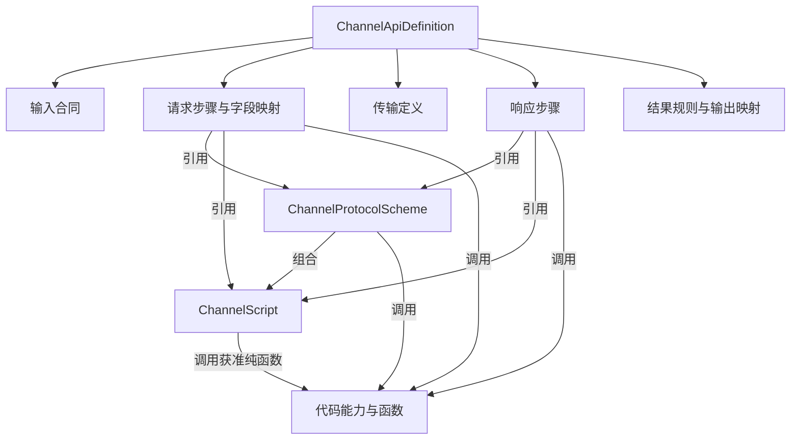

# 渠道 API 模型、脚本与字段映射设计

**公共脚本后继：** [公共脚本与 HTTP 对象](./public-script-http-context-design.md)取代本页公共方案与独立脚本分离、脚本一律只读及强制返回包装的设计。公共脚本直接修改当次 HTTP 工作对象，API 显式绑定参数及顺序；普通字段映射的只读求值、复杂逻辑由代码实现的原则保留。下文三表方向及阅读样例属于前版。

**后继修订：** 当前分组、输入、执行和返回合同以[通用执行修订](./generic-execution-amendment.md)为准，取代下文的支付方式层级、固定 Payment 输入与旧结果外壳。本文保留第 18 轮的字段映射、简单脚本和代码能力说明；其三表及 Payment 管理落点是前版方向，旧阅读 JSON/检查不是通用执行的验证。

本稿整理 2026-09-14 最近几轮讨论。用户接受继续保留当前设计方向，并明确要求“先整理成文档”；本轮只整理设计，不进入应用研发、正式模型修改或 SQL 执行。确认原话及证据范围见[交付记录第 18 节](./delivery.md#18-模型脚本与字段映射整理2026-09-14)。

**当前方向：API、公共协议方案、独立脚本三个配置对象，拟对应三张表。** 请求字段和响应字段使用明确映射；脚本处理简单组装、转换、判断，复杂逻辑由代码函数实现。底层方案仍涉及 Payment、Operations BFF/Web 和 Platform；原有 13 项管理操作、两表 17 字段及 145 行注册 SQL 只覆盖前一版能力，新增脚本的管理合同、物理字段及注册增量尚待补齐，不能沿用旧统计作为完整三表交付量。

本文是模型与映射的阅读入口，取代旧稿“只有两个独立配置对象、脚本不单独保存”的结论。精确 Step/Binding 类型由[定义合同](./definition-contract.md)拥有，代码能力由[协议合同](./capability-contract.md)拥有，数据落点由[数据库说明](./db/README.md)拥有；本文不新建第二套可执行 Wire。旧 NI 样例仍是有效的无独立脚本子集，其静态检查不证明新增脚本能力可执行。

## 1. 目标与范围

维护层级保持 `Channel → 精确支付方式 → 渠道原生 API`。一次定义描述一次渠道接口调用中的数据准备、请求组装、协议处理、通信和响应映射；最多发送一次目标渠道请求。

- 调用方提供 PAYMENT、REFUND 等有类型的业务上下文；字段不足时引用代码注册的只读系统数据函数。
- 普通字段支持上下文路径、Aviator 表达式、系统函数结果取值。表达式可以同时完成取值和加工，不增加独立的“转换渠道格式”配置。
- 简单可复用逻辑可以保存为独立脚本。复杂业务查询、精确金额处理、密码算法及受控材料访问由代码实现。
- 公共方案可包含代码能力和脚本，并声明顺序和参数。同 Channel 内允许共享方案，也允许不同支付方式或同支付方式的不同 API 使用不同方案；没有隐式继承。
- 保存直接影响新调用；进行中的调用使用已加载的完整定义。暂不引入发布、版本、灰度或历史快照。
- 标准 authorize/sales/query 等内部 API、跨渠道 API 编排、支付状态机和重试恢复继续留在后续范围。

## 2. 独立配置对象

| 对象 | 维护内容 | 身份和复用 |
|---|---|---|
| ChannelApiDefinition | 输入合同、请求步骤、传输定义、响应步骤、结果规则、输出映射 | 一个 Channel 和一个精确支付方式下的 apiCode；API 定义不跨支付方式共用 |
| ChannelProtocolScheme | 已命名的协议规则、固定/开放参数及处理顺序 | 同 Channel 下的 schemeCode；多个 API 可共享 |
| ChannelScript | 简单逻辑源码、引擎标识、输入输出合同 | 同 Channel 下的 scriptCode；API 和组合方案可引用 |

三个对象按独立聚合根设计，各自编辑并进行引用校验。Channel、Payment Method、Account、MID 复用现有事实，不把整棵渠道配置树变成必须一次保存的巨大聚合。



公共方案与脚本是可选引用：普通接口可以只配置映射及必要代码能力，不要求每个字段或 API 都创建脚本/方案。

## 3. API 内部对象与 JSON 对应

| 对象 | 职责 | 配置位置 |
|---|---|---|
| InputDefinition | 声明上下文类型及必需路径 | inputDefinition |
| ProcessingStep | 描述一次能力、脚本或方案执行及输入输出关系 | requestSteps、responseSteps 内每一项 |
| FieldMapping | 指定目标字段及其取值 | OBJECT_MAPPING 的字段项；outputDefinition 的输出字段项 |
| ValueBinding | 描述一个值来自哪里、如何求值 | inputBindings 的值、字段 binding、HTTP 参数绑定 |
| FieldDefinition | 类型、必填、空值及数据分类等合同 | 字段/函数/脚本输入输出定义 |
| TransportDefinition | 协议、目标别名、方法、路径、Header/Body 来源及超时 | transportDefinition |
| ResultRule | 将条件匹配到渠道调用结果码 | resultRules.rules |
| ResultOutput | 声明每种结果下的调用方输出字段 | outputDefinition |

这些是聚合内的配置结构，不分别建表。ProcessingStep 的 stepCode 只在所属定义内标识步骤，独立维护的仍是 API、方案和脚本。FieldMapping 是领域概念；当前请求与响应的具体 JSON 形状仍使用既有合同，不新增另一个 requestMapping 根属性。

一次 API 定义仍保留六段：

```text
inputDefinition      输入需要什么
requestSteps         发送前如何处理和组装
transportDefinition  实际发送到哪里、发送哪些内容
responseSteps        收到后如何验签、解密、解析和校验
resultRules          本次渠道调用属于哪个结果
outputDefinition     向调用方输出哪些字段
```

## 4. 请求 Body 的字段在哪里配置

普通请求 Body 优先使用 requestSteps 中的 OBJECT_MAPPING。每个字段指定目标路径、类型和 ValueBinding；步骤组装出对象后，由 ENCODE_JSON 产生字节，transportDefinition.body 引用这些字节。

以虚构 DEMO 退款接口为例：

| 渠道目标字段 | 取值 | 来源 |
|---|---|---|
| transactionId | result.externalTransactionId | 原交易查询步骤返回值 |
| amount | money.minorUnits(refundContext.refundAmount, refundContext.currency) | 上下文加代码纯函数 |
| currency | refundContext.currency | 上下文路径 |

FieldMapping 说明“给哪个字段赋值”，ValueBinding 说明“值如何得到”，ProcessingStep 说明“执行哪个处理”。三者不能用一个无合同的 Map 代替，也不要求维护者把所有内部包装手写出来。

上下文输入示例为：

```json
{"originalTransactionRefId":"10001","refundAmount":"10.00","currency":"AED"}
```

refundContext 是目录提供给编辑器和表达式使用的变量名，实际调用数据不强制再包一层 refundContext。此前对话带该外层的写法只用于解释名称，不是新增调用 Wire。

假设查询返回的 externalTransactionId 为 txn_123，组装出的第三方请求体为：

```json
{"transactionId":"txn_123","amount":1000,"currency":"AED"}
```

这里 amount 是第三方 JSON 的整数 token；内部金额输入先按注册合同转为精确 Decimal，不能用二进制浮点数或固定乘 100 代替币种精度规则。

## 5. 独立脚本和代码函数

脚本是对简单逻辑的复用单位。前述请求体也可以由 BUILD_REFUND_BODY 脚本组装，这是一种替代写法，不与对象映射步骤同时执行：

```text
seq.map(
  'transactionId', transactionId,
  'amount', money.minorUnits(amount, currency),
  'currency', currency
)
```

transactionId、amount、currency 由脚本调用步骤的 inputBindings 显式传入。脚本只返回值，不自动读取整个上下文、前序步骤全集或业务 Bean。seq.map 的对象构造语义见 [Aviator 源码](https://github.com/killme2008/aviatorscript/blob/master/src/main/java/com/googlecode/aviator/runtime/function/seq/SeqNewMapFunction.java)；该函数需加入明确的允许目录，示例不是当前项目已经安装/执行 Aviator 的证据。

| 逻辑 | 放在哪里 |
|---|---|
| 路径读取、短表达式、简单字段赋值 | 字段映射中的 ValueBinding |
| 可复用的字符串拼接、对象组装、简单转换和判断 | 独立脚本 |
| 金额精度等对已有数据的处理 | 代码纯函数，可由获准表达式/脚本调用 |
| 读取原交易等业务查询 | 明确的系统数据函数步骤；返回值可供多个字段复用 |
| 签名、验签、加密、解密及敏感字节/材料处理 | 代码能力，通过步骤或公共方案执行 |

普通脚本可构造获准的非敏感待签文本，但不获取密钥原文、打开受控句柄或直接操作保护字节。字符编码、精确待签字节以及加密签名的实际执行由代码能力承担；需要签请求体时，签名和 HTTP 必须使用同一份字节。

新增一种可由既有函数组合表达的拼接规则，应调整脚本或方案；新增未覆盖的算法/受控能力时才增加代码实现。注册 Profile 继续约束底层算法、参数、输入字节与允许输出位置，不用它把所有普通组装规则重新锁死在渠道专属代码里。

脚本不能隐式发起业务查询、第二次渠道请求或业务写入；数据查询和处理函数的边界仍由[注册目录](./registry-contract.md)约束。语言能力遵循现有受限表达式边界；独立源码大小、语法子集、编译与执行预算须在脚本详细合同中补齐，不把长度更大的脚本当作已获准的无限制程序。

## 6. 步骤输入、输出和表达式变量

| 字段 | 意义 |
|---|---|
| stepCode | 当前步骤的局部名称 |
| kind | CAPABILITY、SCRIPT 或 SCHEME |
| capabilityCode / scriptCode / schemeCode | 按 kind 三选一，定位被执行对象 |
| parameters | 所选能力或方案的处理参数，如 charset、固定算法规则选择 |
| inputBindings | 将数据绑定到本步骤输入参数 |
| outputBindings | 从本步骤的返回结构选择输出，并给后续引用命名 |
| EXPRESSION.variables | 为某一个表达式显式提供变量；不是另一次函数调用 |

以原交易函数返回对象为例，只有能力执行器添加 value 包装，业务函数自身不返回额外 value：

```text
业务函数结果：             { externalTransactionId: "txn_123" }
CALL_SYSTEM_FUNCTION 返回：{ value: { externalTransactionId: "txn_123" } }
outputBindings：          { result: ["value"] }
后续步骤引用：              originalTransaction.result.externalTransactionId
```

若表达式写 result.externalTransactionId，其 variables.result 应明确绑定到 originalTransaction 步骤的 result 输出。result 不是全局魔法变量；同名只是别名约定。脚本返回值也由执行器包装为 value，输出绑定再选择别名。

工具应根据字段选择生成合法绑定并展示来源路径。是否进一步精简持久化中的别名层，留作可读性优化项；本轮不静默替换既有 Binding 合同。

## 7. 响应 Body 怎样映射为调用方输出

响应流程是：原始 HTTP 响应 → 按协议要求保护/解析/校验 → 结果分类 → 字段映射 → ChannelApiResult。

| 配置位置 | 作用 |
|---|---|
| responseSteps | 验签、解密、解析和关联校验，产生可读取的有限字段 |
| resultRules | 判断统一的渠道调用结果码；不直接推进 Payment 状态 |
| outputDefinition | 按结果分支，将处理后的字段映射为调用方输出 |

假设 DEMO 响应为 `{"refund_id":"refund_001","status":"PROCESSING"}`，经 responseSteps 处理后在 observedFacts.facts 下保留这两个获准字段，则：

| 内部输出字段 | 来源 |
|---|---|
| channelRefundId | observedFacts.facts.refund_id |
| channelStatus | observedFacts.facts.status |

UNRESOLVED 分支的一个字段项为：

```json
{
  "name": "channelRefundId",
  "valueType": "STRING",
  "required": true,
  "binding": {
    "source": "STEP",
    "stepCode": "observedFacts",
    "path": ["facts", "refund_id"]
  }
}
```

对应输出数据为 `{"channelRefundId":"refund_001","channelStatus":"PROCESSING"}`。它是 ChannelApiResult.outputs，不是另起一个任意 HTTP 响应外壳。resultCode 由 resultRules 产生；sendState 是执行器记录的实际发送事实，不能由脚本或映射伪造。

验签、解密或强制关联校验失败时不产生可信输出；HTTP 200 也不能自动推导为退款成功。本例只演示 PROCESSING → UNRESOLVED，不声称定义了真实渠道退款关联规则。NI 仍沿用[真实协议样例](./ni-refund-example.md)中无法唯一识别本次退款的限制。

## 8. 运行对象和持久化关系

| 运行对象 | 内容 | 与配置的区别 |
|---|---|---|
| BusinessContext | 本次金额、币种、原交易引用 | 实际输入，不是 inputDefinition |
| InvocationIdentity | 可信 Client、业务动作、冻结 Channel/Account/MID/OE 和支付方式 | 不接受表达式或浏览器自报替换 |
| StepExecutionResult | 本次查询、脚本或处理结果 | 不写回配置 JSON |
| PreparedCall | 最终请求、当次完整定义和受控材料 | 进程内单次对象，只能消费一次 |
| ChannelResponse | 状态、响应头、原始响应字节 | 瞬时协议数据，不整体暴露给普通脚本 |
| ChannelApiResult | sendState、failureStage、diagnosticCode、protocolEvidence、resultCode、outputs | 交给调用方的渠道事实，不直接更新支付状态 |

这些是概念上的运行结构，不要求机械地各建一个 Java 类或数据库表。完整调用边界见[prepare/execute 合同](./query-contract.md#4-prepare--execute)。

拟定存储为 API 表、方案表和脚本表。脚本源码单独保存在文本列；输入输出合同保存在严格 JSON，不将源码复制到 API 或方案的 definition_json。API/方案通过同 Channel 的 scriptCode 引用脚本。表关系、保存并发、删除引用保护及旧 DDL 的适用范围见[数据库说明](./db/README.md)。

## 9. 当前示例和待补细节

[JSON 阅读样例](./assets/api-mapping-and-script.example.json)集中保存虚构 DEMO 的请求映射、脚本替代步骤、方案引用、响应输出片段和预期数据。它不是完整管理请求，也不是可导入定义；省略完整类型、注册目录及真实协议规则，不使用 DEMO 代码创建业务数据。示例覆盖普通映射和脚本替代两种写法，运行时必须二选一。

| 已确定的方向 | 仍需细化或验证 |
|---|---|
| 三个独立配置对象和三表方向 | 脚本物理字段长度、索引、完整 DDL 与管理 DTO/路由/注册增量 |
| SCRIPT 步骤和独立源码复用 | 引擎语法子集、允许函数、源码与总执行预算、编译检查 |
| 请求字段映射和响应输出映射的位置 | 完整来回样例及错误定位的实际运行 |
| 函数实现复杂逻辑，脚本处理简单逻辑 | 带真实签名/加密协议的向量和共享方案差异场景 |
| 修改直接生效，当前调用使用完整已加载内容 | 三对象的引用竞争、共享修改和多实例可见性验证 |

上述待补项用于记录证据边界，不取消用户已经接受的设计方向。本轮不扩展 XML、标准 API 编排、版本发布、真实密钥接入或其他尚未纳入的功能。
