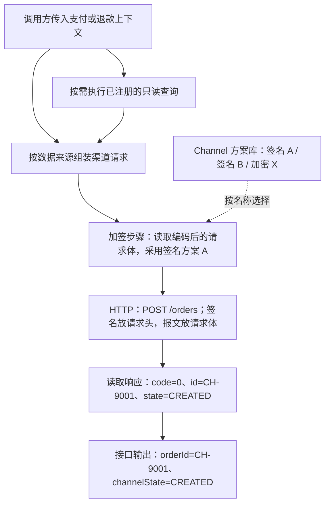

# 渠道 API、处理步骤与协议方案逻辑评审稿

**后继边界：** [通用执行修订](./generic-execution-amendment.md)拥有当前分组、输入、执行与返回语义。本文的支付方式层级、固定支付身份及旧结果码仅保留为前期讨论；处理步骤、映射和显式复用原理继续适用。

最新阅读入口为[模型、脚本与字段映射设计](./model-and-mapping-design.md)，补充独立脚本、三配置对象和三表方向。本文保留前期概念解释；“三个逻辑模型”中的步骤是聚合内对象，不是最新三个独立聚合根，不能与 API/方案/脚本混为一组。

本稿细化三个逻辑模型，不定义 Java 类、管理 HTTP Wire、数据库表或执行器实现。范围由 [requirement.md](./requirement.md) 拥有，成果确认见 [delivery.md](./delivery.md)。文中的字段名是评审用逻辑名称，尚不是已批准的存储或接口合同。

阶段 3 的[详细设计](./design.md)及其附件拥有管理 HTTP、字段结构、存储、查询和页面的具体提案；本文保留概念图与逻辑解释，不建立第二份详细合同。具体存储修订待确认，尚未替代现行全局权威。

真实协议核验与现状分析见[NI 退款配置及过程图](./ni-refund-example.md)和[能力缺口/逐系统影响](./gap-analysis.md)。前者用合成数据代入公开协议，后者记录工程证据及未闭合的合同；均不表示已经接通渠道。

## 0. 先看一笔调用，再看字段

三个模型分别回答三个问题：**API 要调用哪个接口；步骤先后做什么；协议方案采用哪套可复用办法。** 文中的“定义”表示配置内容，不要求把每个术语做成一个单独表单、表或数据库字段。

下面采用虚构渠道的“创建渠道订单”示例，只解释数据流，不代表 NI 的实际协议。对象用 JSON 形式展示是为了可读，不表示本轮已经选定或实现 JSON 编解码器。



| 看见的术语 | 普通说法 | 本例 |
|---|---|---|
| 输入定义 inputDefinition | 这个接口需要哪些数据、从哪里取 | 支付时接收支付上下文；缺少的渠道字段可通过指定查询补齐 |
| 请求处理 requestSteps | 发出去之前怎么处理 | 按需查询、组装字段、编码、使用签名 A 加签 |
| 输入绑定 inputBindings | 某个值从哪里拿 | 金额取退款上下文；原渠道交易号取查询结果；签名内容取编码步骤的结果 |
| 协议方案 schemeCode | 选择已经配好的哪套办法 | 选择“签名 A”，该方案可以被其他 API 使用 |
| 执行参数 parameters | 这一步额外要填的选项 | 编码步骤选择字符集；若公共方案已固定就不用再填 |
| 输出绑定 outputBindings | 处理结果供后面怎样引用 | 签名结果叫 signature，HTTP 请求头从这里取值 |
| 传输配置 transportDefinition | 请求发到哪里、怎么发 | HTTP、POST、/orders、请求头和请求体 |
| 响应处理 responseSteps | 渠道返回的数据怎么读 | 需要时验签/解密，再提取 code、id、state |
| 结果规则 resultRules | 渠道这次接口调用是什么意思 | 本示例 code=0 表示订单创建被接受，不代表已经收款 |
| 输出定义 outputDefinition | 最后把哪些结果交给调用方 | id 转成 orderId，state 转成 channelState |

“步骤”和“方案”的区别可以直接看一句配置：**对请求体（输入）使用签名 A（方案）进行加签（步骤），得到 signature（输出）。** 加密、验签和解密也采用同样表达。

## 1. 组织与关系

```text
Channel
├── 协议方案库：同类能力可以存在多套命名方案
└── 支付方式：引用精确 Payment Method Catalog code
    └── API：引用具体方案，拥有输入输出与处理顺序
```

- 每个 API 定义属于一个 Channel 下的一个支付方式；API 标识在该支付方式内唯一。同一 Channel 的不同支付方式可以各自存在同名 API。
- 原稿的 paymentMethodRefs 表示“一份 API 被多个支付方式引用”，属于超出当前需求的扩展，现改为单一归属 paymentMethodCode。Channel 从所属支付方式的关系确定，页面不必重复填写。
- 本轮复用的是签名、加密等协议方案及请求/响应步骤组合。API 定义本身不跨支付方式共用。共享 Token API 的独立归属与跨接口复用暂不展开，不为它创建虚拟支付方式。
- Account/MID、环境及认证材料属于当次执行上下文；它们不改变主层级，也不允许 API 修改本次已经选定的账户/MID。
- API 只描述自身的渠道输入输出；没有标准 `authorize/sales/query` 绑定、调用其他渠道 API 的节点或支付状态推进规则。组装阶段可调用注册的业务数据查询，查询与跨渠道 API 编排分开。

## 2. API 定义

| 逻辑字段 | 含义与例子 |
|---|---|
| paymentMethodCode | 属于哪个支付方式。创建 API 时由所在目录确定，单值；Channel 由父级关系确定 |
| apiCode / apiName / description | 例如 CREATE_ORDER / 创建渠道订单 / 用途说明；标识在所属支付方式内唯一 |
| inputDefinition | 声明所需上下文、基础字段及待补齐数据的数据来源；不要求调用方把全部渠道字段预先摊平传入 |
| requestSteps | 例如按需查询原交易 → 组装请求 → 编码 → 加签；每步写清读取和生成的数据 |
| transportDefinition | 例如 HTTP POST /orders，Header 从签名步骤取值，Body 从编码步骤取值 |
| responseSteps | 例如验签 → 解码 → 提取 code/id/state，按实际协议选择 |
| outputDefinition | 例如返回 orderId、channelState；写清类型、是否可空及数据来源 |
| resultRules | 例如合成示例的 code=0 表示该接口受理成功，不映射平台支付状态机 |

环境、账户/MID 和认证材料用途是运行时数据来源，归入步骤的输入绑定说明，本轮不再单列一个需要用户配置的 contextRequirements 块。HTTP Header/Body 是 transportDefinition 中的请求消息配置；原响应头/体是 responseSteps 可读取的数据。

### 业务上下文与动态查询

这里的“外部调用方”指渠道 API 执行能力的调用者，例如后续支付或退款流程，不据此新增公网入口。支付调用传入支付上下文，退款调用传入退款上下文；精确 Java 类型、字段清单及跨进程传输合同后续由调用方与业务 Owner 确定。

API 通过声明的数据来源取值，主要包括：

| 来源 | 例子 | 使用方式 |
|---|---|---|
| 调用方上下文 | 支付金额、退款金额、币种、原交易引用 | 读取明确的字段路径，原上下文只读 |
| 受控运行上下文 | 已选账户/MID、认证材料用途 | 按允许属性或句柄读取，不能由配置替换已选身份 |
| 已注册查询的结果 | 由原交易引用查询渠道交易号 | 配置查询方法及入参，结果命名后供后续步骤读取 |
| 常量与前序步骤结果 | 固定 Header、编码后的报文、签名结果 | 读取明确常量或前序输出 |

动态查询以系统函数方式提供：开发者实现并注册函数，配置者选择函数、绑定入参，再用字段选择工具取其返回值。查询是函数内部逻辑，页面不维护“何时查询 / 先检查哪个已有字段”的独立策略。配置中不填写 Java 类名/任意 Bean 方法、SQL 或任意 URL；具体实现通过业务 Owner 的公开查询能力获取数据。注册与调用字段以当前 [系统函数合同](./query-contract.md) 和 [定义合同](./definition-contract.md) 为准。

以退款为例，下面都是说明用途的逻辑名称，不代表已有公开方法或已确定的上下文类：

```text
传入的退款上下文：
  refundAmount = "10.00"
  currency = "USD"
  originalTransactionRefId = "ref-example-001"

查询步骤 originalPayment：
  查询方法 = 查询原渠道交易
  参数 transactionRefId = 上下文.originalTransactionRefId
  结果 originalPayment = { externalTransactionId: "CH-9001" }

渠道请求字段：
  amount                ← 上下文.refundAmount
  currency              ← 上下文.currency
  originalTransactionId ← originalPayment.externalTransactionId
```

查询能力的契约至少说明可用名称、所属业务 Owner、适用上下文、入参、返回字段及空结果/失败行为。查询返回有类型的获准数据，不返回持久化对象或任意整表。执行器如何接入这些能力留给实现设计；本稿不新增 Maven 依赖，也不允许 Channel 越过模块边界访问其他 Owner 的 Repository/Mapper。

### 补数与校验顺序

1. **先校验基础上下文。** 校验上下文结构、身份范围，以及本次必要查询所需的原交易引用等基础字段；允许由查询补齐的目标字段此时不判为缺失错误。
2. **调用明确引用的系统函数。** 字段可直接来自上下文，或取注册函数的返回值。函数内部的已有值利用和缺失处理由开发者定义；API 不再配置查询专用触发模式。函数失败/超时不能被当作缺失悄悄回退；没有引用函数时不自动猜测方法或遍历数据源。
3. **保留来源和原值。** 查询结果放在独立的步骤输出中，不原地修改上下文。已经冻结的金额、币种、OE、Account/MID 及原交易身份不得被当前查询值覆盖；有身份或金额冲突时明确失败。
4. **复用当次结果。** 同一步查询执行一次，Header、Body 和签名需要相同数据时引用同一结果；不因多处字段引用就重复查询。当前调用内结果不成为跨请求缓存，也不表示多 Owner 查询天然处于同一数据库快照。
5. **完成后再检查目标请求。** 必需字段、类型、约束及目标交易范围满足后，才编码/加密/签名并发送。查询失败、超时、空结果或多条结果如何处理必须明确；必需数据仍缺失则停止，不发送渠道请求。

查询只读取业务数据，不创建订单、占用额度、退款、刷新支付状态或在内部再执行渠道交易。跨模块/服务查询通过 Owner 能力完成，远程查询在数据库事务外；它们可以有内部同步 HTTP，但不能由配置访问跨库 SQL 或用任意 URL 绕过 Owner。原始卡和认证材料仍按既有受控边界访问，通用查询不能变成任意取明文的入口。

查询预算、权限范围及数据新鲜度由各查询契约规定；执行时受总时限、次数和结果大小边界约束。具体数值和注册方式不在本次逻辑稿中编造。

### 输入输出

- 逻辑数据可以是字符串、布尔、精确整数/小数、对象、数组或字节；具体编码器不在本稿选型。取值后继合同采用上下文路径、受限 Aviator 表达式、系统函数及 result 表达式，取值与加工在一处完成，详见[定义合同](./definition-contract.md#32-aviator-取值与处理)；本逻辑稿早期独立转换步骤只说明处理依赖，不再对应独立转换选择器。
- 区分字段缺失、显式空值、空字符串和零。缺省值只在定义允许的缺失场景应用；金额、账户、原交易身份等必需事实不能通过默认值伪造。
- 数值精度、单位、溢出和转换失败行为由对应字段明确声明，禁止由浮点误差或隐式字符串转换决定报文。
- API 声明自身需要的输入视图，通过业务上下文和查询结果满足，不要求调用方为每个渠道构造独立的全部输入字段；输出可以包括渠道订单号、渠道返回码、渠道原状态和获准的其他字段。本稿不预定义统一支付结果枚举。
- 输出契约可以按本接口结果分支声明必填字段，例如成功响应必须有渠道引用、拒绝响应允许没有。先识别结果分支，再校验该分支输出；不能因缺少成功分支字段而丢失有效拒绝结果。无法形成业务输出时仍返回执行事实与失败阶段。
- 输出字段的敏感分类和用途必须明确。临时 Token、跳转链接等只走批准的受限返回路径，不因定义了输出字段就获得持久化、日志或外部披露许可。

## 3. 处理步骤定义

| 逻辑字段 | 含义与约束 |
|---|---|
| stepCode | 在展开后的本次调用中唯一，供后续步骤引用 |
| capabilityCode | 注册的处理能力，例如数据查询、映射、编码、加签、验签、加密、解密、提取 |
| schemeCode | 采用哪套方案，例如 SIGN-A；可选，引用必须属于同一 Channel 且能力类型匹配 |
| inputBindings | 从业务/运行上下文、查询结果或前序步骤输出取值；绑定查询所需参数也使用同一规则 |
| parameters | 该能力或方案明确允许由 API 填写的参数；禁止未声明参数和隐式覆盖 |
| outputBindings | 将能力结果暴露为此步骤下的命名输出，供后续步骤或最终消息使用 |
| 失败语义 | 本轮固定为停止当前调用并报告失败阶段，不作为可编辑字段；不配置忽略失败、回退成功或自动重试 |

### 执行规则

1. 请求链和响应链内部按顺序执行；请求组装允许注册的数据查询，不引入跨渠道 API 调用、直接 SQL/持久化访问、任意脚本、循环或并行网络分支。
2. 步骤只读取已声明输入及已经产生的前序输出；不允许向前引用、循环引用或覆写其他步骤的输出。
3. 请求步骤可以把字段转换为对象、文本或字节；签名、加密能力的输入类型必须准确。处理能力输出不是任意共享变量。
4. 时间戳、随机数等如被声明为受控处理能力，应在当次调用中生成一次并通过步骤输出引用；签名、请求头与请求体引用同一结果。跨次调用的重放策略不在本稿定义。
5. 需要报文签名时，必须明确签的是对象选定字段、编码结果、密文还是协议要素组合；最终发送字节与对应签名输入保持一致，传输阶段不再隐式重编码受保护内容。
6. 验签、解密、解码等顺序取决于该 API 协议。必要的预解析可以产生临时未验证数据；通过该协议要求的验证之前不能将其当成可信业务输出。
7. 无需加密或验签的接口不配置对应步骤；步骤省略必须符合其真实协议，不能通过忽略执行失败模拟省略。

### 调用内的数据范围

| 范围 | 使用规则 |
|---|---|
| 业务上下文 | 调用方提供支付/退款等上下文，单次调用只读；先校验基础字段，再补齐允许查询的数据 |
| 运行上下文 | 获准的环境、账户、MID 属性及认证材料访问句柄，只读且不能由任意输入替换 |
| 查询结果 | 请求组装时通过注册查询获取的有类型结果，作为命名步骤输出使用，不覆盖原上下文 |
| 步骤输出 | 当次调用私有，以 stepCode 定位；不跨请求共享 |
| 传输响应 | 协议状态、响应头和原始响应体；原始字节只在受控内存中供验证/解码使用 |
| API 输出 | 按声明白名单生成，不自动返回完整上下文、原始信封或全部步骤结果 |

## 4. 可复用协议方案定义

| 逻辑字段 | 含义与约束 |
|---|---|
| channelCode / schemeCode / schemeName | 所属渠道及 Channel 内唯一方案标识、名称 |
| 方案形态 | 单能力预设或步骤组合；两种形态有各自的内容约束，不混用同一配置体 |
| capabilityCode | 方案对应哪种受控能力；加签/验签、加密/解密可分别定义 |
| fixedParameters | 固定算法参数、拼接/排序规则、编码等；并非每类能力都具有所有字段 |
| parameterDefinition | 明确允许由 API 提供的参数、类型和范围 |
| inputDefinition / outputDefinition | 该方案要求的输入及产生的输出类型 |
| credentialPurpose | 如 signingKey、encryptionKey 等用途标识，由受控上下文解析真实材料 |

方案中的固定规则不能被 API 随意覆盖。API 可以绑定数据、提供已声明参数并使用输出；协议差异超出参数契约时创建另一套方案。

算法能力属于受控实现，方案属于该 Channel 的配置。例如两份方案可以使用同一种算法能力，却采用不同的字段拼接或编码规则。首版不建立跨 Channel 的业务方案继承体系。

### 可复用步骤组合

多个 API 连处理顺序也相同时，方案库可以保存命名的步骤组合。它是上述步骤的复用形式，不增加跨接口流程能力：

- 组合形态以 steps 保存有序步骤，替代单能力形态的 capabilityCode/fixedParameters；共享标识、输入输出及参数契约。
- 对外声明输入、参数和输出；内部只引用单个处理能力/方案。
- 首版组合不引用其他组合，避免递归、循环和难以解释的多层覆盖。
- API 引用组合时绑定参数；解析后得到带唯一名称空间的顺序步骤，两个组合中的同名局部步骤不会冲突。
- 展开结果不含渠道传输或调用其他渠道 API 的节点。组装所需的注册只读查询可以作为步骤；唯一 transportDefinition 最多执行一次本 API 的目标渠道通信。
- API 与组合中若都有业务不同的处理顺序，直接使用独立 API 步骤或另建组合，不增加隐藏例外。

## 5. 传输与编解码边界

传输能力负责本 API 的一次目标渠道通信，处理能力负责查询补数、构造与解释消息。注册业务查询可能通过 Owner 内部同步 HTTP 获取数据，因此“单次渠道通信”不表示整个执行过程只有一次网络访问；查询数量与目标渠道请求分开记录和约束。

| 方面 | 逻辑要求 |
|---|---|
| HTTP 参数 | Method、目标地址/路径/Query 绑定、连接与响应超时等；实际地址受环境允许范围约束 |
| HTTP 请求头 | 支持按名称绑定值；声明必要的多值语义，不假定所有协议字段都是单值字符串 |
| HTTP 请求体 | 引用请求处理链的最终字节或批准的空体，不在传输时重新生成已签名的报文 |
| HTTP 响应 | 同时提供状态、响应头及原始体，支持空体与非预期 Content-Type 的明确处理 |
| 其他协议 | 保留独立协议参数及消息结构的扩展点，不强制套用 HTTP Header/Status |
| JSON/XML | 保留对象/文本/字节之间的编解码能力契约，本轮不实现或选定库、JSONPath/XML 查询语法 |

自动 HTTP 重定向、隐式认证握手重试或库级失败重试可能导致额外请求；本稿的单次调用边界不允许这些行为悄悄发生。未来确有协议需求时明确设计其发送证据和目标校验，不用默认配置引入。

## 6. 结果与失败定义

返回结果需要分别表达以下事实；下面是逻辑维度，不是新增持久化状态枚举：

1. **执行事实：** 是否在发送前结束、是否可能已发送、是否收到响应，以及失败阶段。
2. **协议证据：** 获准的 HTTP 状态、渠道返回码、验证/解析结果等。
3. **渠道接口输出：** 按 outputDefinition 提取的数据及该接口本身的结果分类。

resultRules 可以读取协议状态、响应头和已经验证/解析的字段。规则需声明明确顺序或优先级；存在未能唯一决胜的匹配时返回规则冲突，没有匹配时返回无法识别，不使用默认成功。

数组提取需声明定位条件及预期数量；没有目标或多于预期时明确失败，不自动取第一项。接口结果由多个字段共同决定时，应完整表达其条件。

| 场景 | 本 API 的处理边界 |
|---|---|
| 基础上下文缺失、方案不匹配、步骤类型错误 | 停止，不执行依赖缺失字段的查询，不发送渠道请求 |
| 必需查询失败/超时、未找到唯一数据，或补数后仍不满足请求 | 停止并报告具体查询/数据失败，不能静默补默认值或发送不完整请求 |
| 请求加签/加密失败 | 停止，不发送渠道请求；不得降级成未签名/未加密请求 |
| 连接/发送状态不确定或响应超时 | 保留可能已发送事实，不自行重试或断言渠道业务失败 |
| 收到响应但验签、解密、解析失败 | 保留已收到响应及失败阶段，不输出可信渠道业务成功 |
| 响应与结果规则不匹配 | 返回未识别/冲突及获准诊断信息，不推进支付状态 |
| 响应明确表达渠道业务拒绝 | 输出该接口的拒绝结果及允许的字段；它不必等同通信故障 |

网络执行必须位于数据库事务外。该逻辑约束不引入新的支付幂等、发送检查点、恢复机制或业务事务。

## 7. 复用示例

以下方式 A/B、API 与方案标识都是合成图例，不是现行 Payment Method Catalog 值，也不是 NI 的真实签名协议。

| 支付方式 | API | 请求签名 | 请求加密 | 响应处理 |
|---|---|---|---|---|
| A | API-1 | SIGN-A | ENCRYPT-X | VERIFY-A → DECRYPT-X → 提取 |
| A | API-2 | SIGN-A | 无 | 提取 |
| B | API-3 | SIGN-B | ENCRYPT-Y | DECRYPT-Y → VERIFY-B → 提取 |
| B | API-4 | SIGN-A | ENCRYPT-Y | VERIFY-A → 提取 |

SIGN-A 可以被跨方式复用，SIGN-B 表达不同规则；ENCRYPT-Y 与不同签名自由组合。各 API 的解密/验签顺序独立，是否解密由响应协议决定，不由请求加密方式推断。

一个 API 的绑定示例：

```text
API-1
  业务上下文：退款金额、币种、原交易引用
  运行上下文：已选账户/MID属性、认证材料用途
  请求步骤：
    originalPayment：按上下文的原交易引用调用注册查询
    buildRequest：根据退款上下文与 originalPayment 结果构造渠道请求对象
    encodeRequest：对象 → 字节（编解码实现另定）
    encryptRequest：引用 ENCRYPT-X，输入 encodeRequest.bytes
    signRequest：引用 SIGN-A，输入 encryptRequest.bytes
  传输：
    protocol = HTTP
    body = encryptRequest.bytes
    渠道签名头 = signRequest.signature
    其余 Header/Path/Query 显式绑定
  响应步骤：
    verifyResponse：引用 VERIFY-A，绑定原始响应体与响应签名头
    decryptResponse：引用 DECRYPT-X，绑定已通过验证的响应体
    extractResponse：按接口契约提取字段
  输出：channelReference、channelStatus、channelResultCode
```

本例只解释数据来源与处理顺序。它可以调用注册的业务数据查询，没有调用第二个渠道 API，没有标准支付动作映射，也不能充当真实渠道测试向量。

## 8. 保存后直接生效

用户已明确暂不考虑版本发布，修改直接生效。本节定义这一目标行为，不引入配置版本号、不可变修订、发布按钮、审批或灰度：

- 保存前校验引用归属、类型、步骤依赖、参数范围、最终消息绑定、结果规则及输出白名单。校验通过并保存成功后，之后开始的调用直接使用新配置；校验失败不改变当前配置。
- 查询方法及上下文字段的可用性、参数类型和引用顺序也在保存校验范围内；保存只验证定义，不以试运行真实业务查询或渠道请求作为保存动作的一部分。
- 公共方案修改同样直接影响所有引用它的 API 的新调用。页面展示影响范围即可，不额外增加确认发布步骤；与引用方不兼容的修改应在保存校验时拒绝。
- 一次调用开始时读取完整当前 API、引用方案及独立脚本内容，在本次执行内使用同一份数据。进行中的请求不在处理中途切换方案或脚本；这是当次内存数据，不是持久化版本或历史快照。
- API、方案与脚本的读取必须完整一致，不能把保存过程中的半份数据拼起来。阶段 3 推荐主库短事务完整读取，见[详细设计第 4 节](./design.md#4-保存后新调用立即可见)；不以延迟刷新改变本规则。
- 原 definitionRevision、schemeRevision 以及持久化依赖修订字段移除。方案使用关系按当前定义解析；实际凭据仍由获准上下文提供，不保存真实密钥。
- 被引用方案不能直接删除；需要先调整引用或拒绝删除。API 有自己的显式方案选择，不通过 Channel/支付方式的隐含默认值决定。
- Operations 展示 API 原定义、引用的当前方案、展开后的步骤和脱敏诊断。[页面](./ui.md)、[权限与管理合同](./api.md)已形成阶段 3 提案，本轮不实施后台。
- 真正开发时用合成输入验证请求字节、签名/加密测试向量、响应解析及上述失败分支；离线逻辑验证不调用真实渠道，不以其结果宣称渠道已经可用。

## 9. 与现行规则的关系及后续议题

| 主题 | 当前边界与处理 |
|---|---|
| 模块 Owner | 遵循 [Payment 模块方案](../../20260913/payment-业务模块划分/technique.md)，本稿不调整 Maven 依赖、创建共享执行 JAR 或搬移 Card 片段 |
| 配置存储 | [Payment 数据库权威](../../../agent-docs/database/PAYMENT_ORCHESTRATION_DATABASE.md)当前要求 Endpoint、超时、Secret 及相关运行材料不进入 Payment DB，Account 仅以 integration_config_key 定位；[详细设计第 2 节](./design.md#2-存储边界及现行规则修订提案)提出相对路径/目标用途别名/超时的窄修订，待确认后才同步权威 |
| 敏感材料 | 原始卡边界继续由 [交易级工具修订](../../20260913/payment-Execution设计/instrument-token-amendment.md)拥有；通用输入、步骤输出和调试结果不获得新增原值权限 |
| 运行与恢复 | [当前台账](../../../agent-docs/CURRENT_IMPLEMENTATION.md#payment-execution-implementation)及 Execution 合同独占实现与恢复事实；本稿不接入或改变其状态、幂等、补偿规则 |
| 公共需求与时序 | 本稿先登记概念评审；没有新增标准支付用例或跨系统调用序列，不向需求站写入已实现能力。后续功能范围获批时按既有目录同步 |

三个逻辑模型、上下文与查询数据来源、依赖和复用边界由本文解释。真实协议样例与差异分析见上述附件；管理 HTTP、持久化、注册查询合同、能力类型及运行预算已进入[阶段 3 详细设计](./design.md)。真实查询/算法实现、回调和标准 API 编排继续留待对应范围，不把提案当作运行能力。

## 10. 评审对照

| 验收项 | 本稿证据 |
|---|---|
| CAPI-01 | 第 1 节 API 单一归属及上下文关系 |
| CAPI-02 | 第 2 节 API 模型、第 5 节单次传输边界 |
| CAPI-03 | 第 5 节协议参数及消息结构 |
| CAPI-04 | 第 3 节步骤输入输出及执行规则 |
| CAPI-05 | 第 4 节多套方案、第 7 节四组配置差异 |
| CAPI-06 | 第 3、4 节显式绑定与凭据用途 |
| CAPI-07 | 第 6 节结果三个维度及平台状态边界 |
| CAPI-08 | 第 6 节失败场景表 |
| CAPI-09 | 第 8 节保存直接生效与当次调用一致性、第 9 节存储边界 |
| CAPI-10 | 第 0 节图解与字段例子、第 7 节复用示例、第 9 节后续议题；NI 退款附件及差异分析 |
| CAPI-11 | 第 2 节业务上下文、数据来源与退款查询示例 |
| CAPI-12 | 第 2 节补数与校验顺序、第 3/5/6 节查询、单次渠道通信与失败边界 |
