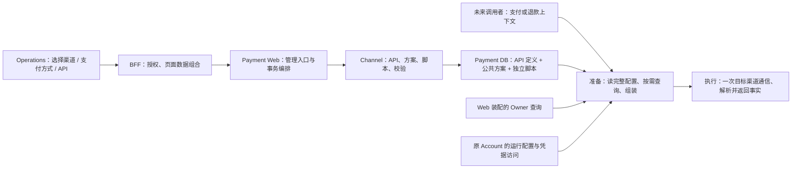

# 渠道 API 配置详细设计

> **2026-10-13 迁移后继：** 本目录已由 `requirements/20260914/payment-渠道API逻辑定义/` 迁至 Platform 命名目录。本文为历史资料，保留原日期与适用范围；现行合同见[需求](./requirement.md)、[六表数据设计](./data-design.md)和[流程设计](./flow-design.md)，本文被取代的范围见[技术说明第 5 节](./technique.md#5-历史资料与取代关系)。

> **2026-09-21 后继：** [Platform HTTP 执行修订](./platform-http-execution-amendment.md)确定配置管理、存储和执行归 Platform，业务系统通过内部 HTTP 调用。本文未同步的 Payment 落点或 Owner 未定表述仅作前序记录；字段与物理 SQL 继续评审。

**2026-09-15 页面修订：** [公共脚本与 HTTP 对象](./public-script-http-context-design.md)将公共方案和独立脚本合并，公共脚本可修改当次 HTTP 工作对象，API 维护有序引用与参数；原 Pencil 已交付 S01～S05。公共输入/输出结构见[模型与场景](./model-library-and-response-scenes.md)。下文三对象/三表、单页及“脚本尚未绘制”均为前版记录，不作为当前完整方案或实现状态。

**当前入口：** [通用执行修订](./generic-execution-amendment.md)取代本文的 Payment 专属分组、固定调用身份、发送门禁与结果外壳。下文的四应用/三表方向和管理草稿属于通用化前提案；通用 Owner、分组存储、物理数量及管理 Wire 尚待同步，不作为现行完整实施设计。

**本方案涉及 Payment、Operations BFF、Operations Web、Platform Support 共 4 个应用，当前采用 API、公共方案、独立脚本三表方向，旧表结构修改 0。原有 13 项管理操作、两表 17 字段/4 索引及 145 行注册 INSERT 是已有部分草稿；独立脚本的完整物理字段、接口和注册增量待补齐，不能把旧统计作为当前全部规模。Operations 保持 1 个功能页面方向，新增脚本维护状态尚未绘制。**

先读[模型、脚本与字段映射设计](./model-and-mapping-design.md)：它整理最近确认的对象边界及一笔调用的数据流，并明确请求 Body/调用方输出映射的位置。用户本轮要求先整理文档，不进入下一研发阶段。

阶段 3 评审稿。用户已接受[阶段 2 差异](./gap-analysis.md)并同意进入存储、查询、页面和接口设计；本稿中的具体取舍待评审，不代表研发或 SQL 已获授权。逻辑主线沿用 [technique.md](./legacy-technique.md)，本稿拥有详细落点；[字段合同](./definition-contract.md)、[查询合同](./query-contract.md)、[最小注册目录](./registry-contract.md)、[管理 API](./api.md)、[数据与 SQL](./db/README.md)、[页面](./ui.md)为本稿附件。阶段授权和证据只记在 [delivery.md](./delivery.md)。

## 1. 推荐落点

- **Channel 是业务 Owner。** 不新建独立服务、通用工作流服务或共享执行 JAR。四个 Payment 业务 JAR 保持默认无互相依赖；Web 装配跨模块协作，边界见[模块方案](../../20260913/payment-业务模块划分/technique.md)。
- **三张表方向。** API 元数据可检索，步骤、绑定、传输和结果规则作为严格定义整体保存；公共方案独立保存；简单逻辑脚本有独立身份、输入输出合同和源码文本列，API/组合方案只保存 scriptCode 引用。步骤没有独立维护生命周期，仍不拆步骤表。脚本表的完整物理设计待补齐，原 DDL 只覆盖前两表。
- **没有支付方式关联表。** 每个 API 行有一个精确 payment_method_code；页面按该字段分组。新增 API 时选择既有目录代码，没有 API 的方式可以从目录选择，不为一棵空目录树造表。
- **系统函数实现不入配置表。** 开发者实现并注册名称、入参、返回类型和既定缺失/失败行为；Operations 只引用获准函数、绑定入参并选择返回字段，不配置查询内部逻辑或触发策略。调用仍由既有步骤表达，真实返回数据不存进 API 定义。
- **配置保存即生效。** 没有业务版本、发布、审批、灰度、历史快照和定时刷新机制。

## 2. 存储边界及现行规则修订提案

三种方案中推荐中间一项：

| 方案 | 结果 | 取舍 |
|---|---|---|
| 全部继续放 Nacos/环境配置，Operations 代写 | 配置和凭据边界沿用原方式 | 增加配置中心写入、权限及多实例生效合同，不利于本期按对象管理 |
| **非敏感协议定义入 Payment DB，环境目标与凭据仍按原 Account 提供** | API/方案整体管理，保存与引用校验在本库完成 | **推荐**；需明确放宽“相对路径和 API 超时不入库”的旧边界 |
| 完整 Endpoint、凭据及协议一起入库 | 一个编辑入口可以修改所有连接材料 | 不采用；将凭据管理与协议编排混为同一权限，也会扩大本期 Account 管理范围 |

建议的具体分配如下：

| 内容 | 存放与管理位置 |
|---|---|
| API 的 Method、相对路径模板、Header/Body 绑定、超时、结果规则 | API definition_json，Operations 编辑 |
| 签名/加密规则、能力参数、步骤组合、凭据用途名 | Scheme definition_json，Operations 编辑 |
| 简单组装、转换、判断的可复用脚本 | 独立脚本表的源码文本和严格输入输出合同；API/方案保存 scriptCode，不复制源码 |
| 环境 base URL、允许的目标别名、Account 凭据材料访问配置 | 继续通过冻结 Channel Account 的 integration_config_key 解析运行配置；Operations 选择目标别名，不填写任意域名 |
| Token、Secret、私钥、证书、KMS/Secrets Manager 定位及轮换材料 | 现有受控运行边界；不进入普通 API/方案定义或页面明文 |
| 原交易事实与后续 NI 定位信息 | 原事实 Owner 的查询合同；不是配置常量，也不新增一个通用数据容器 |

**待批准的窄修订：** [Payment 数据库规则](../../../agent-docs/database/PAYMENT_ORCHESTRATION_DATABASE.md)及[Account 设计第 6 节](../../../agent-docs/plans/2026-08-25-payment-provider-account-mid-simplification-design.md)中，禁止 Endpoint/超时进入 Payment DB 的规则，对本需求的“非敏感相对路径模板、目标别名和 API 超时”作上述例外。绝对环境地址、账户身份、凭据与轮换仍在原边界。本文没有静默改写这些权威；用户批准本设计后才同步现行规则及正式模型。

## 3. 保存与并发

写入链路：权限检查 → 纯结构校验 → 同 Channel 协调锁 → 本地短事务 → 锁定原 Channel 行 → 读取当前引用集合 → 校验完整候选配置 → 条件写入 → 提交后返回当前对象。

- 采用 `channel-api-config:{channelId}` 资源锁，冲突域是共享协议定义所在 Channel，不锁整个 Tenant。按[资源锁规则](../../../agent-docs/decisions/2026-09-05-redis-first-resource-lock.md)，Redis 锁在事务外取得，数据库 Channel 行锁与唯一索引承担最终保护；同 Channel 所有配置写入口必须遵守同一行锁约定。
- 更新/删除携带读取时的 `expectedUpdateTime`。它仅用于防止两人互相覆盖，不是发布版本，也不新增 version 列。每次成功修改使用 `max(当前 UTC 微秒时刻, 旧 update_time + 1 微秒)`；行锁内比较旧时间并核验影响行数。按内部 ID 更新，因此删除后重建同代码也不能被旧编辑请求覆盖。
- Channel 行仅用于存在性与并发保护，不因此改写其 update_time。CLOSED Channel 不允许新增/编辑，允许只读和清理无引用定义；其他 Channel 状态不等于 MID 运行资格。
- 方案保存必须校验直接引用 API 和经步骤组合间接引用的 API；任何一个失效则整次保存回滚，并返回受影响 API 与错误字段。方案删除时仍有引用就拒绝。
- 独立脚本纳入同 Channel 的写协调、旧时间并发检查和依赖分析。修改脚本须检查直接引用它的 API、方案及间接 API；被引用脚本禁止删除。当前调用在同一次完整配置读取中取得脚本内容，不在步骤执行中重新查找“最新脚本”。脚本数、源码及依赖展开预算须补入完整限额后再实现。
- API 身份（Channel、支付方式、apiCode）与方案身份（Channel、schemeCode）创建后不可修改。调整身份通过新建与明确删除处理；当前范围没有标准 API 绑定表，未来有新引用 Owner 时须扩展删除检查再允许接入。
- 不新增命令幂等表，也不接入当前仅批准 Commerce 消费的 Foundation 幂等 JAR。创建由自然唯一键防重复，更新由旧时间条件保护。响应丢失时页面显示“保存结果待确认”，重新读取核对，不自动重试、覆写或制造持久化成功回执。

创建/更新的成功响应只在提交后返回。检查配置接口不会写库、调用真实查询、读取凭据或发送渠道请求。

## 4. 保存后新调用立即可见

首期不使用跨请求配置缓存，不读异步副本。准备一次调用时，从同一主库连接的短只读 REPEATABLE READ 事务读取 API 及全部引用方案、脚本源码和合同；第一次一致性读定义此次调用的配置读取时点，加载完成即结束事务。此后查询补数、脚本求值与渠道通信都在事务外。

保存提交后才启动配置读取的新调用，必须看到新定义；在保存前已经取得一致性视图的调用允许完成旧定义。已进入准备阶段的调用不会中途切换方案；不能仅按 HTTP 到达时间判断采用哪份数据。多实例都读取同一主库，不依赖刷新事件或本机缓存失效来承诺“立即”。

后续只有在能保持上述语义并拿到性能证据时再设计缓存。现行 Gateway 的 Last Valid/延迟 Snapshot 不移植到这里。主库不可用、定义损坏或依赖不齐时，准备失败，不悄悄使用进程内旧配置。

## 5. 配置有效与可执行分开

注册目录同时给出输入输出合同和当前实现可用性。定义可以保存对已注册但尚无运行实现的能力的引用，页面明确显示“缺少执行能力”及具体项；未注册代码、类型不匹配、循环或无效绑定则不能保存。可执行性是基于当前定义、已装配能力与受控运行输入的派生结果，不新增 enabled/published 状态或人工激活按钮。

实际 prepare 必须检查所需实现、查询和运行材料可用；缺少任一项就返回未发送事实。新增算法扩展受控能力注册及测试；取值允许定义合同限定的 Aviator 表达式及纯函数，独立脚本亦须满足其完整受限合同，不允许任意 Java 类、无限制程序、SQL 或密码算法源码。

首批结构化取值、函数、字段映射、条件、JSON 编解码、认证和密码处理的具体合同见[协议处理附件](./capability-contract.md)，原 NI 定义与前两表内容已对应核对；该检查不覆盖独立脚本。XML 及具体算法实现/库仍按既定范围另行接入，不将设计阶段选项写成已安装能力。

## 6. 运行时合同与现有 Execution

本期定义 Channel 的 `prepare / execute` 两段本地能力，详细输入输出见[查询与调用合同](./query-contract.md)。prepare 先在本库短只读事务内读取完整 API、引用方案及脚本，结束事务后完成补数和请求组装，产生只在本进程当前调用中有效的 PreparedCall；execute 消费一次该对象，最多发送一次目标渠道请求，保留发送阶段与解析结果。

不直接替换现有 Execution Channel 端口。其发送门禁、UNKNOWN、查询恢复、退款预占和业务状态更新保持原合同。未来接入时由同一用例入口在适当阶段调用 prepare，再受理发送、提交后 execute，最后由受控适配转换并应用结果；门禁拒绝必须释放准备材料，准备完成不代表资金已提交。该衔接要随标准动作/渠道适配专项评审，不能由 Operations 配置推进 Execution 状态。

NI 多级导航与本次退款关联继续保留[样例中的缺口](./ni-refund-example.md#5-响应的关键识别这次退款)。本期定义所需查询返回结构，但不凭空新增已完成交易事实、绕过 Owner 查询 NI 或将观察记录认定为本次成功。

## 7. 管理入口和页面

维护者为熟悉渠道文档的接入人员或开发者，使用一个“渠道 API”页面：先选 Channel，再按支付方式定位 API；公共方案在 Channel 下独立页签维护。API 编辑采用“接口定义 / 请求映射 / 协议处理 / 响应映射 / 校验”页签，统一工具栏校验并保存整份草稿；使用技术字段与规则表格，取消问答式向导。请求字段旁只选上下文路径、Aviator 表达式或系统函数；表达式完成取值与加工，系统函数用 result 表达式读取返回值，不再提供独立转换选择器。函数由开发者注册，页面不维护查询内部策略。调用上下文解释为“调用方传入的数据”，保留类型合同，不把 REFUND 表示为执行退款。执行链仍由同一份定义合同表达，不单设数据来源、请求处理或查询管理页。当前布局、字段行为与模型映射以 [ui.md](./ui.md) 为准。

BFF 负责菜单权限与页面聚合；Payment 负责真实数据、校验和业务事务。页面支持只读、编辑、新建、配置检查、并发冲突、引用错误、保存结果待确认、空目录和能力未安装；保存成功提示直接生效，没有发布页面。具体行为和原型见 [ui.md](./ui.md)。

Platform 除注册 SQL 外还要更新随制品装配的[页面能力清单](../../../paytech/platform-support/paytech-platform-support-access-control/src/main/resources/operations/console-resource-capabilities.json)，登记 `OPERATIONS_CHANNEL_APIS → /channel-apis` 和 `OPERATIONS_CHANNEL_API_MANAGE` 按钮。当前 ConsoleResourceCapabilities 会拒绝未知组件，只有数据库菜单行不足以完成接入；前端组件目录也须同时登记。不把支付配置页加入 IAM 自我保护管理闭包，不改变 Platform 权限模型或 Gateway 实现。

## 8. 拟研发顺序与验证

1. 设计批准后先同步窄存储修订、Payment 唯一 PDManer 模型和完整 Schema 来源；本需求 SQL 保留为增量执行材料，不自动应用。
2. 在 Channel 中实现严格定义模型、注册目录、引用校验、保存/读取与并发保护；Web/API 实现管理合同。先完成输入/引用/并发失败证据，再实现对应行为。
3. BFF 接入权限与 Payment 管理能力，Web 实现一个功能页；Platform/Web 同步页面能力目录，注册数据先保持禁用，不自动给角色授权。
4. 本地调用能力按注册端口实现 prepare/execute 的通用边界，用合成查询和受控本地协议 Simulator 验证；未接入的 JSON/XML/算法能力明确返回不可用，不为展示补默认成功。
5. 真实 NI、原交易事实补齐、标准 API 编排与 Execution 资金接入继续作为后续专项，不包含在本次研发入口默认授权内。

| 验证组 | 必须证明的行为 |
|---|---|
| 定义与引用 | 缺失/null/零的差异、类型约束、前序引用、组合展开、跨方式复用、同类型不同方案、禁止递归/任意代码 |
| 保存与完整读取 | 并发两人编辑仅一人成功；方案修改与 API 新引用竞争；删除与引用竞争；Redis Lease 丢失时 DB 仍保护；保存失败旧定义完整；提交后另一个实例读取新定义 |
| 系统函数与材料 | 函数入参/返回类型校验、无引用零调用、同一次调用的返回值复用、不同调用不隐式合并、函数缺失数据/失败/超时/多结果/身份冲突短路、运行句柄不能作为常量或普通输出 |
| 发送边界 | prepare 不发送；PreparedCall 只能消费一次；门禁拒绝可释放；超时保留可能已发送；不自动重试/重定向；验签失败不产生可信输出 |
| 管理 HTTP | 身份/权限、当前业务资源校验、分页和严格参数、64 KiB 上限、旧时间冲突、错误 Profile、BFF 上游损坏响应、无正文日志 |
| 页面 | 状态/筛选保留、只读无保存、新建/编辑、数据来源选择、方案影响范围、无效定义定位、保存结果待确认、窄屏布局和键盘操作 |

Java 验证遵循[测试规范](../../../agent-docs/UNIT_TEST_GUIDE.md)：从公开入口经真实本地 MySQL/Redis 和 Simulator 闭环，不使用 Testcontainers/Flyway，不因设施未就绪改连共享环境。当前只是设计验证，实际测试、SQL/环境前置和研发完成状态另行记录。

## 9. 本轮需要确认的具体取舍

本稿推荐的两表结构、非敏感相对路径/超时入库、无发布的主库完整读取、旧更新时间并发保护、注册查询与能力目录，以及一个 Operations 功能页，是本次阶段评审的具体结果。批准后可进入上述限定研发；未批准前不改现行数据库权威、应用或环境。NI 合同缺口不阻止配置管理设计，但阻止真实资金接入完成声明。
