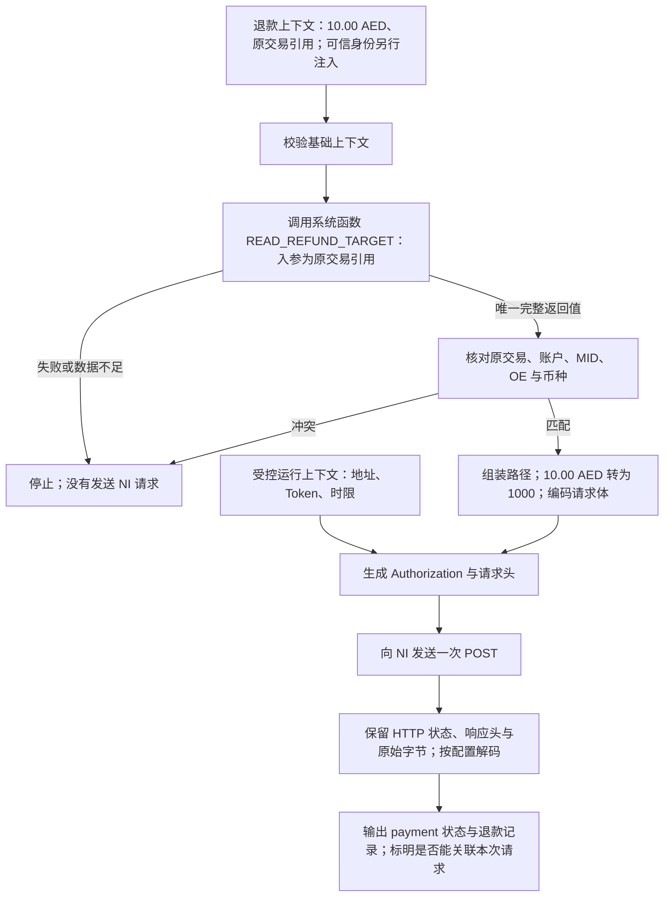

# NI 退款 API：配置与数据流样例

> **2026-10-13 迁移后继：** 本目录已由 `requirements/20260914/payment-渠道API逻辑定义/` 迁至 Platform 命名目录。本文为历史资料，保留原日期与适用范围；现行合同见[需求](./requirement.md)、[六表数据设计](./data-design.md)和[流程设计](./flow-design.md)，本文被取代的范围见[技术说明第 5 节](./technique.md#5-历史资料与取代关系)。

**样例范围：** 本文及关联 JSON 保留通用化前的 NI 协议核对证据。当前输入、分组和返回合同见[通用执行修订](./generic-execution-amendment.md)；下文固定支付身份、UNRESOLVED/UNRECOGNIZED 及旧调用外壳不属于通用合同，不能作为新版导入定义。

本例用 NI N-Genius Online 的 **Refund a Capture** 检查[逻辑模型](./legacy-technique.md)能否表达真实协议。它覆盖输入、补数、共享方案、请求、响应及结果规则。当前完整定义和注册能力合同见第 4 节；仍是开发前设计，现有系统没有配置执行器可直接导入运行。本文没有调用 NI。

结论：请求可以用现有逻辑模型描述；原交易的完整渠道定位数据尚无可用实现，退款响应与本次 Action 的唯一关联规则也尚未闭合。样例保留这些缺口，不把“配置能够表达”写成“真实退款已可运行”。

## 1. 真实协议与本例取舍

| 内容 | 本例采用的事实或边界 |
|---|---|
| API | `POST /transactions/outlets/{outletId}/orders/{orderRef}/payments/{paymentRef}/captures/{captureId}/refund` |
| 请求头 | `Authorization: Bearer <access_token>`；Content-Type、Accept 均为 `application/vnd.ni-payment.v2+json` |
| 请求体 | `amount.currencyCode` 与整数 `amount.value`；value 使用币种最小单位 |
| 例子 | 原 Capture 20.00 AED，本次请求退 10.00 AED，因此 value 为 1000 |
| 适用范围 | 只分析 Capture 的退款。PURCHASE 退款的资源链接另行确认，不把它机械套成 Capture 路径；Multi-Currency Pricing 的部分退款限制也不由配置转换规避 |
| 签名、加密 | 所查退款文档未要求报文级签名、验签、加密或解密，因此本例不配这些步骤；HTTPS 传输保护与报文处理分开 |

协议来源：[NI Refund a capture](https://docs.ngenius-payments.com/reference/refund-a-capture-1)。接口参考列出成功响应 HTTP 200 与对应媒体类型，见 [Refund a Capture reference](https://docs.ngenius-payments.com/reference/refundcapture)。这些是本接口的事实，不是所有 NI API 的共同规则。

访问 Token 由受控运行上下文提供，不把 API Key 写进配置。NI 将获取 Token 定义为独立接口；本轮不增加自动获取、刷新或一次退款中隐式再调用 Token API 的行为。[NI 认证说明](https://docs.ngenius-payments.com/reference/request-an-access-token-paypage)

## 2. 先看各方提供什么

| 来源 | 提供什么 | 在本次请求中的用途 |
|---|---|---|
| 退款上下文 | originalTransactionRefId、refundAmount、currency | 本次退多少、使用哪个原交易引用；由已授权 Action 投影 |
| 可信调用身份 | Client、业务根、当前 Action、冻结的 Channel/Account/MID/OE/支付方式 | 核对归属和资金指令，普通表达式不能自报或覆盖 |
| 受控运行上下文 | 与冻结 Account 对应的环境地址、Token 访问句柄、运行时限 | 确定连接与认证；不是任意调用方可以替换的参数 |
| 原渠道交易查询 | 原交易对应的 outletId、orderRef、paymentRef、captureId，以及校验所需的归属与币种 | 填充 HTTP 路径，并核对没有串单、串账户 |
| 本 API 的配置 | Header、Body 字段映射、数据转换、处理顺序和结果解释 | 把以上数据变成一次 NI 请求，并读取响应中的获准字段 |

**动态查询能读取已有事实，不能补出系统从未保存或接收过的数据。** 现有 Execution 查询可返回原交易引用，但它没有定义 NI 的四段路径坐标。本例的查询结果是待实现的合同样例，差异见[能力缺口 G2/G3](./gap-analysis.md#2-需求与现状差异)。

示例函数 `READ_REFUND_TARGET` 的建议语义：开发者按当前 Client 和退款 Action 查询原交易，并通过 Owner 能力读取已记录的协议定位数据；不在内部请求 NI 查询订单。Web 装配各模块的公开能力，不能让 Channel 直接依赖 Execution 的 Repository。

按最新系统函数交互，本例直接把 originalTransactionRefId 绑定给 READ_REFUND_TARGET，并从其返回值选择协议字段。移除原先 context.refundTarget 的可选补数分支；该函数没有 existing 参数或 Operations 可配置的查询策略。函数必须返回来源、归属和完整性均合法的数据，否则停止；缺失/null/部分对象与身份冲突由已注册函数的合同处理。

## 3. 调用过程

整个过程不在数据库事务内。是否受理退款、预占多少额度、如何恢复 UNKNOWN，由 Execution 保持既有职责；该图没有新增标准 API 编排。

## 4. 完整配置内容

当前可解析的定义内容已收敛为[协议处理合同](./capability-contract.md)及下列两份 JSON；它们取代前轮带说明字符串、旧能力名称和旧参数形态的逻辑 YAML。配置内容可独立检查，实际创建 API 仍须提供获准的精确支付方式代码、名称和既有 Channel 身份，不能使用占位码。

### 4.1 Channel 中的公共方案

[ni-payment-bearer-scheme-definition.json](./assets/ni-payment-bearer-scheme-definition.json) 是 NI_PAYMENT_BEARER 的完整 SchemeDefinition，存入公共方案表的 definition_json。kind=CAPABILITY，引用 BEARER_AUTHORIZATION，凭据用途为 accessToken；没有可覆盖的固定前缀参数。输入和输出都是具备固定用途及允许接收位置的受控句柄，真实 Token 不进入配置。

API 通过 SCHEME 步骤显式引用 NI_PAYMENT_BEARER。其他支付方式或 API 可以引用同一方案；需要不同认证或密码协议时，选择另一个已注册且满足合同的方案。

### 4.2 一个支付方式中的退款 API

[ni-refund-api-definition.json](./assets/ni-refund-api-definition.json) 是完整 ApiDefinition，存入 API 表的 definition_json。输入使用 REFUND 的三个基础字段，执行顺序如下：

| 阶段 | stepCode / 能力 | 作用 |
|---|---|---|
| 请求 | originalTarget / CALL_SYSTEM_FUNCTION | READ_REFUND_TARGET 读取已核验原 Capture 的协议坐标 |
| 请求 | requestBody / OBJECT_MAPPING | 币种取上下文，金额通过 money.minorUnits 表达式得到 INTEGER |
| 请求 | encodeBody / ENCODE_JSON | 将有类型对象编码为 UTF-8 JSON bytes |
| 请求 | authorization / NI_PAYMENT_BEARER 方案 | 取得只允许发送到 Authorization 的受控输出 |
| HTTP | transportDefinition | 四个 Path 参数复用 originalTarget；发送一次 POST |
| 响应 | decodeResponse / DECODE_JSON_RESPONSE | 根据 NI_REFUND_CAPTURE Profile 解码为当次受控 document |
| 响应 | observedFacts / VALIDATE_AND_PROJECT | 校验父级身份、币种、链接与返回结构，输出字段白名单 |
| 结果 | resultRules / outputDefinition | HTTP 200 且投影通过时 UNRESOLVED，否则默认 UNRECOGNIZED；执行错误单独返回 |

原先单列的 validateTarget 不再作为可编辑重复步骤；注册函数固定校验请求前的原目标身份，响应 Profile 固定校验返回身份。调用者的资金受理、退款额度和发送门禁仍由 Execution 负责。

UNRESOLVED 分支输出 channelPaymentState、refundRecords、observedPaymentRef 和 responseContentType；第一方精确金额/整数使用字符串，responseContentType 保留多值数组。UNRECOGNIZED 分支的业务输出为空，HTTP 状态由固定 protocolEvidence 返回。结构/身份/验签/解密失败不能被这些规则改写。

运行预算采用[定义合同](./definition-contract.md#5-http-传输)中的项目上限，不把它们称为 NI 官方限制。渠道实际整数/长度/退款限制、准许的支付方式与运行材料仍须接入前核对。路径按单独参数编码，域名来自受控环境；关闭隐式重试和重定向。配置保存后对新调用立即生效，一次调用使用开始时完整读取的配置。

## 5. 响应的关键：识别“这次退款”

NI 的示例响应是 Payment 对象，内部含 `cnp:refund` 集合；退款记录有自己的状态、金额及 self 链接。父 Payment 的 `reference` 不能直接当作退款 ID。单笔退款查询接口还要求明确的 refundId，见 [Get a Refund](https://docs.ngenius-payments.com/reference/getrefund)。响应形状参见[官方退款样例](https://docs.ngenius-payments.com/reference/refund-a-capture-1)。

本例白名单只返回 Payment 引用/状态，以及退款记录的 `refundId / state / amount.currencyCode / amount.value`。记录应有非空 ID/状态、有效整数金额及与原目标一致的币种。从退款 self 链接提取 ID 时先校验允许的 scheme、host、path 和父 outlet/order/payment 坐标，不访问该链接，不输出完整 URL；缺失或不匹配就不能生成有效记录。不返回卡信息、认证信息或未审查字段。

**假如响应里有两条同金额的 SUCCESS 记录，配置不能靠金额、数组顺序或时间最近来判定哪条属于本次 Action。** 即使只出现一条记录，也需要明确的请求关联保证，才能把它认定为本次退款成功。

所查公开退款页面没有给出足以确认本次 Action 与退款记录唯一关系的完整合同，也未在这些页面确认可用的退款幂等 Header。未检索到说明不等于 NI 不支持；下一阶段需结合实际产品合同或沙箱证据确认。不能把现有 `channelIdempotencyKey` 任意写进猜测的 Header，也不能因此增加盲目重发。

因此，本样例只返回渠道观察到的状态及记录，`resultCode = UNRESOLVED`。这让请求与解析链条可评审，但**还不能完成真实退款成功认定或替换 Execution 的渠道适配器**。后续补齐关联合同后才能增加本次退款的结果分类；标准 API/业务状态映射依旧单独设计。

## 6. 可检查的合成数据

[ni-refund-fixture.json](./assets/ni-refund-fixture.json) 给出分离的合成业务上下文/可信身份、假定系统函数返回、脱敏请求，以及双退款记录的预期投影。取值片段与目录交叉检查见[注册目录验证](./registry-contract.md#7-可复验范围)。所有 ID 都是合成值，Token 只有占位符；该文件不是生产种子数据、可执行 HTTP 请求或真实渠道测试记录。

| 场景 | 预期行为 |
|---|---|
| 配置引用 Q2 且假定返回完整一致的数据 | 调用一次，四个路径字段复用，金额精确转为 1000 |
| 上下文塞入 refundTarget 或 Client/冻结路由字段 | 未注册字段，拒绝作为 REFUND 投影；不绕过系统函数 |
| 任一目录运行实现缺失（本设计样例现状） | prepare 预检失败，NOT_SENT，不查询、不发送 |
| 查询无结果、超时、数据不完整或身份冲突 | 不发送 NI；报告数据阶段失败 |
| 200 响应含两条相同金额的 SUCCESS | 返回两条获准记录；本次退款关联仍为 UNRESOLVED |
| 缺少退款 ID、父级身份冲突或非预期 JSON | 不生成可信退款输出；保留收到响应事实 |
| 非 200、发送超时或响应丢失 | 返回对应执行/协议事实，不自动重试，不推断资金结果 |
| 当前配置保存期间已有请求运行 | 老调用继续使用当次完整配置；保存成功后新调用读取新配置 |

本轮只核对配置结构、合成数据与预期请求的一致性。注册查询、协议执行器、NI 联调与失败场景运行测试均未实施。
