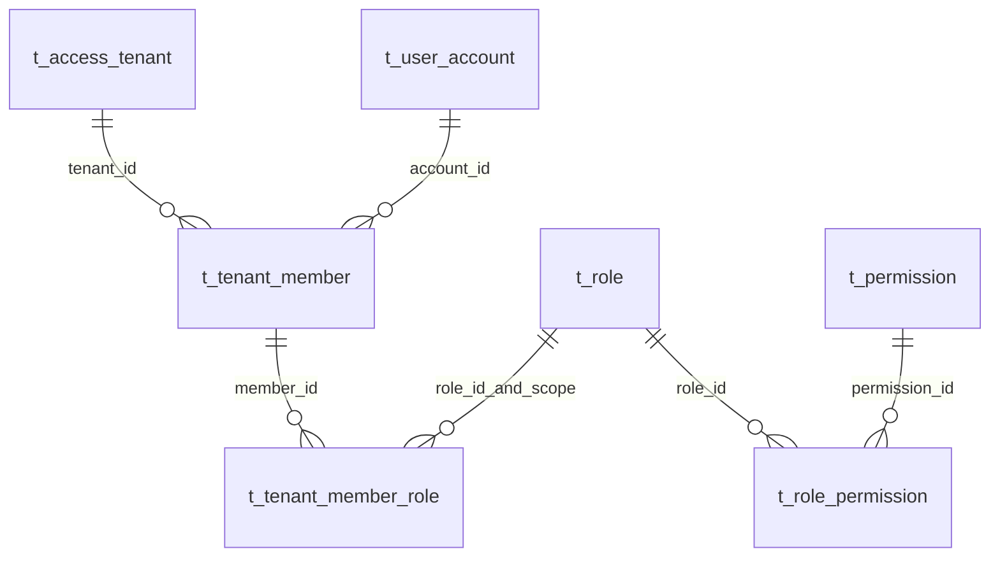

# 数据与权限来源设计（阶段 3 已确认）

**新增业务表 0、修改表结构 0、新增/修改/删除字段 0、新增/删除索引 0。** 复用现有七张 IAM 表的 75 个字段，不增加姓名、诊断结果、暂停历史、回执或权限缓存表。字段权威是 [Platform Schema](../../../paytech/platform-support/docs/database/sql/platform-support-schema.sql) 和 [PDManer](../../../paytech/platform-support/docs/database/platform-support.pdma.json)，既有表统计及环境证据见 [阶段 2](./technique.md#3-数据模型与环境观察)。

## 1. 关系及读写边界

关系是应用不变量，不新增物理 FOREIGN KEY/CHECK。七表只在 Platform 库读取；BFF/Web 不直连库，也不跨库补读 CCT 或 Vault。

| 表 | 字段数 | 本期读取事实 | 本期业务修改 |
|---|---:|---|---|
| t_access_tenant | 11 | 类型、Owner ID/名称、双状态、版本/时间 | security_status、version、update_time 三列值 |
| t_user_account | 16 | 账号 ID、Realm、类型、脱敏邮箱、状态 | 无；不读取或投影 Vault Token/密码类值 |
| t_tenant_member | 9 | Tenant+Member+Account、成员类型/状态、时间 | 无 |
| t_role | 11 | Scope、代码/名称、状态 | 目标成员角色无修改；注册启用时管理角色版本另计 |
| t_tenant_member_role | 12 | 角色授权 ID、Tenant/Scope、状态、有效期 | 无 |
| t_role_permission | 7 | role_permission_id、角色权限映射和状态 | 目标成员授权无修改；新 Operations 权限登记另计 |
| t_permission | 9 | 权限代码、resource_type/action_code、状态 | 只登记三项 Operations 管理权限 |

既有 `t_command_idempotency` 与现有审计继续复用；不改变它们的 Schema。租户操作不写 owner_status/source_version/source_payload_hash，不更新其余 Tenant、账户或凭证。普通查询不推进版本、登录失败次数或授权状态，不把时间过期物化为 EXPIRED 写回。

## 2. 查询方法与索引

| 查询 | 约束与已有索引 |
|---|---|
| Tenant 列表/详情 | 限 CLIENT/PARTNER；ID 用主键，类型+Owner 用 uk_access_tenant。tenantId 稳定排序；名称/状态作为残余条件 |
| Member 列表/详情 | 固定 tenant_id，用 uk_tenant_member(tenant_id,account_id)；Account 按主键获取安全列；直接 Member 用主键并核对 Tenant |
| RoleGrant | 固定 member_id，idx_tenant_grant_member_scope(member,tenant)；Role 主键及 scope 校验；grantId 排序 |
| MemberPermission | 当前成员的 Grant → RolePermission 的 uk_role_permission(role_id,permission_id) → Permission 主键；按 permissionId 合并，先按去重权限分页，再计算本页来源汇总 |
| PermissionSource | 固定 Tenant/Member/Permission，仅该成员授权下的映射，grantId+rolePermissionId 排序；COUNT 同 WHERE，不在服务内先载入所有来源分页 |

名称/脱敏邮箱包含匹配无法从普通 B-tree 获得前缀查找收益，本期不为每种筛选排列加索引。现有两库无真实 CLIENT/PARTNER 数据，本阶段不能用空库推断大规模查询性能。设计采用现有索引、绑定参数、分页及数据库内聚合；研发使用代表性合成数据核对 EXPLAIN 和计划成本，若发现必要索引，提交精确增量供确认，不静默扩表。

每请求一个本地 RR 只读事务；从数据库 UTC 时间获得 evaluatedAt 后查询。COUNT/页内内容/授权解释同快照；不进行 N+1 的逐权限完整查询，不把所有行无界装入 JVM。不加排他资源锁，不承诺多个分页请求冻结同一历史版本。

## 3. 身份、来源与生效原因

先验证目标 CLIENT/PARTNER Tenant；Member 的 tenant_id 必须精确匹配。Account 必须存在且 Realm=CUSTOMER，符合既有 CUSTOMER 账号类型约束。以下情况属于持久化数据不一致：未知枚举、缺失账号/角色/权限、Grant 指向其他 Tenant、Role Scope 非法、授予区间终点 <= 起点。Owner 返回 500 受控错误，日志只含排查所需非敏感 ID；UI 显示查询失败及 Request ID，不暴露其他 Tenant 的角色名称或假装“没有权限”。路径串读在进入这些查询前按 404 处理。

角色 Scope 合法条件：

- PLATFORM：role.tenant_id=NULL，role.scope_key=PLATFORM，grant.role_scope_key=PLATFORM。
- TENANT：role.tenant_id=当前 Tenant，role.scope_key=当前 Tenant ID 十进制字符串，grant.role_scope_key 与之完全一致。
- Grant.tenant_id 与 Member.tenant_id 一致；不能只校验 role_id，也不能按 OWNER/ADMIN 名称自动授予权限。

对合法记录计算如下原因；按表顺序返回、按 code 去重。细分业务状态通过 message 说明（待激活/已停用/已终止），不为它们新增字典表。

| 原因 code | 条件 | 可读说明 |
|---|---|---|
| TENANT_OWNER_INACTIVE | owner_status != ACTIVE | 来源业务状态未允许访问（附当前状态说明） |
| TENANT_SECURITY_SUSPENDED | security_status=SUSPENDED | 租户已安全暂停 |
| ACCOUNT_INACTIVE | account.status != ACTIVE | 账号待验证、已停用或已关闭 |
| MEMBER_INACTIVE | member.status != ACTIVE | 成员已暂停或撤销 |
| ROLE_INACTIVE | role.status=INACTIVE | 角色已停用 |
| GRANT_REVOKED | grant.status=REVOKED | 角色授予已撤销 |
| GRANT_NOT_STARTED | evaluatedAt < effective_from | 授权尚未生效 |
| GRANT_EXPIRED | status=EXPIRED 或 evaluatedAt >= 非空 effective_to | 授权已过期 |
| ROLE_PERMISSION_REVOKED | rolePermission.status=REVOKED | 角色上的权限关联已撤销 |
| PERMISSION_INACTIVE | permission.status=INACTIVE | 权限已停用 |

Tenant restrictionReasons 只使用前两项。RoleGrant 使用到 GRANT_EXPIRED 为止；PermissionSource 还加最后两项。无原因即 effective=true。Account 临时密码锁定、会话、Route、Api Scope 和业务对象不在该 IAM 解释中；界面称“当前授权状态”，不称“已允许此业务请求”。

A07 权限由已存在的完整 Grant/RolePermission 链关联出来，不提前过滤 inactive/revoked/expired。每个 Permission 的 sourceCount 是完整来源数量，effectiveSourceCount 仅有效来源；后者 >0 则 effective=true，汇总 reasons=[]。全部来源无效时合并已知原因，展开可定位各来源，避免以失效来源覆盖有效来源。

不持久化上述派生字段。数据库缺失关联不会被 INNER JOIN 静默吞掉：读取范围先进行完整性检查，受控 LEFT JOIN/计数对照识别缺失引用，再产生页内容；不能把损坏源当作“未授予”而继续返回有效结论。

## 4. 审计与幂等

租户状态修改沿用现有 Operations command idempotency 实现，不引入 Foundation 命令组件迁移。事务外 HMAC/上下文准备，事务内操作者授权、已有结果重放、目标行保护、CAS 及完成结果；具体场景见 [API](./api.md#3-a03安全状态变更)。只保存现有机制要求的规范化请求证据和稳定响应引用。

审计资源类型 `ACCESS_TENANT`、resourceId=tenantId，操作标识 `CHANGE_TENANT_SECURITY_STATUS`，理由使用用户非敏感原因。受控字段差异为 securityStatus 与必要版本；沿用 ConfigurationChanged/受控字段投影及 Controller 提交后尽力审计，需要新增 `SECURITY_STATUS` 展示/映射枚举，不增加表字段。无状态变化和旧命令重放不重复制造一条状态变更事实。既有历史没有租户修改记录时显示为空，不追补伪历史。

## 5. 目录登记、启用及示例

新增 **105 行**：3 Permission、3 角色权限关联、3 Console Resource、8 Route、20 Header、20 Query、48 Guard。具体可审查文件见 [dml.sql](./db/dml.sql) 和 [计数清单](./db/registration-counts.json)。初次更新/删除旧行 0；不新增 Target。

- Permission：TENANT_ACCESS_READ / TENANT_ACCESS_MANAGE / TENANT_MEMBER_READ。
- 根菜单 OPERATIONS_TENANT_ACCESS，route=/tenant-access，componentKey 同码；下挂安全暂停/恢复与成员查看两个 BUTTON。不要求现有 Gateway 配置读权限。
- 八 Route 均 HUMAN_PERMISSION / OPERATIONS_JWT；新 Route/资源先 DISABLED，PLATFORM_ADMIN 三项关联先 REVOKED，不能仅因 SQL 登记便扩大角色权限。
- 后续启用需在应用兼容后，明确批准将八 Route、三个 Resource、三条角色权限关联切为 ACTIVE 并推进各自版本，PLATFORM_ADMIN 版本推进一次，预计 **15 行 UPDATE**。这不在当前 dml.sql 中，阶段 6 根据实际角色/版本生成精确执行清单。
- 普通角色不默认新增权限；是否分配通过已建管理入口显式操作。

本期没有业务初始化 DML。研发回归需要两种 Tenant、同 CUSTOMER 账号跨租户、不同角色/权限状态及可验证 CLIENT Credential；均使用受控合成数据。test 示例需在发布准备中单列内容与清理目标，当前未创建，也不以直接插入伪 CCT 事实实现生产入驻。
