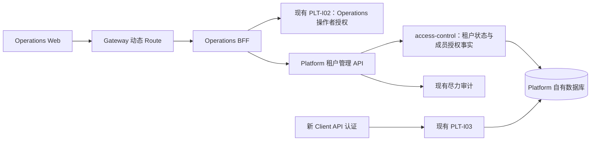

# 租户访问与成员权限查询：阶段 3 方案

阶段 2 已由用户“可以”确认，包括成员使用脱敏邮箱和账号 ID 的收敛。本稿及关联 API、数据、SQL、Pencil 方案已由用户“可以”整体确认，进入研发及开发回归；SQL 应用和部署另行授权。范围以 [requirement.md](./requirement.md) 为准，实际进度统一见 [当前台账](../../../agent-docs/CURRENT_IMPLEMENTATION.md#platform-tenant-access-20260914)。

**一句话规模：本方案修改 Platform Support、Operations BFF、Operations Web 3 个应用，新增 8 项 API 能力（7 读、1 写，Owner/BFF 各 8 个落点），既有 API 路径和请求字段调整 0；新增/修改业务表结构、字段及索引均为 0，注册 DML 新增 105 行、初次更新旧记录 0 行，设计 3 个功能页面、8 张 Pencil 状态画板。** 后续启用预计更新 15 行，另见数据方案；审计和页面能力旧接口有内容扩展。

## 1. 评审材料

| 材料 | 本阶段确定的内容 |
|---|---|
| [API 合同](./api.md)、[接口清单](./api-inventory.json) | Method/Path、操作者权限、字段和分页、幂等/版本、错误、转发 |
| [数据设计](./data-design.md)、[SQL 说明](./db/README.md)、[注册 SQL](./db/dml.sql) | 复用现有七表、读写范围、权限来源、105 行目录登记、启用边界 |
| [页面方案](./ui.md)、[8 页 PDF](./assets/stage3/pencil/export.pdf) | 租户列表、详情、成员授权及确认/空/错状态，原 Pencil 文件可编辑 |
| [交付记录](./delivery.md) | 阶段确认及证据入口 |

## 2. 调用及职责

- Platform API 模块增加 `TenantAccessManagementApi` 与明确用途的请求/响应模型；access-control 保留 Service 接口及实现、Domain 查询与 DAL；web 层承载 Controller、Processor、资源锁和事务编排。类型名不含 V1/V2。
- BFF 为八项操作逐项转发，保留自己的外部 DTO 与 Owner Client，不计算权限生效结果，也不携带操作者之外的伪 Context。当前方案不需要跨 Owner 聚合，不新增空 Processor；将来有真正组合时放 BFF Processor。
- Web 按需取租户、成员及当前选中的角色/权限页。展开某个权限再加载来源；不预取全部成员、授权或审计。失效成员仍只读可查。
- Gateway 复用 OPERATIONS Target 和动态 Snapshot，新增数据库路由登记；代码/镜像无变更。既有 PLT-I02、PLT-I03 运行合同不变。
- 新根菜单“租户访问”避开现有“平台配置”父菜单的 GATEWAY_CONFIG_READ 前置。三个权限独立；日常租户读者不会自动获得成员查询或安全操作。

## 3. 安全状态命令

暂停与恢复共用 A03，只允许修改一个 CLIENT/PARTNER 租户的 `security_status`，并推进 `version/update_time`。既有来源状态/版本/Hash、账号、成员、角色、凭证均不改写。

1. HTTP 边界校验目标 ID、状态、期望版本、原因及幂等键；事务外准备既有本地幂等上下文。资源锁以 `access-tenant + tenantId` 为键，暂停/恢复同一锁。
2. 本地短事务中复用 Operations 操作者保护，再检查命令重放；其策略的账号 targetId 参数必须为空，不能传 Tenant ID。
3. 非重放命令锁目标租户行，限定 CLIENT/PARTNER，核对版本；只按目标行主键和期望版本 CAS 更新。数据库行锁/CAS 保证 Redis 租约失效时仍不覆盖并发写入。幂等完成与业务更新同一事务。
4. 提交后按既有机制尽力记录审计；无外部服务调用进入事务。审计失败不回滚已提交业务，不新增可靠审计、回执或历史表。
5. Web 保存成功后重读租户详情。已恢复安全状态但业务仍停用时，明确保留业务限制说明。重新加载失败时显示“操作已完成，详情刷新失败”，不能把成功命令说成失败。

具体同状态、反向操作及旧键重放见 [API 状态表](./api.md#3-a03安全状态变更)。本期不接通 CUSTOMER 登录/Session/CCT 投影生产链；真实既有消费者验证使用管理命令后再调用 PLT-I03，不用夹具直接改状态代替。

## 4. 成员权限查询

租户、成员和全局账号身份先在一个只读一致性快照内确认。角色范围只能为合法 PLATFORM 或该 Tenant；TENANT 的 scope_key 是租户 ID 的十进制字符串，无 `TENANT:` 前缀。再按同一 `evaluatedAt` 检查状态和半开授权区间。

角色页一行代表一条成员角色授权；权限页一行代表一个 permissionId。来源页一行代表 `成员角色授权 + 角色权限关系`，包括撤销/过期来源；同权限至少一条来源全部满足才为 EFFECTIVE。合法无效来源给原因，损坏身份/跨租户关联不泄漏其他租户信息并返回数据不一致错误。完整口径见 [数据设计](./data-design.md)。

这里是当前 IAM 授权事实，不是模拟一次业务请求。账号临时登录锁、会话有效性、入口/Route 和具体资源归属仍在各自运行入口检查。

## 5. 研发与开发回归顺序

| 顺序 | 研发内容 | 必须覆盖的行为及验收 |
|---|---|---|
| 1 Platform 查询 | 新 API、受 Tenant 限定的 Mapper/Service、权限来源与生效原因 | AC-01/02/07/08/09；分页 COUNT 同口径、INTERNAL 拒绝、跨 Tenant 不串读；账号脱敏；一条过期来源不遮蔽有效来源 |
| 2 Platform 命令 | 现有锁/幂等/事务接入、CAS、安全状态与审计 | AC-03/04/06；当前操作者授权、缺原因、旧版本、同键异内容、暂停→恢复→重放旧暂停、不同键同状态；并发来源字段保持 |
| 3 实际消费者 | 真实管理入口更新后调用既有 PLT-I03 | AC-05；暂停前通过/后拒绝，恢复仍检查 Owner/Credential/Scope；其他 Tenant 不受影响；在途快照边界明确 |
| 4 注册与 BFF | 完整初始化 DML 同步、能力清单、八项转发和错误/幂等 Header | AC-03/07/09/10；PLT-I02 不例外跳过、Owner DTO 不越界、403/404/409/5xx 不误映射 |
| 5 Web | 三页面、按需来源、URL 筛选与历史、状态弹窗和错误 | UI-01–UI-06；只读无保存、无成员编辑入口、长文本、取消/失败保留原因、双击/网络不确定重试复用原键 |
| 6 开发检查 | 各应用相应公开入口测试及构建、需求站检查、Pencil 对照 | AC-10；不为内部方法逐个镜像造测试，不把文档检查当功能通过 |

Java 回归依项目 `UNIT_TEST_GUIDE` 使用本机 MySQL/Redis 真实基础设施，不用 Testcontainers 或应用启动建库。现有本机验证库有七表但没有 CUSTOMER/Tenant 合成数据；下一阶段准备精确注册/夹具和执行方案，若需应用人工 SQL 则另请授权。当前不给数据库写入授权作推定。

阶段 5 做三应用真实链与浏览器综合验收，阶段 6 再冻结 test 制品、禁用登记→应用→启用顺序及必要示例。后续预计发布 Platform API JAR 并部署 Platform、BFF、Web；没有 Foundation 或 Gateway 制品变更。不能用本阶段预计清单声称已发布。

## 6. 本阶段确认点

确认本设计包后进入三个应用研发及开发回归，继续遵守阶段停点。当前只交付方案、SQL 文件和 Pencil；未实施业务代码、执行 SQL、创建示例、部署或提交。
