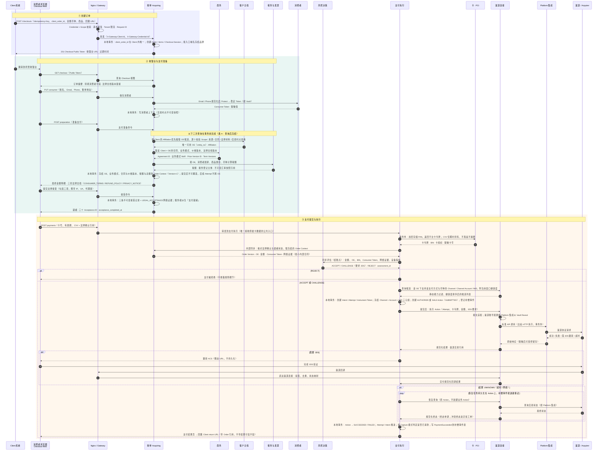
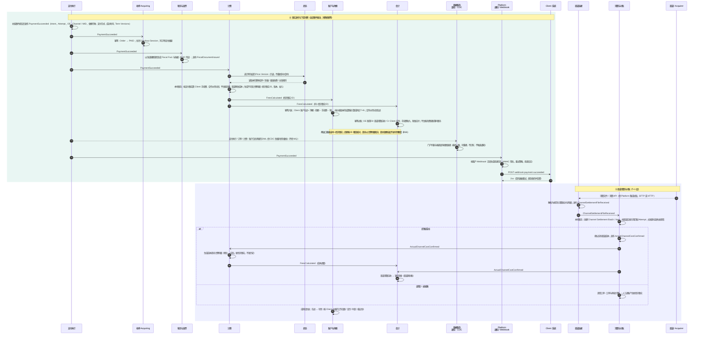
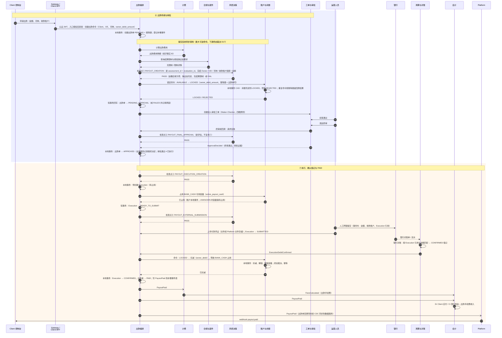

# 收单端到端时序（讨论稿，2026-10-17）

按目标架构 V2 的服务划分，从 Client 创建订单到结算出款的三段式时序。编号连续；同步调用为内部 HTTP 契约（事务外），事件为补偿事件表提交后发布，自调用为该服务的本地事务。与 [架构画板](./assets/architecture-design.pen) 配套，依据决策登记表 D16 / D17 / D18 / D25 / D31（收单 = acquiring-service）。

## Stage 1 · 收单：创建订单 → 支付准备 → 支付执行

## Stage 2 · 入账：事实发布 → 计费 → 账户与会计 → 通知 → 渠道对账

## Stage 3 · 结算出款：申请 → 双人审批 → Execution → 银行提交 → 确认借记 → PAID

