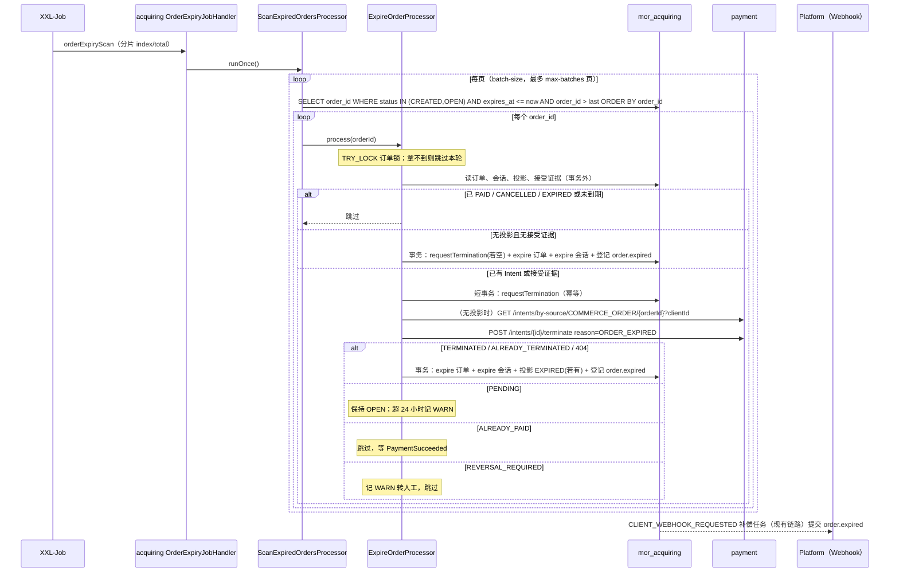

# acquiring：订单与会话过期收尾 · 技术方案

> 状态：第 1 节为阶段 1 现状证据、第 2 节为阶段 2 差异与影响（均已确认，D1—D5 按建议）；第 3 节为**阶段 3 评审稿**（2026-10-22，主工作区 `73a2460d`）。

## 1. 现状证据（阶段 1 调研）

### 1.1 acquiring

| 环节 | 状态 | 证据 | 说明 |
|---|---|---|---|
| 订单到期字段与状态 | 已有 | `paytech/acquiring/docs/database/sql/acquiring-schema.sql:28-30,41` | `order_status` 允许 EXPIRED；`expires_at NOT NULL`；`idx_order_expiry(order_status, expires_at, order_id)`；`status_reason_code`、`termination_requested_at` 可用 |
| 会话状态 | 已有 | `acquiring-schema.sql:186` | `session_status` 允许 EXPIRED；无独立到期时刻，跟随订单 |
| 创建时冻结期限 | 已实现 | `CreateCheckoutProcessor.java:102-111` | 缺省 30 分钟，范围 5 分钟—24 小时（设计 `2026-09-05-commerce-client-api-v1-design.md:323`） |
| 到期读侧：Client GET 订单 | 已实现 | `GetOrderProcessor.java:152-156,180` | 到期后 `checkoutUrl` 为空；Intent EXPIRED 映射为支付状态 EXPIRED |
| 到期读侧：消费者 GET 收银台 | 已实现 | `GetCustomerCheckoutProcessor.java:90`；`CommerceOrder.java:106-110` | 到期或已 EXPIRED 抛 `CHECKOUT_EXPIRED` |
| 到期读侧：提交支付 | 已实现 | `SubmitCustomerPaymentProcessor.java:187-188`；`CommerceOrder.java:113-115` | 只允许 OPEN、未请求终止、未支付 |
| Cancel 对 EXPIRED | 已实现 | `CancelOrderProcessor.java` `checkCancellationAllowed` | 返回 `ORDER_NOT_CANCELLABLE` |
| 晚到 `PaymentSucceeded` | 已实现 | `ApplyPaymentSucceededProcessor.java:59` | 订单 CANCELLED / EXPIRED 时只记投影并告警 |
| **过期写入** | **缺失** | `CommerceOrderRepository.java:37,43,46` 只有 `requestTermination` / `cancel` / `markPaid`；`CheckoutSessionRepository.java:26,29` 只有 `cancel` / `complete` | `grep OrderStatus.EXPIRED` 只命中读取 |
| **过期扫描任务** | **缺失** | `acquiring/.../ext/job/` 只有 `ClientWebhookSubmissionHandler`、`RefundSubmissionHandler`（补偿 Handler） | acquiring 无 `@XxlJob`；XXL 执行器已配置（`test-environment/compose.applications.yaml:296-303`） |
| 取消写入样式 | 已实现 | `CommerceOrderMapper.xml:112`；`CheckoutSessionMapper.xml:60-64`；`CommerceOrderRepositoryImpl.java:99-107` | 条件更新 + 版本号；`status_reason_code='CLIENT_REQUESTED'` 写死在 SQL；DataObject 无 `statusReasonCode` 字段 |
| 取消编排 | 已实现 | `CancelOrderProcessor.java`；`OrderCancellationServiceImpl.java` | 先写 `termination_requested_at`，事务外终止，TERMINATED 才本地取消并登记 `order.cancelled` |
| Webhook 事件类型 | 缺 expired | `ClientWebhookEventType.java:13-19`；`ClientWebhookEvent.java:83-96` | 只有 paid / cancelled / refund.created；cancelled 载荷：orderNo、clientOrderId、orderStatus、checkoutStatus、reasonCode、cancelledAt、version |
| Payment 终止客户端 | 固定 Mock | `integration/payment/FixedPaymentTerminationClient.java`；`PaymentTerminationClient.java` | TODO(PAY-I12)；Request 为 clientId + orderId；Status 只有 TERMINATED / PENDING / REVERSAL_REQUIRED |
| 支付投影 | 已有 | `GetCustomerCheckoutProcessor.java:146` 用 `projection.getPaymentIntentId()` 查 Payment | 终止可用同一 Intent ID |

### 1.2 payment

| 环节 | 状态 | 证据 | 说明 |
|---|---|---|---|
| Intent 到期字段与状态 | 已有 | `paytech/payment/docs/database/sql/payment-schema.sql:67,76` | `intent_status` 允许 EXPIRED；`idx_payment_intent_expiry` |
| 终止接口 | 已实现 | `PaymentIntentApi.java:96` `POST /intents/{intentId}/terminate`；`TerminateIntentProcessor.java:41-55`；`TerminateIntentContext.java:26-47` | 决定：ALREADY_PAID / ALREADY_TERMINATED / TERMINATED / PENDING / REVERSAL_REQUIRED；受理后未建 Action 也算 PENDING；TERMINATED 时 `terminateIntent` 落库，无原因区分 |
| 新尝试资格 | 已实现 | `PayProcessor.java:169-178` | 非 OPEN、已过期、有活动尝试、已成功均拒绝 |
| **Intent 过期写入** | **缺失** | 唯一补偿 Handler 为 `PaymentSucceededHandler`；无 `@XxlJob` | Payment 不自行收尾 |
| 锁 | 已实现 | 3DS 方案 `technique.md:141` | 终止与 pay、3DS 查单推进共用 Intent 锁 |

### 1.3 platform-support 与事件目录

| 环节 | 状态 | 证据 |
|---|---|---|
| `order.expired` 事件类型 | 已登记 | `platform-support/.../api/enums/WebhookEventType.java:15` |
| MQ 事件目录 | 无需改动 | `paytech/foundation/paytech-messaging/catalog/events.yaml:11-14` 仅 `PaymentSucceeded` → acquiring、card；过期收尾不发 MQ |

### 1.4 设计与需求目录依据

- `docs/superpowers/specs/2026-09-05-commerce-client-api-v1-design.md:523,622`：到期后不再返回 `checkoutUrl`、不得发起新支付；`:799` Cancel 遇 EXPIRED 返回 `ORDER_NOT_CANCELLABLE`；`:1038` Cancel / Expired 载荷同结构；`:1142-1144` 到期只阻止新支付、等待 Payment 收敛、不按本机时钟覆盖。
- `agent-docs/decisions/2026-09-05-commerce-client-api-v1.md:130`：业务事件固定含 `order.expired`。
- `agent-docs/database/COMMERCE_DATABASE.md:68`：`status_reason_code` 来自 Commerce Order Status Reason Catalog，用于取消、过期等终态。
- `requirements-site/content/requirements.ts:167`（COM-05 过期或取消未付款 Checkout）、`:193`（acquiring 发布事件含 `CheckoutExpired`，仅目录）。
- `agent-docs/CURRENT_IMPLEMENTATION.md:1142`：`order.expired`、`order.funds_available` 待对应业务能力。
- 3DS 需求 `requirements/20261022/payment-3DS全链路/technique.md:86`（D4 核对结论：订单过期仍 OPEN，晚到成功照常推进）。

### 1.5 测试基线

- acquiring：`CancelOrder*` 测试经 `FixedPaymentTerminationClient` 固定 TERMINATED；无过期场景测试。
- Payment：`TerminateIntent*` 测试覆盖决定分支（阶段 2 核对具体用例）。
- 验收脚本：`requirements/20261017/commerce-ClientAPI测试环境联通/verification/client_api_flow.py` 已覆盖 `order.cancelled`、`order.paid`（夹具）、`refund.created`。

## 2. 差异与影响（阶段 2）

### 2.1 需求项差异

| 需求项 | 当前行为及证据 | 目标 | 缺口 | 处理建议 |
|---|---|---|---|---|
| R1 过期扫描 | acquiring 无 `@XxlJob`，`ext/job/` 只有两个补偿 Handler；XXL 执行器已配置（`test-environment/compose.applications.yaml:296-303`），mor-test 已登记 `compensationEventScan`（`requirements/20261017/commerce-ClientAPI测试环境联通/release/release-20261017.md:26`）；`idx_order_expiry(order_status, expires_at, order_id)` 无人使用 | AC-01、AC-09 | 扫描入口、分页查询、分片 | 仿 `card/.../ext/job/CardInstrumentPurgeJobHandler.java`：app 模块 `@XxlJob("orderExpiryScan")` → `runOnce()` → core 的扫描 Processor；Mapper 按索引取 `order_status IN ('CREATED','OPEN') AND expires_at <= now` 的 `order_id` 分页（按 XXL 分片号对 `order_id` 取模），逐单调用收尾 Processor，单单独立事务，一单失败不影响同批其余；批大小与分页从 `acquiring.order-expiry.*` 配置 |
| R2 单订单收尾 | 取消链路可复用：`CancelOrderProcessor` 先 `requestTermination`（`CommerceOrderMapper.xml:101-105`，条件 CREATED/OPEN 且未请求）、事务外终止、TERMINATED 才 `cancel`（`:111-130`，按投影版本或“无接受证据且无投影”保护）；`OrderCancellationContext.canCancelLocally()` = 无投影且无接受证据；`OrderCancellationServiceImpl.cancel` 同事务写订单、会话、Webhook | AC-01—AC-05、AC-09 | 过期的写入 SQL、收尾 Processor、与 Cancel 不同的决定处理 | 新增内部 `ExpireOrderProcessor`（无 HTTP 入口，只被扫描调用）与 `OrderExpiryContext`；仓储新增 `expire`：订单 SQL 与 `cancel` 同条件但写 `order_status='EXPIRED'`、`status_reason_code='EXPIRY_REACHED'`，不写 `cancelled_at`；会话 SQL 与 `CheckoutSessionMapper.xml:60-64` 同条件写 `EXPIRED`。决定处理：TERMINATED / ALREADY_TERMINATED / NOT_FOUND → `expire`；PENDING → 本轮结束（D4）；ALREADY_PAID → 跳过；REVERSAL_REQUIRED → 告警跳过；订单已 PAID / CANCELLED / EXPIRED → 跳过。`requestTermination` 先于终止写入，复用现有 SQL |
| R2 无投影但已有接受证据 | 提交支付先保存接受事实，再在事务外 `createIntent`，然后 `bindPayment` 写投影（`SubmitCustomerPaymentProcessor.java:108-113,237-245`）；HTTP 创建成功、投影写入前崩溃会留下“Payment 有 Intent、acquiring 无投影”；Cancel 现在把这种情况交给 Mock 按订单身份终止（`PaymentTerminationClient.Request(clientId, orderId)`）；真实接口只按 intentId（`PaymentIntentApi.java:96`），Payment 没有按来源查询的接口；创建接口按来源幂等（`CreateIntentProcessor.java:78-88`）但终止链路禁止调用创建 | AC-02、AC-07 | 无投影时定位 Intent | 见 D1 |
| R3 真实终止客户端 | `FixedPaymentTerminationClient` 固定 TERMINATED；`PaymentClientConfiguration` 已用 `@ImportHttpServices` 装配 `PaymentIntentApi`（strict 选项，4xx Problem 解码为 `FailException`，`CheckoutCardPaymentPortImpl.java:67-68` 已按 `NOT_FOUND` 代码分支）；Payment 决定五种，客户端 `Status` 三种 | AC-07 | 实现类、决定映射、NOT_FOUND 映射 | 新增 `integration/payment/impl/PaymentTerminationClientImpl`：按 D1/D2 定位 Intent 后调用 `terminateIntent`，`decision` 映射 TERMINATED、ALREADY_TERMINATED → TERMINATED；PENDING → PENDING；REVERSAL_REQUIRED → REVERSAL_REQUIRED；ALREADY_PAID → 新增 `Status.ALREADY_PAID`（Cancel 返回 409 `REVERSAL_REQUIRED`，过期跳过）；Payment 404 `NOT_FOUND` 原样抛 `FailException`；归属不一致抛 `CheckoutUpstreamProtocolException`（沿用 `CancelOrderProcessor.terminatePayment`） |
| R3 测试设施 | `PaymentTerminationMocker` 是 `@Primary` 的端口实现（按 orderId 配置 DTO）；`MockPaymentIntentApi.terminateIntent` 抛 `AssertionError`；引用方：`CancelOrderTest`（6 个场景）、`ClientWebhookOrderCancelledTest`、`CheckoutIntentCreationTest` | AC-07、AC-09 | Mock 改为 HTTP DTO | `MockPaymentIntentApi.terminateIntent` 改为按 intentId 配置 DTO / 404 / 故障（同 `getSubmission` 样式），`PaymentTerminationMocker` 改为记录 HTTP 请求（reason、clientId）；三个测试类随之调整，断言改为 HTTP 调用记录 |
| R4 Payment 终止原因 | `TerminateIntentRequestBody.reason` 已存在，只允许 `ORDER_CANCELLED|OPERATING_ENTITY_CLOSED`，核心层不接收（`TerminateIntentRequest`、`TerminateIntentContext`、Converter 无 reason）；`PaymentIntentMapper.xml:56-62` 固定写 `CANCELLED`，条件 `OPEN` 且无活动尝试、无成功尝试；失败的尝试由 `ActionFlow.java:131` `releaseAttempt` 释放 | AC-02、AC-11 | 原因值、传递、按原因落库 | 原因加 `ORDER_EXPIRED`；Converter → Request → Context 传递；仓储 `terminateIntent(intent, status)` 按原因写 `CANCELLED` 或 `EXPIRED`；响应 `status` 回传实际终态。Payment 测试模块没有任何终止测试（`grep -i terminate paytech-payment-test` 为空）→ 新增 `TerminateIntentTest` 覆盖五种决定与两种原因 |
| R5 `order.expired` | `ClientWebhookEventType` 三种；`ClientWebhookEvent.orderCancelled` 载荷 orderNo、clientOrderId、orderStatus、checkoutStatus、reasonCode、cancelledAt、version；`buildEvent` 上限 4096 字节；Platform `WebhookEventType.ORDER_EXPIRED` 已登记 | AC-06 | 事件类型与载荷 | 枚举加 `ORDER_EXPIRED("order.expired", "expired")`；`orderExpired(order, session, now)` 载荷同结构，`reasonCode=EXPIRY_REACHED`、`expiredAt=expires_at`（Q3）；在 `expire` 同事务登记；`ClientWebhookOrderCancelledTest` 为模板 |
| R6 读侧一致性 | GET 订单：`validateAmounts` 允许 EXPIRED 无最终金额、到期 `checkoutUrl` 为空（`GetOrderProcessor.java:130-139,152-156`）；`paymentStatus` 由投影推导（`:166-186`），投影 `intent_status` 只在成功时更新（`OrderPaymentProjectionRepository` 只有 `insert` / `recordSucceeded`），过期后仍显示 NOT_STARTED / PROCESSING；GET 收银台 `checkExpiry`；提交 `allowsPayment`；Cancel `ORDER_NOT_CANCELLABLE`；`ApplyPaymentSucceededProcessor.java:59-64` EXPIRED 只记投影 | AC-01、AC-04、AC-08 | 过期后支付状态的推导 | 见 D3；其余分支无需改动。TERMINATED 后 Intent 已终态且无活动尝试，`PaymentSucceeded` 不可能再到达，EXPIRED 分支只作兜底 |
| R7 测试与验收 | acquiring auto 测试可直接调用 Handler `runOnce`（ledger `AccountingRuleVersionActivationJobTest` 样式）；验收脚本 `client_api_flow.py` 有 `client_api`、`commerce_sql`、`checkout_body`、`task_state` 等辅助，创建期限最短 5 分钟（设计 `:323`） | AC-09、AC-12 | 过期场景 | auto：到期无 Intent、到期有 Intent 五种决定、重复扫描、与 Cancel 并发（先取消后扫描）、Webhook 一次；脚本：见 D5 |

### 2.2 逐系统影响

| 系统 | 职责 | 影响点 | 代码 / 模型 / 配置 | 依赖与风险 |
|---|---|---|---|---|
| acquiring | 订单与会话状态 Owner | app：`ext/job/OrderExpiryJobHandler`、`acquiring.order-expiry` 配置类；core：扫描 Processor、`ExpireOrderProcessor`、`OrderExpiryContext`、`OrderExpiryService`（同事务写订单 / 会话 / Webhook / 投影）、`CommerceOrderRepository.expire`、`CheckoutSessionRepository.expire`、`OrderPaymentProjectionRepository.recordTerminated`（D3）、Mapper XML 3 条 UPDATE、`ClientWebhookEventType.ORDER_EXPIRED`、`ClientWebhookEvent.orderExpired`、`PaymentTerminationClientImpl`、`PaymentTerminationClient.Status.ALREADY_PAID`、删除 `FixedPaymentTerminationClient`；`CancelOrderProcessor.terminatePayment` 增加 ALREADY_PAID 分支 | 代码、`application.yml`（批大小、分页、分片开关）；无 DDL；mor-test XXL 新登记任务 `orderExpiryScan`（每分钟） | 三个现有测试类改造；扫描与 Cancel / `PaymentSucceeded` 并发靠版本 CAS |
| payment | Intent 终止 | `TerminateIntentRequestBody.reason` 加 `ORDER_EXPIRED`；Converter / Request / Context 传 reason；`PaymentIntentRepository.terminateIntent` 按原因写终态；D1 若选按来源查询则新增 `GET /intents/by-source` 接口、Processor、Converter | 代码；无 DDL | 与 3DS 需求同改 Payment（Q7：阶段 4 以 3DS 合入后为基线） |
| platform-support | Webhook 受理 | 无改动：事件类型已登记；无新路由、无 ID 块 | — | — |
| api-gateway / nginx | — | 无改动 | — | — |
| 验收脚本 | mor-test 验收 | `client_api_flow.py` 新增过期场景（D5） | 脚本 | 需要 acquiring、payment 新镜像 |
| 文档 | 目录与台账 | `agent-docs/database/COMMERCE_DATABASE.md` 的 Status Reason Catalog 列入 `EXPIRY_REACHED`；`CURRENT_IMPLEMENTATION.md` 台账；`requirements.ts` COM-05 补过期行为 | 文档 | 阶段 8 |

### 2.3 依赖与风险

- **3DS 需求（阶段 4 进行中）：** 共享 Payment `TerminateIntentProcessor` 的 Intent 锁与 acquiring 测试 `MockPaymentIntentApi`；按 Q7，本需求阶段 4 以 3DS 合入主工作区后的代码为基线。
- **PENDING 的频繁终止调用：** 每轮扫描对每个 PENDING 订单调用一次 PAY-I12，决定为只读判断、幂等；24 小时内最多约 1440 次 / 单，量小（D4）。
- **多实例扫描：** XXL 分片 + 每单条件更新，重复扫描只产生空更新；Webhook 在同一事务登记，不会因重复扫描重复登记。
- **ALREADY_PAID 后的订单：** 保持 OPEN，等 `PaymentSucceeded`（MQ 可能延迟）；此期间 GET 仍按投影显示处理中，符合设计“只能收敛为 PAID”。
- **Payment 当前无终止测试：** 改终止落库前先补基线测试，避免回归不可见。
- **mor-test XXL：** 需新登记执行器任务（acquiring 执行器已在用），发布清单在阶段 6 列出。

### 2.4 待确认

2026-10-22 已确认：D1—D5 均按建议列采纳。

| 编号 | 问题 | 建议（已采纳） |
|---|---|---|
| D1 | 无投影但已有接受证据时如何定位 Intent？（创建 Intent 成功、投影写入前崩溃的窗口） | **Payment 新增按来源查询 `GET /payment-execution/v1/intents/by-source/{sourceType}/{sourceId}?clientId=`**（404 → 不存在）；acquiring 有投影用投影 intentId，无投影先按来源查再终止，仍不存在才视为 NOT_FOUND。替代方案“无投影即视为不存在”会让 Payment 留下 OPEN 的孤儿 Intent（终止请求已阻止 acquiring 再提交，所以无资金风险，但 Payment 无人收尾） |
| D2 | 终止客户端的请求形态 | `Request(clientId, orderId, paymentIntentId 可空)`：Processor 传投影中的 intentId；客户端在空时执行 D1 查询。`Status` 加 `ALREADY_PAID`；Cancel 对它返回 409 `REVERSAL_REQUIRED`（与设计“已成功支付返回 409”一致） |
| D3 | 过期后 GET 订单的 `paymentStatus` | TERMINATED 分支在 `expire` 同事务把投影 `intent_status` 写为 EXPIRED（新 `recordTerminated`，以投影版本为条件），GET 推导为 EXPIRED；无投影时仍为 NOT_STARTED。不等待 Payment 事件（Payment 不发终止事件） |
| D4 | PENDING 订单的重试节奏与 24 小时上限 | 每轮扫描都调用 PAY-I12，不做退避；超过 `termination_requested_at` + 24 小时仍 PENDING 的，每轮记一条 WARN（含 orderId、intentId），订单保持 OPEN、继续扫描，直到 Payment 给出终态或人工处理 |
| D5 | 验收脚本如何制造“到期” | 创建 `expiresAt = now + 5 分钟` 的 Checkout 后用脚本已有的 `commerce_sql` 把 `expires_at` 回拨到过去，再等下一轮扫描（≤ 1 分钟）；仅限 mor-test 验收，不等待真实 5 分钟 |

## 3. 方案、接口与数据设计（阶段 3）

### 3.1 规模总结

| 项 | 数量 | 说明 |
|---|---|---|
| 接口变更 | 2 | Payment 新增按来源查询 Intent；Payment 终止接口加原因值 `ORDER_EXPIRED`（请求形态不变） |
| 内部端口变更 | 1 | acquiring `PaymentTerminationClient`：请求加可空 intentId 与原因，Status 加 `ALREADY_PAID`，固定 Mock 删除 |
| Client API / Webhook | 1 | 新事件 `order.expired`；Client API 请求 / 响应不变 |
| MQ 事件 | 0 | — |
| DDL / DML / Platform 注册 | 0 / 0 / 0 | 无表与列变更；Platform 事件类型已登记，无新路由 |
| XXL 任务 | 1 | acquiring 执行器新登记 `orderExpiryScan`（每分钟） |
| acquiring 新增类 | 9 | 见 3.6 |
| payment 新增 / 修改 | 4 / 6 | 见 3.6 |
| 自动测试 | 新增 4 类、修改 3 类 | 见 3.6 |

### 3.2 主流程与时序



要点：

1. **扫描与收尾分离。** 扫描 Processor 只取 ID 并逐单调用；收尾 Processor 每单独立，一单异常记录后继续下一单。扫描按 `order_id` 游标分页，XXL 分片参数对 `order_id` 取模（D2 之 S2 见 3.7）。
2. **收尾 Processor 用 `AbstractLockProcessor` + `TRY_LOCK`**（`DEVELOPMENT_CONVENTIONS.md` 5.1：新单资源写 Processor），锁实际资源为订单，锁内再按版本条件更新；拿不到锁视为别的实例或取消在处理，本轮跳过。Cancel 保持现状不加锁（不在本需求迁移范围）。
3. **事务边界与取消链路一致**（事务公理）：下游读（Payment 查询、终止）在事务外；本地事实在一个 REQUIRED 事务里写订单、会话、投影与 Webhook 登记；`requestTermination` 单独短事务先提交，再调用 Payment。
4. **到期再判一次。** 收尾 Processor 重新比较 `expires_at <= now`，扫描结果过期的订单（例如被取消）跳过。
5. **决定映射**：

| Payment 决定 | 条件（Payment 侧） | acquiring 处理 | 订单结果 |
|---|---|---|---|
| TERMINATED | OPEN、无活动尝试、无成功 | 本地 expire | EXPIRED |
| ALREADY_TERMINATED | 已 CANCELLED / EXPIRED | 本地 expire | EXPIRED |
| 404 NOT_FOUND（按来源查无 / 终止 404） | Intent 不存在 | 本地 expire（SQL 要求无投影） | EXPIRED |
| PENDING | 有活动尝试（含受理后未建 Action） | 不写；`termination_requested_at` 超 24 小时每轮 WARN | OPEN |
| ALREADY_PAID | 已成功 | 不写；INFO | OPEN → 由 `PaymentSucceeded` 置 PAID |
| REVERSAL_REQUIRED | 有未释放授权 | 不写；WARN 转人工 | OPEN |
| `ServiceUnavailableException` | Payment 不可用 | 不写；下轮重试 | OPEN |

### 3.3 接口

#### 3.3.1 新增：Payment 按来源查询支付意图（acquiring → payment）

- `GET /payment-execution/v1/intents/by-source/{sourceType}/{sourceId}?clientId={clientId}`，`PaymentIntentApi.getIntentBySource`。
- Path：`sourceType` `[A-Z][A-Z0-9_]{0,63}`；`sourceId`、`clientId` 与现有 `getIntent` 相同的正整数字符串校验。
- 响应：200 复用 `GetIntentResponseBody`（intentId、sourceType、sourceId、status、activeAttemptId、successfulAttemptId）；不存在或不属于该 Client 返回 404 `NOT_FOUND`（与 `getIntent` 一致，不区分两种原因）。
- 实现：`GetIntentBySourceProcessor extends AbstractProcessor`（只读，无锁），复用 `PaymentIntentRepository.findIntentBySource(sourceType, sourceId)`（已存在，`CreateIntentProcessor` 在用）与 `GetIntentProcessor.processResponse` 的组装；Controller 与 Converter 按现有 `getIntent` 形态增加一个方法。
- 不改数据：`uk_payment_intent_source(source_type, source_id)` 保证唯一。

#### 3.3.2 修改：Payment 终止支付意图（acquiring → payment）

- 路径、请求字段不变：`POST /payment-execution/v1/intents/{intentId}/terminate`，Body `clientId`、`reason`。
- `reason` 允许值由 `ORDER_CANCELLED|OPERATING_ENTITY_CLOSED` 扩为 `ORDER_CANCELLED|OPERATING_ENTITY_CLOSED|ORDER_EXPIRED`；语义：前两者终态 `CANCELLED`，`ORDER_EXPIRED` 终态 `EXPIRED`。响应 `status` 回传实际终态；`decision` 五值不变。
- 实现：core 新增枚举 `TerminationReason`（三值，各自 `targetStatus()`），`TerminateIntentConverter` → `TerminateIntentRequest.reason` → `TerminateIntentContext`；`PaymentIntentRepository.terminateIntent(intent, IntentStatus target)`，Mapper `SET intent_status = #{status}`，WHERE 条件不变（OPEN、无活动尝试、无成功尝试、版本）。`ALREADY_TERMINATED` 判断不变（已 CANCELLED 或 EXPIRED 都算）。

#### 3.3.3 修改：acquiring 内部端口 `PaymentTerminationClient`

```java
record Request(long clientId, long orderId, Long paymentIntentId, TerminationReason reason) {}
record Result(long orderId, Status status) {}
enum Status { TERMINATED, PENDING, REVERSAL_REQUIRED, ALREADY_PAID }
enum TerminationReason { ORDER_CANCELLED, ORDER_EXPIRED }
```

- `PaymentTerminationClientImpl`（`integration/payment/impl`，经 `PaymentIntentApi`）：`paymentIntentId` 为空时先 3.3.1 按来源查，404 → 抛 `FailException(NOT_FOUND)`；再终止；`decision` 映射 TERMINATED、ALREADY_TERMINATED → `TERMINATED`，其余同名；响应 `intentId` 与请求不一致抛 `CheckoutUpstreamProtocolException`。其它 `FailException` 原样抛出；传输失败由公共客户端映射为 `ServiceUnavailableException`。
- `CancelOrderProcessor.terminatePayment`：传投影 intentId 与 `ORDER_CANCELLED`；`ALREADY_PAID` 与 `REVERSAL_REQUIRED` 同样返回 409 `REVERSAL_REQUIRED`。删除 `FixedPaymentTerminationClient`。

#### 3.3.4 新增 Client Webhook：`order.expired`

Envelope 与现有三种一致（`schemaVersion` 1，RFC 8785 规范化，≤ 4096 字节）；`eventId = evt_<orderNo>_expired`。

```json
{
  "eventId": "evt_ord_2026…_expired",
  "eventType": "order.expired",
  "schemaVersion": "1",
  "createdAt": "2026-10-22T12:00:03.123456Z",
  "data": {
    "object": {
      "orderNo": "ord_2026…",
      "clientOrderId": "A-1001",
      "orderStatus": "EXPIRED",
      "checkoutStatus": "EXPIRED",
      "reasonCode": "EXPIRY_REACHED",
      "expiredAt": "2026-10-22T11:59:00Z",
      "version": 4
    }
  }
}
```

`checkoutStatus` 只在有会话时出现（Direct Pay 省略，与 cancelled 一致）；`expiredAt` 取 `expires_at`（D3 / Q3）；`version` 为写入 EXPIRED 后的订单版本。Platform 侧无改动。

#### 3.3.5 新增 XXL Handler：`orderExpiryScan`

- `acquiring-app` `ext/job/OrderExpiryJobHandler`：`@XxlJob("orderExpiryScan")`，读取 `XxlJobHelper.getShardIndex()/getShardTotal()`，调用 `runOnce(shardIndex, shardTotal)`；异常 `handleFail`，成功记录扫描条数、收尾条数、跳过条数。
- 任务参数无；测试直接调用 `runOnce`。

### 3.4 数据

- **DDL：不涉及。** 订单、会话、投影、Payment Intent 均已有所需列与状态值；PDManer 模型不变。
- **DML：不涉及。** 无 Platform 注册。
- **Commerce Order Status Reason Catalog**：新增 `EXPIRY_REACHED`（文档登记于 `agent-docs/database/COMMERCE_DATABASE.md`，阶段 8 更新）。
- **Mapper 语句清单（新增 / 修改）：**

| # | 系统 / Mapper | 语句 | 要点 |
|---|---|---|---|
| 1 | acquiring `CommerceOrderMapper.selectExpiredOrderIds` | `SELECT order_id FROM t_commerce_order WHERE order_status IN ('CREATED','OPEN') AND expires_at <= #{now} AND order_id > #{afterId} AND MOD(order_id, #{shardTotal}) = #{shardIndex} ORDER BY order_id LIMIT #{batchSize}` | 走 `idx_order_expiry`；分片与游标 |
| 2 | acquiring `CommerceOrderMapper.expire` | `UPDATE t_commerce_order SET order_status='EXPIRED', status_reason_code='EXPIRY_REACHED', version=version+1, update_time=#{now} WHERE order_id=#{order.orderId} AND client_id=#{order.clientId} AND version=#{order.version} AND order_status IN ('CREATED','OPEN') AND termination_requested_at IS NOT NULL AND paid_at IS NULL AND expires_at <= #{now}` + 与 `cancel` 相同的 `<choose>` 守卫（有投影：投影版本、无成功尝试、`captured_amount=0`、`intent_status<>'SUCCEEDED'`；无投影：`NOT EXISTS` 投影，本地分支另加 `NOT EXISTS` 接受证据） | 不写 `cancelled_at` |
| 3 | acquiring `CheckoutSessionMapper.expire` | `UPDATE t_checkout_session SET session_status='EXPIRED', version=version+1, update_time=#{now} WHERE checkout_session_id=… AND order_id=… AND version=… AND session_status IN ('PREPARING','OPEN','PAYMENT_PROCESSING')` | 无过期时刻列 |
| 4 | acquiring `OrderPaymentProjectionMapper.recordTerminated` | `UPDATE t_order_payment_projection SET intent_status='EXPIRED', version=version+1, update_time=#{now} WHERE order_id=… AND payment_intent_id=… AND version=… AND successful_attempt_id IS NULL AND captured_amount=0` | D3 |
| 5 | payment `PaymentIntentMapper.terminateIntent` | `SET intent_status = #{status}`（原固定 `'CANCELLED'`），WHERE 不变 | 3.3.2 |

仓储：`CommerceOrderRepository.findExpiredOrderIds / expire`、`CheckoutSessionRepository.expire`、`OrderPaymentProjectionRepository.recordTerminated`，行数不为 1 抛 `ConcurrentRequestException`（与 `cancel` 同）。

### 3.5 配置

acquiring `application.yml`（新增，带默认值，不需要环境变量）：

```yaml
acquiring:
  order-expiry:
    batch-size: 200        # 每页订单数，1—1000
    max-batches: 50        # 单次执行最多页数，防止长任务
    pending-alert-after: 24h   # termination_requested_at 之后仍 PENDING 的告警阈值（B5）
```

`OrderExpiryProperties`（app 模块，`@ConfigurationProperties("acquiring.order-expiry")`，`@Validated`，样式同 `CardInstrumentPurgeProperties`）。

XXL（mor-test，阶段 6 发布清单）：执行器 `acquiring-service`（已存在），任务 `orderExpiryScan`，Cron `0 * * * * ?`，路由策略分片广播，阻塞策略丢弃后续，无参数。本地 e2e 与 auto 测试不需要 XXL。

Payment：无配置变更。日志：PENDING 超阈值与 REVERSAL_REQUIRED 用 WARN，含 orderId、intentId、决定；不含 Token、URL、卡数据。

### 3.6 研发计划与验收映射

| 顺序 | 系统 | 工作 | 对应 AC |
|---|---|---|---|
| 1 | payment | 先补 `TerminateIntentTest` 基线（现状五种决定）；`TerminationReason`、reason 传递、按原因落库；`getIntentBySource` 接口、Processor、Converter、Controller；`GetIntentBySourceTest` | AC-02、AC-11 |
| 2 | acquiring | `PaymentTerminationClient` 请求 / Status 改造、`PaymentTerminationClientImpl`、删除 Fixed、`CancelOrderProcessor` 适配；测试设施：`MockPaymentIntentApi.terminateIntent / getIntentBySource` 改 DTO、`PaymentTerminationMocker` 改为 HTTP 记录；改 `CancelOrderTest`、`ClientWebhookOrderCancelledTest`、`CheckoutIntentCreationTest` | AC-07 |
| 3 | acquiring | Mapper 语句 1—4 与仓储方法；`OrderExpiryContext`、`OrderExpiryService`（接口 + Impl，同事务写四项）、`ExpireOrderProcessor`（`AbstractLockProcessor`）、`ScanExpiredOrdersProcessor`；`ClientWebhookEventType.ORDER_EXPIRED`、`ClientWebhookEvent.orderExpired` | AC-01—AC-06、AC-08、AC-09 |
| 4 | acquiring | `OrderExpiryJobHandler`、`OrderExpiryProperties`、`application.yml` | AC-01、AC-09、AC-10 |
| 5 | 验收脚本 | `client_api_flow.py` 新增过期场景（D5：创建 5 分钟期限 → `commerce_sql` 回拨 `expires_at` → 等待扫描 → GET EXPIRED、`order.expired` 送达且与 GET 一致） | AC-12 |
| 6 | 文档 | `COMMERCE_DATABASE.md` 原因目录；`requirements.ts` COM-05 补过期；acquiring README / API 文档 `order.expired`；`CURRENT_IMPLEMENTATION.md` | — |

实施前按 AGENTS 要求读取 `DEVELOPMENT_CONVENTIONS.md`、`JAVA_PROJECT_STRUCTURE.md`、`WRITE_API_EXAMPLE.md` 并按第 11 节自查；阶段 4 待 3DS 合入主工作区后在独立工作目录开始（Q7），由执行代理分卡实现。

**自动测试（`auto`，真实入口、本地 MySQL / Redis / RabbitMQ、外部只用 DTO Mock）：**

| 系统 | 入口测试类 | 场景 |
|---|---|---|
| payment | `TerminateIntentTest`（新，HTTP） | 无尝试 → TERMINATED 且状态随原因为 CANCELLED / EXPIRED；已终态 → ALREADY_TERMINATED 不改写；有活动尝试 → PENDING；已授权未捕获 → REVERSAL_REQUIRED；已成功 → ALREADY_PAID；跨 Client 404；非法 reason 400 |
| payment | `GetIntentBySourceTest`（新，HTTP） | 命中；不存在 404；跨 Client 404；非法 sourceType 400 |
| acquiring | `CancelOrderTest`、`ClientWebhookOrderCancelledTest`、`CheckoutIntentCreationTest`（改） | 经 `MockPaymentIntentApi` DTO：TERMINATED / PENDING / REVERSAL_REQUIRED / ALREADY_PAID → 409 / 404 → 本地取消 / 503 → 保留待定；无投影有接受证据时先按来源查再终止（AC-07） |
| acquiring | `ExpireOrderTest`（新，经 `OrderExpiryJobHandler.runOnce`） | 到期无 Intent（CREATED、OPEN 未提交）→ EXPIRED（AC-01）；有投影 TERMINATED → 订单、会话、投影 EXPIRED，终止请求带 `ORDER_EXPIRED`（AC-02）；PENDING → OPEN 且 `termination_requested_at` 已写、提交支付被拒（AC-03）；ALREADY_PAID → OPEN（AC-04）；REVERSAL_REQUIRED → OPEN（AC-05）；过期后 Cancel 409、GET 收银台 `CHECKOUT_EXPIRED`（AC-08）；连续两次 `runOnce` 与先取消后扫描只写一次（AC-09）；拨时钟超 24 小时 PENDING 记 WARN（AC-10）；未到期不处理；分片不命中不处理；Payment 503 下轮重试 |
| acquiring | `ClientWebhookOrderExpiredTest`（新） | 冻结载荷字段、`evt_<orderNo>_expired`、单次提交、无会话省略 `checkoutStatus`（AC-06） |

测试设施：`MockPaymentIntentApi` 加 `getIntentBySource`（DTO / 404）与 `terminateIntent`（DTO / 404 / 故障）；`PaymentTerminationMocker` 改为按 intentId 配置并记录请求（reason、clientId）；新增 `OrderExpiryDataMocker`（到期订单、会话、投影、接受证据夹具）与 `OrderExpiryChecker`。

**综合验证（阶段 5）：** 本机 e2e 环境跑 acquiring + payment 新镜像：创建短期限 Checkout，手动触发 `runOnce`（或等 XXL），核对订单 / 会话 / 投影 / Payment Intent 状态与 `order.expired` 送达；一笔走到 3DS PROCESSING 的订单到期后保持 OPEN、提交被拒；3DS 查单收敛后下一轮置 EXPIRED。

### 3.7 待确认

| 编号 | 问题 | 建议 |
|---|---|---|
| S1 | 收尾 Processor 的锁 | 用 `AbstractLockProcessor` + `TRY_LOCK`，锁键为订单（acquiring 若无锁键工具类则新增 `Locks.orderLock(orderId)`）；Cancel 不在本需求迁移 |
| S2 | 扫描分片 | `MOD(order_id, shardTotal) = shardIndex` + XXL 分片广播；单实例时 total=1 退化为全量，不另设开关 |
| S3 | 按来源查询接口形态 | Path `GET /intents/by-source/{sourceType}/{sourceId}?clientId=`，复用 `GetIntentResponseBody`；不做 Query 参数版本 |
