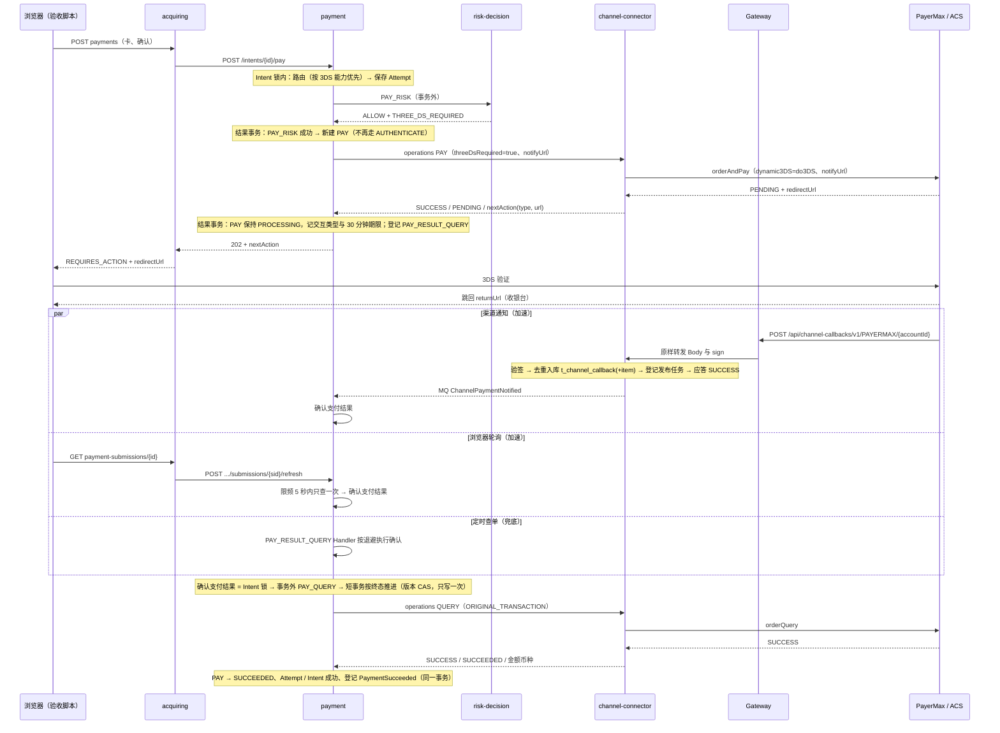

# payment：3DS 全链路 · 技术方案

> 状态：**阶段 2 已确认**（2026-10-22 用户“接收”）；第 3 节为**阶段 3 评审稿**（2026-10-22）。第 1 节为阶段 1 现状证据，第 2 节为阶段 2 差异与影响（只读核对，主工作区 `a5479950`）。

## 1. 现状证据（阶段 1 调研）

| 环节 | 状态 | 证据 | 说明 |
|---|---|---|---|
| 收银台提交卡支付 | 已实现（后端） | `paytech/acquiring/paytech-acquiring-api/.../checkout/v1/payment/CustomerPaymentApi.java:27,40` | 处理中返回 202 + Retry-After |
| returnUrl | 已实现 | `acquiring/.../processor/customer/SubmitCustomerPaymentProcessor.java:134-143` | 回跳到 Checkout 页面本身，无专门回跳路由 |
| acquiring → Payment pay | 已实现 | `acquiring/.../integration/payment/impl/CheckoutCardPaymentPortImpl.java:44-53,80-93` | 只传 AUTOMATIC |
| 卡流程定义 | 已实现 | `payment/.../core/action/flow/CardPayFlow.java:46-53` | ALLOW + 需认证 → AUTHENTICATE |
| Risk 认证要求 | 已实现 | `risk-decision/.../service/evaluation/PaymentAttemptEvaluator.java:189-200`；`payment/.../PayRiskCheckActionActor.java:68` | 冻结在 `t_payment_action.authentication_requirement` |
| commercial `require_3ds` | 只存不读 | `commercial/.../ResolveCheckoutContextResponseBody.java:164-165` | acquiring / payment / risk 均无读取 |
| MID `SECURITY.3DS_MODE` | 只是配置 | `channel-connector/config/nacos/channel-connector-service.yaml:28` | 路由不读 |
| AUTHENTICATE | 桩 | `payment/.../core/action/AuthenticateActionActor.java:25-30` | TODO + throw → UNKNOWN，Attempt 永远 PROCESSING |
| AUTHORIZE | 桩 | `payment/.../core/action/AuthorizeActionActor.java:26-31` | acquiring 固定 AUTOMATIC 绕开 |
| channel-connector 结果映射 | 已实现（通用） | `channel-connector/.../domain/PayOutputs.java:31-34,79-81` | 读 `nextAction.redirectUrl`，不传 `nextAction.type` |
| PayerMax 协议配置 | 数据配置 | `requirements/20261014/payment-PayerMax卡直付对接/assets/harness/configure_card.py:84-105` | `frontCallbackUrl←returnUrl`；`notifyUrl` 可选但 Payment 不传 |
| PAY 遇 PENDING + 跳转 | 已实现 | `payment/.../core/action/PayActionActor.java:180-203` | 类型写死 THREE_DS_CHALLENGE，30 分钟过期，URL 不落库 |
| pay 响应 nextAction | 已实现 | `PayProcessor.java:229`；`PayConverter.java:41-46` | 重放不返回 |
| 提交查询返回交互 | 已实现（无 URL） | `GetSubmissionProcessor.java:77-89` | 过期后不返回 |
| acquiring 映射 | 已实现 | `CheckoutCardPaymentPortImpl.java:115-125`；`CheckoutSubmissionModels.java:133-188` | 只接受 THREE_DS_CHALLENGE |
| checkout-web | 缺失 | `checkout-web/` 只有 `docs/` | 画板 07「银行验证」 |
| 回跳处理 | 缺失 | — | 只能轮询，Payment 状态不变 |
| 渠道异步通知 | 缺失 | Gateway `CHANNEL_CALLBACK` 路由 0 条；payment / channel-connector 无入站处理 | PayerMax 需求写明恢复本期不做 |
| 查单恢复 | 缺失 | `ChannelOperation.QUERY` 只有枚举；Payment 唯一补偿 Handler 是 `PaymentSucceededHandler` | — |
| 过期收尾 | 缺失 | — | — |

测试：`PayCardChannelTest.test_threeDsChallenge`、`PayRiskEvaluationTest.test_allowWithThreeDs`（未断言卡死）、`GetSubmissionTest.test_threeDsPending`、`ExecuteChannelOperationTest.test_pendingWithRedirect`；无回程测试；acquiring 提交路径带 URL 无自动测试。

设计出入：Execution 设计（`requirements/20260913/payment-Execution设计/design.md:85-118` 及修订）由 AUTHENTICATE 承担认证；V2 时序（`requirements/20261017/architecture-目标架构V2/acquiring-sequence.md:71-101`）设计了渠道回调经 GW → CHN → PAY 与 UNKNOWN 退避查单，均未实现。

## 2. 差异与影响（阶段 2）

### 2.1 需求项差异

| 需求项 | 当前行为及证据 | 目标 | 缺口 | 处理建议 |
|---|---|---|---|---|
| R1 3DS 要求进入 PAY | `CardPayFlow.java:46-53` ALLOW + 需认证 → AUTHENTICATE 桩；`PayActionActor.input()` :158-172 / `PayInput` 无 3DS 字段 | AC-01 | 流程转移、渠道输入字段；标准 API PAY 无 `payment.threeDsRequired`；PayerMax “强制 3DS”请求字段仓库内无证据 | 改流程与 `PayInput`；标准 API 与 PayerMax 流程经管理接口按版本修改；PayerMax 字段查文档 + UAT 实测。`CHALLENGE_REQUIRED` 也按需要 3DS 处理 |
| R1 MID `3DS_MODE` 参与路由 | 路由在 Risk 之前（`PayProcessor.java:75` 先路由并冻结三元组，再 PAY_RISK）；`QueryMidCandidatesProcessor.project()` :98-113 只投影 `ACTION.*`、`AMOUNT.*`；`MidCriteriaBody` 无 3DS 维度 | AC-02 | 路由时还不知道是否要求 3DS，“不参与路由”按现有顺序做不到 | 见 D2 |
| R2 交互类型如实传递 | 渠道配置已输出 `nextAction.type`（`configure_card.py:96-99` THREE_DS_CHALLENGE，收银台版 REDIRECT）；`PayOutputs.java:79-81` 只读 `redirectUrl`；`PayActionActor.pending` 写死类型；acquiring `CheckoutSubmissionModels.java:168`、`CustomerCheckoutModels.java:229` 只接受 THREE_DS_CHALLENGE | AC-03 | 三处读取与校验 | 小改：channel-connector 读出类型，Payment 按渠道记录，acquiring 两种都接受；`interaction_type` 注释改为含 REDIRECT |
| R3 查单恢复 | 无查单调用方；`ExecuteChannelOperationProcessor.java:86` 用操作码 `QUERY` 找标准 API，实际叫 `PAY_QUERY`；结果固定按 `PayOutputs` 解析，`ChannelPaymentStatus` 只有 SUCCEEDED / PENDING / FAILED，读不出 `CLOSED`、`NOT_FOUND`；补偿库无“首次执行时刻”，重试只靠 XXL 30 秒扫描；没有“把渠道结果套到现有 Action”的入口，复用 `flow.execute` 会把 PROCESSING 改写成 UNKNOWN | AC-04、AC-05、AC-09 | channel-connector 两个阻断点；Payment 新的“应用查单结果”服务；新补偿 Handler | channel-connector：QUERY + 原交易 PAY → `PAY_QUERY`，新增查单结果解析（CLOSED、NOT_FOUND）。Payment：新增“查单并推进”服务（intent 锁 + 版本 CAS）；新补偿类型 `PAY_RESULT_QUERY`，Handler 返回可重试失败按策略退避，不改 foundation（见 D3） |
| R3 两个隐患 | PENDING 时已写渠道交易引用，查单成功再插入会撞 `uk_channel_transaction_ref`（`payment-schema.sql:174`）回滚；`saveResult` 整体覆盖 `interaction_type`、`interaction_expires_at`（schema :145 要求保留历史） | AC-04、AC-08 | 结果事务需改 | 交易引用“已存在则跳过”；结果写入保留交互字段 |
| R4 回跳加速 | acquiring 轮询 → Payment `getSubmission`（GET，无副作用）；补偿事件同一身份重复登记不会提前执行 | AC-06 | 无立即查单入口 | Payment 新增刷新命令（POST，Redis `setIfAbsent` 限频），复用“查单并推进”服务；acquiring 轮询发现 REQUIRES_ACTION / PROCESSING 时调用 |
| R5 异步通知 | Gateway 只有快照校验，运行时没有 `CHANNEL_CALLBACK` 安全链，请求落到兜底 `denyAll`；Platform 枚举与编译校验已具备；channel-connector 无入站概念、无 MQ 生产者；Payment 只是 MQ 生产者；Payment 不传 `notifyUrl`（PayerMax 映射已存在）；仓库内无 PayerMax 通知格式文档；mor-test 无公网 HTTPS 入口 | AC-07 | Gateway 代码、channel-connector 入站（定位账号、Vault 公钥验签、去重表、发 MQ）、Payment 消费者、Platform 注册块、事件目录 | 通知路径带渠道账号：`/channel-callbacks/v1/{channelCode}/{channelAccountId}`；去重表放 channel-connector；新事件 `ChannelPaymentNotified`；真实 PayerMax 通知受公网入口限制（见 D5） |
| R6 刷新页面 / 过期 | `GetSubmissionProcessor.java:77-89` 过期后不返回交互；过期后 Attempt 仍 PROCESSING，Intent 不释放，`PayProcessor.java:174-175` 拒绝重新提交 | AC-10 | 与 Q4（不自动判失败）冲突 | 见 D1 |
| 认证结果记录（Q5） | PayerMax `PAY_QUERY` 输出无 ECI；`t_payment_action` 无认证结果列 | — | 渠道不一定返回 | 新增可空列 `authentication_eci`、`authentication_challenged`；渠道返回才写，本期只记录 |
| R7 测试 | `ChannelConnectorMocker` 只能预置一个回复，不分操作、无查单回复；退避场景需把 `next_execute_at` 拨到现在 | AC 全部 | 测试设施 | 扩展 Mocker 为按操作排队；测试辅助拨时 + 显式调用 Scanner |

### 2.2 逐系统影响

| 系统 | 职责 | 影响点 | 代码 / 模型 / 配置 | 依赖与风险 |
|---|---|---|---|---|
| payment | Attempt / Action 状态 Owner | 流程转移；`PayInput`（threeDsRequired、notifyUrl）；按渠道记交互类型与认证结果；`ChannelExecutionResult` / `PaymentChannelClientImpl`（类型、认证结果、QUERY 请求）；“查单并推进”服务；`PAY_RESULT_QUERY` Handler 与目录；刷新命令；MQ 消费者；路由读 `threeDsMode`；`AuthenticateActionActor` 不再被卡流程使用 | 代码；DDL：`t_payment_action` 加 2 个可空列、`interaction_type` 注释；PDManer；配置：notifyUrl 地址、补偿策略、MQ 消费 | 结果事务两处隐患；补偿重试粒度 ≥30 秒 |
| channel-connector | 渠道协议与执行 Owner | QUERY → `PAY_QUERY`；查单结果解析；`PayOutputs` 读类型与认证字段；响应体扩展；候选投影 `SECURITY.3DS_MODE`；入站通知 Controller | 代码；DDL：通知去重表 1 张；MQ 生产者配置 | 验签依赖 Vault 账号材料；通知原文与跳转 URL 不得进日志 |
| channel-connector 配置数据 | 标准 API 与 PayerMax 流程 | 标准 API PAY 加 `payment.threeDsRequired`、`authentication.*`；PAY_QUERY 加认证输出；PayerMax ORDER_AND_PAY / ORDER_QUERY 补字段；`PAYERMAX`、`PAYERMAX_MOCK` 同步 | 经管理接口按版本写入（harness 脚本），无需求级 SQL | PayerMax 字段待查证；mor-test 上 PAYERMAX 的 PAY 是收银台版还是卡直付版待核对；改标准 API 会使沙箱用例“需重新验证” |
| api-gateway | 公网入口 | 新增 `CHANNEL_CALLBACK` 安全链：不认证（验签下沉 channel-connector）、Body 原文转发、`sign` 头透传、Body 上限 | 代码 | 无公网入口时外部渠道到不了 |
| platform-support | 路由配置 Owner | `t_gateway_target`（channel-connector-service）、`t_gateway_route`、`route_header`、`guard_rule`（CLIENT_IP 限流） | 注册 DML，新块 132 起（执行前复核号段）；代码不改 | 注册后须重新发布 Gateway Snapshot |
| acquiring | 收银台接口 | 两处校验接受 REDIRECT；轮询时调用 Payment 刷新命令；API 文档“GET 不推进”改述；测试 `MockPaymentIntentApi` 实现新方法 | 代码与文档 | 依赖 Payment 新命令 |
| foundation / messaging | 事件目录 | `catalog/events.yaml` 登记 `ChannelPaymentNotified`（producer channel-connector，consumer payment） | 配置 | ArchUnit 与目录校验 |
| foundation / compensation-event | — | 不改（D3） | 无 | — |
| risk-decision | 3DS 要求来源 | 无 | 只读核对 mor-test R-11（金额 > 500 要求 3DS）生效后的影响 | — |
| 文档 | 设计权威 | Execution 设计 `design.md:85-118,132`、`card-pay-action-flow-amendment.md:14-39`、`execution-state-channel-recovery-amendment.md:54-80`、`state-and-recovery.md:43,71,144`、`data-design.md:60-91` 等；`paytech/payment/README.md:68`；`agent-docs/database/PAYMENT_ORCHESTRATION_DATABASE.md:130-132`；PayerMax 卡直付技术方案“恢复本期不做” | 文档修订（建议新增一份 3DS 修订记录，原文加指向） | — |
| 部署 / 测试环境 | — | Payment XXL 已登记扫描；channel-connector 加 MQ 连接；notifyUrl 公网地址 | compose、nacos | 见 D5 |

### 2.3 阶段 2 需确认的决定

| 编号 | 问题 | 建议 |
|---|---|---|
| D1 | Q4（过期仍处理中不判失败）与 R6 / AC-10（过期后显示失败可重新提交）冲突 | 以 Q4 为准：过期后最后查单得到失败 / 无此交易 → 失败、可重新提交；仍处理中 → 收银台显示“支付结果确认中”，不允许重新提交，直到查单得到终态或 24 小时后转人工。AC-10 相应修订 |
| D2 | 路由在风控之前，3DS 能力怎样参与选 MID | 路由时优先选支持 3DS 的 MID（不论本次是否要求）；风控要求 3DS 而冻结的 MID 不支持时，Attempt 失败，原因“无可用 3DS 通道”（B4）。AC-02 改为“优先选中支持 3DS 的 MID；冻结的 MID 不支持时 Attempt 失败”。不调整路由与风控顺序 |
| D3 | 退避查单是否扩展补偿库加“首次执行时刻” | 不扩展：单一事件类型，首次立即查一次，之后 Handler 返回可重试失败，策略初始 10 秒、倍数 2、上限 30 分钟、最多约 56 次覆盖 24 小时；耗尽后 FAILED 并告警，对应“转人工” |
| D4 | 3DS 完成时 Intent / 订单可能已过有效期 | 渠道确认已扣款就按成功推进（`attemptSucceed` 不检查过期），Commerce 按晚到成功处理；阶段 3 核对 Commerce 对晚到 `PaymentSucceeded` 的现有行为 |
| D5 | mor-test 没有公网 HTTPS 入口，PayerMax 通知到不了 | AC-07 用按 PayerMax 签名规则构造的合成通知验证（本机与 mor-test 经 Gateway 入口）；真实 PayerMax 通知待有公网入口后补验，列为遗留。AC-12 不依赖通知（回到收银台后靠刷新查单） |
| D6 | PayerMax “强制 3DS”请求字段与查单返回的认证字段仓库内无证据 | 阶段 3 查 PayerMax 文档并用 UAT 测试卡实测；查不到“强制 3DS”字段时，PayerMax 只支持渠道自行决定 3DS，风控要求 3DS 对 PayerMax 按“不支持”处理并在 MID 能力上标注 |

## 3. 方案、接口与数据设计（阶段 3 评审稿）

> **规模（本次方案）：** 涉及 6 个系统（payment、channel-connector、acquiring、api-gateway、platform-support、foundation/messaging 目录）；新增 2 个 HTTP 接口（Payment `POST /payment-execution/v1/intents/{intentId}/submissions/{sourceSubmissionId}/refresh`、channel-connector `POST /channel-callbacks/v1/{channelCode}/{channelAccountId}`，后者经 Gateway 公开为 `POST /api/channel-callbacks/v1/{channelCode}/{channelAccountId}`），调整 3 个接口合同（channel-connector `POST /channel-connector/v1/operations` 响应加字段并支持 QUERY、`POST /channel-connector/v1/mid-candidates` 响应加 `threeDsMode`、acquiring `GET .../payment-submissions/{submissionId}` 改为触发确认）；新增 1 个 MQ 事件 `ChannelPaymentNotified`；新增 2 张表（Payment 的 `t_consumed_event`、`t_consumed_aggregate_version`，paytech-messaging 标准消费表，共 10 列、2 个主键、1 个普通索引）；新增 1 个字段（`t_channel.callback_definition_json`）；修改 0 个字段结构，改 2 处字段注释（`t_payment_action.interaction_type`、`t_channel_callback_item.target_type` 的允许值说明）；复用已建模未使用的 `t_channel_callback`、`t_channel_callback_item`；注册 DML 8 行（Platform 块 133；阶段 4 补并发上限 1 行）+ 渠道配置 DML 更新 2 行（PAYERMAX、PAYERMAX_MOCK 的回调定义）；标准 API / PayerMax 流程经管理接口修改 3 项；页面 0 个。

### 3.1 已解决的阶段 2 遗留

| 编号 | 结论 | 证据 |
|---|---|---|
| D4 | **不需要改动。** acquiring 订单不会被定时任务写成 EXPIRED（仓库内只读判断，无写入方），过期订单在库中仍是 OPEN，晚到的 `PaymentSucceeded` 按正常路径推进订单、会话与投影；只有被取消（CANCELLED）或将来真被写成 EXPIRED 的订单，才走“只记录支付投影 + 告警、资金人工处理”分支（`ApplyPaymentSucceededProcessor` 第 59—64 行）。Payment `attemptSucceed` 不检查 Intent 过期。结论：渠道确认已扣款就按成功推进，与 D4 一致 | `paytech/acquiring/.../service/processor/order/ApplyPaymentSucceededProcessor.java:56-70`；`grep OrderStatus.EXPIRED` 只命中读取 |
| D6 | **PayerMax 有“强制 3DS”字段：** 卡直付 `orderAndPay` 的 `data.paymentDetail.cardInfo.dynamic3DS`，取值 `do3DS`（使用 PayerMax 3DS）、`no3DS`（不做 PayerMax 3DS，发卡行仍可能要求）、`ext3DS`（外部 3DS，需带 `info3DSecure`）；不传时 PayerMax 直接使用自身 3DS 服务。动态 3DS 需向 PayerMax 申请开通。**查询与通知不返回 ECI 或认证结果。** 通知：POST JSON，`sign` 头，`notifyType=PAYMENT`，`data.outTradeNo / tradeToken / status / totalAmount / currency / completeTime`，只在 SUCCESS / FAILED / CLOSED 终态发送，商户须应答 `{"code":"SUCCESS","msg":"Success"}`，否则按 0s/30s/300s/600s/3600s/43200s 最多重发 6 次。签名为 SHA256WithRSA，文档未写明通知的签名原文，按与响应验签相同的“`sign` 头 + 原始 Body + PayerMax 公钥”设计，**待 UAT 实测**；`dynamic3DS` 未开通时的行为**待 UAT 实测** | [3DS](https://docs.payermax.com/en/202506-version/acquiring/start-integration/related-capabilities/3ds.html)、[支付结果通知](https://docs.payermax.com/en/202606-version/acquiring/start-integration/related-capabilities-integration/payment-result.md)、[API 说明](https://docs.payermax.com/en/202606-version/developer/api-desc.md) |

据 D6：PayerMax MID 的 `SECURITY.3DS_MODE` 配置为 `SUPPORTED`（PayerMax 默认自带 3DS）；风控要求 3DS 时传 `dynamic3DS=do3DS`，不要求时不传。

### 3.2 主流程与时序



**“确认支付结果”用例（Payment `ConfirmPayResultProcessor`，三处入口共用）：**

1. **入口与锁：** `AbstractLockProcessor`，锁 `Locks.getIntentLock(intentId)`，`TRY_LOCK` 等待 500 ms、租约 -1。与 `PayProcessor`、`TerminateIntentProcessor` 同一把锁，避免首次 PAY 执行中途被确认流程抢先写结果、导致 pay 请求版本冲突。拿不到锁：Handler 返回可重试失败；刷新返回当前状态；MQ 监听确认消费（结果由仍持锁的一方或 Handler 推进）。
2. **事务前读取与判断：** 读 Attempt、当前 Action、Intent、Token，组成 `PayContext`（`channelInput` 为空）。只有 `actionType=PAY` 且状态为 PROCESSING / UNKNOWN 才查单；其他情况直接返回当前事实。
3. **事务外查单：** 经 channel-connector `operations`，`operation=QUERY`、`purpose=ORIGINAL_TRANSACTION`、冻结三元组、`input.payment.attemptId`。
4. **结果映射（不采信通知与回跳内容，只采信查单）：**

   | 查单结论 | 动作结果 |
   |---|---|
   | SUCCESS + SUCCEEDED，金额与币种等于 Action | SUCCEEDED |
   | SUCCESS + SUCCEEDED，金额或币种不一致 | 不推进，记 ERROR 日志（只含 ID）；Handler 返回终态失败转人工 |
   | SUCCESS + FAILED / CLOSED | FAILED（失败代码取渠道结果代码；CLOSED 用 `CHANNEL_ORDER_CLOSED`） |
   | FAIL + NOT_FOUND，且 Action 创建已超过 10 分钟 | FAILED（`CHANNEL_TRANSACTION_NOT_FOUND`）；10 分钟内视为渠道尚未落单，不推进 |
   | SUCCESS + PENDING | 原为 UNKNOWN 时改回 PROCESSING（保留交互字段）；原为 PROCESSING 时不写库 |
   | 其他 FAIL、NOT_SENT、ERROR、HTTP 失败 | 不推进 |

5. **短事务推进：** `ActionFlow` 新增 `complete(context, action, result)`，复用 `advanceAction` 的结果事务：`saveResult`（版本 CAS + 原状态在 PROCESSING / UNKNOWN）→ 渠道交易引用“同 Action 同外部编号已存在则跳过，不同编号则系统错误”→ FAILED 则 `failAttempt` 释放 Intent；SUCCEEDED 则匹配 `PAY` 结束转移，`PayActionActor.doInTransaction` 完成 Attempt / Intent 并登记 `PAYMENT_SUCCEEDED`。确认流程构造的结果**带上 Action 原有的交互类型与期限**，满足“完成后保留历史值”。
6. **幂等：** 终态只写一次由 `saveResult` 的状态 + 版本条件保证；重复通知、并发刷新、Handler 同时到达时，后到者读到终态直接返回；`PaymentSucceeded` 只在成功的那次事务里登记一次（消费方另按 eventId 防重）。
7. **事务边界：** 查单、Redis 限频、MQ 均在事务外；结果事务只写 Payment 库。

**状态变化：**

| 对象 | 变化 |
|---|---|
| PAY Action | PROCESSING（有交互）→ SUCCEEDED / FAILED；UNKNOWN →（查单仍处理中）PROCESSING →终态；查单无结论时保持 |
| Attempt | PROCESSING → SUCCEEDED（`payCompleted` + `actionSuccess`）/ FAILED（`updateToFail`） |
| Intent | 成功 `attemptSucceed`；失败 `releaseAttempt`，可新建 Attempt |
| 卡流程 | `PAY_RISK` 成功 + ALLOW：AUTOMATIC → PAY（不论是否要求认证）；MANUAL → AUTHORIZE（保持现状，仍为桩，acquiring 只传 AUTOMATIC）。AUTHENTICATE 不再出现在卡流程转移中 |

**3DS 要求与 MID 能力：**

- PAY 渠道输入 `payment.threeDsRequired = (PAY_RISK.authenticationRequirement ∈ {THREE_DS_REQUIRED, CHALLENGE_REQUIRED})`。
- 路由：候选按 `threeDsMode` 排序（SUPPORTED → REQUIRED → 未声明 → UNSUPPORTED），同级保持 channel-connector 返回顺序；先过滤动作与金额（现有规则不变）。冻结 MID 的 `threeDsMode` 只放进本次 `PayContext`（同一请求内路由后即执行 PAY），不落库。
- PAY 执行前：要求 3DS 而冻结 MID 的 `threeDsMode` 为 UNSUPPORTED 或未声明 → 不申请读卡票据、不调渠道，直接 FAILED，失败代码 `THREE_DS_CHANNEL_UNAVAILABLE`（B4）。

**定时查单 Handler（`PayResultQueryHandler`，事件类型 `PAY_RESULT_QUERY`）：**

- 登记：PAY 结果事务保存为 PROCESSING 或 UNKNOWN 时，同事务登记 `buildEvent(attemptId)`（`eventKey=attemptId`，`subEventType="-"`）。`ActionActor` 增加默认空实现的 `onRunningInTransaction(context, action)`，`PayActionActor` 实现登记；`ActionFlow.advanceAction` 在“仍在运行”分支调用。
- 执行：Handler 经 `PaymentExecutionService.findAttempt(attemptId)` 取 Intent ID，调用 `ConfirmPayResultProcessor`；终态 → 成功（删除任务）；无结论 → 可重试失败；Action 创建超过 24 小时仍无结论 → 终态失败 `PAY_RESULT_UNRESOLVED`，任务置 FAILED 并告警，转人工（Q4）。
- 策略：超时 20 秒、最多 56 次、初始 10 秒、倍数 2、上限 30 分钟、抖动 0.2。重试只靠 XXL 30 秒扫描唤醒，实际间隔 ≥30 秒。

**渠道通知入站（channel-connector `ReceiveChannelCallbackProcessor`）：**

1. 按路径 `channelCode`、`channelAccountId` 读取渠道与账号：渠道须为 PAYMENT 且 ACTIVE、账号属于该渠道且有 Vault 配置、渠道有 `callback_definition_json`；否则 404，不落库。
2. 事务外取账号参数（复用 `CHANNEL_ACCOUNT_CONFIG` 的 Vault Reveal），按回调定义验签：`RSA_SHA256`，签名取请求头 `sign`，原文为原始 Body 字节，公钥取账号参数 `payermaxPublicKey`。
3. 解析回调定义声明的字段：商户订单号（`data.outTradeNo`，即 Attempt ID）、渠道交易号（`data.tradeToken`）、状态（`data.status`）、事件时间（`data.completeTime`）。
4. 本地事务：插入 `t_channel_callback`（`payload_fingerprint` = 原始 Body 的 SHA-256 十六进制，`signature_status`，`callback_status`）与 1 条 `t_channel_callback_item`（`event_type=PAYMENT_RESULT`、`target_type=PAYMENT_ATTEMPT`、`target_id`=解析出的 Attempt ID、`normalized_status`、`mapping_status`）；验签通过且映射成功时同事务登记 `CHANNEL_PAYMENT_NOTIFIED` 发布任务。撞 `uk_channel_callback_fingerprint` → 视为重复通知，直接应答成功。
5. 应答：验签通过（含重复）→ 200 + 回调定义的应答体（PayerMax 为 `{"code":"SUCCESS","msg":"Success"}`）；验签失败 → 记录 `signature_status=REJECTED`、`callback_status=REJECTED` 后返回 401 Problem；Body 非 JSON 或缺字段 → 记录 `mapping_status=UNMATCHED` 后 200 应答（避免渠道无限重发，靠查单兜底）。
6. 不保存原始 Body（`file_id` 为空），日志只记 ID、渠道编码与结论。

**发布与消费：** channel-connector `ChannelPaymentNotifiedHandler` 从 `t_channel_callback(+item)` 重建事件，经 paytech-messaging 发布到 `channel-connector.events`，收到 Broker 确认后把 `callback_status` 置 PROCESSED。Payment `ChannelPaymentNotifiedListener`（`HANDLER_MANAGED`）解析 Attempt ID，经 `PaymentExecutionService.findAttempt` 核对冻结的渠道与账号一致后调用 `ConfirmPayResultProcessor`；不一致或 Attempt 不存在 → 拒绝进死信并告警（不影响交易，查单兜底）。

### 3.3 接口

#### 3.3.1 新增：Payment 刷新支付结果（acquiring → payment）

`POST /payment-execution/v1/intents/{intentId}/submissions/{sourceSubmissionId}/refresh`，内部 HTTP（`@HttpExchange`），调用方 `acquiring-service`。

请求：

```json
{ "clientId": "880000000123" }
```

| 字段 | 类型 | 必填 | 约束 |
|---|---|---|---|
| `intentId`（Path） | String | 是 | 正十进制 long，无前导零 |
| `sourceSubmissionId`（Path） | String | 是 | 同上 |
| `clientId` | String | 是 | 同上；须与 Intent 归属一致 |

响应：200，Body 与 EX-I06 `GetSubmissionResponseBody` 完全相同（复用该类型），`Cache-Control: no-store`。

```json
{
  "sourceSubmissionId": "720000000000000101", "intentId": "710000000000000088", "attemptId": "730000000000000301",
  "paymentMethodCode": "CARD", "status": "SUCCEEDED", "capturedAmount": "10.00", "currency": "USD",
  "interaction": null, "failureCode": null, "observedAt": "2026-10-22T08:15:30.123456Z"
}
```

行为：先按 EX-I06 规则校验归属（不存在或不属于返回 404 `NOT_FOUND`）；当前 PAY 为 PROCESSING / UNKNOWN 且 Redis 键 `pay-result-refresh:{attemptId}`（`SET NX`，TTL 5 秒）获取成功时执行一次“确认支付结果”，否则直接返回当前事实；Redis 不可用时跳过查单返回当前事实（只是加速，失败不影响正确性）；锁冲突同样返回当前事实。不返回 3DS 跳转地址。没有新错误码。

#### 3.3.2 修改：channel-connector 执行渠道操作（payment → channel-connector）

`POST /channel-connector/v1/operations`，请求不变，新增 `operation=QUERY` 的处理：`QUERY` + `purpose=ORIGINAL_TRANSACTION` 时，标准 API 编码映射为 `PAY_QUERY`（`ChannelOperation` 增加“对应标准 API 编码”属性：QUERY → PAY_QUERY，其余与代码相同），输出按新类 `PayQueryOutputs` 解释。

`ChannelOperationResponseBody` 新增字段（全部可空，旧调用方忽略）：

| 字段 | 类型 | 说明 |
|---|---|---|
| `nextActionType` | String | PAY 待交互时渠道给出的交互类型：`THREE_DS_CHALLENGE`、`REDIRECT`；有跳转地址但未给类型时为 `REDIRECT` |
| `amount` | String | QUERY 时渠道返回的金额，主单位十进制字符串 |
| `currency` | String | QUERY 时渠道返回的币种 |

`ChannelPaymentStatus` 新增 `CLOSED`（QUERY：渠道订单已关闭未支付）与 `NOT_FOUND`（QUERY：渠道无此交易，此时 `outcome=FAIL`）。PAY 输出仍只认 SUCCEEDED / PENDING / FAILED。

QUERY 示例：

```json
// 请求
{ "entityNo": "AE001", "channelId": "9200000000001", "channelAccountId": "9200000000101", "midId": "9200000000201",
  "operation": "QUERY", "purpose": "ORIGINAL_TRANSACTION", "input": { "payment": { "attemptId": "730000000000000301" } } }
// 响应
{ "outcome": "SUCCESS", "paymentStatus": "SUCCEEDED", "channelTransactionRef": "T2026102208123456", "channelStatus": "SUCCESS",
  "amount": "10.00", "currency": "USD", "rawOutputKeys": ["amount", "channelStatus", "channelTransactionRef", "paymentStatus"] }
```

#### 3.3.3 修改：channel-connector MID 候选（payment → channel-connector）

`POST /channel-connector/v1/mid-candidates`，请求不变；`MidCandidateBody` 新增 `threeDsMode`（String，可空）：本次维度匹配到的 `SECURITY.3DS_MODE`，取值 `REQUIRED`、`SUPPORTED`、`UNSUPPORTED`，未声明为空。`QueryMidCandidatesProcessor.project` 增加投影。

#### 3.3.4 新增：渠道支付通知入站（PayerMax → Gateway → channel-connector）

| 项 | 值 |
|---|---|
| 公网 | `POST /api/channel-callbacks/v1/{channelCode}/{channelAccountId}`，Route Channel / Security Profile / Authorization Mode 均为 `CHANNEL_CALLBACK`，不认证，Body 上限 64 KiB |
| 内部 | channel-connector `POST /channel-callbacks/v1/{channelCode}/{channelAccountId}`，只接受 Gateway 转发（内部令牌调用方 `api-gateway`） |
| 请求 | 渠道原始 Body（PayerMax JSON）+ 头 `sign`、`content-type` |
| 应答 | 见 3.2 第 5 步；PayerMax 成功应答 `{"code":"SUCCESS","msg":"Success"}` |
| 错误 | 404 渠道 / 账号 / 回调定义不可用；401 验签失败（Problem `CHANNEL_CALLBACK_SIGNATURE_INVALID`，渠道据非成功应答重发，便于排障）；413 / 429 由 Gateway 返回 |

`notifyUrl` 由 Payment 配置拼出：`{payment.execution.channel-callback-base-url}/api/channel-callbacks/v1/{channelCode}/{channelAccountId}`，配置为空时不传 `notifyUrl`（只靠查单）。

#### 3.3.5 新增 MQ 事件：`ChannelPaymentNotified` v1

| 项 | 值 |
|---|---|
| producer / consumers | channel-connector / [payment] |
| aggregateType / aggregateId / aggregateVersion | `CHANNEL_CALLBACK` / `channel_callback_id` / 1（不可变）；`strictOrder: false` |
| Payload | `channelId`、`channelAccountId`、`merchantReference`（Attempt ID 字符串）、`channelTransactionRef`（可空）、`reportedStatus`（渠道原始状态，可空）、`receivedAt`（UTC RFC 3339） |
| 不含 | 原始 Body、签名、金额以外的渠道数据；Payment 只把它当作“去查单”的信号 |
| 目录 | `foundation/paytech-messaging/catalog/events.yaml` 新增条目，`payloadSchemaRef: paytech-channel-connector-api/event/ChannelPaymentNotified/v1` |
| 拓扑 | `channel-connector.events` → `payment.channel-connector.hash` → `payment.channel-connector.p0..p3`（4 分区，DLQ `payment.channel-connector.dlq`） |

#### 3.3.6 修改：acquiring 收银台

| 项 | 改动 |
|---|---|
| `GET /customer-gateway-api/v1/checkouts/{token}/payment-submissions/{submissionId}` | 合同字段不变；实现由调用 Payment `getSubmission` 改为调用 3.3.1 刷新接口，API 文档“不创建或推进支付”改为“不创建支付；可能触发 Payment 向渠道确认结果” |
| `CheckoutCardPaymentPort` | 新增 `refresh(clientId, reference)`；`query` 保留给其他调用方 |
| 交互类型校验 | `CheckoutSubmissionModels.validateAction`、`CustomerCheckoutModels.PaymentStatus.validate` 接受 `THREE_DS_CHALLENGE` 与 `REDIRECT` |
| 过期仍处理中 | 已有映射：Payment PROCESSING 且无交互 → `PROCESSING`（“支付结果确认中”），重新提交由 Payment `checkNewAttemptAllowed` 拒绝，符合修订后的 AC-10 |

#### 3.3.7 标准 API 与 PayerMax 配置（经管理接口，harness 脚本）

| 对象 | 改动 |
|---|---|
| 标准 API `PAY` | 请求字段新增 `payment.threeDsRequired`（BOOLEAN，非必填）；响应字段已含 `nextAction.type`，不变 |
| 标准 API `PAY_QUERY` | 不变（已有 `amount.value/currency`、`paymentStatus` 含 CLOSED / NOT_FOUND） |
| PayerMax 原子 API `ORDER_AND_PAY`（卡直付版） | 请求字段新增 `data.paymentDetail.cardInfo.dynamic3DS`（非必填） |
| PayerMax 流程 `PAY` | 节点请求新增 `'BODY:data.paymentDetail.cardInfo.dynamic3DS': expr("input.payment.threeDsRequired == true ? 'do3DS' : nil")`；`notifyUrl` 映射已存在 |
| 范围 | `PAYERMAX`、`PAYERMAX_MOCK` 两个渠道；修改标准 API 会使沙箱用例“需重新验证”，阶段 5 重跑 7 个用例 |
| 脚本 | 新增 `assets/harness/configure_3ds.py`（阶段 4），沿用 `configure_card.py` 的 upsert 写法 |

### 3.4 数据

| 库 | 文件（均为**未执行草案**） | 内容 |
|---|---|---|
| `mor_payment` | [db/payment/ddl.sql](./db/payment/ddl.sql) | 新建 `t_consumed_event`、`t_consumed_aggregate_version`（paytech-messaging 标准消费表，与 acquiring 定义一致）；`t_payment_action.interaction_type` 注释改为“本期写 THREE_DS_CHALLENGE、REDIRECT” |
| `mor_channel_connector` | [db/channel-connector/ddl.sql](./db/channel-connector/ddl.sql) | `t_channel` 新增 `callback_definition_json JSON NULL`；`t_channel_callback_item.target_type` 注释增加允许值 `PAYMENT_ATTEMPT`；`t_channel_callback.received_at` 注释改为 channel-connector |
| `mor_channel_connector` | [db/channel-connector/dml.sql](./db/channel-connector/dml.sql) | `PAYERMAX`、`PAYERMAX_MOCK` 的回调定义（按 `channel_code` 更新 2 行） |
| `mor_platform` | [db/platform-support/dml.sql](./db/platform-support/dml.sql) | 块 133：Gateway Target 1、Route 1、Route Header 2、Guard Rule 4（阶段 4 补 CLIENT_IP 并发上限），共 8 行；Target ACTIVE、Route DISABLED，激活与回滚语句在文件注释中 |

`t_channel.callback_definition_json` 结构（应用校验，最多 4096 UTF-8 字节，禁止凭据）：

```json
{
  "signature": { "algorithm": "RSA_SHA256", "headerName": "sign", "publicKeyParameter": "payermaxPublicKey" },
  "fields": { "merchantReference": "data.outTradeNo", "channelTransactionRef": "data.tradeToken",
              "status": "data.status", "eventTime": "data.completeTime" },
  "acknowledgement": { "contentType": "application/json", "body": "{\"code\":\"SUCCESS\",\"msg\":\"Success\"}" }
}
```

本期由人工 DML 写入，运营页面不展示、不编辑（列为遗留）；`algorithm` 本期只实现 `RSA_SHA256`。

**PDManer 与模型同步（阶段 4）：** `paytech/payment/docs/database/payment.pdma.json` 与 `payment-schema.sql`（2 张表、1 处注释）、`PAYMENT_ORCHESTRATION_PHYSICAL_DECISIONS.md`；`paytech/channel-connector/docs/database/channel-connector.pdma.json` 与 `channel-connector-schema.sql`（1 个字段、2 处注释）；`paytech/platform-support/docs/database/sql/platform-support-initial-data.sql` 追加块 133；arch-rules `table-ownership.yaml` 登记 Payment 2 张新表。

**执行顺序：** ① `mor_payment` DDL → ② `mor_channel_connector` DDL → ③ 应用部署（见 3.6）→ ④ `mor_channel_connector` DML → ⑤ harness 修改标准 API 与 PayerMax 流程 → ⑥ `mor_platform` 块 133 → 发布 Gateway Snapshot → 激活路由。回滚：路由停用；DML 按 ID / `channel_code` 还原；DDL 新列与新表保留（应用回滚不读取，不影响旧版本）。

### 3.5 配置

| 系统 | 配置 | 说明 |
|---|---|---|
| payment | `payment.execution.channel-callback-base-url`（`PaymentExecutionProperties`，可空，https） | 拼 notifyUrl；本机与 mor-test 为空或指向 Gateway 地址（mor-test 无公网入口，D5） |
| payment | `PAY_RESULT_QUERY` 策略 | Handler Java 声明：20 s / 56 次 / 10 s 起 ×2 / 上限 30 min / 抖动 0.2；`compensation-event-catalog.yaml` 登记 |
| payment | `messaging.consumers.channel-connector.partitions: 4`、`messaging.consumer.service: payment`、RabbitMQ 连接 | 首次作为消费者；compose / Nacos 模板同步 |
| payment | Redis 限频键 TTL 5 s | 常量，不做配置 |
| channel-connector | paytech-messaging 生产者、RabbitMQ 连接、`compensation-event-catalog.yaml` 登记 `CHANNEL_PAYMENT_NOTIFIED` | 首次作为生产者 |
| channel-connector | Web 日志 `metadata-only-path-prefixes` 加 `/channel-callbacks/` | 不记录回调 Body（B6） |
| api-gateway | 新增 `CHANNEL_CALLBACK` 安全链（按运行时路由的渠道匹配，`permitAll`，关闭 CSRF / Basic / Form），Body 不改写原样转发，Route Header 白名单放行 `sign`、`content-type` | 现缺此链，请求落到兜底 `denyAll` |
| XXL | 不变 | Payment、channel-connector 均已登记 `compensationEventScan` |

### 3.6 研发计划与验收映射

| 顺序 | 系统 | 工作 | 对应 AC |
|---|---|---|---|
| 1 | channel-connector | QUERY → PAY_QUERY 映射、`PayQueryOutputs`、响应字段与状态枚举、`nextActionType`、候选 `threeDsMode` 投影 | AC-03、AC-04、AC-05 |
| 2 | payment | 卡流程转移；`PayInput.threeDsRequired / notifyUrl`；按渠道记交互类型；路由排序与 PAY 前 3DS 能力检查；`ConfirmPayResultProcessor`、`ActionFlow.complete`、引用去重、交互字段保留；`PayResultQueryHandler`；刷新接口；DDL | AC-01—AC-06、AC-08—AC-10 |
| 3 | acquiring | 刷新调用、交互类型放宽、API 文档 | AC-03、AC-06、AC-10 |
| 4 | channel-connector | 回调入站 Processor 与 Controller、验签、去重入库、`ChannelPaymentNotifiedHandler`、messaging 生产者、DDL / DML | AC-07、AC-08、AC-11 |
| 5 | payment | `ChannelPaymentNotifiedListener` 与消费表 | AC-07、AC-08 |
| 6 | foundation/messaging | 事件目录条目与目录测试 | AC-07 |
| 7 | api-gateway、platform-support | `CHANNEL_CALLBACK` 安全链；块 133 | AC-07 |
| 8 | 配置数据 | `configure_3ds.py`（PAYERMAX_MOCK、PAYERMAX） | AC-01、AC-12 |
| 9 | 文档 | [Execution 3DS 修订](./execution-3ds-amendment.md) 及其列出的指向行；payment README；CURRENT_IMPLEMENTATION | — |

**自动测试（`auto`，按 UNIT_TEST_GUIDE：真实入口、本地 MySQL / Redis / RabbitMQ、外部只用 DTO Mock，不用 Mockito Stub）：**

| 系统 | 入口测试类 | 场景 |
|---|---|---|
| payment | `PayCardChannelTest`（扩展）、`PayRiskEvaluationTest`（改） | 风控要求 3DS → PAY 带 `threeDsRequired=true`、无 AUTHENTICATE（AC-01）；MID UNSUPPORTED → FAILED `THREE_DS_CHANNEL_UNAVAILABLE`、渠道零调用（AC-02）；路由优先 SUPPORTED；REDIRECT 类型（AC-03）；PENDING 登记 `PAY_RESULT_QUERY` |
| payment | `RefreshSubmissionTest`（新，HTTP） | 成功、失败、CLOSED、NOT_FOUND 10 分钟内外、仍处理中、金额不一致、5 秒限频、归属 404、锁冲突返回当前事实、交互字段保留、交易引用不重复插入（AC-04—AC-06、AC-08、AC-10） |
| payment | `PayResultQueryHandlerTest`（新，经 Scanner） | 退避重试、终态删除任务、24 小时转 FAILED、`PaymentSucceeded` 只登记一次 |
| payment | `ChannelPaymentNotifiedListenerTest`（新，真实 Broker） | 通知触发确认、重复通知、通知与刷新并发只写一次、坐标不一致进死信（AC-07、AC-08） |
| channel-connector | `ExecuteChannelOperationTest`（扩展） | QUERY 映射、CLOSED / NOT_FOUND / 金额、`nextActionType` |
| channel-connector | `QueryMidCandidatesTest`（扩展） | `threeDsMode` 投影 |
| channel-connector | `ReceiveChannelCallbackTest`（新，HTTP） | 合成 RSA 密钥签名的 PayerMax 通知：验签成功入库并发布 MQ、验签失败 401 并记录、重复通知只记一条、无回调定义 404、Body 不进日志（AC-07、AC-11） |
| acquiring | `GetCustomerPaymentTest`（扩展） | 轮询调用刷新、REDIRECT、确认中（AC-03、AC-06、AC-10） |
| api-gateway | `GatewayChannelCallbackTest`（新） | CHANNEL_CALLBACK 路由放行、Body 与 `sign` 原样转发、未注册路径仍拒绝 |
| foundation/messaging | `YamlEventCatalogAutoTest` | 新条目通过 |

Payment 测试设施：`ChannelConnectorMocker` 改为按 operation 排队回复并记录请求；`PaymentTestMapper` 增加把 `next_execute_at` 拨到当前时间的辅助方法。

**综合验证（阶段 5）：** 本机 e2e：合成 PAYERMAX_MOCK 挑战 → 浏览器脚本回跳 → 刷新确认成功；按 PayerMax 签名规则构造的合成通知经 Gateway 入站（AC-07）；PAYERMAX UAT 测试卡人工走通 3DS 成功（AC-12，同时实测 `dynamic3DS` 与通知签名原文）；日志 / MQ / 补偿表检索跳转地址与卡号（AC-11）。

### 3.7 待确认

| 编号 | 问题 | 建议 |
|---|---|---|
| S1 | Q5 定为“记录渠道返回的认证结果”，但 PayerMax 的查询与通知都不返回 ECI 或认证结果，当前没有任何渠道会写这些字段。是否仍新增认证结果列？ | **本期不新增列。**“是否发生挑战”已能从保留的 `interaction_type` 得出；ECI 等字段待第一个返回它的渠道接入时再加，避免无写入方的空列 |
| S2 | 回调定义本期用人工 DML 写入，运营页面不展示，是否接受？ | 接受；渠道详情页展示与编辑另立需求 |
