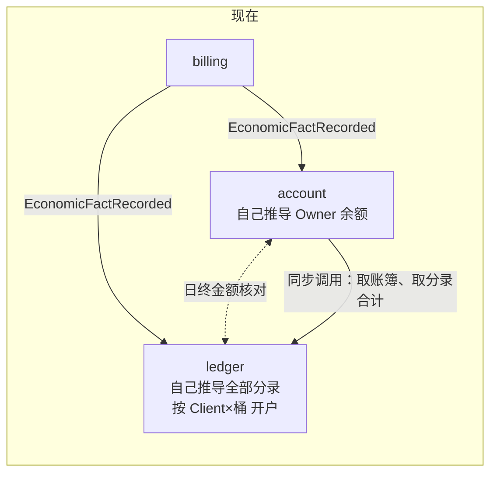
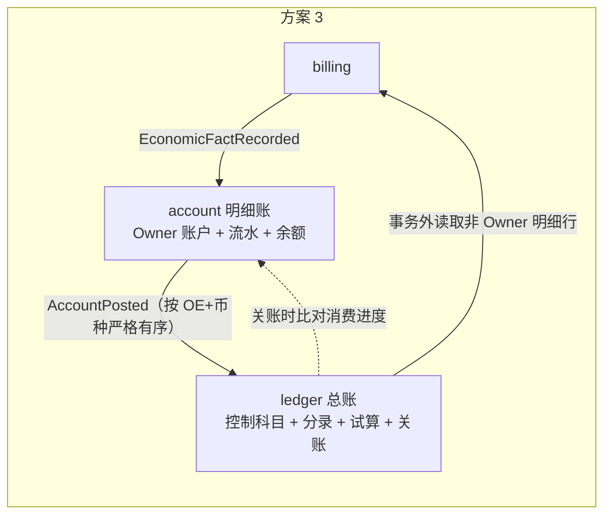
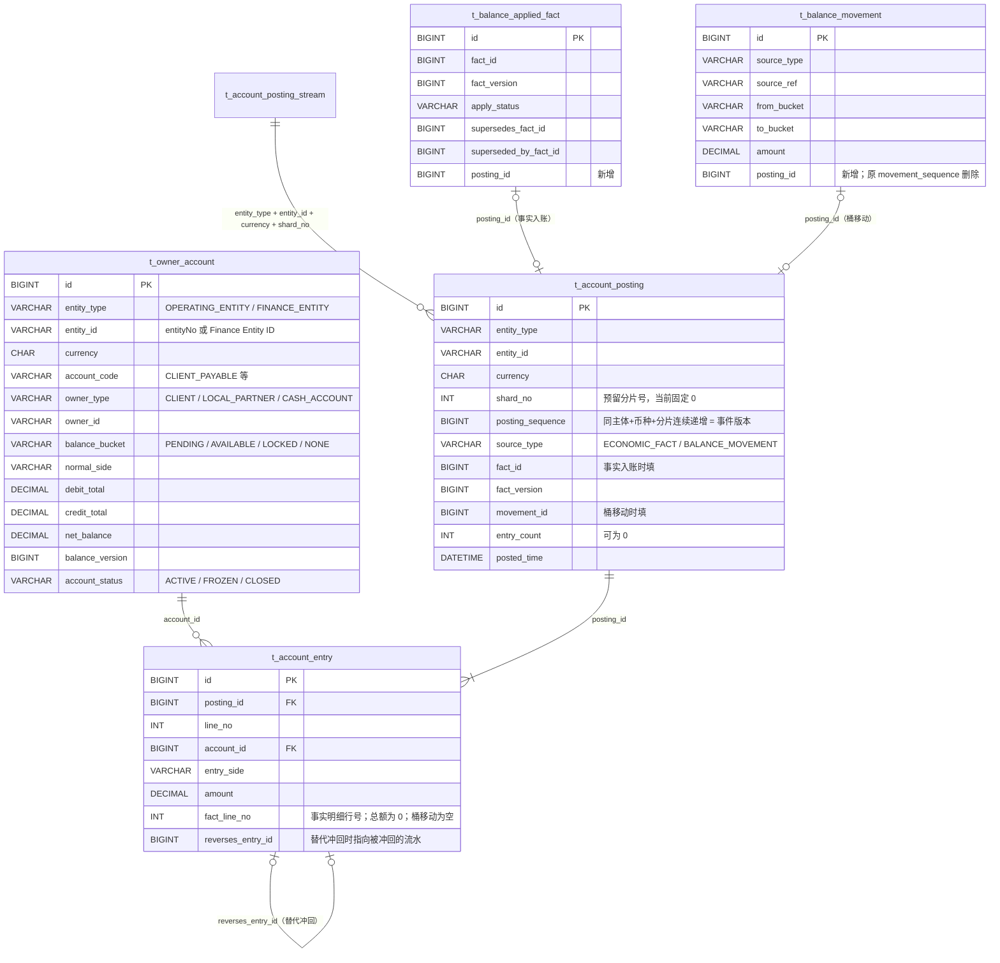
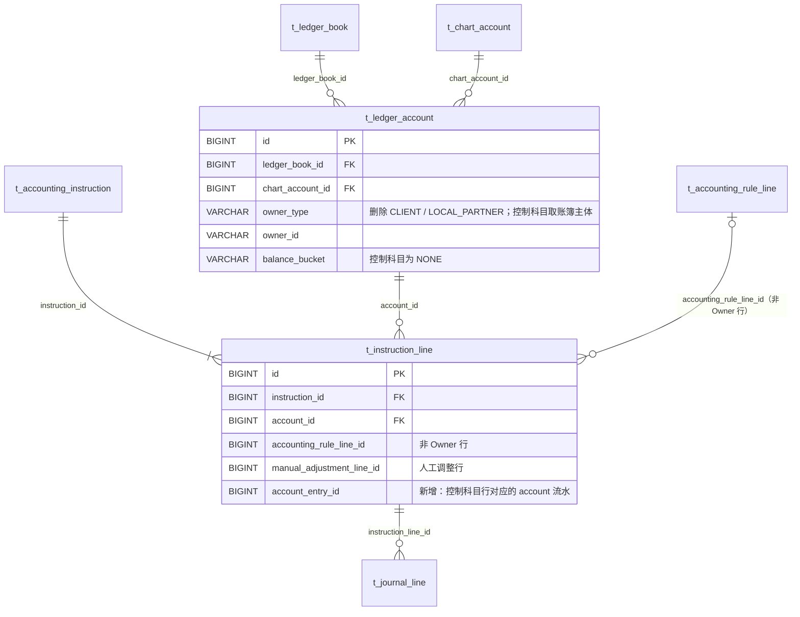

# account 与 ledger 模型划分（方案 3：明细账在上游，总账控制科目在下游）

状态：已确认设计（未实施）· 2026-10-18 · 决定记录：[2026-10-18 account 明细账与 ledger 总账控制科目决定](../agent-docs/decisions/2026-10-18-account-ledger-subledger-control-account.md)
范围：`paytech/account`（`mor_account`）与 `paytech/ledger`（`mor_ledger`）两个服务的表归属、数据流和表级变化。
现状依据：`account.pdma.json`（8 表）、`ledger.pdma.json`（31 表）、design/04、决定 D05 / D16。
配套图：同目录 `finance-account-ledger-v3.pen`。

---

## 1. 一句话说明

- **现在**：billing 发出经济事实，account 和 ledger **各自推导一遍**（两套映射规则），日终比对两边金额。ledger 还按每个 Client / Partner × 每个余额桶开户，和 account 重复维护一份明细。
- **方案 3**：
  - **account 是明细账**：按 Client / Partner、按余额桶记账户、流水和余额，三者同一事务。
  - **ledger 是总账**：只记控制科目，每个账簿每个科目一个汇总账户，不再有 Client / Partner 维度。分录行通过 `account_entry_id` 下钻回 account 明细。
  - 链路单向：billing → account → ledger。

---

## 2. 明细账与控制科目：例子

经营主体 A0001、USD，两个 Client（C1、C2）依次发生 5 件事：

| # | 业务 |
|---|---|
| 1 | C1 收到一笔支付，应付 C1 97（待结算） |
| 2 | C2 收到一笔支付，应付 C2 50（待结算） |
| 3 | C1 的 97 到期，待结算 → 可用 |
| 4 | C1 申请出款 60，锁定 |
| 5 | 银行确认 60 已付给 C1 |

**account（明细账）**：回答「C1 现在能出多少钱」

| 账户 | Owner | 科目 / 桶 | 流水 | 最终余额 |
|---|---|---|---|---|
| OA1 | C1 | CLIENT_PAYABLE / PENDING | ① 贷 97；③ 借 97 | 0 |
| OA2 | C1 | CLIENT_PAYABLE / AVAILABLE | ③ 贷 97；④ 借 60 | 37 |
| OA3 | C1 | CLIENT_PAYABLE / LOCKED | ④ 贷 60；⑤ 借 60 | 0 |
| OA4 | C2 | CLIENT_PAYABLE / PENDING | ② 贷 50 | 50 |

**ledger（总账）**：回答「A0001 一共欠客户多少钱」。「应付客户款」只有一个控制账户 L1。

| 事件 | 分录 | L1 余额 |
|---|---|---|
| ① | 借 渠道待清算应收 100 / 贷 **应付客户款 97** / 贷 平台收入 3 | 97 |
| ② | 借 渠道待清算应收 52 / 贷 **应付客户款 50** / 贷 平台收入 2 | 147 |
| ③ | **不记**：仍欠 C1，只是从待结算变为可用，会计上无变化 | 147 |
| ④ | **不记**：锁定只限制出款，欠款金额不变 | 147 |
| ⑤ | 借 **应付客户款 60** / 贷 银行存款 60 | 87 |

account 中 CLIENT_PAYABLE 各账户合计 0 + 37 + 0 + 50 = 87，等于 L1 余额 87。这由构造保证：L1 的分录行逐行照抄 account 流水，并以 `account_entry_id` 指回原流水，审计可以从 L1 下钻到具体客户。

---

## 3. 职责划分

| 职责 | 现在归属 | 方案 3 归属 | 说明 |
|---|---|---|---|
| Client / Partner 账户（开户、Owner、币种、科目代码、余额桶、状态） | ledger `t_ledger_account` 与 account 各一份 | **只在 account** `t_owner_account` | ledger 不再有 Client / Partner 维度的账户 |
| Owner 余额与余额桶 | account | account | 实时权威，不变 |
| 分户流水（入账、替代冲回、桶移动） | account 两张表 + ledger 也记桶移动 | **只在 account** `t_account_posting` + `t_account_entry` | 桶移动在会计上无变化，ledger 不记 |
| Owner 账户类型目录（科目代码、正常方向、允许的桶与 Owner 类型） | 散落在 account-api 常量、映射代码和 ledger 科目表 | **account**（account-api 代码目录） | ledger 只校验每个类型代码在科目表中存在且可过账 |
| 经济事实 → Owner 借贷的映射 | account 代码 **和** ledger 规则包 Owner 行 | **只在 account**（先用代码） | ledger 规则包删除 Owner 行 |
| 经济事实 → 非 Owner 科目（收入、渠道应收、费用预提、税）的映射 | ledger 规则包 | ledger 规则包 | 不变 |
| 银行现金可用额度（出款、缴税共用） | 锁 ledger 的 BANK_CASH 账户行，按其余额计算；11b 删除余额列后已无落脚点 | **account**（`owner_type = CASH_ACCOUNT`，每个银行账户一个账户） | 余额会实时卡住出款与缴税命令，按与 Client 相同的原则归 account |
| 渠道账户、税务机关、银行存款科目 | ledger | ledger | 数量少、由财务配置、不卡住命令，只用于报表与对账；ledger 每个渠道账户、税务机关、银行账户各一个科目账户 |
| 控制科目、科目表、账簿、日历、期间、分录、人工调整、试算、关账 | ledger | ledger | 不变 |
| 金额一致性 | 日终金额核对 + `t_balance_discrepancy` | **构造保证** + 关账前进度比对 | 删除金额核对链路 |

### 3.1 主体与主数据归属

账簿、账户都挂在「主体 + 币种」下。主体有两种：

| 主数据 | 是什么 | Owner | 说明 |
|---|---|---|---|
| 经营主体（Operating Entity，`entity_no`） | 与渠道签约、拥有 MID 的法律卖方 | CCT（client-master） | ledger、account、reconciliation 只引用 `entity_no` |
| 财务主体（Finance Entity） | 平台内部会计主体，如收取平台服务费的平台签约方；不一定拥有 MID | ledger `t_finance_entity` | Finance 手工维护，`legal_party_id` 指向 CCT 法律 Party |
| 账簿、科目表 | 每个主体 + 币种一个账簿 | ledger `t_ledger_book`、`t_chart_account` | `entity_type` 取 `OPERATING_ENTITY` 或 `FINANCE_ENTITY` |
| 银行账户及用途绑定 | 主体名下的平台银行账户；按「主体 + 币种 + 用途（渠道结算、出款、缴税）」绑定 | reconciliation `t_cash_account`、`t_cash_account_binding` | 银行账号存 Vault，表中只有 Token 与末四位 |
| Client / Partner 明细账户、银行现金额度 | 会卡住业务命令的余额 | account `t_owner_account` | 见第 3.2 节 |

同一个银行账户在三处出现：

| 位置 | 记录 | 主体 | Owner |
|---|---|---|---|
| reconciliation `t_cash_account` | 银行账户主数据 | 开户的 OE 或 FE | — |
| ledger `t_ledger_account` | 「银行存款」科目账户，用于报表与银行对账 | 该主体的账簿 | `CASH_ACCOUNT` / 银行账户 ID |
| account `t_owner_account` | 现金额度（AVAILABLE、LOCKED 两个桶） | 同一主体 | `CASH_ACCOUNT` / 银行账户 ID |

约束：出款使用的银行账户必须与被扣款的 Client / Partner 余额属于同一主体（例如 C1 的应付在 OE A0001 账簿，就只能用 A0001 绑定为出款用途的银行账户），否则会产生跨主体往来，而通用跨主体转账不被允许。现有「主体 + 币种 + 用途」绑定保证了这一点。account 与 ledger 只引用主体 ID 和银行账户 ID，运行时不调用 reconciliation。

### 3.2 余额归属

原则：**会实时卡住业务命令的余额在 account，其余所有余额都在 ledger，由分录推导。**

| 账户 | 主体 | 余额在哪 | 怎么得到 | 卡住哪个命令 |
|---|---|---|---|---|
| Client / Partner 应付各桶、保证金、追偿应收 | OE | **account** | 实时余额 + 余额版本 CAS | 出款、保证金使用、追偿冲抵 |
| 银行现金额度 | OE 或 FE（银行账户所属主体） | **account** | 实时余额 + 余额版本 CAS | 出款执行、缴税付款 |
| 应付客户款等控制科目 | OE | ledger | 按分录聚合；期末冻结到 `t_ledger_period_balance` | 无 |
| 财务主体的收入、应收（如平台服务费） | FE | ledger | 同上 | 无 |
| 经营主体的收入、渠道待清算应收、渠道费用预提、应交税费 | OE | ledger | 同上 | 无 |
| 银行存款科目 | OE 或 FE | ledger | 同上；与银行流水对账 | 无（额度看 account） |

ledger 不保存实时余额（11b 已删除账户余额列）：当前余额按需汇总分录，期末余额由试算冻结。若以后报表查询变慢，ledger 可在本库内为低频账户（如财务主体收入）加余额投影，与分录同事务更新；控制科目每笔交易都会更新，不适合做投影，否则会成为热点行。

---

## 4. account 库（`mor_account`）

### 4.1 表级变化总览

| 现在的表 | 方案 3 | 变化类型 | 要点 |
|---|---|---|---|
| `t_account_balance` 账户余额 | `t_owner_account` Owner 账户 | **改名 + 改字段** | 成为 Client / Partner 账户的唯一主数据：补状态生命周期，账簿主体改为法律主体 |
| `t_balance_applied_fact` 已处理经济事实 | 同名 | **小改** | 保留幂等与版本替代；增加 `posting_id`，去掉 `lines_hash` |
| `t_balance_applied_entry` 已应用余额变化 | `t_account_entry` 账户流水明细 | **替换** | 并入统一流水，挂在入账批次下 |
| `t_balance_movement` 余额桶移动 | 同名 | **小改** | 只保留命令记录；序号移到入账批次，借贷进流水 |
| — | `t_account_posting` 账户入账批次 | **新增** | 每次入账一条，带 OE+币种内连续序号；发给 ledger 的事件就是它 |
| — | `t_account_posting_stream` 入账流序号行 | **新增** | 每个主体 + 币种 + 分片一行，行锁内分配连续 `posting_sequence`；也是进度查询与 ledger 追平的起点（2026-10-19 阶段 3 细化） |
| `t_balance_discrepancy` 余额核对差异 | — | **删除** | 不再做金额核对 |
| `t_consumed_event` / `t_consumed_aggregate_version` | 同名 | 不变 | 消费 billing 事件去重 |
| `t_compensation_event` | 同名 | 不变（用途增加） | 新增用于可靠发布 `AccountPosted` |

表数：8 → 9（删 1 张，增 2 张）。Owner 账户类型目录是 account-api 中的代码目录，不建表。

### 4.2 方案 3 的 account 关系图

### 4.3 逐表字段变化

**`t_account_balance` → `t_owner_account`**

| 字段 | 变化 | 原因 |
|---|---|---|
| `book_entity_type` / `book_entity_id` | 改名为 `entity_type` / `entity_id` | account 不认识 ledger 账簿，只认法律主体 |
| `account_status` | 由 `status`（只有 ACTIVE）扩展为 `ACTIVE / FROZEN / CLOSED` | 账户主数据需要冻结、销户生命周期 |
| `last_fact_id` / `last_fact_version` | 删除 | 由流水追溯 |
| `owner_type` 允许值 | `CLIENT`、`LOCAL_PARTNER`、`CASH_ACCOUNT`；去掉 `CHANNEL_ACCOUNT` | 渠道是总账维度；银行现金额度归 account，见第 4.4 节 |
| 唯一键 `(entity_type, entity_id, currency, account_code, owner_type, owner_id, balance_bucket)` | 保留 | 每个余额桶仍是一个账户 |
| 其余余额字段 | 不变 | — |

**新增 `t_account_posting`（账户入账批次）**

- 一次入账一条：一条经济事实（含替代冲回），或一次桶移动。
- `posting_sequence` 在同一主体 + 币种 + 分片内连续递增，同时是 `AccountPosted` 的聚合版本和 ledger 的消费进度。
- `shard_no` 是预留分片号，当前固定为 0，即同一主体 + 币种内所有入账串行分配序号（见第 8.1 节）。它从第一天起就进入唯一键和事件合同，以后切换为多分片时不改合同。
- 唯一键：`(entity_type, entity_id, currency, shard_no, posting_sequence)`；`(source_type, fact_id, fact_version)`；`(source_type, movement_id)`。
- 不影响 Owner 的事实也生成 `entry_count = 0` 的批次，让 ledger 只有 account 一个上游（见第 9 节第 3 项）。

**`t_balance_applied_entry` → `t_account_entry`**

- 挂到 `posting_id` 下，不再直接挂 `applied_fact_id`；删除冗余的 `fact_id`。
- `balance_id` 改名为 `account_id`，`line_no` 改名为 `fact_line_no`。
- 新增 `reverses_entry_id`：版本 2 事实冲回版本 1 时，冲回行指向原流水。
- 桶移动的借贷也写这里（转出桶账户一行、转入桶账户一行）。

**`t_balance_movement`**

- 只保留命令语义：`source_type + source_ref` 唯一，记录从哪个桶转到哪个桶、金额多少。
- 删除 `movement_sequence`，新增 `posting_id`。

**`t_balance_applied_fact`**

- 保留按 `fact_id + fact_version` 的幂等和替代链（`apply_status`、`supersedes_fact_id`、`superseded_by_fact_id`）。
- 新增 `posting_id`；删除 `lines_hash`（批次和流水本身就是不可变证据）。

**Owner 账户类型目录（account-api 代码，不建表）**

每个类型一条：科目代码（如 `CLIENT_PAYABLE`、`BANK_CASH`）、正常余额方向、允许的余额桶、允许的 Owner 类型。account 开户和映射都按它校验；ledger 初始化时校验每个代码在科目表中存在且 `posting_allowed`。

### 4.4 银行现金可用额度

出款执行和缴税付款共用同一主体、同一币种下某个银行账户的现金，必须先确认额度：

`可用现金 = 银行现金余额 − 进行中的出款 − 进行中的缴税`

方案 3 中由 account 承担，复用余额桶和桶移动，不新增表：

| 账户 | 含义 |
|---|---|
| `CASH_ACCOUNT` × 银行账户 × `BANK_CASH` / `AVAILABLE` | 可承诺的银行现金 |
| `CASH_ACCOUNT` × 银行账户 × `BANK_CASH` / `LOCKED` | 已被进行中的出款、缴税占用 |

| 动作 | account 中的变化 | ledger |
|---|---|---|
| 创建出款执行 / 缴税付款 | 桶移动 AVAILABLE → LOCKED（余额不足即拒绝），`source_ref` 为执行 ID | 不记 |
| 执行失败或取消 | 桶移动 LOCKED → AVAILABLE | 不记 |
| 结果 UNKNOWN | 保持 LOCKED，不释放 | 不记 |
| 银行确认付款 | LOCKED 借记（随出款 / 缴税完成的经济事实入账） | 贷 银行存款（该银行账户的科目账户） |
| 渠道结算到账等收款 | AVAILABLE 贷记（随到账的经济事实入账） | 借 银行存款 |

ledger 仍按银行账户各保留一个「银行存款」科目账户，用于报表和与银行流水对账。

### 4.5 余额重建

方案 3 中桶移动来自 account 自己的命令（成熟释放、出款锁定、银行现金占用），billing 中没有这些记录，重放 billing 无法还原桶余额。因此：

- **`t_account_entry` 是余额的唯一来源。** 重建 = 按本库流水重算 `t_owner_account` 的 `debit_total`、`credit_total`、`net_balance`，再以旧 `balance_version` 做 CAS 并单调加一；不改账户身份和状态。
- **billing 重放只用于核对**：确认每条已批准事实都有对应的 `t_balance_applied_fact` 与入账批次，不再用来重算余额。
- 现有 `POST /balances/v1/books/{bookId}/rebuild`（从 billing 分页重放）改为按主体 + 币种从本库流水重算；account 不再需要 ledger 的账簿 ID。

---

## 5. ledger 库（`mor_ledger`）

ledger 31 张表中，**24 张不变**，7 张有变化。

### 5.1 表级变化总览

| 表 | 变化类型 | 要点 |
|---|---|---|
| `t_ledger_account` 会计科目账户 | **改允许值** | `owner_type` 删除 `CLIENT`、`LOCAL_PARTNER`；Owner 科目改为**控制科目账户**：每账簿每科目一行，Owner 取账簿主体本身（`OPERATING_ENTITY` / entityNo），`balance_bucket = NONE`。渠道、银行、税务机关维度保留 |
| `t_instruction_line` 记账指令明细 | **加字段** | 新增 `account_entry_id`：Owner 控制科目行逐行对应一条 account 流水，用于下钻；与 `accounting_rule_line_id`、`manual_adjustment_line_id` 三选一 |
| `t_accounting_instruction` 会计记账指令 | **只加枚举值** | `origin_type` 增加 `ACCOUNT_POSTING`；`source_system = account`，`source_event_key` 为入账批次 ID，`source_version` 为 `posting_sequence` |
| `t_accounting_rule_line` 自动记账规则行 | **表结构不变，规则数据变** | 规则包删除 Owner 角色（CLIENT、LOCAL_PARTNER）规则行，只保留非 Owner 科目 |
| `t_consumed_aggregate_version` | **用途变化** | 记录对 `AccountPosted` 的消费进度（聚合 = 主体:币种），关账用它比对 |
| `t_close_step` 关账执行步骤 | **改允许值** | `step_type` 的 `RECONCILE_ACCOUNT_BALANCES` 改为 `CHECK_ACCOUNT_POSTING_PROGRESS`，一个步骤内做两段完整性检查：billing → account（已批准事实全部入账）、account → ledger（各分片 `posting_sequence` 已追平） |
| `t_trial_balance_exception` 试算平衡异常 | **改允许值** | `resolution_type` 删除 `PROJECTION_REBUILD`：ledger 已没有余额投影可重建 |
| 其余 24 张（科目表、账簿、日历、期间、序号、分录、人工调整、试算运行与明细、期间余额、关账流程与审批、关账科目映射、补偿事件、消费事件等） | 不变 | — |

### 5.2 ledger 中受影响部分的关系

`account_entry_id` 是跨库引用，只存 ID，不建外键，也不画进 ledger 的库内关系图。

### 5.3 ledger 的处理变化

| 环节 | 现在 | 方案 3 |
|---|---|---|
| 消费的事件 | `EconomicFactRecorded`（billing），`strictOrder = false` | `AccountPosted`（account），按主体 + 币种 `strictOrder = true` |
| Owner 科目行 | 规则包按 `owner_role` 推导，为每个 Client / Partner × 桶自动开户 | 每条 account 流水生成一行，记到该科目的控制账户，`account_entry_id` 指回流水 |
| 非 Owner 科目行 | 规则包推导 | 不变；事务外经 billing-api 读事实明细 |
| 版本替代 | ledger 自行处理 | account 流水带 `reverses_entry_id`，ledger 生成对应冲回分录 |
| 桶移动 | 计划由 `BalanceMoved` 回传并补记分录 | **不记分录**：收到 `source_type = BALANCE_MOVEMENT` 的批次只推进消费进度 |
| 人工调整 | 拒绝涉及 Owner 账户 | 拒绝涉及 Owner 控制科目；影响 Owner 的调整走 billing `MANUAL_ADJUSTMENT` → account → ledger |
| 关账一致性 | 调 account `consistency` 比对金额（`RECONCILE_ACCOUNT_BALANCES`） | `CHECK_ACCOUNT_POSTING_PROGRESS` 两段检查，任一段未追平即失败关闭：① billing → account：经 billing-api `economic-facts/pending` 与 account 进度接口确认该账簿主体的已批准事实全部入账（被 account 拒绝或卡在死信的事实会在这里暴露）；② account → ledger：各分片已消费的 `posting_sequence` 等于 account 当前最大序号 |
| 客户维度报表 | 两边都能出 | 由 account 出，总额等于 ledger 控制科目 |
| 对外接口 | `GET /ledger/v1/books/{bookId}/account-totals` 供 account 核对 | 删除 |

---

## 6. 一笔支付的完整链路：billing → account → ledger

设定：经营主体 A0001，USD，Client C1，Partner P1，渠道清算账户 CH1。交易 100，Client 收 90，Partner 分 8，平台留 2，渠道成本 0.5。

按现行 PAYMENT 规则，交易全额 = Client 本金 + Client 手续费，Partner 分润记为平台的费用支出，所以拆成：

- 交易全额 100 = Client 本金 90 + Client 手续费 10
- Partner 分润 8（平台支出），平台实得 10 − 8 = 2
- 渠道成本 0.5（平台支出），平台净利 2 − 0.5 = **1.5**

### 6.1 第 0 步：billing 登记经济事实（billing 本地事务）

`t_economic_fact`：`F1 · PAYMENT · fact_version = 1 · entity_no = A0001 · client_id = C1 · local_partner_id = P1 · channel_account_id = CH1 · USD · gross_amount = 100.00`

| `t_economic_fact_line` 行 | component_type | posted_amount |
|---|---|---|
| 1 | CLIENT_PRINCIPAL | 90.00 |
| 2 | CLIENT_FEE | 10.00 |
| 3 | PARTNER_SHARE | 8.00 |
| 4 | CHANNEL_COST | 0.50 |

同一事务登记 `t_compensation_event`，提交后发布 `EconomicFactRecorded(F1, v1)`。

### 6.2 第 1 步：account 入账（account 本地事务）

account 只挑出影响 Owner 余额的行：

| 事实行 | 是否影响 Owner | 结果 |
|---|---|---|
| 交易全额 100 | 否（渠道应收归 ledger） | — |
| 1 · CLIENT_PRINCIPAL 90 | 是 | C1 应付 / PENDING 贷 90 |
| 2 · CLIENT_FEE 10 | 否（平台收入） | — |
| 3 · PARTNER_SHARE 8 | 是 | P1 应付 / PENDING 贷 8 |
| 4 · CHANNEL_COST 0.5 | 否（渠道费用归 ledger） | — |

| 表 | 写入 |
|---|---|
| `t_consumed_event` / `t_consumed_aggregate_version` | 记下已消费 F1 v1 |
| `t_balance_applied_fact` | F1 v1 · APPLIED · posting_id = P1 |
| `t_owner_account` | OA1：C1 · CLIENT_PAYABLE · PENDING；OA2：P1 · PARTNER_PAYABLE · PENDING（不存在就开户） |
| `t_account_posting` | P1 · A0001 / USD / 分片 0 · posting_sequence = 42 · ECONOMIC_FACT · F1 v1 · entry_count = 2 |
| `t_account_entry` | E1：OA1 · 贷 90.00 · fact_line_no = 1；E2：OA2 · 贷 8.00 · fact_line_no = 3 |
| `t_owner_account`（更新） | OA1 net_balance = 90.00；OA2 net_balance = 8.00；各自 balance_version + 1 |
| `t_compensation_event` | 登记发布 `AccountPosted(P1)` |

提交后发布 `AccountPosted`：聚合 `A0001:USD:0`，版本 42，携带 E1、E2。

### 6.3 第 2 步：ledger 过账

事务外：确认 `A0001:USD:0` 已处理到 41，经 billing-api 读取 F1 明细。

本地事务（A0001 USD 账簿）：

| 表 | 写入 |
|---|---|
| `t_accounting_instruction` | origin_type = ACCOUNT_POSTING · instruction_type = PAYMENT_SUCCEEDED · source = account / P1 / 42 · economic_fact_id = F1 · 规则版本 5101 |
| `t_instruction_line` | 7 行，见下表 |
| `t_book_sequence` | 分配 journal_sequence |
| `t_journal_entry` / `t_journal_line` | 1 条分录、7 行 |
| `t_consumed_event` / `t_consumed_aggregate_version` | `A0001:USD:0` → 42 |

| 借 / 贷 | 账户（`t_ledger_account`） | 金额 | 指令行来源 |
|---|---|---|---|
| 借 | 渠道待清算应收 · CH1 | 100.00 | 规则行 5201 |
| 贷 | **应付客户款（控制科目）** | 90.00 | `account_entry_id` = E1 |
| 贷 | Client 手续费收入 | 10.00 | 规则行 5203 |
| 借 | Partner 分润费用 | 8.00 | 规则行 5207 |
| 贷 | **应付 Partner 款（控制科目）** | 8.00 | `account_entry_id` = E2 |
| 借 | 渠道成本费用 | 0.50 | 规则行 5205 |
| 贷 | 渠道费用预提 · CH1 | 0.50 | 规则行 5206 |

借方 100 + 8 + 0.5 = 108.50，贷方 90 + 10 + 8 + 0.5 = 108.50，平衡。规则行编号取自 `ledger-initial-data.sql` 的 STANDARD_TRANSACTION 版本 5101；方案 3 中 5202（Client 应付）、5208（Partner 应付）两条 Owner 规则行删除，由 account 流水替代。

### 6.4 结果：两边各看到什么

| account（运营视角） | 余额 |
|---|---|
| C1 应付 / PENDING | 90.00 |
| P1 应付 / PENDING | 8.00 |

| ledger（A0001 账簿，报表视角） | 余额 |
|---|---|
| 渠道待清算应收 | 借 100.00 |
| 应付客户款 | 贷 90.00（= account 中 C1 合计） |
| 应付 Partner 款 | 贷 8.00（= account 中 P1 合计） |
| 渠道费用预提 | 贷 0.50 |
| 收入：Client 手续费收入 | 贷 10.00 |
| 费用：Partner 分润费用 + 渠道成本费用 | 借 8.50 |

### 6.5 平台利润在哪里

利润不单独记一笔，分两层体现：

- **平时**：利润 = 收入科目 − 费用科目 = 10 − 8 − 0.5 = **1.50**。交易时的分录已经记下全部要素，再记一笔「贷 利润」会重复，借贷也会不平。
- **期末**：关账的损益结转（`t_close_step` 的 `POST_PROFIT_CLOSE`，按 `t_close_account_rule`）把收入、费用结转到「本期损益」，再转入「留存收益」。仅看这一笔：

| 借 / 贷 | 科目 | 金额 |
|---|---|---|
| 借 | Client 手续费收入 | 10.00 |
| 贷 | 本期损益 | 10.00 |
| 借 | 本期损益 | 8.50 |
| 贷 | Partner 分润费用 | 8.00 |
| 贷 | 渠道成本费用 | 0.50 |

结转后收入、费用科目归零，「本期损益」留下贷方 1.50。利润属于卖方经营主体 A0001 的账簿；Partner 来源的经营主体另有平台服务费，会在平台财务主体账簿形成财务主体自己的收入。利润不卡住任何命令，因此 account 中没有平台利润账户。

### 6.6 之后发生的事

- C1 的 90 到期、待结算转可用：只在 account 生成桶移动批次，ledger 收到后只推进进度，不记分录。
- 渠道清算到账、Client 与 Partner 出款完成：由 reconciliation、payout 调用 billing 登记经济事实，再走一遍同样的链路；出款执行创建时的额度占用是 account 的桶移动（第 8.3 节）。

---

## 7. 事件合同变化

| 事件 | 现在 | 方案 3 |
|---|---|---|
| `EconomicFactRecorded`（billing） | 消费者：account、ledger | 消费者：**只有 account** |
| `BalanceMoved`（account，只有 Schema） | 计划由 account 发给 ledger 补记分录 | **删除**：桶移动不产生总账分录 |
| `AccountPosted`（account，新增） | — | 聚合类型 `ACCOUNT_POSTING`，聚合 ID `{OE|FE}.{entity_id}.{currency}.{shard_no}`（如 `OE.AE001.USD.0`、`FE.8001.USD.0`；当前分片固定 0。分隔符用 `.`：Foundation `AggregateKey` 只允许 `[A-Za-z0-9._-]`，`:` 是事件键分段符，见需求 `requirements/20261019/finance-account明细账与ledger控制科目重构/technique.md` 2.1），版本 `posting_sequence`，严格有序。Payload：批次头（主体、币种、序号、来源类型、`fact_id/fact_version` 或 `movement_id`）+ 流水（`entry_id`、`account_code`、借贷、金额、`fact_line_no`、`reverses_entry_id`）。ledger 记控制科目只需 `account_code`，不需要 Owner 明细 |

桶移动批次仍会发出（保持序号连续），ledger 只推进进度、不记分录。

---

## 8. 运行约束（2026-10-18 已定）

### 8.1 入账序号串行

同一主体 + 币种（当前只有分片 0）内所有入账共用一个连续序号，分配时锁同一行，所以单个主体内的入账串行执行。先接受这一点；若单个大主体的吞吐不够，再把 `shard_no` 扩展为多个分片：

- 账户按固定规则（如 `owner_account_id` 取模）落到分片，同一账户始终在同一分片，保证单账户内有序；
- 每个分片独立编号、独立有序发布；
- ledger 关账逐个分片比对进度。

`shard_no` 已在唯一键和事件合同中，扩展时只改分片规则，不改合同。

### 8.2 ledger 处理卡住的流程

ledger 只有 account 一个上游，事件按分片严格有序：一个批次处理失败（例如规则包缺少某种事实类型的非 Owner 规则），该分片后续批次全部停住。

- 自动重试，按补偿事件的退避策略；达到上限后告警，并在关账检查中显示为阻断项。
- 修复规则或数据后，从原批次继续处理。
- ledger 自校验首条序号：某流尚无已消费进度而到达批次序号不为 1 时等待重投，不从中间开始。修复后经 ledger `POST /posting-streams/v1/catch-up` 命令按 HTTP 从 account 读取批次追平；之后重放的死信消息按已消费跳过。
- **不允许跳过批次**：跳过会造成序号缺口，关账永远无法通过，也会漏记分录。
- account 不可用或积压时，ledger 整体延后（包括纯平台收入）。ledger 不在实时链路上，可以接受；关账会因进度未追平而失败关闭。

### 8.3 payout、tax 占用银行现金额度的两步操作

出款执行（缴税付款同理）分两步：先在事务外调用 account 桶移动 AVAILABLE → LOCKED，再在 payout 本地事务里创建执行。

- account 的桶移动按 `source_type + source_ref`（= 执行 ID）幂等，重复调用不会重复锁定。
- payout 先在本地登记补偿事件，再调用 account：若已锁定但执行没建成，补偿事件负责释放（LOCKED → AVAILABLE）；若执行已建成，补偿事件完成即删除。
- account 对长时间处于 LOCKED、却没有对应完成或释放的额度告警，供人工核查。
- 这些步骤写入 payout 与 tax 的设计，不由 account 单方面保证。

### 8.4 ledger 现有数据

`mor_ledger` 中按 Client / Partner × 余额桶开的 `t_ledger_account` 行及引用它们的分录，目前只有本机与测试数据。**不做历史迁移**：实施时清空 Finance 相关测试数据后，按新模型重建。共享环境执行前仍按数据库规范单独审阅 SQL。

### 8.5 到期转可用由 account 定时任务触发

支付事实带有 `balance_available_time`。account 入账时记下每笔 PENDING 的到期时间，到期后由 account 自己的定时任务做桶移动 PENDING → AVAILABLE（`source_type` 为成熟释放，`source_ref` 为原入账流水）。它不是新的金额，不经 billing 登记；ledger 收到该批次只推进进度。

### 8.6 扣款类事实的分桶规则

退款、争议败诉等扣减 Owner 余额的事实，在 account 中扣哪个桶取决于当时的余额，由 account 映射规则按以下顺序确定，结果写入流水，ledger 照抄：

| 事实 | 扣减顺序 | 不足部分 |
|---|---|---|
| 退款成功 | AVAILABLE → PENDING；不动 LOCKED（出款中），不动保证金 | 记 `CLIENT_RECOVERY_RECEIVABLE / NONE`（Partner 为 `PARTNER_RECOVERY_RECEIVABLE / NONE`） |
| 争议败诉（`DisputeLost` / `DisputeOutcomeCorrected`） | 仅当 `outcome=LOST`、`principal_bearer=CLIENT`、`security_deposit_use_allowed=1` 时先用 `CLIENT_SECURITY_DEPOSIT / NONE`，其余同退款 | 同上 |

扣减顺序只在 account 推导一次；余额重建以已记录的流水为准，不重新按当时规则推导。

### 8.7 账户状态只约束命令，不拒绝事实

`FROZEN`、`CLOSED` 只拒绝出款锁定、额度占用等主动命令；经济事实（如冻结期间到来的退款）照常入账。`CLOSED` 账户再收到事实时照常入账并告警。account 拒绝事实只因映射非法（如未知费用类型），不因账户状态。

### 8.8 关账检查覆盖该期间涉及的全部入账流

财务主体账簿中的平台服务费分录来自各 Partner 来源经营主体的入账流。因此关账检查的两段都按期间整体执行：第一段覆盖该期间全部相关已批准事实；第二段覆盖该期间所有账簿涉及的全部「主体:币种:分片」流，不只看账簿自身主体。

### 8.9 会计期间按事实业务日期确定

分录日期取事实的业务时间（如支付成功时间），不取 ledger 处理时间。关账前两段进度都必须追平，正常情况下不会有迟到分录；若所属期间已关账（例如事实在关账后才登记），记入其后最早的开放期间，过账日期取该期间开始日并记告警，原业务日期经 `economic_fact_id` 与 billing 事实追溯（2026-10-19 阶段 4 修订：试算与损益结转按过账日期区间取数，若保留原日期，迟到分录会落入下一期期初且永不结转）。

### 8.10 前置条件

- 经营主体开始交易前，ledger 必须已为其建好账簿（主体 + 币种）。否则该主体第一个入账批次在 ledger 处理失败，整条流卡住。此项写入经营主体上线检查。
- 银行现金的期初余额，以及银行手续费、利息等非业务资金变动，经 billing `MANUAL_ADJUSTMENT` 事实登记，使 account 现金额度与真实银行余额一致。

---

## 9. 已定事项（2026-10-18）

用户已全部确认，登记为 [account 明细账与 ledger 总账控制科目决定](../agent-docs/decisions/2026-10-18-account-ledger-subledger-control-account.md)。

1. **account 管哪些 Owner 类型。** Client / Partner 应付各桶、保证金、追偿应收，以及银行现金可用额度（`CASH_ACCOUNT`，见第 4.4 节）；`CHANNEL_ACCOUNT` 只留 ledger。
2. **银行现金与出款的入账来源。** 渠道结算到账、出款完成、缴税完成都由 billing 统一登记经济事实：reconciliation、payout、tax 分别调用 billing 登记，再走 billing → account → ledger。具体合同在各自切片设计。
3. **不影响 Owner 的事实也经过 account。** 生成 0 条流水的入账批次，ledger 只有 account 一个上游。
4. **控制科目账户的 Owner 表示。** 沿用 `t_ledger_account` 现有字段：Owner 取账簿主体本身（`OPERATING_ENTITY` / entityNo），`balance_bucket = NONE`，不新增列。
5. **ledger 模型脱离生成器。** 与 account 相同，直接维护 `ledger.pdma.json`；billing、reconciliation、tax、payout 留在 Finance 生成器中，改到时再摘出。
6. **权威文档修订。** 新增上述决定记录；修订目标架构 V2 决定 D05、D16、D37；在 design/04 与 `FINANCE_DATABASE.md` 开头写明取代范围（不改写正文）；AGENTS.md 增加路由，Finance 相关正文仍成立不改。

## 10. 实施影响（供排期）

| 位置 | 影响 |
|---|---|
| account | 模型与 SQL 按第 4 节调整；接入事件发布；映射规则与 Owner 账户类型目录在 account；删除对 ledger 的同步调用（`LedgerBookClient`）、日终核对任务和差异表；重建改为按本库流水重算（第 4.5 节）；新增入账进度查询接口（含已处理事实范围），供 ledger 关账两段检查使用；对外合同为 `AccountPostingApi` / `OwnerAccountQueryApi` / `BalanceMovementApi` |
| ledger | 模型与 SQL 按第 5 节调整；消费源从 billing 改为 account；控制科目账户替代 Client / Partner 账户；规则包删除 Owner 行（初始化 DML 修改）；删除 `account-totals` 接口；关账步骤改为两段进度检查；处理卡住按第 8.2 节；现有测试数据清空重建（第 8.4 节） |
| billing | 不变（仍发布 `EconomicFactRecorded`，消费者减少一个） |
| payout | `t_payout.available_account_id`、`locked_account_id` 改为引用 account 的 `t_owner_account`；创建、失败、取消出款执行时，在事务外调用 account 的桶移动命令占用或释放银行现金额度，不再锁 ledger 的 BANK_CASH 账户行；两步操作按第 8.3 节用补偿事件保护 |
| tax | 缴税付款占用银行现金额度同 payout；`t_tax_payment.tax_payable_account_id`（税务应付科目）仍引用 ledger |
| 测试 | 重写 billing → account → ledger 链路：乱序到达、重复投递、版本替代冲回、桶移动不产生分录、控制科目总额等于明细合计、ledger 落后时关账失败、account 拒绝事实时关账失败、ledger 卡住后修复继续、流水重算余额、出款锁定后执行创建失败的额度释放 |
